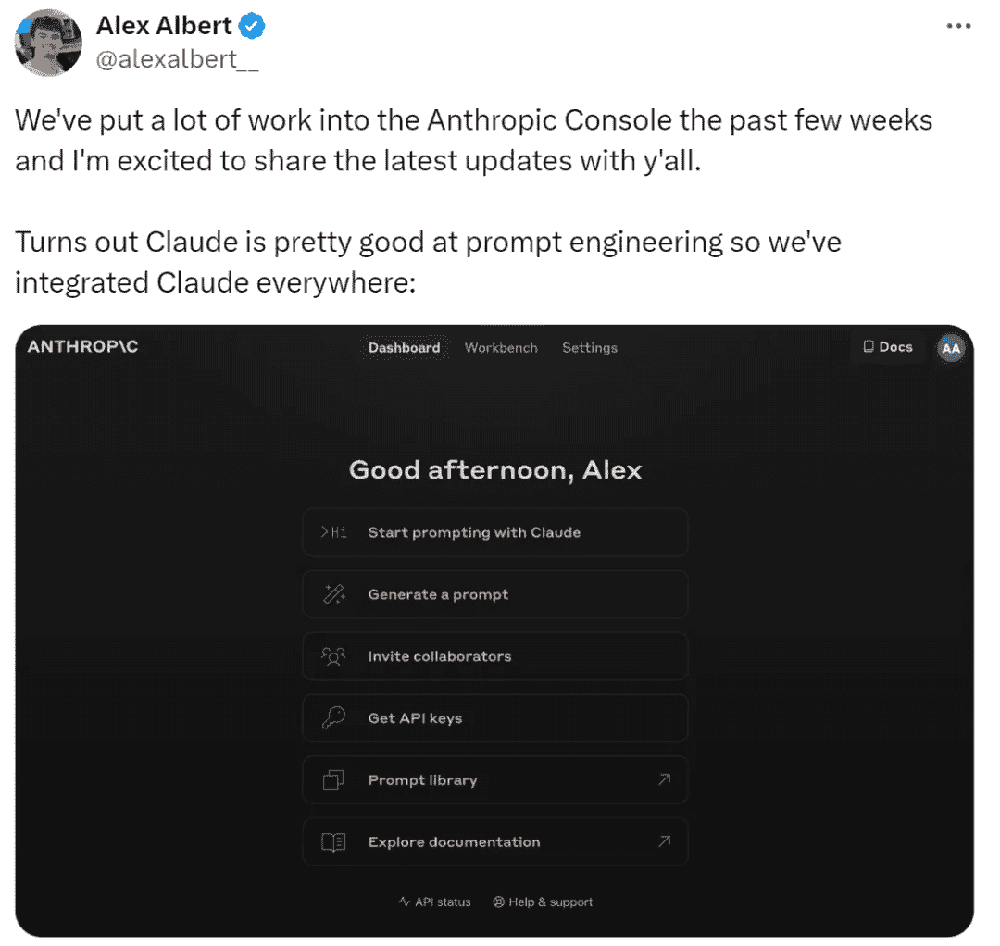
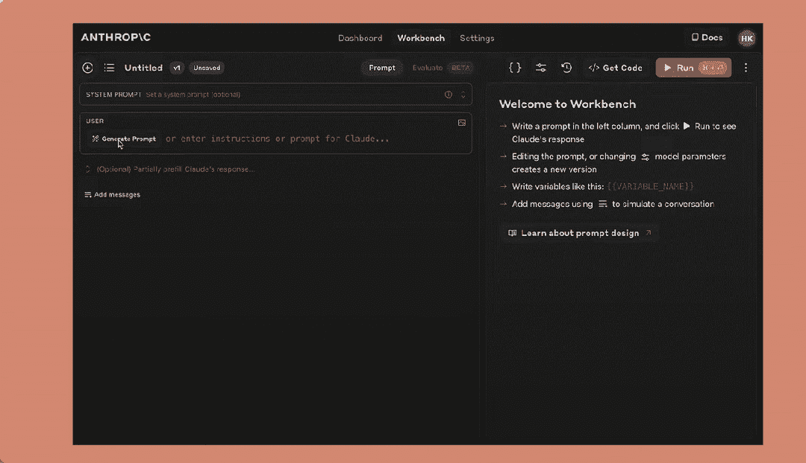
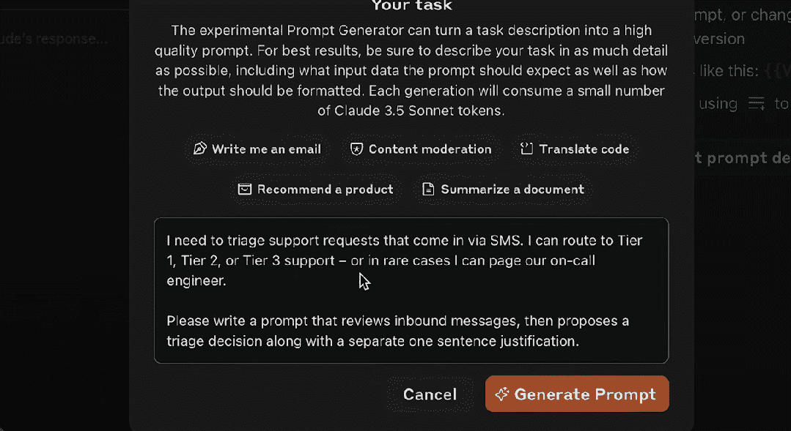
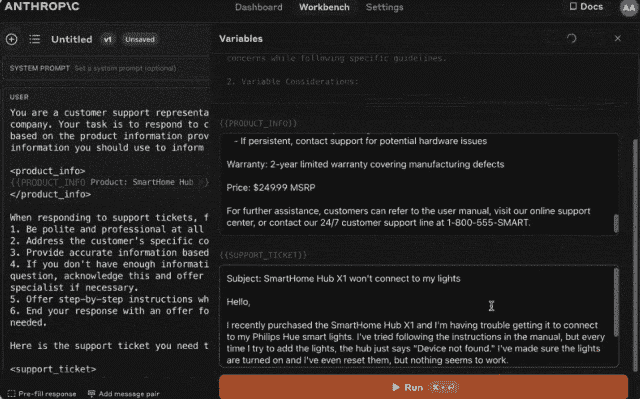
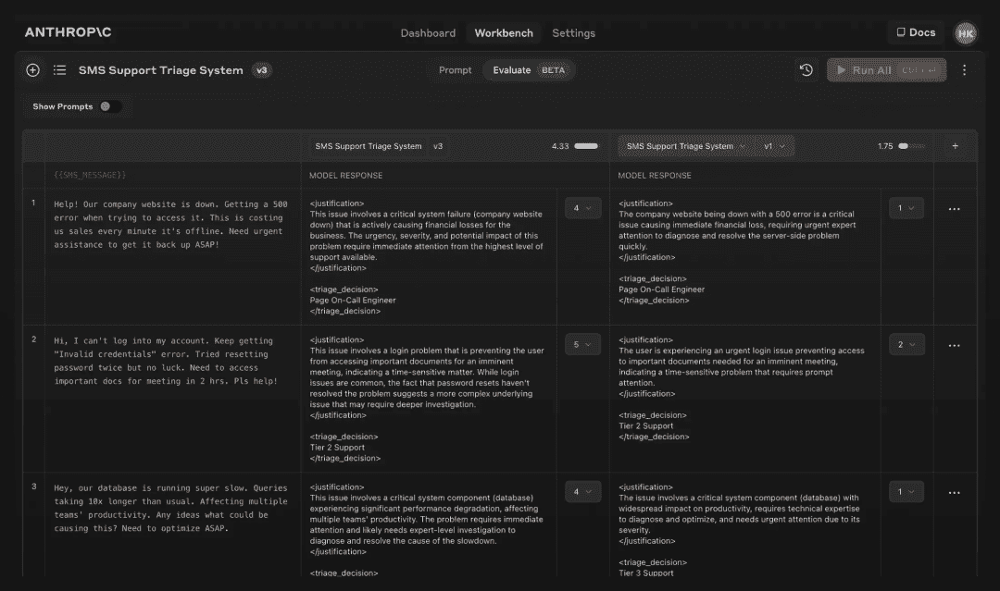
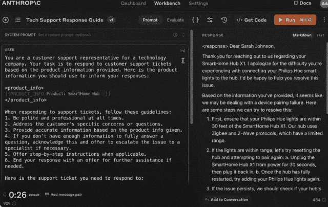
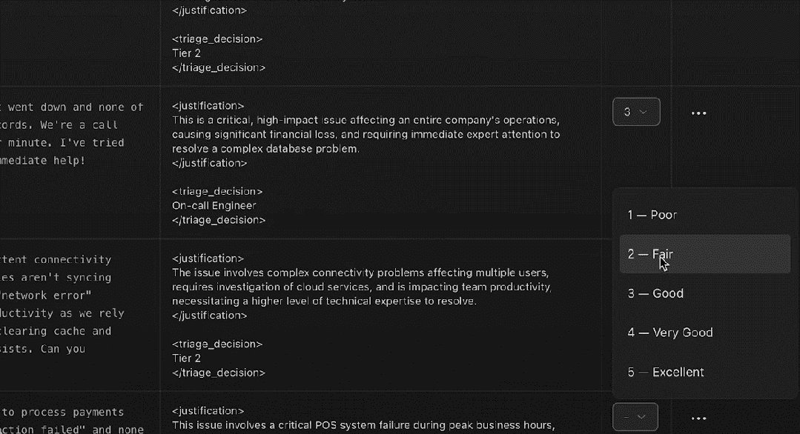
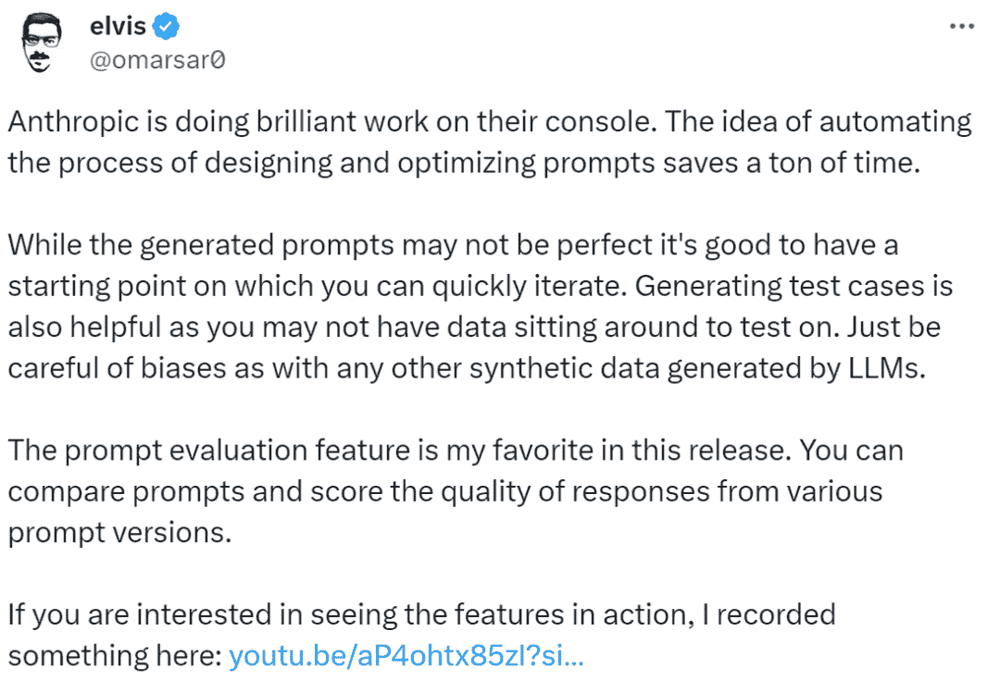

# 人人可做提示工程师！Claude上新：一键生成、测试和评估prompt

> 来源：[https://agijuejin.feishu.cn/docx/OHHNdLPC1owrwyxo9oAc6BURnye](https://agijuejin.feishu.cn/docx/OHHNdLPC1owrwyxo9oAc6BURnye)

> 作者：机器之心

> 原文：https://mp.weixin.qq.com/s/KL40M1bR3EPlAGWYYEghCg

> 不会写 prompt 的看过来。

在构建 AI 应用时，prompt 质量对结果有着重大影响。但制作高质量的 prompt 具有挑战性，需要研究者深入了解应用需求，并具备大型语言模型方面的专业知识。为了加快开发速度并改善结果，AI 初创公司 Anthropic 简化了此流程，可以让用户更轻松地制作高质量的 prompt。

具体来说，研究者为 Anthropic Console 添加了新功能，可以生成、测试和评估 prompt。

Anthropic 提示工程师 Alex Albert 表示：这是他们过去几周投入了大量工作才得到的成果，现在 Claude 在提示工程（Prompt Engineering）方面表现得非常好。

难写的 prompt，交给 Claude

在 Claude 中，写一个好的 prompt 就像描述任务一样简单。控制台提供了一个内置的 prompt 生成器，由 Claude 3.5 Sonnet 提供支持，允许用户描述任务并让 Claude 生成高质量的 prompt。

**生成 prompt。 **首先点击 Generate Prompt，进入 prompt 生成界面：

然后输入任务描述，Claude 3.5 Sonnet 将把任务描述转换为高质量的 prompt。例如「 撰写一个用于审查入站消息的 prompt…… 」，点击生成 prompt 就可以了。

**生成测试数据。 **如果用户有了 prompt，可能需要一些测试用例来运行它。Claude 可以生成那些测试用例。

用户可以根据需要修改测试用例，并一键运行所有测试用例，还可以查看并调整 Claude 对每个变量生成要求的理解，以实现对 Claude 生成测试用例更细粒度的控制。

这些功能让优化 prompt 变得容易，因为用户可以创建 prompt 的新版本并重新运行测试套件以快速迭代和改进结果。

此外，Anthropic 还按照 5 分制为 Claude 响应质量设置了评分。

**评估模型。 **如果用户对 prompt 感到满意，之后可以在「评估」选项卡中一次针对各种测试用例运行它。用户可以从 CSV 导入测试数据，也可以直接使用 Claude 为用户生成合成测试数据。

比较。用户还可以在测试用例中相互测试多个 prompt，并对更好的响应进行评分，以跟踪哪个 prompt 表现最佳。

AI 博主 @elvis 表示：Anthropic Console 是一项出色的研究，其自动化设计和优化 prompt 的过程可以节省大量时间。虽然生成的提示可能并不完美，但给了用户一个快速迭代的起点。此外，生成测试用例功能也很有帮助，因为开发者可能没有可供测试的数据。

看来，以后写 prompt 这个活，可以交给 Anthropic 了。

了解更多内容，请查看文档：https://docs.anthropic.com/en/docs/build-with-claude/prompt-engineering/overview