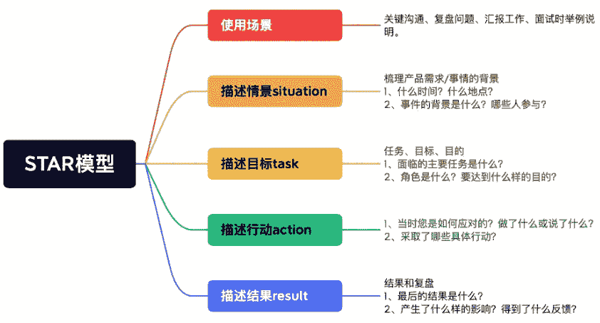
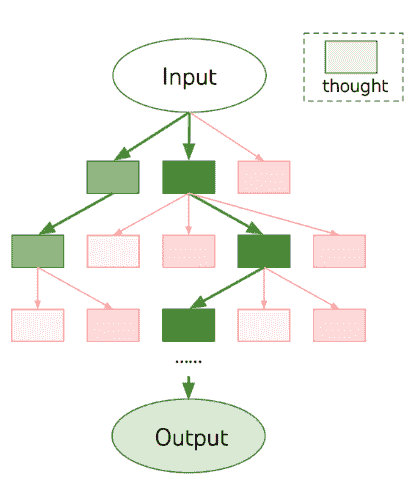
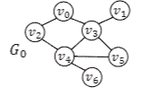

# 复杂提示词（prompt）为什么需要Prompt Chain、Prompt Tree、Prompt Graph技术

> 来源：[https://agijuejin.feishu.cn/docx/Rlx5dJs8Eo5OafxJa6zc6Pzkn9d](https://agijuejin.feishu.cn/docx/Rlx5dJs8Eo5OafxJa6zc6Pzkn9d)

> 作者：木木说AI

> 原文：https://mp.weixin.qq.com/s/cIy8WTM6KKbrcPfIriOBTg

如果你想完成一件复杂的事情，你最好分步骤进行

如果你想写一个复杂的提示词，你最好进行任务分解

复杂提示词是需要任务分解，因为这样可以帮助人工智能系统更好地理解和处理信息，提高生成响应的准确性和相关性。

提示词的任务分解有三种方式，Prompt Chain、Prompt Tree、Prompt Graph

## Prompt Chain（提示链）

定义 ：Prompt Chain 是一系列顺序排列的提示，其中每一个提示都是基于前一个提示的回答构建的。这种方式常用于逐步深入或扩展讨论的场景。

优点 ：可以逐步引导模型深入到更具体的话题或问题解析。

缺点 ：依赖于链条中前一个提示的质量和相关性，如果中途出现误解，后续的所有提示都可能受到影响。

场景 ：在线教育平台的问答系统

应用 ：在学生向在线教育平台提出问题时，系统首先提出一个基础的解答。然后，系统根据学生的反馈逐步提出更细化的问题或进一步的解释，以帮助学生更好地理解概念。例如，学生问：“为什么苹果会掉落？”系统回答后，根据学生的理解深度，可以继续询问“你对引力定律有了解吗？”或“你想知道更多关于物理力的平衡吗？”，从而逐步深入，直至学生满意。

## Prompt Tree（提示树）

定义 ：Prompt Tree 是一种树形结构的提示组织方式，从一个根提示分叉出多个子提示，每个子提示可以根据不同方向或条件继续分叉。

优点 ：能够覆盖更多的可能性和方向，适用于探索多种解决方案或观点。

缺点 ：更复杂，需要更多的管理和设计以确保各个分支的一致性和完整性。

场景 ：客户支持聊天机器人

应用 ：在处理客户咨询时，聊天机器人会从一个基本问题开始，例如“您需要帮助什么？”基于客户的回答（如“我的订单有问题”），机器人会展开更多相关的子问题（如“是关于支付还是配送？”）。每个子问题再分叉出更具体的问题（如“支付时遇到技术问题还是要更改支付方式？”），从而构建一个决策树，帮助精确地导向客户的具体问题并提供解决方案。

## Prompt Graph（提示图）

定义 ：Prompt Graph 是一种更为复杂的结构，其中的节点（提示）可以有多个连接点，不仅限于单一的后续节点。这种结构允许提示之间存在多种关系，而不仅仅是线性或树状的。

优点 ：极大的灵活性和复杂性，可以模拟复杂的决策过程和关联。

缺点 ：管理和设计难度较高，可能需要复杂的逻辑和算法来有效运用。

场景 ：复杂项目管理软件中的决策支持系统

应用 ：在项目管理中，决策者需要考虑多个因素，如成本、时间、资源和风险。Prompt Graph 可以用来展示和分析这些因素之间的相互影响。例如，如果成本增加，这可能会影响项目的时间线和资源分配。通过提示图，系统可以提供多个路径和选项，展示如果选择不同的资源配置，将如何影响项目的总体风险和预期结果。这种结构允许决策者从多个角度分析问题，选择最佳方案。