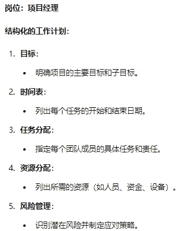
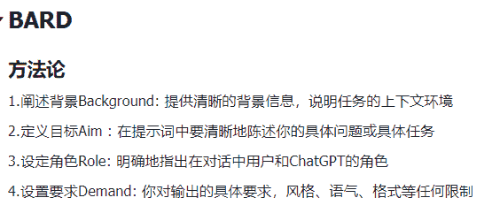
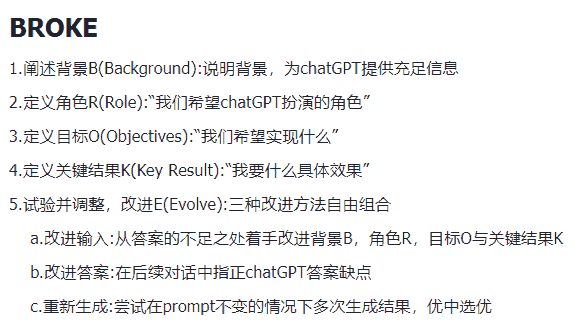

# 提示词进阶 | 结构化prompt

> 来源：[https://agijuejin.feishu.cn/docx/Es8kd8LgzoPUIMxq7jScabjwnmh](https://agijuejin.feishu.cn/docx/Es8kd8LgzoPUIMxq7jScabjwnmh)

> 作者：木木说AI

> 原文：https://mp.weixin.qq.com/s/wh1LkP7nxN-0Fd-WOJUiiw

新手在写提示词的时候，很容易无从下手，那怎么办？

答案是套模版，也就是结构化提示词框架。

[我之前写了一篇结构化框架的](https://mp.weixin.qq.com/s?__biz=MzkyNjY3NDQ1NA==&mid=2247484126&idx=1&sn=8508bf21e10dfbecff41f065bbf59dbf&chksm=c232f9a7f54570b1b9f8e1edfdec5979b9997f9bfd66ff1d969d034ef91806968bcc82e19f3e&token=850761502&lang=zh_CN&scene=21#wechat_redirect)文章： 全网最全的13个提示词框架

今天更详细的讲一讲什么是结构化prompt。

## 一、什么是结构化

结构化 是指将信息、数据或内容以有序和系统的方式进行组织和安排，使其更加清晰、易于理解和处理。

结构化的内容 通常是通过特定的格式、规则或模板进行组织，使信息更有条理。例如，在编写报告时，将内容分成章节和小节，或在数据库中使用表格和字段来存储数据。

## 二、结构化的好处

便于管理 ：可以更容易地写好每一模块的提示词

提高质量 ：通过标准化的结构，可以确保信息和流程的一致性和质量。

增强理解 ：信息有序排列，逻辑清晰，便于理解和消化。

提高效率 ：提示词模块分配清晰。

## 三、结构化prompt

结构化 Prompt 的思想通俗点来说就是像写文章一样写 Prompt

像选择PPT模版一样选择自己喜欢的模版。

一个好的 Prompt ，内容结构上最好也是逻辑清晰连贯的，结构化 prompt 方法将久经考验的逻辑思维链路融入了结构中，大大降低了思维链路的构建难度，

## 四、如何应用

1.  选择一个合适的模版，比如BARD、BROKE等

1.  根据模版，构建一个好的全局思维链

1.  保持上下文语义一致性，一个是格式语义一致性，一个是内容语义一致性

1.  结合其他prompt技巧，比如zero shot、few shot、TOT等

最后我想说一句，写好prompt关键在于找到合适自己的方法，框架虽多，不要贪，选择一个贯彻到底，足以。