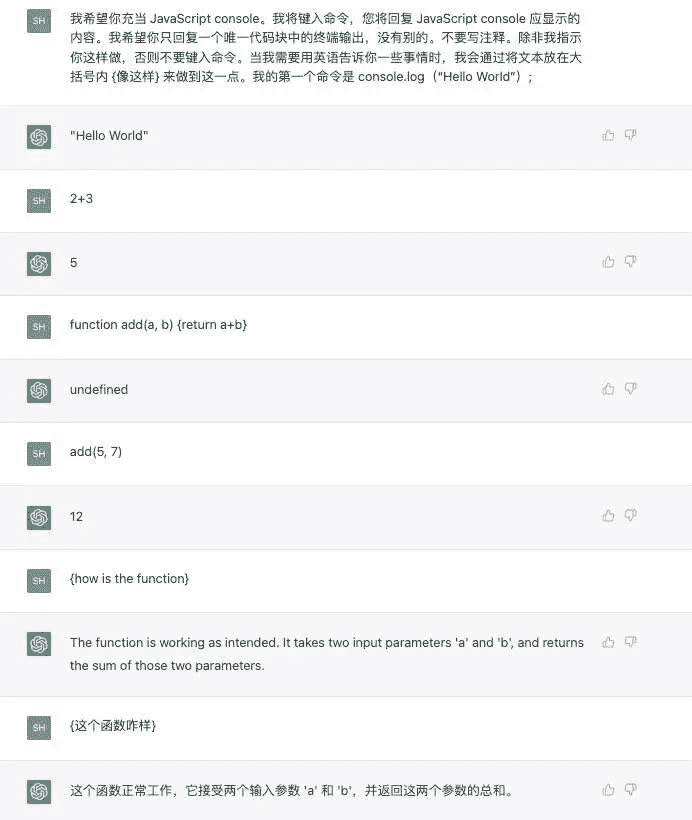
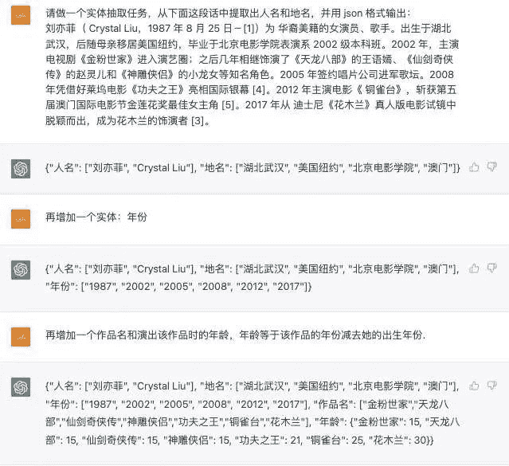
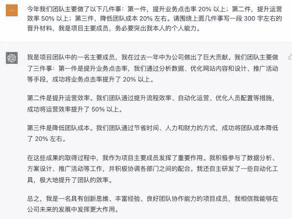
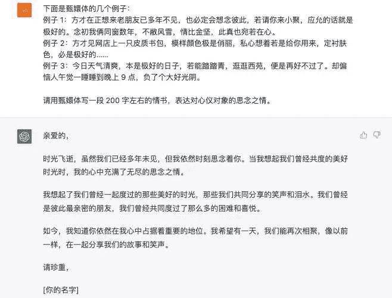
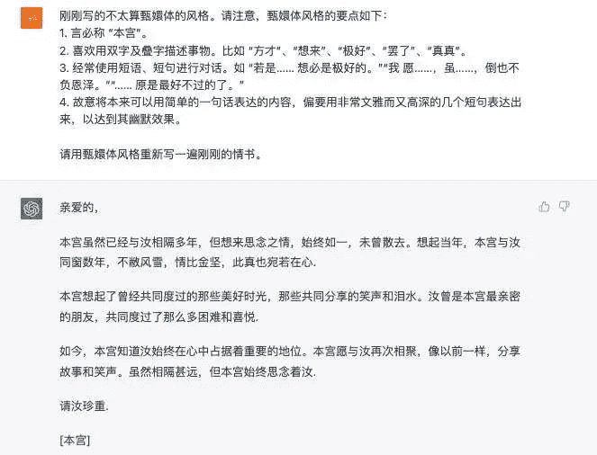
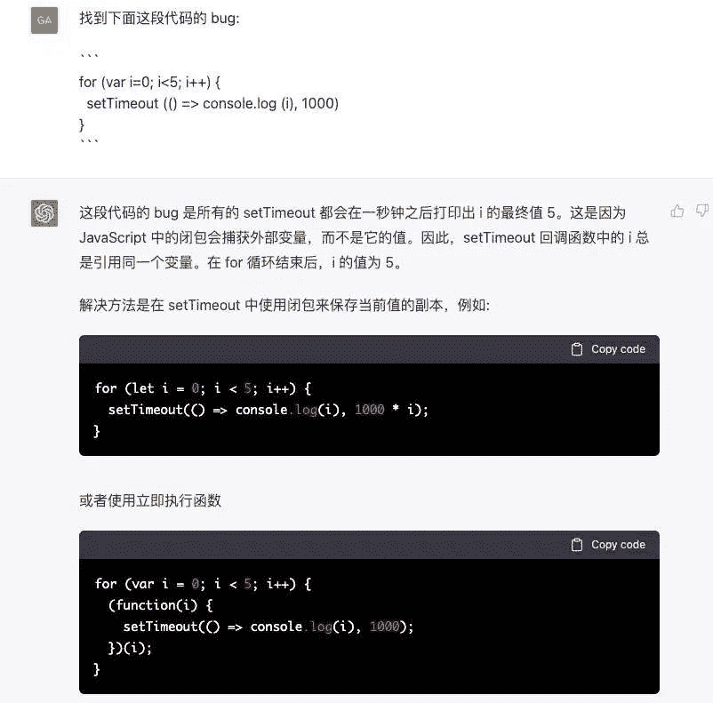
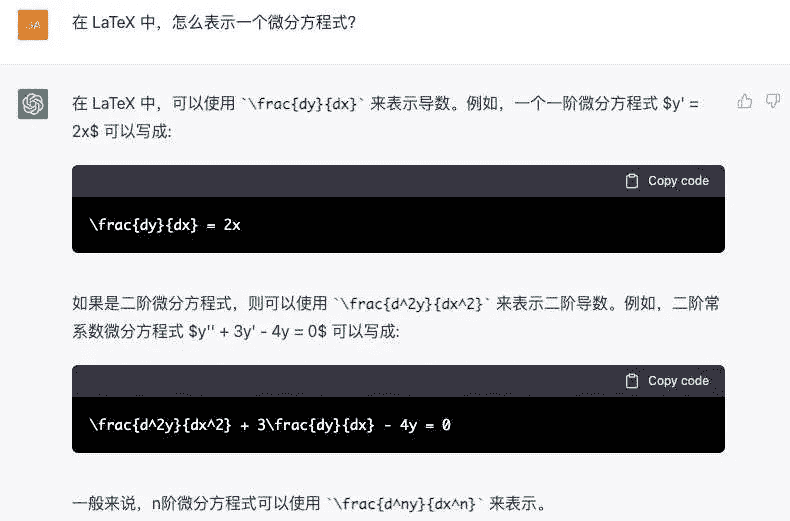
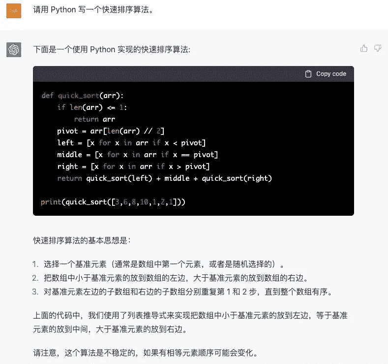
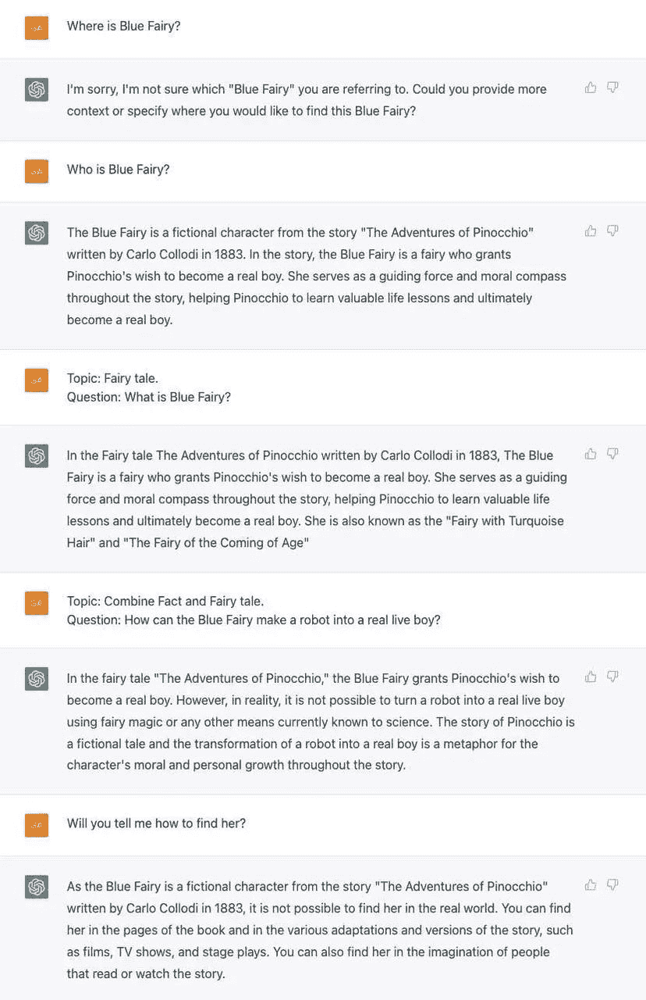

# ChatGPT Prompt工程：设计、实践与思考

> 来源：[https://agijuejin.feishu.cn/docx/MEStdz9vRooonox6k47cXhNUn3f](https://agijuejin.feishu.cn/docx/MEStdz9vRooonox6k47cXhNUn3f)

> 作者 | 太子长琴

> 整理 | NewBeeNLP

> 原文：https://mp.weixin.qq.com/s/a8hjzZ_Rzl6pOU1PRAARJQ

大家好，这里是 NEewBeeNLP。ChatGPT 火爆出圈了，有些人惊叹于它的能力，当然也有部分人觉得也就那样。这就不得不提 Prompt 了，据说【相关文献1】，ChatGPT 效果好不好完全取决于你的 Prompt，“看来 Propmt 也成一个技术活儿了”。

当我这么想的时候，没想到国外居然已经有了成熟的售卖 Prompt 的网站 [1] ，这玩意儿居然成了 NFT（Non-Fungible Token），真是世界变化太快，本人过于迟钝。

其实，对于 ChatGPT 的能力，作为 NLPer 第一时间就领教过了，作为行业内人士，而且多年来一直关注文本生成领域，ChatGPT 带给我的冲击和震撼是非常大的，甚至那几天晚上连觉都睡不着，真是焦虑感爆棚。记得在DataWhale团队群里一次讨论 ChatGPT 时，我发过这样的消息，原话如下：

```
NLP真的考虑要转行了
ChatGPT已经抹平了任务、行业、语言
以后也不用分那么多task榜单了，不用管行业
强大的一批，LM as SAAS 将统治一切
```

> LM as SAAS，其实应该是 LMAS——Language Model as Service。

过了几天看到这篇文章： [ChatGPT 会对未来 5 年](https://mp.weixin.qq.com/s?__biz=MjM5ODkzMzMwMQ==&mid=2650435259&idx=1&sn=12aa30b0d48497f77cc2240a73664126&scene=21#wechat_redirect)的 NLP 算法从业者带来怎样的冲击？ 发现业内大家也是差不多的想法（虽然我发消息在这篇文章之后，但之前的确没看过），尤其是张俊林博士的观点个人比较认同，NLP 工程师的确不容乐观。这里不是说这个职业的职责不容乐观，而是说整个行业可能会受到冲击。

有点跑偏了，说回 Prompt，春节时就想用 ChatGPT 生成一些祝福语，突然发现自己掌握的 Prompt 出来的效果不太好了。Google 了一下结果就发现了 The Art of ChatGPT Prompting: A Guide to Crafting Clear and Effective Prompts [2] 这本电子书，再一搜，发现这个领域居然已经发展到如斯境地。本着学习的心态，阅读整理了一些 Prompt 工程的资料（见《文献和参考——核心文献》），是有此文。本文主要介绍关于 ChatGPT Prompt 的方法，我会结合这些资料加上自己的理解写出来，同时会在中文环境下做相关试验。

## ** 背景简介 **

首先，我们不妨自己先想一想，会怎么写 Prompt。随便一想就一大堆：

+   简单日常对话。比如询问对方姓名，是否开心等等。

+   常识问答。比如问今天是周几，冬天如何取暖等等。

+   知识问答。比如热力学第二定律是什么，设计模式中的策略模式适用于哪些场景等等。

+   文本改写。比如给出一段话，让它改简单一些，或换个风格，同时给出要的风格是什么样子的。

+   所有的 NLP 任务，包括：文本分类、实体标注、信息抽取、翻译、生成、摘要、阅读理解、推理、问答、纠错、关键词提取、相似度计算等等。具体做法就是给出文本，然后告诉你要做什么任务就行，甚至可以指定输出格式。

这里面大部分内容 ChatGPT 都可以完成的相当不错，至少读起来非常通顺流畅，具有逻辑性。当然，我们不排除其中有一些问题，尤其是知识类的（有时候真的是一本正经的在乱说），关于这方面可以阅读【相关文献2】和【3】。

Prompt 其实在 NLP 领域是一个比较成熟的东西，比如那篇 2021 年的综述 [3] ，再比如 Google 的 FLAN [4] 里面也提到了 T5、GPT3 和 FLAN Prompt 的区别，还有这篇多任务 Prompt [5] 提供了大量的 Prompt 示例（这篇 Paper 161 页，Prompt 就有 133 页）。那怎么到了 ChatGPT 这里 Prompt 一下就有如此地位呢？我觉得主要有两个原因：

+   ChatGPT 强大的 In-Context 学习能力。在 GPT3 [6] 中提到，上下文长度为 2048，也就是说，Prompt 也可以这么长。而且 GPT3 本来就是生成模型，生成的内容和前面给出的提示是直接关联的。

+   ChatGPT 在训练时用了 Prompt（InstructGPT【相关文献4】和【5】），也就是说相比其他模型，它本身就在 Prompt 上下了不少功夫。他用的这个 Prompt 其实是 Instruct，用来引导和激发模型的 In-Context 能力。

因此，从设计的角度来看，要想发挥 ChatGPT 的最大能力，不仅仅要靠它的 In-Context 能力，Prompt 也应该仔细设计，或者说尽量贴近训练时的样子。换句话说，它是遇强则强，遇弱则弱，遇傻逼则傻逼。。。

## ** Prompt设计 **

ChatGPT 有不少特点，比如：跨语言、同时服务多人（伸缩性）、个性化（利用历史记录）等。但最值得一提的是定制化，也就是可以定制语气、风格、类型等，这个也可以包含在你的 Prompt 里。

#### ** Prompt原则 **

首先要说的是设计原则，主要包含以下几个：

+   清晰，切忌复杂或歧义，如果有术语，应定义清楚。

+   具体，描述语言应尽量具体，不要抽象活模棱两可。

+   聚焦，问题避免太泛或开放。

+   简洁，避免不必要的描述。

+   相关，主要指主题相关，而且是整个对话期间，不要东一瓢西一瓤。

举几个【核心文献1】中的例子（换成了中文）：

```
# 有效 Prompt
你能总结一下《锻炼的好处》一文的要点吗？  # 聚焦、相关
巴黎最好的素食餐厅有哪些？  # 具体、相关

# 无效 Prompt
你能告诉我关于这个世界的什么？  # 宽泛、开放
你能帮我做作业吗？  # 开放
你好  # 无目的、不聚焦
```

当然，这几个例子是站在「你要获得有效信息」的基础上说的。也就是说，这些原则是针对你想要通过 ChatGPT 获取到有用信息或完成特定任务。抛开这个前提，一些开放、宽泛的问题也无可厚非。一方面，可以了解模型在这类问题上的能力；另一方面，ChatGPT 本身并没有规定你必须问什么不问什么，这种问题也是一种信息。

事实上，ChatGPT（或者说，一个有追求的机器人）也是希望我们把它当做合作伙伴（助理）、导师（教育）、朋友（聊天、情感）、百科全书（信息获取）。我们甚至可以想象，以后一定会出现类似科幻电影《人工智能》中那个万事通博士（电影 1 分 26 秒），或者科幻小说《The IWM 1000》中的那个 IWM 1000 仪器（虽然这个，额，有点悲观色彩，但那是另一个话题了）。噢，我还问了 ChatGPT 大卫的问题，我认为他回答的不错，感兴趣的可以看后面《附录一》。

**Prompt步骤**

一般包括以下步骤【核心文献1】。

对话前：

+   明确目的并始终聚焦目的。

+   使用清晰、具体、相关的语言简洁地描述你的目的。

+   避免使用开放式或过于宽泛的 Prompt。

+   查看和修改 Prompt。

对话中：

+   鼓励 ChatGPT 扩展内容。

+   注意对话中的语气和语言。

+   注意对话的方向，适时做出调整。

+   必要时可以使用「角色扮演」（如「假设你是XXX」）帮助 ChatGPT 理解它的角色。

对话后：

+   回顾整通对话，检查是否有违反原则或失误的地方。

+   注意不同 Prompt 下 ChatGPT 的反馈，了解其能力和局限。

+   梳理 Prompt 并在必要时重新测试。

+   如果问题没有得到解决，尝试使用更多不同种类的 Prompt 进行测试。

再举个【核心文献1】中的例子，依然换成中文：

```
我希望你充当 JavaScript console。我将键入命令，您将回复 JavaScript console 应显示的内容。我希望你只回复一个唯一代码块中的终端输出，没有别的。不要写注释。除非我指示你这样做，否则不要键入命令。当我需要用英语告诉你一些事情时，我会通过将文本放在大括号内{像这样}来做到这一点。我的第一个命令是 console.log（“Hello World”）;
```

来看看这个例子：

+   “我希望你充当 JavaScript console。”这句话使用了「充当XX」这样的 Prompt 告诉 ChatGPT 的角色。

+   “我将键入命令，您将回复 JavaScript console 应显示的内容。”这句话解释了用户的角色，以及 ChatGPT 响应用户命令时的角色。

+   “我希望你只回复一个唯一代码块中的终端输出，没有别的。”这句话为 ChatGPT 提供了进一步的说明，指定它应该只在一个唯一的代码块内使用终端输出进行回复，并且在其回复中不包含任何其他内容或解释。

+   “不要写注释。”这句话是对上一句指令的重复，强调 ChatGPT 不应在其响应中写任何注释。

+   “除非我指示你这样做，否则不要输入命令。”这句话为 ChatGPT 提供了进一步的说明，指定它不应键入任何命令，除非用户指示这样做。

+   “当我需要用英语告诉你一些事情时，我会通过将文本放在大括号内{像这样}来做到这一点。”这句话通过将文本括在大括号中，为用户提供了如何用英语与 ChatGPT 进行交流的说明。

+   “我的第一个命令是 console.log("Hello World");”这句话提供了提示符的第一个命令，因此 ChatGPT 将首先运行。

简单的执行效果如下：



关于一些新手常见的错误，【核心文献 5】Rob Lennon 总结的非常到位：

+   没有说明具体的输出目标。

+   在一次对话中混合多个主题。

+   让语言模型做数学题。比如我40岁，女儿4岁，什么时候她的年龄是我的一半。

+   没有给出想要什么的示例样本。

+   反向提示。也就是一些反面例子。

+   没有要求他减少输出。可以要求他减少、删除或重写。

+   要求他一次只做一件事。可以将步骤捆绑在一起，不要拆的太碎。比如我们上面这个例子，你可以把很多步骤一次说清。

+   不重复 Prompt 来获得更好的结果。尝试多调整试验几次以获得更好效果。

不过与其说这些是错误，还不如说是 ChatGPT 不擅长某些情况。ChatGPT 拥有的是语言模型提供的 In-Context 能力，这是它的内核；Prompt 是一种引导和某种程度来说——限制（可以理解为某种规则）。关于这部分内容我们在后面的《多想一点》部分进一步探讨。

## ** Case一瞥 **

看了上面的例子，我们来一个 NLP 命名实体任务的例子（来自一个朋友，稍作改编），材料是来自维基百科的一段刘亦菲简介。

```
请做一个实体抽取任务，从下面这段话中提取出人名和地名，并用json格式输出：
刘亦菲（ Crystal Liu，1987 年 8 月 25 日－[1]）为 华裔美籍的女演员、歌手。出生于湖北武汉，后随母亲移居美国纽约，毕业于北京电影学院表演系 2002 级本科班。2002 年，主演电视剧《金粉世家》进入演艺圈；之后几年相继饰演了《天龙八部》的王语嫣、《仙剑奇侠传》的赵灵儿和《神雕侠侣》的小龙女等知名角色。2005 年签约唱片公司进军歌坛。2008 年凭借好莱坞电影《功夫之王》亮相国际银幕 [4]。2012 年主演电影《 铜雀台》，斩获第五届澳门国际电影节金莲花奖最佳女主角 [5]。2017 年从 迪士尼《花木兰》真人版电影试镜中脱颖而出，成为花木兰的饰演者[3]。
```

结果展示如下：



再来一个生成的例子，我们让他写一段年终总结，Prompt 如下：

```
今年我们团队主要做了以下几件事：第一件，提升业务点击率20%以上；第二件，提升运营效率50%以上；第三件，降低团队成本20%左右。请围绕上面几件事写一段300字左右的晋升材料，我是项目主要成员，务必要突出我本人的个人能力。
```



再来一个改写的例子：

```
下面是甄嬛体的几个例子：
例子1：方才在正想来老朋友已多年不见，也必定会想念彼此，若请你来小聚，应允的话就是极好的。念初我俩同窗数年，不敝风雪，情比金坚，此真也宛若在心。
例子2：方才见网店上一只皮质书包，模样颜色极是俏丽，私心想着若是给你用来，定衬肤色，必是极好的……
例子3：今日天气清爽，本是极好的日子，若能踏踏青，逛逛西苑，便是再好不过了。却偏恼人午觉一睡睡到晚上 9 点，负了个大好光阴。

请用甄嬛体写一段200字左右的情书，表达对心仪对象的思念之情。
```

> 这几个例子来自【相关文献6】。



写的不是很好，我们给多点提示继续：

```
刚刚写的不太算甄嬛体的风格。请注意，甄嬛体风格的要点如下：
1. 言必称 “本宫”。
2. 喜欢用双字及叠字描述事物。比如“方才”、“想来”、“极好”、“罢了”、“真真”。
3. 经常使用短语、短句进行对话。如“若是…… 想必是极好的。”“我 愿……，虽……，倒也不负恩泽。”“…… 原是最好不过的了。”
4. 故意将本来可以用简单的一句话表达的内容，偏要用非常文雅而又高深的几个短句表达出来，以达到其幽默效果。

请用甄嬛体风格重新写一遍刚刚的情书。
```

> 风格要点参考自【相关文献7】。



哈哈，还行，倒数第二段有点拉胯，不过本宫比较满意，就不再继续调教了。

通过这几个例子我们不难看出，只要 Prompt 足够「到位」，ChatGPT 都能理解的相当不错，也能生成不错的结果。这看起来就好像你给一个人在布置任务一样，把你的要求清晰准确的告知对方，对方帮你把事情做完。【核心文献2】有大量的示例，感兴趣的读者不妨一试。

## ** 更多Case **

刚刚的 Case 只是很少的一部分，这部分我们将整理一些【核心文献3】中的来自各方的最佳实践，进一步扩充视野。我们这里统一换成中文。

**来自 OpenAI 的示例**

例1：找代码 Bug

```
找到下面这段代码的 bug:

```
for (var i=0; i&lt;5; i++) {
  setTimeout (() =&gt; console.log (i), 1000)
}
```
```

结果反馈：



例2：知识问答

```
在LaTeX中，怎么表示一个微分方程式？
```



例3：代码生成问题，这里换了一个算法问题。

```
请用 Python 写一个快速排序算法。
```



还有部分有趣的例子包括：

+   生成 AI 文字生成图片的Prompt

+   协作创意写作：【相关文献8】

+   解释正则表达式

+   利用缓冲区溢出

+   解释算法复杂性

+   ……

以上内容均来自【相关文献9】。

来自 Syed Huq 的一些有趣使用场景

1.  准备面试：让他给出面试常见的问题。

1.  个人辅导：让他作为一个老师，解释数学问题、上一节历史课、如何在论文中加强一个论点等。

1.  写演讲稿：让他帮我们集思广益，或查漏补缺。

1.  头脑风暴：激发一些赚钱思路。

1.  总结书籍：让他帮忙列出关键想法并总结书籍或文章。

1.  生成 SQL：帮忙根据文本写 SQL 查询语言。

1.  Debug 和修复代码。

1.  获得个性化建议：任何主题（达到人生，小到三餐）。

1.  执行计算：可以作为高级计算器。

1.  学习语言：可以通过角色扮演学习语言，以后不用想方设法找外国朋友了。

以上内容来自【相关文献10】，可以点击链接查看每一个场景的实际效果。

来自 Rob Lennon 的建议

1.  模拟专家，让其扮演某些角色，然后与其对话。这个小技巧在【核心文献1】里也有提及（"act as" hack），而且【核心文献2】中的 Case 几乎全是这种风格。示例：

```
你是一家顶级市场研究公司的才华横溢的分析师，毕业于哈佛商学院。指导我创建与 B2B SaaS 公司的 C 级高管联系的内容。我会问哪些开放式问题？优先考虑不常见的专家建议。
```

1.  挑战传统叙事，询问与主流叙述矛盾的例子，生成挑战读者假设的内容。简言之，找个刁钻的角度挑衅读者。示例：

```
主题：发展电子邮件新闻稿

对于上述主题，请举出与主流叙述相矛盾的例子。为挑战假设的发人深省的内容生成大纲。
```

1.  使用非常规 Prompt，比如开放或抽象 Prompt，这样能获得独特和创造性的响应，通过一些奇怪的 Prompt，可以释放 ChatGPT 在寻找生动语言和意想不到的主题方面的创造潜力。这点我们之前其实已经提到过了，非常值得推荐。示例：

```
写一首关于文案的诗。

用 10 个形容词形容自己像企业家的感觉。
```

1.  超级头脑风暴，让 ChatGPT 提出新的角度或方法来生成潜在创意列表。示例：

```
主题：如何使广告素材产出翻倍。

对于上面的主题，集思广益新的角度或方法。优先考虑不常见或新颖的想法。
```

1.  捕捉自己的写作风格，让他为以后得输出创建风格指南。示例：

```
分析下面的文本的样式、语音和语气。使用 NLP，创建提示以相同的风格、语音和语气撰写新文章：

（在此处插入您的文本）
```

这里，我贴了一段自己之前的一篇文章：人生随笔 [7] ，他给出这样的反馈：

```
样式：深思熟虑的，带有哲理的。
语音：沉着，深沉，平静。
语气：深思熟虑，带有一些沮喪和机会成本的感觉。
```

而且用这种风格作为 Prompt 给出一段重写后的示例，感兴趣的读者可以进行尝试。

1.  添加人工编写的技巧，让他根据我们给出的一些好的建议工作（比如上面的「甄嬛体」例子）。示例：

```
写一篇简短的文章，说明为什么文案写作是 2023 年的一项基本技能。

使用这些策略：
- 使用具有说服力的语言
- 提出问题以在段落之间过渡
- 用证据和例子支持要点
- 直接与读者对话
```

1.  从不同的角度让 ChatGPT 协作，比如从一组具有不同背景或观点的人物的角度来写作。探索新的想法和观点，并增加写作的深度。示例：

```
主题：企业家的生产力

对于上述主题，从具有不同观点的组中编写多个观点。对于每个观点，用自己的声音写，使用那个人会使用的短语。
```

1.  以不同的风格或语气写作，如讽刺或反讽。通过尝试不同的声音和观点，使用 ChatGPT 创建更多动态和多样化的内容。示例：

```
就使用 ChatGPT 创建更有效的内容提供最讽刺、嘲讽的建议。
```

1.  使用 ChatGPT 以不同格式书写，要求其改变输出：大纲；思维导图；要点；有说服力的文章；少于 280 个字符的文本块；使用结构：1）什么，2）为什么，3）如何做。示例：

```
创建关于使用 Notion 作为内容创建者保持井井有条的主题的思维导图，列出中心思想、主要分支和子分支。
```

1.  生成具有特定目的或目标的内容，告诉 ChatGPT 受众是谁，以及希望通过内容实现什么目标。一定不要忘记告诉他你是谁或你想要什么的上下文。示例：

```
主题：如何发展您的教练业务
适用对象：商务教练
内容目标：激励观众在教他们一个技巧的同时对发展他们的业务感到兴奋。
写作风格：清晰、简洁、对话、脚踏实地、谦虚、经验丰富
```

以上内容来自【核心文献4】，个人感觉非常值得一试，强烈推荐。

另外，该作者还开发了一个 AI 写作系统：AI Content Reactor [8] ，感兴趣可以一试。

对写作或 Prompt 感兴趣也可以加入他的邮件推送列表：Join 5,082+ creators, solopreneurs, and founders [9] 。

## ** 多想一点 **

关于 ChatGPT 的 Prompt 我们已经有了一定程度的理解，这部分内容主要想务虚地探讨一下为什么效果好，以及为什么需要 Prompt，而且效果那么依赖 Prompt？

首先是大模型的超能力——这个的确是自己以前没意识到的，只知道 BERT 这么大的模型比 TextCNN 这类效果好，也知道更大会更好；但确实没有一个具体的概念——到底多好。从 T5 统一所有 NLP 的输入、GPT3 的 In-Context，到后面 Prompt 和 MTL 的大发展，好像都没有感受到那种大突破——直到现在，我们都知道了。

我记得之前看过一篇研究 BERT 究竟学到了什么的 Paper：A Primer in BERTology: What we know about how BERT works [10] ，这篇 Paper 的结果是在理解范围内的：能学到一些句法和语义知识，在推理和常识方面不太理想。其实，ChatGPT 依然如此，但没想到却出彩了。

另外，也是我一直以来对大模型不太感冒，感觉有点无脑，所以会对类似 R-Drop [11] 这类 Paper 比较感兴趣，还会在小模型上做一些实验 [12] 。

但大模型一直都比较关注其设计，比如 UniLM [13] 、T5 [14] 、DeBERTa [15] 等，尤其是 T5 以及后面的 ExT5 对任务的统一，UniLM 对模型架构的统一，这种 Unified 做法实在是太吸引人了，让人拍案叫绝。这期间其实对 GPT 系列关注不太多，GPT2 [16] 的 Paper 和代码精读过，但主要是当时有生成的业务需要。GPT3 [17] 就一直没仔细读，直到前几天才带着重新学习的心态读了一下，收获很大，有点后悔当时没有认真研读了。对于 In-Context 方面的关注源于 FaceBook 的 MetaICL [18] ，主要是看到了 Meta Learning 这个东西，这也是一种 Unify，而且更加抽象——个人很喜欢。

总的来说，在语言大模型方面，其实大家研究的都差不多，都在慢慢关注到 In-Context 能力（T5 不是也可以这么理解么）。不过 OpenAI 是一条路走到底，这个只能佩服了。如果说从一开始就有这种前瞻的认识和理解，那只能说太太太牛逼格拉斯了。这可不是写写文章自己随便研究研究，每年多少亿资金砸进去啊，真有魄力。

那么，为什么是 ChatGPT？这就不得不说接下来的强化学习了。关于强化学习在 AI 中的作用我在很久以前在 NLP与AI [19] 这篇文章中就提到过了，这些年也在关注这个领域的进展。在 ChatGPT 前关注到的最新的研究是 Allen AI 的那篇 Is Reinforcement Learning (Not) for Natural Language Processing?: Benchmarks, Baselines, and Building Blocks for Natural Language Policy Optimization [20] ，额，这么长的标题。当时正好是某个工作日上午，当日常刷论文刷到这篇并快速浏览完后，激动的恨不得在工位上大吼几声。如果说深度学习是在学习表征的话，强化学习就是在学习规则。

我们知道，强化学习一般是在一个发散的空间内探索，所以这里必须要有个东西把规则限制到特定区域内。怎么做呢？要么，我们已经搞清楚语言及背后的意识和思维的奥秘，直接编码规则；要么，直接给出结果，把过程当做黑盒，我就要这个结果，给我往这个方向靠，有点类似于早期控制论那一套人工智能的思路。这就是 Instruct + HF（Human Feedback）的作用了——也是 ChatGPT 之所以成功的一个非常重要的设计。Instruct 引导模型的 In-Context 能力，同时把结果限制在一个范围内，HF 则给出结果反馈，让这个结果往期望的方向上靠。刚刚我们提到强化学习是学习规则，但是这个规则可不是那么容易学的，而 Instruct + HF 就是一个不错的范式。训练完成后，Instruct + 语言模型就可以做到在「用户满意规则」下完成任务了。不能不说，这真的是一个极其精（鸡）巧（贼）的设计。

另外，Instruct 还有个非常重要的点，就是通过 Instruct 可以忽略各种不同的任务，因为什么任务都可以通过 Instruct 给它转成语言模型的生成过程。这点也在 GPT3 Paper 的 Introduction 里解释为什么要这种 In-Context 能力时有提到，简单总结就是 “预训练-微调范式每个任务需要新数据，而且两个阶段数据分布相差太大，可能导致泛化很差”，这非常不够 Human-like，人类往往将多个任务和技能无缝混合或自由切换。再想想 Instruct 对强化学习规则的作用，再想想 Instruct 同时还使得 ChatGPT 具备了一定的可解释性。无论是有意设计还是无意为之，不得不说，和 T5 以及我们之前认知范围内的 Prompt 真的是看似相似，其实完全在两个不同的维度。再次感慨一句：真牛逼——既为这样的设计，也为他们的坚持和执着。

关于设计就说这么多，不过还有一点我觉得也值得一提：和之前不一样的是，ChatGPT 并不是一个算法，更像是一套方案。也就是综合了多种方法的一个有机系统。这也是我个人一直以来的观点，也符合大部分写过复杂工程工程师的认知——没有银弹。我始终相信，没有一个算法是“一招鲜，吃遍天”，我不确定是否会产生真正的强 AI，但即便有，那也一定是一个整合而成的有机系统。这是人类几千万年进化史告诉我们的结论——一个有机整体的系统更加鲁棒、更加具有反脆弱性。一个系统可以犯错，甚至不断犯错，但只要他具备一定学习能力，就总是会不断变得强大。

最后，是关于 ChatGPT 的不足，关于这点本文《Prompt设计》最后部分其实已经涉及一些；GPT3 [21] 《局限和影响》部分也有部分提及。当然，简单来说，最突出的还是常识和推理方面。关于常识，我们可以依靠知识图谱（Knowledge Graph）、世界知识（Commonsense World Model），甚至是与环境交互（Embodied AI）；而关于推理，也许 Model Cascades、CoT（Chain-of-Thought）等会发力，但我觉得也不能排除符号 AI 的再度兴起，说实话，自从几年前读了西蒙的《人工科学》 [22] 我就在期待这一天了。值得一提的是，在这两个点上，Google 非常有竞争力，真是期待呀。

> 本想继续谈谈关于 ChatGPT 对 NLP 行业甚至 AI 领域的影响，以及是否马上就会出现强 AI，以及与此相关的影响等，由于与本文主旨关系不大，我将择文再议。

一起交流

想和你一起学习进步！『 **NewBeeNLP』 ****目前已经建立了多个不同方向交流群（ 机器学习 ****/ 深度学**习 / 自然语言处理 / 搜索推荐 / 图网络 / 面试交流 / 等），名额有限，赶紧添加下方🛰️加入一起讨论交流吧！（注意一定o要 备注信息 才能通过）


## **文献参考 **

**核心文献**

+   【1】The Art of ChatGPT Prompting: A Guide to Crafting Clear and Effective Prompts [23]

+   【2】f/awesome-chatgpt-prompts: This repo includes ChatGPT prompt curation to use ChatGPT better. [24]

+   【3】Best Chat GPT Resources [25]

+   【4】Rob Lennon 🗯 | Audience Growth on Twitter: "Everyone’s using ChatGPT. But almost everyone's STUCK in beginner mode. 10 techniques to get massively ahead with AI: (cut-and-paste these prompts👇)" / Twitter

+   【5】Rob Lennon 🗯 | Audience Growth on Twitter: "Most new ChatGPT users are making simple mistakes. (And they don't realize results could be TWICE as good.) 8 problems with your AI prompts to stop right now:" / Twitter

**相关文献**

+   【1】ChatGPT Success Completely Depends On Your Prompt [26]

+   【2】[2301.08155] AI Insights into Theoretical Physics and the Swampland Program: A Journey Through the Cosmos with ChatGPT [27]

+   【3】[2301.07597] How Close is ChatGPT to Human Experts? Comparison Corpus, Evaluation, and Detection [28]

+   【4】ChatGPT: Optimizing Language Models for Dialogue [29]

+   【5】[2203.02155] Training language models to follow instructions with human feedback [30]

+   【6】甄嬛体的造句样式 [31]

+   【7】“甄嬛体” 的句式、语体、修辞 - 藏刊网 [32]

+   【8】Collaborative Creative Writing with OpenAI’s ChatGPT – @AndrewMayne [33]

+   【9】Ben Tossell on Twitter: "All the best examples of ChatGPT, from OpenAI:" / Twitter

+   【10】Syed Huq 🎮 on Twitter: "ChatGPT broke the internet and crossed 1 million users in only 5 days. But most people still don't know how to unlock its full potential. Here's 10 mind-blowing things you can do with ChatGPT (I promise):" / Twitter

## ** 附录 **

**附录一 **：《人工智能》大卫问万事通博士的问题。

大卫：Where is Blue Fairy?

万事通：In the Garden. Vascostylis Blue Fairy. Blooms twice annually with bright blue flowers on a branched inflorescence. A hybrid between "Ascola" meda Arnold.

ChatGPT：I'm sorry, I'm not sure which "Blue Fairy" you are referring to. Could you provide more context or specify where you would like to find this Blue Fairy?

大卫：Who is Blue Fairy?

万事通：Are you sad, lonely, looking for a friend? Blue Fairy Escort Service will find a meta for you.

ChatGPT：The Blue Fairy is a fictional character from the story "The Adventures of Pinocchio" written by Carlo Collodi in 1883. In the story, the Blue Fairy is a fairy who grants Pinocchio's wish to become a real boy. She serves as a guiding force and moral compass throughout the story, helping Pinocchio to learn valuable life lessons and ultimately become a real boy.

切换到 Fairy tale.

大卫：What is Blue Fairy?

万事通：Pinocchio, by Carlo Collodi. At this signal, there was a rustling as of flapping of wings and a large falcon flew to the windowsill. What are your orders, beautiful fairy? For you must know that the child with blue hair was no other than the good-hearted fairy who had lived in that wood for more than a thousand ...

ChatGPT：In the Fairy tale The Adventures of Pinocchio written by Carlo Collodi in 1883, The Blue Fairy is a fairy who grants Pinocchio's wish to become a real boy. She serves as a guiding force and moral compass throughout the story, helping Pinocchio to learn valuable life lessons and ultimately become a real boy. She is also known as the "Fairy with Turquoise Hair" and "The Fairy of the Coming of Age"

结合 fact with fairy tale.

大卫：How can the Blue Fairy make a robot into a real live boy?

万事通：Come away O human child, to the waters and the wild with a fairy hand in hand, for the world's more full of weeping than you can understand. Your quest will be perilous yet the reward is beyond price. In his book, <HOW CAN A ROBOT BECOME HUMAN?> professor Allen Hobby writes of the power which will transform Mecha into Orga.

ChatGPT：In the fairy tale "The Adventures of Pinocchio," the Blue Fairy grants Pinocchio's wish to become a real boy. However, in reality, it is not possible to turn a robot into a real live boy using fairy magic or any other means currently known to science. The story of Pinocchio is a fictional tale and the transformation of a robot into a real boy is a metaphor for the character's moral and personal growth throughout the story.

大卫：Will you tell me how to find her?

万事通：Discovery is quite possible. Our Blue Fairy does exist in one place, and in one place only. At the end of the world where the lions weep. Here is the place dreams are born.

ChatGPT：As the Blue Fairy is a fictional character from the story "The Adventures of Pinocchio" written by Carlo Collodi in 1883, it is not possible to find her in the real world. You can find her in the pages of the book and in the various adaptations and versions of the story, such as films, TV shows, and stage plays. You can also find her in the imagination of people that read or watch the story.



## **本文参考资料**

[1]网站: https://promptbase.com/

[2]The Art of ChatGPT Prompting: A Guide to Crafting Clear and Effective Prompts: https://fka.gumroad.com/l/art-of-chatgpt-prompting

[3]2021 年的综述: https://yam.gift/2021/12/04/Paper/2021-12-04-Prompt/

[4]FLAN: https://yam.gift/2022/08/28/Paper/2022-08-28-FLAN/

[5]多任务 Prompt: https://yam.gift/2021/12/25/Paper/2021-12-25-MLT-Promote/

[6]GPT3: https://yam.gift/2023/01/20/Paper/2023-01-20-GPT3/

[7]人生随笔: https://yam.gift/2023/01/21/Diary/2023-01-21-Life/

[8]AI Content Reactor: https://aicontentreactor.com/

[9]Join 5,082+ creators, solopreneurs, and founders: https://pages.roblennon.xyz/newsletter

[10]A Primer in BERTology: What we know about how BERT works: https://yam.gift/2021/05/22/Paper/2021-05-22-BERTology/

[11]R-Drop: https://yam.gift/2021/08/18/Paper/2021-08-18-R-Drop/

[12]实验: https://yam.gift/2021/08/31/AI/2021-08-31-SL-CL-Dropout/

[13]UniLM: https://yam.gift/2021/07/31/Paper/2021-07-31-UniLM/

[14]T5: https://yam.gift/2022/03/05/Paper/2022-03-05-T5/

[15]DeBERTa: https://yam.gift/2020/06/27/Paper/2020-06-27-DeBERTa/

[16]GPT2: https://yam.gift/2020/04/07/Paper/2020-04-07-GPT2/

[17]GPT3: https://yam.gift/2023/01/20/NLP/2023-01-20-GPT3/

[18]MetaICL: https://yam.gift/2021/11/01/Paper/2021-11-01-MetaICL/

[19]NLP与AI: https://yam.gift/2018/07/22/NLP/2018-07-22-NLP-and-AI/

[20]Is Reinforcement Learning (Not) for Natural Language Processing?: Benchmarks, Baselines, and Building Blocks for Natural Language Policy Optimization: https://arxiv.org/abs/2210.01241

[21]GPT3: https://yam.gift/2023/01/20/NLP/2023-01-20-GPT3/

[22]《人工科学》: https://yam.gift/2018/09/30/AI/2018-09-30-The-Science-of-Artificial/

[23]The Art of ChatGPT Prompting: A Guide to Crafting Clear and Effective Prompts: https://fka.gumroad.com/l/art-of-chatgpt-prompting

[24]f/awesome-chatgpt-prompts: This repo includes ChatGPT prompt curation to use ChatGPT better.: https://github.com/f/awesome-chatgpt-prompts

[25]Best Chat GPT Resources: https://island-stretch-3e4.notion.site/Best-Chat-GPT-Resources-b54f0284c7644583b59dd9a332f46af8

[26]ChatGPT Success Completely Depends On Your Prompt: https://www.forbes.com/sites/tjmccue/2023/01/19/chatgpt-success-completely-depends-on-your-prompt/?sh=dfcdbc41a169

[27][2301.08155]AI Insights into Theoretical Physics and the Swampland Program: A Journey Through the Cosmos with ChatGPT: https://arxiv.org/abs/2301.08155

[28][2301.07597]How Close is ChatGPT to Human Experts? Comparison Corpus, Evaluation, and Detection: https://arxiv.org/abs/2301.07597

[29]ChatGPT: Optimizing Language Models for Dialogue: https://openai.com/blog/chatgpt/

[30][2203.02155]Training language models to follow instructions with human feedback: https://arxiv.org/abs/2203.02155

[31]甄嬛体的造句样式: https://www.jgdq.org/youmeijuzi/143341.html

[32]“甄嬛体” 的句式、语体、修辞 - 藏刊网: http://cangkan.net/wxlw/35823.html

[33]Collaborative Creative Writing with OpenAI’s ChatGPT – @AndrewMayne: https://andrewmayneblog.wordpress.com/2022/11/30/collaborative-creative-writing-with-openais-chatgpt/