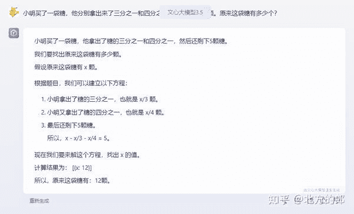
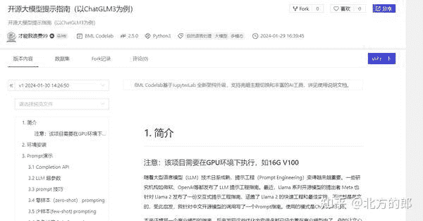

# 开源中文LLM Prompt交互指南

> 来源：[https://agijuejin.feishu.cn/docx/GkB3d9ldIojySpxBlIJcdVp6nCb](https://agijuejin.feishu.cn/docx/GkB3d9ldIojySpxBlIJcdVp6nCb)

> 作者：北方的郎

> 原文：[https://zhuanlan.z](https://zhuanlan.zhihu.com/p/680561668)hihu.com/p/680561...

## 1. 简介

随着大型语言模型（LLM）技术日渐成熟，提示工程（Prompt Engineering）变得越来越重要。一些研究机构如微软、OpenAI等都发布了 LLM 提示工程指南。最近，Llama 系列开源模型的提出者 Meta 也针对 Llama 2 发布了一份交互式提示工程指南，涵盖了 Llama 2 的快速工程和最佳实践。不过都是英文的，受此启发，我针对中文开源模型的调用写了一个Prompt指南。使用的模式是ChatGLM3-6B。

本来还想写一个商业模型的指南，后来发现这些优化内容很多都已经内置在商业模型中了，例如让文心一言做数学题：



[

所以就只写了开源模型的指南。

Meta的关于LLama 2的Prompt的优化建议： https](https://link.zhihu.com/?target=https%3A//github.com/facebookresearch/llama-recipes/blob/main/examples/Prompt_Engineering_with_Llama_2.ipynb):// github.com/facebookrese arch/llama-recipes/blob/main/examples/Prompt_Engineering_with_Llama_2.ipynb

本项目已经在AiStudio上开源，链接：

[开](https://link.zhihu.com/?target=https%3A//aistudio.baidu.com/projectdetail/7444423)源大模型提示指南（以ChatGLM3为例） - 飞桨AI Studio星河社区 (baidu.com)



直接Fork后就可以运行。

## 2. 环境安装

请参考：[ ](https://link.zhihu.com/?target=https%3A//aistudio.baidu.com/projectdetail/7444423)开源大模型提示指南（以ChatGLM3为例） - 飞桨AI Studio星河社区 (baidu.com)

## 3. Prompt演示

首先是获取模型，在本项目中，直接使用本地模型。然后就可以与模型对话了。

```
# 添加如下代码, 这样每次环境(kernel)启动的时候
import sys 
sys.path.append(&#x27;/home/aistudio/external-libraries&#x27;)
# 获取model
from transformers import AutoTokenizer, AutoModel
tokenizer = AutoTokenizer.from_pretrained(&quot;/home/aistudio/data/data245452&quot;, trust_remote_code=True)
model = AutoModel.from_pretrained(&quot;/home/aistudio/data/data245452&quot;, trust_remote_code=True, device=&#x27;cuda&#x27;)
model = model.eval()

DEFAULT_MODEL = model
DEFAULT_TOKENIZER = tokenizer
from typing import Dict, List

def completion(
    prompt: str,
    history = [],
    model = DEFAULT_MODEL,
    tokenizer = DEFAULT_TOKENIZER,
    temperature: float = 0.6,
    top_p: float = 0.9,
) -&gt; str:
    response, history = model.chat(tokenizer, prompt, history=history, temperature=temperature, top_p=top_p)
    return response

def chat_completion(
    prompt: str,
    history = [],
    model = DEFAULT_MODEL,
    tokenizer = DEFAULT_TOKENIZER,
    temperature: float = 0.6,
    top_p: float = 0.9,
) -&gt; str:
    return completion(
        prompt,
        history,
        model,
        tokenizer,
        temperature,
        top_p,
    )

def assistant(content: str):
    return { &quot;role&quot;: &quot;assistant&quot;, &quot;content&quot;: content }

def user(content: str):
    return { &quot;role&quot;: &quot;user&quot;, &quot;content&quot;: content }

def complete_and_print(prompt: str, model = DEFAULT_MODEL):
    print(f&#x27;==============\n{prompt}\n==============&#x27;)
    response = completion(prompt, history=[], model= model)
    print(response, end=&#x27;\n\n&#x27;)
```

### 3.1 Completion API

```
complete_and_print(&quot;典型的天空颜色是: &quot;)
complete_and_print (&quot;你是哪个型号的版本？&quot;)
```

Chat Completion 模型提供了与 LLM 互动的额外结构，将结构化消息对象数组而不是单个文本发送到 LLM。此消息列表为 LLM 提供了一些可以继续进行的「背景」或「历史」信息。

通常，每条消息都包含角色和内容：

具有系统角色的消息用于开发人员向 LLM 提供核心指令。具有用户角色的消息通常是人工提供的消息。具有助手角色的消息通常由 LLM 生成。

```
response = chat_completion (prompt=&quot;我最喜欢的颜色是什么?&quot;, history=[
user (&quot;我最喜欢的颜色是蓝色.&quot;),
assistant (&quot;很高兴知道!&quot;),
])
print (response)
# &quot;Sure, I can help you with that! Your favorite color is blue.&quot;
```

### 3.2 LLM 超参数

LLM API 通常会采用影响输出的创造性和确定性的参数。在每一步中，LLM 都会生成 token 及其概率的列表。可能性最小的 token 会从列表中「剪切」（基于 top_p），然后从剩余候选者中随机（温度参数 temperature）选择一个 token。换句话说：top_p 控制生成中词汇的广度，温度控制词汇的随机性，温度参数 temperature 为 0 会产生几乎确定的结果。

```
def print_tuned_completion (temperature: float, top_p: float):
    response = completion (&quot;写一句赞美梅花的话&quot;, temperature=temperature, top_p=top_p)
    print (f&#x27;[temperature: {temperature} | top_p: {top_p}]\n {response.strip ()}\n&#x27;)
print_tuned_completion (0.01, 0.01)
print_tuned_completion (0.01, 0.01)
# These two generations are highly likely to be the same
print_tuned_completion (1.0, 1.0)
print_tuned_completion (1.0, 1.0)
# These two generations are highly likely to be different
```

### 3.3 prompt 技巧

详细、明确的指令会比开放式 prompt 产生更好的结果：

```
complete_and_print (prompt=&quot;描述量子物理学：在不超过24个词的简短句子中。&quot;)
# Returns a succinct explanation of quantum physics that mentions particles and states existing simultaneously.
```

**我们可以给定使**用规则和限制，以给出明确的指令。

风格化，例如：

+   向我解释一下这一点，就像儿童教育网络节目中教授小学生一样；

+   我是一名软件工程师，使用大型语言模型进行摘要。用 250 字概括以下文字；

+   像私家侦探一样一步步追查案件，给出你的答案。

**格式化**

+   使用要点；

+   以 JSON 对象形式返回；

+   使用较少的技术术语并用于工作交流中。

**限制**

+   仅使用学术论文；

+   切勿提供 2020 年之前的来源；

+   如果你不知道答案，就说你不知道。

以下是给出明确指令的例子：

```
complete_and_print (&quot;为我解释最新的大语言模型。&quot;)
# More likely to cite sources from 2017
complete_and_print (&quot;为我解释最新的大语言模型。始终引用你的来源。不要引用2020年之前的来源。&quot;)
# Gives more specific advances and only cites sources from 2020 
```

### 3.4 零样本（zero-shot） prompting

一些大型语言模型（例如 Llama 2）能够遵循指令并产生响应，而无需事先看过任务示例。没有示例的 prompting 称为「零样本 prompting（zero-shot prompting）」。例如：

```
complete_and_print(&quot;文本：这是我看过的最好的电影！\n文本的情感是：&quot;)
# 返回积极情感
complete_and_print(&quot;文本：这个电影的导演努力过头了。\n文本的情感是：&quot;)
# 返回消极情感
```

### 3.5 少样本(few-shot) prompting

添加所需输出的具体示例通常会产生更加准确、一致的输出。这种方法称为「少样本 prompting（few-shot prompting）」。例如：

```
def sentiment(text):
    response = chat_completion(text, history=[
        user(&quot;你是一个情感分类器。对于每条消息，请给出积极/中性/消极的百分比。&quot;),
        user(&quot;我喜欢它&quot;),
        assistant(&quot;70% 积极 30% 中性 0% 消极&quot;),
        user(&quot;它可以更好&quot;),
        assistant(&quot;0% 积极 50% 中性 50% 消极&quot;),
        user(&quot;它还行&quot;),
        assistant(&quot;25% 积极 50% 中性 25% 消极&quot;),
    ])
    return response

def print_sentiment(text):
    print(f&#x27;输入：{text}&#x27;)
    print(sentiment(text))

print_sentiment(&quot;我觉得还好&quot;)
# 更有可能返回积极、中性和消极的平衡混合
print_sentiment(&quot;我爱它！&quot;)
# 更有可能返回100% 积极
print_sentiment(&quot;糟糕的服务 0/10&quot;)
# 更有可能返回100% 消极
```

### 3.6 角色扮演 Role Prompting

Llama 2 在指定角色时通常会给出更一致的响应，角色为 LLM 提供了所需答案类型的背景信息。

例如，让 Llama 2 对使用 PyTorch 的利弊问题创建更有针对性的技术回答：

```
complete_and_print(&quot;解释使用PyTorch的利弊。&quot;)
# 更有可能解释使用PyTorch的利弊，涵盖一般领域，如文档、PyTorch社区，并提到陡峭的学习曲线
complete_and_print(&quot;你的角色是给与处理复杂数据集的高级工程师高度技术建议的机器学习专家。解释使用PyTorch的利弊。&quot;)
# 往往会得到更多关于技术方面的利弊，提供更多有关模型层如何工作的技术细节
```

### 3.7 思维链

简单地添加一个「鼓励逐步思考」的短语可以显著提高大型语言模型执行复杂推理的能力（Wei et al. (2022)），这种方法称为 CoT 或思维链 prompting：

```
complete_and_print(&quot;谁活得更久，埃尔维斯·普雷斯利还是莫扎特？&quot;)
# 往往会给出“莫扎特”这个错误答案
complete_and_print(&quot;谁活得更久，埃尔维斯·普雷斯利还是莫扎特？让我们仔细地、一步一步地思考这个问题。&quot;)
# 给出正确答案“埃尔维斯”
```

### 3.8 自洽性（Self-Consistency）

LLM 是概率性的，因此即使使用思维链，一次生成也可能会产生不正确的结果。自洽性通过从多次生成中选择最常见的答案来提高准确性（以更高的计算成本为代价）：

```
import re
from statistics import mode

def gen_answer():
    response = completion(
        &quot;约翰发现15个数字的平均值是40。&quot;
        &quot;如果每个数字加10，那么数字的平均数是多少？&quot;
        &quot;报告答案时，请用三个反引号括起来，例如：```123```&quot;
    )
    match = re.search(r&#x27;```(\d+)```&#x27;, response)
    if match is None:
        return None
    return match.group(1)

answers = [gen_answer() for i in range(5)]

print(
    f&quot;答案：{answers}\n&quot;,
    f&quot;最终答案：{mode(answers)}&quot;,
    )
```

### 3.9 检索增强生成

有时我们可能希望在应用程序中使用事实知识，那么可以从开箱即用（即仅使用模型权重）的大模型中提取常见事实：

```
complete_and_print(&quot;加利福尼亚的首都是什么？&quot;) 
# 给出正确答案“萨克拉门托” 
```

然而，LLM 往往无法可靠地检索更具体的事实或私人信息。模型要么声明它不知道，要么幻想出一个错误的答案：

```
complete_and_print(&quot;2023年12月12日，门洛帕克的气温是多少？&quot;)
#&quot;我只是一个AI，我无法访问实时天气数据或历史天气记录。&quot;
complete_and_print(&quot;周六晚上我的晚餐预订是几点，我应该穿什么？&quot;)
#&quot;我无法访问您的个人信息[...] 我可以提供一些一般性指导&quot;
```

检索增强生成（RAG）是指在 prompt 中包含从外部数据库检索的信息（Lewis et al. (2020)）。RAG 是将事实纳入 LLM 应用的有效方法，并且比微调更经济实惠，微调可能成本高昂并对基础模型的功能产生负面影响。

```
MENLO_PARK_TEMPS = {
    &quot;2023-12-11&quot;: &quot;52华氏度&quot;,
    &quot;2023-12-12&quot;: &quot;51华氏度&quot;,
    &quot;2023-12-13&quot;: &quot;51华氏度&quot;,
}

def prompt_with_rag(retrieved_info, question):
    complete_and_print(
        f&quot;给定以下信息：&#x27;{retrieved_info}&#x27;，回答：&#x27;{question}&#x27;&quot;
    )

def ask_for_temperature(day):
    temp_on_day = MENLO_PARK_TEMPS.get(day) or &quot;未知温度&quot;
    prompt_with_rag(
        f&quot;门洛帕克在{day}的温度为{temp_on_day}&#x27;&quot;,  # 检索到的事实
        f&quot;门洛帕克在{day}的温度是多少？&quot;,  # 用户问题
    )

ask_for_temperature(&quot;2023-12-12&quot;)
# &quot;当然！2023年12月12日门洛帕克的温度为51华氏度。&quot;

ask_for_temperature(&quot;2023-07-18&quot;)
# &quot;根据提供的信息，我无法提供2023年7月18日门洛帕克的温度，因为信息显示温度未知。&quot;  
```

### 3.10 程序辅助语言模型

LLM 本质上不擅长执行计算，例如：

```
complete_and_print(&quot;&quot;&quot;
计算以下数学问题的答案：
((-5 + 93 * 4 - 0) * (4^4 + -7 + 0 * 5))
&quot;&quot;&quot;)

# 给出类似于 92448、92648、95463 的错误答案
```

Gao et al. (2022) 提出「程序辅助语言模型（Program-aided Language Models，PAL）」的概念。虽然 LLM 不擅长算术，但它们非常擅长代码生成。PAL 通过指示 LLM 编写代码来解决计算任务。

```
def extract_code(text):  
    # 使用正则表达式匹配代码块
    # 默认python
    pattern = r&#x27;```python.*?\n(.*?)```&#x27;  
    matches = re.findall(pattern, text, re.DOTALL)  
    if matches:  
        # 如果匹配成功，返回第一个匹配到的代码块  
        return matches[0]  
    else:  
        # 如果匹配失败，返回空字符串  
        return &quot;&quot; 

input=&quot;&quot;&quot;
    # Python code to calculate: ((-5 + 93 * 4 - 0) * (4^4 + -7 + 0 * 5))
    &quot;&quot;&quot;
response, history = model.chat(tokenizer, input, history=[])
print(response)
exec(extract_code(response))
```

### 3.11 限制多余标记

一个常见的问题是输出时出现多余标记（例如，“当然！这是更多关于...的信息”）。

看看这个改进，它结合了一个角色、规则和限制、明确的说明以及一个例子：

```
complete_and_print(
    &quot;以JSON格式给出门洛帕克的邮政编码，字段为&#x27;zip_code&#x27;&quot;
)
# 可能会返回JSON，还会返回“当然！这是JSON...”

complete_and_print(
    &quot;&quot;&quot;
    你是一个只输出JSON的机器人。
    你以JSON格式回复，字段为&#x27;zip_code&#x27;。
    示例问题：帝国大厦的邮政编码是多少？示例答案：{&#x27;zip_code&#x27;: 10118}
    现在我的问题是：门洛帕克的邮政编码是多少？
    &quot;&quot;&quot;
)
# &quot;{&#x27;zip_code&#x27;: 94025}&quot;
```