# 零代码自建决策助手，帮你解决生活中的决策问题

> 来源：[https://agijuejin.feishu.cn/docx/UJhzd6g1ZoFOqkxdiiec9BymnJc](https://agijuejin.feishu.cn/docx/UJhzd6g1ZoFOqkxdiiec9BymnJc)

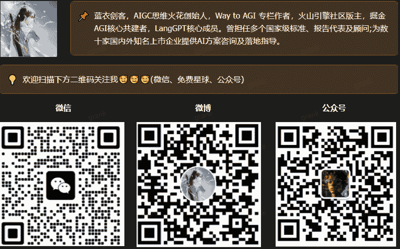

# 一、你是否也遇到过这样的问题？

你是否看过那个段子：”我跟你妈同时掉水里了，你先救谁？“ 。

段子里的人可能会说：“没事，我妈会游泳！”

但是你还真别说，我也被女朋友问过类似的问题，就比如上面那个段子的升级版：“如果有一天我不省人事了，你亲一口前女友我才能醒过来，你会怎么办？”

当我第一次听到这个这个事的时候，我我我...整个人是，瑟瑟发抖的(你看我说话都结巴了，哈哈哈)。

你别看就这么一句玩笑话，其实还真的难解决。

---

再说点正经的，你是否会遇到过这些问题：

1.  考上了大学，该去学哪个专业好呢？

1.  我得到了好几个offer，应该去哪家公司好呢？

1.  我想买衣服，但是预算有限，我又同时看上了好几件，应该选哪个好呢？

以上种种都会发生在我们的生活中，其实背后都透露着“机会成本”。

---

**简单**来说，机会成本就是在多方案决策时，被舍弃的价值最高的选项。换句话说，它是你为了得到某样东西而必须放弃的另一样东西的价值。而多方案决策是在面临多项选择时，需要比较各个选择的优劣，最终选择其中最优的方案。

所以我们在这里得到了一个很明确的信息：机会成本并非独立存在的概念，而是与决策过程紧密相连。

不过光知道这些似乎并没有什么大用，怎么做好决策才是正道，那么普通人又该怎么在零代码的条件下构建属于自己的决策模型呢？

接着往下看。

# 二、构建决策模型的前期准备

基于以上信息，我们可以得出以下几个关键点：

1.  首先，我们面对的是一个多方案决策的情境。而且，我们的目标是在零代码的情况下构建这个决策模型。

1.  在当前的技术环境下，零代码情况下我们能够选择的主要工具就是提示词。提示词不仅是与模型交互的方式，也是一种微调模型的过程。

1.  由于我们面对的是多方案决策，我们可以利用思维树(ToT)这种提示词工程技术作为实现路径构建一个类似的决策树，来帮助我们更全面地考虑各种可能性和潜在结果。这种方法可以让我们更清晰地看到每个决策选项可能带来的后果，从而更好地评估机会成本。

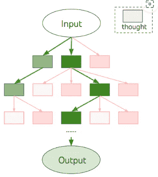

1.  然而，仅有决策树还不足以构建一个完整的决策模型。我们还需要引入权重等因素，将它们整合到决策树中。这些权重反映了各个因素在整个决策过程中的相对重要性。通过引入权重的概念，我们可以更精确地衡量每个决策选项的价值和潜在影响。

> 延伸阅读：什么是思维树（ToT）：https://www.promptingguide.ai/zh/techniques/tot

# 三、决策链设计

在了解完基础概念、明确目标以后，我们就要构建决策链条了，整个决策链条有三个大阶段，如图所示：

信息收集、量化阶段（绿色虚框）：

1.  明确决策目标：
这是整个决策过程的起点和基础。我们需要清晰地定义我们要解决的问题或达成的目标。例如，"选择最适合自己长期职业发展的工作" 或 "在预算范围内购买最适合的衣服"。明确目标有助于我们聚焦于真正重要的因素，避免在决策过程中偏离方向。

1.  收集基本信息：
这是决策过程的基础。我们需要全面收集与决策相关的所有选项和信息。例如，在职业选择中，我们会详细记录每个工作机会的具体情况，包括职位、薪酬、公司背景、工作内容等。

1.  权重选配：
在这一步，我们确定用于评估各个选项的具体标准。这些标准通常分为理性因素和情感因素。理性因素可能包括薪酬、职业发展前景、公司稳定性等；情感因素可能包括工作环境、团队氛围、个人兴趣等。在这一步可以根据实际情况进行权重调配

1.  评分与初步调整：
对每个选项在各个评估标准上进行打分，通常使用 1-10 分的量表。这一步要求我们客观公正，尽量避免个人偏见。每个分数都应该有明确的理由支撑。

---

计算风险、分析阶段（黄色虚框）：

1.  加权得分计算：
将每个选项在各个标准上的得分与相应的权重相乘，然后求和，得出每个选项的总加权得分。这个过程可以通过简单的数学计算来完成。（当然你可以不使用加权求和模型，这个可以自己DIY，不过越复杂的模型计算准确度越差，这个是我亲身试验过的）

1.  机会成本分析：
考虑选择每个选项时可能放弃的其他机会。这有助于我们更全面地理解每个选择的真实价值。例如，选择一份高薪工作可能意味着放弃更多的个人时间。

1.  简单情景分析：
为每个选项构想最佳和最坏的情况。这有助于我们理解每个选择的潜在风险和回报。我们需要考虑这些极端情况发生的可能性，以及我们是否能够承受最坏的结果。

1.  决策矩阵分析：
将前面步骤的分析结果汇总到一个表格中，包括预期收益、机会成本、净收益、长期影响和风险评估。这为我们提供了一个直观的比较工具。

---

**决策阶段（红色虚框）：**

1.  敏感性分析：
通过调整不同因素的权重，检验我们的决策是否稳健。如果轻微的权重变化导致结果发生显著变化，那么我们可能需要重新评估我们的分析过程或收集更多信息。

1.  情感检验：
虽然我们努力保持客观，但个人感受也是重要的考虑因素。我们需要反思自己对每个选项的情感反应，并考虑这些反应与理性分析的一致性。

1.  提供最终决策建议：
基于前面的所有分析，提出一个综合的建议。这个建议应该包括选择的理由、潜在的风险、需要注意的事项等。

---

这是我再三压缩过的决策过程，已经很难继续简化了，别看这个过程看起来挺麻烦的，但是事关决策，多花点时间和精力来权衡是值得的。这样做出来的决策，大概率会更适合你，让你在未来的日子里更有干劲，过得更舒心。

# 四、 案例——帮你选工作

仅仅讨论理论、概念和基础知识并不能满足我们的实际需求。每个人的思维方式都是不同的，因此面对同一个事物，不同人的决策细节和考虑因素也会有所不同。当然，我自己也有自己的考量方式。

正因为如此，我认为通过具体的例子来展示这些概念如何在实际生活中应用是非常重要的。这样可以让我们真正理解决策模型如何在我们的工作和日常生活中发挥作用，让这些理论真正产生价值。

为了达到这个目的，我准备举个“如何选offer”的例子来具体说明。这个决策都是人生中的重要选择之一，几乎每个人都会或多或少地遇到。它们不仅贴近生活，而且影响深远。

## 4.1 测试

### 4.1.1 情景

假设我现在是一名在职的产品经理，我这段时间由于一些个人原因想跳槽换个工作。历经各种面试，我拿到了两个offer，一家创业公司的，一家大公司的，而且这两家公司提供的机会看起来都不错。于是我决定求助一下“决策助手”让他帮我算算账。

### 4.1.2 收集信息、量化阶段

整个流程始于我向决策助手提出一个问题：我有两个工作机会，不知道该选哪一个，请帮我分析。决策助手随即要求我提供这两个 offer 的基本信息。

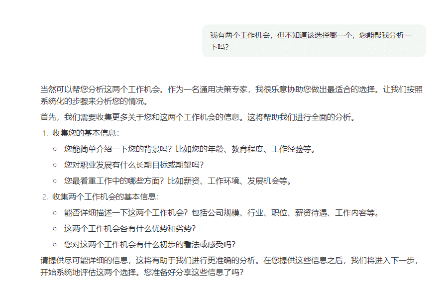

我提供了一些offer的基本信息，同时也跟它说明了我是一个怎样的人，追求什么生活。（好像大家都这么追求的🤣）

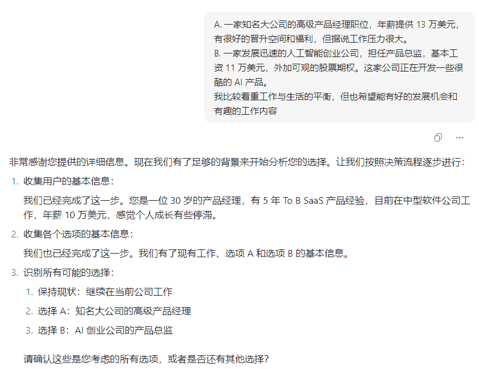

在我提供完信息后，决策助手开始定义一些基本的评估标准，并让我对这些标准进行审核。这样的设计使得在后续的分析过程中，我们可以灵活地调整各项标准的权重。同时，决策助手还会根据我的喜好和目标，给出一个权重分配的建议。

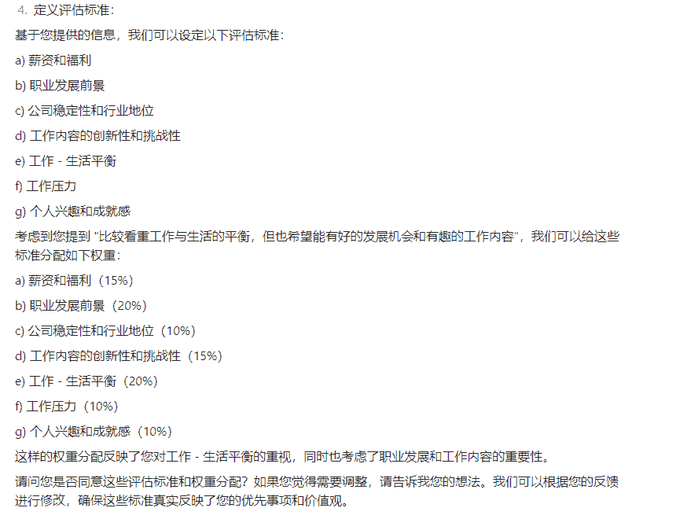

在我认可了权重分配后，决策助手开始对我提供的每个选项进行评分。评分采用 1 到 10 分的制度，涵盖了所有的评估标准。评分完成后，决策助手会整理出一个清晰的表格。这个表格包含了各项评估标准的权重，以及每个选项在各个标准下的得分。

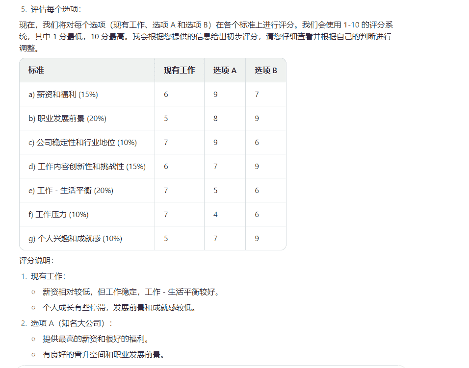

### 4.1.3 分析阶段

在完成各项标准的打分后，我们进入了加权求和计算加权得分的阶段。决策助手会按照刚加权求和的计算公式最后算出一个总分数出来。

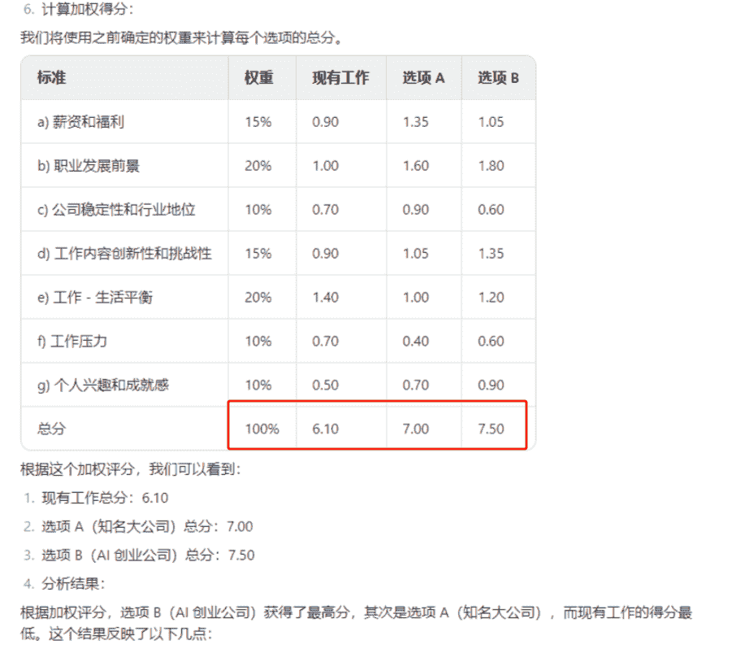

然而，仅仅依靠加权得分来做决策是有局限性的。因此，在分析阶段，我们需要采用多种分析方法，而不仅仅依赖于加权得分的计算。比如在这里我的互补方式采用了机会成本分析、情景假设分析。

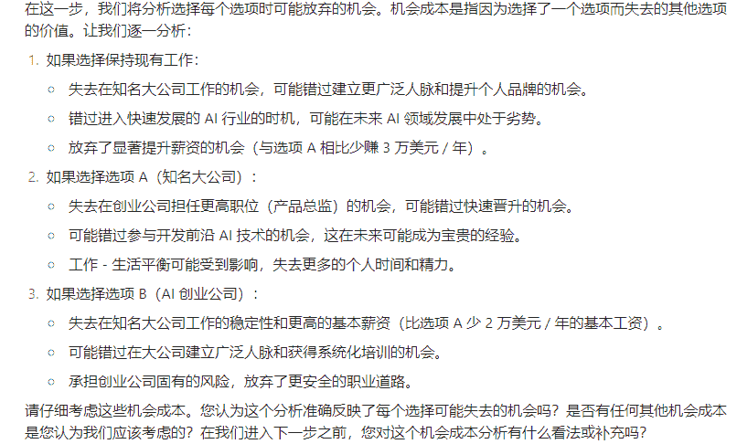

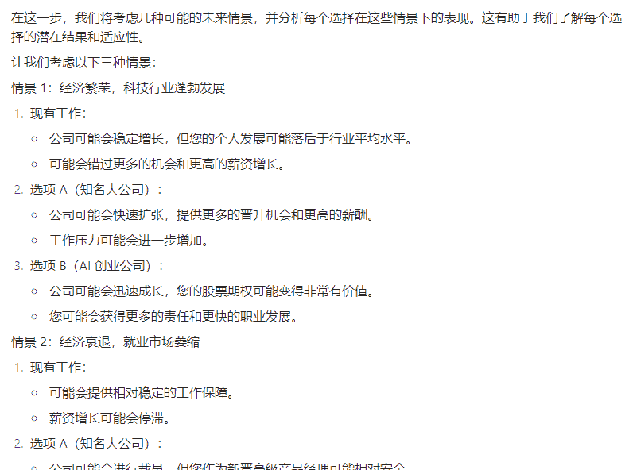

最后，我们会综合所有的分析结果，形成一个决策分析矩阵。这些不同的分析方法相互补充，共同形成一个全面的决策依据。

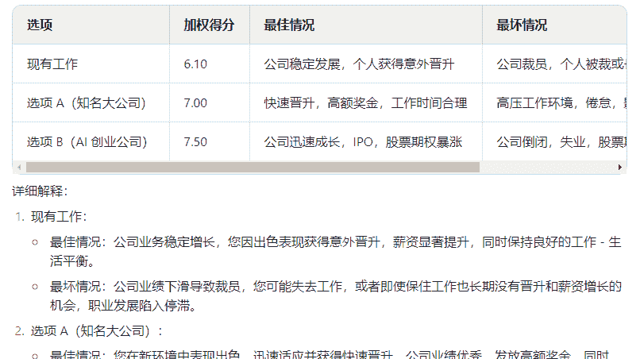

### 4.1.4 决策阶段

在完成整体分析并得出决策矩阵后，我们还需要进行一个关键的检验环节。这个环节的重点是重新审视权重的比例分配和计算。在这个检验过程中，我们会随机给出三种不同的权重分配可能性，并基于这些新的分配进行重新计算。这样做的目的是微调权重，探索是否存在其他可能的结果。如果在不同的权重分配下，最终结果仍然相似，那么我们就可以认为前期的基础分析是可靠和有效的。

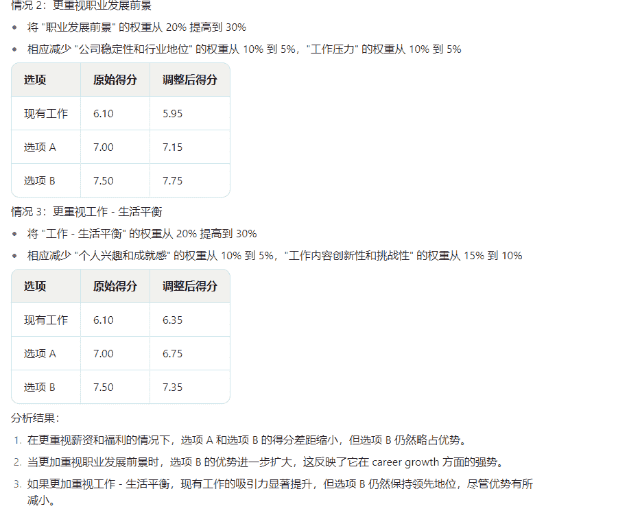

完成这些基础分析和检验后，我们就进入了最后的决策建议阶段。在给出决策建议时，我们不仅会提供明确的选择建议，还会附带一系列其他重要信息。这些信息可能包括备选计划、需要注意的事项，以及可能存在的隐性成本。

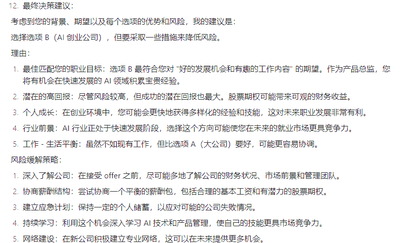

# 六、 做一个小总结

1.  正如我在文中多次强调的，加权求和模型有其固有的局限性。因此，必须从其他角度进行分析，在实际应用过程中，你需要考虑具体的环境因素，甚至可以打乱既定的决策链条，加入一些个人化的因素，以互补的方式来提高决策的准确性。

1.  在使用大语言模型辅助决策时，需要控制提示词的长度。如果步骤过多，某些模型可能会表现不佳，甚至可能会跳过几个步骤。在这种情况下，我建议使用 Claude 或 GPT 模型效果更好。

1.  通过提示词来调整大模型使其成为决策模型的方法，可能不如专门训练的决策小模型效果好。但对于一般的简单决策场景，这种方法通常已经足够使用。

1.  切记使用过程中不要透露关于你的任何敏感信息（如名字、电话号码等）。

1.  谨记第4条。

最后，还是老规矩，关注我，我会把提示词免费送给你。