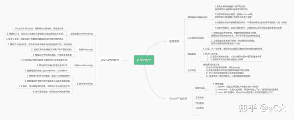
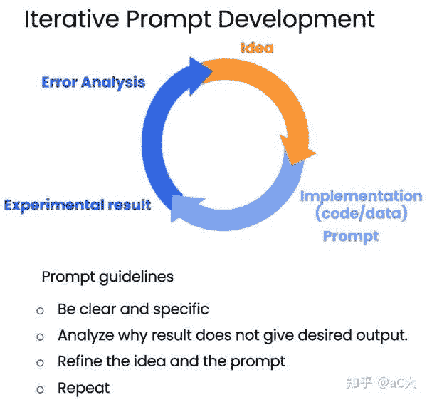
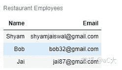

# prompt的艺术：ChatGPT提示工程准则&AI大神吴恩达教你写提示词

> 来源：https://agijuejin.feishu.cn/docx/DlXPdKBxcoFpD2xQLDicxxvYn7c

> 作者：aC大

> 原文：https://zhuanlan.zhihu.com/p/634413585

## 写在前面

因为前些时间在剖析Auto-GPT的源码（文章和视频），一直没有整理prompt提示的总结，今天这里整理了一份AI大神吴恩达的 prompt提示工程 内容。

该课程是吴恩达联合openAI成员共同制作的，主要围绕使用ChatGPT的使用准则、ChatGPT具有的能力及聊天机器人的应用几个方面展开，每个方面都给出了实践的讲解和代码演示，整个课程的介绍，无不透露promot工程的艺术。总共九节课，每节课时间几分钟到十几分钟不等。看似简单的一个课程，但仔细深究发现要使用好ChatGPT，需要注意的细节还是很多，这也是prompt工程的魅力所在。


根据课程的内容，按我自己的理解以脑图的形式整理了一下课程的大纲，介绍不是完全按课程的提纲来的，比如迭代开发部分，我将其放在使用准则部分介绍。如下图：



## ChatGPT的使用准则

同样使用ChatGPT，有的人可以用它完成复杂的任务，而有的人只是当成简单的工具试用而已。两者的千差万别究其原因是没有完全了解ChatGPT的使用准则，使用准则可以帮你更快更精准的得到你想要的结果。只用准则主要包括：1）编写清晰&明确的指令；2）给予模型时间思考；3）模型本身的限制，如何绕开解决你的问题；4）完成复杂的任务，如何迭代开发，达到预期目标。

### 编写清晰&明确的指令

使用分隔符明确输入的不同内容，保证每部分内容可以被模型完整识别。

这里的分隔符可以是各种形式，比如反引号代码块（```）、`"""`、`---`、`<>`、`<tag> </tag>`、html标签等。具体使用哪种分隔符可以根据自身喜好，只要在背景说明描述清楚并且不会和内容中以后的字符相冲突就可以。比如下面的文本，使用反引号代码块（```）分割模型要处理的内容。

这里主要介绍prompt词指定，而需要处理的文本，因为篇幅限制，会省略，需要完整的内容，可以在`https://learn.deeplearning.ai/chatgpt-prompt-eng`获取：

```
# 示例（演示转为了中文，便于国人阅读，后续的直接使用演示的英文内容，）

# 这里主要介绍prompt词指定，而需要处理的文本，因为篇幅限制，会省略，需要完整的内容，
# 可以在https://learn.deeplearning.ai/chatgpt-prompt-eng 获取：

import openai

import os

from dotenv import load_dotenv, find_dotenv

_ = load_dotenv(find_dotenv())

openai.api_key  = os.getenv('OPENAI_API_KEY')

def get_completion(prompt, model="gpt-3.5-turbo"):

    messages = [{"role": "user", "content": prompt}]

    response = openai.ChatCompletion.create(

        model=model,

        messages=messages,

        temperature=0, # this is the degree of randomness of the model's output

    )

    return response.choices[0].message["content"]

text = f"""

您应该通过提供尽可能清晰和具体的说明来表达您希望模型做什么。

这将引导模型获得所需的输出，并减少收到不相关或不正确响应的机会。不要把写一个清晰的提示和写一个简短的提示混为一谈。在许多情况下，较长的提示为模型提供了更多的清晰度和上下文，从而可以产生更详细和相关的输出。

"""

prompt = f"""

将用三个反调分隔的文本概括为一个句子

```{text}```
"""
response = get_completion(prompt)
print(response)

# 输出：
"""
提供清晰具体的说明可以引导模型获得所需输出，减少不相关或不正确响应的机会，较长的提示可以提供更多清晰度和上下文，产生更详细和相关的输出。
"""
```

指定模型的输出格式，包括json,html等

结构化的输出格式可以是常见的，比如json，html，xml等格式。规范输出格式有利于在其他应用上使用，比如我有一个应用接入了ChatGPT，那我要处理ChatGPT的返回结果，我就可以要求结构化的输出。

```
# 示例：
prompt = f"""
生成一个由三个虚构的书名及其作者和流派组成的列表。以JSON格式为它们提供以下信息：book_id、title、author、流派。
"""
response = get_completion(prompt)
print(response)
```

### 检查要处理的内容是否满足条件

不满足条件给出的结果可能胡说八道，在处理时可以让ChatGPT先校验用户给出的信息是否满足处理的要求，如果不处理需要怎么处理。示例中的`If the text does not contain a sequence of instructions, \ then simply write "No steps provided."`就给让ChatGPT先判断是否满足说明书的条件。

```
text_1 = f"""
Making a cup of tea is easy! First, you need to get some \ 
water boiling. While that's happening, \ 
grab a cup and put a tea bag in it. Once the water is \ 
hot enough, just pour it over the tea bag. \ 
Let it sit for a bit so the tea can steep. After a \ 
few minutes, take out the tea bag. If you \ 
like, you can add some sugar or milk to taste. \ 
And that's it! You've got yourself a delicious \ 
cup of tea to enjoy.
"""
prompt = f"""
You will be provided with text delimited by triple quotes. 
If it contains a sequence of instructions, \ 
re-write those instructions in the following format:

Step 1 - ...
Step 2 - …
…
Step N - …

If the text does not contain a sequence of instructions, \ 
then simply write \"No steps provided.\"

\"\"\"{text_1}\"\"\"
"""
response = get_completion(prompt)
print("Completion for Text 1:")
print(response)
```

### 给出样例提示，给出少量的例子，让模型可以更好的输出满足要求的结果

ChatGPT可以使用zero-shot和few-shot两种prompting方式，使用few-shot也就是给出一些样例，则可以得到更好的结果。示例：

```
prompt = f"""
Your task is to answer in a consistent style.

<child>: Teach me about patience.

<grandparent>: The river that carves the deepest \ 
valley flows from a modest spring; the \ 
grandest symphony originates from a single note; \ 
the most intricate tapestry begins with a solitary thread.

<child>: Teach me about resilience.
"""
response = get_completion(prompt)
print(response)

# 解释
"""
上述的prompt先通过<child>，<grandparent>的问答方式，给出一个例子，让模型学习这种回答方式，回答风格。然后给出问答：Teach me about resilience.
response: Resilience is like a tree that bends with the wind but never breaks. It is the ability to bounce back from adversity and keep moving forward, even when things get tough. Just like a tree that grows stronger with each storm it weathers, resilience is a quality that can be developed and strengthened over time.
"""
```

### 给予模型时间思考

明确完成任务的步骤，将复杂任务拆解成子任务。

让模型按子任务挨个解决，每个子任务给出清晰的描述，也就是说让模型思考每一步要做什么(COT思想)，ChatGPT完成每一个子任务的准确率更高，一步一步有利于得到最终想要的结果。如果直接让ChatGPT给出最终结果，往往得不到最终的结果。示例：

```
text = f"""
In a charming village, siblings Jack and Jill set out on \ 
a quest to fetch water from a hilltop \ 
well. As they climbed, singing joyfully, misfortune \ 
struck—Jack tripped on a stone and tumbled \ 
down the hill, with Jill following suit. \ 
Though slightly battered, the pair returned home to \ 
comforting embraces. Despite the mishap, \ 
their adventurous spirits remained undimmed, and they \ 
continued exploring with delight.
"""
# example 1
prompt_1 = f"""
Perform the following actions: 
1 - Summarize the following text delimited by triple \
backticks with 1 sentence.
2 - Translate the summary into French.
3 - List each name in the French summary.
4 - Output a json object that contains the following \
keys: french_summary, num_names.

Separate your answers with line breaks.

Text:
```{text}```

"""
response = get_completion(prompt_1)

print("Completion for prompt 1:")

print(response)

# 解释

"""
上面的promot中，给出了1.总结文本；2）将总结文本翻译成法语等子任务。让ChatGPT一个任务一个任务完成。当然也可以指定输出格式让内容更加的合理。（上文介绍的指定输出格式原则）

"""
```

### 让模型给出答案进行校验，先让模型给出答案

要判断一个结论是否正确，可以让ChatGPT先给出自己的答案，然后给需要判断的结论对比，最终给出最后的判断，这样得到的结果更加可信。若直接让ChatGPT给出判断结果，往往比较难得到正确的结果。比如使用ChatGPT检查学生习题答案的例子：

```
prompt = f"""

Your task is to determine if the student's solution \

is correct or not.

To solve the problem do the following:

- First, work out your own solution to the problem. 

- Then compare your solution to the student's solution \ 

and evaluate if the student's solution is correct or not. 

Don't decide if the student's solution is correct until 

you have done the problem yourself.

Use the following format:

Question:

```
question here
```

Student's solution:

```
student's solution here
```

Actual solution:

```
steps to work out the solution and your solution here
```

Is the student's solution the same as actual solution \

just calculated:

```
yes or no
```

Student grade:

```
correct or incorrect
```

Question:

```
I'm building a solar power installation and I need help \
working out the financials. 
- Land costs $100 / square foot
- I can buy solar panels for $250 / square foot
- I negotiated a contract for maintenance that will cost \
me a flat $100k per year, and an additional $10 / square \
foot
What is the total cost for the first year of operations \
as a function of the number of square feet.
``` 

Student's solution:

```
Let x be the size of the installation in square feet.
Costs:
1. Land cost: 100x
2. Solar panel cost: 250x
3. Maintenance cost: 100,000 + 100x
Total cost: 100x + 250x + 100,000 + 100x = 450x + 100,000
```

Actual solution:

"""

response = get_completion(prompt)

print(response)


解释：通过让ChatGPT进行真确的判断，明确给出指令，让ChatGPT先自己计算一遍，然后比较学生的答案，给出最终的判断。

若没有明确给出让ChatGPT先自己计算，而直接进行判断结果，就比较难给出正确结果。这也是上文将复杂任务拆解为多个子任务的原则

## ChatGPT的限制

在一些场景，ChatGPT会给出看似正确但没有依据的虚假结果，这就是ChatGPT的幻觉现象。解决或缓解幻觉方法：1）让模型找到相关信息，比如让模型依据xx网页的信息作答；2）让模型基于找到的相关信息给出结果。让模型利用现有的信息而不是凭空捏造能够有效避免幻觉现象。

````
prompt = f"""

Tell me about AeroGlide UltraSlim Smart Toothbrush by Boie

"""

response = get_completion(prompt)

print(response)
````

这样的问题很容易让ChatGPT开始自我发挥，得到不符合客观事实的结果

## 迭代开发

正如一般的模型迭代过程一样，需要不断反复修正，指定`prompt`也一样，我们很难第一次就给出预期结果的提示，因此需要根据ChatGPT的反馈，针对不符合预期的地方进行修正。根据迭代提示开发方法:

1) 按自己对业务的理解，制定`prompt`

2) 根据当前提示存在的问题思考哪里不符合预期

3）针对不符合预期的部分思考更优的提示

4）尽量给出一些样例提示，以便得到更好的结果



## ChatGPT的能力

### 获取摘要(summarizing)

对长的文本进行总结，

对于冗长的新闻或某些说明书，可以使用ChatGPT对长把文本进行总结，得到一个总结性的主要内容。另外在设计`prompt`时，可以指定总结的文本长度。示例：

````
prompt = f"""

Your task is to generate a short summary of a product \

review from an ecommerce site. 

Summarize the review below, delimited by triple 

backticks, in at most 30 words. 

Review: ```{prod_review}```
"""

response = get_completion(prompt)
print(response)
````

给出的提示为：总结使用三个反引号分割符中的内容，最多30个单词，实际结果基本控制在30左右个单词，可能会有一点差异，但不会相差太远。

处理长文本，获取某个方面的主要信息(其他方面信息不处理)

在获取文本摘要时，可以指定从长本文中获取某些方面的信息，而不是获取整体的摘要。

````
prompt = f"""

Your task is to generate a short summary of a product \

review from an ecommerce site to give feedback to the \

Shipping deparmtment. 

Summarize the review below, delimited by triple 

backticks, in at most 30 words, and focusing on any aspects \

that mention shipping and delivery of the product. 

Review: ```{prod_review}```
"""

response = get_completion(prompt)
print(response)
````

上面的`prompt`中，直接明确总结关于 shipping and delivery of the product主题的信息（focusing on any aspects \
that mention shipping and delivery of the product. ）

处理长文本，获取与某个主题或关键词相关的所有方面的信息

处理长文本，还可以获取其中某主题相关所有摘要总结

````
prompt = f"""

Your task is to generate a short summary of a product \

review from an ecommerce site to give feedback to the \

pricing deparmtment, responsible for determining the \

price of the product.  

Summarize the review below, delimited by triple 
backticks, in at most 30 words, and focusing on any aspects \
that are relevant to the price and perceived value. 

Review: ```{prod_review}```

"""

response = get_completion(prompt)

print(response)
````

上面提示指定获取与价格和感知价值相关的的任何方面的信息，不在局限某个主题。

### 推理(inferring)

提取文本中的标签，名称

如电子商务中的商品品牌识别、商品识别。在ChatGPT问世之前，NLP应用有一个领域是知识图谱，里边就需要抽取各种标签实体。有了ChatGPT就轻松了很多，甚至都不需要单独构建知识图谱了。示例

```
prompt = f"""

Identify the following items from the review text: 

- Item purchased by reviewer

- Company that made the item

The review is delimited with triple backticks. \

Format your response as a JSON object with \

"Item" and "Brand" as the keys. 

If the information isn't present, use "unknown" \

as the value.

Make your response as short as possible.

Review text: '''{lamp_review}'''

"""

response = get_completion(prompt)

print(response)
```

上面的prompt指定，抽取文本中的商品和品牌名， 并以json格式显示

reponse：

{

  "Item": "lamp",

  "Brand": "Lumina"

}

理解文本中的情感(了解客户对产品的反馈)

在电子商务中，用户会对购买的商品进行评论，此时可以使用ChatGPT对用户评论处理，得到用户对商品的情感反馈信息，判断是正向还是负面的。这可以在后面的扩展应用中生成电子邮件中使用，正向和负面的邮件内容是不同的。

```
prompt = f"""

What is the sentiment of the following product review, 

which is delimited with triple backticks?

Review text: '''{lamp_review}'''

"""

response = get_completion(prompt)

print(response)
```

上面直接让ChatGPT判断，给定的评论情绪是积极的还是负面的。

推理文本中包含的主题，可指定主题长度

```
      prompt = f"""

Determine five topics that are being discussed in the \

following text, which is delimited by triple backticks.

Make each item one or two words long. 

Format your response as a list of items separated by commas.

Text sample: '''{story}'''

"""

response = get_completion(prompt)

print(response)
```

prompt中推理出文本中的5个主题

### 转换(transforming)

转换包括翻译，拼接检查及不同数据类型之间的格式转换。

不同语言之间相互翻译

不同语言之间相互翻译，并且可指定场合，指定文本的形式(正式或非正式)

````
prompt = f"""

Translate the following English text to chinese: \ 

```Hi, I would like to order a blender```
"""

response = get_completion(prompt)
print(response)
````

将指定文本翻译成中文

帮助拼写检查和语法检查&纠正

````
text = [ 
  "The girl with the black and white puppies have a ball.",  # The girl has a ball.
  "Yolanda has her notebook.", # ok
  "Its going to be a long day. Does the car need it’s oil changed?",  # Homonyms
  "Their goes my freedom. There going to bring they’re suitcases.",  # Homonyms
  "Your going to need you’re notebook.",  # Homonyms
  "That medicine effects my ability to sleep. Have you heard of the butterfly affect?", # Homonyms
  "This phrase is to cherck chatGPT for speling abilitty"  # spelling
]
for t in text:
    prompt = f"""Proofread and correct the following text
    and rewrite the corrected version. If you don't find
    and errors, just say "No errors found". Don't use 
    any punctuation around the text:
    ```{t}```"""

    response = get_completion(prompt)

    print(response)
````

多行文本的拼写检查

数据格式的转换, 如json转html ，json转xml

```
data_json = { "resturant employees" :[ 

    {"name":"Shyam", "email":"shyamjaiswal@gmail.com"},

    {"name":"Bob", "email":"bob32@gmail.com"},

    {"name":"Jai", "email":"jai87@gmail.com"}

]}

prompt = f"""

Translate the following python dictionary from JSON to an HTML \

table with column headers and title: {data_json}

"""

response = get_completion(prompt)

print(response)
```

将json转成html



### 扩展(expanding)

顾名思义，扩展就是将简短的描述进行扩充，比如1）根据用户的评论和情感，生成一封定制的邮件；2）根据提供的主题列表扩展成更长相关主题的文章；3）可以根据不同语境、不同场合生成相应的文本；4) 调节温度参数，控制生成内容的多样性

````
prompt = f"""

You are a customer service AI assistant.

Your task is to send an email reply to a valued customer.

Given the customer email delimited by ```, \
Generate a reply to thank the customer for their review.
If the sentiment is positive or neutral, thank them for \
their review.
If the sentiment is negative, apologize and suggest that \
they can reach out to customer service. 
Make sure to use specific details from the review.
Write in a concise and professional tone.
Sign the email as `AI customer agent`.
Customer review: ```{review}```

Review sentiment: {sentiment}

"""

response = get_completion(prompt)

print(response)
````

根据客户评论是积极的还是负面的，生成不同风格的电子邮件内容

## ChatGPT的应用

### 聊天机器人

机器人聊天的应用领域很广，比如AI智能客服，包括电子商务的、法律事务所的、云计算产品使用说明的。AI点餐机等。聊天最主要的两个核心是：1）在聊天中提供有用的信息；2）保证聊天的连贯性。对于ChatGPT，聊天中提供有用的信息基本可以做到。而保证聊天的连贯性，就需要结合ChatGPT接口提供的不同角色进行设置。ChatGPT接口包括三类角色：

1) `system`：描述应用背景(AI客服代理or点餐机)

2）`assistant`： 机器人的回答，其回答构建上下文，保证聊天的连贯性

3）`user`: 用户的提问，与`assistant`的回答一起构建完整的上下文。

保证连贯性的要义是，将`assistant`和`user`的历史问答内容按顺序组织好，在下一次聊天时带上这些历史聊天信息。

```
def get_completion_from_messages(messages, model="gpt-3.5-turbo", temperature=0):

    response = openai.ChatCompletion.create(

        model=model,


```python
messages=messages,
temperature=temperature,  # this is the degree of randomness of the model's output
)
#     print(str(response.choices[0].message))
return response.choices[0].message["content"]

messages = [
    {'role': 'system', 'content': 'You are an assistant that speaks like Shakespeare.'},
    {'role': 'user', 'content': 'tell me a joke'},
    {'role': 'assistant', 'content': 'Why did the chicken cross the road'},
    {'role': 'user', 'content': "I don't know"}
]

response = get_completion_from_messages(messages, temperature=1)

print(response)
```

这里将前面一轮的对话放到`message`中，在下一轮对话上一起传给模型。这样就可以保证对话的连贯性。

## 其他应用

基于ChatGPT的聊天机器人，还有其他的很多应用，比如文章润色、生成小说、写代码等。但为了让ChatGPT更好的输出我们需要的内容，还需要针对具体应用指定不同的`prompt`。引导ChatGPT正确的工作。

## 总结

本文针对AI大神吴恩达的prompt工程课程做了一个总结，课程中对于能力的介绍没有额外分点介绍，但我这里进一步划分了，这样便于读者更清晰的了解具体的应用场景。比如摘要部分，分提取长文本中主要信息、获取某个方面的信息(其他方面信息不处理)及获取与某个主题相关的所有方面的信息等。这既是一个笔记，也是一个从自己角度理解后的总结。
