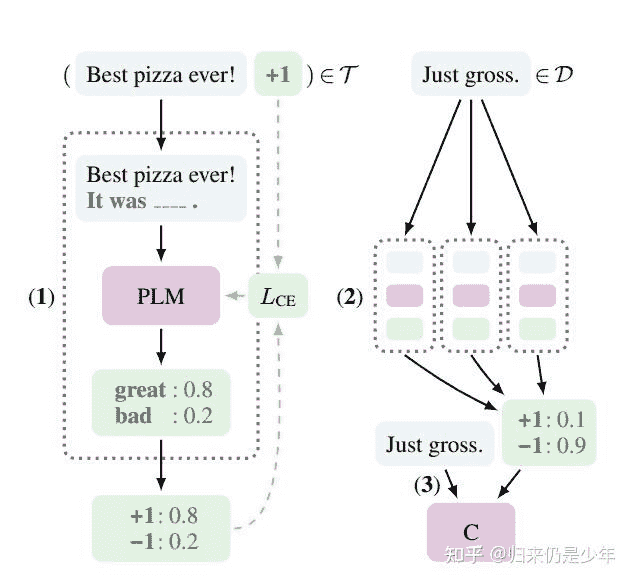
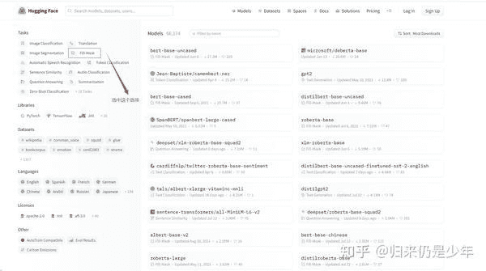
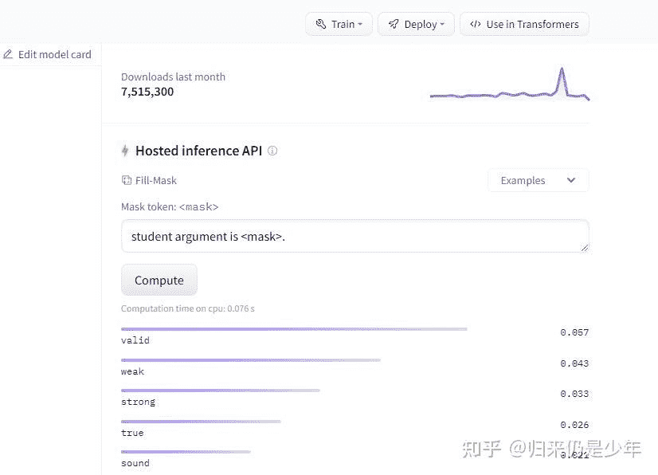
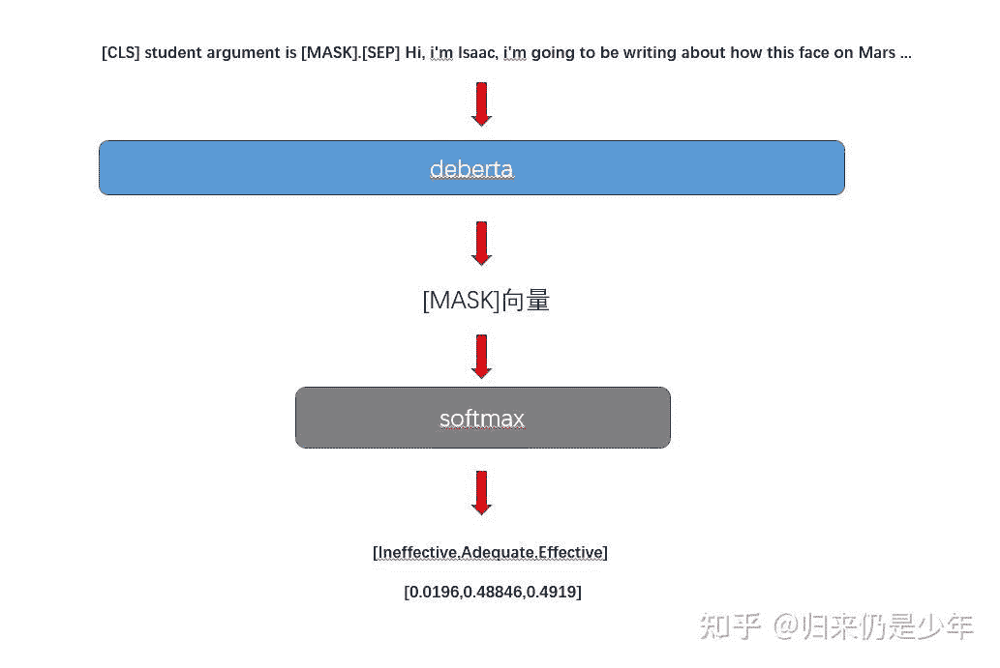

# 基于prompt方法打败传统微调

> 来源：[https://agijuejin.feishu.cn/docx/XeErdImrVoUKN0xPaEocCuBsnLc](https://agijuejin.feishu.cn/docx/XeErdImrVoUKN0xPaEocCuBsnLc)

> 作者：归来仍是少年

> 原文：[https://zhuanlan.z](https://zhuanlan.zhihu.com/p/556179022)hihu.com/p/556179...

## 一、前言

prompt是新型的范式，主要是针对于少样本和零样本。prompt目前主要是分为离散型和连续型，上一篇我介绍过连续型prompt。连续型prompt方法没有离散型prompt方法效果好。可以通过人工设计出来的模板，具有更强的可解释性，我在kaggle的Feedback Prize - Predicting Effective Arguments比赛中尝试离散型模板效果比微调高一截。但此方法主要是适用于少样本或者大量样本微调的时候提升效果，并不适合零样本学习。

[归来仍是少年：提示学习soft prompt](https://zhuanlan.zhihu.com/p/532153343)浅尝 120 赞同 · 27 评论 文章

## 二、prompt介绍

prompt主要是利用Bert这类模型的预训练任务mlm，在预训练的时候随机mask掉15%token并且对mask掉的tok[en进行预](https://zhida.zhihu.com/search?q=%E5%85%88%E9%AA%8C%E7%9F%A5%E8%AF%86&zhida_source=entity&is_preview=1)测，从而让Bert模型学到上下文语意关系。prompt就是人工构造模板来靠近Bert在大数据上预训练学习到的 先验知识 。将Bert finetune分类任务变成mlm任务。

正常微调举例：

[cls]今天天上都出太阳了，阳光明媚。[SEP]

prompt输入举例：

[cls]今天天气是[MASK]。[SEP] 今天天上都出太阳了，阳光明媚。[SEP]

正常微调的话就是通过数据标签来学习到与天气的映[射关系，文](https://zhida.zhihu.com/search?q=%E5%85%A8%E8%BF%9E%E6%8E%A5%E5%B1%82&zhida_source=entity&is_preview=1)本分类微调是取CLS向量进入 全连接层 进行标签分类。而prompt则是构建提示句，prompt进行微调是取mask预测的结果来映射到标签与mlm任务是保持一致，会更好的利用预训练学习到的知识。因为是人工构建的模板，所以非常取决于构建的模板质量，不同的模板之后准确率可能差距有几个百分点这么大。

**手工设计模板**

Prompt最开始就是从手工设计模板开始的。手工设计一般基于人类的自然语言知识，力求得到语义流畅且高效的模板。例如，Petroni等人在著名的LAMA数据集中为知识探针任务手工设计了cloze templates；Brown等人为问答、翻译和探针等任务设计了prefix templates。手工设计模板的好处是较为直观，但缺点是需要很多实验、经验以及语言专业知识，代价较大。

**

自动学习模**板

为了解决手工设计模板的缺点，许多研究开始探究如何自动学习到合适的模板。自动学习的模板又可以分为离散（Discrete Prompts）和连续（Continuous Prompts）两大类。离散的主要包括 Prompt Mining, Prompt Paraphrasing, Gradient-based Search, Prompt Generation 和 Prompt Scoring；连续的则主要包括Prefix Tuning, Tuning Initialized with Discrete Prompts 和 Hard-Soft Prompt Hybrid Tuning。

## 三、在kaggle Feedback Prize比赛实验prompt并改进方法

之前在kaggle论坛看到取得grand master的老哥用的是prompt方法获得金牌，于是我决定尝试prompt方法，不然可能会技术落后。

找到一篇prompt的相关论文并且根据论文思路做了些改进，方法实现起来会更加的方便和快捷。pet论文是做少样本文本分类，显著提高了少样本下文本分类的效果。

**论文标题：**

Exploiting Cloze Questions for Few Shot Text Classification and Natural Language Inference。



论文中将文本分类任务转化成类似于阅读理解填空的PLM，阅读理解和Bert预训练任务mlm有点区别的地方在于，阅读理解填空的答案是从文章中寻找候选项，而mlm任务预测mask填空部分其中Bert整个词表里面的token都是填空候选。所以我们在构建模板的时候需要注意的是预测mask的token必须要和我们文本分类任务的标签产生联系。人工构建的模板最好是能在零样本下预测mask的token靠近下游文本分类的标签，无疑这样的模板是成功的。

简单介绍下Feedback Prize比赛任务，学生对于一篇议论文的提出自己的论点，标签是三类分别是Adequate（足够的）、Effective（有效的）、Ineffective（无效的）。

针对上面任务如何构建有效的模板呢？下面我来介绍我的技巧。

这里可以使用最简单的办法，利用huggingface models的api。



从里面随便挑选一个model来做实验。我这里就选择robert base。

比赛任务是来分类学生对于议论文提出的论点正确与否，于是我构建这样的模板：

student argument is <mask>.



从图中可以看roberta base预测出来的top5 token，valid（有效的）、weak（不能令人信服的）、strong（强有力的）、true（正确的）、sound（合理的）。

MASK预测top3 token与标签映射关系：

valid ---> Effective

weak ---> Ineffective

strong ---> Adequate

prompt+预训练模型，在数据上微调的时候学习到不同的文本句子中mask预测值和标签产生了强关联性，这样就将文本分类任务转化为mask lm任务。

**prompt常规做法：**

常规做法是在微调之后取mask预测的词然后去之前设定好的标签映射字典找到对应预测结果，微调的反向传播会更新模型权重提高mask位置预测词的精准性。这个方法的好处就是在零样本下也可以使用，坏处就是需要找标签映射词稍微麻烦点。

**我改进的prompt做法：**

其实我的主体思想也是pet这篇论文演化出来的，主要是改进了需要事先构建标签映射的麻烦事。预测结果直接和文本分类是一样的，但是我取的向量并不是CLS向量，而是MASK位置的向量， 模板中只需要一个mask标识符就好，因为只需要学到映射关系就行 。



映射标签的操作我交给全连接层来做，只需要将deberta输出向量mask位置的向量输入进全连接层，这样在微调的时候全连接预测结果靠近分类标签。这样做有个缺点就是不能应用在零样本上，只适合少样本和全量数据微调。

## 四、prompt实现

插入模板实现

```
tokenizer = AutoTokenizer.from_pretrained(CFG.model)
collate_fn = Collate(tokenizer, isTrain=True)
df = pd.read_csv(&quot;./feedback/train.csv&quot;)
df[&#x27;essay&#x27;] = df[&#x27;essay_id&#x27;].apply(fetchEssay)
query = &#x27;student argument is &#x27;+str(tokenizer.mask_token)+&#x27;.&#x27;
new_label = {&quot;Ineffective&quot;: 0, &quot;Adequate&quot;: 1, &quot;Effective&quot;: 2}
df[&#x27;discourse_effectiveness&#x27;]  = df[&#x27;discourse_effectiveness&#x27;].apply(lambda x: new_label[x] )
#query+tokenizer.sep_token+
df[&#x27;text&#x27;]  = df.apply(lambda x: query+tokenizer.sep_token+x[&#x27;discourse_type&#x27;]+tokenizer.sep_token+x[&#x27;discourse_text&#x27;]+tokenizer.sep_token+x[&#x27;essay&#x27;],axis=1) #df.apply(lambda x: x[&#x27;essay_id&#x27;]+&#x27;[SEP]&#x27;+x[&#x27;discourse_id&#x27;]+&#x27;[SEP]&#x27;+x[&#x27;discourse_text&#x27;],axis=1)
mask_index = tokenizer.encode_plus(query,
                           add_special_tokens=True,
                           max_length=CFG.max_len,
                           truncation=True,
                           return_offsets_mapping=False)[&quot;input_ids&quot;].index(tokenizer.mask_token_id)
print(&#x27;mask的位置在&#x27;,mask_index)
```

模型部分

```
class FeedBackModel(nn.Module):
    def __init__(self, model_path):
        super(FeedBackModel, self).__init__()
        self.config = AutoConfig.from_pretrained(model_path)
        self.model = AutoModel.from_pretrained(model_path)
        self.linear = nn.Linear(self.config.hidden_size,CFG.target_size)

    def forward(self, ids, mask, mask_index):
        x = self.model(ids, mask)[0][:,mask_index,:]
        pred = self.linear(x)
        return pred
```

完整文本分类代码

```
import gc
import os
from re import X
from unittest import TestSuite
os.environ[&#x27;CUDA_VISIBLE_DEVICES&#x27;] = &#x27;1&#x27;
os.environ[&#x27;CUDA_LAUNCH_BLOCKING&#x27;] = &#x27;1&#x27;
os.environ[&quot;TOKENIZERS_PARALLELISM&quot;] = &quot;false&quot;
import sys
import time
import pickle
import random
import numpy as np
import pandas as pd
# from tqdm.notebook import tqdm
from tqdm import tqdm 
from sklearn.metrics import log_loss
from sklearn.model_selection import StratifiedKFold,GroupKFold
from tools import StratifiedGroupKFold
import torch
import transformers
import torch.nn as nn
import torch.nn.functional as F
from torch.cuda.amp import GradScaler, autocast
from torch.utils.data import Dataset, DataLoader
from text_unidecode import unidecode
from typing import Dict, List, Tuple
from torchcontrib.optim import SWA
import codecs
from transformers import AutoModel, AutoTokenizer, AdamW, get_linear_schedule_with_warmup, get_cosine_schedule_with_warmup,AutoConfig

import warnings
warnings.simplefilter(&#x27;ignore&#x27;)

def fetchEssay(essay_id: str):
    &quot;&quot;&quot;
    Read the text file of the specific essay_id
    &quot;&quot;&quot;
    essay_path = os.path.join(&#x27;./feedback/train/&#x27;, essay_id + &#x27;.txt&#x27;)
    essay_text = open(essay_path, &#x27;r&#x27;).read()
    return essay_text

def seed_everything(seed):
    np.random.seed(seed)
    torch.manual_seed(seed)
    torch.cuda.manual_seed(seed)
    torch.backends.cudnn.deterministic = True
    torch.backends.cudnn.benchmark = False
    # Set a fixed value for the hash seed
    os.environ[&#x27;PYTHONHASHSEED&#x27;] = str(seed)

class CFG:
    wandb=True
    competition=&#x27;PPPM&#x27;
    _wandb_kernel=&#x27;nakama&#x27;
    debug=False
    apex=False
    print_freq=100
    num_workers=4
    model=&#x27;./pretrain_model/deberta_v3_large&#x27;
    scheduler=&#x27;cosine&#x27; # [&#x27;linear&#x27;, &#x27;cosine&#x27;]
    batch_scheduler=True
    num_cycles=0.5
    num_warmup_steps=0
    epochs=1
    encoder_lr=1e-5
    decoder_lr=1e-5
    min_lr=1e-6
    eps=1e-6
    betas=(0.9, 0.999)
    batch_size=8
    fc_dropout=0.1
    target_size=3
    max_len=512
    weight_decay=0.01
    gradient_accumulation_steps=1
    max_grad_norm=1000
    seed=42
    n_fold=5
    trn_fold=[i for i in range(n_fold)]
    train=True
seed_everything(CFG.seed)

class callback:
    def __init__(self):
        self.loss = list()
        self.model = list()
    
    def put(self, model, loss):
        self.loss.append(loss)
        self.model.append(model)

    def get_model(self):
        ind = np.argmin(self.loss)
        return self.model[ind]

class FeedBackDataset(Dataset):
    def __init__(self, data, model_path, is_test=False):
        self.data = data
        self.is_test = is_test
        self.tokenizer = AutoTokenizer.from_pretrained(model_path)
        
    def __getitem__(self, idx):
        text = self.data[&#x27;text&#x27;].values[idx]
        if not self.is_test:
            target_value = self.data[y_cols].values[idx]
        inputs = self.tokenizer.encode_plus(text,
                           add_special_tokens=True,
                           max_length=CFG.max_len,
                           truncation=True,
                           return_offsets_mapping=False)
        if self.is_test:
            return {
                &#x27;input_ids&#x27;: inputs[&#x27;input_ids&#x27;],
                &#x27;attention_mask&#x27;: inputs[&#x27;attention_mask&#x27;],
            }
        
        else:
            targets = torch.FloatTensor(target_value)
            return {
                &#x27;input_ids&#x27;: inputs[&#x27;input_ids&#x27;],
                &#x27;attention_mask&#x27;: inputs[&#x27;attention_mask&#x27;],
                &#x27;targets&#x27;: targets
            }
        
    def __len__(self):
        return len(self.data)

def softmax(z):
    assert len(z.shape) == 2
    s = np.max(z, axis=1)
    s = s[:, np.newaxis] # necessary step to do broadcasting
    e_x = np.exp(z - s)
    div = np.sum(e_x, axis=1)
    div = div[:, np.newaxis] # dito
    return e_x / div

def monitor_metrics(outputs, targets):
        device = targets.get_device()
        mll = log_loss(
            targets.cpu().detach().numpy(),
            softmax(outputs.cpu().detach().numpy()),
            labels=[0, 1, 2],
        )
        return mll

class Collate:
    def __init__(self, tokenizer, isTrain=True):
        self.tokenizer = tokenizer
        self.isTrain = isTrain
        # self.args = args

    def __call__(self, batch):
        output = dict()
        output[&quot;input_ids&quot;] = [sample[&quot;input_ids&quot;] for sample in batch]
        output[&quot;attention_mask&quot;] = [sample[&quot;attention_mask&quot;] for sample in batch]
        if self.isTrain:
            output[&quot;targets&quot;] = [sample[&quot;targets&quot;] for sample in batch]

        # calculate max token length of this batch
        batch_max = max([len(ids) for ids in output[&quot;input_ids&quot;]])

        # add padding
        if self.tokenizer.padding_side == &quot;right&quot;:
            output[&quot;input_ids&quot;] = [s + (batch_max - len(s)) * [self.tokenizer.pad_token_id] for s in output[&quot;input_ids&quot;]]
            output[&quot;attention_mask&quot;] = [s + (batch_max - len(s)) * [0] for s in output[&quot;attention_mask&quot;]]
        else:
            output[&quot;input_ids&quot;] = [(batch_max - len(s)) * [self.tokenizer.pad_token_id] + s for s in output[&quot;input_ids&quot;]]
            output[&quot;attention_mask&quot;] = [(batch_max - len(s)) * [0] + s for s in output[&quot;attention_mask&quot;]]

        # convert to tensors
        output[&quot;input_ids&quot;] = torch.tensor(output[&quot;input_ids&quot;], dtype=np.long)
        output[&quot;attention_mask&quot;] = torch.tensor(output[&quot;attention_mask&quot;], dtype=np.long)
        if self.isTrain:
            output[&quot;targets&quot;] = torch.tensor(output[&quot;targets&quot;], dtype=np.long)

        return output

tokenizer = AutoTokenizer.from_pretrained(CFG.model)
collate_fn = Collate(tokenizer, isTrain=True)
df = pd.read_csv(&quot;./feedback/train.csv&quot;)
df[&#x27;essay&#x27;] = df[&#x27;essay_id&#x27;].apply(fetchEssay)
query = &#x27;student argument is &#x27;+str(tokenizer.mask_token)+&#x27;.&#x27;
new_label = {&quot;Ineffective&quot;: 0, &quot;Adequate&quot;: 1, &quot;Effective&quot;: 2}
df[&#x27;discourse_effectiveness&#x27;]  = df[&#x27;discourse_effectiveness&#x27;].apply(lambda x: new_label[x] )
#query+tokenizer.sep_token+
df[&#x27;text&#x27;]  = df.apply(lambda x: query+tokenizer.sep_token+x[&#x27;discourse_type&#x27;]+tokenizer.sep_token+x[&#x27;discourse_text&#x27;]+tokenizer.sep_token+x[&#x27;essay&#x27;],axis=1) #df.apply(lambda x: x[&#x27;essay_id&#x27;]+&#x27;[SEP]&#x27;+x[&#x27;discourse_id&#x27;]+&#x27;[SEP]&#x27;+x[&#x27;discourse_text&#x27;],axis=1)
mask_index = tokenizer.encode_plus(query,
                           add_special_tokens=True,
                           max_length=CFG.max_len,
                           truncation=True,
                           return_offsets_mapping=False)[&quot;input_ids&quot;].index(tokenizer.mask_token_id)
print(&#x27;mask的位置在&#x27;,mask_index)
print(tokenizer.tokenize(query))
print(df.head())
OUTPUT_DIR = &#x27;./save_model/&#x27;
os.system(&#x27;rm -rf &#x27;+OUTPUT_DIR+&#x27;*&#x27;)
y_cols = [&#x27;discourse_effectiveness&#x27;]

class FeedBackModel(nn.Module):
    def __init__(self, model_path):
        super(FeedBackModel, self).__init__()
        self.config = AutoConfig.from_pretrained(model_path)
        self.model = AutoModel.from_pretrained(model_path)
        self.linear = nn.Linear(self.config.hidden_size,CFG.target_size)

    def forward(self, ids, mask):
        x = self.model(ids, mask)[0][:,mask_index,:]
        pred = self.linear(x)
        return pred
        
class FGM():
    def __init__(self, model):
        self.model = model
        self.backup = {}

    def attack(self, epsilon=0.5, emb_name=&#x27;word_embeddings&#x27;): #DebertaV2Embeddings.word_embedding
        # emb_name这个参数要换成你模型中embedding的参数名
        # 例如，self.emb = nn.Embedding(5000, 100)
        for name, param in self.model.named_parameters():
            if param.requires_grad and emb_name in name:
                self.backup[name] = param.data.clone()
                norm = torch.norm(param.grad) # 默认为2范数
                if norm != 0:
                    r_at = epsilon * param.grad / norm
                    param.data.add_(r_at)

    def restore(self, emb_name=&#x27;word_embeddings&#x27;):
        # emb_name这个参数要换成你模型中embedding的参数名
        for name, param in self.model.named_parameters():
            if param.requires_grad and emb_name in name: 
                assert name in self.backup
                param.data = self.backup[name]
        self.backup = {}


kf = StratifiedGroupKFold(n_splits=CFG.n_fold)
local_cv_loss = 0
for i, (train_idx, valid_idx) in enumerate(kf.split(X=df,y=df[&#x27;discourse_effectiveness&#x27;], groups=df[&#x27;essay_id&#x27;])):
    # if i+1 not in [4]:
    #     continue
    # if i+1 == 1 :
    #     CFG.encoder_lr = 8e-6
    #     CFG.decoder_lr = 8e-6
    print(&#x27;*&#x27;*50+f&#x27;fold {i+1}&#x27;+&#x27;*&#x27;*50)
    gc.collect()

    cb = callback()
    
    train_loader = torch.utils.data.DataLoader(FeedBackDataset(df.loc[train_idx, :].reset_index(drop=True), CFG.model), batch_size=CFG.batch_size, shuffle=True, num_workers=4,collate_fn=collate_fn)
    val_loader = torch.utils.data.DataLoader(FeedBackDataset(df.loc[valid_idx, :].reset_index(drop=True), CFG.model), batch_size=CFG.batch_size, shuffle=False, num_workers=4,collate_fn=collate_fn)
    
    net = FeedBackModel(CFG.model)
    net.cuda()
    fgm = FGM(net)
    loss_fn = torch.nn.CrossEntropyLoss()
    def get_optimizer_params(model, encoder_lr, decoder_lr, weight_decay=0.0):
        no_decay = [&quot;bias&quot;, &quot;LayerNorm.bias&quot;, &quot;LayerNorm.weight&quot;]
        optimizer_parameters = [
            {&#x27;params&#x27;: [p for n, p in model.model.named_parameters() if not any(nd in n for nd in no_decay)],
             &#x27;lr&#x27;: encoder_lr, &#x27;weight_decay&#x27;: weight_decay},
            {&#x27;params&#x27;: [p for n, p in model.model.named_parameters() if any(nd in n for nd in no_decay)],
             &#x27;lr&#x27;: encoder_lr, &#x27;weight_decay&#x27;: 0.0},
            {&#x27;params&#x27;: [p for n, p in model.named_parameters() if &quot;model&quot; not in n],
             &#x27;lr&#x27;: decoder_lr, &#x27;weight_decay&#x27;: 0.0}
        ]
        return optimizer_parameters
    optimizer_parameters = get_optimizer_params(net,
                                                encoder_lr=CFG.encoder_lr, 
                                                decoder_lr=CFG.decoder_lr,
                                                weight_decay=CFG.weight_decay)
    optimizer = AdamW(net.parameters(), lr = CFG.encoder_lr, eps=CFG.eps, betas=CFG.betas)
    num_train_optimization_steps = int(CFG.epochs * len(train_loader) / CFG.gradient_accumulation_steps)
    # ====================================================
    # scheduler
    # ====================================================
    def get_scheduler(cfg, optimizer, num_train_steps):
        if cfg.scheduler == &#x27;linear&#x27;:
            scheduler = get_linear_schedule_with_warmup(
                optimizer, num_warmup_steps=cfg.num_warmup_steps, num_training_steps=num_train_steps
            )
        elif cfg.scheduler == &#x27;cosine&#x27;:
            scheduler = get_cosine_schedule_with_warmup(
                optimizer, num_warmup_steps=cfg.num_warmup_steps, num_training_steps=num_train_steps, num_cycles=cfg.num_cycles
            )
        return scheduler
    scheduler = get_scheduler(CFG, optimizer, num_train_optimization_steps)
    scaler = torch.cuda.amp.GradScaler()
    best_log_loss = float(&#x27;inf&#x27;)
    for epoch in range(CFG.epochs):
        start_time = time.time()
        avg_loss = 0.0
        net.train()
        tbar = tqdm(train_loader, file=sys.stdout)
        loss_list = []
        val_loss_list = []
        val_log_loss_list = []
        
        for step, data in enumerate(tbar):
            # get the inputs
            input_ids = data[&#x27;input_ids&#x27;].cuda()
            input_masks = data[&#x27;attention_mask&#x27;].cuda()
            targets = data[&#x27;targets&#x27;].long().view(-1).cuda()
            with torch.cuda.amp.autocast():
                pred = net(input_ids,input_masks)       
                loss = loss_fn(pred, targets)
                loss = loss / CFG.gradient_accumulation_steps
            scaler.scale(loss).backward()
            with torch.cuda.amp.autocast():
                fgm.attack() # 在embedding上添加对抗扰动#model.embeddings.word_embeddings
                pred = net(input_ids,input_masks) 
                loss_adv = loss_fn(pred, targets) / CFG.gradient_accumulation_steps              
            scaler.scale(loss_adv).backward()
            fgm.restore() # 恢复embedding参数
            if (step+1) % CFG.gradient_accumulation_steps == 0 or step == len(tbar) - 1:
                scaler.step(optimizer)
                scaler.update()
                optimizer.zero_grad()
                scheduler.step()
                
            loss_list.append(loss.detach().cpu().item())
            avg_loss = np.round(np.mean(loss_list), 4)
            tbar.set_description(f&quot;Epoch {epoch + 1} Loss: {avg_loss} lr: {scheduler.get_last_lr()}&quot;)
        net.eval()
        avg_val_loss = float(&#x27;inf&#x27;)
        avg_val_log_loss = float(&#x27;inf&#x27;)
        tbar_val = tqdm(val_loader, file=sys.stdout)
        for step, data in enumerate(tbar_val):
            # get the inputs
            input_ids = data[&#x27;input_ids&#x27;].cuda()
            input_masks = data[&#x27;attention_mask&#x27;].cuda()
            targets = data[&#x27;targets&#x27;].long().view(-1).cuda()
            with torch.no_grad():
                pred = net(input_ids,input_masks)
            loss = loss_fn(pred, targets)
                
            val_loss_list.append(loss.detach().cpu().item())
            avg_val_loss = np.round(np.mean(val_loss_list), 4)

            val_log_loss = monitor_metrics(pred, targets)
            val_log_loss_list.append(val_log_loss)
            avg_val_log_loss = np.round(np.mean(val_log_loss_list), 4)
            tbar_val.set_description(f&quot;Epoch {epoch + 1} Loss: {avg_val_loss:.4f} val_log_loss: {avg_val_log_loss:.4f}&quot;)

        if best_log_loss &gt; avg_val_log_loss:
            best_log_loss = avg_val_log_loss
            torch.save({&#x27;model&#x27;: net.state_dict()},
                        OUTPUT_DIR+f&quot;{CFG.model.split(&#x27;/&#x27;)[-1]}_fold{i}_best.pth&quot;)
        print(f&#x27;Epoch {epoch+1} Loss: {avg_val_loss:.4f} val_log_loss: {avg_val_log_loss:.4f} --- Save Best log_loss: {best_log_loss:.4f} Model&#x27;)
        print(&#x27;\n&#x27;)
        cb.put(net, avg_val_loss)
    if best_log_loss is not float(&#x27;inf&#x27;):
        local_cv_loss += best_log_loss/CFG.n_fold
print(f&#x27;local cv loss: {local_cv_loss:.4f}&#x27;)
```

## 五、简单消融实验

Feedback Prize - Predicting Effective Arguments（训练集3.6w）

| 模型 | logloss |
| --- | --- |
| deberta large+fgm+五折+微调 | 0.634 |
| deberta large+fgm+五折+prompt | 0.602 |

高 [鲁棒性 ](https://zhida.zhihu.com/search?q=%E9%B2%81%E6%A3%92%E6%80%A7&zhida_source=entity&is_preview=1)要求下的领域事件检测任务关系分类（训练集4.2w）

| 模型 | f1 |
| --- | --- |
| nezha wwm base+微调 | 86 |
| nezha wwm base+prompt | 88 |

业务数据集文本分类（训练集40w+）

| 模型 | f1 |
| --- | --- |
| bert base+微调 | 0.9779 |
| bert base+prompt | 0.9806 |

从结果是看prompt能够提升几个百分点，但人工的prompt非常依赖设计的模板，不同模板可能会差几个百分点。

## 六、总结

我这改进的方法主要是一种微调的优化方法，能够在少样本和大量样本上产生较好的提升，prompt算是现在研究的重点之一，工业界大部分都是少样本的情况，标注成本比较高，prompt能够在少样本上带来比较大的提升同时又不会降低推理速度，在工业界上具有较高的应用价值。

## 七、 [参考文献](https://zhida.zhihu.com/search?q=%E5%8F%82%E8%80%83%E6%96%87%E7%8C%AE&zhida_source=entity&is_preview=1)

+   AI Box专栏：NLP新宠——浅谈Prompt的前世今生

+   [https:// arxiv.org/](https://link.zhihu.com/?target=https%3A//arxiv.org/pdf/2001.07676.pdf)pdf/2001.0767 6.pdf

+   [https:// arxiv.org/](https://link.zhihu.com/?target=https%3A//arxiv.org/pdf/2107.13586.pdf)pdf/2107.1358 6.pdf

+   归来仍是少年：提示学习soft prompt浅尝