# 实用至上：智能体/Agent 是什么

> 来源：[https://agijuejin.feishu.cn/docx/Su4YdtStdo5SW2xqlSpcNeeunUb](https://agijuejin.feishu.cn/docx/Su4YdtStdo5SW2xqlSpcNeeunUb)

> 作者：金色传说大聪明 | 赛博禅心

> https://mp.weixin.qq.com/s/xQPmiEfFOOp8R5zgTcYHDA

我算比较资深的 Agent 开发者：ChatGPT中，用量最大的 Plugin 和用量最大的华人捏的 Bot，可能都是我做的。

之前写过一篇实操教程：《保姆级教程：Coze 打工你躺平》，今天想从 Agent 的发展脉络，来更深入谈谈。

## Agent 的起源

不做词义追源，仅从大众角度，这个事儿是去年初开始的，也就是 2023 年 2-3 月。标志性事件包括：

+   AutoGPT 等开源项目的发布，这是第一批基于自然语言的 AI 自动化实践：你告诉它一个任务，它就会通过自然语言的自我对话，将这个任务进行拆分、规划并实现。

+   斯坦福小镇一类的项目实践：给予不同的 Bot 以不同的人格，搭配记忆窗口，让它们之间相互对话。

+   发表于 2 月的论文《Toolformer: 大模型可以教自己使用工具》，以及 OpenAI 在 3 月底发布的插件计划：这意味着，大模型从原来的“思想家”，通过对外部工具的使用，变成了实干家。

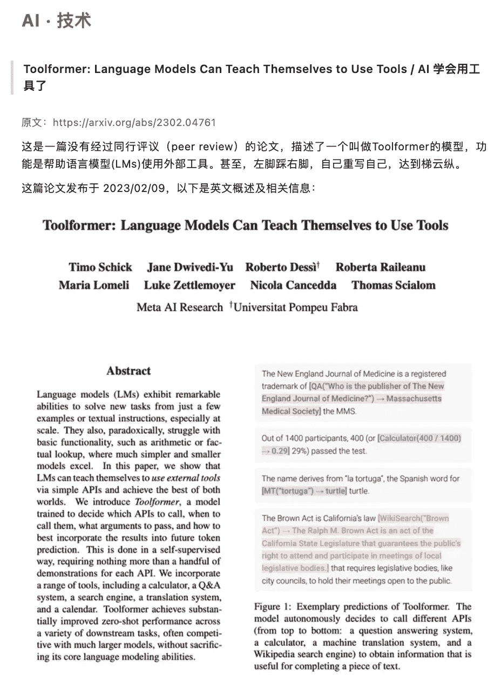

## 现在的 Agent

时至今日，对于 Agent 是什么，可能还没有一个标准的定义。

一个常见的观点是，Agent 是一种让 AI 以类似人的工作和思考方式，来完成一系列的任务。一个 Agent 可以是一个 Bot，也可以是多个 Bot 的协同。就像是职场里，简单的工作独立完成，复杂的工作协作完成一样。

对于每个 Bot 来说，可能会包括：

+   **一个大脑**：判断和规划行为，这里通常用 GPT-4或同水平的 LLM；

+   **眼睛和手**：确认信息和使用外部工具，一般是各种插件/action/api；

+   **工作纪要**：储存已经发生的事，通常的媒介是上下文窗口，或者数据库；

+   **行为SOP**：明确这个 Agent 的身份、任务、目标和机制。这个 SOP 可能是用户给的，也可能是由其它 Bot 给出的。

再具象一点，这里我从 GPTs 里截了个图：

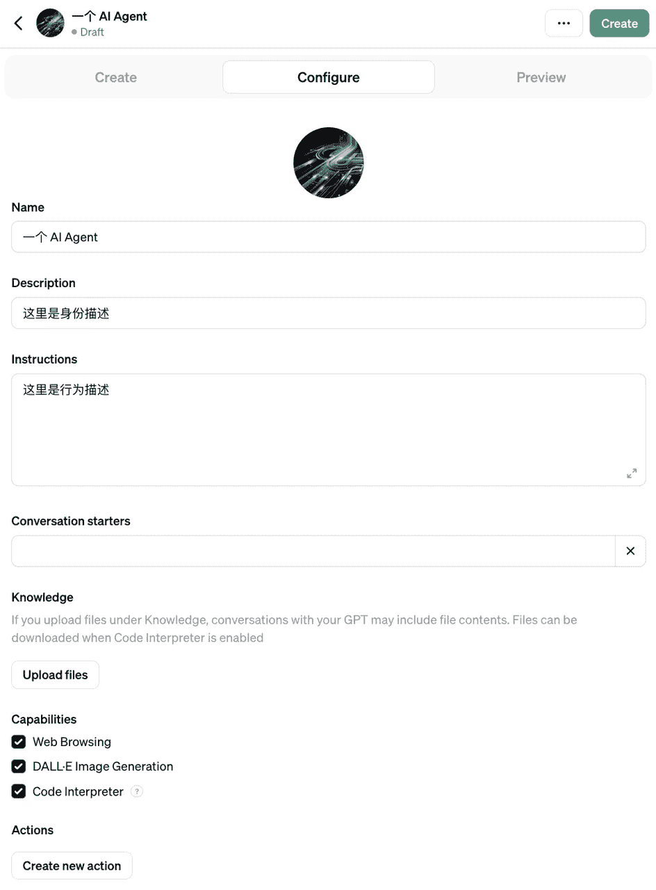

对于 GPTs，通常被认为是由 OpenAI 设计的简化版的 Agent。默认情况下，只能进行单 Bot 交互：

+   **一个大脑**：在 ChatGPT GPT Store 里，GPT-4 是唯一可选的 LLM；

+   **眼睛和手**：可以在 Capabilities 里勾选由 OpenAI 提供的第一方能力，也可以通过Actions 来拓展更多的外部能力；

+   **工作纪要**：一般来说就是对话记录，GPTs 可以回顾之前的对话；

+   **行为SOP**：存放在 Description, Instructions 以及 Knowledge 里。

## OpenAI 的 Agent 演进

以 OpenAI 为例，我们看看 Agent 是如何一步步演进的。

去年 3 月底，OpenAI 宣布了插件计划，并在 5 月上线了插件商店，这也标志了 OpenAI 揭开 Agent 战局的第一步。

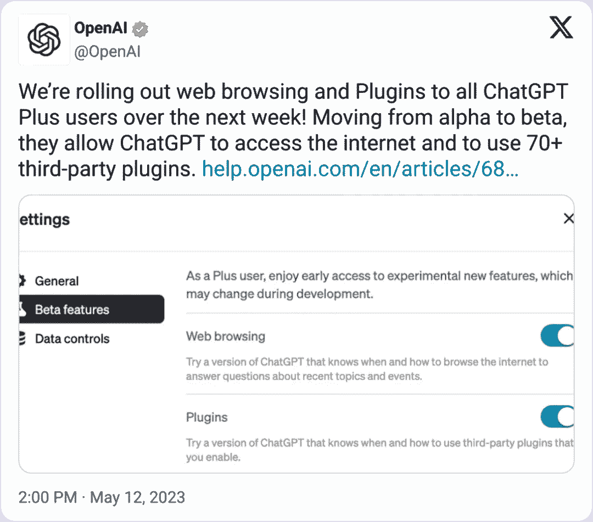

在当时 OpenAI 给开发者发送的指引中，给了这样的 Todo：

+   **第一步**：开发接口，来定义 ChatGPT 可以调用的功能。接口可以是新开发的，也可以是改造现有的

+   **第二步**：写一份文档，给 ChatGPT 来看，让它知道什么时候去调用接口。当然，这里要遵循一定的格式，然后用自然语言来写。

如果你做过 OpenAI API 的开发，可能会觉得这个文档有些熟悉，这不就是 Fuction Call 吗？

没错，在 2023 年 6 月 13 日，OpenAI 发布了 Function Call 模式，让大模型可以来调用外部工具，用的就是非常类似的方案。

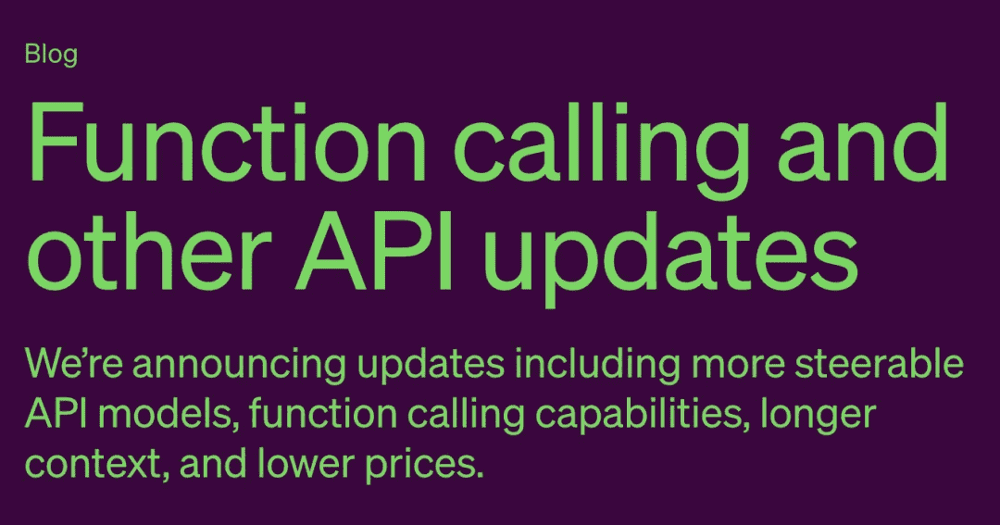

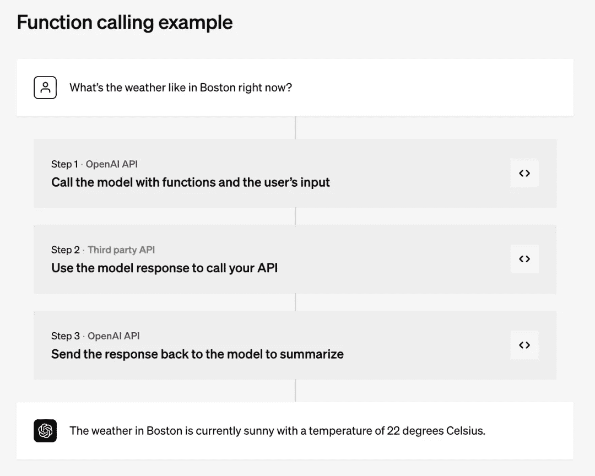

再往后，OpenAI 的相关工作人员做了一系列的 Research，关于 Agent 的最佳实践。同时的，也发布了 Custom Instruction 指令的相关功能。

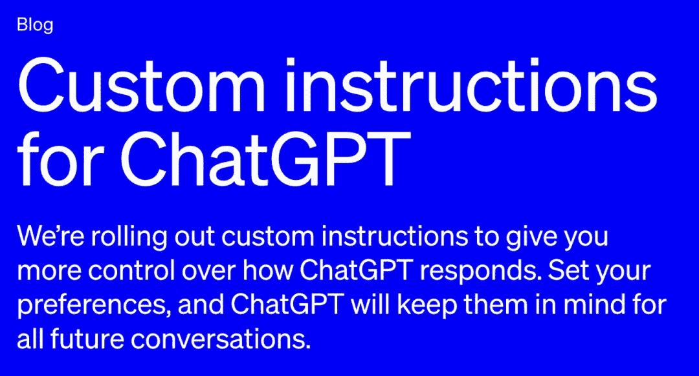

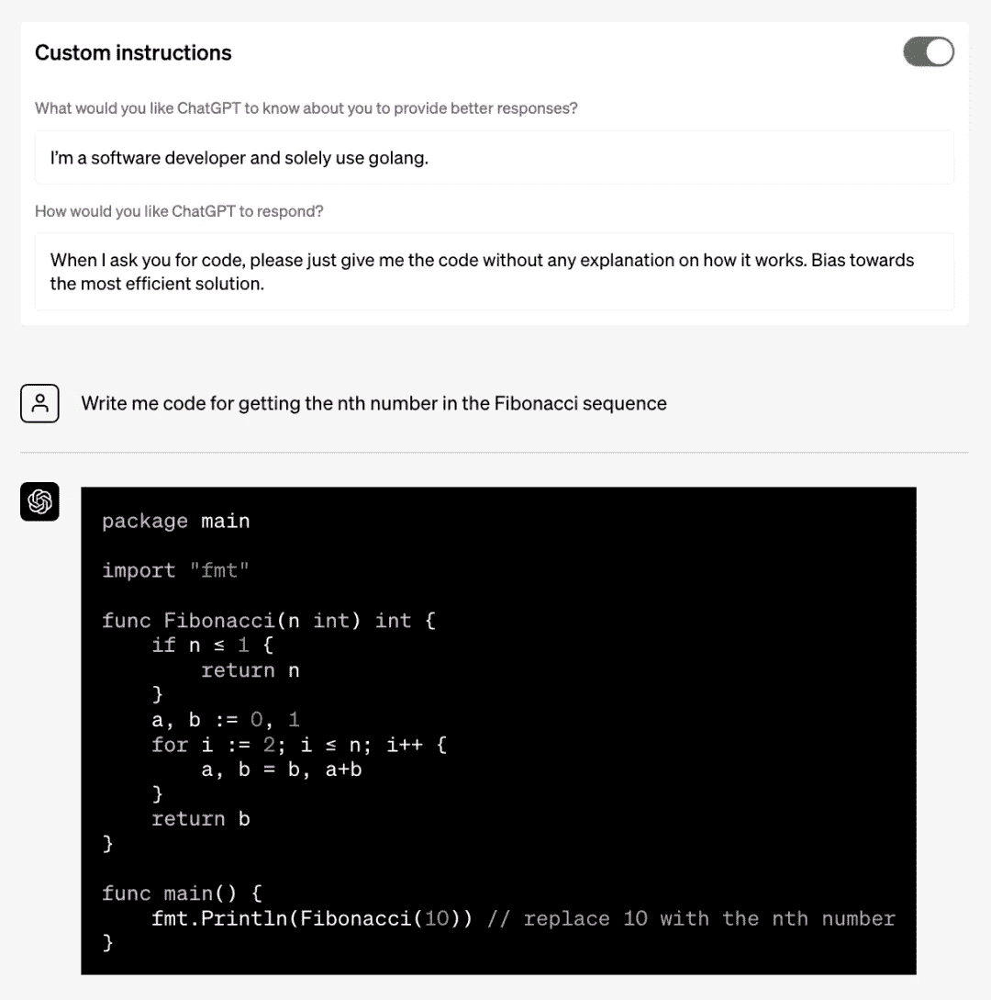

之后，ChatGPT 推出了 All Tools 功能。也就是回答用户问题时，不再需要用户自主的来选择工具，这可以视作是“自动版的Plugin”，覆盖了三款官方工具：Browsing, Advanced Data Analysis 和 DALL·E。

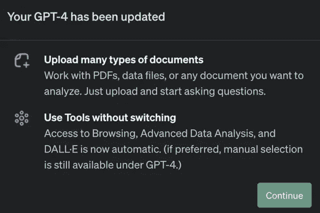

时间推移，在2023 年 11 月 6 日的时候，在 OpenAI 开发者大会上，Sam Altman 宣布了 GPTs，这通常被认为是 OpenAI 推出了其第一个正式版的 AI Agent。在最初的版本中，包括以下功能

+   允许用户创建多个 Bot，自定义它们的身份和回答风格。并且这些 Bot 可以分享

+   Bot 可以自由使用三款官方工具：Browsing, Advanced Data Analysis 和 DALL·E

+   Bot 也可以通过 Action 的方式（类似 API 的东西），去调用任何的外部能力

+   [**Bot 可以有自己的数据**](http://mp.weixin.qq.com/s?__biz=MzkzNDQxOTU2MQ==&mid=2247486714&idx=1&sn=43e3bd41f23a6ec836e5184aafa8acef&chksm=c2bcc1fcf5cb48ea428f74a9f6925cd9422de67a9c43740f71ec62b8730fa3511b779961bae2&scene=21#wechat_redirect)空间，允许用户对这些数据进行 QA。比如在《我刚弄个贼实用的GPTs》中，我上传了 OpenAI 的开发文档，帮助开发者快速生成 OpenAI 的调用代码

同时，在11月06日的时候，OpenAI 也更新了几个影响深远的接口：

+   Function Calling：更新多参数生成功能，可以让一轮对话完成多项任务

+   **JSON Mode**：让 API 通过 JSON，而非文字，来做出回应

+   **Seed**：设定随机值，提高一致性

+   Assistants API & Code Interpreter：可以理解为把 ChatGPT 的 Bot，搬到了 API 里

+   **Retrieval**：简易化知识库构建

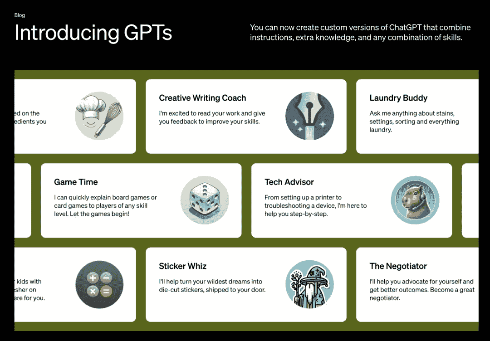

在最近 GPTs  体系上线了 GPT Store，有些媒体称其为 OpenAI 的 App Store 时刻，但其实并不相同。在 GPT Store 里，用户可以搜索和使用为各项任务所开发的 GPTs。

紧随 GPT Store 上线的，还有 @GPTs 功能，也就是在任何的对话中，你都可以手动的让某个 GPTs 接管这个对话内容，做出更好的输出。

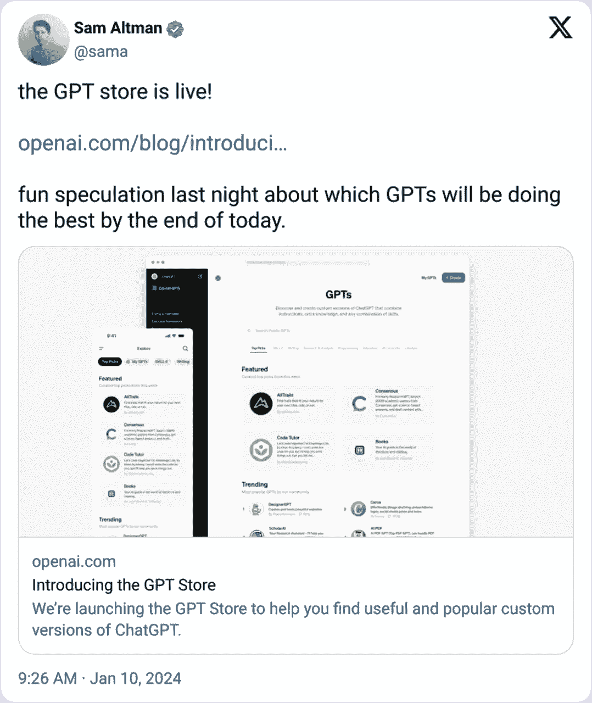

值得一提的是，由于 GPT Store 没有开放支付入口，所以目前几乎所有[**的 GPTs 都是免费的。对此**](http://mp.weixin.qq.com/s?__biz=MzkzNDQxOTU2MQ==&mid=2247487713&idx=1&sn=95727bd341e00994ba2480aee23dc98f&chksm=c2bcdde7f5cb54f18b5f4014687a7fd2b834d7fe7230044f8855f21ea65680b5074a26e89ab3&scene=21#wechat_redirect)，OpenAI 也承诺了会给头部开发者提供激励：《GPTs 商店，要发钱了！！！》。

## 其它 Agent 平台

之前和 OpenAI 的相关负责人聊过，ChatGPT 的主要定位是“开箱即用的消费级产品”。那这里，自然给“较为复杂的生产级产品”留下了生态空间。这里，我们也来探讨下这类产品。

主要的 AI 玩家都会对这方面有所涉足，也各有侧重。比如来传统大厂自字节扣子/coze，百度的灵境矩阵，也比如来自 AI 初创公司的 Dify 等等。

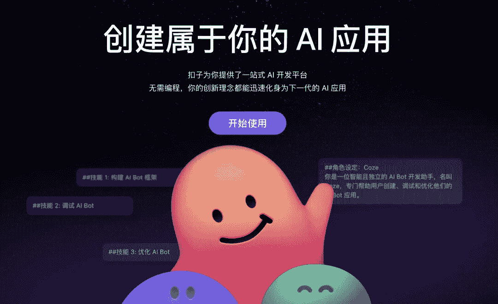

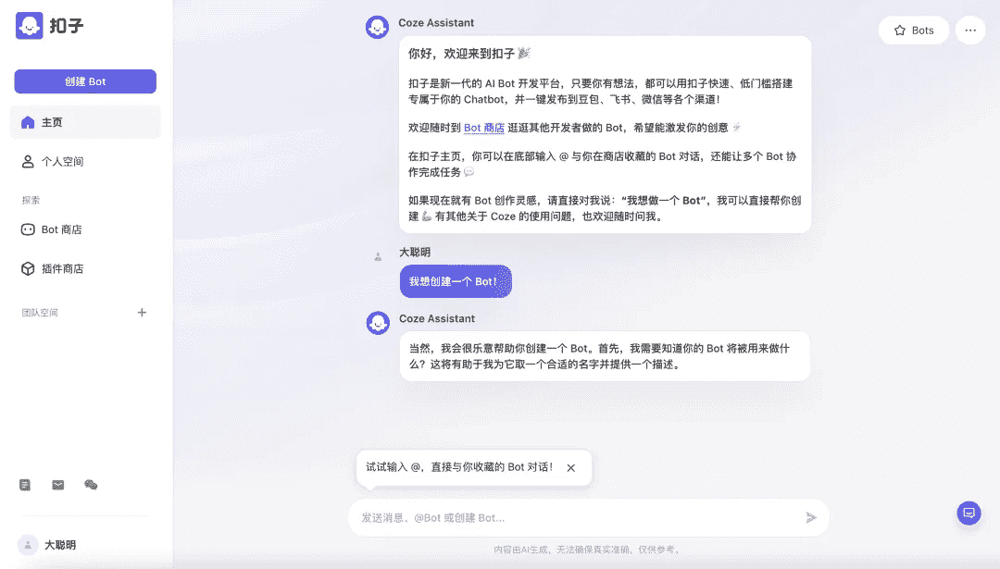

以扣子为例，对比与 GPTs Store，主要的体感区别包括：

+   免费，至少目前是完全免费的

+   有数十个官方插件，对比与 GPTs 里只有3个

+   可以用类似低代码的方式，构建Workflow，并被 Bot 调用

+   可以将捏好的 Bot 发布到其它平台（比如飞书，👸号），同时支持 API

**其中后两条极为核心**。

## 我的 Agent 的实战

一个设计良好的 Agent 可以提供极大的生产力，并创造极高的价值。

前几天大火的 Devin，被称为“第一位由 AI 担任的软件工程师”，它可以自主的去学会如何使用不熟悉的技术，自主的生成代码、调试bug和部署应用。

Ag[ent 也可以替代现有的很多软件工具，去](http://mp.weixin.qq.com/s?__biz=MzkzNDQxOTU2MQ==&mid=2247487509&idx=1&sn=fccd1f1fa399d459492a2d5d2a0d16e5&chksm=c2bcdd13f5cb54058f31c0479e66e09d6b4202bc1bfbc84e86e970da38101846e7f669bcc56f&scene=21#wechat_redirect)完成工作中繁琐的任务。举个例子，我正打算开一个专栏，叫做“乘风破浪的少年们”，去讲述和记录那些在这次 AI 浪潮中，登上世界舞台的中国人，用对话的形式。类似这种：《奥特曼专访：关于 GPT-5、Sora、Ilya、Q\*、AGI、外星人等等一切》。

这里对我来讲的一个很大挑战：我需要整理大量的文字稿，并且把它排版出来，这并不轻松，也很占时间。我希望有一个 Agent 来帮我做这件事情。

昨天下午，我和 Owen（**沉浸式翻译的作者**）去参加了一个 Hackathon，现场有了灵感，并梳理出了这个 Agent 的思路：

+   第一步：将对话音频文件，通过 AI（比如whisper）转化成文字稿

+   第二步：将文字稿用 AI 转化成 QA 问答对，以 json/csv 的方式储存

+   第三步：将 QA 问答对，转化成 HTML（可以导入进🛰️👸号）

我们花了俩小时，用扣子，把这个 Agent 给搓了出来，起名《带带弟弟排版器》，希望大家带带单打独斗的弟弟。也顺道着把我上次参加 OpenAI  的红队活动的笔记，转成了 .csv

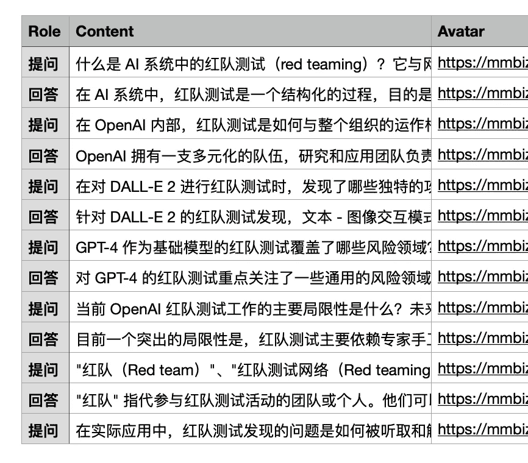

然后把这个 .csv 文件丢给了《带带弟弟排版器》

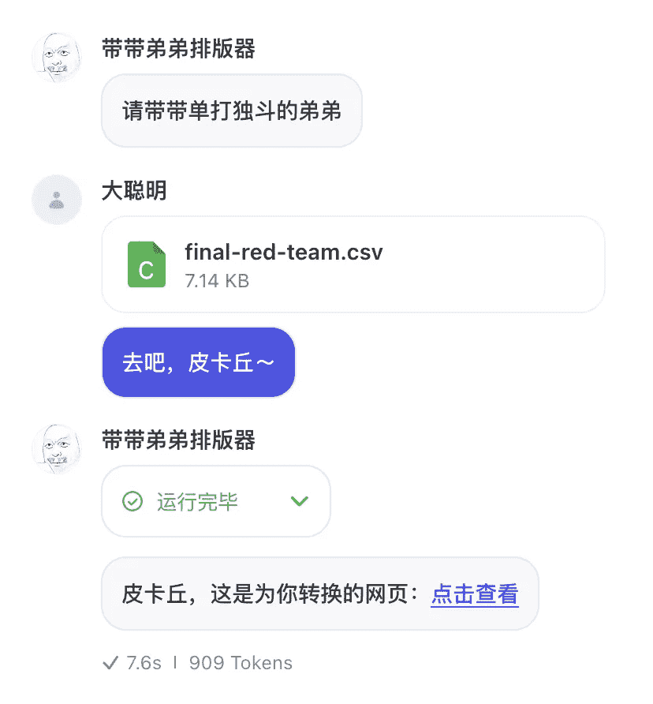

就有了昨天的文章：《我参加了 OpenAI 红队的活动，并带来了一些笔记》

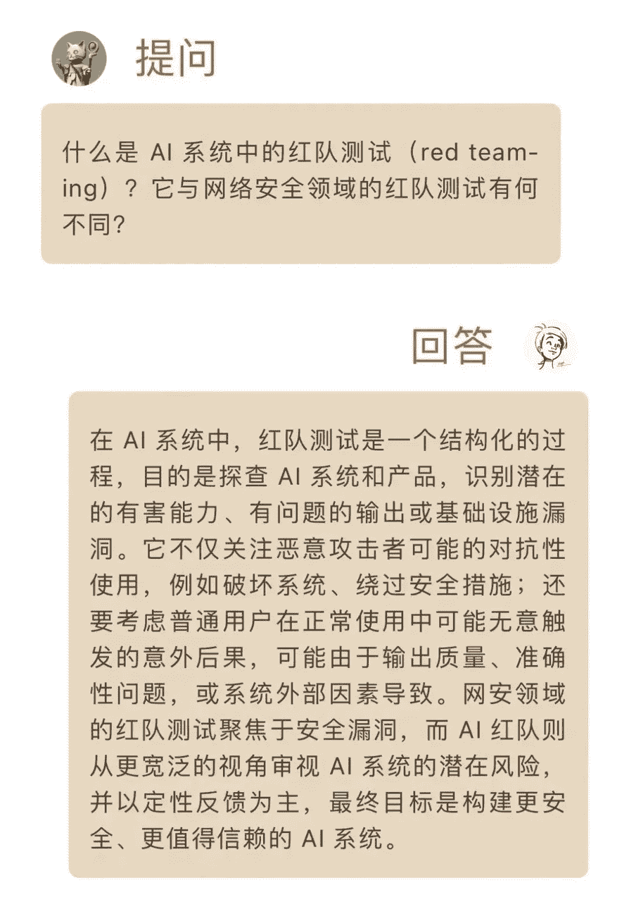

同样的，这一篇文章《中学生能看懂：Sora 原理解读》，是用我写的另一个 Agent 完整生成的，包括排版。

我相信，在 AGI 来之前，Agent 是一个很棒的替代方案。不过现在还有俩主要毛病：1.不够稳定；2.算力有点贵