# 万字长文！何谓Agent，为何Agent？

> 来源：[https://agijuejin.feishu.cn/docx/JOaTdDDlYorbA0xmd6sczCBlnMe](https://agijuejin.feishu.cn/docx/JOaTdDDlYorbA0xmd6sczCBlnMe)
>
> 作者：萧夫 | 下维NextDimension
>
> 原文链接：https://mp.weixin.qq.com/s/jFf0fmZLehLDaNNzgqeAIQ
>
> 浅看是LLM造就了AI应用
>
> 深入思考才发现是AI应用救赎了LLM
>
> 归根到底是LLM还不足够强大
>
> `Human in the loop` 将会成为未来主流，未来无标品只有定制化

AI应用层出不穷爆发式涌现出来，在深思护城河深度之后，市场的玩家齐刷刷地转向到AI Agent

是模型能力的不断提升？还是资方的倒逼？本质上是每个人都想有解决特定任务的AI

在探寻了算法，工程，数据等核心要素价值后，AI应用设计方到底能抓住什么呢？

场景的不断探索，又带来了什么？不可能三角中，市场更加看好的又是什么呢？

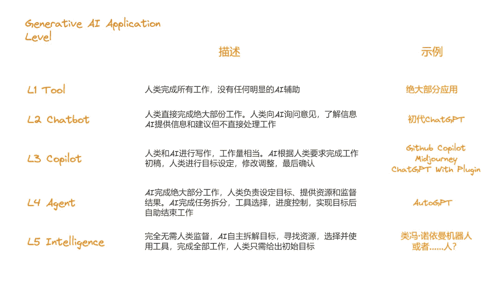

生成式AI的评级---@ZhenFund

Fig.1. 生成式AI产品的分级

根据AI App的智能化能力和解决问题的能力进行等级划分及整体描述，我们可以近似得到以上的能力划分表。随着智能化的程度递增，App能解决的问题范围也逐渐在扩大。

## LLM的过渡状态

操作工具➡建议者➡执行者➡控制器（决策者）➡高级智能体

角色的变化背后是智能属性的增强，当然也是AI能力类脑发展的一个趋势。如果这样一个发展趋势是成立的，那么已经跑通了`PMF`的微软Copilot已经算是`L3`的顶级应用了。他的`Moat`本质上在于场景和深耕多年的B端资源。

当场景的价值弱化，那么工程深度就需要增加“厚度”或技术增强来建立起整体的应用，以保证此类AI应用的`Moat`足够深。

在`AutoGPT`、`BabyGPT`和`GPT-Engineer`的demo爆火之后，以LLM作为核心控制器来构建`L4`的Agent成为一个很酷的概念。应用场景的想象空间被打开，我们发现LLM的潜力不仅限于生成写得很好的副本、故事、文章和程序，它还可以作为一种强大的工具解决通用问题。

## Agent System Overview---@Lilian Weng

Weng, Lilian. (Jun 2023). "LLM-powered Autonomous Agents". Lil’Log. `https://lilianweng.github.io/posts/2023-06-23-agent/.`Autonomous Agent系统由LLM驱动，LLM作为代理的大脑，辅以几个关键的组件。

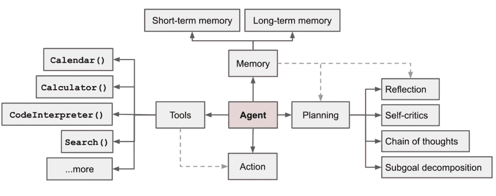

Fig.2. 由LLM驱动的Autonomouse Agent 系统

+ Planning

+ 拆解子目标和任务分解：Agent能够将大型任务分解为较小，易于管理的子目标，从而高效地处理复杂任务。

+ 自查与自纠：Agent能够对过去的actions进行自我批评和自我反省，从错误中吸取教训，并在今后的工作中加以改进，从而提高最终结果的质量（本质上是产生RL的数据，RL并不需要HF）

+ Memory

+ 短期记忆：所有`in-context learning`都是利用模型的短期记忆来进行学习的。（在这背后的主要支撑是`Prompt Engineering`）

+ 长期记忆：为Agent提供了在较长时间内保留和`recall`（无限）信息的能力，通常是利用外部的向量存储和快速检索（借助向量数据库的力量实现）[召回率的高低也直接决定了Agent复杂内容记忆及检索的效果]

+ Tool Use

+ Agent学习调用外部应用程序的`API`，以获取模型训练数据权重中缺失的“额外信息”（任务相关，预训练后通常难以更改），包含当前信息、代码执行能、专有信息源的访问权限等。（`code interpreter`的出现本质上也是OpenAI继`plugin`之后对于Agent的进一步探索）

a16z提出的LLM App的新型架构，与论文中的介绍也是异曲同工。究其本质，是生物性的发展过程和整体类比的结果，将LLM进行类脑比较，定位为整体中枢，进行分工合作。七月初流出的GPT4的设计也有类似的影子，`MOE`的存在。

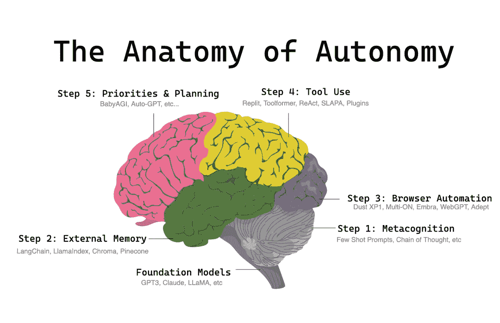

## 第一部分：Planning

一项复杂任务通常会包含很多步骤，Agent需要了解这些步骤是什么并提前规划。

### 任务拆解

`Chain of Thought` (`CoT`; Wei et al. 2022) 已经成为一种标准的Prompting技术，用于提高模型在复杂任务中的性能。模型被要求“think step by step”利用更多的时间进行计算，将艰难的任务分解成更小，更简单的步骤。`CoT`将大型任务转化为多个可管理的任务，并对模型的思维过程进行了阐释。

`Tree of Thoughts` (Yao et al. 2023) 进一步扩展`CoT`，在每一步都探索多种推理的可能性。它首先将问题分解为多个思考步骤，并在每个步骤中生成多个思考，从而创造一个树形结构。搜索过程可以是`BFS`(广度优先搜索）或`DFS`（深度优先搜索），每个状态由分类器（通过一个prompt）或少数服从多数的投票原则来决定。

任务分解可通过以下几种方式实现：

1. 给LLM一个简单的提示词“`Steps for XYZ.\n1.`”，“`What are the subgoals for achieving XYZ?`”

1. 使用针对具体任务的指令，例如对一个写小说的任务先给出“`Write a story outline.`”指令

1. 使用者直接输入

`Graph of Thoughts`（Besta et al. 2023）同时支持多链、树形以及任意图形结构的Prompt方案，支持各种基于图形的思考转换,如聚合、回溯、循环等,这在`CoT`和`ToT`中是不可表达的。将复杂问题建模为操作图（`Graph of Operations`，`GoO`),以LLM作为引擎自动执行，从而提供解决复杂问题的能力。某种程度上，`GoT`囊括了单线条的`CoT`和多分枝的`ToT`。

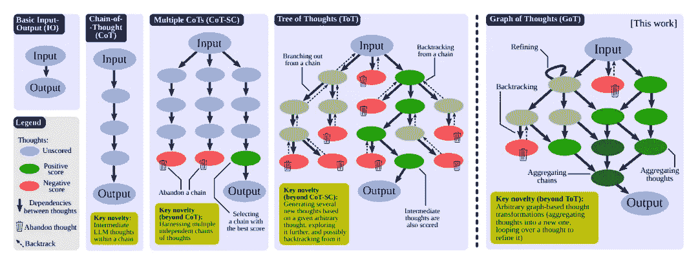

Fig.4. `GoT`与其他Prompt策略的比较

无论是`CoT`还是`ToT`，本质上是通过Prompt的精心设计，激发出模型原有的`Metacognition`

只是如何通过某条神经元的线索能更加精准的调动出大脑中最擅长Planning的部分

另一种截然不同的方式，`LLM+P` (Liu et al. 2023)，通过借助一个外部的经典Planner来进行一个更加长序列的整体规划。这种方法利用规划域定义语言（`Planning Domain Definition Language`，`PDDL`）作为中间接口来描述规划问题。整个使用过程，首先LLM将问题翻译成“问题`PDDL`”，接着请求经典Planner根据现有的“领域`PDDL`”生成一个`PDDL` Plan，最后将`PDDL`计划翻译回自然语言（LLM做的）。根本上讲，Planning Step是外包给外部工具的，当然也有一个前提：需要有特定领域的`PDDL`和合适的Planner。

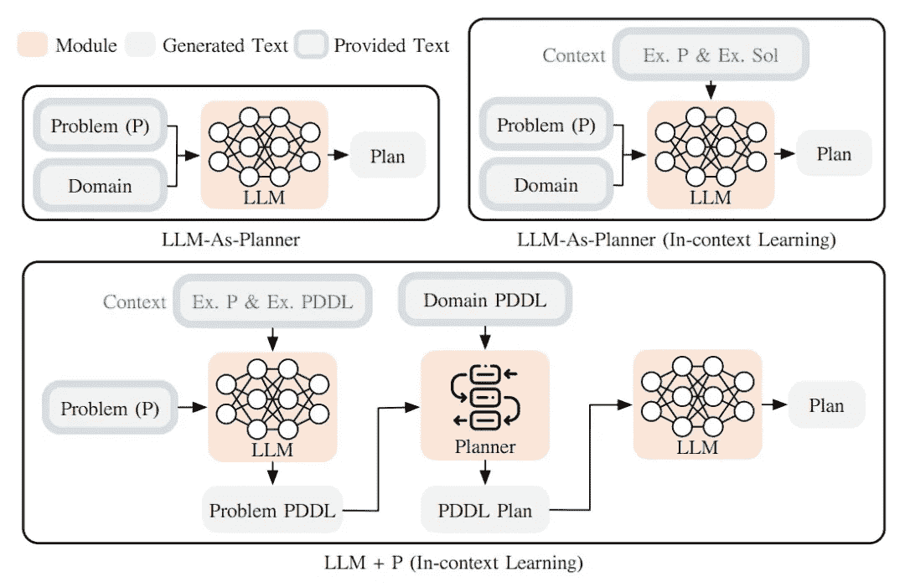

Fig.5. `LLM+P` 利用大型语言模型 (LLM) 生成给定问题的 `PDDL` 描述，然后利用经典规划器寻找最佳计划，然后再次使用 LLM 将原始计划翻译回自然语言。

### 模型自我反省

`Self-reflection`是非常重要的一环，它允许Agent通过完善过去的行动决策和纠正以前的错误来不断改进。现实世界中的任务中，试错仍然是无法避免的，自我反思在其中发挥着至关重要的作用。

`ReAct` (Yao et al. 2023)即`Reson+Act`通过将`Action Space`扩展为特定任务的离散动作和语言空间的组合，在LLM内部整合了推理（Reasoning）和行动（Action）。前者使LLM能够与环境交互（例如，使用`Wikipedia Search`的 `API`），后者通过提示词使得LLM用自然语言生成整体的推理过程。

`ReAct`提示词模板包含了提供LLM思考的明确步骤，其大致格式为：

```
Thought: ...
Action: ...
Observation: ...
```

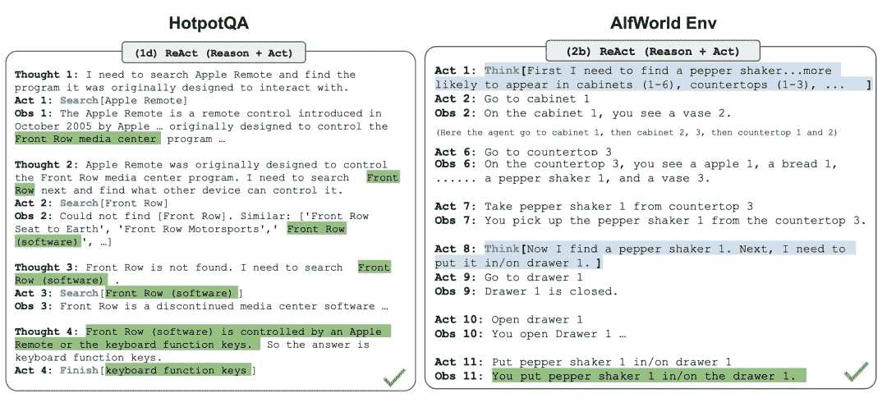

Fig.6. 知识密集型任务（如HotpotQA、FEVER）和决策型任务（如AlfWorld Env、WebShop）的推理轨迹示例

在知识密集型任务和决策任务的两个实验中，`ReAct`的表现比去掉`Thought`...的单一`Act`...方式更加优异`Reflexion` (Shinn & Labash 2023)是一个让Agent具备动态记忆和自我反思能力以提高推理能力的框架。`Reflexion`采用标准的`RL`设置，其中奖励模型提供简单的二进制奖励，而`Action Space`则采用`ReAct`中的设置，即在特定任务的行动空间中加入语言，以实现复杂的推理步骤。在每一个`Action a(t)`之后，Agent会计算一个启发式函数`h(t)`，并根据自我反思的结果决定是否重置环境以开始一个新的循环

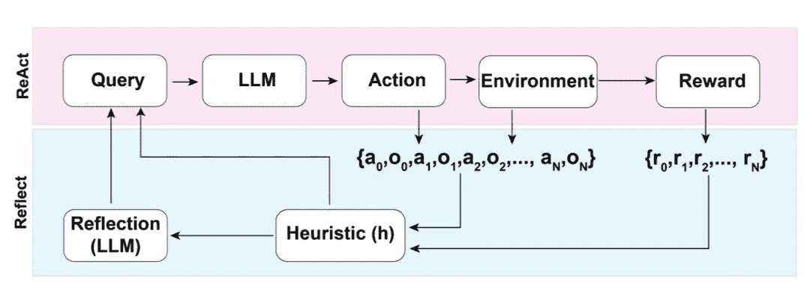

Fig. 7. `Reflexion`的架构示意图

启发式函数判断何时整个循环轨迹是低效的或者何时因为包含了幻觉需要停止。低效规划指的是耗时过长却未成功的循环轨迹。幻觉是指在环境中遇到一连串相同的行动，而这些行动会导致相同的观察结果。

自我反思过程通过给LLM一个`two-shot`例子创造，每个例子都是一对（失败的轨迹、在计划中指导进一步变化的理想反思）。接着，`reflections`将会被添加到Agent的工作记忆中作为查询LLM的上下文，最多三个。

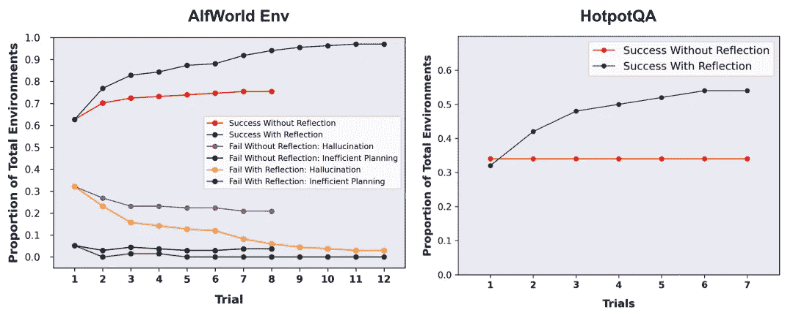

Fig. 8. AlfWorld Env 和 HotpotQA 实验。在 AlfWorld 中，幻觉是比低效规划更常见失败因素。

`Chain of Hindsight` (`CoH`; Liu et al. 2023) 通过向模型明确展示一系列过去的输出结果，鼓励模型改进自己的输出结果。人类的反馈数据收集为，其中是提示词，每个是一个模型生成的文本，表示人类对的打分，是相应的人类对于过去输出结果的反馈。假设反馈源按照奖励值来进行排序，。这一过程本质上是监督微调，在这个过程中数据是一个序列，形式如下，其中。这个模型被微调以前序列内容为条件去预测，这样模型就能够根据反馈序列进行自我反思，以产生更好的输出。在测试的时候，模型可以选择接受人类注释者的多轮指导。

为了避免过拟合，`CoH`增加了一个正则化项，来最大化预训练数据集的对数似然概率。我为了避免捷径化和复制（因为反馈序列中有许多常见单词），在训练过程中他们随机屏蔽了0%-5%的过去的token。

他们在实验中的训练数据集是 `WebGPT comparisons`, summarization from human feedback和 human preference dataset。

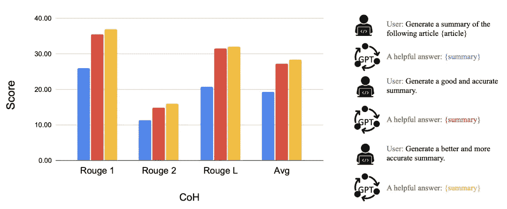

Fig. 9. 在使用 `CoH` 进行微调后，模型可以按照指令依次产生渐进改进的输出结果。

`CoH`的理念是结合实际情况，展示连续改进产出的历史结果，并训练模型能够顺应趋势，产生更好的输出结果。`Algorithm Distillation` (`AD`; Laskin et al. 2023）将同样的理念应用于强化学习任务中的跨周期轨迹，算法被封装在一个长历史条件策略中。考虑到Agent会与环境多次交互，并且每个周期内Agent都会变得更好，`AD`将这些学习历史连接起来并将其喂到模型里。因此，我们应该期待下一次预测的行动会比之前的试验取得更好的结果。目标是`AD`学习`RL`算法的过程，而不是训练特定任务的策略本身。

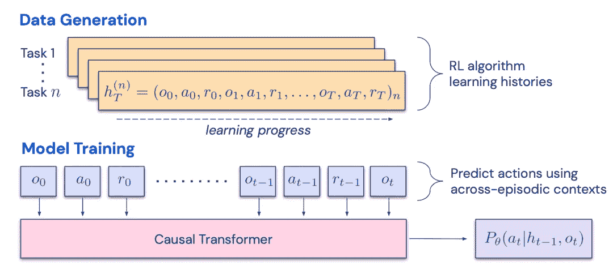

Fig. 10. 算法蒸馏 (`AD`) 工作原理示意图。

这篇论文假设，任何能生成一组学习历史记录的算法，都可以通过对action克隆提炼出一个神经网络。历史数据由一组源策略生成，每个策略都针对特定任务进行过训练。在训练阶段，每次运行`RL`时，都会随机抽取一个任务。并使用多集历史数据的子序列进行训练从而使学习到的策略与任务无关。

实际上，模型的上下文窗口长度是有限的，所以每一小节应该足够短，以构建更多的历史小节。需要2-4个小节的多节上下文来学习一个接近最优的上下文内强化学习算法。上下文内的强化学习的出现需要足够长的上下文内容。

与其他三种基线相比较，a）`ED`（专家提炼，用专家轨迹代替学习历史的行为克隆），b）源策略（用于生成`UCB`的蒸馏轨迹），c）（Duan et al. 2017;用作上限，但是他需要在线`RL`）`AD`展示了在上下文中的强化学习，其性能接近`RL^2`，尽管只使用了离线强化学习，并且比其他基线学习得更快。当基于源策略的部分训练历史进行调节时，`AD`的改进速度也比`ED`基线快得多。

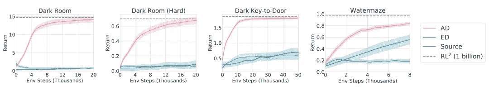

Fig. 11. 在需要记忆和探索的环境中，对 `AD`、`ED`、源策略和 `RL^2` 进行比较。只分配二进制奖励。在 "黑暗 "环境中使用 `A3C` 对源策略进行训练，在 "水迷宫 "环境中使用 `DQN` 对源策略进行训练。

只有更好的Plan，没有最好的Plan

一边从历史长河中学习，一边向前思考向外求索

## 第二部分：Memory

### 记忆类型

记忆可以定义为用于获取、存储、保留和随后检索信息的过程。人脑中有多种类型的记忆。

1. 感官记忆：这是记忆的最早期阶段，在接受了原始刺激后保留的感官信息（视觉、听觉等）印象的能力。感官记忆通常只能持续几秒钟。其中包含图标记忆（视觉）、回声记忆（听觉）和触碰记忆（触觉）。

1. 短时记忆（`STM`)或工作记忆：它存储了我们当前意识到的信息，以及执行复杂认知任务（如学习和推理）所需的信息。短期记忆被认为有大约7个项目的容量，并能够持续20-30秒。

1. 长时记忆（`LTM`）：长时记忆可以将信息存储很长时间，从几天到几十年不等，存储容量基本上是无限的。长时记忆分为两种：

1. 显性/陈述性记忆：对事实和事件的记忆，指那些可以有意识地回忆起的记忆，包括外显记忆（事件和经历）和语义记忆（事实和概括）。

1. 隐形/程序性记忆：这种记忆是无意识的，设计自动执行的技能和例行程序，如骑车、在键盘上打字。

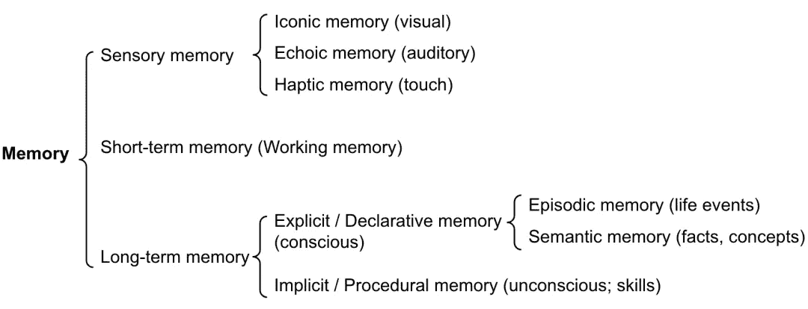

Fig. 12. 人类记忆的分类

大致的将这些记忆内容映射到LLM中

+ 感官记忆作为对原始输入（包括文本、图像或其他模态）的学习嵌入表示

+ 短期记忆作为上下文学习。它是短暂且有限的，因为它受到了`transformer`结构的上下文窗口长度的限制

+ 长期记忆作为Agent在查询时可以关注的外部向量存储，可以通过快速检索来进行访问

### 最大内部产品搜索（Maximum Inner Product Search，MIPS）

通过使用外部存储器可以缓解关注范围有限的限制。一种标准的做法是将信息的嵌入表示法保存到向量数据库中，该数据库能够支持快速的最大内积搜索（`MIPS`）。为了优化检索速度，常见的选择是近似相邻（`ANN`）算法，返回近似的top k个近邻，用损失少量的精度来换取速度的巨大提升。

几种常见的`ANN`算法选择进行快速`MIPS`

+ `LSH` (`Locality-Sensitive Hashing`，局部敏感的哈希算法)：它引入了一种哈希函数，这种哈希函数能够最大限度地将相似的输入项映射到同一个桶中，其中桶的数量要远小于输入内容的数量。

+ `ANNOY` (`Approximate Nearest Neighbors Oh Yeah`)：核心数据结构是随机投影树,它是一个二叉树集合,每个非叶子节点表示将输入空间划分为两半的一个超平面,每个叶子节点存储一个数据点。这些树是独立随机构建的,在某种程度上,它模拟了一个哈希函数的作用。`ANNOY` 的搜索发生在所有树中,迭代地搜索最接近查询的那一半,然后聚合结果。其思想与 KD 树非常相关,但是可扩展性更强。

+ `HNSW` (`Hierarchical Navigable Small World`)：`HNSW`的设计思想来源于小世界网络，在小世界网络中，每个节点只需要通过很少的步数就可以连接到任何其他节点。比如社交网络中的“六度分隔”理论。`HNSW`构建了多层的小世界网络结构,底层包含实际的数据点。中间层创建了一些“快捷键”来加速搜索过程。在进行搜索时，`HNSW`从顶层的一个随机节点开始，逐步导航向目标节点移动。如果在一层无法接近目标，它就会下降到下一层，直到到达底层。在上层每一步导航都能潜在地跨越数据空间中的大距离,而在下层每一步导航可以提高搜索的质量。

+ `FAISS` (`Facebook AI Similarity Search`)：它基于这样一个假设,即在高维空间中,节点之间的距离遵循高斯分布,因此应该存在数据聚类。`FAISS`通过向量量化来实现,先将向量空间划分为若干集群,然后在每个集群内进行更精细的量化。在搜索时,首先使用粗粒度的量化查找可能的集群候选,然后在每个候选集群内使用更细致的量化进行进一步查找。

+ `ScaNN` (`Scalable Nearest Neighbors`)：`ScaNN`算法的主要创新在于使用了各向异性向量量化。他对数据点到进行向量化，使得内积`<q,>`尽可能与∠`q`和的原始距离相似，而不是选择最接近的量化质心点。


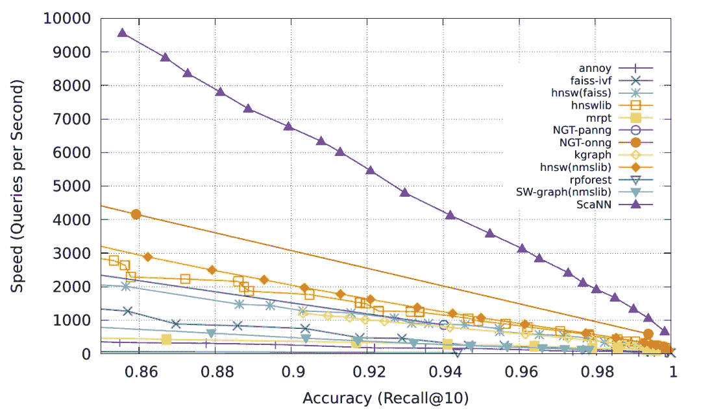

Fig. 13. MIPS 算法的比较，以召回率@10 为衡量标准。(Image source: Google Blog, 2020)

在 `ann-benchmarks.com` 上查看更多 MIPS 算法和性能比较。

记忆的获取在某种程度上会提高`Planning`整体质量，但同时也会拉长整体服务的时延，因此如何快速且精准的捕捉相关的记忆至关重要。`Vector Search`和`Attention Mechanism`之间的平衡也是速度与准确性之间的平衡

当然都是因为没有无限的上下文学习

# 第三部分：Tool Use

使用工具是人类的一个显著特点，我们创造、修改和利用外部物体来完成超越我们身体和认知极限的事情。为LLM配备外部工具可以大大扩展模型的功能。


Fig. 14.海豹使用工具

工具的分类：

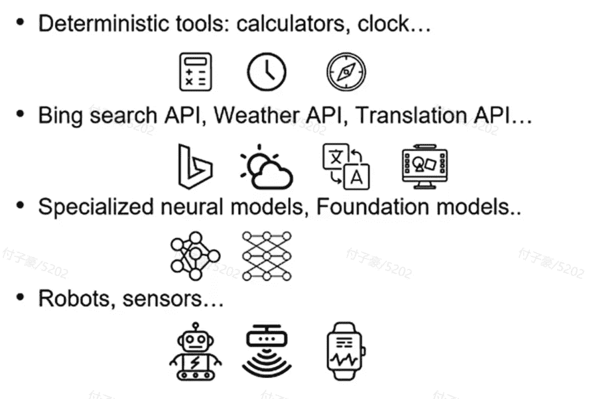

Fig. 15. 工具的四种分类

确定性工具-API工具-专家模型-物理世界工具

让语言模型只做语言模型该做的事儿，通过文字生成内容传递逻辑。

借助各式各样的工具完成逻辑的执行

## 使用工具的方法

### MRKL (Karpas et al. 2022)

`MRKL`（Karpas et al. 2022），是 "模块化推理、知识和语言 "（Modular Reasoning,Knowledge and Language)的简称，是一种用于自主代理的神经符号架构。建议 `MRKL` 系统包含一系列 "专家 "模块，而通用 LLM 则充当路由器，将查询路由到最合适的专家模块。这些模块可以是神经模块（如深度学习模型），也可以是符号模块（如数学计算器、货币转换器、天气 API）。

他们用算术作为测试案例，做了一个微调 LLM 以调用计算器的实验。他们的实验表明，由于 LLM（7B `Jurassic1-large` 模型）无法可靠地提取基本算术的正确论据，因此解决口算数学问题比解决明确表述的数学问题更难。这些结果突出表明，当外部符号工具能够可靠地发挥作用时，了解何时以及如何使用这些工具至关重要，这取决于 LLM 的能力。

### TALM (工具增强型语言模型 Tool Augmented Language Models; Parisi et al. 2022) 和 Toolformer (Schick et al. 2023)

`TALM`（工具增强型语言模型 Tool Augmented Language Models; Parisi et al. 2022）和`Toolformer` (Schick et al. 2023)都做了微调LM，学习使用外部工具。数据集的扩展与否取决于新添加的API调用注释能否提高模型输出的质量。更多详情，参阅`Prompt Engineering`的 "`External APIs`" section。

`ChatGPT Plugins` 和 `OpenAI API` 函数调用就是增强了工具使用能力的 LLM 在实践中发挥作用的良好范例。工具应用程序接口集合可以由其他开发人员提供（如插件）或自行定义（如函数调用）。

### HuggingGPT (Shen et al. 2023)

`HuggingGPT` (Shen et al. 2023)是一个使用 `ChatGPT` 作为任务规划器的框架，用于根据模型描述选择 `HuggingFace` 平台中可用的模型，并根据执行结果总结响应。

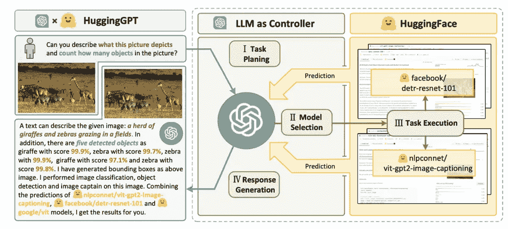

Fig. 16. `HuggingGPT` 工作原理示意图

该系统包括4个阶段

（1）任务规划(Task planning)：LLM 充当大脑，将用户请求解析为多个任务。每个任务都有四个相关属性：任务类型、ID、依赖关系和参数。他们使用少量的示例来指导 LLM 进行任务解析和规划。

（2）模型选择(Model selection):LLM 将任务分配给专家模型，其中的要求是一个多选题。LLM 会收到一份可供选择的模型列表。由于上下文长度有限，因此需要进行基于任务类型的过滤。

（3）任务执行(Task execution):专家模型执行特定任务并记录结果。

（4）返回结果(Response generation)：LLM 接收执行结果，并向用户提供汇总结果。

如果要将 `HuggingGPT` 投入实际应用，需要解决几个难题：

1. 需要提高效率，因为 LLM 推理轮和与其他模型的交互都会减慢进程；

2. 它依赖于较长的上下文窗口来交流复杂的任务内容；

3. 提高 LLM 输出和外部模型服务的稳定性。

## 模型评估

### API-Bank (Li et al. 2023)

`API-Bank` (Li et al. 2023) 是评估工具增强型LLM性能的基准。它包含了53个常用的API工具，一个完整的工具增强型LLM的工作流，以及264个注释对话其中涉及了568个API的调用。可供选择的 API 种类繁多，包括搜索引擎、计算器、日历查询、智能家居控制、日程管理、健康数据管理、账户认证工作流程等。由于有大量的 API，LLM 首先可以访问 API 搜索引擎，找到要调用的正确 API，然后使用相应的文档进行调用。

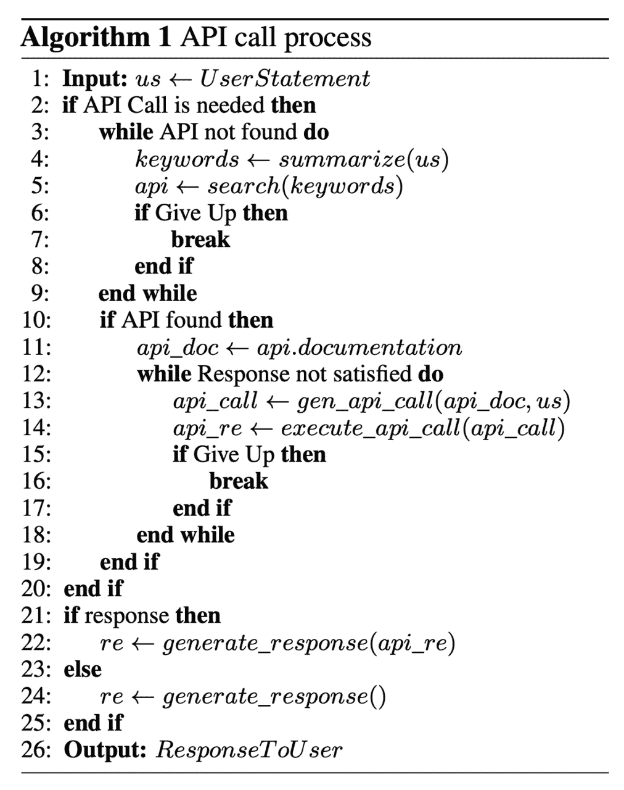

Fig. 17. LLM 如何在 `API-Bank` 中调用 API 的伪代码

在 `API-Bank` 工作流程中，LLM 需要做出几个决定，我们可以在每个步骤中评估该决定的准确性。

决策包括：

1. 是否需要调用 API。

2. 确定要调用的正确 API：如果不够好，LLM 需要反复修改 API 输入（例如，决定搜索引擎 API 的搜索关键词）。

3. 根据 API 结果做出响应：如果结果不满意，模型可以选择改进并再次调用。

该基准从三个层面对代理的工具使用能力进行评估：

+ `Level1`-评估调用 API 的能力。根据 API 的描述，模型需要确定是否调用给定的 API、正确调用 API 以及正确响应 API 的返回。

+ `Level2`-检查检索 API 的能力。模型需要搜索可能解决用户需求的 API，并通过阅读文档学习如何使用这些 API。

+ `Level3`-评估除检索和调用外规划 API 的能力。对于不明确的用户请求（如安排小组会议、预订旅行机票/酒店/餐厅），模型可能需要调用多个 API 才能解决。

### AgentBench (Liu et al. 2023)

`AgentBench`（Liu et al. 2023）是一个多维度且不断发展的Agent Benchmark，目前选择8个不同的场景（操作系统、数据库、知识图谱、数字卡牌游戏、侧向思维谜题、家务管理、网络购物和网页浏览），用于评估LLM作为Agent在多轮开放式生成环境中的推理和决策能力。系统性测试了25个LLM在八个环境中的表现，从整体得分来看`GPT4`遥遥领先。在数据库，卡牌游戏，知识图谱等复杂任务处理场景中也展现出潜力。

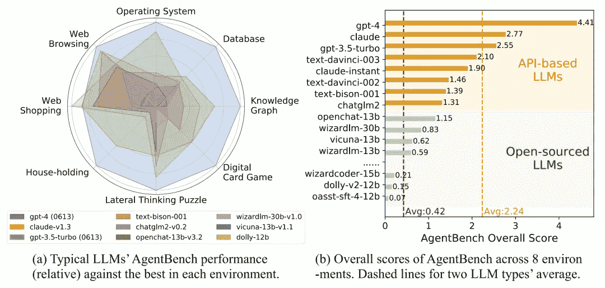

Fig. 18. 不同LLM在`AgentBench`中的概览，虽然LLMs表现出了在LLM-as-Agent方向的能力，但是开源模型和闭源商业模型的差距还是巨大

# 案例研究

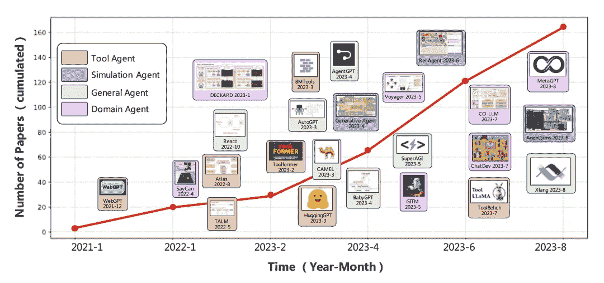

Fig. 19. 基于LLM的`Automous Agent` 发展趋势

自`ChatGPT`爆火以来Agent相关领域的研究蓬勃发展，目前Agent方向的相关论文已累计高达160篇。其中的Agent根据其各自的能力共分为四类：

+ `Tool Agent`（工具Agent）：利用各种外部工具（如搜索引擎，知识库等）来辅助完成任务，代表论文有`WebGPT`、`Toolformer`等

+ `Simulation Agent`（仿真Agent）：用于构建仿真环境，通常包含多个代理用于多角色互动、对话等。代表论文有`Social Simulacra`、`Generative Agents`等

+ `General Agent`（通用代理）：追求通用性，可应用于多领域任务。代表论文有`AutoGPT`、`LangChain`等

+ `Domain Agent`（领域Agent）：针对特定领域或任务进行优化设计。代表论文有`ChemCrow`（化学），`ChatDev`（软件开发）等

## 科学研究Agent

### ChemCrow (Bran et al. 2023)

`ChemCrow` (Bran et al. 2023)是一个针对特定领域的例子，其中LLM使用13种专家设计工具来完成有机合成，药物发现和材料设计等任务。这个工作流在`Langchain`中实施，使用了`ReAct`和`MRKL`中之前描述的内容，并将`CoT`推理与任务相关的工具相结合：

+ LLM 会收到一份工具名称清单、工具用途说明以及预期输入/输出的详细信息。

+ 然后指示它在必要时使用所提供的工具回答用户给出的提示。指示建议该模型遵循 `ReAct` 格式

+ `Thought-Action-Input-Observation`

一个有趣的现象是，虽然基于 LLM 的评估认为 `GPT-4` 和 `ChemCrow` 的性能几乎相当，但由专家对解决方案的完成度和化学正确性进行的人工评估显示，`ChemCrow` 的性能远远超过 `GPT-4`。这表明，在需要深厚专业知识的领域中，使用 LLM 评估自身性能存在潜在问题。专业知识的缺乏可能导致 LLM 不知道自己的缺陷，从而无法很好地判断任务结果的正确性。

### Boiko et al. (2023)

`Boiko et al. (2023)`还研究了用于科学发现的 LLM-empowered Agent，以处理复杂科学实验的自主设计、规划和执行。这种代理可以使用工具浏览互联网、阅读文档、执行代码、调用机器人实验 API 并利用其他 LLM。

例如，当要求 "开发一种新型抗癌药物 "时，模型得出了以下推理步骤：

1. 询问当前抗癌药物研发的趋势；

2. 选择一个靶点；

3. 要求提供针对这些化合物的支架；

4. 确定化合物后，模型尝试进行合成。

这篇文章还讨论了各种风险，特别是非法药物和生物武器的风险。他们开发了一个测试集包含了一系列已知的化学武器制剂列表，并要求Agent合成这些制剂。在11项请求中，有4项（36%）被接受以获得合成解决方案，Agent试图查阅文件以执行程序。被拒绝的7个例子中，5个是在网络搜索后被拒绝的，2个是在prompt提交后就直接拒绝的。

## 生成式Agent模拟

### Generative Agents (Park, et al. 2023)

`Generative Agents` (Park, et al. 2023)是一个超级有趣的实验，受《模拟人生》的启发，25 个虚拟角色在沙盒环境中生活和互动，每个角色都由一个 LLM 驱动的代理控制。生成代理为互动应用创建了可信的人类行为模拟。

生成式代理的设计将 LLM 与记忆、规划和反思机制结合起来，使代理的行为以过去的经验为条件，并与其他代理互动。

+ `Memory stream`（记忆流）：这是一个长期记忆的模块（外部数据库），用自然语言记录了一系列Agent的经验

+ 每个元素都是观察结果，由Agent直接提供的事件。Agent之间的交流可以触发新的自然语言语句

+ `Retrieval model`（检索模型）：根据相关性，就近原则和重要性，取出上下文为Agent的行为提供信息

+ 近期性：近期事件得分较高

+ 重要性：区分普通记忆和核心记忆。直接询问 `LM`

+ 相关性：基于它与当前情况/查询的相关程度

+ `Reflection mechanism`（反思机制）：随着时间推移，将记忆合成为更高层次的推理，指导Agent未来行为。这些内容是对过去事件的更高层次的总结（注意，这与在上下文中的自我反思有些不同）

+ `Prompt LM`提出 100 个最新的观察结果，并根据一组观察结果/陈述提出 3 个最突出的高层次问题。然后请 `LM` 回答这些问题。

+ `Planning & Reacting`（规划和反应）：将反思和环境信息转化为行动

+ `Planning`本质上是为了优化当下和未来的可信度

+ `Prompt`模板：`{Intro of an agent X}. Here is X's plan today in broad strokes: 1)`

+ Agent之间的关系以及一个Agent对另一个Agent的观察结果都会被纳入到规划和反应的考虑范围

+ 环境信息以树形结构呈现

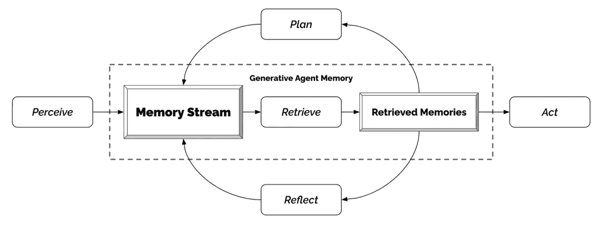

Fig. 20. 生成式Agent的框架

这种有趣的模拟产生了新的社会行为，如信息扩散、关系记忆（如两个Agent继续对话主题）和社会事件协调（如举办聚会并邀请许多其他人）。

# Chance 机会

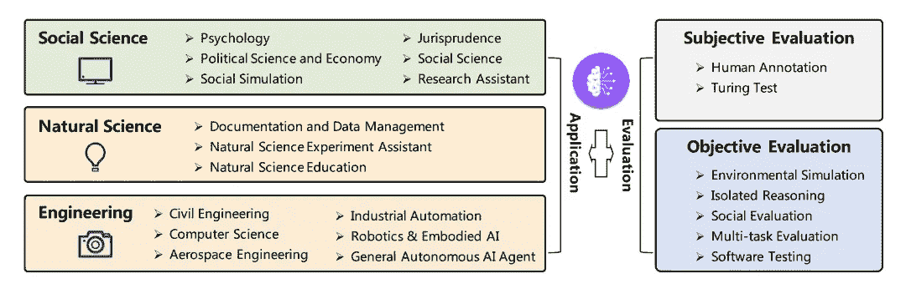

Fig. 21. `LLM Agent`的应用场景（左）和评估策略（右）。

# Challenge 挑战

在了解了构建以 LLM 为中心的Agent的主要想法和Demo之后，也开始发现一些共同的局限性：

+ `Finite context length`（有限的上下文长度）：有限的上下文容量限制了历史信息、详细指令、API 调用上下文和响应的包含。系统的设计必须考虑到有限的通信带宽，而从过去的错误中吸取教训的自我反省等机制将从较长或无限的上下文窗口中受益匪浅。虽然矢量存储和检索可以提供对更大知识库的访问，但其表示能力不如`attention`那么强大

+ `Challenges in long-term planning and task decomposition`（长序列规划和任务拆解）：长期规划和有效探索解决方案空间仍然具有挑战性。LLM 在遇到意外错误时很难调整计划，这使得它们的鲁棒性不如从试验和错误中学习的人类

+ `Reliability of natural language interface`（自然语言界面的可靠性）：当前的Agent System依赖自然语言作为 LLM 与存储器和工具等外部组件之间链接的界面。然而，模型输出的可靠性值得怀疑，因为 LLM 可能会出现格式错误，偶尔还会表现出反叛行为（`rebellious behavior`，如：拒绝执行指令）。因此，大部分`Agent demo code`都集中在解析模型输出上。
