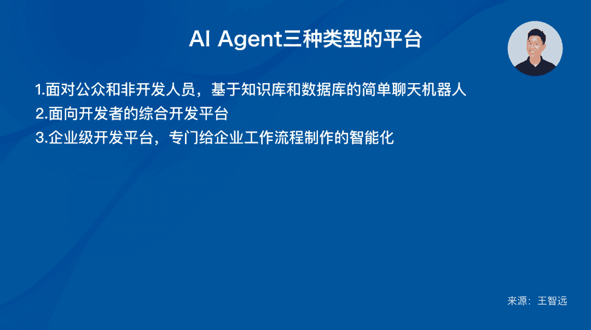

# 火爆的AI Agent，到底是什么？

> 来源：[https://agijuejin.feishu.cn/docx/DRMXd9whRoP9rHxSiBmcqgxSncb](https://agijuejin.feishu.cn/docx/DRMXd9whRoP9rHxSiBmcqgxSncb)

> 作者：王智远 | 神州问学

> 链接：https://mp.weixin.qq.com/s/0ugnUF3QTWN1WpwTV52jjQ

AI Agent热潮，准确来说，从2023年3月开始。

那时候，一个叫AutoGPT框架项目发布，项目利用大型语言模型，能自动把一个大任务拆分成小任务，并使用工具完成它们。

这种技术，将大语言模型处理语言、创造内容，和逻辑推理的能力扩展到了应用场景里，还加了感知和行动技术，所以，能从头到尾解决一个简单的问题。

**紧**接着，一年时间内，项目引起国外大公司、国内创业者、投资者们极大关注，大家开始积极开发AI Agent的框架、平台或具体应用。

外加上去年11月，OpenAI又推出一系列的GPTs，然后，国内才有不少公司才开始根据各自能力布局应用层、平台层、开发层和运营层等方向，来增加下一波生态下的壁垒性。

因此，人们才认为它是下一个重要细分发展方向。

可是：任何行业都存在信息差，我周围有很多人，之前并没有关注该赛道，爆发后才觉得有必要了解下，但现在市场上各种信息泛滥，让人眼花缭乱，就带来不少困扰。

他们不太清楚Agent是什么？为什么很重要，未来发展怎样？借此机会，分享一些信息，希望帮你初步了解这个概念。

## **01**

到底什么是AI agent？它是怎么工作的呢？

先来看一个词：“agent”，中文意思是代理人。代理人，你可以理解成有人帮你去做某件事。

那么，AI agent是什么？**简单来说，一个由AI技术加持的代理人，它变得更聪明了，可以感**知周围的环境，并且能够独立地思考和行动。

你有没有用过对话式的大模型（LLM），比如：文心一言、Kimi Chat、或者智谱AI？AI agent和对话式模型区别在于，你不用一直告诉它要做什么，只要给它一个目标，就能想办法自动帮你完成。

所以，大模型（LLM）要很多各种各样的数据，数据帮助它，学习的和人一样具备交流、学习、思考和推理的能力。

不过，它并不完美，时常出现一些奇怪的想法，或者受到环境影响；这时，就能用基于大模型开发的AI agent进一步细化问题。

举个容易理解的例子：你用过小爱同学吗？假如生病了，以前对它说：“我不舒服”，它只会告诉你去医院看看，多注意防护。

如果更聪明的AI agent，做法会不一样。它能检测你的体温和其他健康指标，结合网上的信息，分析之后告诉你：你可能发烧了。”接下来，还能帮你自动写好请假条。如果说：“帮我在钉钉上发给领导”，它立刻就能搞定。

要是家里布洛芬不够了，它甚至可以把药加入购物车，你确认后付款，很快药就能送到家。这就是AI agent的聪明之处。

所以，它的工作原理是什么呢？主要有四部分：

+   感知

+   信息处理

+   执行

+   输出

感知是第一步。AI通过传感器、摄像头、麦克风这些外部设备来感知周围的世界。比如你说：“我不舒服”，这句话就能通过麦克风被捕捉到。

信息处理，像把一个通用的大模型和很多专业的知识库结合起来。比如：健康数据和家里的药物存量，你告诉它这些信息，它就能帮你保存并做出决策。

写请假条、在线购买药品，这些都是系统根据它的决策来完成的具体工作。完成之后，系统会告诉你结果。

**一**个完整的智能体（Agent），好比人类和周围环境互动的过程，它由两部分组成：一部分是智能体自己，另一部分是它所在的环境。

智能体像生活在物理世界中的人类，而物理世界是它的外部环境，人类感知周围的世界，理解环境中隐藏的信息，再结合自己的记忆、对世界的了解来做计划、做决定和采取行动一样；行动又会影响环境，产生新的反馈。

人类根据反馈再次做出决策，从而形成一个不断循环的过程。

**你看，整个过程像不像马克思主义的「实践论」？有个目标后，从认**识开始，实践得出理论知识，再把知识应用回实践中去。这就是，AI Agent神奇之处。

## 02

不过，由于大模型本身能力还在不断发**展**中，智能体形态、应用场景也就更晚一些，所以，看似短短一年内，探索了多种实现智能体的方式，但大部分还处在概念验证、产品演示阶段，常见问题也相对明显。

包括：项目文档不完整、复用效果不稳定、任务拆分过细，导致成本过高，以及推理能力不够，更主要的原因，还有跨平台能力如何解决等等。

我身边爱写作、阅读的朋友们都有一个共同的习惯：

他们会收藏一些有用的信息。通常，信息被临时记录在备忘录中。随着时间往后推，记录东西多了，管理起来就比较麻烦。

前段时间，我琢磨能不能创建一个完整的流程，自动化处理，折腾半天，虽然搭建成功流程自动化，但实际使用起来的效果并不理想。

所以，许多平台厂商、研究机构、创业公司推出各种单一智能体、多组合智能体、以及机器人自动化（RPA）等框架项目，但从实际调研和行业反馈看，还要迭代。

不过，这个框架的总体思路，可以用一个公式概括：

**A**gent = LLM（大型语言模型）+ Planning（规划）+ Feedback（反馈）+ Tool use（工具使用）。

当我们做规划时，不仅只看当前情况，还会考虑记忆、过去的经验，以前的反思和总结，还有对世界的了解也加入进来。

而现在以ChatGPT和其他为首的国内大模型，更像一个固定不变的知识库，它不能直接和环境互动，虽然它们可以进行逻辑推理、基本规划，但不能感知周边的一切，来进行自主反馈。

在我看来，智能体能通过各种方式获取反馈。

比如：

如果我们把和对话的ChatGPT视为一个智能体，那么，通过文本框输入的回复就是给它的反馈，这种互动后，它能调整自己的回答，而不是一次次再教育。

还有，更进一步地，智能体可以使用外部工具来增强它的功能，解决更复杂的问题。

例如：

它可以用天气API来获取天气预报，如果没有工具，智能体还能学习适应环境变化的策略，来应对挑战。

所以，一个完整AI智能体应该能够主动和环境互动。而大型语言模型是它潜在能力的核心，未来发展方向，是创建一个从头到尾的系统，这将依靠它有效地使用周围的工具，来实现更广泛的应用。

## 03

那么，它为什么很重要？我为什么要深入理解呢？

首先，AI智能体将会引领软件行业进入一个新的时代，我们可以叫它“3D打印时代”。

什么意思呢？3D打印技术普及时，人**们**很方便地3可以打印出各种“实体物品”。在所谓的“3D打印时代”，开发、定制软件将变得跟打印文件一样简单、快速。公司、个人想要什么？都根据自己的需求，很快找到解决方案。

有一个科学家，名叫Andrej Karpathy，他在特斯拉负责开发、优化自动驾驶技术。他在推特上说过，我们可以利用大数据、强大的计算能力来解决过去需要很多人力和时间的复杂问题。

这也是为什么那么多人对AutoGPT感兴趣的原因。

其次，AI智能体能减少软件的生产成本。

你学过编程没？以前编程，要写大量临时文件、测试方案，还要长期保存下来，以便不时之需；现在的编程，完全可以自动化制作，成本几乎为零；这意味着，原来需要上千万人才能完成的软件任务，现在少量的人就可以搞定。

还有一点是，智能体灵活满足各种需求。

以前，我在几家C轮公司工作过，技术人员占了一半，因为用户很多、开发的东西也特别多。不仅要做商城，还要做CRM系统，只有用很多人力才能提高效率。

现在情况不同，很多基础的需求直接交给智能体来处理。这就像，我们从大批量生产，转变成了小批量快速响应的模式。

**如**果把大语言模型看作人类思考的“系统1”，即负责快速、直觉的思考，而AI智能体则类似于人类的“系统2”，负责慢速、分析性的深入思考。

计算机专家，Andrej Karpathy曾提到：大模型可以快速产生反馈，但也容易产生误判。AI智能体目标是建立一个个小框架，让LLM循序渐进的思考，反而更能做出可靠的决策。

我以前在网上搜索学术文章时，要分两步筛选信息：

首先，根据研究领域进行初步筛选；然后，根据第一次搜索结果，进一步筛选出与我期望最相似的文章。这个过程通常要多次查询和调整，耗时又麻烦。

后来，情况大有改观。

**我**用RPA后，它按照要求自动筛选，并在第一轮结果后精准查找，所以，这就像APP的推荐系统，你可以根据需要，定制自己的智能体。

所以，基于大模型的Agent，改变了获取信息的方式，未来会有更多人有自己的Agent，帮它当合作伙伴，你可以想想，如果有个小助手，你会让它做什么？

## 04

那么，AI Agent有什么不同类型呢？

**因**为Agent技术还不是完全成熟，所以，Agent平台也在初期阶段，现在一些比较固定的工作流程，或有详细标准SOP的程序，都在封闭环境下进行。

即便一些比较受欢迎的平台，它们在API生态系统，工作流程再组合上，还是不够完善。我盘了一下，AI Agen平台大致有三类：

**一类，面对公众和非开发人员，基于知识库和**数据库的简单聊天机器人（Chatbot）；如“类GPTs”，它提供标准界面、流程。国内字节的扣子（Coze）、阿里的AI助理市场。

另一类，面向开发者的综合开发平台：这类平台帮助开发者使用各种API、第三方库和代码嵌入，进行Agent的流程调优。

例如：

Coze海外版、百度灵境矩阵全代码版，阿里、亚马逊等提供模型托管，支持开发者开发应用。它们可以能解决复杂问题、有多个工作流程安排的复杂场景在里面。

第三类是企业级开发平台：专门给企业工作流程制作的智能化。比如：TARS-RPA-Agent、CubeAgent和Torq等。澜码科技的AskXbot平台，以及360的“大模型+企业知识库+Agent”的解决方案。

基于该框架下又能进行行业结构，应用场景再次划分。

因为大家发展速度真的很快，所以，从实际情况来看，首先需要做的是：第一步，丰富通用和特定场景的工作流程。这意味着，要创建一些标准的流程，这样不同的情况下都能用。

**第**二步，深入地学习和积累专业知识。这样，第三步，平台能更好地重复使用已有的工作流程，也能更灵活地结合不同的工具。

同时，还要探索适合的商业模式，这样才能满足AI时代的需求。简单说，就是要搞清楚怎么通过AI Agent赚到钱，同时确保AI平台能不断进步，更好地服务大家，很重要。

更直白一点说：

产品营销圈，有一个很重要概念叫做PMF（Product-Market Fit，产品市场匹配度）。如果一个产品找到它的PMF，就找到了自己的市场立足点，开始有了用户黏性。

在AI大模型产品领域里，大模型要找到自己的TPF（Technology Product Fit，技术产品匹配）。

技术发展比较快时，AI从业者，要从技术、产品和市场三个角度全面考虑，寻找一个中间值，三者，完美匹配的时，才是AI Agent解决具体需求，赚到前的高光时刻。

我们不能总说技术厉害，而忽略市场是否需要。

前段时间，跟一个老板沟通企业内部流程再造时，就提到该问题，他说：看似很多冗余工作，AI Agent可以解决，但是，AI Agent解决前，总要先有人得先用好他。

举个例子：

服装设计公司，面临一个重大挑战，批量生产服装时，要设计和制作多个样板，这个过程传统上完全依赖人工；现在，AI智能体可以介入这一过程，但到底能处理到哪一步呢？精确度足够高吗？这些都要进一步的探索、测试。

**所以，国内Agent发展还未达到**其真正潜力，大多只是些简单的聊天机器人。缺少反思、规划、环境感知能力，而这些能力，恰巧构成高级AI Agent的核心要素。

# 总结而言

AI Agent，进一步迭代工作流。

据我所知，目前市面有很多agent搭建工具，如果你想进一步了解这个赛道，亲自试试，是最快的方法。