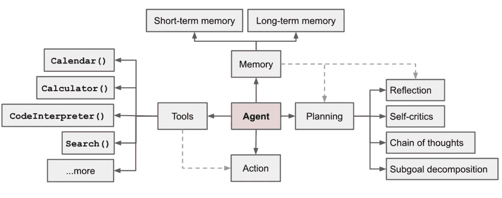
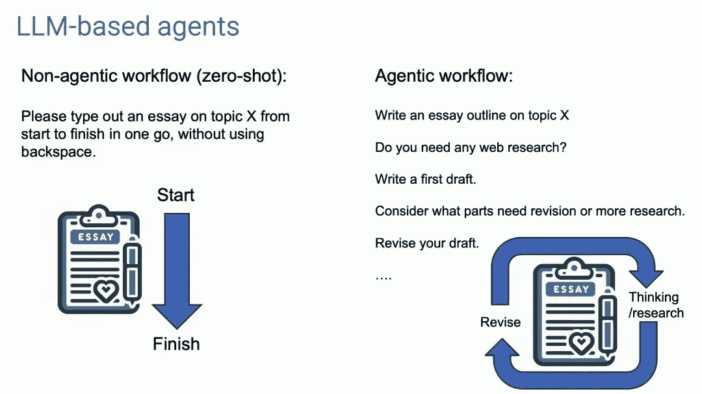
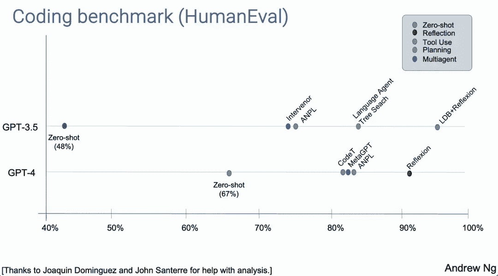
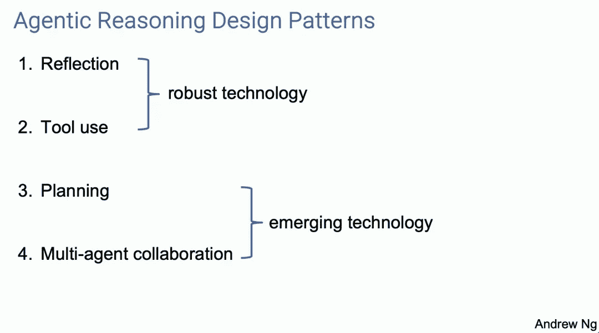
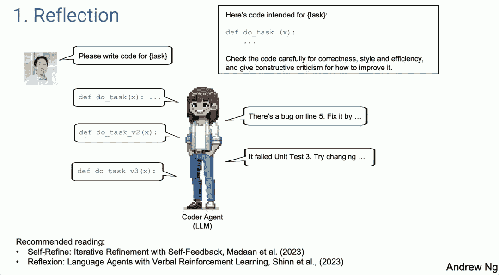
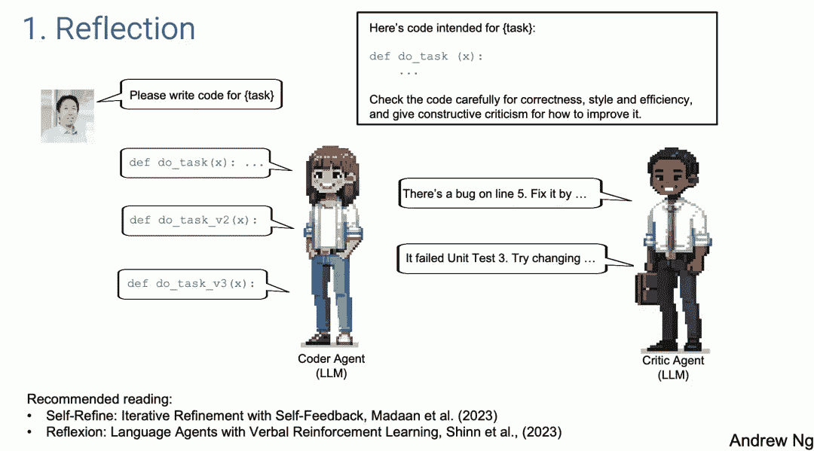
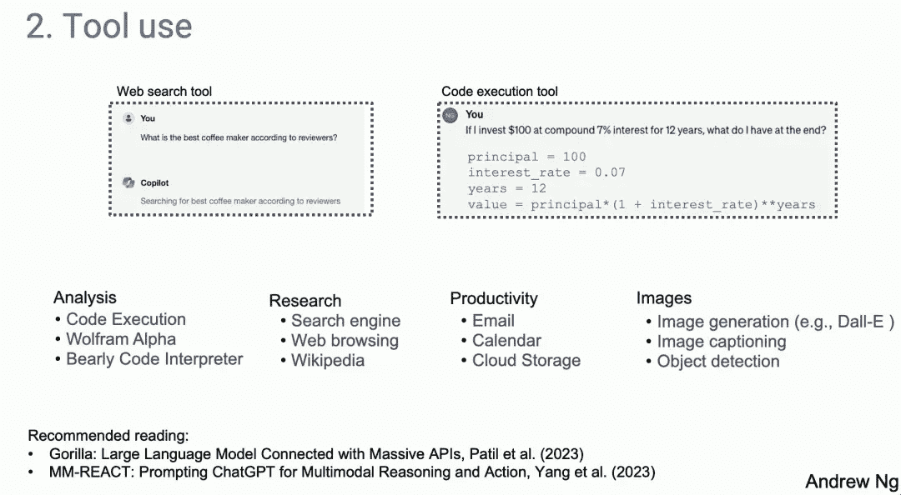
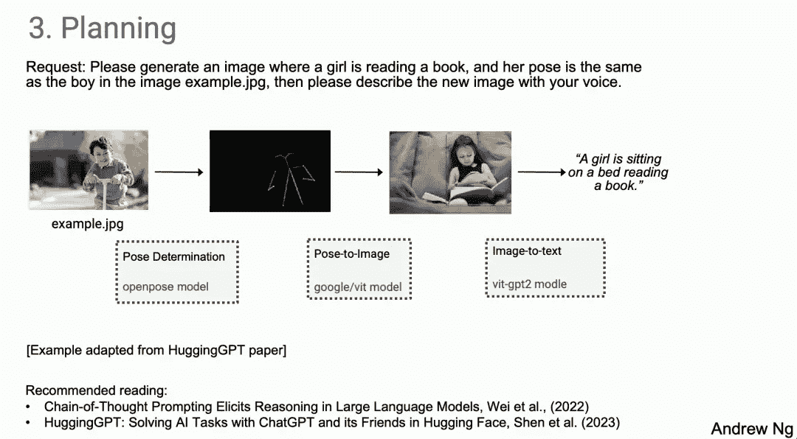
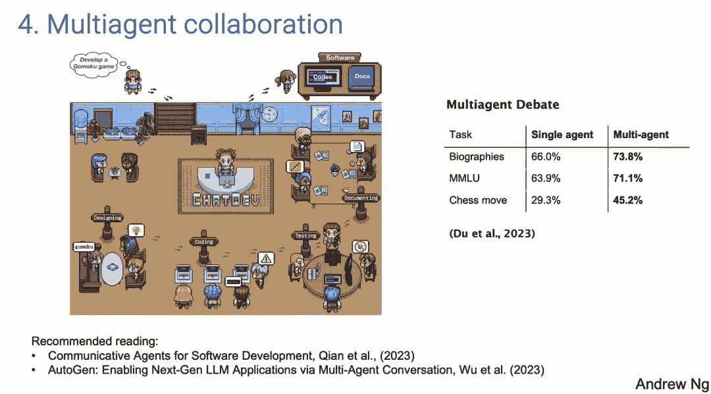
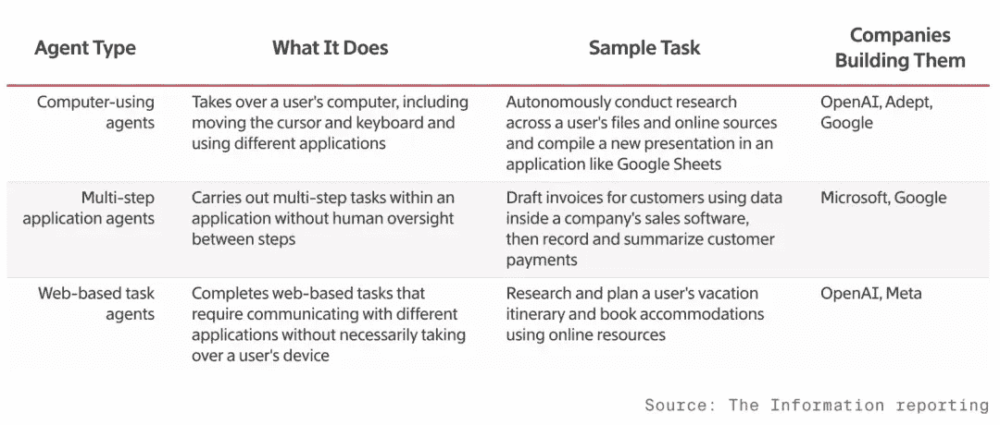

# AI Agent：自主性、反应性与交互性的融合，将颠覆软件行业

> 来源：[https://agijuejin.feishu.cn/docx/Fw6BdbKTaoFJi7xodqncxXkpnkh](https://agijuejin.feishu.cn/docx/Fw6BdbKTaoFJi7xodqncxXkpnkh)

> 作者：Zhongmei | 神州问学

> 原文：https://mp.weixin.qq.com/s/ANx5n8fX2cF4IFdwgd7OIw

Agent来袭：AI如何变身软件界的超级英雄？

# **前言**

**“AI Agent不仅会彻底改变计算机的使用方式，它还将颠覆软件行业，是一个**对科技行业的冲击波，是一场自‘输入命令到点击图标’变革之后计算机领域的最大变革”

**——比尔•盖茨**

AI Agent作为一种新兴的人工智能技术，随着LLM的异军突起正在同步快速发展并广泛应用于各个行业。AI Agent的概念和框架是理解其功能和潜力的基础。目前已有数十篇关于AI Agent的行研报告（列在文末），他们显示，AI Agent不仅仅是一个工具，这种智能体具备自主性、反应性和交互性，能够通过独立思考和调用工具来逐步完成给定目标。这使得它的应用方向和领域非**常广**泛，例如，智能体能够在可以用于自动化决策过程，提高效率和精确度；能在金融、医疗、教育等多个领域提供个性化服务。此外，AI Agent还能够在虚拟与真实世界之间建立桥梁，增强其感知能力和对环境的理解。同时，关于关于AI Agent的商业实践和市场趋势，多份报告中显示，AI Agent正成为AI应用层的基本架构，涵盖toC和toB产品等不同领域。这表明AI Agent技术不仅在学术界受到重视，也在商业界显示出巨大的潜力和价值。总结来说，AI Agent行业的深度梳理揭示了这一领域的快速发展和广泛应用前景。随着技术的进步和市场需求的增加，预计AI Agent将在未来几年内继续扩展其影响力，并可能成为推动人工通用智能（AGI）发展的关键因素。

学习AI Agent的设计范式由此变得至关重要，本文将从吴恩达教授（Andrew Ng）在美国红杉资本的人工智能峰会(AI Ascent)的一场演讲内容入手 ，探讨Agentic Workflow的多步迭代模式和他自己对AI agent设计模式的四种分类，最后作为结尾，会对美国AI 大厂在研 Agent进行盘点 。

# 吴恩达对AI Agent的阐述与洞见

**"AI **Agent 是一个令人兴奋的新兴趋势，AI Agentic Workflow比下一代基础大模型，对AI发展有着更大的推动作用，所有从事人工智能的人都应该关注。"

**—— 吴恩达**

**在AI Asecent上，吴恩达首先指出**，现在大多数人使用LLM的方式，就是输入一个Prompt，然后等它生成一个答案。（图1左侧所示）这就好比：给定一个主题，让一个人去写文章，这个人就坐在电脑前，从头到尾不断打字直到全部写完，而不允许使用退格键。尽管这样做很困难，但是LLM的表现极其出色。与之形成对比的是 Agentic Workflow（智能体性工作流）。如果一样是写论文，那在这种方式下的流程应该是这样的：先让LLM写一个文章大纲，让它如果需要研究就在互联网上进行资料搜集；跟着写一个草稿，让LLM自己阅读自己的第一稿，思考哪些部分需要修改，对文稿进行修改；如此循环、迭代多次。（图1右侧所示）

图1.  非智能体性工作流vs智能体性工作流

很多人没有意识到这种Agentic Workflow方式，能带来多显著的优化效果，但吴恩达表示自己经常这样做，得到的效果往往很惊艳。惊讶于对Agentic Workflow的效果，他的团队进行了一个案例研究。研究使用了OpenAI在2021年发布的HumanEval数据集(包含164个精心设计的Python编程问题，是评估LLM代码性能方面业界公认的基准测试)，数据集中包含例如，“给定一个数字列表，找出奇数位置上的数字并返回其中的所有奇数的总和“这样的问题。

我们平常**大多都会采用Zero-Shot（不给大模型具体训练样本或标签提示，直接提问让**其回答）的方式提问，让 AI 编写代码并直接运行，于是AI给了错误的回答。但是现实中是没有人这样一次过写成代码的。实验结果显示，在Zero-shot的方式下，即使是GPT3.5，正确率也仅有48%；GPT-4 更强会做的更好，正确率达到了 67.7%。但是当围绕着GPT-3.5上使用一个Agentic Workflow，它的实际表现将超越GPT-4。如果在GPT-4上使用代理工作流程，它的表现也非常出色。这意味着Agent对于构建应用程序影响巨大、至关重要。（如图2所示）

图2.  GPT3.5和GPT4在不同使用方式下在HumanEval数据集上的表现

# 吴恩达总结的四种Agent模式

**“**AI Agent是一个非常混乱、动荡的领域，存在大量的研究和开源项目，很多团队做了多种多样的尝试，但我试图将其更具体的划分为四种模式”

**—— 吴恩达**

**图3呈现的就是吴恩达划分的四种模式，其中，相对经典、业界广泛使用的是前两种：Re**flection 和 Tool Use，而Planning 和 Multi-agent 属于比较新颖、有前景的方式。

图3. Agent推理设计方案总览

1.  **Reflection（反思）**

首当其冲的Reflection，翻译成中文是反思，类似于AI 的自我审视和修正。举例说明：现在让AI写一段定义 do_task函数的代码，等它写好后，将生成的代码，加上类似“仔细检查这段代码的正确性、效率和结构是否良好”，再次返回给AI。这时同一个模型就可能提出其中的bug、给出修改建议并生成更好的代码版本，如此反复，AI就完成了自我迭代。（图4所示）

图4. AI Agent通过Reflection方式编程

吴恩达表示，**Agent Reflection是一个得到广泛认可、广为使用的做法。这**是一**个鲁棒性很强的技术，使用它时，实**际效果往往都会提升。同时它的使用也可以很灵活，比如上述的案例是Single-agent，但其实也可以使用两个 Agent，一个撰写代码，然后另一个来审查代码。（图5所示）同时，这两个 Agent 可以用相同的 LLM，也可以用不同的，这种 Reflection 的方式在很多场景都适用，实际实现上难度也低。

图5. 撰写代码Agent和审查代码Agent共同通过Reflection方式编程

Recommended reading:

Self-Refine:

Iterative Refinement with Self-Feedback, Madaan et al. (2023)

Reflexion:

Language Agents with Verbal Reinforcement Learning, Shinn et al., (2023)

1.  **Tool Use（工具使用）**

第二个设计模式是很多人熟悉的Tool Use(工具使用)，如果平时玩GPT-4，对LLM插件肯定不陌生，图6中，上方左侧显示的是一个来自Copilot的截图，显示当被问及“网评最好的咖啡机“时，调用了网络搜索工具；上方右侧展示的是GPT-4对话截图，显示当被问及”初始资金100美元，年利率7%，12年后可以得到多少钱“时，LLM调用了代码运行工具，生成并运行代码得到答案。事实上，当前有很多不同的工具被用于分析、获取信息、采取行动、提升个人生产力。大量文献也显示，早期工作中工具几乎都源于计算机视觉（CV）领域，因为在多模态大模型出现之前，模型对图像都无法处理，唯一的选择就是生成一个可以操作图像的函数，例如：生成图像、目标检测。（图6下方）所以LLM的Tool Use其实是拓展LLM 的能力边界的方式。

图6.Tool Use示例

Recommended reading:

Gorilla:

Large Language Model Connected with Massive APls, Patil et al. (2023)

MM-REACT:

Prompting ChatGPT for Multimodal Reasoning and Action, Yang et al. (2023)

1.  **Planning（规划）**

第**三**个是 Planning（规划），对于大量玩过规划算法的人，谈论ChatGPT的时候都会惊叹于人工智能的能力。规划指的是，用户输入任务后，AI Agent自主将其拆解成AI可以完成的小目标，拆解流程后，选择工具，调用并执行后输出结果。吴恩达表示，自己曾在运行现场实时demo时，遇见一些错误，但是AI Agent自主规避了失败、顺利继续运行，最终完成了任务。他接着给出了一个从HuggingGPT 论文中改编的例子：你和LLM说，”请生成一张图片，图中的女孩在看书，她的姿势要和我提供的.jpeg文件中男孩的姿势相同，最后用语音描述你生成的图像“，这时AI Agent会规划出做法：先提取.jpeg文件中男孩的姿态，这可能就需要在HuggingFace上找到一个合适的模型来提取这个姿势；接下来再找到一个图像模型生成一张同样姿势的女孩读书的图片；跟着用image2text模型描述图片后，再再用文本-语音模型进行语音合成。（图7）

图7. Planning 示例

吴恩达也强调，他并不是说现在AI Agent可以稳定、可靠的工作了，实际上他们有些不稳定，但是当它们奏效时，效果确实令人惊叹。并且，当有了Agent循环，有时可以从前期失败中恢复过来。所以对于一些研究工作，他已经开始使用研究代理，代替自己进行耗时耗力的谷歌搜索过程，几分钟后看看它能找到什么，虽然它时而管用，时而不管用，但是已经成为了个人工作流程的一部分了。

Recommended reading:

Chain-of-Thought Prompting Elicits Reasoning in Large Language Models, Wei et al., (2022)

HuggingGPT:

Solving Al Tasks with ChatGPT and its Friends in Hugging Face, Shen et al. (2023)

1.  Multiagent Collaboration（多智能体合作）

最后一个设计模式是，多Agent合作，可能听**起来很**奇特，但是效果可能比你想象中的好。这涉及到使用多个LLMs来共同完成任务，多个AI Agent 之间的合作能够带来更加丰富和多样的输入，与此同时，模拟出一个更加接近真实工作环境的场景，这使得不同的AI Agent在同一任务中以不同的角色、用不同专业知识、不同工具参与迭代，为了共同目标而努力。这就使得LLM由执行单一任务的代理，转变成了一个能协调复杂工作流程的AI Agent系统。以清华面壁智能的开源项目 ChatDev为例，在项目中，通过提示 LLMs，告诉它们：你现在是软件工程公司的 CEO、你现在是软件工程师、你现在是设计师、你现在是产品经理.......，告诉他们通过合作，进行拓展对话，开发一个多人游戏。随后他们就会花一段时间编写代码，测试它，迭代它，并最终生成一个出人意料的复杂程序。（图8）这种方法的潜在价值巨大，因为它为自动化和提升工作流程的效率提供了新的可能性。

图8. Multiagent Collaboration 示例

Recommended reading:

Communicative Agents for Software Development, Qian et al.. (2023)

AutoGen:

Enabling Next-Gen LLM Applications via Multi-Agent Conversation, Wu et al. (2023)

# 吴恩达对AI Agent的展望

**通**往AGI的道路是一场旅程而不是终点，但我相信，Agent能帮助我们在这条漫长征途上迈出微小而坚实的一步。

**—— 吴恩达**

1.  通过Agent Workflow ，AI 能做的任务将在今年得到大幅扩展。

1.  一个实际上让人难以习惯的事情是，当我们向 LLM 发出提示时，我们希望立即得到回应。例如，当你进行网络搜索时，你希望在半秒钟内得到回应，这就是人性，即时抓取，即时反馈。但是对于许多 Agent Workflow，我们需要耐心等待几分钟，甚至几小时以获得回应。

1.  token生成速度也很重要，因为在这些workflow中，需要不断的迭代，即使使用质量略低但速度更快的语言模型，通过更多轮次的迭代，也可能比使用更高质量但速度较慢的模型获得更好的结果。

1.  坦率说，我也很期待 Claude4，GPT-5 和 Gemini 2.0 以及所有这些你们正在构建的精彩模型。如果你也在期待Zero-Shot使用GPT-5，你很可能最后发现，你过去在使用某个llm的agent时已经得到了和你想象中接近水平的表现，这是一个重要的趋势。

# 硅谷 AI 大厂在研 Agent

外媒 The Information 在报告《To Unlock Al Spending, Microsoft, OpenAl and Google Prep Agents》中盘点了Microsoft, OpenAI, Google等等，多个AI巨头供应商的AI Agent方向，图9显示的是汇总表格，覆盖了三种归纳出的 Agent 类型、主要功能描述、示例，以及正在开发该类Agent开发的代表大厂。

1.  Computer-using agents（电脑使用型智能体）：这类Agent会接管用户的计算机，通过操作光标和键盘，在不同的应用程序间切换以执行任务。代表性的示例任务为：Computer-using agents可以自主在用户文件夹以及在线资源中展开研究工作，进而在类似Google Sheets的应用程序中整理绘制出新的演示文稿。目前，OpenAI、Adept和Google正致力于开发这种类型的代理。例如：OpenAI 正在悄悄设计类似钢铁侠的AI助手「贾维斯」（Jarvis）一样的Agent: 它可以同时操作不同的应用程序，例如将数据从文件传输到电子表格，自动为你制作下一次会议所需的PPT; 再比如让它帮忙写作业，它会打开浏览器、搜索分析信息、撰写论文，最后帮你打印出来。Adept公司被爆料筹集了4亿多美元，从零构建人工智能，CEO David Luan 曾表示，Adept利用人们再电脑上工作的视频对模型进行训练，这样他们的AI就可以像人一样操作电脑，比如，浏览网页在Redfin上找房子，或者在CRM系统中记录电话。

2. ** Muti-step applicati**on agents（多步骤应用型智能体）：这类 Agent 能够在一个应用程序内部，无人工干预情况下，完成多步骤的任务链。一个典型的任务示例是， Agent 根据公司销售软件中的数据自动起草发票，然后记录并汇总客户的支付信息，微软和谷歌是这类 Agent 的代表性开发者。比如，微软据现员工曾透露，微软正在开发Agent来自动执行多种操作，比如根据客户的订单历史记录创建、发送和跟踪客户发票，或者用不同的语言重写应用程序的代码，并验证其是否按预期运行。就在5月21日凌晨，微软向整个AI PC市场抛入一枚重磅炸弹，发布了自家最新、最强的“Copilot+PC”。微软CEOSatya Nadella强调说，微软做的不仅是理解我们的电脑，更是可以预测我们想要什么的电脑，将AI进阶成“主动式AI”。

3.  Web-based task agents（基于网络的任务型智能体）：这类Agent并不直接接管用户的额设备，而是通过使用不同的在线资源和应用执行基于网络的任务。打个比方是，这类Agent 能够研究和规划用户的假期行程，并基于该行程预订旅游住宿。OpenAI 和 Meta 是在这一领域工作的主要公司。据报道，OpenAI正在开发一款由微软支持的革命性AI代理软件，旨在自动执行复杂的网络任务，如搜集信息、规划行程，甚至是订购机票。而Meta AI Agent则是在Facebook上崭露头角，Facebook的在线帮助上，如果受到邀请，或者有人在帖子中提出问题，但一小时内没有人回复，Meta AI Agent将加入群组对话。但是也有用户反馈Meta的这个Agent过于自主，没事就进个群聊几句，还不时给大家伙提提建议，导致部分用户感到很困惑。

# 结语

AI Agent的前景是公认广阔的，大模型在各个方面都颠覆着人们对AI的认知。从我个人的学习和动手开发的过程中，有一些小小的看法：

1.  AI Agent扩展LLM的能力，所以LLM自身能力是Agent下限：种种迹象表明，当以Agent方式使用LLM时，效果会得到提升，但是同样的AI设计构建策略下，依旧是模型自身的能力越强，表现越好。AI Agent只是使用预算情况有限的情况下，最大程度利用当下affordable LLM的途径。

1.  Tools的设计和开发很重要，重要过卷基础模型：LLM的预训练对数据和算力要求都极高，对资源消耗巨大，费用昂贵。工具是拓展LLM能力边界的方式。设计出和实际情况贴近的、LLM能正确调用的工具，在某种程度上是手动增强了大模型的“涌现能力”，增益其所不能。所以与其买一千张A100自己训练一个ChatGPT或者ChatGLM，不如设计适合他们的工具。

1.  自主Planning还是预设SOP：现阶段由于Agent不足够稳定，但是toB场景下，往往容错率低，且要求AI表现始终如一，所以现阶段往往在多步骤任务的设计中会对标RPA。但是这样预设SOP的方式就使得Agent对未见任务还是表现不好，所以也许应该针对Agent Planning这一小模块进行强化学习微调，让Agent在使用过程中，学习经验，进步成鲁棒性很强、对人工依赖变少的人工智能。

1.  **一步一步慢慢来：**随着Agent的火热，大公司们有时会扩大并淡化了Agent的定义。比如，有些公司发布的Agent，实际上只是对话式聊天机器人的不同版本，它们并不是我们理想中的Agent。有些Agent是用于处理特定任务，但是他们执行时好时坏，有时还会陷入死循环。所以人们也会意识到Agent没有预期的那么厉害，就会陷入观望而不是动手实操。可是其实技术的进步，大部分都是循序渐进的，没必要急着肯定或者否定，多看别人的研究，多找落地场景，多动手开发，才能真正达成人们期待中的Agent的作用。

# 推荐阅读&参考研报：

甲子光年《2024年AI Agent行业报告》

埃森哲《技术展望2024》

IDC&钉钉 《2024 AIGC应用层十大趋势白皮书》

腾讯研究院《2024数字科技前沿应用趋势》

慧博智能投研《AI Agent行业报告：框架拆解、应用方向、应用领域及相关公司深度梳理》

招商证券《大模型多模态应用深化，AI Agent为应用普及提速》

东方证券《AI Agent，基于大模型的自主智能体，在探索AGI的道路上前进》

华金证券《全球生成式AI应用全景图AI应用进入大爆发时代》

国盛证券《2023车载全息数字人：AI Agent新场景，全息投影新方向》

德勤 《全球企业生成式AI应用现状调研报告》

至顶智库 《2023年全球生成式AI产业研究报告》