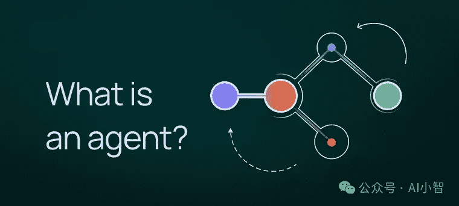
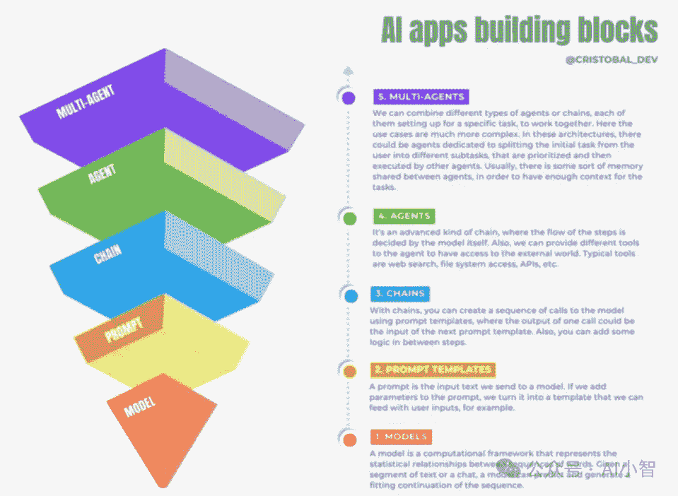
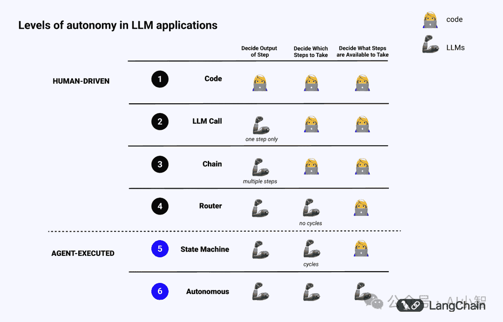
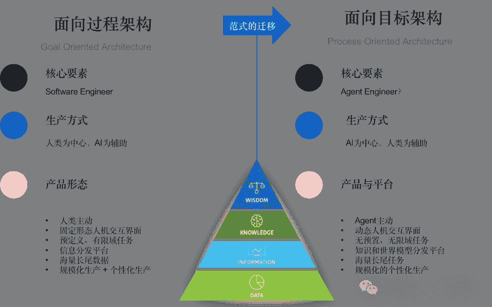
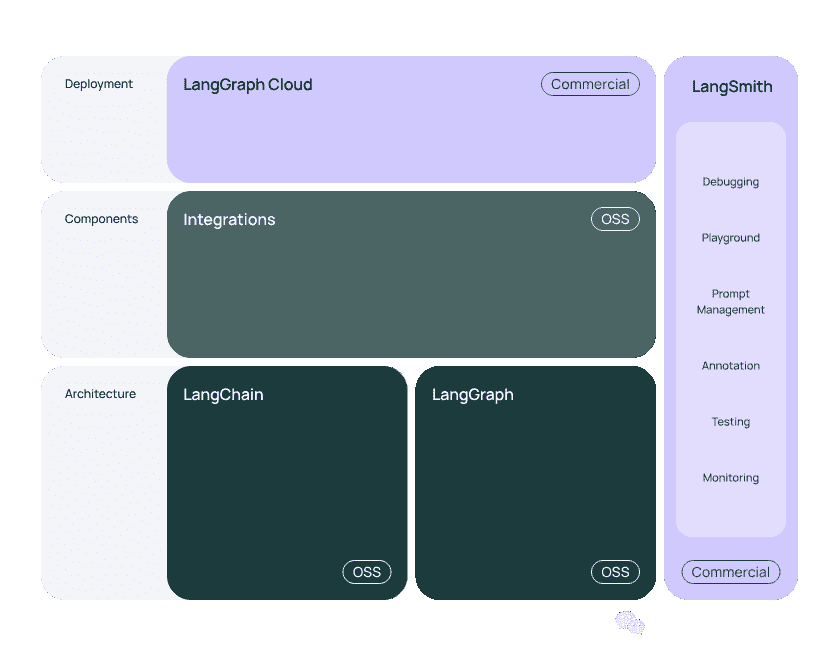

# Agent智能体？我们要的到底是什么

> 来源：[https://agijuejin.feishu.cn/docx/NUvmd9KuMoUkpPxSTMfcv9REn3b](https://agijuejin.feishu.cn/docx/NUvmd9KuMoUkpPxSTMfcv9REn3b)

> 作者：AI小智

> 原文：https://mp.weixin.qq.com/s/VI6jP_Z7t-OpTLzOnP_ZIA

What is an agent?

> 近年来，大型语言模型（LLM）的能力越来越强，应用**范围也越来越广泛，其中****一个热门方向就是** 智能体（Agent）** 。但在这一**切的背后，我们真正追求的是什么？是简单地 让机器执行命令 ，还是赋予它们更多的 智能体特性 （Agentic features），使它们能够更加自主地参与决策过程？

本文将深入探讨智能体的概念、为何“具有智能体特性”变得如此重要，以及这一趋势如何影响我们对未来技术的构想。

##  **什么是智能体？ **

**传统应用程序 ****通常遵循**预先定义好的规则和逻辑，而 智能体 则不同，它可以根据LLM的理解和判断，动态地选择下一步操作，这使得智能体能够处理更加复杂和不确定的任务。

简单来说， **智能体 **就是一个利用LLM来决定应用程序控制流程的系统，可以被视为一种能够自主决策和执行任务的系统。它通过与外部数据和计算资源的交互，来实现复杂的任务。

智能体与传统应用程序的区别

以LangChain生态为例，通过LangChain创建的很多LLM应用的工具**，特别是**那些作为 推理引擎并与外部数据源和计算资源交互的系统 ，这些系统通常被称为 智能体 。

> **❝**

> **智能体的**定义可能因人而异。技术上讲， 智能体 是一个利用LLM来决定应用程序控制流程的系统。

然而，这样的定义并不完美。人们往往认为智能体是高级的、自主的、类似人类的系统，但一个简单的系统也可以通过LLM在两条不同路径之间进行路由，这也符合技术定义。这表明，智能体的定义并不单一，而是具有多样性。

举个例子，想象一下一个智能客服机器人。传统的客服机器人只能根据预设的关键词进行简单的问答。但智能客服机器人则可以利用LLM理解用户的真实意图，并根据情况选择不同的对话策略，例如：

+   如果用户只是询问简单的信息，智能客服机器人可以直接给出答案。

+   如果用户的问题比较复杂，智能客服机器人可以引导用户提供更多信息，或者将用户转接到人工客服。

##  **Agentic意味着什么？ **

**Agentic **可以理解为“具有智能体特性”。一个系统越“具有智能体特性”，就意味着LLM在决定系统行为方面的作用越大。

Agentic谱系

我们可以把Agentic看作一个连续谱系：

+   一端是完全没有Agentic的系统。 这些系统完全按照预设的规则运行，LLM的作用仅仅是提供信息或执行简单的指令。

+   另一端是完全Agentic的系统。 这些系统的行为完全由LLM决定，甚至可以自己设定目标和计划。

当然，大多数实际系统都处于这个谱系的中间地带。例如，一个**智能客服机器人可**能在回答简单问题时没有 Agentic ，但在处理复杂问题时就需要一定的**Agentic。

**吴恩达 **提**出了一个观点，即**智能体的**能力可以被视**为一个谱系，就像自动驾驶车辆有不同的自动化等级一样，智能体的能力也可以有不同的等级,因而在现阶段使用 Agentic 定义比 Agent 更加合适。这个观点得到了广泛的认同，并且有助于更好地理解智能体的不同层次。

LLM的作用程度

根据系统中LLM的作用程度，可以将智能体划分为不同的等级：

1.  **路由器（Router） **：使用LLM将输入路由到特定的下游工作流，这种行为具有一定的“智能体特性”。

1.  状态机（State Machine） ：如果系统使用多个LLM进行多次路由步骤，并且其中一个步骤决定是否继续或结束，这种系统就类似于状态机。

1.  自主智能体（Autonomous Agent） ：如果系统能够构建工具、记住这些工具并在未来的步骤中使用它们，这种系统就具有高度的智能体特性。

尽管这些定义看起来比较技术性，但在设计和描述LLM系统时，这些技术定义是非常有用的。

##  **Agentic为何有价值？ **

理解 **Agentic **的概念对于构建和使用基于LLM的系统至关重要。它可以帮助我们：

+   **选择合适的系统架构。 **对于一些简单的任务，可能并不需要Agentic，传统的应用程序就足够了。但对于一些复杂的任务，就需要考虑构建具有Agentic的系统。

+   **设计更有效的交互方式。 **对于具有Agentic的系统，我们需要设计更灵活的交互方式，以便LLM能够充分发挥其作用。

+   **评估系统的性能。 **对于具有Agentic的系统，传统的评估指标可能不再适用，我们需要探索新的评估方法。

总而言之，Agentic是一个需要根据具体问题和应用场景进行权衡的因素。

更进一步说，理解你的系统可以有多“具有智能体特性”，可以在开发过程中指导你的决策——包括构建、运行、交互、评估，甚至监控。

Agentic在开发过程中的作用

+   **构建 **：在构建复杂的智能体系统时，拥有一个框架可以加速开发过程。这个框架应该支持分支逻辑和循环。

+   **运行 **：智能体系统越复杂，运行起来就越困难。需要能够处理长时间运行的任务，并且在执行过程中处理任何可能发生的错误。

+   **交互 **：在系统运行时，你需要观察系统内部的运行情况，并在必要时修改智能体的状态或指令。

+   **评估 **：需要一个评估框架来测试智能体的表现，包括中间步骤的效率。

+   **监控 **：需要一个新的监控框架来深入了解智能体的每一步操作，并根据智能体的步骤查询运行情况。

理解和利用系统中智能体特性的谱系，可以提高开发过程的效率和系统的鲁棒性。

##  **Agentic是新趋势 **

随着LLM技术的不断发展，我们正在构建越来越多的具有Agentic的系统。例如：

Agentic

+   **自主机器人： **可以根据环境和任务自主规划行动路线，例如自动驾驶汽车、物流机器人等。

+   **智能个人助理： **可以根据用户的习惯和需求提供个性化的服务，例如安排日程、推荐内容等。

+   **智能创作工具： **可以辅助用户进行创作，例如生成文本、图像、音乐等。

随着我们在智能体谱系上走得更远，支持工具的整个生态系统都需要重新构想。我们需要开发新的编程模型、调试工具和评估指标，以支持这些更复杂、更智能的系统。

传统的工具和基础设施可能无法满足需求,例如，LangGraph和LangSmith就是为了帮助构建、运行和交互智能体而设计的新工具。

LangGraph和LangSmith

随着智能体特性的不断发展，我们需要重新构想整个支持工具的生态系统，以适应智能体应用的需求。

##  **总结 **

**Agent **和 **Agentic **是理解和构建基于LLM的系统的关键概念。随着LLM技术的不断发展，我们可以预见，未来将会出现更多更强大的智能体，为我们的生活带来更多便利和可能性。

智能体技术的探索之路还很长，但通过不断地学习和创新，我们有望构建一个更加智能、更加互联的未来。

今天的 内容就到这里，如果老铁觉得还行，可以来一波三连，感谢！

