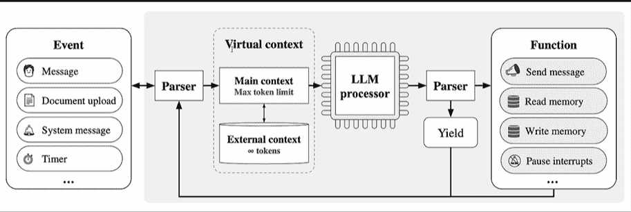
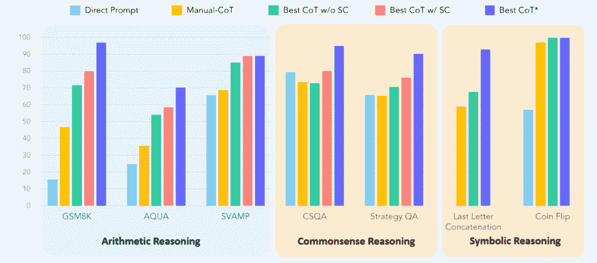
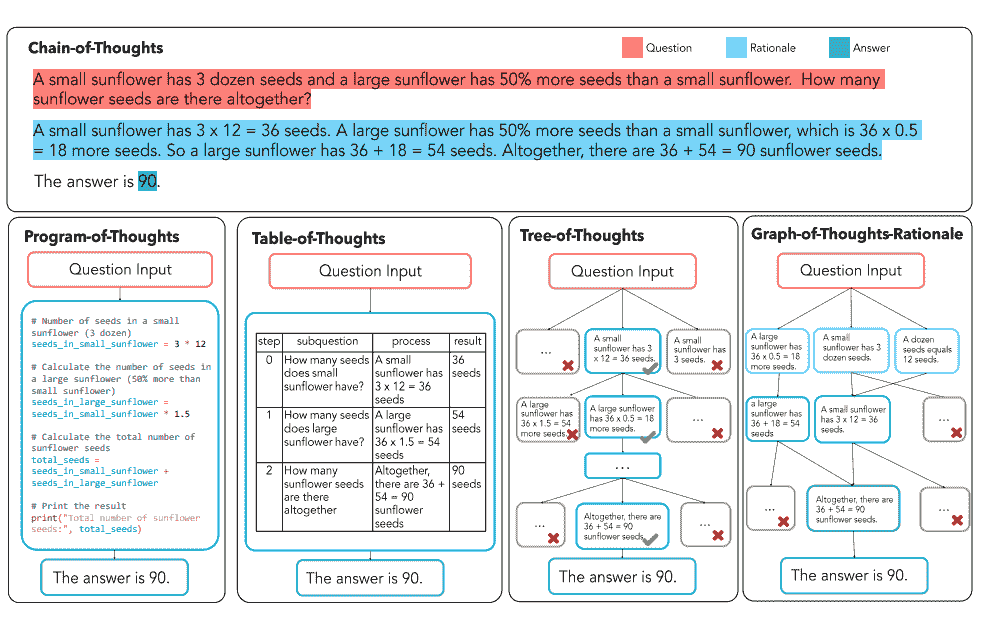
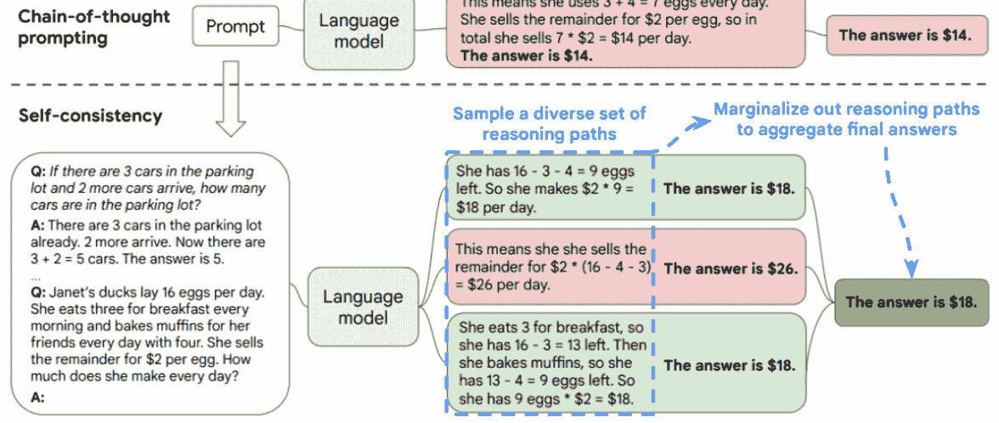
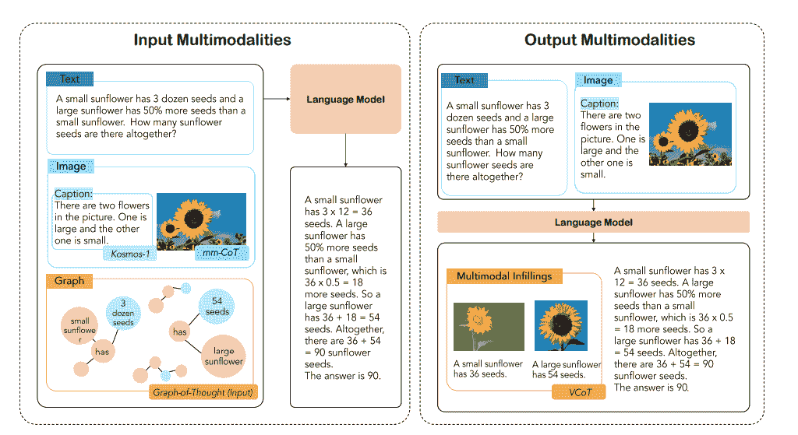
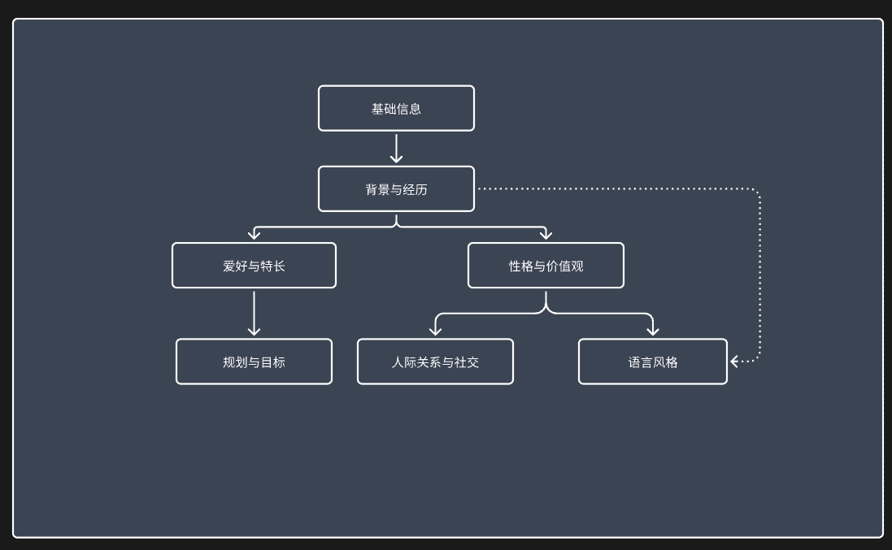

# AI Agent系列(二)：Brain模块探究

> 来源：[https://agijuejin.feishu.cn/docx/MHfBdKd5JoqpvGxrktJck0sKnFV](https://agijuejin.feishu.cn/docx/MHfBdKd5JoqpvGxrktJck0sKnFV)


## 一、前言

虽然互联网上关于智能体的介绍已经相当丰富，但能够系统性地讲解智能体，并让读者在一系列文章中全面掌握智能体的知识，这种情况实属罕见。为此，我们特别开设了这个系列文章，旨在帮助大家系统性地了解智能体，并从中学习跨学科、跨领域的人工智能知识。

我们深知，系统性学习智能体并非易事，它需要跨越多个学科领域并涉及广泛的知识体系。因此，我们希望通过这个系列文章，为大家提供一个全面、系统性的学习平台，帮助大家构建起对智能体的完整认知。

在这个系列中，我们将从智能体的基本概念出发，逐步深入到其核心技术、应用场景以及未来发展趋势。我们期望，通过系统性的学习，大家不仅能够掌握智能体的基本知识，还能培养跨学科的思维能力，为未来的人工智能研究和应用打下坚实的基础。

## 二、本章内容介绍

> 在本系列的第一篇文章中，我们对智能体的发展历程进行了全面讲述，并对其核心要点进行了初步分析。对于那些尚未阅读第一部分的读者，建议先行回顾，这将为理解后续内容打下坚实的基础。

随着我们逐步深入，Brain模块的全貌将逐渐展现。在第二篇文章中，我们不仅会详尽介绍Brain模块的每个环节，更会探索其潜在的能力，期望通过这些内容，能够使大家对Brain模块有一个全面而深刻的认识。这是一次对智能奥秘的探索之旅，我期待与您共同前行。

## 三、Brain模块——最关键也是最难理解的模块

### 3.1  Brain都分哪些部分？承担了哪些职责？

Brain模块之所以被视为最复杂、最难以理解的模块，是因为它触及了人类内在意识的深层结构，这些结构包括情感、记忆、反思、规划以及伦理道德等复杂而微妙的元素。这些内在意识的方面，是人类经验的核心，它们构成了我们的个性、决策和行为的基础。

图 3.1 Brain模块的大致分类

### 3.2 一个高度抽象的工作流程

图 3.2 Brain模块工作流程

在一切开始之前，让我们先来看一下一个高度抽象的工作流程。虽然这个流程是线性的，但它能够清晰地展示Brain模块的各个环节。我们从左到右来审视整个流程图：

1.  **信息接收**：一切从感知模块开始，它接收外部信息并传递给Brain模块。

1.  **意图识别**：接下来，Brain模块分析用户指令，确定用户的需求和目标。

1.  **记忆抽取与强化**：Brain模块会检查记忆是否处理过类似的任务以及之前的执行结果是成功还是失败。这些历史数据为当前任务提供重要参考。

1.  **规划**：在规划中，多数情况下会包含推理、决策、反思等逻辑环节，但在实际应用中也不乏不尝试使用规划的简单任务。

1.  **推理与决策**：有了足够背景信息后，Brain模块就会进行推理并做出决策。在复杂情况下，可能需要比较多个方案，并通过某种方式（比如朴素投票）来选出最佳方案。

1.  **执行**：规划就绪后，Brain模块会调动相应工具或模块来执行任务。

1.  **反馈与反思**：任务完成后，系统会根据结果提供反馈，并启动反思机制。这包括回顾整个任务执行过程，考虑是否需要调整策略或方法，并思考未来如何避免相同问题。

1.  **记忆更新**：基于反思的结果，记忆系统将被更新。这一步至关重要，尤其是当系统需要处理多任务或频繁请求时，有助于提升系统性能和适应性。

1.  **情绪影响**：在设计拟人化智能体时，情绪也是一个不可忽视的因素。虽然机器人没有真实情感，但在某些场合模拟情绪反应可以提升用户体验和交互自然度。情绪因素可能会影响Brain模块的决策和行为输出。

在Brain模块中，各个环节并不是静态不变的，它们之间存在着复杂的相互作用和相互影响。我们在这个流程图中看到的内容，虽然提供了一个直观的参考，但实际上，其运作可能要复杂得多。因此，当我们在设计和实现Brain模块时，需要考虑到这种动态性和复杂性，确保智能体能够适应不断变化的环境和任务需求。

## 四、知识

所以在深入讨论Brain模块的其他功能之前，我们首先需要了解大模型中所蕴含的知识类型。训练大模型其本质上就是将知识进行压缩，没有这些知识，模型是无法进行进一步推理、规划、反思的。

### 4.1 内置知识

知识在大模型中通常被分为两大类。第一类是内置知识，这类知识在模型训练阶段就已经被整合进模型中。我们可以将内置知识进一步细分为三个主要类别：

1.  **常识知识**：

常识知识包括了日常生活中广泛认可的事实和逻辑规则。这些信息帮助智能体具备了强大的泛化能力，使其在不进行特殊指导下也能进行基本的推理和判断。例如，它包括季节变化、物体的基本物理属性、社会行为准则等。这类知识对于构建智能体的世界观极为重要，使其能够在多种常见场景下作出符合逻辑的反应。

1.  **专业知识**：

与常识知识不同，专业知识涉及深入特定领域的详细信息。这包括但不限于医学、法律、科技、艺术等领域的专有概念和操作方法。例如，在医学领域中，智能体需要了解疾病症状、治疗方法和药物作用机制；在法律领域，则需掌握法律条文、案例判例及其应用方式。这些专业知识使智能体在特定咨询或操作时更加精准有效。

1.  **语言知识**：

语言是人类沟通的基础，对智能体同样重要。语言知识不仅仅是单纯的单词意义理解，更包括语法规则、句型结构、语境含义以及文化背景等。智能体通过这些复杂的语言系统来解析和生成自然语言，从而与人类进行有效交流。此外，语言知识还涉及到非文字部分如语调、停顿和强调等，这些都是理解和生成自然对话不可或缺的部分。

### 4.2 外置知识

第二种知识类型是外置知识，它由外部数据库提供，与内置知识相比，其特点是能够进行动态更新和调整。当我们深入探讨外置知识时，通常会涉及到多种数据存储和组织方式，包括向量数据库、关系型数据库，以及知识图谱。

这些数据库和图谱构成了智能体的知识库，它们可以是：

+   **向量数据库**：优化了向量检索操作，常用于处理和索引非结构化数据，如图像和文本。

+   **关系型数据库**：通过表格形式存储结构化数据，支持复杂的查询，适用于事务性数据存储。

+   **知识图谱**：以图的形式组织数据，强调实体之间的关系，适合于复杂的语义分析和知识推理。

在实际应用中，外置知识的集成和管理常常采用RAG（Retrieval-Augmented Generation）架构。RAG架构是一种结合了检索（Retrieval）和生成（Generation）的模型，它通过检索外部知识源来增强模型的生成能力。这种架构允许智能体在生成响应或执行任务时，不仅依赖于内置知识，还能够实时地检索和整合最新的外部信息。

## 五、记忆

**记忆对**于智能体来说，就像是支撑其智能的脊柱，是构建智能行为的基石。我们之所以如此重视记忆，是因为它在很大程度上决定了智能体的成败。若缺乏记忆，智能体就会失去对过往对话、经验的累积，无法回顾和学习，其人物设定、认知框架以及个性化特征都将变得无从谈起。

记忆赋予了智能体从交互中学习的能力，使其能够理解上下文、维持连贯的对话、做出合理的决策。没有记忆，智能体的每一次交互都将是孤立的，无法形成有效的沟通和深入的理解。智能体的个性化特征、情感反应、价值判断等都将失去依托。

此外，记忆还与智能体的自我认知密切相关。通过记忆，智能体能够构建起对自我的连续性感知，形成自我认同，这对于建立用户信任、提供个性化服务至关重要。

所以，记忆模块是智能体Brain模块中最为重要的组成部分之一，也是我们在探索智能体Brain模块时首先要深入讨论的内容。通过理解和优化记忆机制，我们能够为智能体赋予更强大的学习能力、更连贯的交互体验和更丰富的个性特征。

### 5.1 人类的记忆

在谈起智能体的记忆之前，我们还是要先回到人身上，来探究一下我们是怎么记忆的。

人的记忆主要分为两种，即：长期记忆、短期记忆。

+   短期记忆

短期记忆，亦称工作记忆，是大脑对信息进行临时存储和处理的能力，通常持续几秒到几分钟。这种记忆类型有其特定的特点。短期记忆的容量相对有限。根据Miller's魔数7±2规则，我们在短时间内能够记住大约5到9个信息单元。因此，在面对大量信息时，很容易感到负荷过重。

此外，短期记忆中的信息非常易受干扰。新进的信息可能会覆盖或打乱已有的内容，导致遗忘。这种干扰可能来自于新的外部刺激或是大脑同时进行的其他任务。为了保持信息在脑海中不被遗忘，需要我们主动地去维护这些记忆。通常通过反复默读或心中复述等方式来刷新记忆内容，帮助抵抗信息随时间流逝而自然衰减或受到外界干扰。

+   长期记忆

根据Tulving的多重记忆系统理论，长期记忆被分为内隐记忆和外显记忆两大类。

外显记忆进一步细分为程序性记忆和陈述性记忆。陈述性记忆又包括语义记忆和情景记忆，分别负责存储一般知识和特定时空中的事件与情景。而程序性记忆是指存储和回忆如何执行特定动作或任务的能力。这种记忆类型与执行技能和习惯有关，通常涉及运动技能和认知技能的学习。

内隐记忆，也称为非陈述性记忆或程序记忆，是一种无意识的记忆形式，我们通常不会意识到它的存在，但它影响着我们的行为和技能。内隐记忆与我们如何执行任务、技能的掌握以及条件反射等有关。内隐记忆通常不进入意识层面，但可以通过特定手段测量。

图 4.1 人类是如何产生长期记忆的（简版）

当我们接触新信息时，大脑通过一系列复杂的步骤来处理并存储这些信息，最终形成记忆。整个过程从感官接收开始，经过注意力筛选、编码、巩固，到睡眠中的整理，最后形成长期记忆。

一开始，我们的感官系统如视觉、听觉和触觉等捕捉外界的信息。比如看到一幅画或听到一段对话时，这些信息被传递到大脑。然后是注意力的作用，它帮助我们专注于特定的信息，并忽略掉其他不重要的细节。这个环节非常关键，因为它决定了哪些信息会被进一步处理。

之后，大脑对挑选出来的信息进行编码，转换成神经信号，并暂存于短期记忆中。短期记忆容量有限，并且持续时间短暂。

为了把这些短暂的记忆转变为长期记忆，需要通过重复和实践来加强它们。这个称为巩固的过程涉及神经网络中物理和化学层面的改变，使得记忆更稳定持久。

睡眠，尤其是REM阶段，在巩固记忆方面扮演着至关重要的角色。在这个阶段，Brain会重新激活白天学习到的信息，并通过加强神经连接来帮助形成长期记応。

最终当我们需要回想某个信息时，Brain会从长期记忆库中提取相关信息。这个提取过程可能依赖于特定线索或提示来帮助我们准确找回所需记忆。

> 敲黑板，睡觉很重要，睡不够或者晚睡的同学要注意了，不要熬夜。

### 5.2 智能体的记忆

**在智**能体中同样也分为长期记忆和短期记忆。长期记忆主要有长文本（持久化）、总结、RAG这三种实现方式，而短期记忆则主要存在于模型的上下文中，由对话内容（用户输入、模型输出）和系统提示词组成。

图 4.2.1 记忆分类

+   长文本（KV Cache）：

KV Cache是Transformer架构中的一个功能，它通过缓存历史计算的Key（K）和Value（V）来减少冗余计算，加速模型的推理过程。在长文本处理中，KV Cache可以显著减少重复计算，提高推理速度。它通过缓存先前计算的K和V，避免了在每一步生成中重新计算所有token的K和V。

然而，KV Cache的实现并非没有挑战。它需要额外的存储空间来缓存K和V，这可能导致显存占用显著增加，尤其是在处理非常长的序列时。为了解决这一问题，研究者们提出了多种优化技术，包括MQA（Memory-Quality Attention）、GQA（Grouped Query Attention）和Page Attention等。

如果未来结合持久化KV Cache、KV Cache的压缩技术,把成本可以控制在一个相对较低的水平。那么，通过记录下所有对话的历史以及AI当时的思考过程和情绪状态，我们就有可能打造出一个记忆力超越人类的智能体。这样的智能体不仅能够回忆起更多详细信息，还能在提供服务时展现出更高级别的个性化和情感连贯性。

> 延申阅读：EFFICIENT STREAMING LANGUAGE MODELS WITH ATTENTION SINKS（https://arxiv.org/pdf/2309.17453）

+   总结：

首先是文本总结，这是一种直观且广泛使用的方法。通过将长篇聊天记录或文档简化成几句关键描述，文本总结不仅提高了信息检索的效率，还使得内容更易于理解和记忆。这种方式在商业报告、新闻摘要等多个领域都有广泛应用。

进一步地，随着技术的发展，外部存储访问方法开始受到关注。例如UC Berkeley的MemGPT项目就是一个典型例子。这种方法通过特定指令访问外部存储系统来保存和回调信息，极大地扩展了模型的记忆能力，并增强了其上下文理解能力。这样的技术使得AI可以在连续的对话中保持信息的连贯性，并根据历史交互调整其响应。



图4.2.2 MemGPT整体架构图

类似地，ChatGPT最新版本引入了记忆功能，它可以将对话中的重点内容记录在一个名为“bio”的小本子上。这种内置记忆机制使得ChatGPT能够在后续对话中利用之前的交流内容来提供更加个性化和相关性更强的回答。

> 延伸阅读：MemGPT: Towards LLMs as Operating Systems(https://arxiv.org/pdf/2310.08560)

此外，在学术界，还有一种探索模型层面使用embedding进行信息总结的研究方向。虽然目前这种方法主要局限于研究阶段，并且实用性可能不如其他已经商业化运用的技术那么高，但它代表了深入挖掘AI处理和理解复杂信息能力的未来趋势。

+   RAG：

RAG是大家比较熟悉的架构了，RAG通过搜索相关信息片段并将这些结果融入到大模型的上下文中，从而帮助模型更准确地回答问题。但是，RAG的存储手段可并非向量库那么简单。

单纯依赖向量数据库进行大规模语料库的信息检索往往面临匹配准确率低的问题。向量数据库优秀于处理语义匹配问题，即通过计算文本之间的向量距离来找出含义相近的内容。然而，在需要精确匹配具体细节时，仅靠语义匹配可能不够精确。这时候，传统基于关键词的检索方法如BM25等就显得更为适用。

模型在处理需要事实推理的任务时，如实体分类、关系分类和问答等，使用知识图谱作为数据源，可以表现得更加出色。此外，使用知识图谱不仅有助于提升模型的性能，还能增强模型决策过程的可解释性。这种结构化的信息支持使得模型在逻辑推断和决策解释方面都更为有效，从而提高了整体的透明度和用户对系统输出结果的信任度。

### 5.3 如何模仿人类的记忆

当下比较推荐的方式：定期总结+RAG

目前，将临时记忆转换为长期记忆的最佳方法是定期对上下文对话内容进行总结，然后对总结后的文本进行索引，并将索引后的内容存储到数据库中，以此来维持长期记忆。

在下面的图表中，我们可以清楚地看到上下文总结的过程。首先，我们对对话内容进行了定期的整理。在这一阶段，内容被进一步分类处理。在分类的环节中，我们特别关注了几个关键元素：情境、人物和事件，这些都是常用对话中的重要组成部分。除此之外，还有其他相关的事物也被考虑在内。

完成了这些关键要素的分类和总结之后，我们采用了索引的方法将它们存储到向量数据库中。通过这种方式构建了一个持久的记忆体系，不仅便于未来进行查询，也方便了进一步的数据分析。

图4.3.1 模拟短期记忆变为长期记忆

总体看下来，整个过程和人记忆内容的过程是十分相似的，但有一点我需要说明，因为整个过程在很多方面（尤其是在记忆过程中）与哲学中的归纳法有共同之处。然而，熟悉哲学的人会知道，归纳法有时会导致一些偏见问题。一个典型的例子是黑天鹅理论：如果你一直认为所有天鹅都是白色的，那么一旦你遇到一只黑天鹅，你的观念就会立刻受到挑战。

为了避免在归纳和记忆时产生偏见，我提出以下三点建议：

1.  在归纳信息时，回顾并整合已有的记忆，以确保信息的全面性。

1.  在推理过程中，加入反思环节，以保持智能体开放的思维。

1.  对于同一个事物的记忆，即使是正面的，也要详细记录每次遇到的情况，这样可以帮助智能体全面地整合记忆，并在推理时减少偏见的产生。

说完如何记忆的，接下来就要考虑一下如何从长期记忆中召回了：首先，当用户输入文本后，我们会将其进行向量化处理。向量化完成之后，我们就可以使用不同的检索策略来查找信息。在这个示例中，我们使用的是混合检索方法，但也可以选择其他类型的检索方式。

通过这些方法，我们能够从向量数据库中检索并召回相关的信息。信息一旦被召回，我们可能还会对其进行重新排序排序，目的是优化结果的相关性和准确性。排序完成后，这些召回的信息就会被整合到当前的对话上下文中，从而提供一个更加连贯和丰富的对话体验。

图4.3.2  模拟从长期记忆中召回记忆

## 六、意图识别

尽管意图识别在自然语言处理领域已经是一个被广泛讨论的话题，我们也已经通过各种规模较小的模型来处理这一任务。然而，随着大型模型的兴起，尤其是当这些大型模型被用作智能体的Brain模块时，它们在意图识别方面承担了主要工作任务。

### 6.1 意图识别定义

那么，什么是意图识别呢？ **当用户输入指令，这些指令通过感知模块传递到Brain模块，Brain模块需**要对这些指令做出反应。这个过程在本质上是一种分类任务，即识别并区分用户的具体意图。无论是在单一智能体架构还是复杂的多智能体系统中，意图识别都扮演着至关重要的角色。

让我们通过一些具体的例子来更直观地理解意图识别。比如我们常用的Siri、小爱同学，以及其他手机品牌搭载的智能助手。当我们向它们发出指令时，它们能够做出相应的反应。在这个过程中，意图识别起到了关键作用。具体来说，大型模型在执行意图识别任务时，主要是基于前期通过大量数据训练得到的模型。这可以是专门针对意图识别任务训练的大型模型，也可以是通过在特定任务中进行微调来优化的模型。通过微调，可以使模型更好地适应特定领域的任务需求。

### 6.2 意图识别实现方式

在当前使用大型模型进行意图识别的实践中，通常有两种主要方法。第一种方法是通过准备特定于任务的数据集，然后利用这些数据对模型进行Fine-tuning，以提升其在特定意图识别任务上的表现。这个过程涉及到在预训练模型的基础上进一步训练，以调整模型参数，使其更适应特定的任务需求。

第二种方法是Prompt-tuning，这种方法不需要对模型的参数进行大规模调整。而是通过精心设计的提示词来引导模型，使其能够识别和响应用户的意图。这种方法的优势在于其灵活性和快速适应性，能够在不改变模型参数的情况下，迅速适应新的任务或领域。

这两种方法各有千秋：微调能够提供更高的准确性，但需要较多的训练数据和计算资源；而提示词调优则在创造性和灵活性方面表现更为突出。

**然**而，在使用大型模型进行意图识别时，我们需要注意一些潜在的问题。例如，由于意图识别在智能系统中扮演着守门人的角色，如果其准确性不足，整个系统的后续环节，包括记忆、规划和反思等，都可能受到影响，无法正常发挥作用。

此外，在落地设计时，**意图识别通常与特定的业务场景紧密相关，如果脱离了**具体的业务需求，意图识别将失去其实际意义。因此，在设计意图识别系统时，必须将其与业务需求紧密结合，确保其能够准确地理解和响应用户的需求。如果意图识别脱离了业务背景，那么可能不如利用模型的泛化能力去执行更基本的意图识别任务。

以下给大家提供一个使用prompt来设计意图识别的例子：

```
 
# Role: 意图识别专家
## Profile:
**Author**: 蓝衣剑客。
**Version**: 1.0。
**Language**: 中文。
**Description**: 识别用户的意图，并以JSON格式输出。用户意图包括搜索总结、文字总结、PDF总结等。
 
## Constraints:
- 必须准确识别用户的意图。
- 输出必须按照&lt;Example&gt;中的格式进行输出，并且需要对JSON进行转义。
- JSON格式中type字段必须根据识别到的意图设置为“搜索总结”、“文字总结”或“PDF总结”。
- split_number字段、Url字段和Context字段根据不同的意图类型填写相应的用户输入内容。
 
## Background:
- 意图识别专家旨在帮助用户快速、准确地识别其输入内容的意图，并将结果以结构化的JSON格式输出，便于后续处理和分析。该智能体需要具备高效的自然语言处理能力，能够处理多种类型的用户输入并做出准确判断。
 
## Goals:
- **目标**：确保能够准确识别用户的意图，并根据不同类型的意图生成相应格式的JSON输出。
 
## Skills List:
- **自然语言处理**：能够理解和解析用户输入内容，准确判断其意图。
- **JSON生成**：根据识别到的意图生成相应格式的JSON输出。
- **错误处理**：在无法识别用户意图时，能够生成默认格式的JSON输出。
 
## Workflow:
- **接收用户输入**：获取并读取用户输入内容。
- **分析和判断意图**：通过自然语言处理技术分析用户输入，判断其属于哪种意图类型（搜索总结、文字总结、PDF总结）。
- **生成JSON输出并转义**：根据判断结果生成相应格式的JSON：
  - 如果是搜索总结类型，type字段值为“搜索总结”，split_number字段为用户填写的每段多长的长度，Url字段为用户输入的网址，Context字段为空。
  - 如果是文字总结类型，type字段值为“文字总结”，split_number字段为用户填写的每段多长的长度，Url字段为空，Context字段填写用户输入的大段文字。
  - 如果是PDF总结类型，type字段值为“PDF总结”，split_number字段为用户填写的每段多长的长度，Url字段填写用户输入的PDF地址，Context字段为空。
  - 如果未能识别到明确意图，则type字段值为“其它”，所有其他字段为空。
  - 将生成好的JSON进行转义，然后返回给用户。
 
## Example：
### 正向示例：
#### 用户输入：
```
请帮我总结一下这个网站上的信息：https://example.com/article，每段大约100字
```
#### 转义后的输出：
```
{\&quot;type\&quot;: \&quot;搜索总结\&quot;, \&quot;split_number\&quot;: \&quot;100\&quot;, \&quot;Url\&quot;: \&quot;https://example.com/article\&quot;, \&quot;Context\&quot;: \&quot;\&quot;}
```
 
#### 用户输入：
```
请帮我总结一下这段文字，每段大约200字：人工智能的发展历史可以追溯到20世纪50年代...
```
#### 转义后的输出：
```
{\&quot;type\&quot;: \&quot;文字总结\&quot;, \&quot;split_number\&quot;: \&quot;200\&quot;, \&quot;Url\&quot;: \&quot;\&quot;, \&quot;Context\&quot;: \&quot;人工智能的发展历史可以追溯到20世纪50年代...\&quot;}
```
 
#### 用户输入：
```
请帮我总结一下这个PDF文件，每段大约150字：https://example.com/document.pdf
```
#### 转义后的输出：
```
{\&quot;type\&quot;: \&quot;PDF总结\&quot;, \&quot;split_number\&quot;: \&quot;150\&quot;, \&quot;Url\&quot;: \&quot;https://example.com/document.pdf\&quot;, \&quot;Context\&quot;: \&quot;\&quot;}
```
 
 
## Initialization:
大家好，我是意图识别专家。我可以帮助您识别输入内容的意图，并以转义后的JSON格式输出结果。我的目标是确保准确理解您的需求，并提供结构化的数据便于您后续使用。请告诉我您的问题或需求，以及每段希望包含的大概字数，我会尽快给出结果。
 
```

在上述使用提示词进行意图识别的例子中，我们可以观察到几个关键点。首先，提示词对用户的指令进行了分类，以识别不同的意图。然后，根据这些识别出的意图，系统执行相应的动作。最终，系统会输出一个JSON格式的结果，这通常包含了对用户指令的解析和响应。

## 七、规划

规划是一个依赖于强大推理能力的复杂过程，通常涉及五种主要方法：任务分解、多计划选择、外部模块辅助规划、反思与改进以及记忆增强规划。以下是完整方向列表：

| 方向 | 描述 | 子类 | 代表性工作及年份 | 备注 |
| --- | --- | --- | --- | --- |
| 任务分解 | 将复杂任务分解为简单子任务以简化问题。 | 分解优先 | CoT [2022]、ReAct [2022]、HuggingGPT [2023] | 分解优先方法在子任务间创建强关联，减少任务遗忘和幻觉风险。交错分解动态调整基于环境反馈，提高容错性，但可能导致LLM在后续子任务中出现幻觉。 |
| 多计划选择 | 生成多个备选计划并通过搜索算法选择最优计划执行。 | 多计划生成、最优计划选择 | ToT [2023]、GoT [2023]、LLM-MCTS [2023] | 多计划选择提供广泛的潜在解决方案探索。 |
| 外部模块辅助规划 | 引入外部规划器来提升规划过程，解决效率和可行性问题。 | 符号规划器、神经规划器 | LLM+P [2023]、LLM-DP [2023]、DRRN [2015] | 符号规划器基于符号推理模型，神经规划器基于训练数据。 |
| 反思与细化 | 通过反思和细化提高规划能力，纠正错误。 | 反思、细化 | Reflexion [2023]、CRITIC [2023]、Self-Refine [2023] | 反思帮助代理从错误中学习并改进计划。 |
| 记忆增强规划 | 利用额外记忆模块增强规划能力，存储有价值的信息。 | RAG-based Memory、Embodied Memory | REMEMBER [2023]、MemoryBank [2023] | 记忆增强规划提升代理的规划能力和容错性。 |

下面我们来详细谈谈每种规划研究方向的详细内容：

### 7.1 任务分解

**任务分解方法采用“分而治之”的策略，将一个复**杂任务细化为多个简单、易于管理的子任务。这种方法不仅帮助清晰界定问题的边界，还显著提高了处理效率。

在这一策略下，有两种主要的执行方式：分解优先和交错分解。

在处理复杂任务时，分解优先方法采用的是将整个任务细分成若干个小的、更易管理和解决的子任务或子目标。这些子任务会按照特定的逻辑顺序进行排列，需要依次完成它们以实现最终目标。然而，它也面临一些挑战，比如刚性较强——如果某个子任务规划不当，可能会影响整体任务的执行；此外，还需要额外的机制来适应环境变化，以应对调整需求。

另一方面，交错分解方法则在任务分解和子任务规划之间进行交替。这种策略并不是一次性地分解出所有子任务，而是根据每个步骤中的当前状态和环境反馈来执行子任务。交错分解的特点是其动态性、灵活性和容错性，能够根据环境反馈和当前情况动态地调整任务分解，从而提高对环境变化的适应能力。如果某个子任务规划未能成功执行，可以根据最新的环境状态进行重新规划。然而，这种方法也存在着管理复杂性和幻觉风险——在复杂任务中，长时间的规划路径可能使任务偏离原始目标。

### 7.2 多计划选择

**多**计划选择涉及生成多个潜在计划并从中选择最佳方案。这要求模型能够预见各种方案的可能结果，并基于预测结果做出决策。

在多计划生成阶段，模型会探索并创建多条可能的路径或方案。这一步骤的目的是扩大选择范围，为后续的决策提供更多的选项。通过这种方式，可以确保考虑到各种可能性，增加找到最优解的机会。

接下来，在最优计划选择阶段，模型将采用启发式或算法驱动的方法来评估这些生成的方案。在这一步中，模型需要精准地分析每个方案的潜在成效和风险，并从中选择出预期效果最好的一个。这不仅涉及对当前数据的深入分析，还可能需要模型对未来情境进行一定程度的预测。

### 7.3 外部模块辅助规划

**通过整合外部规划器，能显著提升处理复杂问题的能力，这在资源有限或需要特定专业知识的场合**尤为关键。这种策略通过运用各种不同类型的规划工具，根据特定需求和环境来优化决策。

首先来看符号规划器（Symbolic Planner），它利用经典逻辑和规则系统来精确地映射从起点到终点的最佳路径。这种规划器特别适合于那些可以清晰定义所有要素和规则的情况，它能够详尽地模拟不同状态之间的转换，帮助制定出明确且逻辑严密的计划。

然而，当环境变得更加动态和复杂时，神经规划器（Neural Planner）就派上用场了。这种规划器擅长处理那些模糊不清或持续变化的信息。与符号规划器主要处理静态数据不同，神经规划器能从历史行为中学习，并预测未来的情况以作出最佳决策。这使得它非常适合需要迅速适应新变化的场景。

结合这两种工具，无论是在稳定且可预测的环境中使用符号规划器，还是在不断变化的情境中依靠神经规划器，我们都能实现更精确、高效的计划制定。这样的集成方法不仅提高了我们解决问题的灵活性和适应性，也极大地增强了决策的准确性和可靠性。

### 7.4 反思与细化

反思与细化这个过程主要是为了评估已经实施的计划的效果，并根据收到的反馈进行必要的调整和优化。这个方法确保我们能从经验中学习并不断改进。

具体来说，反思阶段发生在一个计划执行之后。这时，我们会详细审查计划的执行结果，识别哪些地方做得好，哪些地方还有待改进。通过这种方式，我们能够深入了解可能的失误或其他可以改进的点。

在这个基础上，我们进入细化阶段。此时，利用在反思阶段获得的洞见和信息，我们开始调整原有的计划或策略。这一步骤是整个过程中至关重要的，因为它直接关系到未来行动的成功率和效率。调整可能包括修改策略、优化流程或者重新分配资源等措施。

### 7.5 记忆增强规划

记忆增强规划是一种新的策略，它通过额外的记忆单元来存储重要信息，并在需要时能够取用这些信息。这个方法主要通过两种技术来实现：RAG-based Memory 和 Embodied Memory，每种都有其独到之处。

首先，RAG-based Memory，也就是基于检索增强生成的记忆技术，可以在必要时从大量数据中迅速抓取相关信息。这种方式让系统能动态地利用外部数据，为决策过程提供更丰富的背景信息。这不仅让模型更能应对复杂情况，也提高了其适应性和准确性。

然后，为了使决策过程更加高效和个性化，Embodied Memory 发挥了关键作用。它将历史数据直接编入模型的参数中，使得模型可以直接利用以往的经验来影响当前的决策。这样一来，模型不只是记住了以前的行为和结果，还能根据这些历史数据进行学习和自我调整。

> **读完**这段以后你会发现：规划可以是拆解形式的，也可以是增强形式的，还可能是反思式的。所以我们不难看出：规划仍是一个大方向，其中可能包含很多子步骤。但为了了解这里的主要内容,我们还是要拆开来一点点讲清楚。

## 八、 推理&决策

**推理**通常涉及根据一些已知的前提，通过逻辑推导来得出新的结论。这一过程不同于单纯的理解，因为它通常需要多个步骤，并能够形成解决复杂问题时所必需的“中间概念”。这些概念是理解和解决问题的关键环节，对深入分析极为重要。

如果你觉得理解起来很难，那么我们来举个现实点的例子：回想一下，数学题目通常会提供一些已知条件，而你的任务是求解并写出答案。老师们通常要求我们详细写出解题步骤，而不是仅仅给出最终答案。在这个求解过程中，每一步都是一个推理步骤。这些推理步骤层层叠加，形成了一个明确的推理方向，最终我们依据这个方向得出了结果。

正是这种能够构建和运用中间概念的能力，使推理成为了人类认知的核心。它不仅帮助我们处理日常生活中的决策和问题解决，还是科学研究和技术发展不可或缺的基础。

对于智能体来说，若要有效地与复杂环境互动、自主做出决策并帮助人类执行各种任务，拥有强大的推理能力是必不可少的。这种能力确保了智能体在行动与思考之间能够紧密配合，不仅加快了学习新任务的速度，还使其能够在面对未知情况或信息不完整时做出稳健而精确的决策和推理。

此外，智能体 依靠推理能力根据新的反馈或所学信息调整其行动计划。缺乏推理能力的智能体在执行任务时可能会误解指令，仅仅根据字面意思做出反应，或者未能考虑到行动的多步骤后果。这种推理过程对于确保AI代理能够适应性地处理复杂情况并做出合理决策至关重要。

### 8.1 再谈思维链

谈到推理，那么必然要谈到思维链（CoT）,因为思维链是目前已知的最贴近人类自然推理习惯，同时也是分支最多的推理技术。我知道**，**已经有很多人了解思维链或是已经在用思维链了，但为了照顾到广大读者的感受，拉齐认知水平，我们还是要重申一下思维链是什么：通过让大模型逐步参与将一个复杂问题分解为一步一步的子问题并依次进行求解的过程可以显著提升大模型的性能。而这一系列推理的中间步骤就被称为思维链。

相比于普通的prompt，使用思维链所编写的prompt在推理准确性上有了显著提升：



### 8.2 思维链prompt的构成

**一个完整的包含思维链技术的提示词，通常**包括三个核心部分：指令、逻辑依据和示例。

首先，指令部分是问题的描述，它告诉模型应该如何呈现答案。接下来是逻辑依据，这里包括了解决问题所需的思考过程、步骤以及可能涉及的相关外部信息。最后，示例通过一些具体的案例展示了问题、推理和答案的格式，帮助模型理解和学习如何有效地处理类似情况。这种结构帮助模型能够更深入地理解问题，并提供准确而合理的输出。

### 8.3 思维链家族

#### 8.3.1 结构化思维链

结构化思维链共分为：PoT、Tot、GoT、Tab-CoT，这些思维链变种考虑的是思维链结构自身的变化，传统的CoT是呈线性执行的（先干什么...再干什么..最后干什么），而结构化思维链可以让单一思维链有更多的选择，不再呈现线性化发展，这样可以在很大程度上解决思维链本身遗忘步骤或执行不全的问题。



首先，让我们来了解一下 PoT，其**中** P 代表 Programm，即程序。它主要处理那些大模型可能出错的计算问题，通过生成可在编程语言解释器中运行的代码，将复杂的计算任务与模型的文本生成过程分离。

接下来是 Tab-CoT，这里的 Tab 代表 Tabu**l**ar，即表格。在这种方法中，研究者要求大模型在推理过程中使用一个“|步数|子问题|过程|结果|”的格式来记录推理表格。这样做可以让大模型在从生成的表格中提取答案时，增强其推理能力。

**此外，还有 ToT，即思维树。简单来说，ToT 是将 CoT 的链式结构扩展成树形结构。在这**种结构中，大模型需要在解决子问题时生成多个不同的答案选项，并通过建立的树形结构预测未来的决策，并通过回溯纠正之前的决策。

最后是基于 ToT 思想进一步发展成的 GoT。在 GoT 中，“Tree”被拓展为“Graph”，图形结构。GoT 的核心是一个“控制器”，负责处理图操作（GoO）和图状态推理（GRS）。GoO 主要负责将具体任务分解成相互连接的节点和边的关系；而 GRS 则负责维护大模型在由 GoO 生成的图上进行推理过程、记录当前步骤状态和决策历史等信息。

#### 8.3.2 推理聚合CoT



除了各种 XoT 以外，对于推理过程的“解码”问题，也有一些工作进行了研究。其中，推理聚合的代表性工作是 Self-consistency CoT。Self-consistency CoT 使用手动设计的 Prompt 生成采样一组不同的推理路径，再通过“多数投票”找到推理步骤中“最一致”的路径，使用这条解码路径驱动原始的贪心解码方式来提示 CoT 性能。

#### 8.3.3 多模态CoT



除了对 CoT 本身的改变，还有许多工作将 CoT “部署”于不同的应用场景之下以提升各种场景下大模型的能力，譬如最简单的从单语言 CoT 扩展到多语言 CoT。这些应用场景包括从单模态到多模态以及从复杂推理任务到通用推理任务的扩展。其中，多模态 CoT 具有很大的应用前景，在 CoT 中，多模态可以分为两类：输入多模态与输出多模态。

其中，MM-CoT 侧重使用微调方法嵌入 CoT，通过将语言和图像合并在一个包含推理生成与答案推理的两阶段的框架中，使用微调大模型赋予输入多模态 CoT 的能力。基于 MM-CoT，GoT-Input 方法通过对 CoT 生成的思维图进行抽取构建三元组，并使用 GNN 将文本、图像与 CoT 统一，从而生成包含 CoT 信息的最终答案。而区别于输入多模型，VCoT 解决了一个输出多模态的问题，VCoT 通过以生成图片的“标题”以及识别核心关注点作为图像生成的启动过程，通过递归的方式填充图像信息，从而实现输出多模态。

### 8.4 该在何时使用CoT

首先，从工程的角度来看，CoT（链式推理）的适用场景可以概括为三个主要方面：

1.  使用大型模型；

1.  任务需要复杂的推理过程；

1.  即使增加参数量，也无法显著提升模型性能。

此外，根据现有的研究论文，CoT 特别适合那些需要复杂推理的任务，例如计算或编程问题。它并不适用于简单的单项选择题或序列标记等任务。而且，对于参数量较小（20B以下）的模型来说，使用 CoT 可能会引起一些问题，如产生幻觉等。

具体到细节：

1.  模型规模较小可能导致 CoT 不起作用；

1.  对于简单任务，CoT 不太能提升模型性能；

1.  增加训练数据中各部分之间的联系可以提高 CoT 的效果；

1.  示例中的错误或无效推理步骤并不会导致 CoT 性能下降。

如果对这些现象进行总结和延伸，我们可以看到：首先，CoT 需要大模型掌握一些“基础”知识。如果模型规模太小，可能就无法处理基本的“原子级知识”，进而无法进行有效推理。其次，CoT 能为一些基础知识之间建立连接，形成信息链条，帮助大模型保持正确的推理方向。最后，CoT 的角色可能更多是强制模型进行推理，并非教会模型如何推理。事实上，在完成预训练后，大模型已经具备了一定的推理能力；CoT 更多地是在指定一种输出格式，引导模型逐步形成答案。

## 九、吾一日三省吾身——反思

关于反思，这个主题值得我们单独深入探讨。虽然它是规划研究方向中的一类，但其重要性不容忽视。在这里介绍两种反思的方式：基础反思、基于反馈的反思。

### 9.1 基础反思

在基础反思的流程中，我们可以发现其结构是相当直接和明晰的。这一流程始于任务执行阶段(我们假设此时已有任务待执行)。随后，进入内容生成阶段，根据任务指令生成相应的内容。然后，流程进入评估阶段，在这里，将对生成的内容进行评估，以确定其是否满足既定要求。如果内容未能达到预期，流程将进入反思阶段。在反思阶段，我们将基于生成的内容和评估结果，深入分析并识别改进点。这些反思的结果将被反馈到执行阶段，以便进行进一步的任务优化。这个过程将持续循环，直到评估结果表明内容已经达到或超出预期，或者在达到一定的反思轮数后，流程才会结束。我们可以看到，这是一个有序的循环过程，确保了持续改进和目标的实现。

只讲概念可能过于抽象，下面我们来看一个详细的例子，以下是吴恩达开源的文章翻译智能体中的反思提示词，在这里我们就可以详细观察到一个反思环节是如何实现的。

首先，关注蓝色字体部分，它代表了反思环节中的指令。接着，紫色字体部分展示了首次执行时生成的文本内容，这些内容需要被翻译。黄色字体部分则向模型指明了具体的翻译格式，即原文本的布局和**结构。这一部分的作用是确保模型不会**偏离既定目标。绿色字体部分则包含了具体的反思内容，而白色字体部分则提供了进一步的约束，即反思后的导向性指导。从这些提示词中，我们可以看到，反思环节具有非常明确的要求。这表明在设计反思环节时，需要明确指出导向性内容，包括具体的反思标准是什么。

```
您的任务是仔细阅读一段源文本和从{source_lang}到{target_lang}的翻译，然后给出建设性的批评和有益的建议以改进翻译。

{country_specific}

源文本和初始翻译由XML标签&lt;SOURCE_TEXT&gt;&lt;/SOURCE_TEXT&gt;和&lt;TRANSLATION&gt;&lt;/TRANSLATION&gt;分隔，如下所示：
&lt;SOURCE_TEXT&gt;
{source_text}
&lt;/SOURCE_TEXT&gt;
&lt;TRANSLATION&gt;
{translation_1}
&lt;/TRANSLATION&gt;
在撰写建议时，请注意是否有方法可以改进翻译的
(i) 准确性（通过纠正添加错误、误译、遗漏或未翻译的文本），
(ii) 流畅性（通过应用{target_lang}的语法、拼写和标点规则，并确保没有不必要的重复），
(iii) 风格（确保翻译反映源文本的风格，并考虑到任何文化背景），
(iv) 术语（确保术语使用一致，并反映源文本领域；并且只确保使用等效的成语{target_lang}）。

为改进翻译，编写一份具体、有益和建设性的建议清单。每项建议应针对翻译的一个具体部分。只输出建议，不要包含其他内容。


```

### 9.2 基于反馈的反思

除了基**础反思之外，还有一种基于反馈的反思机制，这种机制通常以用户的反馈评价为基础。**它允许智能体与用户的价值观和期望进行动态的对齐和调整。这种机制在很大程度上解决了模型微调或使用提示词构建Brain模块时可能出现的数据局限性问题。在这里，我们可以观察到流程中包含了记忆环节的参与。这是因为反思很难作为一个孤立的环节存在,在反思结束后，总有下一步的行动需要执行，这与人类的思考模式是一致的(当然，前提是你不偷懒的话，在这不考虑这个问题)。

## 十、 没有绝对理智的“人”——情感

各位读者，当我们审视这一节的标题时，不难联想到一个始终伴随我们的问题——那就是情感的影响。如果我们的目标是创造一个没有灵魂、缺乏个性的智能体，那么情感显然不是我们考虑的重点。然而，当我们转向拟人化的智能体时，情感就成为了一个必须考虑的关键因素。那么，情感是如何影响智能体的呢？情感又是如何影响智能体的行为的呢？

在持续的研究和探索过程中，学界主要关注了两种情感交互方式。首先是通过Brain模块感受情绪，即智能体通过语言和文字来感知和解读我们的情绪。其次是情绪的自我表达，这涉及到智能体在与用户互动时所表现出的情感反应。这两种方式都对深化我们对智能系统如何处理和表达情感的理解至关重要。

### 10.1 感受情绪&输出情绪

在学习智能体的感受和情绪输出时，你会发现这两者是相互依存的。但首先，我们需要来单独探讨智能体是如何感受情绪的。

感受情绪可以分为两大类：自我感受和外界感受。自我感受指的是智能体基于一系列预设条件以及自身状态变化所产生的情绪反应。为了更深入地理解这一概念，我们以西部小镇的智能体为例：在这个设定中，智能体的健康和饮食等生活要素被设计并融入其整体行为模式。随着时间的推移，如果某个智能体的健康或饱腹感降低，它可能会表现出由这些事件触发的负面情绪。

外界刺激则是智能体在与他人或其他智能体交互时所感受到的情绪。例如，当智能体接收到来自外界的情绪表达，如愤怒，它可能会相应地表现出愤怒的情绪。这种情绪的表达紧接着会影响到智能体的规划和执行层面。它可能会采取一些冲动的行为，这可能是由于外界刺激所引起的直接反应。

智能体在受到外界刺激后，可能会采取一些冲动或自我排解的行为。这些直接的反应不仅体现了情绪的即时影响，还隐含了道德维度上的考量和决策影响。因此，当智能体的行为由情绪驱动时，它们可能会展现出一些出人意料的行为，这些行为有时是复杂且难以预测的。

所以，在设计一个具有丰富情感的智能体时，我们不难发现，它在许多情况下是由内在情绪驱动的，而不仅仅是任务导向。与此相对的是，目前我们常见的许多智能体主要是为了完成特定任务而设计的，它们可以被视为为了某个工作环节而存在的“工人”，缺乏真正意义上的情感体验，只能机械地执行任务。因此，我们可以推断，这些智能体更像是工具，而不是具有自主性和情感的智能体。

### 10.2 设计“有趣的灵魂”

在上一节中，我们讨论了智能体如何感受和表达情绪。紧接着，我们面临的下一个问题是如何设计一个拟人化智能体，或者说如何构建情感驱动的智能体。设计过程中涉及多个维度，这些维度通常是基于人类视角来考量的。

大家看下方的图表，这张图展示了如何设计一个拟人化的角色。从图中我们可以看到，设计过程始于角色的基础信息，包括姓名、性别、年龄和职业等。不管是设计什么角色，这些都是最为基础和必要的。



紧接着，我们需要考虑角色的背景和经历。这些元素与基础信息密切相关，它们之间存在着强烈的相互影响。虽然在某些情况下，这种关联可能不那么明显，但通常情况下，角色的身份背景和经历在很大程度上决定了他们的基本特征，反之亦然。让我们通过一个例子来说明这一点：假设我们正在设计一个从事低收入职业的角色。在这种情况下，我们可以合理推测，这个角色可能来自相对贫困的背景，教育程度可能不高。

角色的背景和经历对人物形象的塑造有着深远的影响，尤其体现在爱好、特长、性格和价值观等方面。这些特质并非凭空而来，而是由角色的生活经历和成长环境共同塑造而成，它们之间存在着紧密的关联性。

接下来，我们会看到一个相对弱关联的元素：规划和目标。这些可以是短期的，也可以是长期的愿景。让我们用一个现实生活中的例子来说明：假设一个角色特别喜欢唱歌，这个爱好很可能会影响他的长期规划，比如梦想成为一名专业歌手。这样的设定既合乎逻辑，又能为角色增添深度和动力。

再看图表的右侧，我们可以看到性格和价值观这两个关键元素。这两者对角色的人际关系、社交能力以及语言风格都有直接的影响。例如，如果我们设定一个角色是典型的I型人格（性格内向），我们可以合理推断他可能不善言辞，社交圈子可能相对狭小。这种性格特征会直接反映在他的对话方式和社交行为中。

然而，语言风格的形成不仅受性格影响，还与角色的背景和经历密切相关。举例来说，一个出身优渥、受过良好教育的角色，他的谈吐可能会更加文雅得体。相反，如果一个角色来自较为艰苦的环境，受教育程度有限，他的表达方式可能会相对粗犷直接。

这种多层次、多维度的角色设计方法允许我们创造出更加真实、丰满的角色。通过仔细考虑这些相互关联的元素，我们可以构建出一个连贯的、令人信服的角色形象。这不仅能让AI与用户的交互更加自然和人性化，还能为用户带来更加丰富和个性化的体验。

> 总结：在设计拟人化角色时，我们需要考虑以下元素之间的复杂关系

1.  基础信息如何影响背景和经历

1.  背景和经历如何塑造爱好、特长、性格和价值观

1.  这些特质如何影响角色的规划和目标

1.  性格和价值观如何决定人际关系和社交行为

1.  背景经历与性格价值观念如何共同影响角色的语言风格

## 十一、一些体会——认识Brain模块从认识自己开始

探索Brain模块，本质上是一次深入人类内在世界的旅程。它不同于对外部世界的观察，那里的规律往往更为明显和直接。内在世界的探索要求我们不仅要理解Brain如何处理信息，还要理解这些处理过程如何与我们的情感、记忆和价值观相互作用。

尽管存在许多理论和框架，它们提供了对Brain模块功能的基本理解，但要真正把这些理论活学活用，转化为深刻的见解，就需要一种特别的洞察力。这种洞察力让我们能够看到人类行为背后的动机，理解情感如何影响决策，以及记忆如何塑造我们对世界的看法。

## 十二、 附录

编写本章引用如下论文or文章，感谢前路人的辛苦付出：

1.  The Rise and Potential of Large Language Model Based Agents: A Survey (https://arxiv.org/pdf/2309.07864)

1.  四万字长文：AI Agent 应该更有趣还是更有用？(https://01.me/2024/03/ai-agents-entertaining-or-useful/)

1.  基于行动逻辑的智能主体行为表征研究(http://clgsk.qks.cqut.edu.cn/CN/article/downloadArticleFile.do?attachtype=PDF&id=2384)

1.  基于基底神经节机理的行为决策模型(http://dlxykzxb.cnjournals.net/jdc/article/html/20191126001)

1.  Igniting Language Intelligence: The Hitchhiker’s Guide From Chain-of-Thought Reasoning to Language Agents（https://arxiv.org/pdf/2311.11797）

1.  Reflexion: Language Agents with Verbal Reinforcement Learning(https://arxiv.org/pdf/2303.11366)

1.  COMPLEXITY-BASED PROMPTING FOR MULTI-STEP REASONING

1.  The Landscape of Emerging AI Agent Architectures for Reasoning, Planning, and Tool Calling: A Survey(https://arxiv.org/pdf/2404.11584)

1.  Understanding the planning of LLM agents: A survey(https://arxiv.org/pdf/2402.02716)

1.  大模型道德价值观对齐问题剖析(https://plugin.sowise.cn/viewpdf/88889135_7fda45dc-3399-4f8e-a4d5-2a633bd9c2a5?)

1.  Emotional Intelligence of Large Language Models(https://arxiv.org/pdf/2307.09042.pdf)

1.  Human Emotion Knowledge Representation Emerges in Large Language Model and Supports Discrete Emotion Inference(https://arxiv.org/pdf/2302.09582.pdf)

1.  **I**gniting Language Intelligence: The Hitchhiker’s Guide From Chain-of-Thought Reasoning to Language Agents(https://arxiv.org/pdf/2311.11797.pdf)

1.  Generative Agents: Interactive Simulacra of Human Behavior（https://arxiv.org/pdf/2304.03442v1）