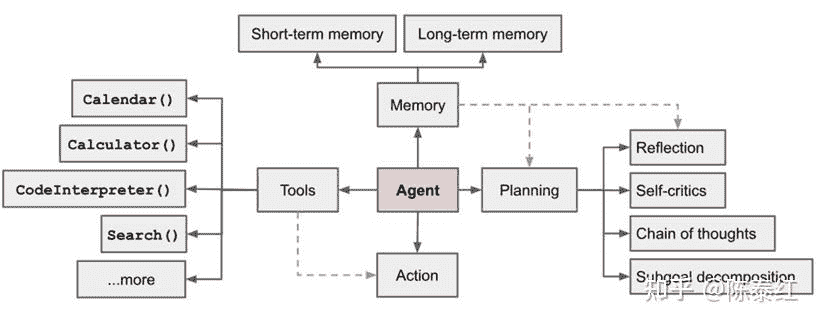
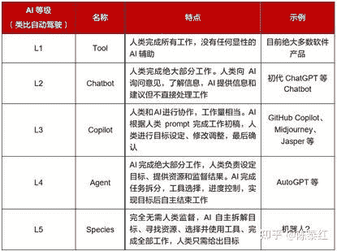
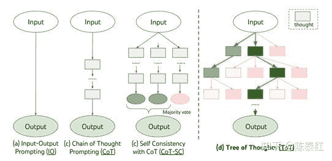
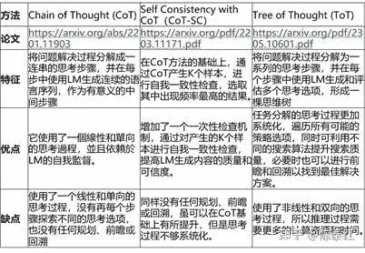
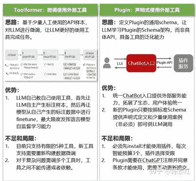
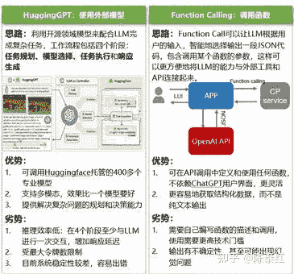
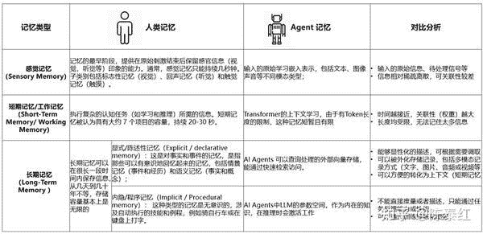

# 全知全能的AI agent，不能做什么？

> 来源：[https://agijuejin.feishu.cn/docx/ReujdoWl5ovBjDx0J0JcTpRUnGb](https://agijuejin.feishu.cn/docx/ReujdoWl5ovBjDx0J0JcTpRUnGb)

> 作者：西红柿牛腩

> 原文：[https://zhuanlan.z](https://zhuanlan.zhihu.com/p/668292894)hihu.com/p/668292...

如今AI时代，人人必称AI agent是AI的未来。看上去agent全知全能，其实是千疮百孔。23年初不聊GPT4就是落伍，年末不谈AI agent就是掉队。

## 1 AI agent是什么？

AI Agent（人工智能代理）是一种能够感知环境、进行决策和执行动作的智能实体。不同于传统的人工智能， AI Agent具备通过独立思考、调用工具去逐步完成给定目标的能力（学术界的期望）。

目前接收度最广泛的定义，是Wenglilian在《LLM Powered Autonomous Agents》中提出，AI Agent 系统可以拆分为大模型、规划、记忆与工具使用四个组件部分。 AI Agent 可能会成为新时代的开端，其基础架构可以简单划分为 Agent=LLM + 规划技能 + 记忆 + 工具使用，其中 LLM 扮演了 Agent 的“大脑”，在这个系统中提供推理、规划等能力。

**AI **Agent可以类比为自动驾驶的 L4 阶段，距离真正实现仍有差距。自动驾驶炒作N年依然遥遥无期，AI Agent同志们尚需努力。

## 2 大模型的痛点

GPT4时代，学术界工业界认为大模型无所不能，他们发现自己错了。大模型本质上是概率生成模型。

大语言模型的浪潮推动了AI Agent相关研究快速发展， 相当一部分原因是LLM大模型的痛点：生成的幻觉，上下文内容的限制，训练成本高、知识容易过期。

如果将LLM大模型比喻为单线程的CPU，学术界期望AI Agent成为核心计算大脑，实现复杂任务拆解成可实现的简单的子任务，类似人的自然语言交互能力。通过让大模型借助一个或多个Agent的能力，构建成为具备自主思考决策和执行能力的智能体， 成为了当前通往AGI的主要研究方向。

大模型庞大的训练数据集中包含了大量人类行为数据，为模拟类人的交互打下了坚实基础；另一方面，随着模型规模不断增大，大模型涌现出了上下文学习能力、推理能力、思维链等类似人类思考方式的多种能力。

## 3 大模型规划的痛点

大模型的规划能力，本质上是prompt工程。

Prompt工程的本质，是针对任务选取最恰当、能够使模型性能最好的模板，是模板不断寻优迭代的过程。不恰当的比喻，人类的情商高会说话。

学术界关于规划的一些论文，COT，TOT，GOT，大多数是调整promt，模型任务分解子任务，结合广度优先搜索（breadth-first search，BFS）和深度优先搜索（depth-first search ，DFS）做遍历。遍历全部可能性而已。

大多数人津津乐道的，思维树（ToT）论文只实现了三个游戏：24点游戏，创意写作和5*5填字游戏。如何使用到任务规划，还是一个在进行中的不断探索的游戏。

## 4 LLM执行任务的痛点

LLM大模型执行任务，一般通过调用外部工具实现，比较著名的是Toolformer微调使用外部工具，Plugin声明式使用外部工具,HuggingGPT使用外部模型,Function Calling调用函数。

目前使用外部工具缺陷不仅限于支撑工具少，需要安装插件，推理效率低，输出不稳定，以及大模型的顽疾：输出不稳定。

## 5 LLM记忆的痛点

LLM大模型的短期记忆，是靠模型训练时候的Transformer上下文长度。模型训练的时候就固定了最长上下文，推理的时候不能改变，只能有选择的截断。

LLM大模型的长期记忆，需要借助于RAG，文档的检索和增强（文档泛指word,pdf,jpg,html等各种存在现实世界的介质）。RAG的知识，也需要加入LLM大模型的prompt模板，同样有最大长度的限制。

## 6 理想很丰满，现实很骨感

AI时代，任何一个新概念，都脱离不了应用。区块链再火爆，没有用户就是空中楼阁。AI的任何概念，没有在高频、重复、海量的场景中得到验证，就是PPT的一页自嗨。AI agent要想真的用起来，必然是在xx游戏、UGC的抖音、快手中首先落地，让普通人感兴趣，积累起来海量用户，才有不断迭代和衍化的能力。

2023 年 3 月起， AI Agent 领域迎来了第一次“出圈” ，西部世界小镇、 BabyAGI、 AutoGPT 等多款重大 Agent研究项目均在短短两周内陆续上线，引发了大家对 AI Agent 领域的关注。 目前已经涌现了在游戏领域大放异彩的英伟达 Voyager 智能体、能够帮助个人完成简单任务的 Agent 助理 HyperWrite、以及主打个人情感陪伴的 AI 助理 Pi 等多款优秀的 Agent成果， AI Agent的研究进展迅速。

哈工大有一篇综述《The Rise and Potential of Large Language Model Based Agents: A Survey》，畅想了AI agent未来人类生活一种可能性：在厨房里，一个代理正在点餐，而另一个代理负责计划和解决烹饪任务。在音乐会上，三个代理正在协作表演乐队。在户外，两个代理正在讨论制作灯笼，通过选择和使用工具来计划所需的材料和财务。用户可以参与这些社交活动的任何阶段。

其实，AI agent任何一个环节，都巨坑无比。每个实现的工程，如果在学术或者工业上实现了，都能给个人和企业带来翻天覆地的变化。这就给普通人和普通企业带来翻身做主的机会。毕竟只有向前看，后浪才能把前浪拍在沙滩上。

待后续。