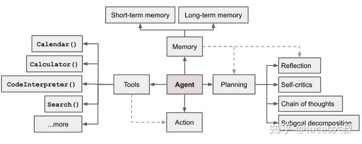
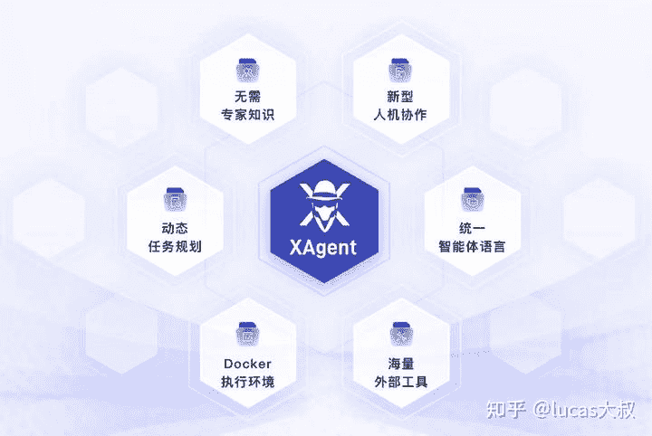
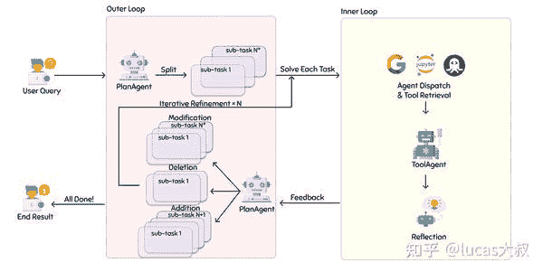
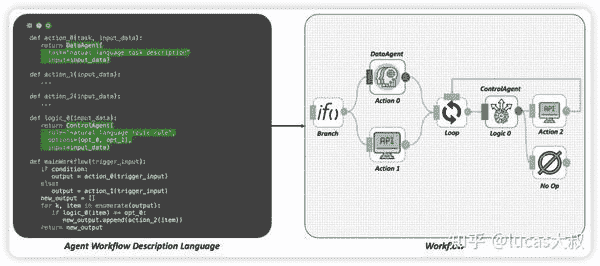
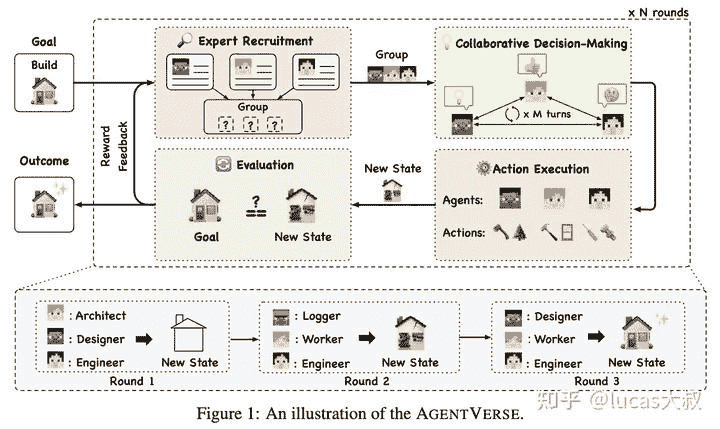
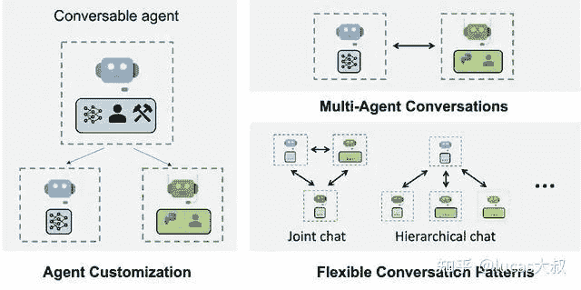
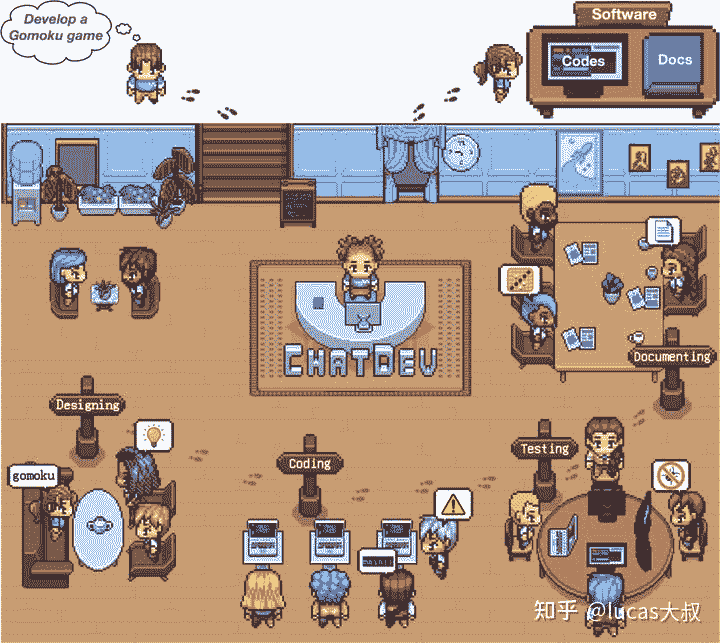
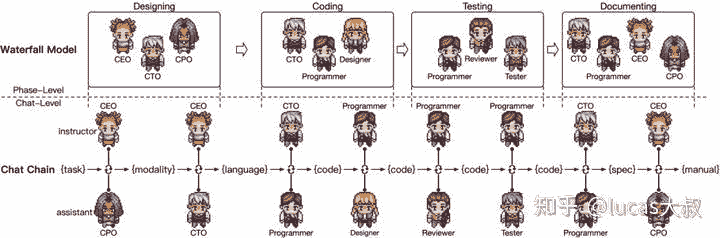
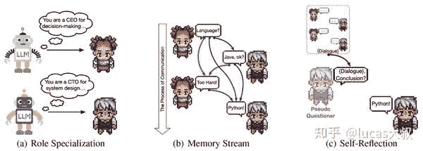

# LLM Agent扫盲贴

> 来源：[https://agijuejin.feishu.cn/docx/KxT5dGtN7o9a9lxfkfacMXjVnEb](https://agijuejin.feishu.cn/docx/KxT5dGtN7o9a9lxfkfacMXjVnEb)

> 作者：lucas大叔

> 原文：[https://zhuanlan.z](https://zhuanlan.zhihu.com/p/668153266)hihu.com/p/668153...

## 一、Agent概述

在LLM赋能的自主agent系统中，LLM充当agent大脑的角色，并与若干关键组件协作：

+   规划（planning）

+   子目标分解：agent将大任务拆分为更小的可管理的子目标，使得可以有效处理复杂任务。

+   反思与完善：agent对历史动作可以自我批评和自我反思，从错误中学习并在后续步骤里完善，从而改善最终结果的质量。

+   记忆（Memory）

+   短期记忆：上下文学习即是利用模型的短期记忆学习

+   长期记忆：为agent提供保留和召回长期信息的能力，通常利用外部向量存储和检索实现

+   工具使用（tool use）

+   对模型权重丢失的信息，agent学习调用外部API获取额外信息，包括当前信息、代码执行能力、专有信息源的访问等等。

## 二、主流Agent框架

### 2.1. XAgent

XAgent是面壁智能联合清华大学 NLP 实验室共同研发开源的基于LLM的自主智能体，可以自动解决各种任务。 它被设计为一个通用的智能体，可以应用于各种任务，终极目标是创建一个可以解决任何给定任务的超级智能体。换句话说，打造的是超级无敌的多边形战士，不是单独为某个任务设计的特定智能体。

XAgent具有以下特点：

+   **自主性 **：XAgent可以在没有人类参与的情况下自动解决各种任务。

+   **安全性 **：XAgent被设计为安全运行。所有的行为都被限制在一个docker容器内。不用担心你的主机环境受到影响

+   **可扩展性 **：XAgent被设计为可扩展的。您可以轻松地添加新的工具来增强智能体的能力，甚至是新的智能体！

+   **GUI **：XAgent为用户提供了友好的GUI来与智能体交互。您也可以使用命令行界面与智能体交互。

+   **与人类的合作 **：XAgent可以与您合作解决任务。它不仅有能力在行进中遵循您的指导来解决复杂的任务，而且在遇到挑战时还可以寻求您的帮助。

XAgent由三部分组成：

+   **调度器 **负责动态实例化和分派任务给不同的智能体。它允许添加新的智能体和改进智能体的能力。

+   **规划器 **负责为任务生成和校正计划。它将任务分解为子任务，并为它们生成里程碑，使智能体能够逐步解决任务。

+   **行动者 **负责采取行动实现目标和完成子任务。行动者利用各种工具来解决子任务，它也可以与人类合作来解决任务。

XAgent提出了双循环机制，外循环负责宏观规划，而内循环则负责细节的执行。

### 2.2. ProAgent

ProAgent是清华大学的研究人员联合面壁智能、中国人民大学、MIT、CMU 等机构共同发布的新一代流程自动化范式 “智能体流程自动化” Agentic Process Automation（APA）。本质上是RPA的升级版，结合大模型智能体一是帮助人类以生成代码的方式构建工作流；二是让智能体自主处理工作流中涉及复杂决策与动态处理的环节，即难以固化为规则表示的复杂任务让agent来动态决定。利用大模型agent进一步提升自动化的程度，提高效率，将人类从繁重的劳动中解放出来。

工作流中引入DataAgent和ControlAgent实现复杂数据处理与控制逻辑。基于智能体工作流描述语言Agentic Workflow Description Language，使用JSON实现工作流中数据的组织和管理，选择 Python 语法实现对工作流的逻辑控制，将控制流中的跳转、循环等直接通过 Python 语法进行表征，同时将工作流中的工具调用封装为 Python Function。于是对于 ProAgent，工作流构建任务便转化为代码生成任务。当接收到人类指令时，ProAgent 便编写相应的 Agentic Workflow Description Language，从而实现了工作流自动化构建。

复杂的现实任务中通常会涉及动态决策，单纯的 Python 式的逻辑控制规则以及 JSON 式的数据组织形式在面对灵活的需求时便无能为力，此时便需要引入agent。

### 2.3. AgentVerse

AgentVerse提供了一个多功能的框架，简化了为大型语言模型（LLMs）创建自定义多智能体环境的过程。它的目标是多智能体交互平台的搭建，期望通过多智能体协作的方式处理更加复杂的业务场景。

整体技术实现分为四大部分：

（1）专家招募

专家招募阶段决定了多智能体群体的构成，是决定群体能力上限的重要模块。当前采用自动化的方式招募专家，目的是增强配置智能体的可扩展性。

对于给定的目标g∈G，特定的自主智能体Mr被指定为招聘者，类似于人力资源经理；Mr不依赖预定义的专家描述，而是根据当前目标g动态地生成一组专家描述。然后根据不同的专家描述提示以及目标g，得到多个不同的智能体形成专家组M = Mr(g)。并且，多智能体群体的组成将根据评估阶段的反馈进行动态调整，也使得框架能够根据当前状态（收到的奖励）组建最有效的多智能体群体，以便在后续回合中做出更好的决策。

（2）协作决策

此阶段主要是聚集专家智能体进行协同决策，选择两种经典的沟通结构来提升决策效率：

+   横向沟通

每个智能体（表示为mi∈M）积极共享并细化其决策，这种民主的沟通结构鼓励智能体之间的相互理解和协作。然后将智能体的集体意见结合起来，使用一个集成函数f来形成当前回合的群体决策。

+   纵向沟通

纵向沟通的特点是职责分工，由一个智能体提出初始决策，其余的智能体充当评审人，对解决方案提供反馈；根据反馈，不断完善决策，直到所有的评审智能体就解决方案达成共识，或者达到最大迭代次数。

（3）行动执行

在决策制定完毕后，智能体需要执行指定的动作，具体取决于实现方式，某些智能体可能会不执行任何操作，然后对环境状态进行更新。

（4）评估

使用奖励反馈机制评估当前状态与期望目标之间的差距，并给出口头反馈，解释为什么当前状态仍然不令人满意并提供建设性建议，讨论下一轮如何改进。

其中奖励反馈机制可以由人工定义（人机协作循环），也可以由自动反馈模型定义，具体取决于实现方式。

如果确定尚未达到预期目标，则奖励反馈循环回到初始阶段，即专家招募；在下一轮专家招募阶段会利用该反馈信号结合初始目标来调整专家组的构成，从而演化出更有效的多智能体群组，以供后续决策和行动执行。

### 2.4. AutoGPT

Auto-GPT是一个实验性的开源应用程序，展示了GPT-4语言模型的能力。这个程序由GPT-4驱动，将LLM“思想”连接在一起，以自主地实现您设置的任何目标。作为GPT-4完全自主运行的最早示例之一，Auto-GPT突破了人工智能的极限，将AI进程推向了新高度 -- 自主人工智能。

AutoGPT的优势：

用于搜索和信息收集的互联网接入

长期和短期记忆管理

用于文本生成的 GPT-4实例

访问热门网站和平台

️ 使用GPT-3.5进行文件存储和摘要

插件扩展性

### 2.5. AutoGen

微软推出的AutoGen开源框架，允许开发人员通过多个agent构建 LLM 应用程序，这些agent可以相互对话来完成任务。AutoGen agent是可定制的、可对话的，并能以各种模式运行，这些模式采用 LLM、人类输入和工具的组合。使用 AutoGen，开发人员还可以灵活定义agent交互行为。自然语言和计算机代码都可用于为不同的应用编程灵活的对话模式。AutoGen 可作为一个通用框架，构建具有不同复杂性和 LLM 能力的各种应用。实证研究证明了该框架在许多样本应用中的有效性，应用领域包括数学、编码、问答、运筹学、在线决策、娱乐等。

### 2.6. ChatDev

清**华大学 NLP **实验**室联合面壁****智能、北**京邮电大学、布朗大学的研究人员共同发布了一个大模型驱动的全流程自动化软件开发框架 ChatDev ( Chat -powered Software Dev elopment)。ChatDev 拟作一个由多智能体协作运营的虚拟软件公司，在人类“用户”指定一个具体的任务需求后，不同角色的智能体将进行交互式协同，以生产一个完整软件（包括源代码、环境依赖说明书、用户手册等）。这一技术为软件开发自动化提供了新的可能性，支持快捷高效且经济实惠的软件制作，未来将有效地将部分人力从传统软件开发的繁重劳动中解放出来。

**C**hatDev 借鉴软件工程瀑布模型的思想，将其分为 软件设计（Designing）、系统开发（Coding）、集成测试（Testing）、文档编制（Documenting） 四个主要环节。之后，通过对软件开发瀑布模型的进一步分解，形成由原子任务构成的交流链（Chat Chain）。整条链可视为由原子任务组成的“软件生产线”，链中每个子任务通过专业角色（例如产品设计官、Python 程序员、测试工程师等）的智能体进行对话式信息交互和决策；驱动其进行自动化需求分析、头脑风暴、系统开发、集成测试、GUI 创作、文档编制等全流程软件工程。

**驱**动智能体交流对话的主要机制为： 角色专业化（Role Specialization）、记忆流（Memory Stream）、自反思（Self-Reflection） :

+   角色专业化通过角色扮演机制（Role-Playing）确保每个智能体各司其职，在指定的专业角色下完成相应的方案提议和决策讨论。

+   记忆流通过将历史对话进行呈现，保证上下文感知的对话过程，并动态地对对话历史信息进行汇总和决策。

+   自反思机制在对话没有自动触发结束协议时生效，通过整轮对话进行文本摘要，摘录出对话过程达成一致后的最终决议

## **三、存在的问题与挑战**

目前看到AI Agent所需的：优秀的prompt工程、强大的大语言模型、好用灵活的工具、多模态模型的调用能力、人机协作的交互等。

AI Agent目前的问题：效果不稳定、复杂推理能力不够强、外部生态融合不高，主要以搜索和文件读取为准、多步推理成本过高、响应时间太久、上下文的限制(或者说如何准确的利用长期记忆)等。

解决方法：

1、优化prompt，减少不必要的token消耗

2、成本优化和监控，达到次数就停止

3、向量缓存技术，相似的问题不经过大模型处理，直接出结果

4、微调开源大模型来增强工具调用能力

5、向量数据库。

参考资料：

[1]. [h](https://link.zhihu.com/?target=https%3A//lilianweng.github.io/posts/2023-06-23-agent/)ttps:// lilianweng.github.io/po sts/2023-06-23-agent/

[2]. [https:// github.c](https://link.zhihu.com/?target=https%3A//github.com/OpenBMB/XAgent/)om/OpenBMB/XAge nt/

[3]. 被OpenAI带火的Agent如何解放人力？清华等发布ProAgent

[4]. [https:// github.com/O](https://link.zhihu.com/?target=https%3A//github.com/OpenBMB/AgentVerse/)penBMB/Agen tVerse/

[5]. [多](https://link.zhihu.com/?target=https%3A//www.163.com/dy/article/IF7J53AI0511ABV6.html)LLM协同作战！清华等开源多智能体框架AgentVerse：合作打造Minecraft物品，还能训练宝可梦

[6]. [AutoGPT中文官网 - 自主人工智能GPT程序 - Au](https://link.zhihu.com/?target=https%3A//autogpt.cn/)toGPT中文网（autogpt.cn）

[7]. [Johnson7788：AutoGen：通过多a](https://zhuanlan.zhihu.com/p/660027092)gent对话支持下一代 LLM 应用程序

[8]. [O](https://zhuanlan.zhihu.com/p/654459772)penBMB：ChatDev：大模型AI Agent驱动的虚拟软件公司，荣登GitHub Trending榜首！

[9]. 程序员在写作：AI Agent万字长文总结