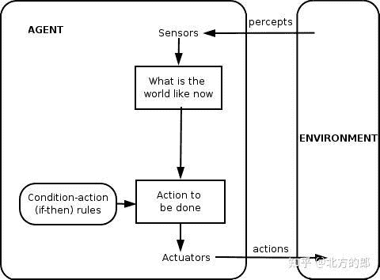
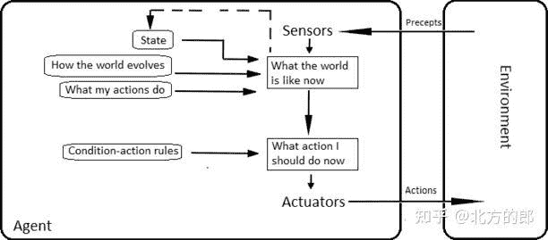
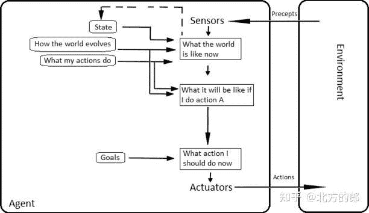
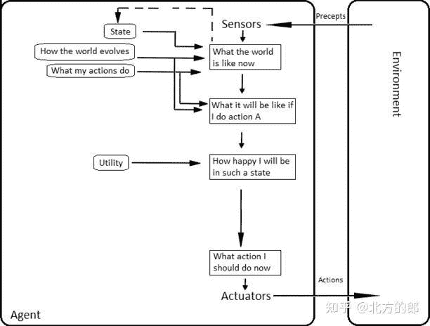
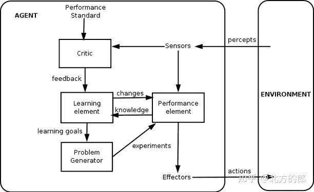

# 智能体（Agent）的定义和分类

> 来源：[https://agijuejin.feishu.cn/docx/BtP1dnNzVo08H0xF2JhcQvF7ndh](https://agijuejin.feishu.cn/docx/BtP1dnNzVo08H0xF2JhcQvF7ndh)

> 作者：北方的郎

> 原文： [https://zhuanlan.z](https://zhuanlan.zhihu.com/p/680078242)hihu.com/p/680078...

在当今科技日新月异的时代，人工智能（AI）已经深入到我们的日常生活中。从Siri、Alexa等智能语音助手，到自动驾驶汽车、机器人等领域，AI正在改变我们的生活方式。然而，你是否想过，AI是如何实现的呢？在AI的背后，有一个核心的概念叫做“智能代理”（Intelligent Agent）。本篇科普文章将带你深入了解这个概念，揭示AI背后的奥秘。

部分内容来自： [https:// en.wikipedia.org/wiki](https://link.zhihu.com/?target=https%3A//en.wikipedia.org/wiki/Intelligent_agent)/I ntelligent_agent

## 定义

在人工智能中，Intelligent agent（IA ）是以智能方式行事的Agent；它感知环境，自主采取行动以实现目标，并可以通过学习或获取知识来提高其性能。智能Agent可以是简单的，也可以是复杂的：恒温器或其他控制系统被认为是智能Agent的一个例子，人类也是如此，任何符合定义的系统也是如此，例如公司、国家或生物群落。[1]

领先的人工智能教科书将“人工智能”定义为“智能Agent的研究和设计”，这一定义认为目标导向的行为是智能的本质。目标导向Agent也可以使用经济学术语“理性Agent”来描述。

Agent具有封装所有 IA 目标的“目标函数”。这样的Agent旨在创建和执行任何计划，在完成后最大化目标函数的预期值。例如，强化学习Agent具有“奖励函数”，允许程序员塑造 IA 所需的行为，[3]而进化算法的行为则由“适应度函数”塑造。

人工智能中的智能主体与经济学中的主体密切相关，智能主体范式的版本在认知科学、伦理学、实践理性哲学以及许多跨学科的社会认知建模和计算机社会模拟中进行了研究。

智能Agent通常被示意性地描述为类似于计算机程序的抽象功能系统。智能Agent的抽象描述称为抽象智能Agent（AIA），以将其与其现实世界的实现区分开来。自主智能Agent被设计为在没有人为干预的情况下发挥作用。智能Agent还与软件Agent（代表用户执行任务的自主计算机程序） 密切相关。

作为人工智能的定义

人工智能：现代方法将“Agent”定义为

> “任何可以被视为通过传感器感知其环境并通过执行器对该环境起作用的东西”

它将“rational agent”定义为：

> “一个Agent，根据过去的经验和知识，最大限度地提高绩效衡量的预期价值。”

它还将“artificial intelligence research”领域定义为：

> The study and design of rational agents"

Padgham 和 Winikoff (2005) 一致认为，智能Agent位于环境中，并及时（尽管不一定是实时）对环境的变化做出响应。然而，智能Agent还必须以灵活而稳健的方式主动追求目标。[a]可选的需求包括Agent是理性的，并且Agent能够进行信念-欲望-意图分析。

卡普兰和哈恩莱因将人工智能定义为“系统正确解释外部数据、从这些数据中学习、并利用这些学习成果通过灵活的适应来实现特定目标和任务的能力”。

### 优点

从哲学上讲，人工智能的这个定义避免了一些批评。与图灵测试不同，它不以任何方式涉及人类智能。因此，没有必要讨论它是否是“真实”智能与“模拟”智能（即“合成”智能与“人工”智能），并且并不表明这样的机器具有思想、意识或真正的理解力（即，它并不暗示约翰·塞尔的“强人工智能假说”）。

更重要的是，它具有许多实际优势，有助于推动人工智能研究的发展。提供了可靠、科学的程序测试方法；研究人员可以通过询问哪个Agent最擅长最大化给定的“目标函数”，直接比较甚至组合解决孤立问题的不同方法。它还为它们提供了与其他领域进行交流的通用语言，例如数学优化（根据“目标”定义）或经济学（使用“理性主体”的相同定义）。

### 目标函数

如果被分配了明确的“目标函数”的智能体始终如一地采取行动，成功地最大化其编程的目标函数，则被认为更聪明。目标可以很简单（“如果 IA 赢得围棋比赛，则为 1，否则为 0”）或复杂（“在数学上执行与过去成功的操作类似的操作”）。“目标函数”封装了Agent被驱动执行的所有目标；对于理性主体，该函数还封装了实现相互冲突的目标之间可接受的权衡。（术语各不相同；例如，某些Agent寻求最大化或最小化“效用函数”、“目标函数”或“损失函数”。）

目标可以被明确定义或诱导。如果人工智能被编程为“强化学习”，它就会具有“奖励功能”，鼓励某些类型的行为并惩罚其他类型的行为。或者，进化系统可以通过使用“适应度函数”来变异并优先复制高分人工智能系统来诱导目标，类似于动物如何进化到天生渴望某些目标，例如寻找食物。一些人工智能系统，例如最近邻系统，通常不会给定目标，而不是类比推理，除非目标隐含在其训练数据中。如果非目标系统被构建为“目标”是完成其狭隘分类任务的系统，则仍然可以对此类系统进行基准测试。

传统上不被视为Agent的系统，例如知识表示系统，有时会通过将它们构建为目标为（例如）尽可能准确地回答问题的Agent来纳入范式；“行动”的概念在此扩展为涵盖对问题给出答案的“行为”。作为额外的扩展，模仿驱动系统可以被构建为根据 IA 成功模仿所需行为的程度来优化“目标函数”的Agent。在生成对抗网络中在 2010 年代，“编码器”/“生成器”组件试图模仿和即兴创作人类文本。生成器试图最大化一个函数，该函数封装了它如何欺骗敌对的“预测器”/“鉴别器”组件。

虽然符号人工智能系统通常接受明确的目标函数，但该范式也可以应用于神经网络和进化计算。强化学习可以生成智能Agent，其行为方式似乎旨在最大化“奖励函数”。有时，机器学习程序员不会将奖励函数设置为直接等于所需的基准评估函数，而是使用奖励塑造来最初为机器学习的增量进展提供奖励。 扬·乐昆2018 年表示，“人们提出的大多数学习算法本质上都是由最小化某些目标函数组成的。” AlphaZero国际象棋有一个简单的目标函数；每场胜利计为+1分，每场失败计为-1分。自动驾驶汽车的目标函数必须更加复杂。进化计算可以进化出智能Agent，这些智能Agent的行为方式似乎旨在最大化“适应度函数”，该函数影响每个智能体被允许离开的后代数量。

理论上且不可计算的 AIXI设计是该范式中的最大智能Agent；然而，在现实世界中，IA 受到有限时间和硬件资源的限制，科学家们竞相开发能够在现实世界硬件基准测试中取得逐步更高分数的算法。

## 智能Agent的类别

### 罗素和诺维格的分类

Russell & Norvig (2003)根据感知智能和能力的程度将智能体分为五类：

简单反射Agent

简单的反射Agent仅根据当前感知起作用，忽略感知历史的其余部分。Agent功能基于条件-动作规则：“如果条件，则动作”。

仅当环境完全可观察时，此Agent功能才会成功。一些反射Agent还可以包含有关其当前状态的信息，这使它们能够忽略执行器已被触发的条件。

对于在部分可观察环境中运行的简单反射Agent来说，无限循环通常是不可避免的。如果智能体可以随机化其动作，就有可能摆脱无限循环。

**基于模型的反射Agent**

基于模型的Agent可以处理部分可观察的环境。它的当前状态存储在Agent内部，维护某种描述世界上看不见的部分的结构。这种关于“世界如何运作”的知识被称为世界模型，因此被称为“基于模型的Agent”。

基于模型的反射Agent应该维护某种依赖于感知历史的内部模型，从而至少反映当前状态的一些未观察到的方面。感知历史和行为对环境的影响可以通过使用内部模型来确定。然后它以与反射Agent相同的方式选择一个动作。

Agent还可以使用模型来描述和预测环境中其他Agent的行为。

**基于目标的Agent**

基于目标的Agent通过使用“目标”信息进一步扩展了基于模型的Agent的功能。目标信息描述了期望的情况。这为Agent提供了一种在多种可能性中进行选择的方法，选择达到目标状态的一个。搜索和规划是人工智能的子领域，致力于寻找实现Agent目标的动作序列。

**基于应用程序的Agent**

基于目标的智能体仅区分目标状态和非目标状态。还可以定义特定状态的期望程度的度量。该度量可以通过使用效用函数来获得，该函数将状态映射到状态效用的度量。更通用的性能衡量标准应该允许根据不同的世界状态满足Agent目标的程度来比较它们。术语“效用”可用于描述智能体有多“快乐”。

一个基于效用的理性智能体会选择最大化行动结果的预期效用的行动——即，在给定每个结果的概率和效用的情况下，智能体平均期望得到的结果。基于效用的Agent必须对其环境、任务进行建模和跟踪，这些任务涉及感知、表示、推理和学习方面的大量研究。

学习（Learning）Agent

学习的优点是，它允许智能体最初在未知的环境中运行，并变得比其初始知识本身所允许的更有能力。最重要的区别是负责改进的“学习元素”和负责选择外部行动的“绩效元素”。

学习元素使用来自“批评者”的关于Agent表现如何的反馈，并确定应该如何修改性能元素或“参与者”以在未来做得更好。性能元素就是我们之前认为的整个智能体：它接收感知并决定行动。

学习Agent的最后一个组件是“问题生成器”。它负责提出可带来新的、信息丰富的体验的行动建议。

### 韦斯分类

Weiss (2013)定义了四类Agent：

+   基于逻辑的Agent——其中通过逻辑演绎来决定执行什么操作。

+   反应性Agent——其中决策是通过某种形式的从情况到行动的直接映射来实施的。

+   信念-欲望-意图主体——决策取决于对代表主体信念、欲望和意图的数据结构的操纵；最后，

+   分层架构——其中决策是通过各种软件层实现的，每个软件层都或多或少地明确地推理不同抽象级别的环境。

### 其他

2013 年，Alexander Wissner-Gross 发表了有关智能体自由与智能的理论。[22] [23]

## Agent的层次结构

为了主动执行其功能，当今的智能Agent通常聚集在包含许多“子Agent”的分层结构中。智能子Agent处理并执行较低级别的功能。总而言之，智能Agent和子Agent创建了一个完整的系统，可以通过显示某种智能形式的行为和响应来完成困难的任务或目标。

通常，可以通过将主体分为传感器和执行器来构建Agent，以便它与复杂的感知系统一起运行，该系统将世界的描述作为控制器的输入并向执行器输出命令。然而，控制器层的层次结构通常是必要的，以平衡低级别任务所需的即时反应和复杂的高级目标的缓慢推理。

### Agent功能

一个简单的Agent程序可以在数学上定义为函数f（称为“Agent函数”），它将每个可能的感知序列映射到Agent可以执行的可能动作或影响的系数、反馈元素、函数或常数最终行动：

{\displaystyle f:P^{\ast }\rightarrow A}

Agent函数是一个抽象的概念，因为它可以结合各种决策原理，例如计算单个选项的效用、逻辑规则的推导、模糊逻辑等。[26]

相反，程序Agent将每一个可能的感知映射到一个动作。[27]

我们使用“感知”一词来指Agent在任何给定时刻的感知输入。在下图中，Agent是任何可以被视为通过传感器感知其环境并通过执行器对该环境采取行动的东西。

### 替代定义和用途

“智能Agent”也经常被用作一个模糊的营销术语，有时与“虚拟个人助理”同义。一些 20 世纪的定义将Agent描述为帮助用户或代表用户行事的程序。这些例子被称为软件Agent，有时将“智能软件Agent”（即具有智能的软件Agent）称为“智能Agent”。

Nikola Kasabov 认为，IA 系统应表现出以下特征：

+   逐步适应新的问题解决规则

+   在线实时适应_

+   能够从行为、错误和成功方面分析自己。

+   通过与环境的互动来学习和提高（实施例）

+   从大量数据中快速学习

+   具有基于记忆的示例存储和检索能力

+   有参数来表示短期和长期记忆、年龄、遗忘等。