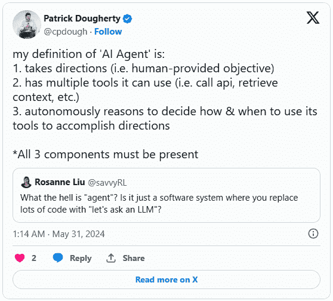
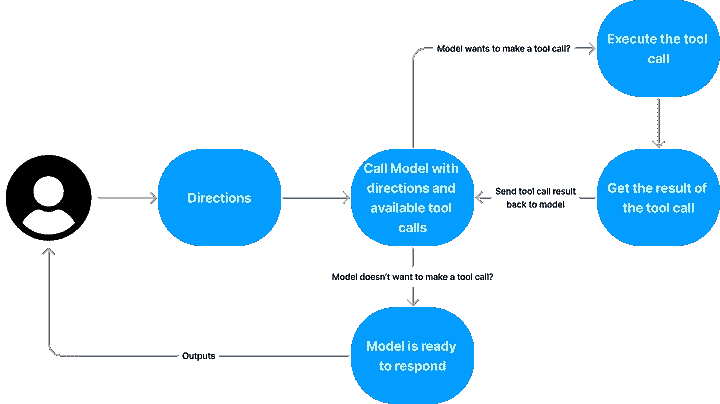

# 实践出真知：Agents 领域“一年打怪升级”的经验分享

> 来源：[https://agijuejin.feishu.cn/docx/IAjGd9etvoWVuTxWCt5cZWGjnCf](https://agijuejin.feishu.cn/docx/IAjGd9etvoWVuTxWCt5cZWGjnCf)

**原文链接🔗：h****ttps://mp.weixin.qq.com/s/i90**PnNXvVyJflLI18ijbog

作者💐 | Patrick Dougherty

**编者按**：在你构建 AI Agents 时，是否曾遇到这些困扰：总是在简单任务上出错，从而让你有时会怀疑自己的技术水平？面对客户的需求，AI Agent() 表现得像个“笨蛋”，无法准确理解和执行指令？随着底层模型的更新，AI Agents 的性能不升反降，让人手足无措？

这些问题不仅影响了 AI Agents 的性能，甚至可能导致项目延期、成本超支，甚至失去客户的信任。在 AI 技术飞速🚀发展的今天，任何一个表现不佳的 Agents 都可能很快被市场淘汰。

今天我们分享的这篇文章将为各位提供来自一线 Agents 开发者的宝贵经验。作者基于过去一年的实践，总结了 7 条经验教训，包括重新认识 AI Agent 的推理能力、优化 Agent-Computer Interface (ACI)、选择和适配底层模型、以及构建差异化的基础设施等。对于正在或计划构建 AI Agents 的开发者和企业而言，这篇文章提供了许多切实可行的操作建议和深入的见解，是一份不可多得的参考指南📄。

作者 | Patrick Dougherty

**编译 | 岳扬**

# 01 何为“Agent”？（Definitions）

在讨论本文的主要内容之前，需要明确定义一下本文所指的“Agent”到底是啥。借用一下这位Twitter用户的话([1])：

What the hell is “agent”?

我尽力给出了一个简明扼要的定义：

该定义大致与 OpenAI 在 ChatGPT 中提及的 “生成式预训练模型（GPTs）” 和其 API 中的 “助手（Assistants([2])）” 概念相符。不过，Agent 并不会局限于这些能力，任何能进行逻辑推理（reasoning）并调用工具（making tool calls）的模型都能胜任这项任务，比如 Anthropic 公司的 Claude()([3])、Cohere 的 Command R+([4]) 等众多模型皆可。

**Note**

**tool calls 是一种让模型表达它想要执行的某种特定操作并获取操作结果的方式，例如调用 get_weather_fo**recast_info(seattle) 或 wikipedia_lookup(dealey plaza) 这样的函数。

构建一个 Agent 仅需几行代码就可以了，这些代码能够处理一个有明确目标且由系统提示词（system prompt）引导的对话过程，能够处理模型想要执行的任何 tool calls ，循环执行这些操作，并在达到目标后停止。

下面这幅图示（visual）可以帮助解释这一流程：

构建 “Agent” 的基本步骤简要概览

# 02 Agent System Prompt Example

需要在此澄清对 AI Agent 的几个常见错误观点：

+   **Scripted（脚本化）**：根据个人理解，Agent 不会机械地执行预编写的指令序列或工具调用步骤，AI Agent 能够自主决定下一步应该使用哪个工具，这是其核心能力；

+   **通用人工智能（Artificial Genera**l Intelligence, AGI）：AI Agent 并不等同于 AGI，后者无需依赖 Agents 来完成特定类型的工作，因为 AGI 本身就是一个集所有可能的输入（inputs）、输出（outputs）和工具（tools）于一身的单一实体（个人浅见，现有技术距离真正的 AGI 尚有很长一段路要走）；

+   **Black Box**：如果告知 AI Agents 具体任务流程，Agents 应当会如同人类接受委托执行任务一样。

# 03 **上下文 Context**

在开发 AI Agents 项目的第一年里，我从与工程师（engineers）和用户体验设计师（UX designer）的合作中获得了第一手经验，对产品的整体用户体验效果进行了多次优化，收获颇丰。我们的目标是为客户打造一个平台，帮助客户使用我们标准化的数据分析 Agents，并针对其业务中特有的任务和数据结构，自行开发符合个体需求（custom）的 AI Agents。我们确保该平台与诸如 Snowflake、BigQuery 等数据库安全对接，同时内置安全机制，在描述数据库内容的元数据层上调用 RAG（检索增强生成）工具，并通过 SQL、Python 和支持数据可视化的数据分析工具分析数据。

**对**于哪些做法可行，哪些观点则不尽如人意，此平台不仅依据自身评估（our own evaluations），也参考了客户的真实反馈。我们的用户大多就职于 500 强企业，他们每天都使用我们的 AI Agent 对内部数据进行深度分析。

# 04 **经验教训（What I’ve L**earned about Agents）

## **4.1 推理能力比知识量更重要**

这句话在过去的一年里一直在我脑海中回响：

我认为，[生成式预训练Transformer（gpt）]有过多的处理能力（processing power）被用于充当数据库（database），而非将模型用作推理引擎（reasoning engine）。

— 山姆·奥特曼（Sam Altman）在莱克斯·弗里德曼（Lex Fridman）播客([5])上发表的见解

AI Agents 正是对此观点的合理回应！在构建 AI Agents 时，我会采用这一逻辑：

**别**太在意 AI Agents “了解、知道（knows）” 什么，而应更看重它的 “思考（think）” 能力。

以编写 SQL 查询语句（SQL Queries）为例。SQL 查询语句（SQL Queries）往往频繁执行出错……，且屡见不鲜。在我担任数据科学家（data scientist）期间，我的查询语句（SQL Queries）执行失败次数远远超过成功的次数。

如果一个复杂的 SQL 查询语句首次就能在我们不熟悉的真实数据上执行成功，我们应该感到惊讶并产生怀疑，“糟糕，可能有问题！”，而不会自信满满地认为“哇！完美！我搞定了”。即便是在评估模型能否将一个简单问题转换为查询语句的 text-to-SQL 基准测试([6])中，其最高准确率也只有 80 %。

因此，即便意识到该模型在编写 SQL 语句的能力顶多只能得到 B- 的成绩，那么我们该如何提升其推理能力呢？关键在于为 Agents 提供足够的上下文，让它能进行 “思考” ，而非希望它一次性答对。当 AI Agents 编写的查询语句执行错误时，需要反馈所有 SQL errors 信息以及能够获得的尽可能多的上下文信息，这样 AI Agents 便能在大多数情况下自行修正问题，使 SQL 语句正常执行。我们同样也为 Agents 提供了大量 tool calls ，使其能像人类那样，在编写新的查询语句前，先对数据库的信息架构（information schema）和数据特性（data for distributions and missing values）进行调研分析。

## **4**.2 提升性能的最佳方式就是不断优化“人”机交互界面（agent-computer interface, ACI）

“ACI” 这个新词（源自普林斯顿大学（Princeton）的一项研究([7])）虽然出现不久，但我们对它的打磨却是过去一年中的日常工作重心。ACI 指的是 AI Agents 所使用的 tool calls 的具体语法和架构，包括了 AI Agents 生成的 inputs 内容与 API 在响应内容中发回的 outputs 。这些是 Agents 获取必要数据、推动工作进展与工作目标一致的唯一方式。

**由**于底层模型（比如 gpt-4o、Claude Opus 等）各有特点，所以对某一个模型来说最完美的 ACI 未必适合另一个模型。这就意味着，构建一个优秀的 ACI 需要“科学（science）与艺术（art）齐飞”……更像是创造一种极致的用户体验，而非纯粹地编写代码（writing source code），因为 ACI 会持续演变，小小的改动就能像多米诺骨牌一样引发一连串的反应。ACI 有多么重要，我再怎么强调都不为过…… 我们对我们构建的 AI Agent 进行了数百次迭代，仅仅是对命名（names）、数量（quantity）、抽象程度（level of abstraction）、输入格式（input formats）及输出的响应（output responses）做出微调，就能导致 AI Agents 的性能产生巨大波动。

此处有一个具体的小案例，能够生动地说明 ACI 有多么关键和棘手：我们在 gpt-4-turbo 刚推出不久后，对我们的 AI Agents 进行了多次测试，却发现了一个棘手的问题 —— AI Agents 在处理响应信息时，会完全忽略掉某些数据（正是我们试图通过 tool call 的响应内容来告知或传递给 Agents 的数据部分）。我们所使用的是直接从 Ope**nA**I 官方文档中提取的 markdown 格式信息，并且在同样的数据集上与 gpt-4-32k 配合得很好。为了使 AI Agents 能够识别出那些被它“视而不见”的数据列（columns），我们尝试对 markdown 结构进行一些调整，但无论怎样修改，Agents 都无动于衷...... 于是，我们决定彻底改变策略，将信息格式从 markdown 转换为 JSON（仅针对 OpenAI 模型）格式后，奇迹发生了，一切都恢复如初。颇具讽刺意味的是，响应内容采用 JSON 格式虽然因为包含了大量语法字符而消耗了更多 tokens ，但我们发现这一步骤不仅十分必要，更是确保 Agents 能够正确解读模型响应的关键。

虽然可能对 ACI 的优化过程感觉微不足道，但这确实是改善 Agents 用户体验的有效途径之一。

## 4.3 AI Agents 的功能受限于其所使用的模型

底层模型就好比是 Agents 的大脑。如果模型的决策不尽人意，那么无论看起来多么吸引人，都无法令用户满意。这一点在我们使用 gpt-3.5-turbo 和 gpt-4–32k 作为底座模型进行测试时亲身感受。在使用 GPT 的 3.5 版本时，某些测试案例的情况大致为：

1.  用户提出了具体任务目标，比如：“按邮政编码分析星巴克店铺位置（starbucks locations）与房价（home prices）的相关性，探究两者之间是否存在联系。”

1.  Agent却臆造了一个数据库表名，比如“HOME_PRICES”，并假设了诸如“ZIP_CODE”和“PRICE”等数据列，而没有先去数据库系统中搜索查找真正存在的数据表；

1.  Agent 会尝试编写 SQL 查询语句，打算按邮政编码计算平均房价，然而查询语句执行失败，系统报错反馈说该表并不存在；

1.  这时，Agent 才会恍然大悟，“啊，对了！我应该可以搜索真实存在的数据表...”，于是开始搜索“home prices by zip code”来定位可用的真实数据表；

1.  Agent 随后根据找到的真实数据表，修正了其查询语句，使用正确的数据列，最终成功获取了数据；

1.  然而，当 Agent 处理星巴克店铺位置数据时，却又一次重蹈覆辙...

在 gpt-4 上，以相同的指导原则运行 Agents ，情况则截然不同。它不会再立即执行错误的操作而浪费时间，而是会精心筹划，制定一个有序的 tool calls 执行计划，并严格按照计划执行。不难想象，在执行更为复杂的任务时，两个模型之间的性能差距会更为显著。尽管 GPT 3.5 版本的速度很快，但产品用户显然更喜欢🩷 gpt-4 那更胜一筹的决策和分析能力。

**Note**

通**过进行这些测试，我们获得了一个重要启示：当 Agents 出现幻觉或执行**失败时，应当极其细致地观察这些情况是为何出现的。AI Agents 往往会展现出一种惰性（可能源于人类的懒惰特质在底层模型的训练数据中被充分学习），因此它们不会轻易调用那些它们认为没有必要调用的工具。同样，即便在它们调用工具时，如果对参数说明（argument instructions）理解不清，它们往往会走捷径（take shortcuts）或是直接忽略必要的参数。这些失败的案例（failure modes）中蕴含着非常丰富的信息！AI Agents 实际上是在告诉你它期望 ACI（Agent Call Interface）应该怎样设计，如果情况允许，最直接的解决方案就是顺从它的意愿，调整 ACI 使其满足 Agents 的需求。当然，也有很多时候，需要我们通过修改系统提示词（system prompt）或 tool call 的 instructions 来对抗 Agents 的天性，但对于那些可以通过简单调整 ACI 就能解决的问题，直接修改就能大大简化我们的工作。

## 4.4 试图通过微调模型提升 Agents 的性能实属徒劳

对模型进行微调([8])是通过提供示例来优化模型在特定应用领域表现的一种方法。尽管当前的微调方法擅长教**会模型**以特定方式（specific way）完成特定任务（specific task），但并不能有效提升模型的推理能力。根据我的经验，使用微调过的模型来驱动 AI Agents 反而可能降低其推理能力，因为 AI Agents 容易倾向于“走捷径（cheat）”，即它会错误地认为微调过程中所接触的示例总能代表最优的处理策略和工具调用序列，而不会独立地对问题进行推理。

**Note**

微调（Fine-tuning）依然是多功能瑞士军刀（Swiss Army pocket knife）里的一项利器。例如，有一种行之有效的方法是使用微调过的模型专门处理 AI Agents 提出的特定 tool calls 。设想一下，假如你拥有一个针对特定数据集专门微调过的用于编写 SQL 查询语句的模型…… 该 AI Agents（在未经微调的强大推理模型（reasoning model）上运行）可以通过 tool call 来表达它想要执行的 SQL 查询语句，而我们可以将这一请求转交由专门针对 SQL 查询语句微调过的模型进行独立处理。

## **4.5 在产品构建过程中，应慎重考虑使用 LangChain** 或 LlamaIndex 等抽象化工具

我们应当完全掌控对模型的每次调用，包括其中涉及的所有输入与输出细节内容。一旦我们将这些核心控制权拱手让给第三方库，未来当我们需要与 AI Agents 合作完成新用户操作引导流程（onboard users）、问题调试（debug an issue）、用户拉新（scale to more users）、记录 AI Agents 的操作日志（log what the agent is doing）、软件迭代更新（upgrade to a new version），或是深入理解 AI Agents 的行为动机（understand why the agent did something）时，我们将会深切感受到遗憾与不便。

**Note**

如果你正处于纯粹的产品原型阶段（prototype mode），唯一的目的在于验证 AI Agents 是否有可能完成任务，那么，不妨随心所欲地选择你最心仪的抽象化工具，马上动手实践吧([9])！

## 4.6 AI Agents 并非护城河

利用** A**I Agents 来自动化（automating）或增强（augmenting）人类的知识型工作，蕴藏着巨大的潜力，但仅仅建立一个优秀的 AI Agents 还远远不够。将 AI Agents 推向市场，服务于用户，就需要在一系列非 AI 的基础设施上投入大量心血，确保 AI Agents 能够真正高效运作 —— 而这正是我们能够塑造差异化竞争优势的地方：

+   **安全性（security）**：AI Agents 应严格在用户授予的权限范围内运行，由用户全面掌控。在实际中，这意味着要跨越 OAuth Integrations（译者注：OAuth 通常用于社交登录，如使用微信或 Google 账户登录其他网站或应用程序。）、Single Sign-On Providers（译者注：单点登录（SSO）是一种身份验证机制，允许用户在多个应用程序和服务中使用单一的登录凭证。）、Cached Refresh Tokens（译者注：指在 OAuth 认证过程中，为了保持用户会话的有效性和减少重复认证次数，而存储在客户端或服务器上的 refresh token。）等一系列的安全门槛。妥善管理这些安全环节，无疑将为我们的产品加分。

+   **data connectors**：AI Agents 通常需要实时从源系统（source systems）获取数据才能好好工作。这就意味着需要与各种 API 接口及其他连接协议集成，通常是内部系统和外部第三方平台。这些 integrations 不仅需要初始的构建、部署，更需要长期的维护与优化。

+   用**户界**面（user interface）：除非用户能够全程跟进并审核 AI Agents 的工作流程，否则很难建立起对 AI Agents 的信任。通常，在用户首次接触 AI Agents 的最初几次，这种需求尤为突出，但会随时间逐渐减弱。最好的办法是，AI Agents 的每一次 tool call 都应配有一套专门的交互界面，让用户可以观察 AI Agents 的决策、操作过程，甚至直接与之互动，以此增进对 AI Agents 推理逻辑的信心（例如，细览语义搜索（semantic search）结果中每个元素的具体内容）。

+   长期记忆（long-term memory）：AI Agents 在默认状态下，仅限于记住当前的工作流程，受限于最大 **t**okens 数量这一参数。要想实现跨工作流程的长期记忆，甚至跨用户范围的长期记忆，就需要将信息存入记忆库，并通过 tool calls 或将其融入提示词中来提取。我发现 AI Agents 在判断哪些信息值得保存至记忆库中时并不擅长，往往需要人类来决定这些信息是否应当保存。根据具体应用场景，你也许可以接受让 AI Agents 自主决定何时保存信息至记忆库中，就像 ChatGPT 一样。

+   AI Agents 的评估（eval**uation）：构建一套评估 AI Agents 的框架是一项既耗神又似乎永无止境的任务。AI Agents 被刻**意设计为保持不确定性（nondeterministic），这意味着它们会依据我们提供的指导方向，寻找最合适的 tool calls 任务序列来完成任务，这一过程就像初学走路的小宝宝，每走一步后都会进行一番思考。对这些任务序列的评估主要体现在两个方面：一是 AI Agents 在完成任务时的整体成功率，二是每次 tool call 的准确性（例如，搜索过程中的信息检索（information retrieval）；代码执行的准确度（accuracy）；等等）。我发现量化整体工作流程性能的最有效且唯一的方法是建立一系列 objective / completion pairs（译者注：训练或测试数据集，"objective" 指的是用户或系统设定的目标或任务，而 "completion" 则是 Agents 完成该目标的具体行动或输出内容。例如， "objective" 可能是 "查找最近的餐厅"，而 "completion" 则可以是 AI Agents 返回的最近餐厅的名称和地址。），其中 objective 是指派给 Agents 的初始指令，而 completion 则代表 objective 达成的最终 tool call 序列。捕捉 AI Agents 的 tool calls 中间过程和思维过程，有助于理解 tool calls 失败的原因或是 tool calls 序列的变化。

**Note**

将这份清单视为一份正式的 request-for-startups([10]) 。围绕清单上的产品需求开发的产品，如果做得好，有望成为行业的新标准或关键组成部分，助力 AI Agents “更上一层楼”。

## 4.7 别假设大模型的进步会停歇

**在构建 Agents 时，我们会不断受到诱惑：过分地为所依附的底层核心大模**型（primary model）开发一些绑定性功能，从而无意间降低了对 Agents 推理能力的预期。务必警惕并**克服这一诱惑！（Resist this **temptation!）大模型的发展势头锐不可挡，也许不可能永远在时下的“快车道”之上，但其发展速度仍将远超历史上的任何技术变革。客户自然倾向于选择能够运行在自己喜欢、认可的大模型上的 AI Agents。而用户最期盼的，则是在 AI Agents 中无缝体验到最前沿的、最强大的模型。比如当 GPT-4o 发布之后，我仅用 15 分钟就令其在使用 OpenAI API 的产品([11])中适配该模型。能够灵活适配不同模型提供商，无疑是巨大的竞争优势！

Thanks for reading!

Hope you have enjoyed and learned new things from this blog!

## Patrick Dougherty

Co-Founder and CTO @ Rasgo. Writing about AI agents, the modern data stack, and possibly some dad jokes.

**END**

**文中链接**

[1]https://x.com/savvyRL/status/1795882798454288715

[2]https://platform.openai.com/docs/assistants/overview

[3]https://docs.anthropic.com/en/docs/tool-use-examples

[4]https://docs.cohere.com/docs/command-r-plus

[5]https://lexfridman.com/podcast/

[6]https://yale-lily.github.io/spider

[7]https://arxiv.org/abs/2405.15793

[8]https://platform.openai.com/docs/guides/fine-tuning/when-to-use-fine-tuning

[9]https://www.youtube.com/watch?v=O_HyZ5aW76c

[10]https://www.ycombinator.com/rfs

[11]https://www.loom.com/share/f781e299110e40238d575fa1a5815f12?sid=73bb6158-216d-4de6-b570-881e6a99ebd2

**原文链接：**

https://medium.com/@cpdough/building-ai-agents-lessons-learned-over-the-past-year-41dc4725d8e5