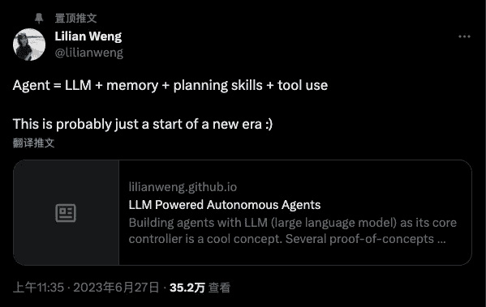

# 十篇高质量的AI-Agents相关论文，让AI教你认识AI-Agents

> 来源：[https://agijuejin.feishu.cn/docx/Kn3Pd3fUqozpyTxfBfKc6iCPnHp](https://agijuejin.feishu.cn/docx/Kn3Pd3fUqozpyTxfBfKc6iCPnHp)

> 作者： VION WILLIAMS VION WILLIAMS

> 原文：https://mp.weixin.qq.com/s/EkNmwq5g0uTY7dYZO3osLQ

尽管在当前阶段关于AGI的技术爆发周期中，大型语言模型似乎是那个一直在舞台中央的主角，然而随着OpenAI的两个关键的技术人物，Andrej Karpathy和Lilian Weng开始对外界释放出一个信号，基于 LLM的AI Agents是AGI领域接下来重要的发展方向，使得很多原本嘲笑Auto-GPT开发者，开始更多开始正视基于LLM驱动的AI-Agents系统。

正如Lilian Weng在其万字长文《LLM Powered Autonomous Agents》对Auto-GTP的点评：

“AutoGPT引起了许多关注，探索了使用LLM作为主控制器构建自主代理的可能性。虽然由于自然语言界面存在相当多的可靠性问题，但它仍然是一个很酷的概念验证演示。”

Auto-GPT事实代表了LLM可以发挥自动化的通用问题解决机器，这一叙事范式代表了AI-Agents的未来发展方向。Lilian Weng撰写的《LLM Powered Autonomous Agents》是目前全世界对于什么是AI-Agents最好的论文综述文章，结构化清晰明了的让我们理解了什么基于LLM驱动的Agents。

事实上，经过这段时间对AI-Agents的 深度理解，以及对Lilian Weng定义的AI-Agents结构框架的研究思考，为**了让**更多人理解Agents的可能性（因为Lilian  Weng的原文还是具有相当高比例的技术解释），在这里分享十篇具有较高可读性的关于AI-Agents论文，各位读者可以下载PDF通过Claude 2，或者Dify.ai进行辅助阅读。当然也可以加入社群，我会分享PDF以及提示词，让AI教你认识什么是AI-Agents！这才是属于超级个体的自我学习之路。

我的下一篇将围绕《LLM Powered Autonomous Agents》进行深度解读，并建立相关联的知识体系与在知识库，也将成为一个开源可索引的关于超级个体与AI-Agent的高质量知识库。

---

# 构建有效的人工智能团队：建立能够补充多种专业能力的机器学习模型

论文标题：Forming Effective Human-AI Teams: Building Machine Learning Models that Complement the Capabilities of Multiple Expert

论文链接：https://arxiv.org/pdf/2206.07948.pdf

**概述：**机器学习（ML）模型越来越多地被用于需要与人类专家合作的应用领域。在这种情况下，当ML模型难以预测某些实例时，将这些实例交给单个人类专家可能是有优势的。虽然以前的研究集中在一个明确定义的人类专家场景上，但在许多真实情况下，可能会有多个具有不同能力的人类专家可供选择。在这项工作中，我们提出了一种方法，通过训练一个分类模型来补充多个人类专家的能力。通过将分类器与分配系统一起进行联合训练，分类器学会准确预测那些对人类专家来说很难的实例，而分配系统则学会将每个实例分配给最合适的团队成员，可以是分类器或其中一个人类专家。我们在多个公共数据集上进行了实验评估，包括使用“合成”专家标注的真实世界医学数据集。我们的方法优于之前的工作，并且比最优秀的人类专家或分类器更准确。此外，它可以灵活地适应不同规模的团队和不同水平的专家多样性。

# **huggingGPT：利用HuggingFace中**的ChatGPT及其相关模型解决AI任务

论文标题：HuggingGPT: Solving AI Tasks with ChatGPT and its Friends in HuggingFace

论文链接：https://arxiv.org/pdf/2303.17580.pdf

**

概述**：通过解决涉及不同领域和模态的复杂人工智能任务，是迈向人工通用智能的关键一步。虽然有许多适用于不同领域和模态的人工智能模型，但它们无法处理复杂的人工智能任务。考虑到大型语言模型（LLMs）在语言理解、生成、交互和推理方面表现出色，我们认为LLMs可以充当控制器，管理现有的人工智能模型来解决复杂的人工智能任务，而语言可以成为通用接口来实现这一点。基于这一理念，我们提出了HuggingGPT，这是一个框架，利用LLMs（例如ChatGPT）将机器学习社区（例如Hugging Face）中的各种人工智能模型连接起来，以解决人工智能任务。具体而言，当接收到用户请求时，我们使用ChatGPT来进行任务规划，根据Hugging Face中提供的模型功能描述来选择模型，然后使用选定的人工智能模型执行每个子任务，并根据执行结果总结回应。通过利用ChatGPT强大的语言能力和Hugging Face中丰富的人工智能模型，HuggingGPT能够涵盖许多不同模态和领域的复杂人工智能任务，并在语言、视觉、语音和其他具有挑战性的任务中取得令人印象深刻的成果，为迈向人工通用智能开辟了新的道路。

# 人工智能心智理论：两个人一起跳探索

论文标题：It Takes Two to Tango: Towards Theory of AI's Mind

论文链接：https://arxiv.org/pdf/1704.00717.pdf

**概述：**心智理论（Theory of Mind）是将心智状态（信念、意图、知识、观点等）归因于他人，并认识到这些心智状态可能与自己不同的能力。心智理论对于有效沟通和团队展现更高集体绩效至关重要。为了有效地利用人工智能（AI）的进步使我们的生活更加高效，人类和AI需要在团队中良好地合作。传统上，研究更多地侧重于使AI更准确，并在较小程度上使其更好地理解人类的意图、倾向、信仰和背景。后者涉及使AI更像人类，并使其发展对我们心智的理论。在这项工作中，我们认为，为了使人类-AI团队有效，人类也必须发展对AI心智的理论（ToAIM）——了解其优势、弱点、信念和特点。我们在视觉问答（VQA）领域内实现了这些想法。我们发现，仅使用少量的示例（50个），普通人可以接受培训，以更好地预测复杂VQA模型的回应和潜在失败。我们进一步评估了现有解释（或可解释性）模式在帮助人类建立对AI心智的理论方面所起的作用。在最近的科学和普遍关注中，可解释的AI受到了相当大的关注。令人惊讶的是，我们发现，获得模型的内部状态——其对前k个预测的信心、明确或隐含的注意力映射（突出显示模型在回答有关图像的问题时正在查看（和聆听）的图像区域和问题中的单词）——并不能帮助人们更好地预测其行为。

# MindCraft：基于心智模型的协作任务情境对话建模

论文标题：MindCraft: Theory of Mind Modeling for Situated Dialogue in Collaborative Tasks

论文链接：https://arxiv.org/pdf/2109.06275.pdf

**

概述**：在人类世界中，将自主代理理想地融入其中意味着它们能够按照人类的方式进行合作。特别是，在人类的协作和交流过程中，心智理论发挥着重要作用，有助于维持共同基础。为了在情境交互中实现心智理论建模，我们引入了一个细粒度的数据集，记录了由一对人类主体在Minecraft虚拟三维方块世界中执行的协作任务。该数据集提供了有关合作伙伴对世界和对彼此的信念的信息，为研究情境语言交流中的人类协作行为提供了丰富的机会。作为实现我们目标的第一步，即开发能够推断合作伙伴信念状态的具身人工智能代理，我们建立了并展示了针对几个心智理论任务的计算模型。

# 大语言模型中发挥认知协同作用：通过多人格自我协作成为任务解决代理

论文标题：Unleashing Cognitive Synergy in Large Language Models: A Task-Solving Agent through Multi-Persona Self-Collaboration

论文链接：https://arxiv.org/pdf/2307.05300.pdf

**概述：**人类智能依赖于认知协同的概念，在不同认知过程之间进行合作和信息整合，相比单独的认知过程，能够产生更优越的结果。尽管大型语言模型（LLMs）在作为通用任务解决代理方面表现出有希望的性能，但它们仍然在需要大量领域知识和复杂推理的任务中遇到困难。在这项工作中，我们提出了“Solo Performance Prompting”（SPP）的概念，它通过与多个人物进行多轮自我协作，将单个LLM转变为认知协同者。认知协同者指的是一种智能代理，它与多个思维合作，结合他们的个体优势和知识，以增强复杂任务中的问题解决和整体性能。通过根据任务输入动态地识别和模拟不同的人物，SPP释放了LLMs中认知协同的潜力。我们发现，在LLMs中分配多个细粒度的人物角色，相比于使用单个或固定数量的人物角色，能够激发更好的问题解决能力。我们在三个具有挑战性的任务上评估了SPP：创意性问答、Codenames协作和逻辑格子谜题，涵盖了知识密集型和推理密集型两种类型。与之前仅增强LLMs推理能力的作品（如Chain-of-Thought）不同，SPP有效地激发了内部知识获取能力，减少了幻觉，并保持了强大的推理能力。代码、数据和提示信息可以在以下链接找到：https://github.com/MikeWangWZHL/Solo-Performance-Prompting.git。

# 人工智能与人类的共生：现有方法综述

论文标题：Human-AI Symbiosis: A Survey of Current Approaches

论文链接：https://arxiv.org/pdf/2103.09990.pdf

**

概述**：本论文旨在提供人工智能与人类协作中不同研究方向的全面概述。通过突出人工智能与人类团队的各个方面，例如互补流程、任务视野、模型表示、知识水平和团队目标，我们根据这些维度对最近的研究进行分类。我们希望这份调查能够更清晰地连接人工智能与人类团队中的研究工作，并为这一领域的新研究人员提供指导。

# 自省提示：用于上下文决策的大型语言模型

论文标题：Introspective Tips: Large Language Model for In-Context Decision Making

论文链接：https://arxiv.org/pdf/2305.11598.pdf

**

概述**：大型语言模型（LLMs）的出现对自然语言处理产生了重大影响，在各种任务中展现出卓越的结果。在本研究中，我们采用“自省提示”来帮助LLMs在自我优化决策方面取得进展。通过自省地检查轨迹，LLMs通过生成简洁而有价值的提示来优化其策略。我们的方法通过考虑三种关键情景，即从代理的过去经验中学习、整合专家示范和在不同游戏中进行泛化，来提高代理在少样本和零样本学习情况下的性能。重要的是，我们在不微调LLMs参数的情况下实现了这些改进；相反，我们调整提示以从上述三种情况中进行洞察力的泛化。我们的框架不仅支持而且强调在上下文决策中使用LLMs的优势。在涉及TextWorld中超过100个游戏的实验中，我们的方法展现出优越的性能。

# **面向决策的人工智能协作对话**

论文标题：Decision-Oriented Dialogue for Human-AI Collaboration

论文链接：https://arxiv.org/pdf/2305.20076.pdf

**

概述**：我们描述了一类称为“面向决策对话”的任务，其中AI助手必须通过自然语言与一个或多个人类合作，帮助他们做出复杂的决策。我们形式化了三个领域，其中用户面临日常决策：(1)选择会议论文的评审人员分配，(2)规划城市中的多步行程，以及(3)为一组朋友协商旅行计划。在每种情况下，AI助手和用户拥有各自不同的能力，他们必须结合起来得出最佳决策：助手可以访问和处理大量信息，而用户拥有系统外的偏好和限制。对于每个任务，我们构建了一个对话环境，代理根据他们达成的最终决策的质量获得奖励。利用这些环境，我们收集了由人类扮演助手角色的人与人之间的对话。为了比较当前AI助手在这些情况下的通信方式，我们提供了使用大型语言模型进行自我对话的基准模型。最后，我们强调了决策导向对话中模型面临的一系列挑战，包括高效的沟通、推理和优化，并将我们的环境发布为未来建模工作的测试平台。

# **生成代理：人类行为的交互模拟体**

论文标题：Generative Agents: Interactive Simulacra of Human Behavior

论文链接：https://arxiv.org/pdf/2304.03442.pdf

**

概述**：可信的人类行为代理可以为交互式应用提供支持，从沉浸式环境到人际交流排练空间再到原型工具。在本文中，我们引入生成性代理——模拟可信人类行为的计算软件代理。生成性代理醒来、做早餐、上班；艺术家绘画，作家写作；他们形成意见，注意彼此，并发起对话；他们回忆和反思过去的日子，规划下一天的计划。为了实现生成性代理，我们描述了一种架构，将大型语言模型扩展为使用自然语言存储代理的完整经历记录，随时间将这些记忆综合为更高层次的反思，并动态地检索它们来规划行为。我们将生成性代理实例化，以填充受《模拟人生》启发的交互式沙盒环境，最终用户可以使用自然语言与25个代理在小镇上进行互动。在评估中，这些生成性代理产生了可信的个体和紧急的社会行为：例如，仅从用户指定一个代理想要举办情人节派对的概念开始，代理会在接下来的两天自动传播派对的邀请，结识新朋友，并相互邀请出席派对，并协调在正确的时间一起出现在派对上。通过消融实验，我们证明了我们代理架构的观察、规划和反思组件对代理行为的可信度都起到了关键作用。通过将大型语言模型与计算性交互代理融合，这项工作介绍了实现可信人类行为模拟的架构和交互模式。

# **人工道德代理的最低可解释性要求**

论文标题：Minimum Levels of Interpretability for Artificial Moral Agents

论文链接：https://arxiv.org/pdf/2307.00660.pdf

**

概述**：随着人工智能（AI）模型的不断扩大，它们正在变得更加强大，并融入各种形式的决策系统中。对于参与道德决策的模型，也称为人工道德代理（AMA），解释性提供了一种理解和信任代理内部推理机制的方式，以实现有效使用和错误修正。在本文中，我们概述了这个快速发展的AI解释性子领域，引入了“最低可解释性水平”（MLI）的概念，并针对不同类型的代理推荐了一个MLI，以帮助它们在现实世界的环境中安全部署。缩写词：AI = 人工智能，AMA = 人工道德代理，BU = 自底向上，GPT = 生成式预训练转换器，IML = 可解释的机器学习（或解释性），LLM = 大型语言模型，MDM = 道德决策，ML = 机器学习，MLI = 最低可解释性水平，TD = 自顶向下。