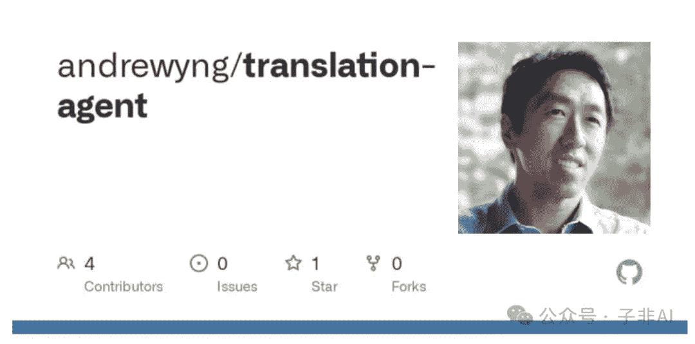

# 吴恩达开源 `Translation Agent`，反思工作流打造更精准译文

> 来源：[https://agijuejin.feishu.cn/docx/UljLdrsvQoLLK9xUWGycxtmmnhp](https://agijuejin.feishu.cn/docx/UljLdrsvQoLLK9xUWGycxtmmnhp)
>
> 作者：非子爱 | 子非AI
>
> 原文：https://mp.weixin.qq.com/s/Ah6hvoEfvLuBTqI0z5ZAKw



## 智能翻译新突破：吴恩达开源 `Translation Agent`，反思工作流打造更精准译文

今年 4 月，我们曾报道了吴恩达 (Andrew Ng) 提出的 Agentic Design Patterns：AI Agent新风潮：让模型自我反思，突破性能瓶颈，其中“反思 (Reflection)”模式备受瞩目。该模式通过让 AI 模型自动评估自身输出并进行改进，从而显著提升模型性能。如今，吴恩达团队将这一理念付诸实践，并将其应用于智能翻译领域，推出了基于反思工作流的开源翻译系统——`Translation Agent`。

机器翻译，这项曾经看似遥不可及的技术，如今已经深入到我们生活的方方面面。从网页浏览到跨语言交流，机器翻译正在悄然改变着我们的世界。然而，传统的机器翻译技术，往往难以处理需要高度定制化和细粒度控制的翻译任务，例如调整输出风格、处理专业术语以及适应不同地区的语言变体等。

近年来，随着人工智能技术的飞速发展，智能翻译应运而生。与传统的基于规则或统计的机器翻译方法不同，智能翻译借助深度学习和大数据的力量，赋予了机器更强大的语言理解和生成能力。

### `Translation Agent`：基于反思工作流的智能翻译新纪元

2023 年 11 月，人工智能领域泰斗级人物吴恩达（Andrew Ng）宣布开源其团队研发的智能翻译系统——`Translation Agent`，再次将智能翻译技术推向了新的高度。`Translation Agent` 不仅仅是翻译，更像是一个专业的翻译助手，它能够理解你的翻译需求，并不断优化翻译结果，直到你满意为止。

#### `Translation Agent` 开源项目

`Translation Agent` 是一个基于 Python 的开源项目，它采用了一种新颖的“反思工作流”，旨在解决传统机器翻译系统在定制化和细粒度控制方面的不足。

#### `Translation Agent` 的工作原理：反思工作流

`Translation Agent` 的核心在于其独特的“反思工作流”，该工作流模拟了人类翻译专家的思考过程，将翻译任务分解为三个主要步骤：

1. 初始翻译：`Translation Agent` 首先利用 LLM 对输入文本进行初步翻译，得到一个初步的译文。
2. 反思与改进：与传统机器翻译系统直接输出译文不同，`Translation Agent` 会引导 LLM 对自身的翻译结果进行反思，并提出改进建议。例如，LLM 可能会指出译文中存在的不准确、不流畅或不符合目标语言习惯表达的地方，就像一个经验丰富的校对员一样，帮助 LLM 找出翻译中的不足之处。
3. 优化输出：最后，`Translation Agent` 根据 LLM 提出的改进建议，对初始译文进行优化，最终生成一个更加精准、流畅且符合目标语言习惯的译文。

#### `Translation Agent` 的优势：高度可定制化

`Translation Agent` 的一大优势在于其高度可定制化的翻译引擎。通过在翻译过程中对 LLM 进行引导，用户可以轻松地控制翻译的各个方面，例如：

+ 调整输出风格：用户可以指定翻译的正式程度，例如是偏向于正式的商务文体，还是更加口语化的日常用语，就像告诉翻译助手你的目标读者是谁一样。
+ 处理习语和专业术语：用户可以在翻译之前提供一个术语表，确保特定的专业术语能够被准确地翻译成目标语言，就像为翻译助手准备了一本专业词典。
+ 指定特定地区或方言的语言使用：`Translation Agent` 可以根据用户的需求，选择使用特定地区或方言的语言变体进行翻译，例如拉丁美洲西班牙语、西班牙西班牙语、加拿大法语或法国法语等，就像告诉翻译助手你的目标受众来自哪里一样。


### `Translation Agent` 代码实现详解

#### `utils.py` 文件概述

`Translation Agent` 的核心代码位于 `src/translation_agent/utils.py` 文件中。该文件包含了 `Translation Agent` 的主要功能函数，例如调用 OpenAI API、文本分块、翻译、反思、改进等。

#### 核心函数解析

+ `get_completion` 函数：调用 OpenAI API 获取 LLM 生成结果。该函数负责调用 OpenAI API，将用户输入的文本和提示词发送给 LLM，并接收 LLM 生成的结果，就像是一个信使，负责在用户和 LLM 之间传递信息。
+ `one_chunk_translate_text` 函数：单段落文本的完整翻译流程。该函数用于处理单段落文本的翻译任务，它包含以下三个步骤：
+ `one_chunk_initial_translation` 函数：单段落文本的初始翻译。该函数负责对单段落文本进行初始翻译，它会将源语言文本和预先设计的提示词发送给 LLM，让 LLM 生成初步的译文。
+ `one_chunk_reflect_on_translation` 函数：对翻译结果进行反思。该函数会将源语言文本、初始译文和反思提示词发送给 LLM，让 LLM 对初始译文进行评估，并提出改进建议。
+ `one_chunk_improve_translation` 函数：根据反思结果改进翻译。该函数会将源语言文本、初始译文、反思结果和改进提示词发送给 LLM，让 LLM 根据反思结果对初始译文进行修改，生成最终译文。
+ `num_tokens_in_string` 函数：计算文本的 token 数量。该函数用于计算文本的 token 数量，token 是 LLM 处理文本的基本单位，就像英语中的单词一样。
+ `multichunk_translation` 函数：多段落文本的完整翻译流程。该函数用于处理多段落文本的翻译任务，它同样包含初始翻译、反思和改进三个步骤：
+ `multichunk_initial_translation` 函数：多段落文本的初始翻译
+ `multichunk_reflect_on_translation` 函数：对多段落翻译结果进行反思
+ `multichunk_improve_translation` 函数：根据反思结果改进多段落翻译
+ `calculate_chunk_size` 函数：计算文本分块大小。该函数用于计算文本分块的大小，以便将长文本分成多个段落进行处理。
+ `translate` 函数：`Translation Agent` 的主函数。该函数是 `Translation Agent` 的主函数，它负责接收用户输入的文本、源语言、目标语言和地区信息，并调用其他函数完成翻译任务。`translate` 函数首先会计算输入文本的 token 数量，如果 token 数量小于预设的最大值 `MAX_TOKENS_PER_CHUNK`，则调用 `one_chunk_translate_text` 函数对文本进行单段落翻译；否则，调用 `multichunk_translation` 函数对文本进行多段落翻译。

```
def translate(
    source_lang,
    target_lang,
    source_text,
    country,
    max_tokens=MAX_TOKENS_PER_CHUNK,
):
    """Translate the source_text from source_lang to target_lang."""

    num_tokens_in_text = num_tokens_in_string(source_text)

    ic(num_tokens_in_text)

    if num_tokens_in_text < max_tokens:
        ic("Translating text as single chunk")

        final_translation = one_chunk_translate_text(
            source_lang, target_lang, source_text, country
        )

        return final_translation

    else:
        ic("Translating text as multiple chunks")

        token_size = calculate_chunk_size(
            token_count=num_tokens_in_text, token_limit=max_tokens
        )

        ic(token_size)

        text_splitter = RecursiveCharacterTextSplitter.from_tiktoken_encoder(
            model_name="gpt-4",
            chunk_size=token_size,
            chunk_overlap=0,
        )

        source_text_chunks = text_splitter.split_text(source_text)

        translation_2_chunks = multichunk_translation(
            source_lang, target_lang, source_text_chunks, country
        )

        return "".join(translation_2_chunks)
```

`translate` 函数的逻辑非常清晰，它就像是一个总指挥，根据输入文本的长度，决定采用单段落翻译还是多段落翻译，并将任务 delegate 给相应的函数去执行。

### `Translation Agent` 提示词解读

提示词在 `Translation Agent` 中扮演着至关重要的角色，它决定了 LLM 如何理解和执行翻译任务。`Translation Agent` 使用了精心设计的提示词来引导 LLM 完成各个阶段的任务。

#### 提示词的作用和重要性

提示词是指导 LLM 行为的关键因素，它为 LLM 提供了上下文信息、任务目标和输出规范。优秀的提示词能够引导 LLM 生成更准确、更符合预期的结果，而糟糕的提示词则可能导致 LLM 生成不准确、不相关甚至有害的内容。

#### `one_chunk_initial_translation` 函数：单段落文本的初始翻译 提示词

```
This is an {source_lang} to {target_lang} translation, please provide the {target_lang} translation for this text. \
Do not provide any explanations or text apart from the translation.
{source_lang}: {source_text}

{target_lang}:
```

#### 说明：

+ 该提示词首先明确了翻译的方向，即从源语言 `{source_lang}` 到目标语言 `{target_lang}`。
+ 然后，它要求 LLM 只提供翻译结果，不要包含任何解释或其他无关信息，例如不要在翻译结果中添加注释或说明，以确保输出的简洁性。
+ 最后，它将源语言文本放在 `{source_text}` 占位符的位置，并将目标语言的占位符空出来，等待 LLM 填写翻译结果，这样可以确保 LLM 生成的内容格式正确，易于后续处理。

#### `one_chunk_reflect_on_translation` 函数：对翻译结果进行反思 提示词

```
Your task is to carefully read a source text and a translation from {source_lang} to {target_lang}, and then give constructive criticism and helpful suggestions to improve the translation. \
{country_specific}
The source text and initial translation, delimited by XML tags <SOURCE_TEXT></SOURCE_TEXT> and <TRANSLATION></TRANSLATION>, are as follows:

<SOURCE_TEXT>
{source_text}
</SOURCE_TEXT>

<TRANSLATION>
{translation_1}
</TRANSLATION>

When writing suggestions, pay attention to whether there are ways to improve the translation's \n\
(i) accuracy (by correcting errors of addition, mistranslation, omission, or untranslated text),\
(ii) fluency (by applying {target_lang} grammar, spelling and punctuation rules, and ensuring there are no unnecessary repetitions),\
(iii) style (by ensuring the translations reflect the style of the source text and takes into account any cultural context),\
(iv) terminology (by ensuring terminology use is consistent and reflects the source text domain; and by only ensuring you use equivalent idioms {target_lang}).\n\

Write a list of specific, helpful and constructive suggestions for improving the translation.
Each suggestion should address one specific part of the translation.
Output only the suggestions and nothing else.
```

#### 说明：

+ 该提示词首先向 LLM 明确了任务目标，即对翻译结果进行反思，并提供改进建议。这部分提示词以清晰的指令引导 LLM 进入“反思”模式。
+ 然后，它使用 XML 标签将源语言文本和初始译文分别标记出来，方便 LLM 识别。利用 XML 标签区分原文和译文，使得 LLM 更容易理解和处理文本信息。
+ 接下来，它列出了 LLM 在反思时需要关注的四个方面，即准确性 (`accuracy`)、流畅度 (`fluency`)、风格 (`style`) 和术语 (`terminology`)。这四个方面也是评价翻译质量的重要标准，提示词中对每个方面的详细说明能够引导 LLM 进行更全面的评估。
+ 最后，它要求 LLM 以列表的形式输出具体的改进建议，每个建议只针对翻译中的一个具体问题，并且不要输出任何其他内容，以确保输出格式的规范性。

#### `one_chunk_improve_translation` 函数：根据反思结果改进翻译 提示词


```
Your task is to carefully read, then edit, a translation from {source_lang} to {target_lang}, taking into
account a list of expert suggestions and constructive criticisms.

The source text, the initial translation, and the expert linguist suggestions are delimited by XML tags `&lt;SOURCE_TEXT&gt;&lt;/SOURCE_TEXT&gt;`, `&lt;TRANSLATION&gt;&lt;/TRANSLATION&gt;` and `&lt;EXPERT_SUGGESTIONS&gt;&lt;/EXPERT_SUGGESTIONS&gt;` \
as follows:

&lt;SOURCE_TEXT&gt;
{source_text}
&lt;/SOURCE_TEXT&gt;

&lt;TRANSLATION&gt;
{translation_1}
&lt;/TRANSLATION&gt;

&lt;EXPERT_SUGGESTIONS&gt;
{reflection}
&lt;/EXPERT_SUGGESTIONS&gt;

Please take into account the expert suggestions when editing the translation. Edit the translation by ensuring:

(i) accuracy (by correcting errors of addition, mistranslation, omission, or untranslated text),
(ii) fluency (by applying {target_lang} grammar, spelling and punctuation rules and ensuring there are no unnecessary repetitions), \
(iii) style (by ensuring the translations reflect the style of the source text)
(iv) terminology (inappropriate for context, inconsistent use), or
(v) other errors.

Output only the new translation and nothing else.
```

**说明：**

+   • 该提示词首先向 LLM 明确了任务目标，即根据专家建议对初始译文进行改进。

+   • 然后，它使用 XML 标签将源语言文本、初始译文和专家建议分别标记出来，方便 LLM 识别。

+   • 最后，它要求 LLM 在改进译文时，要考虑专家建议，并确保译文的准确性、流畅度、风格和术语的准确性。

## `multichunk_initial_translation` 函数：多段落文本的初始翻译 提示词

```
Your task is provide a professional translation from {source_lang} to {target_lang} of PART of a text.

The source text is below, delimited by XML tags `&lt;SOURCE_TEXT&gt;` and `&lt;/SOURCE_TEXT&gt;`. Translate only the part within the source text
delimited by `&lt;TRANSLATE_THIS&gt;` and `&lt;/TRANSLATE_THIS&gt;`. You can use the rest of the source text as context, but do not translate any
of the other text. Do not output anything other than the translation of the indicated part of the text.

&lt;SOURCE_TEXT&gt;
{tagged_text}
&lt;/SOURCE_TEXT&gt;

To reiterate, you should translate only this part of the text, shown here again between `&lt;TRANSLATE_THIS&gt;` and `&lt;/TRANSLATE_THIS&gt;`:
&lt;TRANSLATE_THIS&gt;
{chunk_to_translate}
&lt;/TRANSLATE_THIS&gt;

Output only the translation of the portion you are asked to translate, and nothing else.
```

## `multichunk_reflect_on_translation` 函数：对多段落翻译结果进行反思 提示词

```
Your task is to carefully read a source text and part of a translation of that text from {source_lang} to {target_lang}, and then give constructive criticism and helpful suggestions for improving the translation.
{country_specific}

The source text is below, delimited by XML tags `&lt;SOURCE_TEXT&gt;` and `&lt;/SOURCE_TEXT&gt;`, and the part that has been translated
is delimited by `&lt;TRANSLATE_THIS&gt;` and `&lt;/TRANSLATE_THIS&gt;` within the source text. You can use the rest of the source text
as context for critiquing the translated part.

&lt;SOURCE_TEXT&gt;
{tagged_text}
&lt;/SOURCE_TEXT&gt;

To reiterate, only part of the text is being translated, shown here again between `&lt;TRANSLATE_THIS&gt;` and `&lt;/TRANSLATE_THIS&gt;`:
&lt;TRANSLATE_THIS&gt;
{chunk_to_translate}
&lt;/TRANSLATE_THIS&gt;

The translation of the indicated part, delimited below by `&lt;TRANSLATION&gt;` and `&lt;/TRANSLATION&gt;`, is as follows:
&lt;TRANSLATION&gt;
{translation_1_chunk}
&lt;/TRANSLATION&gt;

When writing suggestions, pay attention to whether there are ways to improve the translation&#x27;s:\n\
(i) accuracy (by correcting errors of addition, mistranslation, omission, or untranslated text),\n\
(ii) fluency (by applying {target_lang} grammar, spelling and punctuation rules, and ensuring there are no unnecessary repetitions),\n\
(iii) style (by ensuring the translations reflect the style of the source text and takes into account any cultural context),\n\
(iv) terminology (by ensuring terminology use is consistent and reflects the source text domain; and by only ensuring you use equivalent idioms {target_lang}).\n\

Write a list of specific, helpful and constructive suggestions for improving the translation.
Each suggestion should address one specific part of the translation.
Output only the suggestions and nothing else.
```

## `multichunk_improve_translation` 函数：根据反思结果改进多段落翻译 提示词

```
Your task is to carefully read, then improve, a translation from {source_lang} to {target_lang}, taking into
account a set of expert suggestions and constructive critisms. Below, the source text, initial translation, and expert suggestions are provided.

The source text is below, delimited by XML tags `&lt;SOURCE_TEXT&gt;` and `&lt;/SOURCE_TEXT&gt;`, and the part that has been translated
is delimited by `&lt;TRANSLATE_THIS&gt;` and `&lt;/TRANSLATE_THIS&gt;` within the source text. You can use the rest of the source text
as context, but need to provide a translation only of the part indicated by `&lt;TRANSLATE_THIS&gt;` and `&lt;/TRANSLATE_THIS&gt;`.

&lt;SOURCE_TEXT&gt;
{tagged_text}
&lt;/SOURCE_TEXT&gt;

To reiterate, only part of the text is being translated, shown here again between `&lt;TRANSLATE_THIS&gt;` and `&lt;/TRANSLATE_THIS&gt;`:
&lt;TRANSLATE_THIS&gt;
{chunk_to_translate}
&lt;/TRANSLATE_THIS&gt;

The translation of the indicated part, delimited below by `&lt;TRANSLATION&gt;` and `&lt;/TRANSLATION&gt;`, is as follows:
&lt;TRANSLATION&gt;
{translation_1_chunk}
&lt;/TRANSLATION&gt;

The expert translations of the indicated part, delimited below by `&lt;EXPERT_SUGGESTIONS&gt;` and `&lt;/EXPERT_SUGGESTIONS&gt;`, is as follows:
&lt;EXPERT_SUGGESTIONS&gt;
{reflection_chunk}
&lt;/EXPERT_SUGGESTIONS&gt;

Taking into account the expert suggestions rewrite the translation to improve it, paying attention
to whether there are ways to improve the translation&#x27;s

(i) accuracy (by correcting errors of addition, mistranslation, omission, or untranslated text),
(ii) fluency (by applying {target_lang} grammar, spelling and punctuation rules and ensuring there are no unnecessary repetitions), \
(iii) style (by ensuring the translations reflect the style of the source text)
(iv) terminology (inappropriate for context, inconsistent use), or
(v) other errors.

Output only the new translation of the indicated part and nothing else.
```

## 提示词的设计理念与技巧

Translation Agent 的提示词设计遵循以下理念：

+   • **清晰明确的任务目标：** 提示词需要清晰地描述 LLM 需要完成的任务，例如翻译、反思或改进。清晰的任务描述可以帮助 LLM 更好地理解用户的意图，从而生成更准确的结果。

+   • **结构化的输入信息：** 使用 XML 标签或其他标记符号，将不同的信息进行区分，方便 LLM 识别和处理。结构化的信息能够帮助 LLM 更有效地提取关键信息，避免混淆和错误。

+   • **具体的指导和规范：** 为了确保 LLM 能够按照预期目标进行工作，提示词需要提供具体的指导和规范，例如需要关注哪些方面、输出格式是什么等。清晰的指导和规范可以减少 LLM 的自由发挥空间，使其生成的文本更加符合预期。

## Translation Agent 的现状与未来

### Translation Agent 的优势与不足

**优势：**

+   • **高度可定制化：** 用户可以通过修改提示词来控制翻译的各个方面，例如输出风格、专业术语和语言变体等，从而满足个性化的翻译需求。

+   • **基于反思工作流：** 模拟了人类翻译专家的思考过程，能够生成更加精准、流畅的译文。反思工作流可以有效降低翻译错误，提高翻译质量。

+   • **开源项目：** 任何人都可以免费使用、修改和分发 Translation Agent，这将促进智能翻译技术的交流和发展。

**不足：**

+   • **翻译质量仍有提升空间：** 与商业翻译引擎相比，Translation Agent 的翻译质量还有待提高。这主要是由于 LLM 本身的局限性，例如对某些语言对的支持不足、对专业领域的理解不够深入等。

+   • **依赖于 LLM：** Translation Agent 的性能取决于所使用的 LLM，而 LLM 的性能会受到训练数据和模型大小的影响。因此，选择合适的 LLM 对于 Translation Agent 的性能至关重要。

+   • **需要一定的技术门槛：** 用户需要具备一定的编程知识才能使用 Translation Agent，这限制了其在普通用户中的普及。

### 智能翻译的未来趋势

+   • **更加精准、流畅的翻译质量：** 随着 LLM 技术的不断发展，智能翻译的质量将会越来越高。未来的 LLM 将会拥有更强大的语言理解和生成能力，能够处理更复杂

+   • **更加个性化的翻译服务：** 未来的智能翻译系统将能够根据用户的需求，提供更加个性化的翻译服务。例如，用户可以根据自己的专业领域、语言水平和文化背景等，定制化自己的翻译引擎。

+   • **更加广泛的应用场景：** 智能翻译将会应用到更多的领域，例如跨境电商、国际会议、文化交流等。随着智能翻译技术的成熟，它将会打破语言障碍，促进不同国家和地区之间的交流与合作。

## Translation Agent 引领智能翻译新方向

Translation Agent 的出现，为智能翻译领域带来了新的活力。其独特的反思工作流和高度可定制化的特点，使其在处理复杂翻译任务时更具优势。相信随着 LLM 技术的不断发展和开源社区的共同努力，Translation Agent 将会在未来取得更大的突破，引领智能翻译技术走向更加美好的未来。

**相关链接：**`https://github.com/andrewyng/translation-agent/`
