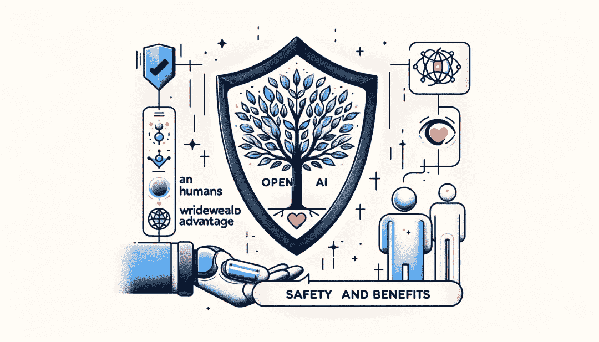
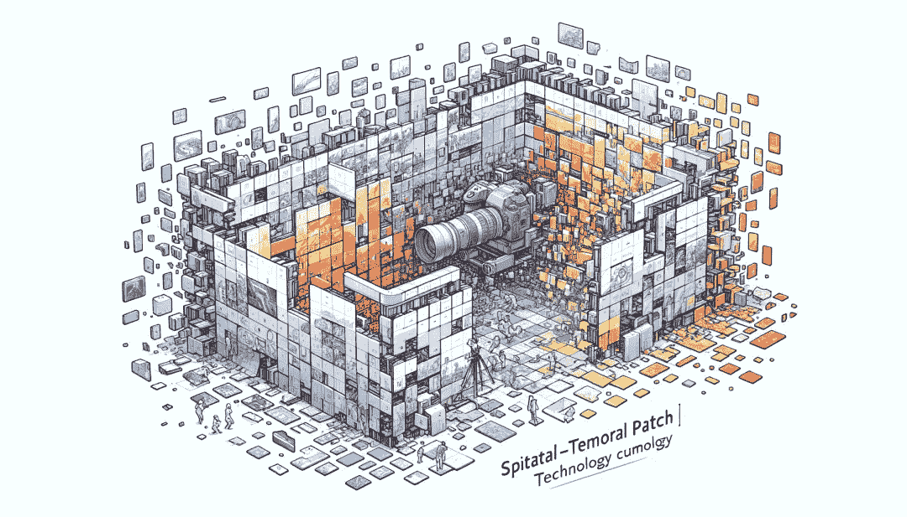
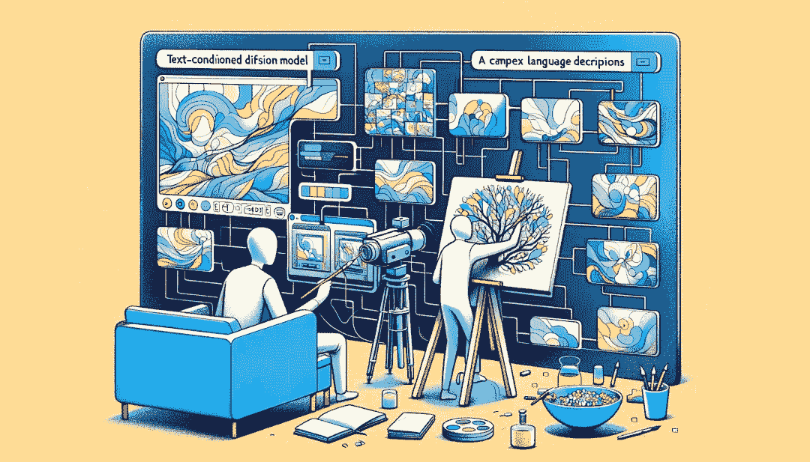
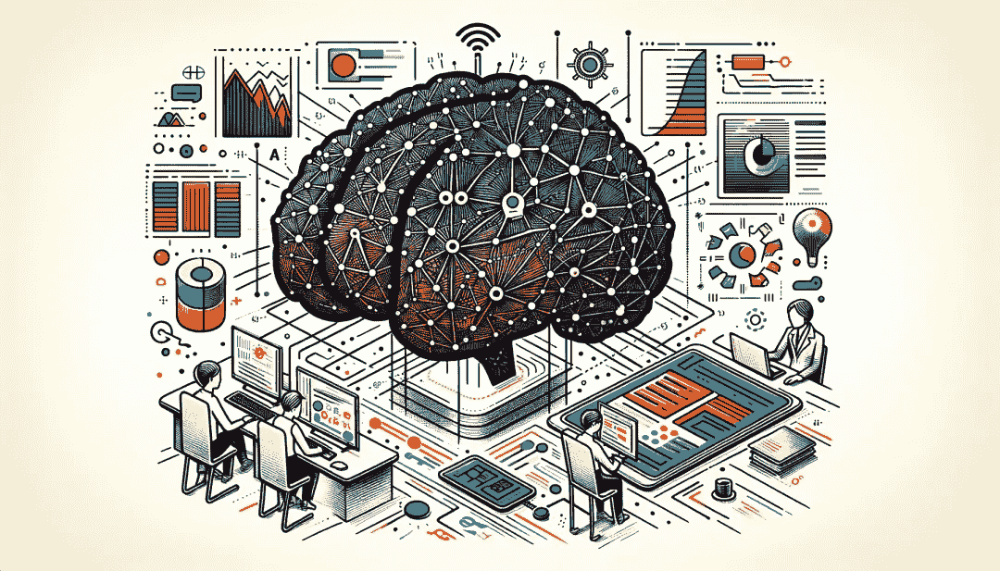
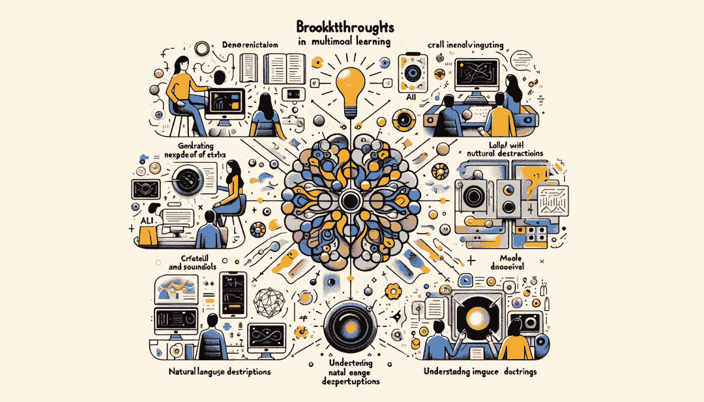
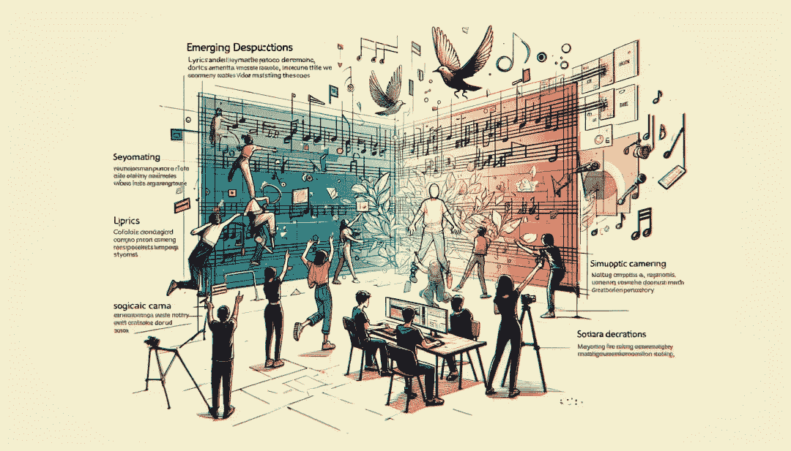
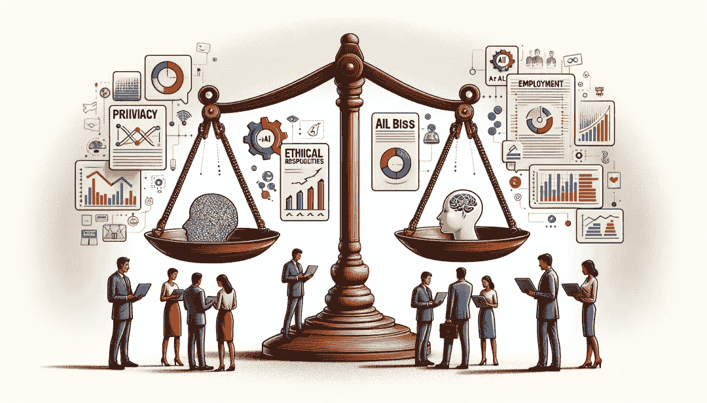
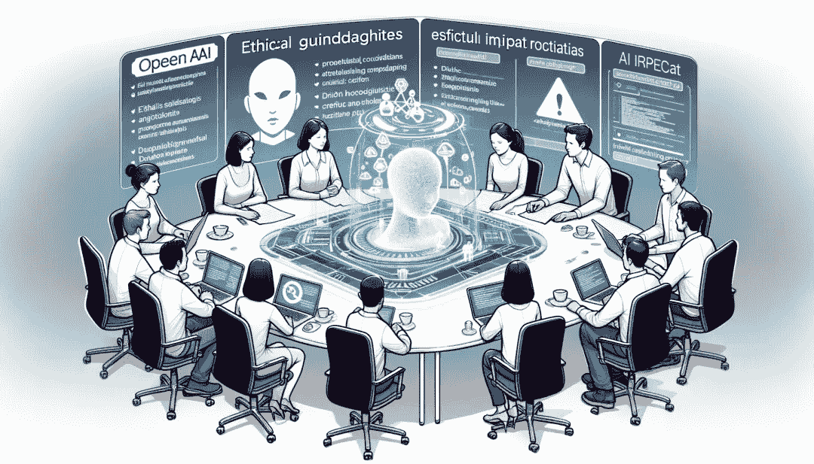

# 从Sora谈起：OpenAI的AGI路线是什么

> 来源：[https://agijuejin.feishu.cn/docx/EA7adVrNaoWybRxdz7mcrmb5nGe](https://agijuejin.feishu.cn/docx/EA7adVrNaoWybRxdz7mcrmb5nGe)

> 作者：金色传说大聪明 | 赛博禅心

> 原文：https://mp.weixin.qq.com/s/h40gLqB6O7aaXPuWsVH1Yg

**OpenAI自成立之初就抱持一项宏大而明确的使命：推**动人工智能（AI）向人工通用智能（AGI）的演进，致力于创建能够解决人类级问题的智能系统。这一愿景源于一个核心信念——即AGI将是人类文明的转折点，它有潜力不仅解决当前科技所无法解决的问题，还能以我们难以想象的方式拓展人类的能力和理解。对OpenAI而言，AGI不仅是技术上的一大跃进，更是向着利益人类的方向努力的承诺。

### OpenAI的核心使命

OpenAI的核心使命集中于两个关键点：安全性与益处。尽管AGI的实现充满挑战，但OpenAI坚信，只有确保AGI的发展过程中人类的安全得到保障，并且其成果能够广泛惠及人类，这一技术的巨大潜力才能被充分发挥。因此，OpenAI不仅致力于推进AGI的技术研究，同时也不断探索如何评估、管理和引导AI技术，以确保它们能够沿着有益于人类的方向发展。

### AGI的定义

在OpenAI的理念中，人工通用智能（AGI）被定义为一种能力水平与人类相当、可以解决广泛人类级别问题的智能系统。不同于当前的人工智能技术通常只专注于解决特定的、狭窄的任务，AGI将能够理解、学习和应用知识于一个范围广泛的问题和环境，包括那些它未被特别编程处理的任务。这一定义突显了AGI与现有AI系统的根本区别，同时也指出了实现AGI所需克服的技术和理论难题。

### OpenAI通过Sora实现使命

Sora项目是OpenAI最新的里程碑，它不仅体现了OpenAI在推进AGI发展路线上的技术创新，也展示了如何将核心使命融入具体研究项目之中。Sora通过先进的视频压缩网络和空间时间补丁技术，处理和理解多样化的视觉数据，再结合文本条件化的Diffusion模型，将文字提示转化为具有高度一致性和创造性的视频内容。这一过程不仅是对AI在视频内容生成方面能力的极大拓展，也是对模拟真实世界互动、理解和创造复杂视觉表达的一次深入探索。

通过Sora**项目，OpenAI展示了其AGI研究的双重目标：一**方面，通过技术创新推进AI能力的边界，实现更加复杂、动态和创造性的任务；另一方面，通过这些研究项目探索AGI发展的安全和道德框架，确保未来的AGI能够符合人类的利益和价值观。正是这样的项目和研究方向，体现了OpenAI对其核心使命的忠诚和追求，即在确保安全和益处的前提下，推进人工智能技术向人工通用智能的演进。

# Sora项目的创新之处

Sora的创新之处在于其独特的处理多样化视觉数据的能力，它通过一系列技术手段将复杂的视频内容制作过程变得简单且高效。以下是Sora在视频内容生成方面的关键技术特点及其创新之处的详细介绍。

### 视频压缩网络

视频压缩网络是Sora处理多样化视觉数据的第一步。这个过程可以被理解为将视频文件进行有效压缩，使其在保留重要视觉信息的同时减少数据量，类似于将一本丰富的图文杂志压缩成一个轻便的电子版。具体来说，这个网络利用深度学习技术识别并保留视频中的关键视觉要素，同时去除冗余信息，这不仅大大提高了数据处理的效率，还为后续步骤减轻了计算负担。此外，视频压缩网络的设计还考虑到了视频内容的多样性，能够适应不同风格和质量的视频，确保输出内容的质量。

### 空间时间补丁

紧随视频压缩网络之后的是空间时间补丁技术，它进一步细化了视频内容的处理。可以将空间时间补丁比喻为将视频分解成一块块小的画布，每块画布捕捉了视频在特定时间和空间范围内的片段。这样的处理使得Sora能够更细致地理解和重构视频内容，就像是用无数个细小的拼图块构建出一幅完整的画面。这种方法的优点在于，它不仅能精确捕捉动态变化，还能够有效处理视频中的长期依赖关系，如确保视频中的人物在不同场景下保持一致的行为和外观。

### 文本条件化的Diffusion模型

Sora的另一个关键技术是文本条件化的Diffusion模型，这一技术让Sora能够根据文本提示生成相应的视频内容。这个过程类似于根据一段故事的描述画出一幅画，其中，文本条件化的Diffusion模型充当了画家的角色，根据给定的文本提示（如“一只猫坐在窗台上看着外面的世界”）生成与之相匹配的视频内容。这一技术的核心创新在于其能够理解复杂的语言描述，并将其转换为具体的视觉表现，这不仅展现了Sora在自然语言处理方面的能力，也体现了其在视觉内容生成方面的创新。

通过上述技术的结合使用，Sora实现了从文本到视频的直接转换，大大拓展了视频内容生成的可能性。无论是创作动画短片、模拟真实世界场景还是生成产品演示视频，Sora都能够提供强有力的技术支持。这些技术的创新不仅加速了视频内容的生成过程，也为创意表达提供了新的可能性，使得Sora成为了OpenAI在推进人工智能向人工通用智能演进过程中的一个重要里程碑。

# 深度学习和多模态学习在OpenAI研究中的应用

接着对Sora项目的技术特点与创新之处的讨论，我们将深入探索OpenAI在深度学习和多模态学习领域的关键进展，以及这些进展如何为其朝着人工通用智能（AGI）迈进的愿景提供支持。

### 深度学习的应用

**概念理解：** 深度学习是一种机器学习技术，它通过模拟人脑的工作原理来处理和学习大量数据。想象一下，就像人脑通过不断学习来识别物体或理解语言一样，深度学习模型也能通过训练，从海量数据中学习复杂的模式和规律。

**在OpenAI的应用：** OpenAI利用深度学习技术开发了多个先进的AI模型，包括语言处理模型GPT系列。这些模型的核心是一个庞大的神经网络，它可以理解和生成自然语言，提供对话、翻译、写作等多种能力。例如，GPT-3，作为目前世界上最大的语言处理模型之一，能够生成令人难以区分的人类水平的文本，展示了深度学习在自然语言处理领域的巨大潜力。

### 多模态学习的突破

**概念理解：** 多模态学习是指AI能够理解和处理多种类型的数据（如文本、图像和声音）。就像人类可以同时看到一幅画、听到音乐并读懂描述它们的文字一样，多模态学习使AI能够融合这些不同类型的信息，提供更丰富和深入的理解。

**在OpenAI的应用：** OpenAI通过多模态学习，推出了如DALL·E和CLIP等创新模型。DALL·E可以从简单的文本描述生成细节丰富、富有创意的图像，显示了AI在理解文本与生成相应视觉内容方面的强大能力。而CLIP模型通过学习大量的图片和相关文字信息，能够理解图片内容并将其与自然语言描述相匹配，这在搜索引擎、内容推荐和自动标注等领域显示了巨大的应用价值。

### 支持AGI路线的重要性

OpenAI在深度学习和多模态学习领域的这些进展，不仅推动了AI技术的边界，更为其AGI的愿景铺平了道路。通过构建能够理解和生成自然语言、处理和融合多种模态数据的模型，OpenAI正在让AI系统逐步具备人类般的理解能力和创造力。这些技术的发展，加速了AI从专用智能向通用智能的转变，让AI能够在越来越多的领域中，执行复杂任务、解决复杂问题，更接近于人类的思维和工作方式。

通过深度学习和多模态学习的持续研究和应用，OpenAI不仅在语言处理、图像生成等单一领域取得了显著的成就，更重要的是，这些技术的结合与进步，为构建能够理解复杂世界、具备广泛应用能力的AGI奠定了坚实的基础。这一进展意味着未来的AI将不仅仅是工具，而是能够理解复杂环境、协助人类解决各类问题的合作伙伴。从Sora的视频生成技术到GPT-3的语言理解能力，OpenAI的技术正逐步解锁AGI的潜能，开辟了通向更智能、更有用的AI系统的道路。

Sora的视频生成技术已在创意产业中找到应用，包括电影制作、设计领域，展示了OpenAI技术的实际效用和行业创新潜力。

# Sora在创意产业的实际应用

Sora的视频生成技术将在创意产业、电影制作和设计等行业中表现出了其惊人的潜力和灵活性。下面我们将探讨几个这样的案例，以及这些案例如何展示了OpenAI技术推动行业创新的方式。

1.  电影制作：预览与概念验证

在电影制作领域，Sora的视频生成技术可被应用于项目的早期阶段，特别是在预览和概念验证环节中。一家知名的电影制作公司可利用Sora生成了数个关键场景的预览视频，这些视频基于简单的文本描述，如“未来城市在黄昏的背景下，主角站在高楼之巅俯视下方。”Sora不仅成功呈现了文本描述中的细节，还以其独有的视角和创意，为创作者提供了灵感，帮助他们更加准确地定义最终的视觉样式。通过这种方式，Sora显著减少了从概念到视觉呈现的时间和成本，同时增强了创意的多样性和创新性。

1.  设计领域：产品概念和广告创意

在设计行业，一个创意机构可采用Sora技术为其客户设计新产品的概念视频和广告。通过向Sora输入产品的描述和预期效果，机构能够迅速获得一系列创意丰富、视觉吸引的视频，展示了产品在不同环境下的使用场景。这种应用不仅提高了设计流程的效率，还为客户提供了更加直观和动态的产品展示方式。此外，利用Sora生成的视频也用于社交媒体广告，通过生动的视觉故事叙述，有效提高了广告的互动性和受众的参与度。

1.  创意产业：音乐视频和动画

一个新兴的音乐制作团队可用Sora为他们的最新单曲创作了一部音乐视频。通过向Sora提供歌词和主题描述，团队得到了一系列与歌曲情感和故事匹配的视频片段。Sora的技术不仅在视频中成功融入了抽象和象征性的元素，还模拟了动态摄像机运动和复杂的人物互动，增加了视频的艺术性和观赏价值。此外，在动画制作领域，Sora可被用来快速生成原型动画，帮助动画师探索不同的风格和叙事方法，加速创作流程，同时提供丰富的视觉材料以供最终产品的参考。

1.  虚拟现实和游戏：环境设计和资产创建

虚拟现实（VR）和游戏开发商也可探索使用Sora来设计环境和创建资产。一个VR体验项目团队可通过Sora生成了一系列极具沉浸感的环境场景，包括从密林深处到未来城市的全景视图。Sora在这一过程中展现出的能力包括了对场景细节的精准捕捉以及在生成过程中考虑用户交互和探索的可能性。此外，一款即将发布的视频游戏使用Sora来创建游戏内的资产，如角色、道具和环境元素，这些通过Sora生成的资产不仅保持了视觉上的一致性，还加快了开发进度，降低了制作成本。

通过展望这些应用案例，我们可以看到Sora在创意产业、电影制作和设计领域的实际应用和帮助，以及OpenAI技术如何推动行业创新。Sora不仅为创作者提供了一个强大的工具来探索和实现他们的想象，也开辟了创意表达和内容创造的新可能性。

# 追求AGI过程中的挑战

在迈向人工通用智能（AGI）的征程中，OpenAI面临着一系列复杂且多维的挑战。这些挑战不仅包括技术层面的限制，还涵盖了伦理和安全方面的考量。以下是OpenAI在这一旅程中所遭遇的主要挑战以及其应对策略的探讨。

### 技术限制

**数据和算法的局限性**：当前，AI的发展在很大程度上依赖于海量数据的训练和复杂算法的迭代。然而，对于AGI来说，这种依赖性构成了一个明显的限制。首先，质量高、范围广的数据难以获得，这限制了AI模型学习的广度和深度。其次，现有的算法往往专注于解决特定类型的问题，缺乏应对未知挑战的能力，这与AGI的目标——解决人类级别问题——存在差距。

为了解决这些问题，OpenAI投入巨大资源进行算法创新和数据收集工作。例如，通过引入如GPT系列这样的大型语言模型，OpenAI尝试提升AI系统处理自然语言的能力，以期能理解和生成更接近人类水平的文本。同时，OpenAI也在积极探索更有效的无监督学习和半监督学习方法，以减少对标注数据的依赖。

**计算资源的需求**：AGI的研究和开发需要极其庞大的计算资源。随着模型的复杂度增加，所需的计算能力也呈指数级增长。这不仅增加了研发成本，也限制了研究的可行性和速度。

OpenAI通过与硬件生产商合作，利用最先进的GPU和TPU等计算资源，试图解决这一问题。此外，OpenAI还在研究更为高效的模型架构和算法，以优化计算效率，减少所需的计算资源。

### 伦理和安全问题

**伦理责任**：随着AI技术的进步，其在社会中的应用也越来越广泛，这就带来了一系列伦理问题。例如，AI技术可能会加剧数据隐私泄露、信息偏见和失业问题。对于追求AGI的OpenAI来说，如何确保其技术用于正义、公正且对人类有益的目的，成为了一个重要挑战。

OpenAI通过建立伦理委员会和合作伙伴关系，积极参与对AI伦理标准和政策的讨论与制定，致力于推动行业内外对AI伦理的广泛认识和共识。同时，OpenAI也在研发过程中加入伦理考量，通过设计透明且可解释的模型来降低偏见，并通过隐私保护技术来增强用户的数据安全。

**安全问题**：AI系统可能被滥用，造成安全风险。随着技术向AGI迈进，这一风险变得尤为突出。如何确保AI系统不被用于恶意目的，并在出现意外时能够可控停止，是OpenAI必须面对的挑战。

OpenAI通过加强AI系统的安全性研究，如探索可靠的中断机制和增强模型的鲁棒性，来降低安全风险。此外，OpenAI还与全球安全研究社区合作，共同探索面对更高级AI系统时的安全框架和策略。

尽管面临诸多挑战，OpenAI坚持不懈地通过技术创新、伦理讨论和安全研究，寻找突破。对于OpenAI而言，这既是一场科学探索，也是对社会责任的承担。通过这些努力，OpenAI希望能够为实现既安全又有益的AGI奠定坚实基础，最终造福人类社会。

# 对未来AGI发展的前瞻

在面对人工智能（AI）发展的未来，OpenAI坚信，通过持续的努力和研究，可以实现安全和有益的人工通用智能（AGI）。为了达成这一宏伟目标，OpenAI已经设定了清晰的路线图，聚焦于克服技术限制、解决伦理和安全问题，以及推进技术和社会的协同进步。

首先，技术创新是推动AGI发展的核心动力。面对当前技术限制，如算法效率、数据可用性和计算资源的需求，OpenAI正在研发更先进的算法，这些算法旨在提高模型的学习效率和适应能力，从而减少对大量标注数据的依赖。例如，通过改进强化学习和无监督学习技术，OpenAI旨在使模型能够从少量数据中快速学习和适应新任务。此外，OpenAI也致力于开发新型硬件，以支持更大规模的模型训练，加速AGI的研发进程。

其次，伦理和安全是AGI研发过程中不可忽视的重要方面。随着AI技术的发展，如何确保其应用不造成负面社会影响，成为了一个紧迫的问题。对此，OpenAI不仅在技术研发中考虑伦理和安全因素，还积极参与全球性的伦理标准和政策制定。通过建立透明、负责任的研究和开发框架，以及与不同利益相关方的广泛合作，OpenAI希望能够确保AI技术的发展既遵循伦理准则，又能有效地预防和减轻潜在的安全风险。

除了技术创新和伦理安全，推动社会和技术的协同进步也是OpenAI面向未来AGI发展的一个重要方向。OpenAI认为，为了实现AGI的广泛应用和积极影响，必须加强与不同领域专家和公众的沟通与合作。这包括与政府、行业和学术界的深度合作，共同探索如何在确保技术安全的基础上，利用AGI解决全球性挑战，如气候变化、疾病防治和教育普及等。同时，通过开放研究成果和技术分享，OpenAI也致力于提升公众对AGI技术的理解和接受度，激发更多创新的思考和应用。

面向未来，OpenAI在实现AGI的旅程上仍将面临许多挑战。然而，通过不断的技术突破、伦理和安全的深度考量以及与全球社会的协作，OpenAI相信能够逐步解决这些挑战，实现既安全又有益的AGI，为未来科技和社会带来更广泛的积极影响。通过这些努力，OpenAI不仅期待AGI能够成为解决人类关键问题的有力工具，也希望能够推动人类社会向着更加繁荣和和谐的方向发展。