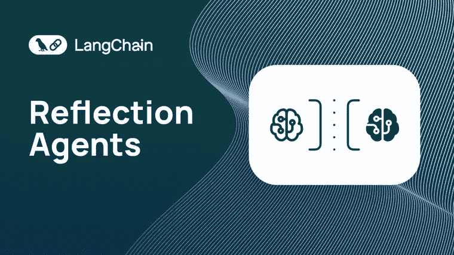
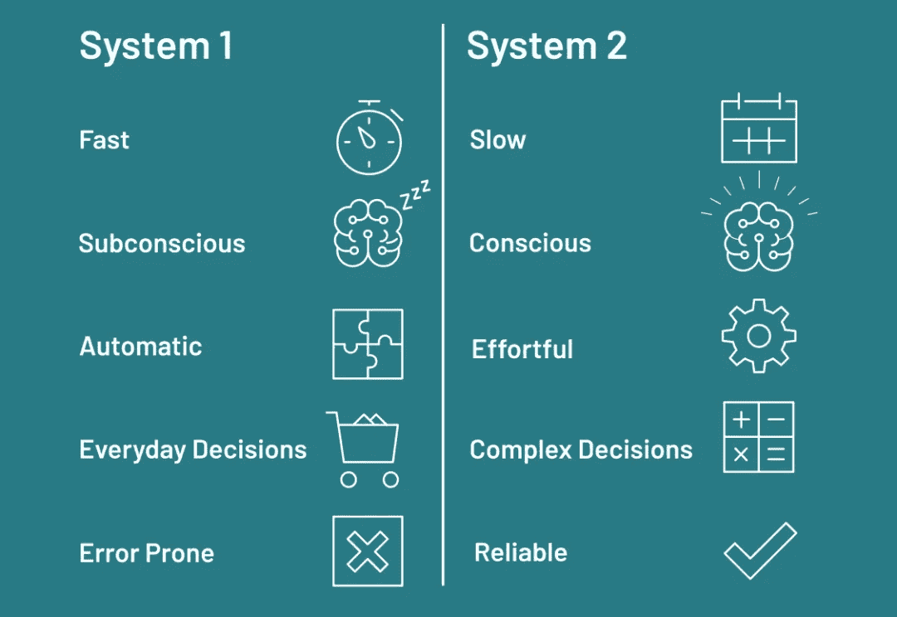
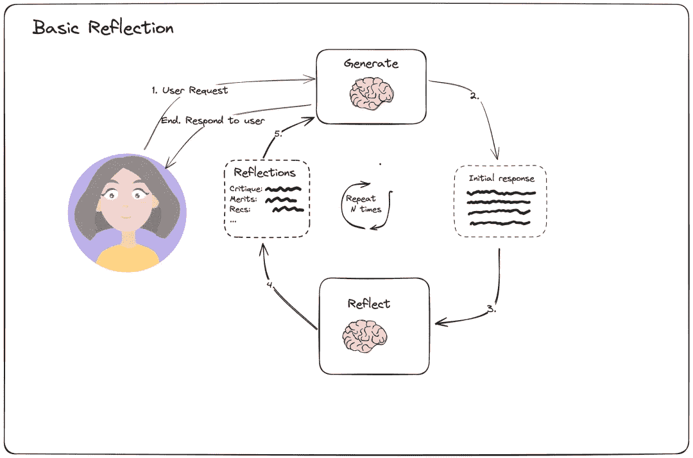
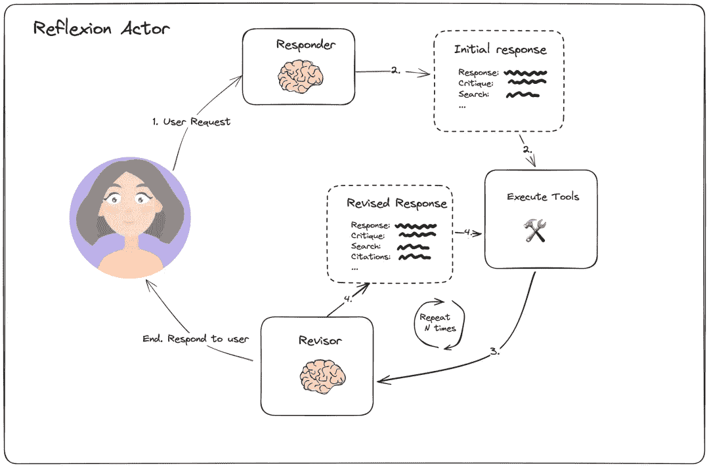
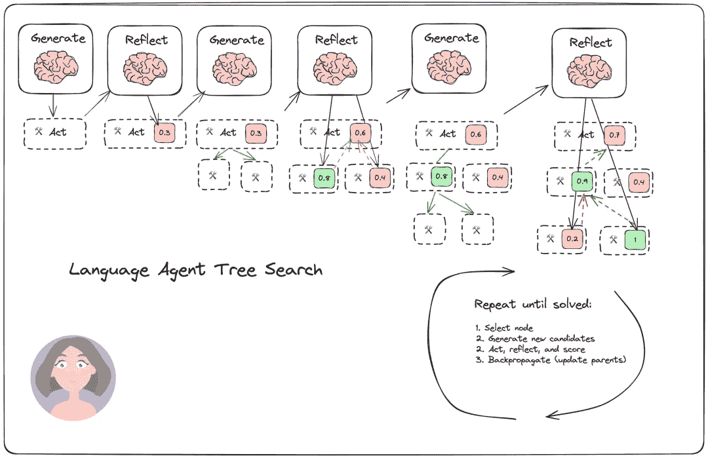
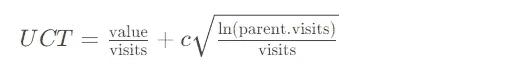
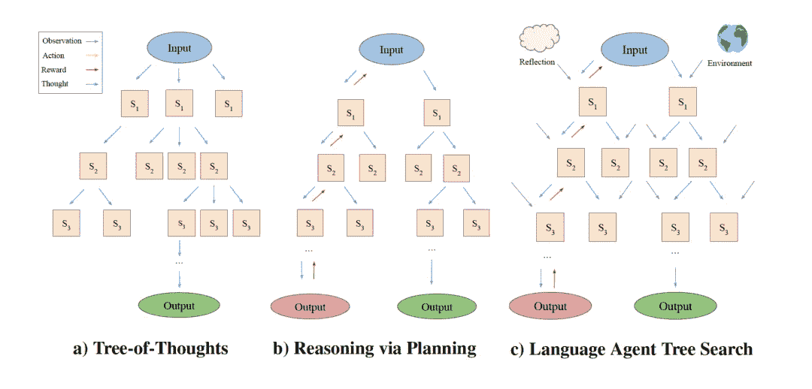

# 自省,让Agents慢思考

> 来源：[https://agijuejin.feishu.cn/docx/GlHQdTFE9oY1nQxXFJjcyW4enAf](https://agijuejin.feishu.cn/docx/GlHQdTFE9oY1nQxXFJjcyW4enAf)

> 作者：AI小智

> 原文：https://mp.weixin.qq.com/s/on2iDke3hRb1q4oXKuEPww



> **❝**

> 本文译自Reflection Agents一文。自省增强是用于提升智能代理和其他人工智能系统性能的策[**略。本篇文章将介绍利用 **](https://mp.weixin.qq.com/mp/appmsgalbum?__biz=Mzg2ODA5NTM1OA==&action=getalbum&album_id=3115055723522015235&token=162966106&lang=zh_CN#wechat_redirect)LangGraph 构建三种自省技术的方法，包括 Reflexion 和语言代理树搜索的实现。 本系列合集，点击链接查看

###  **关键链接 **

+   **简易自省：( Python )**

+   Reflexion：( Python )

+   语言代理树搜索：( Python )

+   **Youtube**

自省增强是一种策略，旨在通过引导语言模型（LLM）回顾与批评其历史行为，辅以工具观察等外部信息，从而提升智能代理的性能。

人们常讨论的“第一系统”和“第二系统”思维，前者更偏向本能反应，后者则更注重方法论和深思熟虑。正确使用时，自省增强能够引导语言模型超越本能反应的限制，展现出更接近深思熟虑的行为。



第一系统和第二系统：快速思考？放慢脚步。

自省不是瞬间完成的过程！本文中介绍的所有方法都需要牺牲一些计算能力，以换取潜在更优质的输出结果。虽然对于对延迟要求极高的应用场景可能不适合，但对于更注重输出品质而非速度的知识密集型任务来说，这种做法是划算的。

接下来，我们将详细介绍这三个案例：

##  **基础自省 **

链接：( Python , Youtube )

这个简单的案例包含了两个语言模型的调用：生成器和自省者。生成器的任务是直接回应用户请求，自省者则扮演教师角色，对生成器的初步回应给出建设性的反馈。

这个过程会重复一定次数，最后给出生成的答案。



基础自省循环

我们可以使用以下 LangGraph 代码定义这一过程：

```
from langgraph.graph import MessageGraph

builder = MessageGraph()
builder.add_node(&quot;generate&quot;, generation_node)
builder.add_node(&quot;reflect&quot;, reflection_node)
builder.set_entry_point(&quot;generate&quot;)


def should_continue(state: List[BaseMessage]):
    if len(state) &gt; 6:
        return END
    return &quot;reflect&quot;


builder.add_conditional_edges(&quot;generate&quot;, should_continue)
builder.add_edge(&quot;reflect&quot;, &quot;generate&quot;)
graph = builder.compile()
```

MessageGraph 是一种带状态的流程图，状态是一个由消息组成的列表。每当调用生成器或自省者节点时，它都会往消息列表中添加一条新记录，最终结果由生成器节点返回。

通过让模型多次尝试改进输出，并以不同身份审视这个输出，这种基础的自省技术有时能够提高性能。

然而，由于这个自省步骤并不涉及任何外部流程，因此最终成果未必比源始结果有显著提升。接下来让我们看看有哪些其他方法能够弥补这一点。

##  **Reflexion **

链接：( Python , Youtube )

由 Shinn 等人设计的 Reflexion 框架，通过口头反馈和自省学习。在这个架构中，执行者角色会对每一次响应进行详细批评，并以外部数据为依据。它要求提供支持引文，并明确指出响应中的冗余和遗漏之处，这使得自省内容更有建设性，并指导生成器根据反馈进行调整。

在我们所链接的例子中，我们在一定步骤后停止，但你也可以让自省语言模型来决定何时停止。

代理循环的概述如下：



执行者概述

在每一步中，回答者负责生成答案，并执行一系列搜索查询作为额外动作。随后，审稿者被要求对当前的情况进行反思。逻辑可通过 LangGraph 框架定义，如下所示：

```
from langgraph.graph import END, MessageGraph

MAX_ITERATIONS = 5
builder = MessageGraph()
builder.add_node(&quot;draft&quot;, first_responder.respond)
builder.add_node(&quot;execute_tools&quot;, execute_tools)
builder.add_node(&quot;revise&quot;, revisor.respond)
# draft -&gt; execute_tools
builder.add_edge(&quot;draft&quot;, &quot;execute_tools&quot;)
# execute_tools -&gt; revise
builder.add_edge(&quot;execute_tools&quot;, &quot;revise&quot;)

# 定义循环逻辑：
def event_loop(state: List[BaseMessage]) -&gt; str:
    # 在我们的案例中，超过 N 步骤后结束
    num_iterations = _get_num_iterations(state)
    if num_iterations &gt; MAX_ITERATIONS:
        return END
    return &quot;execute_tools&quot;


# revise -&gt; execute_tools 或结束
builder.add_conditional_edges(&quot;revise&quot;, event_loop)
builder.set_entry_point(&quot;draft&quot;)
graph = builder.compile()
```

这个智能体能够有效地利用明晰的自省和基于网页的引用提升答案质量。不过，由于它固守单一轨迹，一旦某步走错，可能给后续决策带来干扰。

##  **语言代理树搜索 **

链接：( Python , Youtube )

由 Zhou 等人开发的语言代理树搜索 (LATS) 是一种结合了自省评估和搜索架构（特别是蒙特卡洛树搜索）的通用语言模型代理搜索算法。该算法采用了标准的强化学习（RL）任务框架，用语言模型替代传统的 RL 代理、价值函数和优化器来提高处理复杂任务的能力，从而避免陷入重复性行为模式。

搜索过程分为以下四个主要步骤：



1.  **选择 **：基于后续步骤产生的综合奖励，挑选出最佳行动方案。当找到解决方案或达到最大搜索深度时，会直接给出响应；若没有，则继续搜寻。

1.  **扩展和模拟 **：预设生成 N 个可能采取的行动（本例中为 5 个），并同时执行这些行动。

1.  **反思和评价 **：观察这些行动产生的结果，并依据反思（也可能包含外部反馈）对其做出评价。

1.  **反向传播 **：根据行动结果更新初始轨迹的评分。

如果智能体拥有一个有效的反馈环，基于环境奖励或可靠的自省得分，那么它就可以确切区分不同的行动轨迹，并选择更佳路径。最终选定的路径可以保存在外部记忆中，或者用于模型的微调，提升未来的性能表现。

“选择”步骤会选择具有最高上限置信区间（UCT）的节点，该步骤平衡了预期奖励与探索新途径的动机。



通过查阅代码，你可以了解具体实现方式。在 LangGraph 的实现中，我们将生成和自省步骤归于同一节点，并且每一次循环时都会检查任务状态，以判断任务是否已被成功解决。图的定义大致如下所示：

```
from langgraph.graph import END, StateGraph

class Node:
    def __init__(
        self,
        messages: List[BaseMessage],
        reflection: Reflection,
        parent: Optional[Node] = None,
    ):
        self.messages = messages
        self.parent = parent
        self.children = []
        self.value = 0
        self.visits = 0
    # 这里定义了附加的方法。查看代码可以得到更多信息！

class TreeState(TypedDict):
    # 整个树结构
    root: Node
    # 最初的输入
    input: str

def should_loop(state: TreeState):
    &quot;&quot;&quot;判断是否继续执行树搜索。&quot;&quot;&quot;
    root = state[&quot;root&quot;]
    if root.is_solved:
        return END
    if root.height &gt; 5:
        return END
    return &quot;expand&quot;


builder = StateGraph(TreeState)
builder.add_node(&quot;start&quot;, generate_initial_response)
builder.add_node(&quot;expand&quot;, expand)
builder.set_entry_point(&quot;start&quot;)


builder.add_conditional_edges(
    &quot;start&quot;,
    # 要么扩展/展开要么结束
    should_loop,
)
builder.add_conditional_edges(
    &quot;expand&quot;,
    # 要么继绑定展开要么结束
    should_loop,
)

graph = builder.compile()
```

一旦你构建了基本架构，就可以轻松将其拓展应用到其他任务上！例如，这种方法非常适合于代码生成任务，因为代理可以编写具体的单元测试，并根据测试的质量评估不同的工作路径。

LATS 将诸如 Reflexion、思想树和计划执行等其他代理架构中的推理、规划、自省组件结合起来。通过对自省和环境反馈的逆向传播，LATS 优化了搜索流程。尽管它对奖励分数可能较为敏感，但总体来说，这个算法可以灵活地应用于多种任务。



与其他代理架构的对比图

##  **总结 **

感谢您的阅读！您可以在 LangGraph 仓库中找到所有这些例子，并且我们不久后也会将它们移植到 LangGraphJS 上（可能在你阅读这篇文章的时候已经完成了）。

上述所有技术都是通过利用额外的语言模型推理来增加产出高质量答案的可能性，或者正确回应更复杂的推理任务。虽然这会消耗更多时间，但当输出质量比响应速度更为重要时，这种方法是切实可行的。如果您将这些过程反馈保存（或作为微调数据），您可以优化模型，以防止将来重复出现类似的错误。