# AI Agent万字长文总结：规划, 工具, 执行, 记忆

> 来源：[https://agijuejin.feishu.cn/docx/BVgUdTWTvoNCjCxf087cEhrMnxc](https://agijuejin.feishu.cn/docx/BVgUdTWTvoNCjCxf087cEhrMnxc)

> 作者：张长旺 | 旺知识

> 原文：https://mp.weixin.qq.com/s/muQtb6f5Zjlwpygl4qLALw

本文对目前流行的ai agent项目做了介绍，并根据自己实际经验，得出目前一个好的ai agent所可能用到的能力、目前的问题以及一些解决方案。

## 引言

OpenAI应用研究主管LilianWeng撰写了一篇万字长文，她提出Agent = LLM（大型语言模型）+ 记忆 + 规划技能 + 工具使用，并对Agent的每个模块的功能作了详细的说明，最后她非常看好Agent未来的应用前景，但也表明挑战无处不在。最近大家开始逐渐关注AI Agent这个领域，并称是大语言模型的下半场。


## Agent的基本组成

在以LLM驱动的自主代理系统中，LLM作为代理的大脑，辅以几个关键组件：

一个Agent的基本组成应该包含如下四个方面 规划（planning), 工具（Tools), 执行(Action), 和 记忆(Memory)。

### 规划

+ 子目标和分解：代理将大型任务分解为较小，可管理的子目标，从而有效地处理复杂的任务。

+ 反思和改进：代理可以对过去的行动进行自我批评和自我反思，从错误中学习并改进未来的步骤，从而提高最终结果的质量

### 记忆

+ 我将所有的上下文学习（参考Prompt Engineering）都看成是利用模型的短期记忆来学习。

+ 长期记忆：长期记忆为代理提供了长期存储和召回（无限）信息的能力，它们通常通过利用外部的向量存储和快速检索来存储和召回（无限）信息。

### 使用工具

+ 代理通过学会调用外部API来获取模型权重（通常在预训练后很难修改）中缺少的额外信息，包括当前信息，代码执行能力，访问专有信息源等。

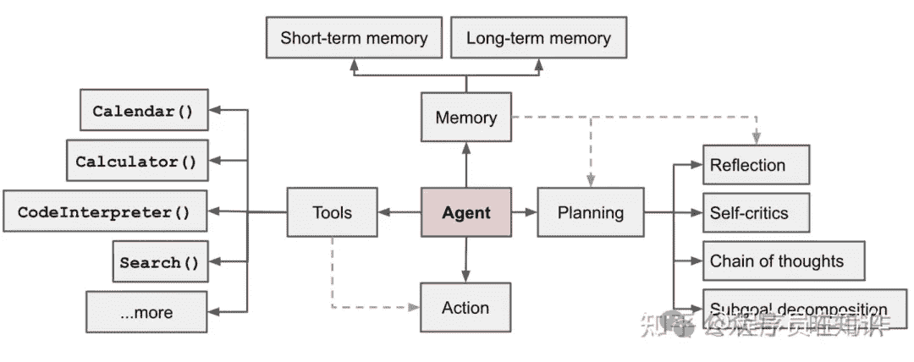

## 流行的AI Agent例子

### AutoGPT

其创新还是在 prompt 层面，通过更好的提示词来激发模型的能力，把更多原先需要通过代码来实现的流程“硬逻辑”转化为模型自动生成的“动态逻辑”。以 AutoGPT 为例，它的核心 prompt 如下：

```
You are Guandata-GPT, &#x27;an AI assistant designed to help data analysts do their daily work.&#x27;
Your decisions must always be made independently without seeking user assistance. Play to your strengths as an LLM and pursue simple strategies with no legal complications.

GOALS:

1. &#x27;Process data sets&#x27;
2. &#x27;Generate data reports and visualizations&#x27;
3. &#x27;Analyze reports to gain business insights&#x27;

Constraints:
1. ~4000 word limit for short term memory. Your short term memory is short, so immediately save important information to files.
2. If you are unsure how you previously did something or want to recall past events, can be parsed by Python json.loads
```

### BabyAGI

相比 AutoGPT 来说，BabyAGI 是一个相对更聚焦在“思维流程”方面尝试的项目，并没有添加对各种外部工具利用的支持。其核心逻辑非常简单：

从任务列表中获取排在第一位的任务。获取任务相关的“记忆”信息，由任务执行 agent 来执行这个任务，获取结果。目前这个执行就是一个简单的 LLM 调用，不涉及外部工具。将返回结果再存放到记忆存储中。基于当前的信息，如整体目标，最近一次执行结果，任务描述，还未执行的任务列表等，生成所需要的新任务。将新任务添加到任务列表中，再判断所有任务的优先级，重新排序。

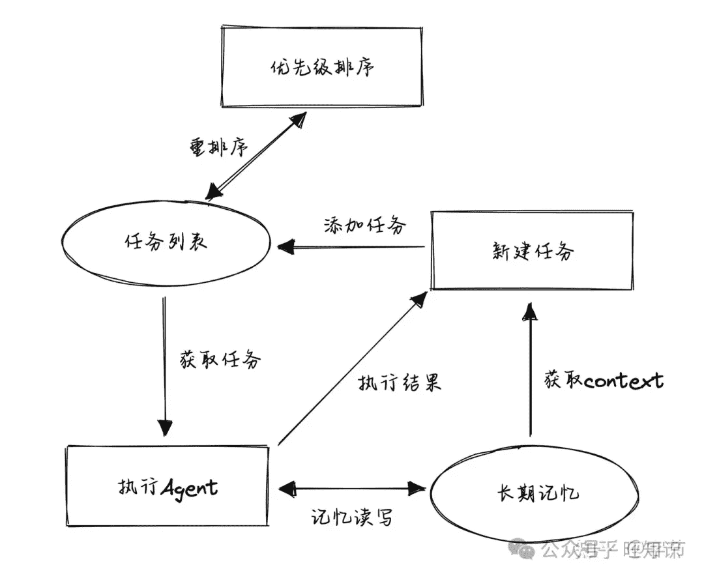

BabyAGI 运作流程

### Lagent

上海人工智能实验室研发了 Lagent 智能体框架，Lagent 的命名来源于 Language Agents（L-Agent）的缩写，主要目标是为了高效构建和拓展基于大语言模型的智能体。它有如下三个特点：支持丰富、高度可配置的智能体，Lagent 目前支持了常见的 3 种类型的智能体，包括了 ReAct、ReWoo 和 AutoGPT。灵活支持多种大语言模型，Lagent 支持了闭源模型的 API，例如 GPT-3.5 和 GPT-4。同时接入了 Huggingface Transformers，因此可以使用 Transformers 中的所有开源大语言模型，例如 InternLM，Llama 2 和 Baichuan-chat 等。支持丰富的工具类型，Lagent 可以支持丰富的工具类型，包括目前已经支持的搜索和 Code Interpreter。用户需要支持新的工具，只需要基于 `BaseAction` 实现传参调用的逻辑，同时对这个工具进行命名和说明即可。

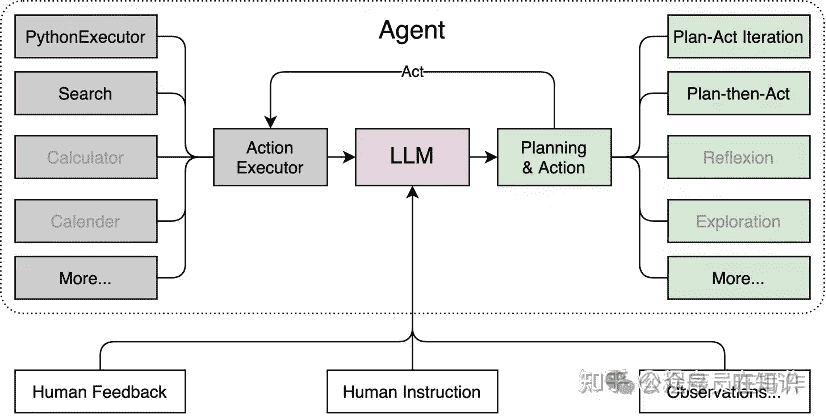

LLM 会接受外界的输入，基于 Agent 实现的某种机制进行推理、规划和行动，在行动阶段调用 Action Executor（动作执行器）去执行具体的 action，并返回行动结果。

### AgentGPT

AgentGPT 一个浏览器端的自主AI代理人工具，可以组装、配置和部署自主AI代理人。AgentGPT的关键创新之处在于其新增的自动任务拆分与自问自答功能。适用于需要运行文本生成和任务管理的场景，例如任务分配、自动化流程等。使用方式：用户给agent任务，例如“查找苹果公司的最受欢迎的产品，并找出它的价格”，agent会自动拆分成许多小的子任务，然后利用llm去逐步处理，最后输出整个任务的结果。

总体来说,AgentGPT实现的自动任务拆分与自问自答功能通过以下流程,降低了复杂问题解决的难度:

1. 用户输入一个复杂任务或问题的描述;

2. AgentGPT自动将任务拆分为多个步骤与子任务;

3. 针对每个子任务,AgentGPT自动生成相关问题(提问);

4. AgentGPT自动生成每个问题的回答(自问自答);

5. 用户对提问与回答进行确认或修改;

6. AgentGPT基于最新输入生成下一轮提问,循环此流程

7. 最后输出整个任务的结果。

### HuggingGPT

HuggingGPT 的核心概念是将语言作为 LLMs 与其他人工智能模型之间的通用接口。这一创新策略使得 LLMs 可以调用外部模型，进而解决各种复杂的人工智能任务。HuggingGPT 的设计强调了任务规划、模型选择、任务执行和响应生成四个阶段，使得整个系统可以高效地协调不同模型，解决多模态信息和复杂数字智能任务。

+ 任务规划：使用 ChatGPT 分析用户请求以了解其意图，并通过提示将其拆分为可能可解决的任务。

+ 模型选择：为了解决计划中的任务，ChatGPT 根据模型描述从托管在 Hugging Face 上的专家模型中选择模型。

+ 任务执行：调用和执行每个选择的模型，并将结果返回给 ChatGPT。

+ 响应生成：最后，使用 ChatGPT 将所有模型的预测整合起来，并为用户生成答案。

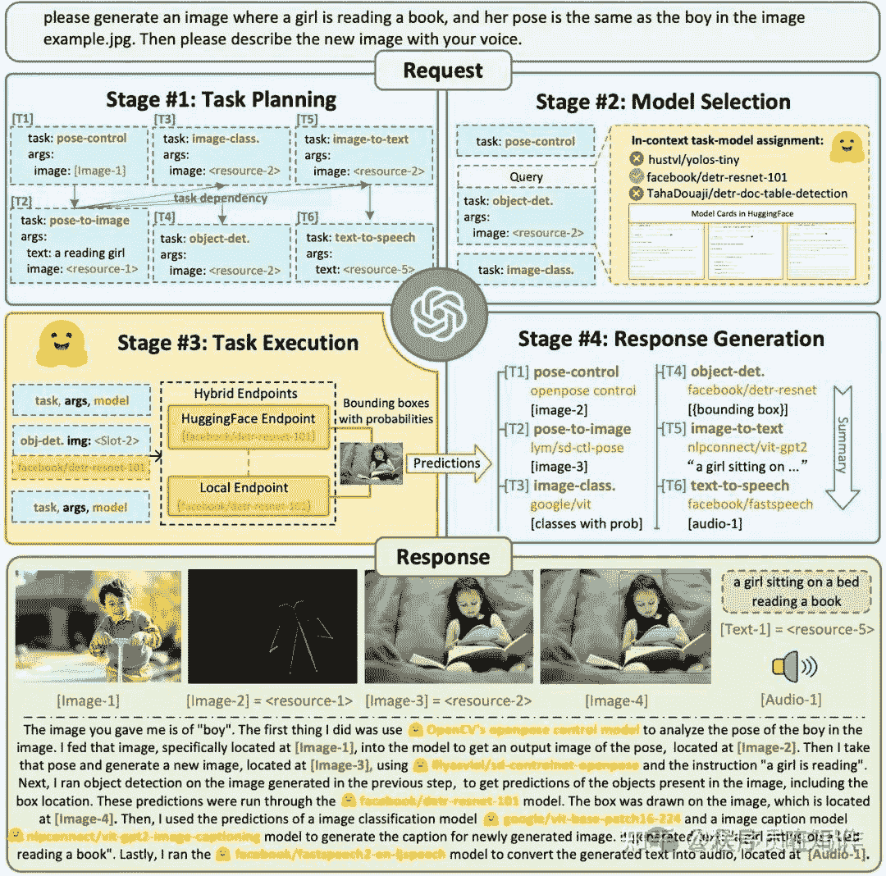

HuggingGPT 在第一步，任务规划中，设计了 6 个任务，pose-control, pose-to-image, image-class, object-det, image-to-text, text-to-speech，并安排了它们的依赖关系。第二步中，ChatGPT 根据模型描述从候选在 huggingface 上的专家模型中选择模型，它们可能是在线的，可能是下载的。第三步，代码去真正执行对应的 huggingface 上的专家模型。第四步，将所有模型的预测整合起来，并为用户生成最后的返回。可以看到，确实就是去找了姿态相关的模型，生成了一个同样姿态的小女孩读书的图像。

HuggingGPT 已经在 Hugging Face 上成功集成了数百个模型，覆盖了 24 个任务，例如文本分类、目标检测、语义分割、图像生成、问答、文本转语音和文本转视频。实验结果证明了 HuggingGPT 在处理多模态信息和复杂人工智能任务方面的强大能力，为实现先进人工智能开辟了新的道路。

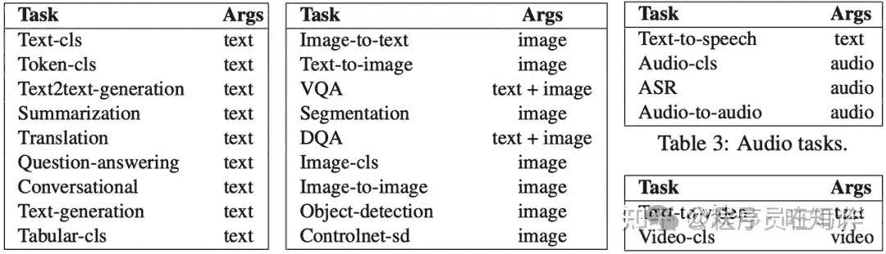


# AI Agent 框架与技术综述

## HuggingGPT 的局限性

HuggingGPT 也有一些短板。比如效率，效率的瓶颈在于大型语言模型的推理。对于每一轮用户请求，HuggingGPT 在任务规划、模型选择和响应生成阶段至少需要与大型语言模型进行一次交互。这些交互大大增加了响应延迟，导致用户体验下降。第二个限制是最大上下文长度。受限于 LLM 能接受的最大标记数量，HuggingGPT 也面临着最大上下文长度的限制。它使用了对话窗口，在任务规划阶段仅跟踪对话上下文以减轻这一限制。第三个是系统稳定性，包括两个方面。一个是大型语言模型推理过程中出现的反叛现象。大型语言模型在推理过程中偶尔无法遵循指示，输出格式可能不符合预期，导致程序工作流中的异常。第二个是 Hugging Face 推理的专家模型的不可控状态。Hugging Face 上的专家模型可能受到网络延迟或服务状态的影响，导致任务执行阶段出错。

## MetaGPT 多代理框架

MetaGPT 是一种多代理框架，它通过将包含现实世界专业知识的 SOP 编码到 LLM 代理中来扩展复杂问题的解决能力，实验表明，与现有方法相比，它可以生成更一致、更全面的解决方案。MetaGPT 的设计分为两层，即基础组件层和协作层，每一层都负责支持系统功能。

### 基础组件层

基础组件层详细定义了单个代理运行和整个系统信息交流所需的核心构件，包括环境、记忆、角色、行动和工具，并开发了协同工作所需的基本能力。

+ 环境：为代理提供协作工作空间和交流平台
+ 记忆：便于代理存储和检索过去的信息和情境
+ 角色：根据领域专长封装专业技能、行为和工作流程
+ 行动：代理为完成子任务和产生输出而采取的步骤。
+ 工具：可用于增强代理能力的实用程序和服务的集合。

MetaGPT 框架会为各种角色（如产品经理和建筑师）生成代理，这些代理通过特定角色设置进行初始化。MetaGPT 框架提供的角色配置允许各方为特定领域和目的创建高度专业化的 LLM 代理。

### 协作层

协作层建立在基础组件层之上，为协作解决复杂任务提供了两种机制——知识共享和封装工作流。知识共享和封装工作流是协作解决复杂任务的机制。

知识共享：这一机制允许代理高效地交换信息，存储、检索和共享各种粒度的数据。它不仅能加强合作，还能减少冗余通信，提高整体运行效率。

封装工作流程：这一机制利用标准作业程序将复杂的任务分解为更小、更易于管理的子任务。这些子任务被分配给适当的代理，并通过标准化输出对其性能进行监控。

基础组件层和协作层的这种分离有利于实现模块化，同时确保代理的个人和集体能力。

### 核心组件设计

MetaGPT 方法的结构方式是将高级任务分解为由不同角色代理（产品经理、架构师、项目经理、工程师、QA工程师）处理的详细组件。该结构将任务分解为 SOP，SOP 是由不同角色代理（产品经理、架构师、项目经理、工程师、QA工程师）处理的详细组件，便于特定角色的专业人员进行处理。

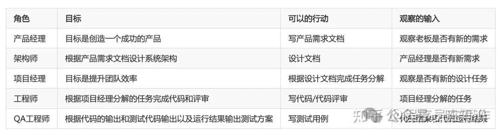

## 游戏领域的 Agent

Ghost in the Minecraft (GITM)：该智能体能够完全解锁《我的世界》主世界的整体科技树的 262 个物品（以往所有智能体方法包括 OpenAI 和 DeepMind 在内总共只解锁了 78 个）、在标准的“获取钻石”任务上将成功率大幅提升了 47.5%（从 OpenAI 提出的 VPT 方法的 20% 提升到 67.5%），而且仅需一个 CPU 节点两天就能完成训练，将与环境交互的所需的训练步数减小到了之前方法的万分之一，远远低于之前 OpenAI 提出的 VPT 方法所需的 6480 个 GPU 天或 DeepMind 提出的 DreamerV3 所需的 17 个 GPU 天。

英伟达开发出了一个全新的游戏AI智能体“VOYAGER”，将AI大模型GPT-4接入了《我的世界》（Minecraft）游戏。基于GPT-4，VOYAGER能够在《我的世界》里扩充着自己的物品和装备，完成诸如建造房屋、挖矿、收集仙人掌和狩猎等基本生存技能；也能独立进行开放式探索，去到不同的城市和地点，甚至是自己搭建传送门。

斯坦福大学和谷歌研究人员用25个AI智能体填充了一个虚拟小镇。

## 学会使用 API：Toolformer

toolformer 是用一种新的方法来学习（自学）使用工具。Toolformer 的主要思路是希望训练一个语言模型，能够在需要的时候自动调用相关API获取答案，以提升准确程度。

为了将外部工具API的调用融入到语言模型中，其调用、输入与输出都会以字符串的形式插入到输入中。设API名称为 `a`，输入为 `i`，对应结果为 `r`，在训练时，数据中在API调用位置处会插入 `<API>a(i)→ r</API>`。推断时，当模型生成出 `→` 时，根据 `a(i)` 调用API得到结果 `r`，从而借助外部工具的帮助继续生成。

文章希望通过无监督的方式做训练，全文的核心就在于这个做数据集的方式。数据集制作的方法整体分这几步：

1. 使用 Prompt 令 LM 在文本中生成 `APICall`，在一段文字中每个位置截断，由提示过的 LM 生成后续内容，假如接下来的这个 `token` 是 `<API>`（TOP `K` 候选当中有 `<API>` 且概率大于阈值 `th`），就另 LM 继续生成完整内容，只保留符合语法的结果（有 `</API>` 做结尾）。
2. 执行 `APICall` 获取结果，根据生成的内容执行 API 会生成一个字符串的结果，论文中准备了计算器、维基搜索等可调用的API。其实只要能够满足输入字符串返回一个字符串的API都可以用在这里。
3. 过滤 `APICall` 结果，形成数据集，API 执行完成后会形成类似于 `<API> Question? → Result</API>` 的结果，这段字符串记为 `e(c_i, r_i)`（`i` 为调用 api 的文本位置）。作者构造了一个函数 `L(z)`，其含义是在一段字符串前加上 prefix `z`，这个 prefix 对这段字符串逐个位置预测下一个字符准确性的影响，越小代表越准确，帮助越大。`L(e(c_i, r_i))` 必须小于 `L(空字符串)` 与 `L(e(c_i, 空字符串))`，并且足够显著（超过一定阈值），这个结果 `e(c_i, r_i)` 才会被保留。最后过滤完毕的数据形成新的数据集，用于后续的模型 finetune。

Toolformer 也依然存在着不足。从训练上，使用不同工具的数据是分别生成的，这使得模型无法配合使用多种工具。使用同种工具的数据也是相互独立生成的，这使得模型无法交互地不断优化查询。从推断上，为了防止模型不断调用API导致卡死，每个样本仅允许调用一次API，这大大降低了模型的能力。

## Gorilla

Gorilla 是一个经过微调的基于 LLaMA-7B 的模型，在编写API调用方面超过了 GPT-4 的性能。采用自我构造来生成 `{指令，API}` 对。为了对 LLaMA 进行微调，我们将其转换为用户-agent 的聊天式对话，其中每个数据点都是一个对话，用户和 agent 各有一个回合，然后我们在基本的 LLaMA-7B 模型上进行标准的指令微调。自指示微调（self-instruct fine-tuning）和检索（retrieval），让 LLM 可根据 API 和 API 文档准确地从大量重叠且多变的工具中做出选择。

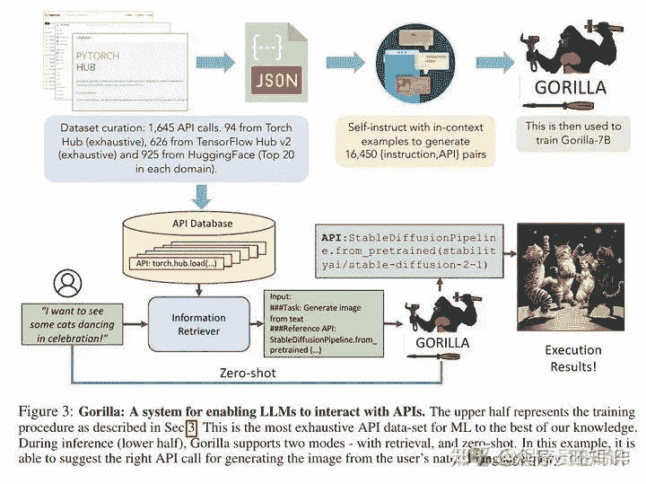

## ToolLLM

ToolLLM 对开源的 LLaMA 模型在 12k+ 的实例上微调，生成的 ToolLLAMA 模型具有执行复杂指令或未见过的 API 工具能力，表现出和 ChatGPT 相当的性能。从 RapidAPI Hub 收集了 16,464 个真实世界的 RESTful API，涵盖 49 个类别，然后提示 ChatGPT 生成涉及这些 API 的各种人工指令，涵盖单工具和多工具场景。为了使搜索过程更加高效，我们开发了一种新颖的基于深度优先搜索的决策树（DFSDT），使 LLMs 能够评估多个推理轨迹并扩展搜索空间。我们证明 DFSDT 显著增强了 LLMs 的规划和推理能力。（通过之前的调研，研究人员发现利用传统的 CoT 或者 ReACT 在给定 Instruction 条件下很难探索出一条有效解决路径（由于 error propagation 跟 limited exploration），从而让这个数据集构建变得困难。于是研究人员提出了一种决策算法 DFSDT，该算法支持语言模型去评估多个不同推理路径，从而选择更具潜力的路径，或者移除那些不可能成功的节点（想法跟之前提到的 tree of thought 接近））

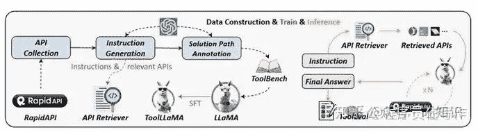

左侧构建 ToolBench、训练 API Retriever（检索器）和 ToolLLaMA。在推理阶段（右侧），输入一个指令，检索器向 ToolLLaMA 推荐 APIs 集合，经历几轮 API 调用得到最后的答案。通过 `ToolEval` 评估答案。

这张图展示了构建 ToolBench 的三个阶段，以及如何训练 API 检索器和 ToolLLaMA。在执行指令时，API 检索器会向 ToolLLaMA 推荐相关的 API，ToolLLaMA 通过多轮 API 调用得出最终答案。整个推理过程由 `ToolEval` 评估。研究人员主要是从 RapidAPI 来收集 API，所有的 API 都可以分为 49 个粗粒度类别，例如体育、金融和天气。研究人员评测了这些 API，最后经过筛选，留下了 16,464 个 API。LLM 的 prompt（提示）中包括了这些 API 相关的文档和使用用例。

作者根据 API，使用 ChatGPT 生成可能用到的指令，利用 `{INST，API}` 的格式训练 API retriever。最后得到的 prompt 包含了任务的描述、API 的文档、3 个 API 的使用例。

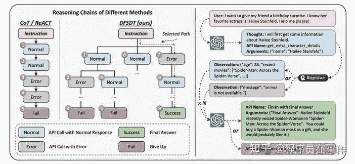

## AutoGen

AutoGen 是多 Agent 交互协助的 LLM 应用。AutoGen agent 是可定制的、可对话的，并能以各种模式运行，这些模式采用 LLM、人类输入和工具的组合。使用 AutoGen，开发人员还可以灵活定义 agent 交互行为。自然语言和计算机代码都可用于为不同的应用编程灵活的对话模式。AutoGen 可作为一个通用框架，用于构建具有不同复杂性和 LLM 能力的各种应用。

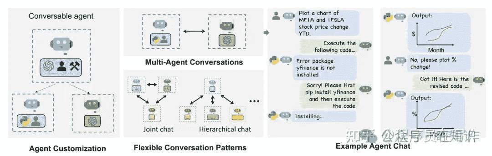

AutoGen 可通过多 agent 对话实现基于 LLM 的各种应用。（左图）AutoGen agent 可对话、可定制，可以基于 LLM、工具、人类，甚至是它们的组合。（中上）agent 可以通过对话解决任务。（右图）它们可以组成一个聊天群，并有可能与人类形成回路。（中下）框架支持灵活的对话模式。

AutoGen 的核心设计原则是使用多 agent 对话来简化和整合多 agent 工作流程。这种方法还旨在最大限度地提高已实施 agent 的可重用性。AutoGen 的两个关键概念：可会话 agent 和会话编程。在 AutoGen 中，可会话式 agent 是一种具有特定角色的实体，它可以传递信息，与其他可会话式 agent 之间收发信息，例如开始或继续对话。它根据发送和接收的信息来维护自己的内部上下文，并可被配置为拥有一系列能力，例如，由 LLM、工具或人工输入等启用的能力。agent 可以按照接下来描述的编程行为模式行事。会话编程模式，该模式考虑了两个概念：第一个概念是计算，即在多 agent 对话中，agent 为计算其响应而采取的动作；第二个概念是控制流，即这些计算发生的顺序（或条件）。

+ AutoGen 能够以最小的努力构建基于多代理对话的下一代 LLM 应用程序。它简化了复杂 LLM 工作流程的编排、自动化和优化。它最大限度地提高了 LLM 模型的性能，并克服了它们的弱点。
+ 它支持复杂的工作流程的各种对话模式。借助可定制和可对话的代理，开发人员可以使用 AutoGen 构建有关对话自主权、代理数量和代理对话拓扑的广泛对话模式。
+ 它提供了具有不同复杂性的工作系统的集合。这些系统涵盖了来自各个领域和复杂性的广泛应用。这演示了 AutoGen 如何轻松支持不同的对话模式。
+ AutoGen 提供 `openai.Completion` 或 `openai.ChatCompletion` 的下拉式替代品，作为增强的推理 API。它允许轻松的性能调优，API 统一和缓存等实用程序，以及高级使用模式，如错误处理、多配置推理、上下文编程等。

AutoGen 的应用 demo：数学问题解决、检索增强代码生成和问答、文本世界环境中的决策制定、多 agent 编程、动态群组聊天、国际象棋对话。

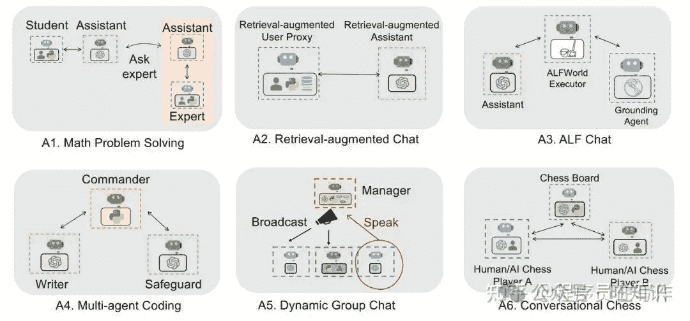

使用 AutoGen 构建的六个不同应用程序示例。它们的对话模式显示了 AutoGen 的灵活性和强大功能。

## OpenAgents

OpenAgents 是港大的研究团队最近发布的一个新的开源 Agent 框架。它可以用于实际用户场景，特别是在使用自然语言执行复杂任务的情况下。先前的语言智能体框架主要关注概念验证或者供开发人员使用，而 OpenAgents 则更注重非专家用户的使用体验和应用设计。它提供了一个开放的平台，让更多人可以在日常生活中使用和部署语言智能体。

这个平台包括数据智能体、插件智能体和 Web 智能体，用户可以通过一个优化的 Web 界面与智能体进行交互。目前，OpenAgents 平台主要包括 3 个智能体：

1. 数据智能体，使用 Python、SQL 和其他数据工具进行数据分析；
1. 插件智能体，配备了 200 多种日常 API 工具；
1. Web 智能体，可以自主浏览网页。

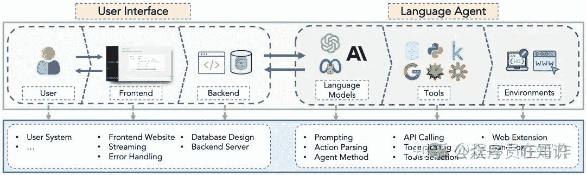

OpenAgents 架构的系统概述

## XAgent

面壁智能联合清华大学 NLP 实验室共同研发并推出大模型「超级英雄」——XAgent。通过任务测试，XAgent 在真实复杂任务的处理能力已全面超越 AutoGPT。其特点主要是双循环的运转机制、人机协作的交互能力、结构化的通信方式、工具执行引擎 `ToolServer`。

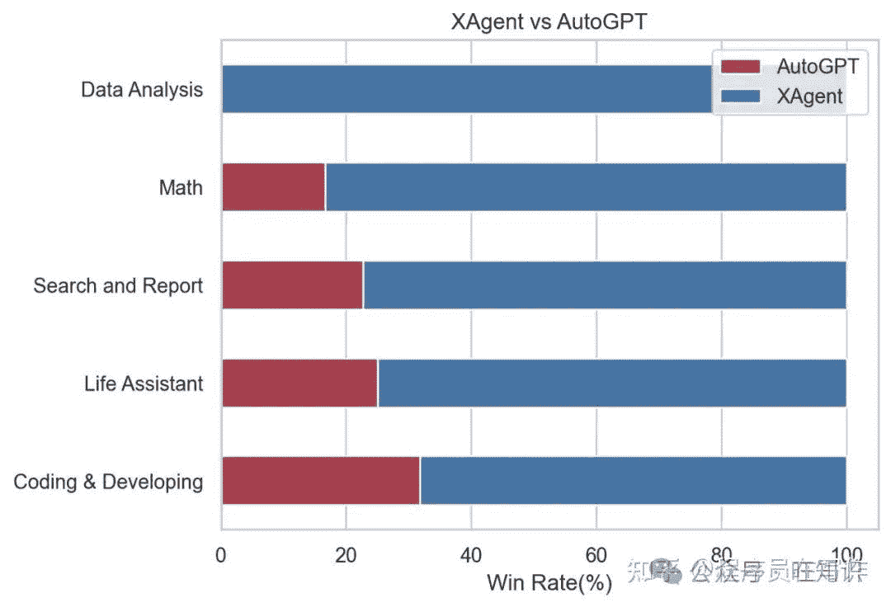

XAgent 在真实复杂任务处理中全面超越 AutoGPT

XAgent 是一个可以实现自主解决复杂任务的全新 AI 智能体，以 LLM 为核心，能够理解人类指令、制定复杂计划并自主采取行动。XAgent 被赋予了自主规划和决策的能力，使它能够独立运行，发现新的策略和解决方案，不受人类预设的束缚。研究人员在 XAgent 的设计中创新地引入了一种「双循环机制」：外循环：负责全局任务规划，将复杂任务分解为可操作的简单任务。内循环：负责局部任务执行，专注于细节。

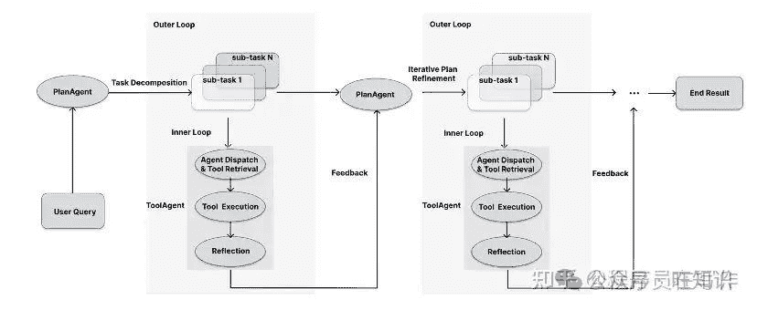

在外循环中，XAgent 展现出作为一个「规划」（`PlanAgent`）的领导力，它会把复杂任务拆分成若干简单任务，并监督问题解决的完整过程。首先，它将给定的复杂任务分解成更小、更易管理的「子任务」，生成「初始规划」，形成任务序列。随后，它将逐次把每个子任务传递给内循环解决。在这个过程中，外循环会不断监督任务的进度和状态，并根据反馈对后续规划进行「迭代优化」。在内循环中，XAgent 快速转变身份，展现出作为一个高效「执行者」（`ToolAgent`）的专业度，确保外循环传递的子任务达到预期。根据子任务性质的不同，它可以从外部系统中检索工具，并针对子任务进行一步步求解。在子任务完成后，它将生成当前子任务执行过程的反思，反馈给外循环，指示当前任务是否完成，以及任务执行中的潜在优化点。

人机协作的交互能力：XAgent 还具备「向人类寻求帮助」能力，它会向用户征求实时反馈、建议或指导，确保即使在不确定的领域，智能体也能发挥出最佳作用。

## AgentBench 智能体能力测评

2023年8月，来自清华大学、俄亥俄州立大学、加州大学伯克利分校的研究团队便提出了首个系统性的基准测试——AgentBench，用来评估 LLMs 作为智能体在各种真实世界挑战和 8 个不同环境中的表现（如推理和决策能力）。在此次工作中，研究团队在操作系统（OS）、数据库（DB）、知识图谱（KG）、卡牌对战（DCG）、情景猜谜（LTP）、家居（Alfworld）、网络购物（WebShop）和网页浏览（Mind2Web）8 种不同的环境任务中，使用 AgentBench 对 25 个不同的语言模型（包括基于 API 的模型和开源模型）进行了全面评估。测试结果显示，像 GPT-4 这样的顶尖模型能够处理各种各样的现实世界任务，而大多数开源 LLMs 在 AgentBench 中的表现远远不及基于 API 的 LLMs；甚至，最有能力的开源模型 `openchat-13b-v3.2` 也与 `gpt-3.5-turbo` 之间存在显著的性能差距。

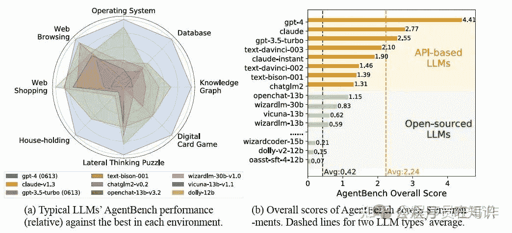

Agent 榜单，国内大模型的 Agent 能力还得提高。

也就是说目前使用开源模型去做 agent 相关的研究，多少会存在大模型能力不够的情况，看到最多的是使用市面上最好的模型 GPT-4-32k 的在做相关的研发。

## AgentTuning 微调方法

2023年10月，智谱AI & 清华 KEG 提出了一种对齐 Agent 能力的微调方法 `AgentTuning`，该方法使用少量数据微调已有模型，显著激发了模型的 Agent 能力，同时可以保持模型原有的通用能力。项目开源了经过 Agent 对齐的语言模型，包括 `AgentLM-7B`、`AgentLM-13B`、`AgentLM-70B`，并开源了相应的数据集 `AgentInstruct`。研究结果表示，`AgentLM-70B` 模型可以取得与 `GPT-3.5-turbo` 相当的水平。

## 总结

目前看到 AI Agent 所需的：优秀的 `prompt` 工程、强大的大语言模型、好用灵活的工具、多模态模型的调用能力、人机协作的交互等。

AI Agent 目前的问题：效果不稳定、复杂推理能力不够强、外部生态融合不高，主要以搜索和文件读取为准、多步推理成本过高、响应时间太久、上下文的限制（或者说如何准确的利用长期记忆）等。

解决方法：

1. 优化 `prompt`，减少不必要的 `token` 消耗
2. 成本优化和监控，达到次数就停止
3. 向量缓存技术，相似的问题不经过大模型处理，直接出结果
4. 微调开源大模型来增强工具调用能力
5. 向量数据库。
