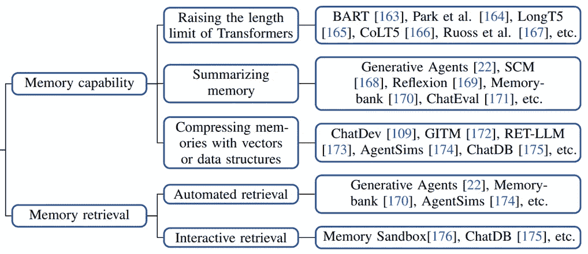
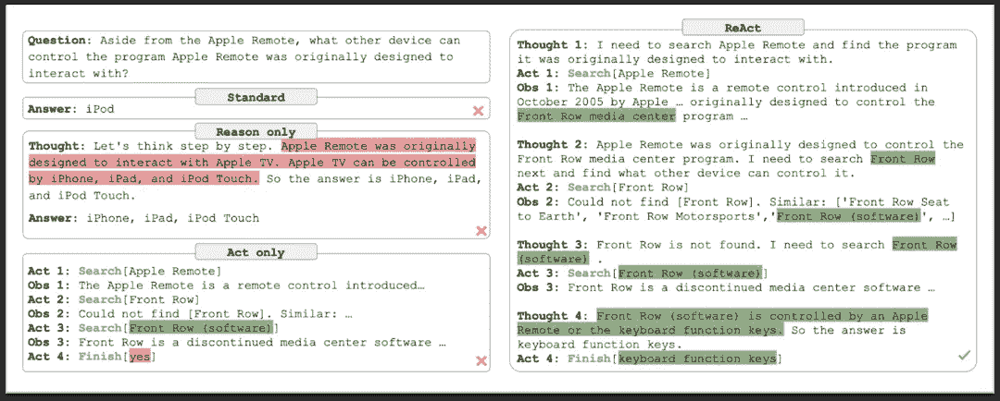
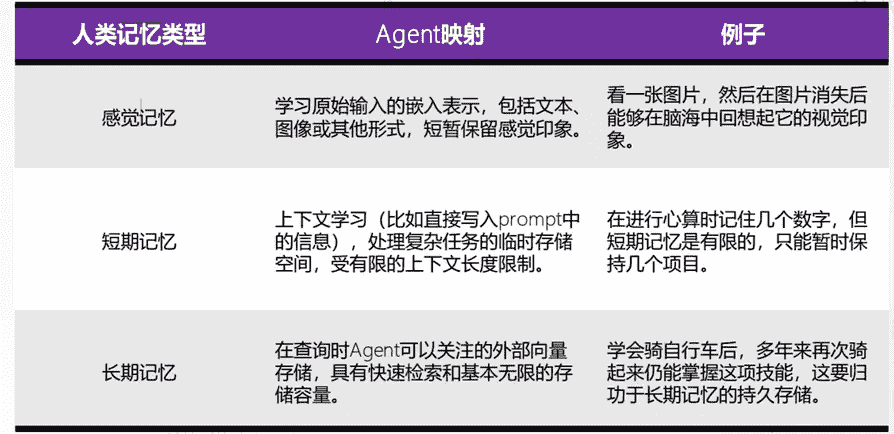
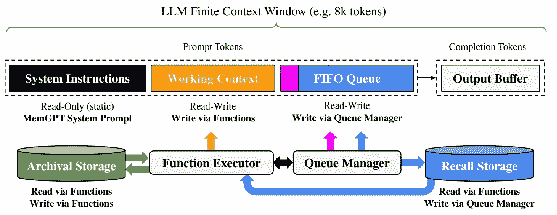
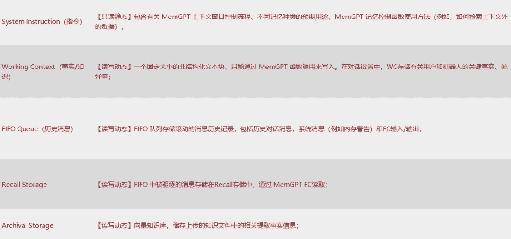
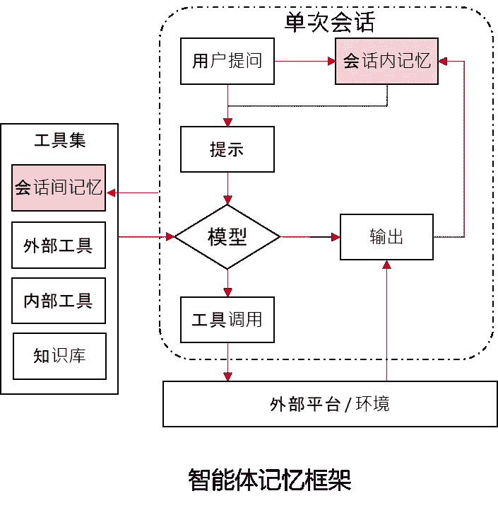

# Agent如何帮助大模型“增强记忆”？

> 来源：[https://agijuejin.feishu.cn/docx/HXRgdvztKojPfaxxK11cGjwZnCL](https://agijuejin.feishu.cn/docx/HXRgdvztKojPfaxxK11cGjwZnCL)

> 作者：格林 | 神州问学

> 原文：https://mp.weixin.qq.com/s/oqft0zbPW27vSr6qoO_HBA

> 记忆+反馈 >规划？

# **引言**

去年6月份，Lilian发布了关于LLM驱动的Agent的结构和组件，其中包括规划、行动、工具还有记忆，这四个模块。这几个模块其实也很好地概括了ReAct式Agent的工作流程：Question – Thought_1 – Action – Action_Input – Observation – Thought_2 - …… - Thought_X – Final_Answer；

{ReAct式的Agent任务解决流程}

在其中，记忆也是Agent的组件之**一，在Age**nt类应用中，记忆可以记住 事实和偏好 ，例如：问题答案、工具调用结果、格式偏好、语言偏好、表达偏好、图表绘制偏好、任务下工具选择偏好；对于事实和偏好的记忆能够让Agent应用提升回答准确率、稳定性以及速度，那么，记忆有哪些种类的分类，Agent的记忆是呼和实现的，记忆又有什么用途，接下来让我们来研究一下：

# 1. Agent什么东西可以存入记忆中？

Agent不同于Chat类或者RAG类的单纯知识型应用，其中还涉及到规划与决策、工具调用等内容，因此对于能够把什么东西存入记忆中则是我们需要思考的

**1.1. 对话交互历史**

对话交互历史是记忆的一部分，也是Agent多轮对话的基础。用户所输入的Query和模型最终返回的自然语言输出形成了对话的交互历史。

1.2. 工作流（规划）与工具调用结果

自然语言规划和工具调用在工作流上的区别，也会让其在工作流记忆的储存上有所区别

在ReAct为基础架构的Agent结构中，规划或Thought是以自然语言的形式呈现的，有长期规划的Agent会在行动开始之前将任务拆解成一系列的子任务，这一系列的子任务就可以作为本次任务生成的工作流储存至记忆中。

以Function Calling（FC）模型为核心驱动的Agent结构中，模型会接收用户Query以及结构化的Function List，输出的是Function调用的JSON文件，接着在外部执行这个函数并返回函数执行结果。函数调用的JSON文件以及执行结果都是可以被记忆所存储的内容，在未来遇到相似条件的时候可以直接召回相关的执行结果，节省函数执行所消耗的资源与时间。

1.3. Reflection的反馈

Reflection是对Agent每步子任务的反馈，把反馈放入记忆中，就像Agent的错题集一样，能够在未来遇到类似的任务时，能够提供的对应的Reflection改进建议，从而提高准确率。将Reflection的结果加入到记忆中从长远来看，能够对Agent的思维能力有极大的提升，在专业场景下相比纯粹去提升模型原生的推理性能要更加高效。但目前主要受限于自动化的Reflection流程还难以提供给模型高质量的改进建议，通常会导致模型“钻牛角尖”，陷入到错误步骤的循环中。因此短期内可能Reflection步骤仍然需要人工的介入，以类似强化学习的方法提升agent在专业场景的表现性能

# **2. 记忆的提炼方式**

2.1. 直接的buffer存储

记忆可以直接存储与用户聊天的历史记录和过程中工具调用的结果，不进行任何形式的总结。这种方法最为稳定，不对存储的内容进行压缩，同时由于没有使用模型对内容进行总结，节省了模型推理所消耗的大量推理时间和算力成本。但由于buffer存储知识稀疏，包含了大量无用的信息和文字内容，在输入模型时容易对模型造成干扰，在对话轮数提升后会造成更大影响，造成Agent的巨大“精神内耗”。因此，buffer类的存储方式只能在对话轮数较少时使用。

2.2. 多种不同的提炼与召回方式

当然，记忆可以像我们在做知识库管理一样，对这些记忆的内容进行提炼，再将其存储至对应的位置，LangChain先前对知识库总结列举了一些方法：

**Refine 精炼法：**

将长文本分成某些块，然后将第1个文本块生成总结，并且将总结内容和第2个文本块合并，依次类推最终生成整篇文章的文本总结

优点：这种合并方式比 map_reduce 要少丢失一些信息。

缺点：需要调用大模型多次，而且对文本顺序有要求，每一个片段的总结需要依赖上一个片段的结果，因此每个片段生成总结的过程没法并行。任务整体变成了串行流程

**map_reduce:**

先将长文档分成一些小块，然后将每个小块调用大模型生成总结，最后再将分块生成的总结合并，生成基于全文的总结

优点：可以处理很长的文本

缺点：单次任务需要调用多次大模型。再文本合并的过程中可能有信息的丢失，不如stuff模型有完整的上下文信息

**map_rank:**

对文章的每一块进行操作，返回结果的同时返回，每个总结的正确性得分，返回得分最高的那个

优点：可以处理长文本

缺点：无法进行总结合并生成基于全文的结论，适用于在文档中检索，基于某一文本块的答案。

但是当然，以上方法都是针对文本内容进行的，Agent的实际情况更加复杂，一些更加结构化的记忆内容，例如工具调用、工具调用返回的JSON等等，其提炼的方式可能会有所不同，由于其结构化的特性，可以直接通过规则算法的方式直接提取其中的关键元素，并继续以结构化的方式存储起来。

**3. 长短期记忆：**

在Lilian的博客中，还提出对于Agent记忆与人类大脑记忆之间的联系，其中包括感知记忆还有长短期记忆。

{人类的感觉记忆与长短期记忆和Agent记忆的映射关系}

**3.1. 感知记忆**

感觉记忆是指在原始刺激结束后保留感官信息（视觉、听觉等）的印象，通常仅持续几秒钟。在此处，可以理解为模型输入的向量化表达以及注意力。

**3.2. 短期记忆与提示模板**

短期记忆则是大模型涌现能力中上下文学习（ICL，In Context Learning）的一种具体表现方式，也是Agent利用大模型提示工程来提升其表现性能的方式。上下文学习是短期记忆的核心，允许Agent在当前对话上下文中记住和利用相关信息，从而更好地理解和回应用户的需求。通过在对话过程中记住用户的指令、提供的背景信息和当前的对话内容，Agent能够提供更加精准和即时的响应。例如，在技术支持场景中，Agent可以记住用户描述的问题细节，从而在后续的对话中提供更有针对性的解决方案。

在短期记忆中，Agent应用可以在其中包含多类内容的记忆，其中包括指令、计划、事实、偏好、历史交互记录等等。

**指令与计划的记忆**

短期记忆中包含的指令和计划信息，可以帮助Agent更好地执行用户的任务和指令。在项目管理或任务安排中，Agent可以记住用户的具体指令和计划步骤，从而在后续的对话中确保任务的正确执行和进展。在一个协作平台上，Agent可以记住团队成员分配的任务和截止日期，确保项目按时完成。

**事实与偏好的记忆**

短期记忆还可以包含用户提供的事实和偏好信息，这对于个性化服务尤为重要。Agent可以根据用户的偏好调整其建议和回应，从而提供更贴心的服务。在餐厅预订场景中，Agent可以记住用户的饮食偏好和特殊需求，从而推荐符合用户口味的餐厅和菜单。

**历史交互记录的记忆**

通过记住历史交互记录，短期记忆可以帮助Agent保持对话的连贯性和上下文的连续性。这在多轮对话中尤为重要，能够避免用户重复提供相同的信息，提高对话的效率和用户体验。在客户服务对话中，Agent能体可以记住用户之前提出的问题和获得的解决方案，从而在后续的对话中快速跟进问题进展。

在实践中，在Berkeley的开源项目MemGPT中，就充分利用了8k左右长度的token上下文窗口实现了多类记忆内容的输入；

{MemGPT关于有限上下文窗口（8k）的记忆分配方法}

在提示词的管理中有三个部分：系统指令（System Instruction）、工作上下文（Working Context）、FIFO队列（FIFO Queue），这三个部分（用户问题包含在FIFO队列中）组成了模型的提示。其中工作上下文和FIFO队列在概念上属于Agent的短期记忆，工作上下文包含了关于用户和Agent所扮演角色的相关关键事实与偏好，FIFO队列则滚动存储了消息的历史纪录，包括历史对话消息，系统消息（例如内存警告）和模型函数调用的输入/输出。

{MemGPT相关记忆存储}

**3.3. 长期记忆与持续学习**

MemGPT项目中还包括了召回存储（Recall Storage）以及档案存储（Archival Storage）这两种存储部分，这两种则是通过外部数据库的方式来记忆更加海量的历史消息和相关事实与知识，这种方式就是长期记忆的存储经典存储方式。

长期记忆通常用于存储重要的事实或偏好，这些信息在其他会话和任务中也能够派上用场。相比于短期记忆，长期记忆不受限于模型上下文的长度限制，能够在更长的时间跨度内保持信息的完整性和准确性。

**信息持久性与上下文独立性**

长期记忆的一个关键优势是其信息持久性。短期记忆受限于当前对话的上下文，一旦对话结束或超过上下文长度限制，这些记忆就会被丢弃或者再次压缩。而长期记忆则能够跨越多个对话会话，保持信息的连续性。这意味着用户在不同时间段与Agent互动时，Agent依然能够记住和引用之前的重要信息。比如，当用户在某个对话中告诉Agent他们的生日日期，下次再与Agent对话时，无需再次提供这一信息，智能体会记得并在相关场景中自动应用。

**存储大容量信息**

长期记忆可以存储大量的信息内容，类似于一本笔记本，只要页数够多，智能体就能记录无限量的相关内容。这不仅包括用户的个人偏好、习惯和兴趣，还可以涵盖更广泛的知识和事实。例如，在健康管理应用中，长期记忆可以记录用户的健康数据、药物服用历史和过敏信息，从而在未来的咨询中提供更个性化的建议。

**动态更新与管理**

长期记忆也具有动态更新的能力。Agent可以不断地从用户的交互中学习新的信息，并将这些信息添加到长期记忆中，同时还能够根据需要对记忆内容进行管理和更新。对于一些陈旧的历史会话或者与当前话题无关的事实，Agent可以将其从短期记忆转移到长期记忆的数据库中，以确保对话的上下文保持清晰和相关。这种灵活的管理方式不仅提高了记忆的效率，还保证了信息的准确性和及时性。

# **4. 会话内与会话间记忆：**

短期记忆和长期记忆是基于其存储方式而定义的记忆概念。在实际使用Chat类以及Agent类应用的时候，在开启新的话题时，用户会选择开启新的Session（会话）来进行对话，这不仅是一种对于交互主题的一种分类，也能让每个会话的记忆相互隔离。从会话的角度上来讲，记忆可被分为两种方式：会话内记忆和会话间的记忆。

{Agent会话记忆框架}

4.1. 会话内记忆（多轮对话）

会话内记忆是指在单次会话窗口内，用户和应用之间的交互历史记录，即多轮对话中的记忆。会话内记忆只能被当前会话的智能体访问，不会影响其他会话的内容。这类似于短期记忆，但在实现上，除了基于提示词，会话内记忆还可以通过外部数据库进行扩展和强化。这种记忆方式能够让智能体在当前会话中保持上下文的连续性，提高对话的连贯性和用户体验。例如，在一次技术支持对话中，智能体可以记住用户先前描述的问题细节，提供更加精准的解决方案，而无需用户重复描述。

4.2. 会话间记忆 （持久记忆）

对于一些相对重要的概念和事实，会话之间则会共享这些记忆内容，作为会话间的持久性记：

今年2月13日，OpenAI发表了一篇博客，其中为其新加的记忆功能进行了描述和解释；在博客中，OpenAI表明ChatGPT现在拥有记住用户讨论内容的功能，以便将来的聊天更有帮助，控制 ChatGPT 的记忆。用户可以明确地让ChatGPT记住某件事，询问其记住了什么，并通过对话或设置让其遗忘相关记忆。

在博客中，OpenAI提出了4种会引发记忆读写的场景：

1. 用户曾解释过，他更喜欢会议记录底部总结标题、要点和行动项目。ChatGPT 会记住这一点，并以这种方式回顾会议。

2. 用户告诉 ChatGPT 他拥有一家社区咖啡店。当为庆祝新店开张的社交帖子集思广益时，ChatGPT 知道从哪里开始。

3. 用户提到自己有一个刚学步的小孩，她很喜欢水母。当你请 ChatGPT 帮她制作生日贺卡时，会建议你画一只戴着派对帽的水母。

4. 作为一名有 25 名学生的幼儿园老师，用户更喜欢 50 分钟的课程和后续活动。ChatGPT 在帮助用户制定课程计划时会记住这一点。

有意思的是，1、3和4这几个场景属于用户偏好相关的记忆，2则是关于事实的记忆，但这些场景都通过了这类记忆影响了后续的计划和行动；并且其中第3个场景种，ChatGPT在一个相对并不相关的事件中，同样使用了记忆并达到了不错的效果。

虽然ChatGPT更加类似于chat类的应用，但这种记忆的概念也可以同样运用于Agent类的应用中，对规划和反馈进行优化。

这种记忆方式类似于跨会话的记忆，在需要时被相应的工作流调用。通过这种持久性记忆，Agent能够提供更加连续和个性化的服务，进一步提升用户体验和互动效率。例如，在客户服务领域，智能体可以记住客户的历史问题和偏好，提供更加定制化的服务和建议。通过数据回流和不断优化，智能体的表现会越来越符合用户的实际需求，增强其在特定任务中的精准度和效率。

# **5. Agent记忆的妙用：**

**5.1. 指代消解**

在多轮对话中，Agent的短期记忆能够帮助模型解决指代不清的问题。当用户在对话中使用代词或其他模糊指代时，Agent可以通过记忆之前的对话内容，准确理解用户的意图。举例来说，如果用户在先前的对话中提到某个特定的“它”或“他”，智能体能够通过回忆先前的上下文信息，确定这个代词具体指代的对象。这不仅提高了对话的连贯性和流畅性，也增强了用户体验，使对话更加自然和人性化。此外，指代消解能力的提升还能减少误解和重复沟通的次数，提高交互效率，特别是在涉及复杂信息或多层次讨论的对话中，这一功能显得尤为重要；

**5.2. 答案缓存**

记忆能够有效帮助应用减少重复调用API的次数，降低API调用产生的费用。当Agent能够记住先前的查询结果并在需要时直接引用这些信息，就不必每次都重新进行昂贵的API调用。这不仅节省了时间和计算资源，也显著降低了运营成本。例如在客户服务场景中，如果用户反复询问相同的问题，Agent可以直接从缓存中提取答案，而无需每次都通过外部API重新查询。这一机制还能提升响应速度，提供更加及时的服务，增强用户满意度。对于需要频繁访问数据库或外部服务的应用，这种答案缓存技术尤为重要，能够大幅提高系统的可扩展性和稳定性；

**5.3. 偏好学习**

记忆模块能记住用户的行为和需求偏好，减少对任务进一步的解释工作。这意味着，Agent可以根据用户的历史交互记录，逐渐了解用户的习惯、偏好和特定需求，从而在未来的交互中提供更个性化和精准的服务。举例而言，在电商平台上，Agent可以记住用户过去的购物记录和浏览习惯，推荐更符合用户喜好的商品。在教育平台上，Agent可以根据学生的学习轨迹和薄弱环节，定制个性化的学习方案。通过这种偏好学习，Agent不仅能够提升用户体验，还可以有效提高任务的完成效率，减少用户在每次交互时需要提供的额外信息量，形成更加智能和高效的交互流程；

**5.4. 数据回流**

Agent的驱动模型还可以基于记录历史交互数据进行微调，使其更适应于专有的场景。通过不断地记录和分析用户的交互数据，Agent可以识别出常见的问题和模式，从而针对特定领域进行优化和调整。这种数据回流的过程和Reflection结合将大大提升Agent未来的表现性能，可以使Agent的表现越来越符合实际应用需求，提高其在特定任务上的准确性和效率。例如，在医疗咨询中，智能体可以通过分析大量患者的提问和反馈，不断优化自身的回答质量和准确性。在客户服务中，Agent可以根据客户的历史投诉和建议，调整服务策略，提升用户满意度。数据回流不仅有助于模型的持续改进，也能帮助企业更好地了解用户需求，制定更精准的业务策略。

# **6. 总结**

记忆模块的应用虽然目前还处于探索阶段，但和其他模块简单的读写过程会不断让Agent存储其关键的事实、偏好和改进建议，从而能得到更好的表现、准确率和稳定性。记忆模块也是Agent学习以及经验的基础，在记忆之上，Agent不仅能够变得更加聪明，更能够具备“智慧”，如同长者一般解决“年轻”Agent难以解决的问题。希望未来，AI在通往AGI之路上，能够更多地研究记忆模块的各类妙用，探索其对模型能力的加持。