# AI Agent新对决：LangGraph与AutoGen的技术角力

> 来源：[https://agijuejin.feishu.cn/docx/FXGydEH6vofS0nxEtETcR8gvnog](https://agijuejin.feishu.cn/docx/FXGydEH6vofS0nxEtETcR8gvnog)

> 作者：Blaze | 神州问学

> 原文：https://mp.weixin.qq.com/s/rh4z76U404YxjzhQwJodvg

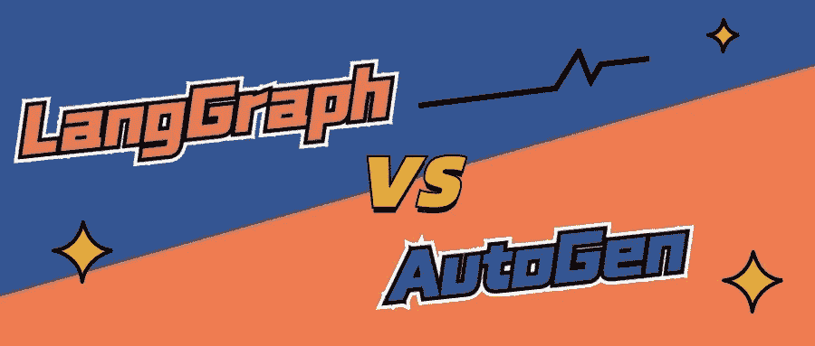

> AI Agent变革未来，LangGraph对抗AutoGen

# **引言**

比尔**.盖茨曾在他的博客****上发表一篇文章：《AI is **about to completely change how you use computers》。在文章中，比尔·盖茨探讨 AI Agent 对我们未来生活的巨大影响，他谈到AI Agent对 教育、医疗保健、娱乐、生产力 等领域的重要作用。AI Agent的出现，为我们提供了与大模型互动的全新方式，彻底改变了我们与技术的交互模式。随着AI浪潮的涌动，开源社区也涌现出多个优秀的AI Agent框架，包括AutoGPT、Langfuse、ChatDev和BabyAGI等，然而AutoGen与LangGraph无疑是目前最引人注目的框架。

**AutoGen **被视为最早的多代理框架，一经推出，瞬间爆火，两周狂揽10k星，直接碾压GPT-4。使用AutoGen，开发人员可以灵活定义agent交互行为，这些代理能在**多种模式下运行，灵活**结合LLM、人工输入和各种工具，展现出强大的应用能力；当AutoGen被追捧的时候，LangChain团队默默发力，于是一款新的技术框架： LangGraph 应运而生，正式宣布 LangChain 进入多智能体框架领域。那么在当前的AI Agent对决中，LangGraph又是如何展现其独特优势对抗如此火爆的AutoGen呢？今天我们就来了解一下吧！

# **AutoGen的技术现状**

**1.什么是AutoGen？**

AutoGen是由微软开源的Multi-Agent框架，它可以使得电脑程序像人一样交流合作以完成任务。这些代理具有定制性和对话性，并可以在利用LLM、人类输入和工具的各种模式中运作。使用AutoGen，研究者们还可以灵活地定义代理交互行为，类似设置如何团队协作的游戏规则。既可以使用自然语言，也可以使用计算机代码来为不同的应用程序编程灵活的对话模式，使得这个框架的应用可能性变得广泛和弹性。

在 AI 世界中，你可以通过工具如 AutoGen 创建多个 AI Agent，并指派给他们任务，就像在公司中领导团队一样。你可以告诉这些 Agent 你的目标和任务，然后他们将通过相互讨论和协作来实现目标，并向你汇报进展。如果你有任何意见或建议，还可以随时调整他们的工作，直到你满意为止。这种方式让你在 AI 环境中成为一个掌控者，带领 Agent 实现你的任务和目标。

假如现在你是一个设计师，需要设计一款Agent框架，可以让开发人员能够在这个框架上开发不同的应用，然后这些应用可以相互协作，那么这个框架需要实现哪些功能呢？其实可以大致分为三步：

**1. 创建Agent：**

● 支持创建和管理不同类型的 Agent，包括特定任务的专家、通用助手、策略制定者等。

● 能够为每个 Agent 指定不同的角色、任务和权限，以确保分工明确。

● 提供 Agent 定制选项，以满足不同任务的特定需求。

**2.提供对话环境：**

●提供一个虚拟的对话空间，让 Agent 之间可以相互沟通和协作。

●支持多方对话和协作，包括文本、音频或视频形式。

● 自动记录对话内容和决策过程，以便回顾和审查。

**3.对对话内容管理：**

●引导 Agent 的讨论方向，以确保讨论围绕目标进行。

●提供实时监控工具，帮助发现潜在问题，并及时给予纠正和调整。

●设置规则和约束条件，以保持对话和协作的质量和效率。

●提供对对话内容的搜索和过滤功能，以便快速查找相关信息。

简单来说，AutoGen就是把上面功能给你实现了，开发人员要做的就是明确任务，创建Agent，把这些Agent搞到一起，你只需要简单几行代码，就可以帮你解决复杂的问题。

**2.AutoGen的基本原理**

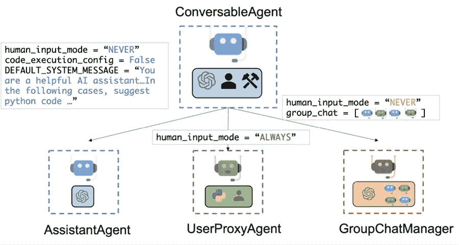

AutoGen中包含两种Agent一种Manager，通过相互协作，一起处理问题

**Manager：**

● GroupChatManager是能够让多个Agent进行分组的管理者，类似于实际工作把团队拆分为多个Team进行管理

**Agent：**

● AssistantAgent的主要作用是作为中枢大脑提供理解、分析

● UserProxyAgent主要作为处理由中枢大脑给出的决策的执行者

AutoGen支持人在整个系统中发挥作用。类似AutoGPT之类的工具过于理想化，试图完全脱离人工来实现自动处理。而AutoGen允许人在整个系统运行过程中作为其中的一个要素参与工作，例如人提出具体的需求，在执行完结果之后，可以对系统的处理结果做出评价，让系统基于该反馈继续迭代出更好的结果。当然，这一特征也是可选的，如果你不需要要时，就可以选择完全自动的模式。

**3.AutoGen的应用场景**

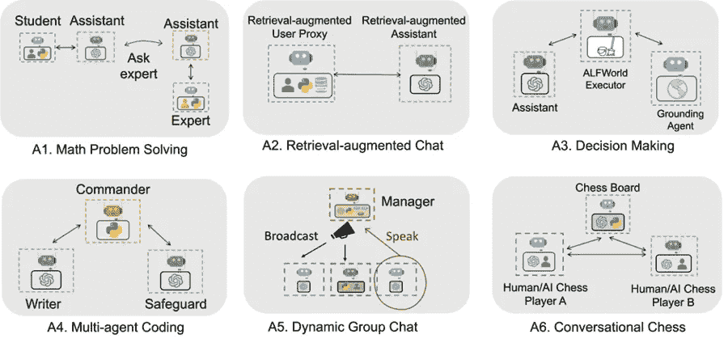

AutoGen的应用场景很广泛，涵盖了数学问题处理，检索增强聊天，决策制定，多智能体编码，动态群聊以及对话式国际象棋，这些应用充分展示了AutoGen 在解决各种问题上的广泛适用性和灵活性 。

**4.AutoGen的优势与不足**

AutoGen的主要优势在于其创新性，它能够自动根据用户需求生成代码，从而避免了传统编程中程序员需要手动编写大量代码的情况。这不仅节省了编码时间，提高了工作效率，而且由于AutoGen生成的代码结构清晰，易于理解和维护，因此大大降低了维护成本。此外，AutoGen还拥有丰富的功能库，覆盖了多种常见的功能需求，使开发者可以快速实现所需功能，无需从头开始编写。

与此同时，AutoGen也存在一些不足，例如它主要针对特定任务设计，可能不如其他人工智能模型那样通用；根据不同任务，可能需要进行大量的设置和配置；并且它的运行也高度依赖于用户输入。

AutoGen固然有它的不足，它的优势依然是我们追捧的对象；然而技术是在不断发展的，每种框架都有自己独特的优势，让我们再来看看最新发布的AI Agent框架： LangGraph——基于LangChain构建的扩展库。

# **LangGraph的革新**

1.诞生背景

Chain（链）是LangChain中最核心的概念之一，简单的说，就是把自然语言输入、关联知识检索、Prompt组装、可用Tools信息、大模型调用、输出格式化等这些LLM 应用中的常见动作，组装成一个可以运行的“链”式过程。LangChain通过使用LCEL（LangChain Express Language）组装链，可以自动获得诸如批量、流输出、并行、异步等一系列能力；Chain可以进一步通过LCEL组装成更复杂的链与Agent。LCEL看起来似乎无所不能，但是为什么还需要LangGraph呢？

● LangChain的链（Chain）不具备“循环”能力；

● AgentExecutor调度的Agent运行过于“黑盒”。

对于简单的问答系统，LCEL都能够提供快速且准确的服务，然而当面对一些更为复杂的任务时，就显得力不从心，因此需要一个具备更精细控制能力的框架来支持更复杂场景的LLM应用，它就是LangGraph。

**2. 设计理念**

LangGraph并不是一个独立于LangChain的框架，相反它是基于LangChain之上一个扩展库，可以与LangChain现有的链（Chain）、LCEL（LangChain Express Language）等无缝协作，是与其生态系统完全兼容的新库。它通过引入循环图的方法，把基于 LLM 的任务细节通过图（Graph）进行精确的定义，最后再基于图编译生成应用。在任务运行过程中，维持一个中央状态对象(state)，会根据节点的跳转不断更新，状态包含的属性可自行定义。

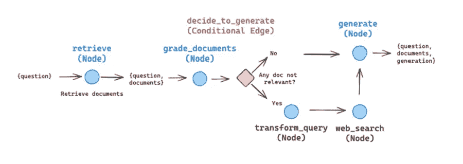

以上是官方通过LangGraph来实现的RAG应用，通过上图，我们可以更加直观的了解到LangGraph的几个基本概念：

● **StateGraph： **图形的类。通过传入状态定义来初始化该类，此状态定义表示随时间更新的中心状态对象。

● **Nodes： **节点。创建StateGraph之后，可以使用 graph.add_node(name, value) 添加一个节点。

●** Edges：边。有了节点后**，需要向图中添加边，边代表从**上一个节点跳转到下一个节**点的关系。目前有三种类型的边： Starting Edge （起始边）， Conditional Edge （条件边）， Normal Edge （普通边）

**3. 体验一把**

下图包含一个名为"oracle"的单个节点，该节点执行聊天模型，然后返回结果：

```
from langchain_openai import ChatOpenAI
from langchain_core.messages import HumanMessage
from langgraph.graph import END, MessageGraph

model = ChatOpenAI(temperature=0)

graph = MessageGraph()

graph.add_node(&quot;oracle&quot;, model)
graph.add_edge(&quot;oracle&quot;, END)

graph.set_entry_point(&quot;oracle&quot;)

runnable = graph.compile()
```

我们来运行它吧！

```
runnable.invoke(HumanMessage(&quot;What is 1 + 1?&quot;))

[HumanMessage(content=&#x27;What is 1 + 1?&#x27;), AIMessage(content=&#x27;1 + 1 equals 2.&#x27;)]
```

小小体验一把之后，我们可以解读一下：

1. 首先创建一个图：graph = MessageGraph()

2.然后，往图中添加节点：graph.add_node("oracle", model)，这个节点的名字叫"oracle"，节点的内容是 model，也就是OpenAI大模型的接口封装。

3.再然后，添加边：graph.add_edge("oracle", END)，添加了一条从 “oracle” 到 END 的边。END 是内置的节点，结束的意思。

4.再然后，添加进入节点：graph.set_entry_point("oracle")

5.编译图：runnable = graph.compile()，complile函数，将图固化下来，就不能再改了。

6. 运行：我们熟悉的 invoke 函数

总结一下步骤：创建图 —> 添加节点 —> 添加边 —> 设置从哪个节点开始运行 —> 编译图 —> 运行。

通过上面示例我们可以看出，LangGraph 和 Autogen 之间最大的区别在于代理的构建方式。LangGraph 更喜欢用一种方法，明确定义不同的代理和转换概率，并将其转化为图形，而Autogen 将其表示为更像“人机对话”。个人认为这个“Graph”框架使其在构建更复杂和更有见地的工作流程时更具直观性和更好的开发体验，通过对“Graph”的定义，可以对一个 LLM 应用的处理过程进行非常细节的编排设计，从而满足大量复杂场景的 AI Agent 产业应用落地。那么LangGraph究竟可以应用到哪些领域呢？

# **LangGraph的应用领域**

**1. 增强的RAG应用**

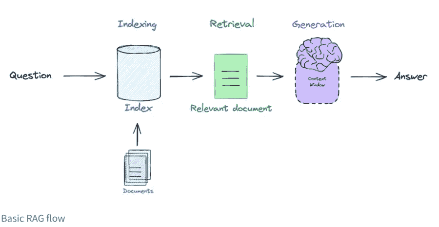

以上是一个基础RAG流程示意图，实际操作中，实现 RAG 需要对上述步骤进行逻辑分析：比如，我们需要知道什么时候进行检索（基于问题和索引的构成）、何时改写问题以提升检索效率，或者何时抛弃无关的检索结果并重新检索。因此提出了自省式 RAG这一概念，自省式 RAG 利用大型语言模型可以解决自我校正检索质量不佳或生成内容不够优质的问题。

自省式 RAG，通过框架中训练大型语言模型生成自我反思的提示符号，用以控制 RAG 流程的各个阶段。下面是提示符号的一览：

●Retrieve 符号决定是否需要根据 x（问题） 或 x（问题）、y（回答） 检索 D 数据块。可能的输出结果有 yes, no, continue。

● ISREL 符号针对 x 问题，判断数据块 D 是否相关。输入为 (x（问题）,d（数据块）)。输出为 relevant（相关）, irrelevant（不相关）。

●ISSUP 符号判断 D 中每个数据块生成的答复是否与之相关。输入包括 x, d, y。这个标记也是验证 d 是否支持 y（生成） 中的所有需要证实的陈述。可输出 fully supported（完全支持）, partially supported（部分支持）, no support（不支持）。

●ISUSE 符号评估 D 中每个数据块生成的答复是否对 x 有用。输入 x, y 对于 d 在 D 里。输出是 {5, 4, 3, 2, 1}。

下表为上述信息提供了进一步细节：

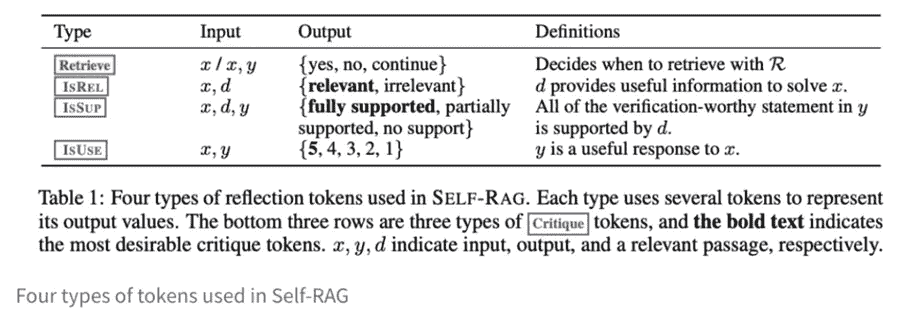

以下简图帮助我们理解信息流的运转机制：

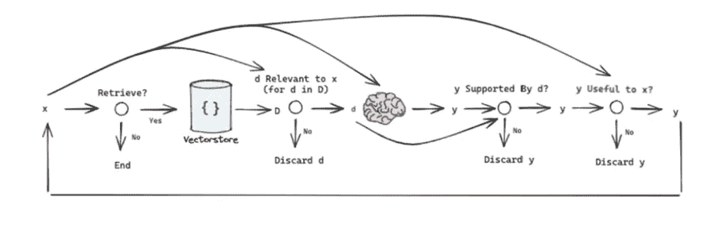

我们可以在 LangGraph 中对其进行实现：

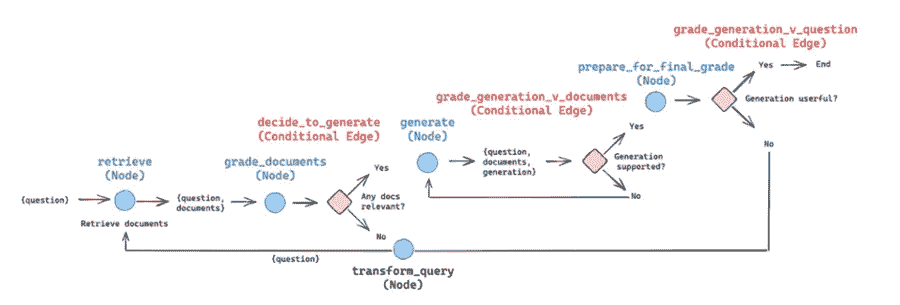

这里展示的示例轨迹强调了主动 RAG 的自我纠正能力。 查询的问题是 解释不同类型代理记忆是如何工作的？ 在此示例中，所有四个文档都被认为相关，对照文档检查生成答案的环节顺利通过，但生成的答案未被认定完全有用。

之后，如这里所示，循环重新开始，问题稍微改写为： 不同类型代理记忆的运作方式如何？ 此时，四份文档中有一份因为无关而被筛选出去。之后的生成答案成功通过了所有检查：

不同类型的代理记忆包含感官记忆、短期记忆和长期记忆。感官记忆能够保留短暂的感觉信息。短期记忆则被用于实时学习和构建提示。而长期记忆则让代理人可以在很长的时间里保存和回忆信息，并常常依赖外部的向量存储来实现。

整体流程轨迹清晰可见，可以容易地进行审核：

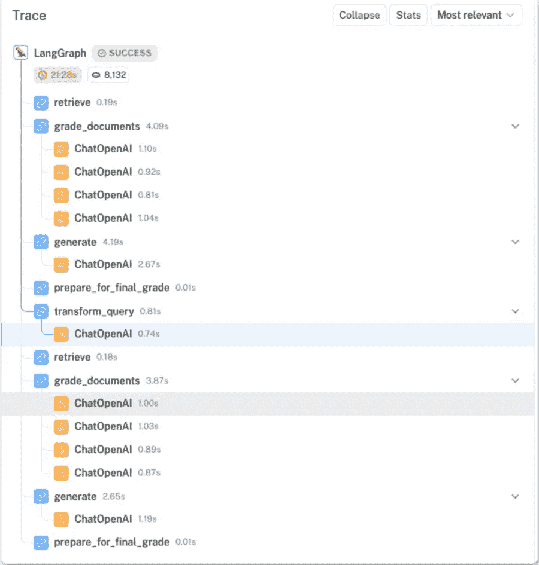

**2. 助力代码生成**

在大型语言模型（LLMs）的众多应**用中，代码生成与分析尤为关键，**这从产品 Gi**tHub copilot **的广泛应用和 GPT-engineer 等项目的热度可见一斑。AlphaCodium 的最新进展展示出与传统“提示-应答”方法不同，“流程”式编程通过测试与反思答案，进而迭代改进，能更好地推动代码的生成。

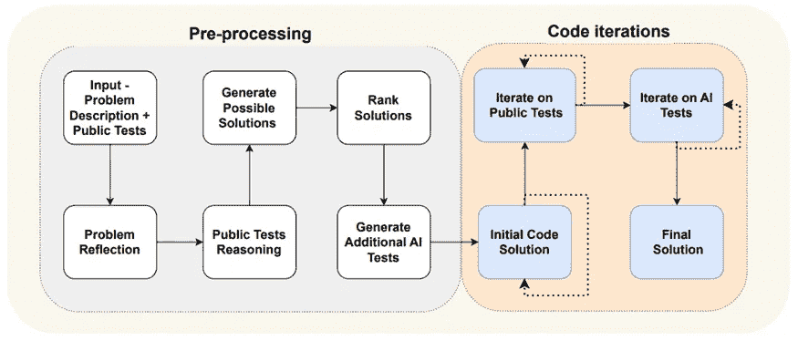

受到 AlphaCodium 和 Reflexion 工作的启发，可以借助 LangGraph 在代码生成中实现类似的迭代循环和关键决策点。

利用 LangGraph 进行反射式代码生成

使用以下组件实现代码生成流程：

●使用GPT-4和128k 令牌上下文窗口将 60k 令牌的 LCEL 文档详尽填充。将有关 LCEL 的问题传递到上下文填充的 LCEL 链以生成初始答案。

**●使用 OpenA**I 工具将输出解析为 Pydantic 对象：（1）问题描述，（2）导入块，（3）代码。

●首先对 导入模块 进行执行测试，因为在代码生成过程中，幻觉可能悄然渗入导入语句之中。

● 如果导入检查通过，会检查代码本身是否可以执行。在生成提示中，指示 LLM 不要在代码解决方案中使用伪代码或未定义的变量，以确保代码能够被执行。

●若上述任一测试失败，我们就会将错误堆栈与先前的回答一起传回生成环节以供反思。默认会重试 3 次，这个次数根据需求还可以增加。

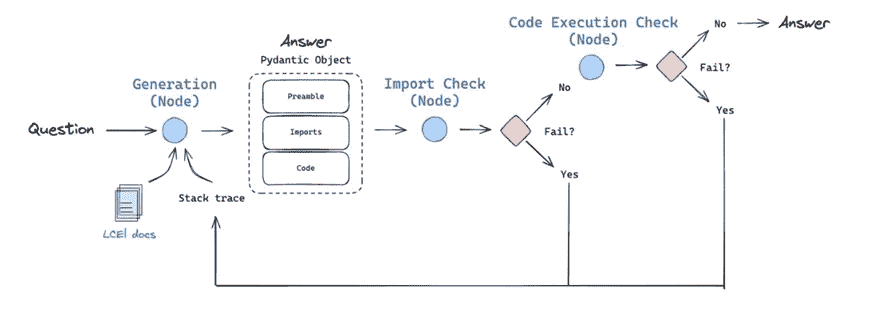

# 利用 LangSmith 进行评估

通过设立不涉及 LangGraph 的 “上下文填充” 基准线，即在流程图中这一环节并未执行任何检测或反馈：同样利用 GPT-4 的 128k 令牌上下文窗口，将 60k 令牌的 LCEL 文档进行充实。提交与 LCEL 相关的问题以生成答案。

我们为两个部分

●（1）导入模块的评估

●（2）代码执行的评估

实现了 LangSmith 的自定义评价功能。

通过 LangSmith 分析失败的案例：一个典型的错误是没能注意到 RunnableLambda 函数的输入应当是 dict，反而将其误认为 string：AttributeError: 'dict' object has no attribute 'upper'

接下来，我们对“上下文填充” + LangGraph的情况进行了测试，通过执行测试以筛查导入和代码执行中的错误，并在生成更新的答案时进行反思。在相同的评估集上，我们观察到 100% 的导入测试是准确的，以及 ~81% 的代码执行测试是成功的（N=78 次尝试）。

以上述失败案例为例，我们可以看到系统是如何进行处理的：完整的错误跟踪显示，我们在回答问题的第二次尝试中遇到了同样的错误详情。在后续的反思环节中，我们提供了先前的解决方案和随之出现的错误：

您之前尝试解决过这个问题。

...

--- 最近的运行错误 ---

执行错误：'dict' 对象没有 'upper' 属性

...

请再次尝试回答这个问题。

...

最终的代码正确处理了 RunnableLambda 函数中的输入字典，避免了 “上下文填充” 情况中出现的错误。总的来看，通过使用 LangGraph 添加这个简单的反思步骤进行重试后，代码执行的准确率得到了 ~47% 的提高：

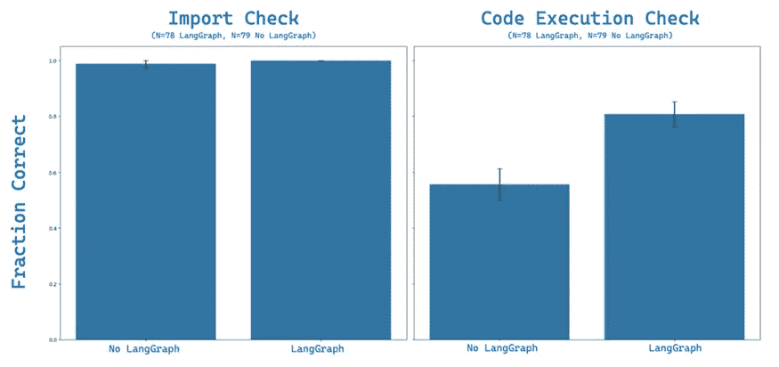

# LangGraph对未来互联网搜索的潜在影响

搜索引擎的模式和发展在不断变化，未来，搜索引擎可能朝以下方向发展：

1. **语音和对话式搜索： **随着语音助手的普及，搜索引擎可能会更加重视语音和对话式搜索。

2. **人工智能和机器学习： **搜索引擎将继续利用AI和机器学习来改进查询理解、结果排序和个性化。

3. **增强现实搜索： **AR技术的发展可能会为搜索引擎带来新的机会，如通过AR设备搜索周围环境中的信息。

4. **更好的隐私保护： **随着用户对隐私的关注增加，搜索引擎可能会在数据保护和用户隐私方面做出更多努力。

5. **多模态搜索： **搜索引擎可能会支持更多类型的查询，包括语音、文本、图像和视频的组合。

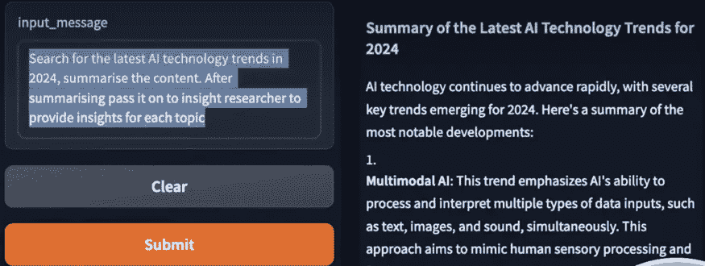

LangChain结合LangGraph，可以提供更深入的搜索功能，只需一个查询即可实现，这无疑是未来互联网搜索的发展方向。

# **结语**

借助AutoGen，开发人员可以创建一个「智能体生态系统」，这些智能体可以专门从事不同的任务并相互协作；然而使用LangGraph，通过循环图协调大模型和外部工具，对一个LLM应用的处理过程进行非常细节的设计编排，实现多轮对话和调整，从而处理更复杂的任务。同时， LangGraph 完全集成到了 LangChain 生态系统中，这意味着您可以充分利用 LangChain 的所有集成和 LangSmith 可观察性，在现有知识的基础上不断深入，不断完善。

LangGraph作为一种新型的应用层混合专**家模型，有着广阔的发展**前景，它不仅可以 增强RAG应用、助力代码生成， 同时还可以打造Multi-Agent系统、构建 Web Agents 等。通过融合各种专家知识，LangGraph为各类应用提供强大支撑，能够显著提高工作效率，其灵活性、可扩展性、高效性和易用性使得LangGraph在人工智能领域具有广阔的应用前景。相信在不久的将来，LangGraph一定会成为处理复杂任务的重要技术手段，开启一个全新的智能时代！

**参考文献**

[1] SELF-RAG: LEARNING TO RETRIEVE, GENERATE, AND CRITIQUE THROUGH SELF-REFLECTION

[2] CODE GENERATION WITH ALPHACODIUM: FROM PROMPT ENGINEERING TO FLOW ENGINEERING