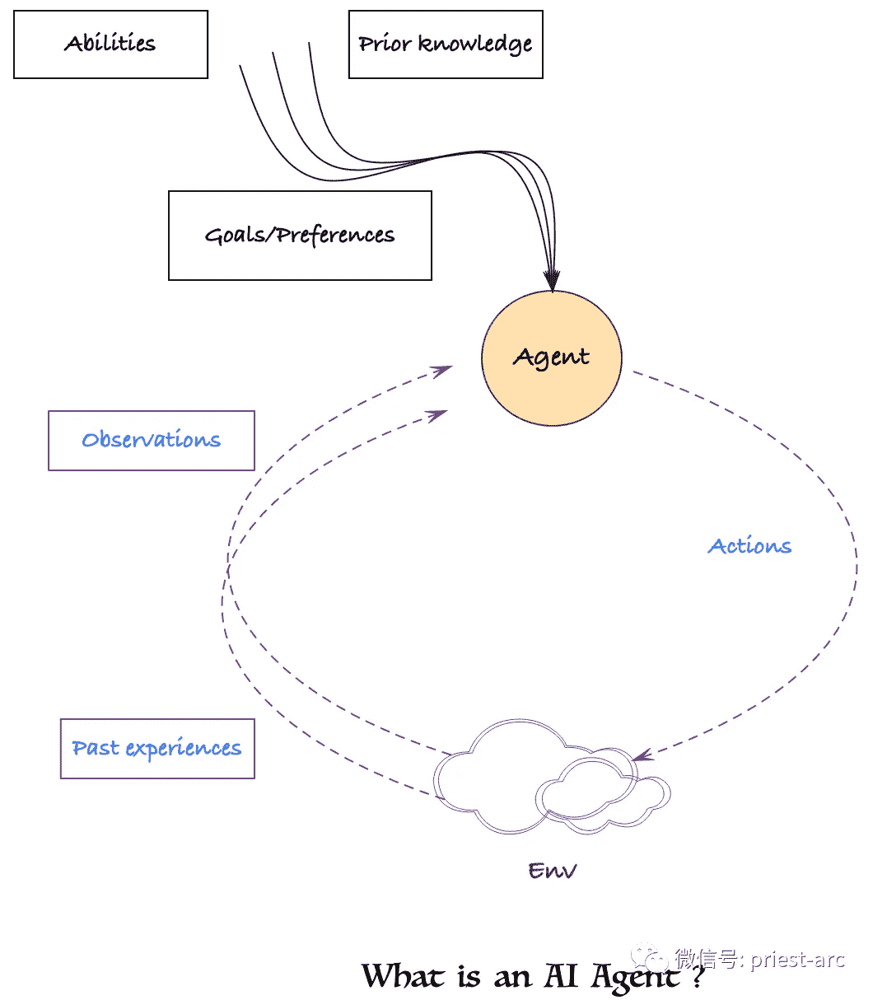
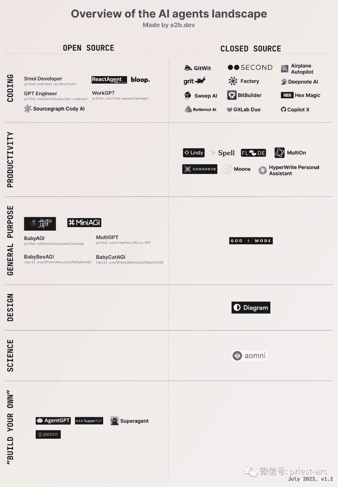
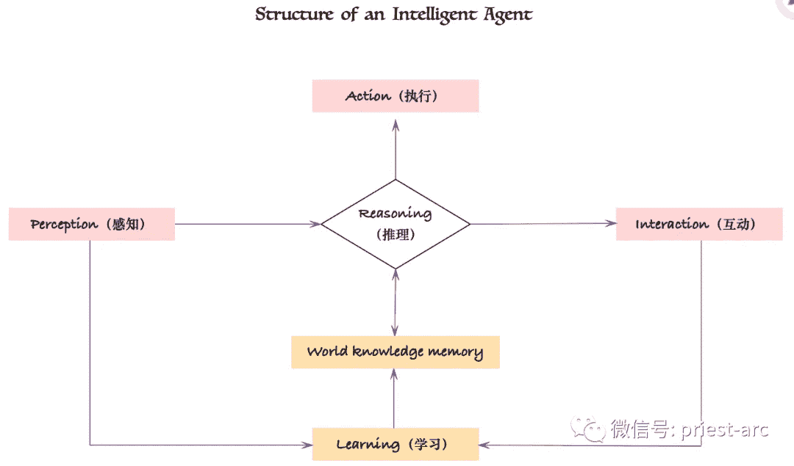
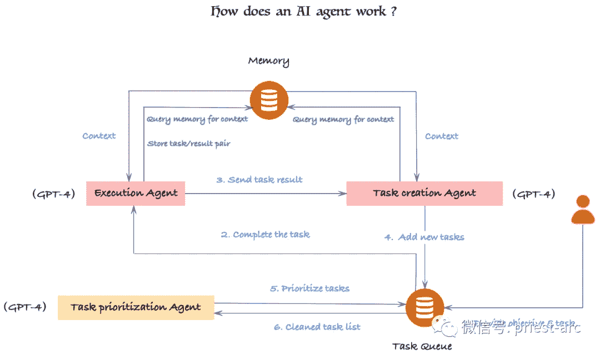
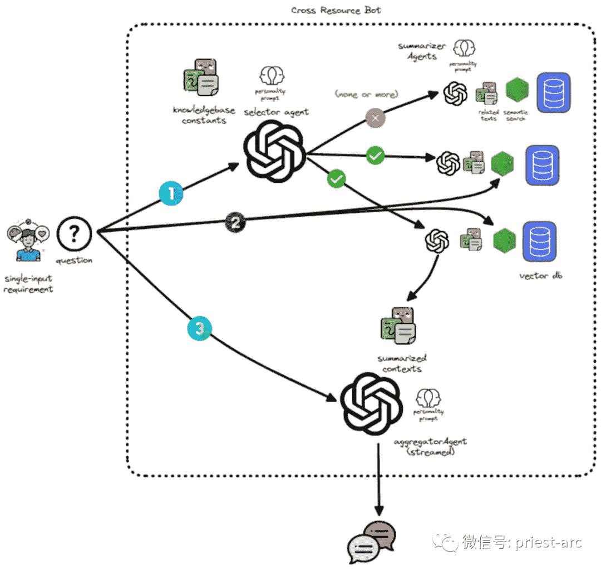

# 一文读懂 AI Agents 技术

> 来源：[https://agijuejin.feishu.cn/docx/KfXud1gc1oBwtzxQd3dckSnOnLe](https://agijuejin.feishu.cn/docx/KfXud1gc1oBwtzxQd3dckSnOnLe)

> 作者：Luga Lee | 架构驿站

> 原文：https://mp.weixin.qq.com/s/QNrVXGw65S_NimiXbkPRaA

Hello folks，我是 Luga，今天我们来聊一下 人工智能（AI）生态领域相关的技术 - AI Agents（AI 代理） 。

想象一下：软件实体能够自主地与环境交互，根据收集的数据做出决策，并以最少的人为干预执行基于特定场景。幸好，借助 AI Agents 技术，这个现实比你想象的更接近了。这些智能代理正在彻底改变行业，并改变我们的生活方式。但是，大家可能会好奇： AI Agents 到底是什么？它们是如何工作的？在本篇博文中，我们将深入探索 AI Agents 的世界！

人工智能（AI）赋予机器具备判断和执行任务的能力，以协助人类在某些特定的业务场景中实现某项目标，从而显著改变了人机交互方式。 在人工智能的核心体系中，我们可以关注到这些智能实体被称为智能代理（IA）的 AI Agents ，能够感知环境变化并对其进行分析，以采取合理的行动来实现既定目标。

通常来说，不同类型的 AI Agents 旨在解决特定的挑战并完成特定的任务。对于构建有效且高效的人工智能系统来说，更深入地了解 AI Agents 的不同类型便显得至关重要。通过了解各种 AI Agents 类型，我们可以更好地理解它们的功能和应用领域，并根据具体需求选择最合适的 AI Agents。

AI Agents 可以是专门针对某个任务设计的，例如图像识别、语音识别或自然语言处理。这些 Agents 利用先进的算法和模型来解析输入数据并生成准确的输出。

另一类 AI Agents 便是通用型代理，它们具备更广泛的智能和适应能力。这些代理能够处理多种任务和领域，并具备学习和适应的能力。通用型代理通常基于机器学习和深度学习技术，通过从大量数据中学习和推断来改进其性能和表现。

除此之外，AI Agents 还可以根据其交互方式进行分类。有些代理是自主的，它们能够独立地感知环境、做出决策并执行任务。另一些代理则是协同的，它们与人类用户进行交互，通过理解用户的意图和目标来提供帮助和建议。

## **什么是 AI Agents & Au**tonomous AI Agents ？

其实，自 20 世纪 80 年代计算机科学家开始探索如何开发可以像人类一样交互的智能软件以来， AI Agents 已经出现。从那时起，这个概念已经发展到包括可以独立做出决策和完成特定场景任务的智能代理。

AI Agents 是一种软件程序，旨在与其环境交互，感知接收到的数据，并根据该数据采取行动以实现特定目标。AI Agents 能够模拟智能行为，可以像基于规则的系统一样简单，也可以像高级机器学习模型一样复杂。AI Agents 使用预先确定的规则或经过训练的模型来做出决策，并且可能需要外部控制或监督。

相对于传统的 AI Agents，自主 AI Agents 是一种先进的软件程序，可以在没有人类控制的情况下独立运行。它们可以自主思考、行动和学习，无需人类不断输入。这些代理广泛应用于医疗保健、金融和银行等不同行业，使事情运行得更顺畅、更高效。它们可以适应新情况，从经验中学习，并利用自己的内部系统做出决策。

随着人工智能技术的不断发展，AI Agents 的能力和应用领域也在不断扩展。在某种程度上，AI Agents 已经成为许多领域中的关键工具，帮助人们解决复杂的问题和提高工作效率。通过不断改进和优化人工智能代理的设计和算法，我们可以期待更多智能、自主的代理出现，为各行各业带来更大的帮助和创新。

在过去的几个月里， AI Agents 引起了巨大的关注和人气。一个令人印象深刻的例子便是 AutoGPT，在 GitHub 上的星星数已经达到了惊人的 140,000 颗。这反映了大家对开源 AI Agents 项目的广泛兴趣和支持。

不仅如此，我们几乎每周都能看到新的公司成立，专注于 AI Agents 的开发和应用。这表明 AI Agents 领域正在迅速发展，吸引了越来越多的创业者和投资者的关注。

这个生态系统中的 AI Agents 种类繁多，从审查代码的代理（例如 Sweep AI）到像 Lindy 这样的虚拟个人助理，涵盖了各种不同的功能和应用领域。这些代理的出现为我们提供了更多的选择和可能性，能够满足不同用户和业务的需求。

为了更好地了解这个生态系统的现状，我们对 50 多个 AI Agents 进行了概览，并将它们汇总到一个列表中。这个列表包括了各种类型的代理，涉及的领域包括自然语言处理、图像识别、语音识别、智能助理等。我们对这些代理的功能、性能和用户反馈进行了评估和总结，以便为用户提供参考和决策支持。

## AI Agents 通常都具有哪些特征因素 ？

通常而言， AI Agents 具有以下几个特征因素，具体表现为如下：

1、感知和理解能力

AI Agents 能够感知环境中的信息，例如图像、声音、文本等，并理解这些信息的含义和上下文。这涉及到使用传感器、计算机视觉、语音识别、自然语言处理等技术来实现对输入数据的解析和理解。

2、决策和规划能力

AI Agents 能够基于感知到的信息和存储的知识做出决策并制定行动计划，可以使用逻辑推理、统计分析、规划算法或机器学习技术来评估不同行动的可能结果和潜在风险，并选择最佳的行动策略。

3、自主学习和适应能力

A I Agents 具有学习和改进自身的能力，可以从经验中学习，并根据反馈信息不断改进自己的性能和表现。代理可以使用监督学习、增强学习、迁移学习等技术来获取新知识、调整决策制定和行动执行过程，以提高自身的智能水平和适应能力。

4、交互和沟通能力

A I Agents 能够与人类或其他代理进行交互和沟通，可以理解自然语言指令、生成自然语言回应，并使用语音、文字或其他形式与用户进行有效的交流。这涉及到自然语言处理、对话系统、语音合成等技术的应用。

5、知识表示和存储能力

A I Agents 能够组织和存储知识，并有效地检索和利用这些知识来支持决策和行动，可以使用符号逻辑、图形模型、向量表示等方式来表示和存储知识，并使用数据库或其他数据结构来实现高效的知识管理。

6、情境感知和灵活性

A I Agents 具有对不同情境的感知能力，并可以根据情境的变化做出相应调整，可以识别环境中的变化、适应新的任务要求，并灵活地调整决策和行动策略，以适应不同的场景和需求。

这些特征因素共同构成了 A I Agents 的核心能力，使其能够在各种任务和领域中展现出智能和适应性。然而，具体的 A I Agents 的特征因素可能会因应用领域、任务要求和设计选择而有所差异。

## AI Agents 的内部结构是怎样设计的 ？

AI Agents 的内部结构可以根据具体的应用和任务而有所不同，但通常包括以下几个核心组件。关于 AI Agents 的通用型内部结构参考示意图，我们可参考如下所示：

基于上述内部结构示意图，我们可以看出： AI Agents 的内部结构由四个关键部分组成，分别是 Environment（环境）、Sensors（传感器）、Actuators（执行器）以及 Decision-making mechanism（决策机制）。

接下来， 我们对每个部分进行简要的解析，以更好地理解上述组件在 AI Agents 中的作用。

1、 Environm e nt

环境是 AI Agents 所处的外部世界，通常而言，可以为真实的物理环境，也可以是虚拟的模拟环境。环境提供了 AI Agents 感知和交互的场所，可能包含各种元素，如物体、其他代理、任务目标等。环境的特性和复杂性直接影响到 AI Agents 的运行和决策过程。

2、 Sensors

传感器是 AI Agents 用于感知环境的组件。作为一种支撑各种类型的设备或技术，如摄像头、麦克风、传感器阵列等。 传感器 可以帮助 AI Agents 获取环境中的各种信息，如图像、声音、位置等。通过传感器，AI Agents 能够将环境中的数据转化为可处理的形式，为后续的决策和行动提供输入。

3、 Actuators

执行器是 AI Agents 用于执行行动或影响环境的组件。执行器可以是机械装置、运动控制系统、语音合成器等。它们根据 AI Agents 的决策结果将行动转化为实际的物理或虚拟操作，从而影响环境或与环境进行交互。执行器的种类和属性取决于具体的应用领域和任务要求。

4、 Decision-making mechanism

决策机制是 AI Agents 用于做出决策的核心组件。通常可以是基于规则的系统、机器学习模型、强化学习算法等。决策机制接收来自传感器的数据，并根据预定义的规则或通过学习和推理来分析这些数据，最终生成适当的决策。这些决策可能涉及选择特定的行动、规划未来的策略或调整代理的内部状态。

通过环境、传感器、执行器和决策机制的相互作用，AI Agents 能够感知环境、分析信息、做出决策并执行行动，以实现特定的目标。这种内部结构的设计和优化对于实现智能、自主的 AI Agents 至关重要，并且在各种应用领域中发挥着重要作用，如自动驾驶汽车、智能机器人、语音助手等。

## AI Agents 到底是如何工作的 ？

当 AI Agents 开始执行某项特定的任务时，通常需要按照一系列步骤进行，往往涉及感知环境、处理输入数据、做出决策、计划和执行行动，以及学习和改进等。具体的工作原理可参考如下架构图所示：

针对 AI Agents 具体实现过程，主要涉及以下活动，具体 ：

1、 环境感知

首先，AI Agents 会通过传感器或其他数据源感知环境。传感器可以包括视觉传感器（如相机）、听觉传感器（如麦克风）、物理传感器（如触摸传感器）等。这些传感器帮助代理获取环境中的信息，例如图像、声音、位置等。

2、知识表示

在此阶段，AI Agents 使用适当的知识表示方法来组织和存储从环境中获取的信息。这些信息可能包括先验知识、学习到的模式或规则。常见的知识表示方法包括符号逻辑、图形模型、向量表示（如词嵌入）等。通过有效的知识表示，AI Agents 能够更好地理解和利用环境中的信息。

3、决策制定

基于感知到的环境信息和存储的知识，AI Agents 使用决策制定机制来生成适当的行动。这可能涉及使用逻辑推理、统计分析、规划算法或机器学习技术来评估不同行动的可能结果和潜在风险。决策制定过程旨在使代理能够选择最佳行动以实现其目标。

4、计划和执行行动

在这一步中，Agents 制定计划或一系列步骤来实现其目标。一旦决策制定完成，AI Agents 将执行行动并与环境进行交互。这可能涉及控制执行器（如机器人的电机）、发送指令（如语音助手的语音合成）或与其他代理进行通信。执行行动后，Agents 会观察执行结果，并将其用作反馈以调整下一步的决策。

5、反馈与改进

在完成上述的执行行动后，AI Agents 通过与环境的交互获得反馈。这些反馈可以来自环境中的直接观测结果，也可以来自人类用户或其他代理的指令和评估。Agents 使用这些反馈来学习和改进自己的行为。这可能包括使用监督学习、强化学习或迁移学习等技术来调整决策制定和行动执行过程，以提高代理的性能和适应能力。

## AI Agents 应用于哪些 现实 场景下 ？

在现实的业务场景中，AI Agents 在各个领域都展示出了广泛的应用，对日常生活产生了重大影响。

目前来看，主要体现在如下几个方面，具体：

1、自然语言处理

AI Agents 在自然语言处理领域的应用广泛而深远。例如，智能语音助手（如 Siri、Alexa 和 Google 助手等）利用语音识别和自然语言理解技术，使用户能够通过语音与设备进行交互、获取信息和执行任务。这使得人们可以轻松地控制智能家居设备、查询天气、发送消息等，极大地提高了日常生活的便利性。

2、机器人技术

AI Agents 在机器人领域的应用也十分显著。智能机器人能够感知环境、理解语音指令、执行任务，并与人类进行交互。这种技术的应用范围非常广泛，包括工业自动化、医疗辅助、家庭服务等。例如，智能无人驾驶汽车正在逐渐成为现实，它们利用感知技术和决策制定能力来实现自主导航和安全驾驶。

3、个性化推荐

在电子商务和娱乐领域，AI Agents 通过个性化推荐系统为用户提供定制化的体验。这些系统利用机器学习和数据挖掘技术，分析用户的历史行为和偏好，并提供个性化的产品推荐、音乐推荐、电影推荐等。这不仅提高了用户的满意度，还促进了销售和用户参与度的增长。

除了上述领域，AI Agents 还在医疗诊断、金融风险管理、智能城市管理等方面发挥着重要作用。医疗领域的 AI Agents 可以帮助医生进行疾病诊断和预测，提高治疗效果和患者生存率。在金融领域， AI Agents 可以通过分析大量数据和模式识别，帮助金融机构更好地管理风险和进行投资决策。智能城市管理中， AI Agents 可以监测交通流量、优化能源利用、改善城市规划等，提高城市的可持续性和居民的生活质量。

上述场景示例表明， AI Agents 在不同领域的广泛应用已经在改变我们的日常生活。随着技术的不断进步和创新，我们可以期待更多领域的 AI Agents 将为我们带来更多的便利、效率和智能化体验。

Reference ：

[1] https://www.simform.com/blog/ai-agent/

[2] https://e2b.dev/blog/ai-agents-in-the-wild

Adiós !

··································

**📣 📣 📣**

**对云原生网关 Traefik 、AI 技术感兴趣的**朋友们，可以加入下面的🛰️进行技术探讨～

Hello folks，我是 Luga，Traefik Ambassador，Jakarta EE Ambassador， 一个 10 年+ 技术老司机，从 IT 屌丝折腾到码畜，最后到“酱油“架构师。如果你喜欢技术，不喜欢呻吟，那么恭喜你，来对地方了，关注我，共同学习、进步、超越～