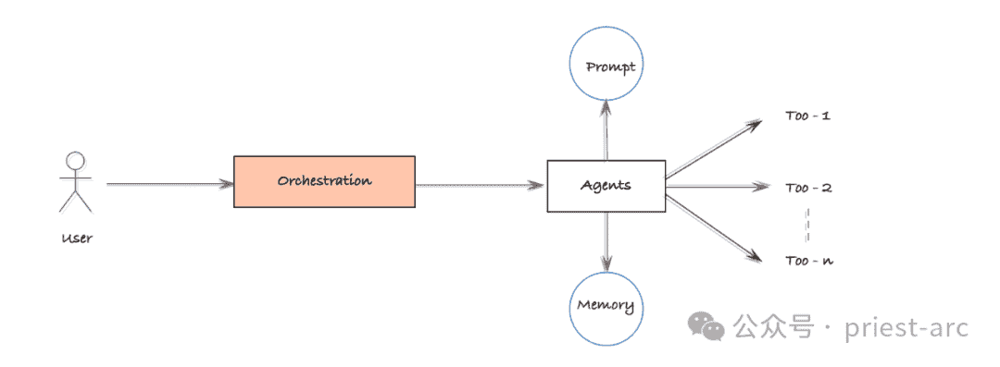
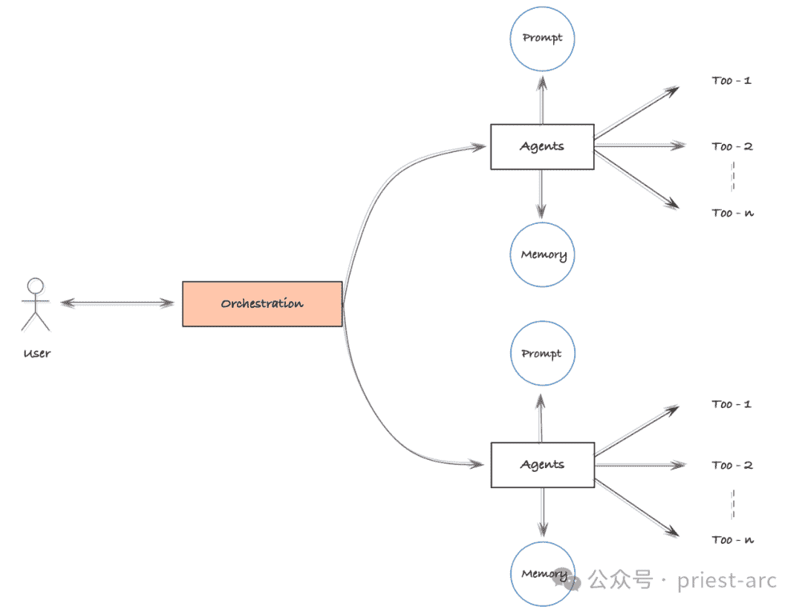

# Multi-Agent ，知多少？

> 来源：[https://agijuejin.feishu.cn/docx/KG9ad3RKNoXGS8xCDcRcrRndnVc](https://agijuejin.feishu.cn/docx/KG9ad3RKNoXGS8xCDcRcrRndnVc)

> 作者：Luga Lee 架构驿站

> 原文：[https://mp.weixin.qq.com/s/Z9](https://mp.weixin.qq.com/s/Z970vS3mGA20YOoqIQMOdw)70vS3mGA20YOoqIQMOdw

Hello folks，我是 Luga，今天我们来聊一下 人工智能（AI）生态领域相关的技术 - Multi-Agent ，即“多代理”技术 。

众所周知，AI Agent 已经成为生成人工智能应用程序的重要组成部分。然而，为了能够有效地与复杂环境进行互动，这些代理需要具备强大的推理能力，以便能够独立做出决策并帮助用户解决各种任务。行为和推理之间存在着紧密的协同联系，这对于 AI Agent 快速学习新任务非常有帮助。此外，AI Agent 还需要推理能力来修改他们的计划，同时考虑到新的反馈或学到的信息。如果缺乏推理技能，这些代理的工作可能会出现问题，例如误解用户的查询或未能考虑到多步骤的影响。

因此，推理能力对于 AI Agent 来说至关重要。它们需要能够推理和理解复杂的情境，从而做出明智的决策和行动。通过推理，AI Agent 能够分析和解释输入数据，并基于已有的知识和经验进行推断。这种能力使得代理能够更好地理解用户的意图和需求，并提供准确的响应和解决方案。

此外，推理还能够帮助 AI Agent 在面对新的信息或反馈时进行灵活的调整和改进。代理可以根据推理结果来修改其计划和策略，以适应不断变化的环境和需求。这种迭代的推理过程使得 AI Agent 能够不断学习和优化自身的性能，提供更加智能和高效的服务。

## 到底什么是 Agent 以及如何理解 ？

近年来，大型语言模型（Large Language Models, LLMs）的出现为人工智能领域带来了革命性的变革。这种基于海量数据训练而成的语言模型不仅具备卓越的自然语言理解和生成能力，更令人惊叹的是它展现出了一定的推理和决策能力。正是基于这一独特优势， LLM 正被视为构建新一代 AI Agent 系统的基础计算组件。

在 LLM 的背景下， AI Agent 被定义为一种以 LLM 为核心，融合多种功能模块的复合智能系统，旨在模拟人类面对任务挑战时的思考和行为方式，即制定解决方案，并合理调配可用的工具资源加以执行。这种设计理念与人类的认知模式有着内在的相似性：面对棘手的问题时，我们首先会在脑中构筑出综合性的解决策略，然后再动用各种手段资源去一一实施，最终完成既定目标。在该过程中，人脑扮演着至关重要的推理和规划角色，而 LLM 恰好为 AI Agent 赋予了类似的核心推理能力。

在整个任务解决的流程中， AI Agent 首先需要借助 LLM 的强大推理能力，根据当前的环境状态、任务需求等全面信息，制定一个合理的解决计划。接下来，为了实现计划的各个环节，代理将根据具体需求调用其可用的工具，如信息检索、分析建模、知识库查询等。这类工具正是代理赖以发挥其功能的“百宝箱”。

除了核心的 LLM 计算单元和功能性工具之外，智能代理系统还需要包含其他辅助组件，如任务管理模块、安全控制模块、用户交互界面等，以保证系统的正常运行和高效调度。总的来说，一个典型的 AI Agent 可以概括为由三大核心部分构成：

1、Prompt

Prompt 是多代理智能系统的核心指导纲领，相当于整个系统的行为和工作方式的总体蓝图。它明确界定了每个智能代理的目标和职责，同时也提出了实现这些目标所需遵循的约束条件和准则。

值得关注的是， Prompt 设计也直接影响了单个智能代理的复杂程度。为了构建一个复杂的多代理系统，我们通常会在不同的代理之间合理分工，使每个代理负责较为简单的子任务。这种分工有利于控制单个代理的复杂性，从而更易于管理和调试。相应地，每个代理的提示也会相对简单一些，只需关注该代理的具体职责范畴。

2、Memory

Memory 则是赋予智能代理以学习、进化和持续优化的能力。就像代理的个人知识库和经验档案，记录了其过往的所见所闻和互动历程。借助 Memory ，代理无需在每个新场景中从零开始，而是能够依赖已有积累做出明智判断。更重要的是， Memory 使代理能够及时总结经验教训，不断提升自我。

正如人类会从过去的失败中汲取智慧一样， AI Agent 也能凭借记忆系统提炼和内化历史交互中的有价值信息，进而不断优化自身的决策模型。因此，从某种角度而言， Memory 的作用，不仅在于对已知的积累和沉淀，更在于赋予了代理持续进化和自我完善的内在动力。

3、Tools

与 Prompt 和 Memory 相比， Tools 则是 AI Agent 施展能力和发挥专长的载体，其可以是功能强大的 API、数据分析模型、知识库查询服务等等，旨在为代理赋能，使其能够高效地完成既定任务。 Tools 所承载的，正是人类在漫长的发展历程中通过不懈探索而积累的各种专业知识和技术能力。通过将这些工具整合到智能代理的工作流程中，赋予了它们专业水准的能力输出，提高了系统的工作效率。

诚然， Prompt 、 Memory 和 Tools 分别侧重于不同层面的能力赋予，但它们并非相互独立，而是紧密融合、环环相扣。一方面，合理的 Prompt 为 Memory 和 Tools 的利用提供了适当的指引，避免了盲目和失范；另一方面， Memory 和 Tools 又为系统实现 Prompt 所定的目标提供了核心支撑。三者缺一不可，相互依赖，共同构筑了一个智能、高效、安全可控的 AI Agent 体系。

## Single-Agent 面临的困境 ？

Single-Agent 系统由一个集成了多种工具的人工智能代理构成，旨在自主完成各种复杂任务。该代理拥有强大的推理和综合能力，能够基于大型语言模型的知识库，制定分阶段的解决方案。在执行过程中，代理会灵活调配所需工具的组合，逐步完成每个环节，并将各阶段的中间输出有机融合，最终生成理想的综合解决方案，从而高效实现预期目标。

Single-Agent 系统参考架构示意图

虽然  Single-Agent 系统凭借集成多种工具和强大推理能力的优势，在某些特定场景中表现出色，但其在复杂动态环境下的适用性和性能仍受到诸多固有局限的制约。具体可参考如下所示。

首先，  Single-Agent 系统的知识获取和认知范畴高度依赖于其训练数据集和模型算法，这使得它难以全面把握多元异构的信息要素，以及复杂环境中瞬息万变的细微变化。  Single-Agent 很容易产生知识盲区和认知偏差，从而在面临新的情景时无法作出前瞻性的正确决策，导致决策失误。

其次，即便是当下最先进的  Single-Agent ，其可用的算力资源和计算能力在物理层面仍有明确的上限，无法做到无限扩展。一旦面临极其错综复杂、计算量密集的任务，  Single-Agent 无疑会遭遇算力瓶颈，无法高效完成处理，性能将大打折扣。

再者，  Single-Agent 系统本质上是一种集中式的架构模式，这决定了它存在着极高的故障风险。一旦核心代理发生故障或遭受攻击，整个系统将完全瘫痪，难以继续运转，缺乏有效的容错和备份机制，无法确保关键任务的连续性和可靠性。

此外，复杂环境下的决策往往需要各种异构智能算法模型的协同配合，而封闭的  Single-Agent 系统难以灵活整合不同AI范式，无法充分挖掘多元异质智能的协同潜能，解决复杂问题的能力相对有限。

最后，  Single-Agent 系统通常是封闭式的，新的功能、知识很难被快速注入和更新，整体的可扩展性和可升级性较差，无法高效适应不断变化的复杂业务需求，存在架构上的先天缺陷。

## 什么是 Multi Agent 以及为什么是一个里程碑突破？

在上述文章中，我们提到， Single-Agent 系统在实践探索中逐步凸显出重大局限性，尤其是在应对复杂多变任务环境以及系统可扩展性方面的不足，这为引入多代理系统（Multi-Agent System，MAS）奠定了坚实基础。MAS 提供了一种强大的分布式架构框架，有望彻底克服单一代理系统固有的瓶颈。

在 Multi-Agent 系统架构中，由众多独立自治的智能体代理组成，它们拥有各自独特的领域知识、功能算法和工具资源，可以通过灵活的交互协作，共同完成错综复杂的决策任务。与单一代理系统将所有职责高度集中在一个代理身上不同，  Multi-Agent 系统 则实现了职责和工作的模块化分工，允许各个代理按照自身的特长和专长，承担不同的子任务角色,进行高度专业化的分工协作。这种方式不仅能够大幅提升整体工作效率，更重要的是赋予了系统更强大的处理复杂多样化任务的能力。

此外，  Multi-Agent 系统 具有天然的开放性和可扩展性。当系统面临任务需求的不断扩展和功能的持续迭代时，通过引入新的专门代理就可以无缝扩展和升级整体能力，而无需对现有架构进行大规模的重构改造。这与单一代理系统由于其封闭集中式设计,每次功能扩展都需要对整体架构做根本性的修改形成鲜明对比。  Multi-Agent 系统 灵活可扩展的特性，使其可以更容易地适应不断变化的复杂业务环境和需求。

Multi-Agent 系统 系统固有的分布式特征还赋予了它天然的容错性和健壮性。由于存在多个代理的冗余和备份，即使某些代理发生故障或受到攻击，只要其他代理能够按照事先商定的协作机制继续运转，整个系统仍将保持正常工作，从而最大程度地确保了关键任务的连续性和可靠性，这是单点故障高风险的单一代理系统所无法企及的。

Multi -Agent 系统参考架构示意图

Multi-Agent 系统凭借其先天的分布式协作、异构智能融合、模块化扩展、容错鲁棒等独特优势，正逐步展现出在诸多传统行业和复杂应用场景中的革命性影响力和巨大变革潜能。具体：

在运输和交通管理领域，Multi-Agent 系统可将复杂的交通网络分解为多个可协作的代理模块，如交通流量代理、路径规划代理、事故预警代理等，通过彼此的紧密协同，实现对整个交通系统的精细化智能管控和动态优化，大幅提升交通效率和安全性。

在制造业和机器人应用方面，Multi-Agent 系统能够高效整合规划、控制、执行、监测等异构智能模块，使机器人系统拥有更高的自主性和适应性，在动态复杂的生产车间环境中可实现高效协作和随机应变，实现人机物的有机融合，推动智能制造向更高水平迈进。

医疗健康系统作为典型的复杂场景，Multi-Agent 系统可将疾病诊断、治疗方案制定、患者健康管理等环节分而治之，由不同的专家代理分工协作，通过整合医疗知识库、个人健康数据等异构信息源，为患者提供更加精准的个性化诊疗方案，实现医疗资源的优化配置和高效利用。

此外，在需求变化剧烈、环境复杂多变的应用场景中，Multi-Agent 系统的适应性决策能力也将大放异彩。灵活的模块化设计和自主调整策略，使 Multi-Agent 系统能够有效应对动态环境的不确定性挑战，制定出行之有效的应对之策。

Reference ：

[1] https://www.marktechpost.com/2024/04/26/single-agent-architectures-ssas-and-multi-agent-architectures-maas-achieving-complex-goals-including-enhanced-reasoning-planning-and-tool-execution-capabilities/

[2] https://neurohive.io/en/news/arthur-bench-framework-for-evaluating-language-models/

Adiós !

Hello folks，我是 Luga，Traefik Ambassador，Jakarta EE Ambassador， 一个 10 年+ 技术老司机，从 IT 屌丝折腾到码畜，最后到“酱油“架构师。如果你喜欢技术，不喜欢呻吟，那么恭喜你，来对地方了，关注我，共同学习、进步、超越～