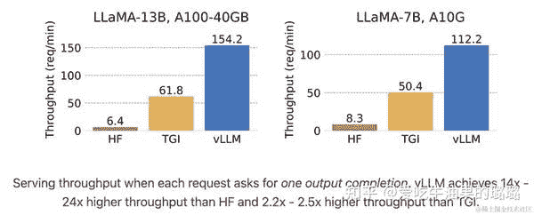
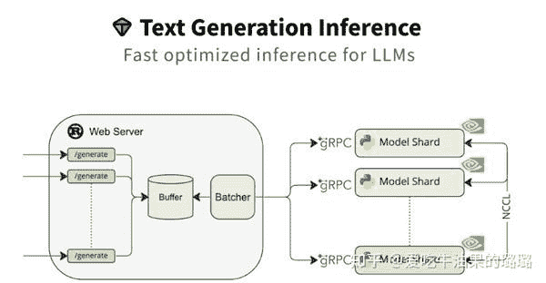
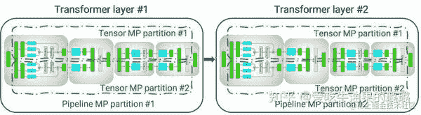
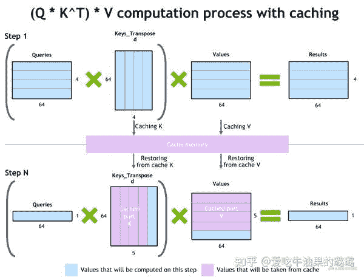

# 大模型LLM推理框架整理

> 来源：[https://agijuejin.feishu.cn/docx/VpXmdnoDuo9RINxKfE2c6aRNnsf](https://agijuejin.feishu.cn/docx/VpXmdnoDuo9RINxKfE2c6aRNnsf)

> 作者：爱吃牛油果的璐璐

> 原文：https://zhuanlan.zhihu.com/p/664106696

学习大模型，先了解一下大模型的推理框架。

自 ChatGPT 面世以来，引领了大模型时代的变革，除了大模型遍地开花以外，承载大模型进行推理的框架也是层出不穷，本文主要整理了业界知名度较高的一些大模型推理框架。可以根据吞吐量，性能，机器，算法模型库这几个方向进行选择。

## vLLM

vLLM是一个开源的大模型推理加速框架，通过PagedAttention高效地管理attention中缓存的张量，实现了比HuggingFace Transformers高14-24倍的吞吐量。

PagedAttention 是 vLLM 的核心技术，它解决了LLM服务中内存的瓶颈问题。传统的注意力算法在自回归解码过程中，需要将所有输入Token的注意力键和值张量存储在GPU内存中，以生成下一个Token。这些缓存的键和值张量通常被称为KV缓存。

### 代码仓库

GitHub: [https:// github.com](https://link.zhihu.com/?target=https%3A//github.com/vllm-project/vllm)/vllm-project /vllm

### 主要特性

+   通过PagedAttention对 KV Cache 的有效管理

+   传入请求的continus batching，而不是static batching

+   支持张量并行推理

+   支持流式输出

+   兼容 OpenAI 的接口服务

+   与 HuggingFace 模型无缝集成

### 业界案例

vLLM 已经被用于 Chatbot Arena 和 Vicuna 大模型的服务后端。

### 存在的问题

同样的模型、参数和prompt条件下，vLLM推理和Huggingface推理结果不一致。

### 与其他框架（HF、TGI）的性能对比

vLLM 的吞吐量比 HF 高 14 - 24 倍，比 TGI 高 2.2 - 2.5 倍。

## **HuggingFace TGI**

Text Generation Inference（TGI）是 HuggingFace 推出的一个项目，作为支持 HuggingFace Inference API 和 Hugging Chat 上的LLM 推理的工具，旨在支持大型语言模型的优化推理。

### **代码仓库**

GitHub: [h](https://link.zhihu.com/?target=https%3A//github.com/huggingface/text-generation-inference)ttps:// github.com/huggingface/ text-generation-inference

### 主要特性

+   支持张量并行推理

+   支持传入请求 Continuous batching 以提高总吞吐量

+   使用 flash-attention 和 Paged Attention 在主流的模型架构上优化用于推理的 transformers 代码。注意：并非所有模型都内置了对这些优化的支持。

+   使用bitsandbytes(LLM.int8())和GPT-Q进行量化

+   内置服务评估，可以监控服务器负载并深入了解其性能

+   轻松运行自己的模型或使用任何 HuggingFace 仓库的模型

+   自定义提示生成：通过提供自定义提示来指导模型的输出，轻松生成文本

+   使用 Open Telemetry，Prometheus 指标进行分布式跟踪

### 支持的模型

+   BLOOM

+   FLAN-T5

+   Galactica

+   GPT-Neox

+   Llama

+   OPT

+   SantaCoder

+   Starcoder

+   Falcon 7B

+   Falcon 40B

+   MPT

+   Llama V2

+   Code Llama

### 适用场景

依赖 HuggingFace 模型，并且不需要为核心模型增加多个adapter的场景。

## FasterTransformer

NVIDIA FasterTransformer (FT) 是一个用于实现基于Transformer的神经网络推理的加速引擎。它包含Transformer块的高度优化版本的实现，其中包含编码器和解码器部分。使用此模块，可以运行编码器-解码器架构模型（如：T5）、仅编码器架构模型（如：BERT）和仅解码器架构模型（如：GPT）的推理。

FT框架是用C++/CUDA编写的，依赖于高度优化的 cuBLAS、cuBLASLt 和 cuSPARSELt 库，可以在 GPU 上进行快速的 Transformer 推理。

与 NVIDIA TensorRT 等其他编译器相比，FT 的最大特点是它支持以分布式方式进行 Transformer 大模型推理。

下图显示了如何使用张量并行 (TP) 和流水线并行 (PP) 技术将基于Transformer架构的神经网络拆分到多个 GPU 和节点上。

### FasterTransformer 中的优化技术

与深度学习训练的通用框架相比，FT 能够获得更快的推理流水线以及基于 Transformer 的神经网络具有更低的延迟和更高的吞吐量。FT 对 GPT-3 和其他大型 Transformer 模型进行的一些优化技术包括：

层融合（Layer fusion）

这是预处理阶段的一组技术，将多层神经网络组合成一个单一的神经网络，将使用一个单一的核（kernel）进行计算。这种技术减少了数据传输并增加了数学密度，从而加速了推理阶段的计算。例如， multi-head attention 块中的所有操作都可以合并到一个核（kernel）中。

自回归模型的推理优化(激活缓存)

为了防止通过Transformer重新计算每个新 token 生成器的先前的key和value，FT 分配了一个缓冲区来在每一步存储它们。虽然需要一些额外的内存使用，但 FT 可以节省重新计算的成本。该过程如下图所示， 相同的缓存机制用于 NN 的多个部分。

**内存优化**

**与 BERT 等传**统模型不**同，大型 T**ransformer 模型具有 多达数万亿个参数 ，占用 数百 GB 存储空间。即使我们以半精度存储模型，GPT-3 175b 也需要 350 GB。因此有必要减少其他部分的内存使用。

例如，在 FasterTransformer 中，我们在不同的解码器层重用了激活/输出的内存缓冲（buffer）。由于 GPT-3 中的层数为 96，因此我们只需要 1/96 的内存量用于激活。

使用 MPI 和 NCCL 实现节点间/节点内通信并支持模型并行

FasterTransormer 同时提供张量并行和流水线并行。对于张量并行，FasterTransformer 遵循了 Megatron 的思想。对于自注意力块和前馈网络块，FT 按行拆分第一个矩阵的权重，并按列拆分第二个矩阵的权重。通过优化，FT 可以将每个 Transformer 块的归约（reduction）操作减少到两次。

对于流水线并行，FasterTransformer 将整批请求拆分为多个微批，隐藏了通信的空泡（bubble）。FasterTransformer 会针对不同情况自动调整微批量大小。

MatMul 核自动调整（GEMM 自动调整）

矩阵乘法是基于 Transformer 的神经网络中最主要和繁重的操作。FT 使用来自 CuBLAS 和 CuTLASS 库的功能来执行这些类型的操作。重要的是要知道 MatMul 操作可以在“硬件”级别使用不同的底层（low-level）算法以数十种不同的方式执行。

GemmBatchedEx 函数实现了 MatMul 操作，并以cublasGemmAlgo_t作为输入参数。使用此参数，您可以选择不同的底层算法进行操作。

FasterTransformer 库使用此参数对所有底层算法进行实时基准测试，并为模型的参数和您的输入数据（注意层的大小、注意头的数量、隐藏层的大小）选择最佳的一个。此外，FT 对网络的某些部分使用硬件加速的底层函数，例如：__expf、__shfl_xor_sync。

**低精度推理**

FT 的核（kernels）支持使用 fp16 和 int8 等低精度输入数据进行推理。由于较少的数据传输量和所需的内存，这两种机制都会加速。同时，int8 和 fp16 计算可以在特殊硬件上执行，例如：Tensor Core（适用于从 Volta 开始的所有 GPU 架构）。

除此之外还有快速的 C++ BeamSearch 实现、当模型的权重部分分配到八个 GPU 之间时，针对 TensorParallelism 8 模式优化的 all-reduce。

### 支持的模型

目前，FT 支持了 Megatron-LM GPT-3、GPT-J、BERT、ViT、Swin Transformer、Longformer、T5 和 XLNet 等模型。在 GitHub 上的 FasterTransformer库中可以查看最新的支持矩阵。

### 存在的问题

英伟达新推出了TensorRT-LLM，相对来说更加易用，后续FasterTransformer将不再为维护了。