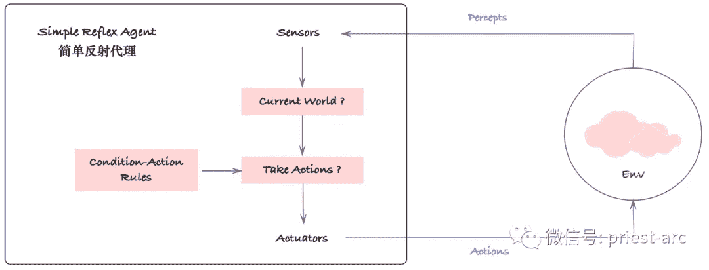
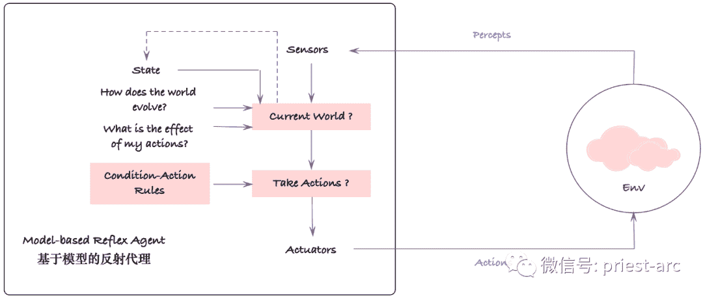
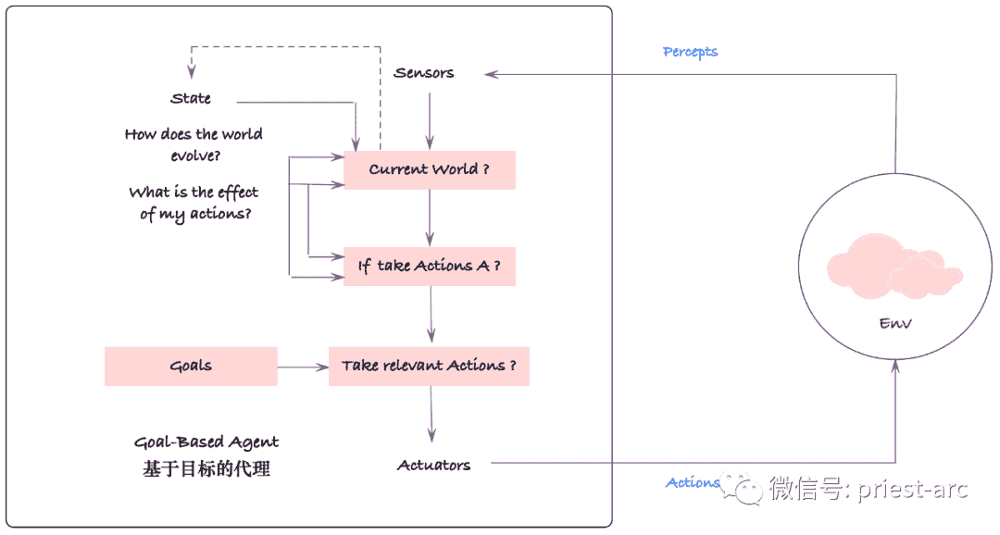
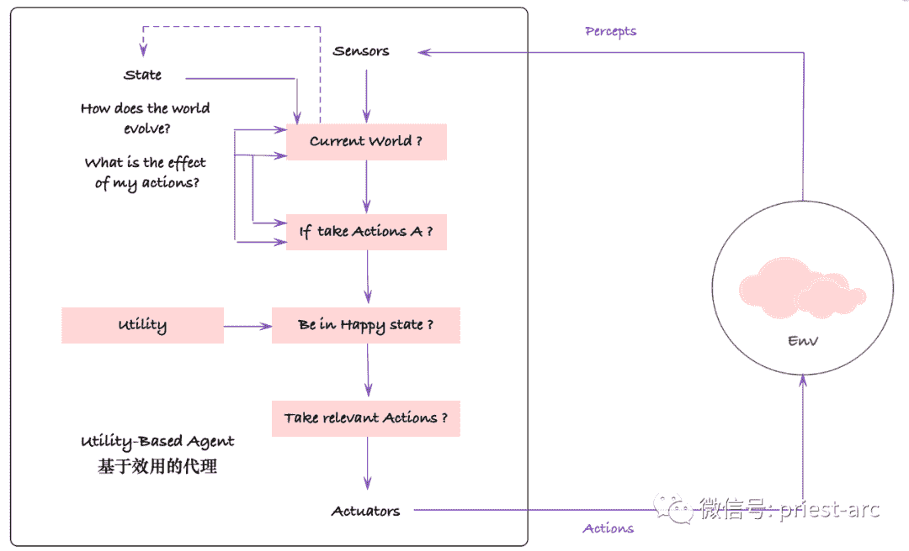
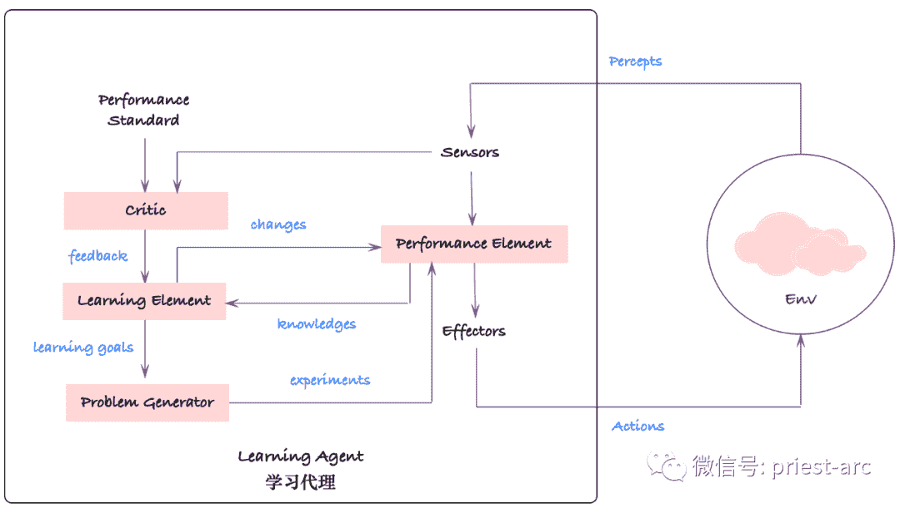

# 一文搞懂 AI Agents 的不同类型

> 来源：[https://agijuejin.feishu.cn/docx/BbfKdowcQo7vRKx8YZZcQiwjnec](https://agijuejin.feishu.cn/docx/BbfKdowcQo7vRKx8YZZcQiwjnec)

> 作者：Luga Lee | 架构驿站

> 原文：https://mp.weixin.qq.com/s/FITU6TImpKPTTrHQ9kX9zw

H ello folks，我是 Luga，今天我们继续来聊一下人工智能（AI）生态领域相关的技术 - AI Agents（AI 代理） ，本文将聚焦在针对不同类型的 AI Agents 技术进行解析，使得大家能够了解不同 AI Agents 实现机制以及所应用的市场领域。

[**关于**](http://mp.weixin.qq.com/s?__biz=MzA4MjM3NzE5MQ==&mid=2649664566&idx=1&sn=240f06f1b0e22a264a48bb1b2a0d1c21&chksm=879cacbeb0eb25a8627addaa3f3d2c56ccfa36b0e0812e8d9bf1393da7a2a5020230e0656b9e&scene=21#wechat_redirect)** AI **Agents 的基础内容，大家可点击 H ere  进行查看 ～

## 5 种不同类型的 AI Agents

通常而言，AI Agents 可以根据其智能水平和能力进行分类划分。根据 Russell & Norvig 的所述，AI Agents 主要分为五种类型，每种类型具有其独特的特点和应用场景。

每种类型的 AI Agents 都有其优点和局限性，使其适用于不同的应用程序和环境。 这里，我们针对每种类型进行更详细的探索以便进一步深入了解它们的功能、优势和应用程序的适用性。 根据具体的问题和需求，选择合适的 AI Agents 类型可以提高系统的性能和效果。

> Simple Reflex Agents - 简单反射代理

基于上述模型图可以看到：AI 中的这些类型的代理，例如简单的反射代理和基于模型的反射代理，通过感知环境的当前状态来采取行动。它们的行动并不基于任何既定模型或先前的信息，而是依赖于对环境的充分观察。这些代理遵循条件行动规则，也就是说， 往往 根据感知到的条件来决定采取对应的行动。

打个比方，假设我们开车的过程中，看到路上有行人横穿马路时，潜意识地果断采取刹车措施以避免交通事故。像这种会根据事先设定的规则，不需要建立复杂的模型或依赖先前的信息，而是根据当前的感知情况来做出决策。

这种 Reflex Agents 的 成功取决于对环境的充分观察。如果代理能准确感知到行人危险操作的存在，它将能够及时采取行动并避免车祸发生。然而，如果代理对环境的感知不准确或遗漏了一些重要信息，它可能无法做出适当的决策。

因此，这些反射代理类型在行动选择上依赖于当前的感知和条件规则，而不需要事先建立模型或依赖先前的信息。这种设计模式使得它们能够快速做出反应，适用于一些简单的、实时性强的任务和环境。然而，对于更复杂的问题和环境，可能需要更高级的代理类型，如基于目标的代理、基于实用程序的代理或学习代理，以便进行更深入的推理和决策。

通常而言， Simple Reflex Agents 设 计方法存在一些问题，这些问题限制了它们的智能水平和适应性，具体涉及如下几个方面：

1、有限的智能

Simple Reflex Agen 是基于固定的条件-动作规则构建，因此，它们的智能行为受限于事先定义好的规则。由于缺乏复杂的推理和学习能力，导致 Simple Reflex Agen 无法进行灵活的决策和问题解决。

2、受限的感知能力

除了上述的智能因素外， Simple Reflex Agen 也 需要充分的可观察性，即只能根据当前环境状态的可感知部分来采取行动。它们无法处理环境中不可感知的信息，这可能导致决策的局限性。代理无法考虑到隐藏或间接的因素，从而可能做出不完全准确或不理想的决策。

3、缺乏环境适应性

由于基于固定的条件-动作规则的有限智能， Simple Reflex Agents 无法适应环境的变化。当环境发生变化时，便无法自动调整或学习新的行为模式，从而导致可能无法有效地应对新的情况。

> **Model-Based Refle**x Agents - 基于模型的反射代理

其实，从本质上来讲，相比于 Simple Reflex Agents，Model-Based Reflex Agents 采用更多基于模型的代理和内部状态来做出决策，即使在部分可观察的环境中也能做到如此。这种代理类型不仅根据当前感知的情况，还会追踪其感知历史，并利用这些信息来指导行动选择。

一个典型的基于模型的反射代理的例子是亚马逊的 Bedrock 系统。Bedrock 利用模型、见解和预测结果来做出决策。通过使用真实数据来完善模型，并提前规划各种可能性，Bedrock 能够有效地管理复杂任务并适应环境的变化。

Bedrock 系统的关键在于其能够建立环境模型，并利用该模型进行推理和预测。这使得代理能够对环境中不可观察或部分观察的因素做出推断，并做出相应的决策。此外，Bedrock 系统还能够根据先前的感知历史来调整行动选择，从而提高决策的质量和适应性。

Model-Based Reflex Agents 充分利用了代理内部状态和建模能力，使其在面对复杂任务和动态环境时能够更加灵活、智能地做出决策。这种代理设计方法通过整合感知、模型和推理，提供了更高级的智能和适应性，为解决复杂问题提供了一种有效的方法。

基于 Model-Based Reflex Agents 在决策过程中涉及两个基本因素，即模型和内部状态。这两个因素对于代理的智能和适应性至关重要。

1、模型：Model-Based Reflex Agents 通过寻找与当前情况相匹配的条件规则来工作。这个模型具有内置的历史记录和关于环境的信息。在 AI 中，这种代理可以根据模型使用多种与条件相关的动作。模型允许代理在部分可观察的环境中进行行动选择和决策，可以利用先前的感知和经验来推断未观察到的环境因素，并根据这些推断做出决策。

2、内部状态：代理必须了解自身的内部状态，这个状态是由当前和过去的感知所注册和记录的。当前状态储存在代理内部，它是一种典型的结构，用于描述环境中不可见部分。为了更新内部状态，代理必须了解环境是如何自发演化的（不论智能体如何行动），以及智能体的行为将如何影响环境。通过对内部状态的维护和追踪，代理能够对环境的动态变化做出反应，并相应地调整其决策。

> Goal-Based Agents - 基于目标的代理

Goal-Based Agents 是一种高度适应性强的实体，利用知识和搜索算法来选择能够最佳实现其目标的选项。此种代理设计方法通常应用于机器人、计算机视觉和自然语言处理等领域。

Goal-Based Agents 依赖于知情的搜索算法和规划，以有效地执行任务。这些代理通过对可能的行动序列进行搜索，并利用启发式方法和领域专家知识来指导搜索过程，以找到最优的解决方案。

通常而言，Goal-Based Agents 具有灵活性的优势，因为可以轻松地修改代理程序中的知识和算法，以适应新的情况和目标。这意味着当环境发生变化或者任务要求发生改变时，代理可以通过更新其知识库和调整搜索算法来适应新的要求。这种灵活性使得基于目标的代理能够适应复杂和动态的环境，并具备处理各种任务的能力。

此外，基于目标的代理是一种高级的代理设计方法，结合了知识表示、搜索算法和规划技术，以实现智能决策和问题解决。通过利用知识和搜索能力，这种代理能够在不同领域和应用中表现出色，并具备适应新情况和目标的能力。

> Utility-based agents -基于效用的代理

Utility-Based Agents 是一种根据其目标做出决策并评估多个场景以最大化预期效用函数的代理方法。此种代理设计方法往往涉及以下关键点：

1、为不同的状态分配数值：Utility-Based Agents 会为不同的状态分配数值，这些数值代表了该状态下的成功或幸福程度。通过对状态赋予数值，代理能够对不同状态的优劣进行比较，并基于这些数值评估决策的效果。

2、比较每个状态下不同行动的结果：Utility-Based Agents 会比较在每个状态下采取不同行动的结果，并将这些结果与预期效用函数进行比较。通过评估不同行动的结果，代理能够选择那些能够最大化预期效用的行动。

3、根据效用价值做出决策：Utility-Based Agents 会根据效用价值来做出决策。效用价值是基于代理对不同状态的评估和对行动结果的比较所得出的价值。代理会选择那些具有最高效用价值的行动，以实现其目标并最大化预期效用。

从某种意义上来说，Utility-Based Agents 可以被认为是一种理性智能体，特别在面对复杂和不确定的情况下具有重要作用。这种代理能够考虑多种因素和潜在结果，并通过比较效用价值来做出最优决策。通过权衡不同的选择并选择那些能够最大化预期效用的行动，Utility-Based Agents 能够在面对挑战和不确定性的环境中表现出卓越的决策能力。

> Learning Agents - 学习代理

Learning Agents 是 AI 领域中的关键组件，能够利用当前和以前的经验，避免不必要的行为，并学习新的选项以提高性能。此种类型代理能够将感知能力整合到早期未见的环境观察中，并将其存储为内部状态，从而为未来的决策和行动提供有用的信息。因此，Learning Agents 不仅仅是执行任务，还包括研究和规划。

打个比方，自动驾驶是一个典型的基于高级代理的应用，可以通过利用内部状态和学习来避开交通拥堵路线，或自动调整车速和车内温度等控制参数。通过感知环境的变化并将其纳入内部状态，自动驾驶可以做出智能的决策，以提供更高效、安全和舒适的驾乘体验。

Learning Agents 这种高级代理的优势在于能够不断学习和适应新的情况和选项，以改进其性能。通过整合感知、学习和规划能力，这些代理能够在复杂和动态的环境中做出智能决策，并根据实时情况进行调整，从而使得它们能够应对各种挑战，并在未知环境中展现出强大的适应性和性能提升能力。

通常而言，Learning Agents 由以下四个主要组件组成，这些组件共同促进了整体学习过程：

1、Learning Element-学习元素：

Learning Element 是学习代理的核心组成部分，利用来自评论家的反馈信息来帮助自身学习，并观察自身的表现并与预设的性能标准进行比较。学习元素负责协调代理的各个组件，以实现学习和提高性能的目标。

2、Critic-评论家：

Critic 向学习元素提供有关代理行为对于预设标准的反馈信息，评估执行元素所采取的行动及其有效性，并向学习元素提供适当的指导。评论家的反馈帮助学习元素调整其内部状态，以改进表现。

3、Performance Element-执行元素：

执行元素采取实际的外部行动，通过与环境进行交互来产生影响。学习元素可以根据来自评论家的反馈要求修改执行元素的行动。因此，执行元素在设计和修改学习元素时起着关键作用。

4、Problem Generator-问题生成器：

Problem Generator 实际上不是生成问题，而是为智能体提供从外部环境中获取更多信息的新情境。它向学习元素公开，为其提供更有用的指导，帮助其更好地学习和适应环境。

这些组件共同作用，使得 Learning Agents 能够不断改进自身的行为和性能。学习元素通过与评论家的交互获取反馈信息，并通过修改执行元素的行动来实现学习。问题生成器提供新的情境和指导，促进学习元素的发展。整体而言，这些组件协同工作，使得学习代理能够逐步提高性能并适应不断变化的环境。

## AI Agents 有哪些优势及面临的挑战 ？

在实际的业务场景中，AI Agents 能够在各种不同的领域中提供高效、自动化、决策和问题解决的能力，具体如下：

1、流程自动化： AI Ag ents  可以自动执行以前需要手动完成的任务，从而简化和加速工作流程，提高效率。

2、任务优先级确定：通过机器学习算法， AI Ag ents  可以分析和评估任务，确定其优先级，使得工作可以更有组织性和高效性。

3、自然语言处理： AI Ag ents  利用自然语言处理技术，能够理解和解释用户的意图和需求，从而更好地与人进行交互和沟通。

4、减少人为错误： AI Ag ents  可以通过自动化和智能决策减少人为错误的发生，提高工作的准确性和可靠性。

5、数据处理能力： AI Ag ents  可以轻松处理大量数据，并从中提取有用的信息和洞察，以支持决策制定和问题解决。

尽管 AI Agents 具有众多优势，但同时也带来了一系列值得关注的挑战。一些主要问题包括道德考虑、数据隐私问题和潜在的滥用。具体如下：

1、 道德考虑： A I Agents 在做出决策和执行任务时，可能面临道德困境。 例如，在自动驾驶汽车中，当发生不可避免的事故时， AI Agents  需要做出选择，这引发了道德优先级和生命价值的问题。

2、数据隐私问题： A I Agents 需要大量数据来进行学习和推断，这可能涉及个人隐私的问题。收集、存储和处理大量个人数据可能导致隐私泄露和滥用的风险，需要制定合适的隐私保护措施和法规。

3、潜在的滥用： A I Agents 的潜在滥用是一个重要的问题。例如，人工智能可以被用于制造假新闻、进行网络欺诈或进行个人监控。防止人工智能技术被恶意利用需要加强监管、教育和技术安全措施。

除了上述的核心问题之外，所面临的其他挑战包括安全风险、法规、任务复杂度、数据可用性和质量、定义成功标准以及其他层面等等。

## 如何更好地提高 AI Agents 性能 ？

为了提高 AI Agents 的性能，可以采用多种技术和策略，其中包括机器学习、搜索算法和优化等。这些技术在增强各个领域的 AI Agents 性能方面具有广泛的应用，并且不断发展和演进。

1、机器学习技术

AI A gents 通过学习过去的经验、适应新情况并接收反馈，可以持续改进并提高其性能。 为此，使用各种流行的机器学习技术是至关重要的。 这些技术包括监督学习、无监督学习、回归、分类、聚类和异常检测等。

通过采用这些机器学习技术，AI Agents 可以完善其决策和解决问题的能力，确保在各种应用中表现得更加准确和高效。 这些技术使代理能够从大量的数据中学习，提取特征和模式，并将其应用于新的情况中。 通过学习和适应，代理可以不断改进自身的性能，并更好地适应不断变化的环境和需求。

2、搜索算法和优化

AI Agents 使用各种搜索算法和优化技术来解决问题。这些算法包括 Uninformed search、Informed search、Hill climbing 以及 Means-end analysis 等。

这些搜索算法和优化技术帮助 AI Agents  在复杂的问题空间中导航，并针对不同情况找到最有效的解决方案。Uninformed search 和 Informed search 算法可以帮助代理系统地探索问题空间，并找到最佳的解决路径。Hill climbing 算法则适用于在解空间中寻找局部最优解的优化问题。而Means-end analysis 则是一种通过分析目标与当前状态之间的差异来制定解决方案的方法。

以上为 AI Agents 不同类型技术的解析，更多关于 AI Agents 的内容可参考后续文章所述，谢谢！

Reference ：

[1] https://www.simform.com/blog/ai-agent/

Adiós !

··································

**📣 📣 📣**

**对云原生网关 Traefik 、AI 技术感兴趣的**朋友们，可以加入下面的微信进行技术探讨～

Hello folks，我是 Luga，Traefik Ambassador，Jakarta EE Ambassador， 一个 10 年+ 技术老司机，从 IT 屌丝折腾到码畜，最后到“酱油“架构师。如果你喜欢技术，不喜欢呻吟，那么恭喜你，来对地方了，关注我，共同学习、进步、超越～