# 【llm大模型】ai agent应用技术介绍-AgentGPT

> 来源：[https://agijuejin.feishu.cn/docx/BS4Ld41AAotkvrxlzIeca5abnqb](https://agijuejin.feishu.cn/docx/BS4Ld41AAotkvrxlzIeca5abnqb)

> 作者：[yeyan](https://www.zhihu.com/people/yeyan-67)

> 原文： [https://zhuanlan.z](https://zhuanlan.zhihu.com/p/662854606)hihu.com/p/662854...

## 1.背景

由于chatpgt的发展，除了基础的问答需求，利用chatgpt完成一系列复杂任务的需求也应用而生，产生了很多关于ai agent的应用框架，具体应用如下图，包括开源和商业的。

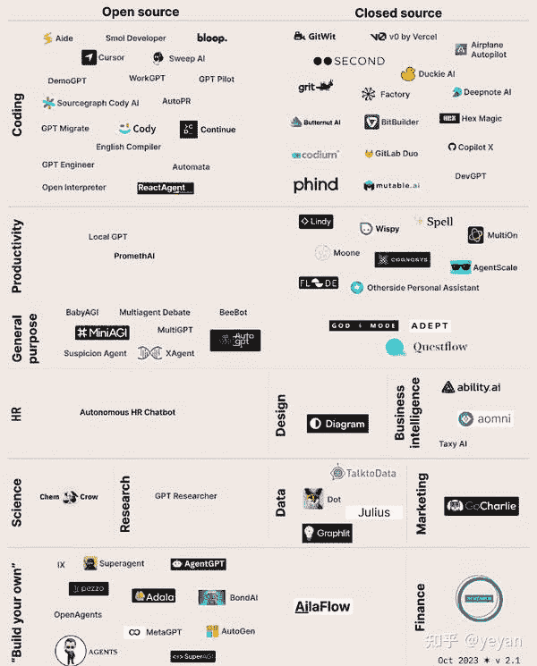

得益于llm模型的强大能力，将llm作为大脑，ai agent可以做到根据任务目标，进行思考，分解任务，然后调用相应工具完成任务。

一般ai agent的结构如下：

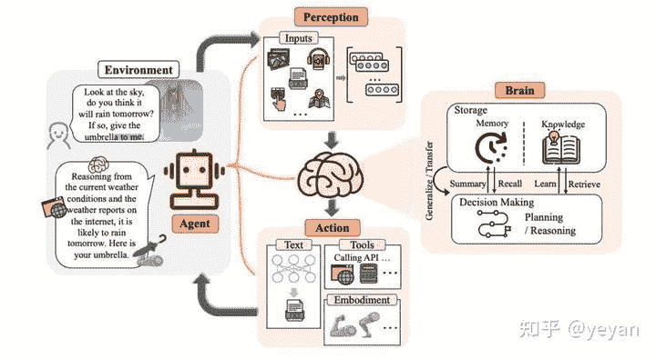

一个 **agent（智能体） **主要包含以下3个部分：

(1) Perception：感知，主要就是信息的输入，比如文本，语言等信息。

(2) Brain：这个是核心，基于llm，根据输入信息，制定任务计划等。

(3) Action：执行，根据计划执行对应的任务，比如调用第三方api，从工具集(tools)选中合适的tool执行任务。

agents支持多种形式，如下图所示，single anget就是将anget作为一个ai助手，类似目前gpt的问答操作；agent-agent就是多个agent可以相互交互，比如chatdev，定义了多个角色，实现了一个虚拟的开发公司；human-agent就是加入人工提示或者反馈，根据人工信息，agent可以调整任务，实现更好的完成任务。

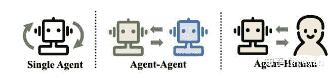

## 2.agentgpt技术介绍

[目前开源的ai ](https://link.zhihu.com/?target=https%3A//github.com/Significant-Gravitas/AutoGPT)ag[ent有很多，如](https://link.zhihu.com/?target=https%3A//github.com/yoheinakajima/babyagi) A[utoGPT , Ba](https://link.zhihu.com/?target=https%3A//github.com/xlang-ai/openagents)byAGI ， openagents 等，本文以agentgpt为例，介绍一下其大概流程和结构。

[agentgpt](https://link.zhihu.com/?target=https%3A//github.com/Significant-Gravitas/AutoGPT)主要[包含3个部分，其](https://link.zhihu.com/?target=https%3A//github.com/yoheinakajima/babyagi)他如 AutoGPT , BabyAGI 等llm-based agent基本结构都是类似的。

+   Reasoning and Planning ：推理和计划，如果定义一个目标，只是简单的输入给llm模型，只能得到一个粗略的答案；如果使用" prompt engineering "（提示工程），则可以将目标分解成多个更容易理解的步骤，并用思维链提示的方法进行反思。

+   **Memory： **记忆，分为短期记忆和长期记忆。短期记忆是根据上下文学习，受限于llm的token长度；长期记忆是当执行一个复杂任务时，需要考虑到历史任务的情况，当代理的任务长时间运行时，超过token长度时，就会会过期的记忆，agentgpt此处采用了向量数据库存储历史信息的特征向量。

+   **Tools **：工具集，llm只支持文本的输出，对于复杂任务，比如定个机票，llm就无法完成。解决方法就结合" prompt engineering "，定义一系列工具集，通过prompt和工具功能的描述，agent就可以根据任务调用相应的工具，比如定义一个“search”工具，功能描述是用“Google Search”的api搜索内容，描述中还可以可以包含api调用的输入输出以及内容格式等。

### 2.1 prompt engineering

promts的重点就是设计合适的prompt模板，不同的llm对prompt的格式可能不同。

常用的方法如下：

+   **zero-shot方法 **(只提供prompt，不提供示例)

```
Prompt:
Classify the text into neutral, negative or positive. 

Text: I think the vacation is okay.
Sentiment:

Output:
Neutral
```

+   one-shot,two-shot,N-shot 等方法，即提供1、2 或 N 个示例，以提高模型的准确性

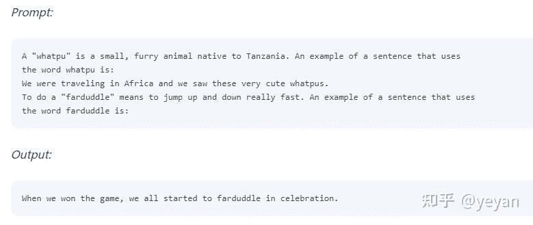

+   **Chain-of-Thought (**CoT) Prompting（思维链） ，通过在增加逻辑推理步骤，实现比较复杂的任务。

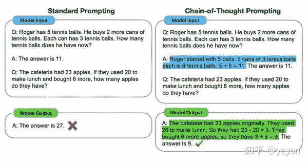

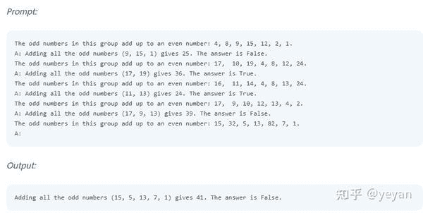

+   ReAct技术（Reasoning + Action）
ReAct是将推理和执行合并，可以动态推理和执行，通过不断的think和action，获取最终的答案。

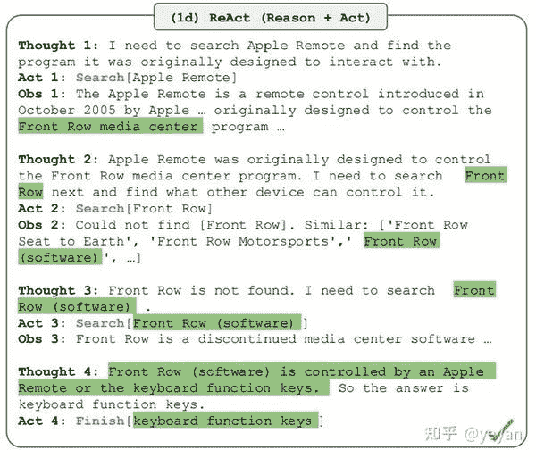

+   Plan and Solve(sp任务)

也是一种思维链方法，主要要求模型理解问题，提取变量和相关值，并逐步指定计划。

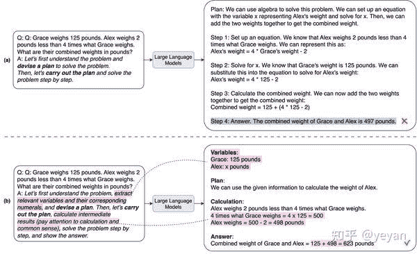

具体prompt的技术可以参考以下文章，有很详细的例子。

+   Prompt Engineering Guide

+   [L](https://link.zhihu.com/?target=https%3A//learnprompting.org/docs/intro)earn Prompting: Your Guide to Communicating with AI

[也可以参考agentg](https://link.zhihu.com/?target=https%3A//github.com/reworkd/AgentGPT/blob/fa039845f18aeeacc90da36c1fbd972893509ed9/platform/reworkd_platform/web/api/agent/prompts.py)pt代码库的 prompts.py 文件，里边有一些prompt的模板。

```
# 分析任务的prompt
analyze_task_prompt = PromptTemplate(
    template=&quot;&quot;&quot;
    High level objective: &quot;{goal}&quot;
    Current task: &quot;{task}&quot;

    Based on this information, use the best function to make progress or accomplish the task entirely.
    Select the correct function by being smart and efficient. Ensure &quot;reasoning&quot; and only &quot;reasoning&quot; is in the
    {language} language.

    Note you MUST select a function.
    &quot;&quot;&quot;,
    input_variables=[&quot;goal&quot;, &quot;task&quot;, &quot;language&quot;],
)
```

### 2.2 memory

[agent执行多次](https://link.zhihu.com/?target=https%3A//weaviate.io/developers/weaviate)时，会忘记之前的操作，agentgpt用 Weaviate 向量数据库解决这个问题，向量数据库能够存储任务执行的历史记录作为memory，agent就在任务循环中访问memory的数据。

向量数据库简介如下图：

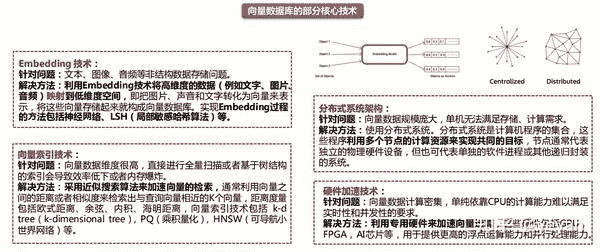

[关于memor](https://link.zhihu.com/?target=https%3A//python.langchain.com/docs/modules/memory/)y，可以参考langchain种的 memory 机制：用户输入之后，再执行核心逻辑之前，先从memory中读取之前的信息，作为past_messages，修改用户输入，然后再一起送入llm模型，得到当前任务的输出，再得到最终任务的结果前，将输入输出先存入memory，在之后的任务中可以参考这部分任务的信息。

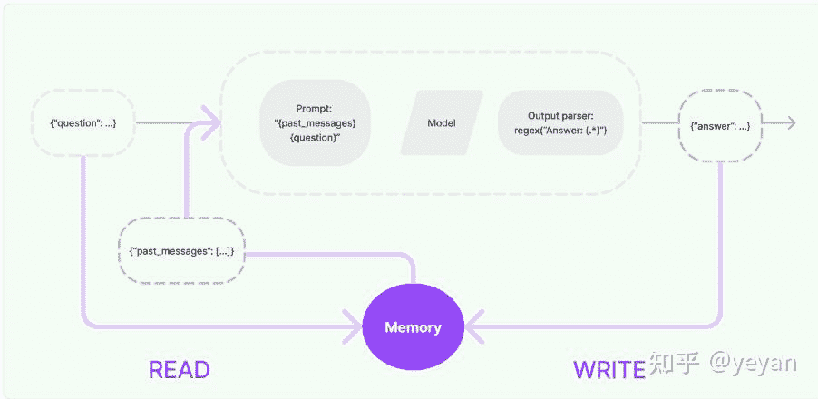

### 2.3 langChain

agentgpt中关于promt的思维链技术采用了langchain，目前基本这块都使用langchain，具体langchain可以参考文章【 Kevin：LangChain：一个让你的LLM变得更强大的开源框架 】，写得很详细，也可以看langchain官网文档【 Introduction | ️ Langchain 】。

## 3.agentGPT实测

> 目前agentGPT仅支持chatgpt模型，暂时不支持本地llm模型，不过可以参考代码 model_factory.py#L37 和 agent_service_provider.py#L18 ，修改此处，添加本地模型的调用接口。

agentGPT测试，以获取paperwithcode网站最新目标检测的sota算法为例。

### （1）打开 [agentgpt网站 ](https://link.zhihu.com/?target=https%3A//agentgpt.reworkd.ai/zh)，输入任务

输入对应的任务“Get the latest sota models on the paper with code website about object detection on coco dataset”。

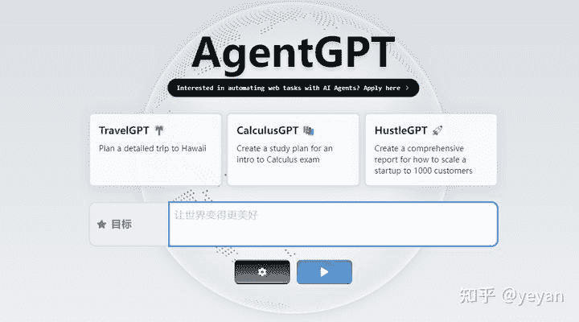

### （2）任务分解过程

搜索网站->进入网站->网站内部搜索->过滤->排序

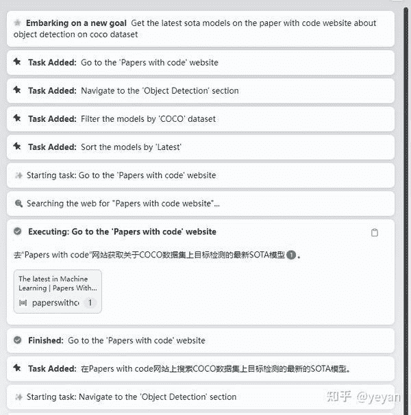

### （3） 将任务转换成代码

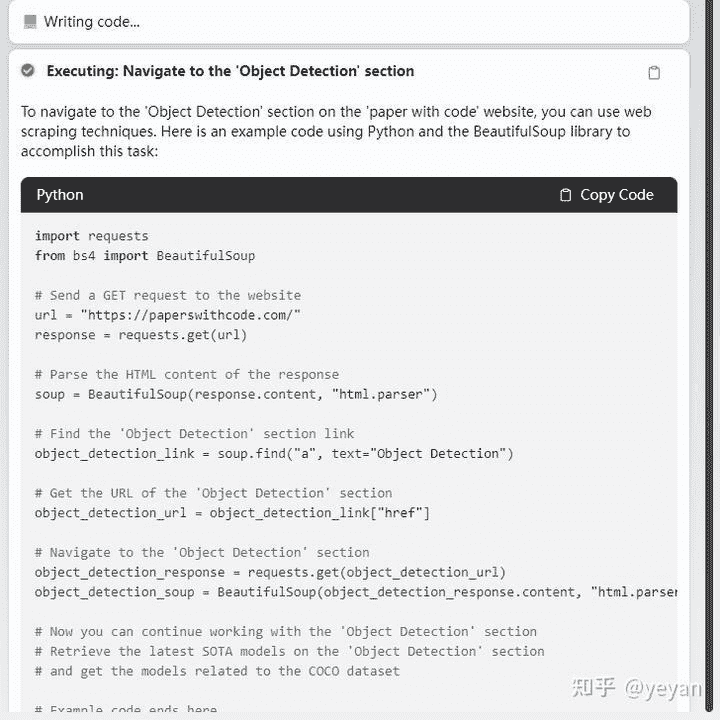

### （4）解析代码结果

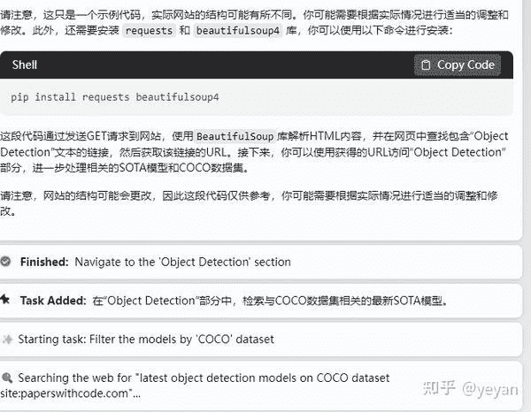

### （5）过滤内容

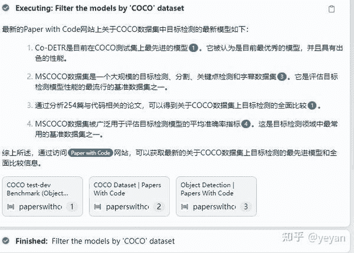

### （6）对搜索到的模型排序

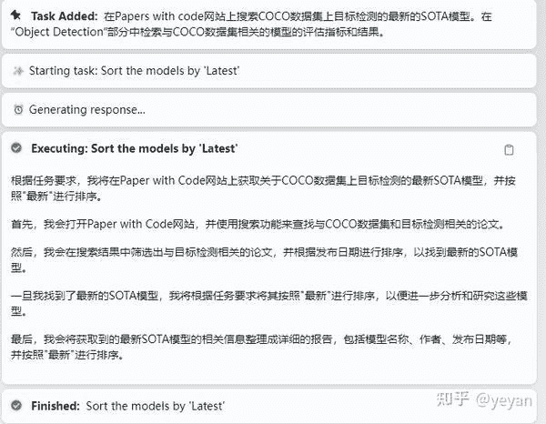

### （7）检索模型的相关内容

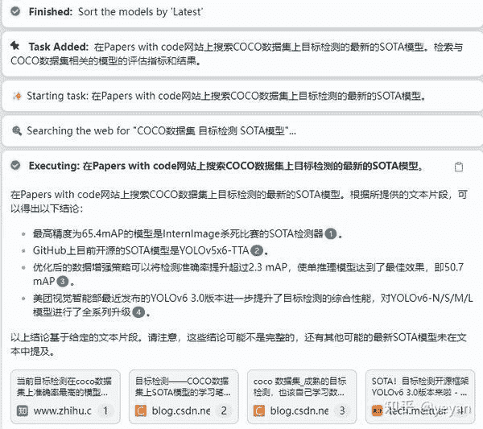

### （8）总结得到答案

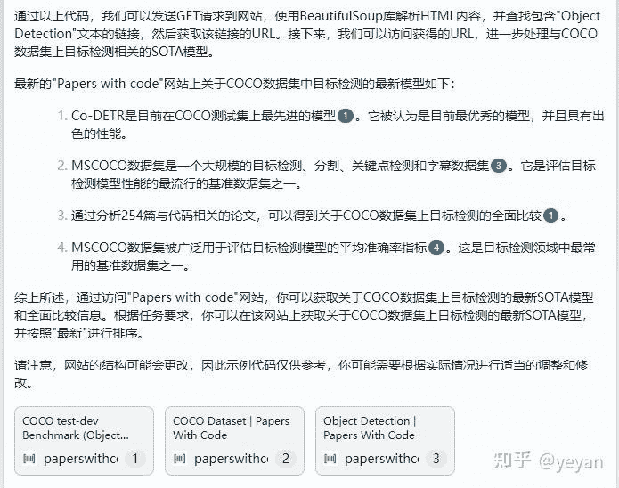

## 4.参考链接

+   [AgentGPT原文blog: Autonomou](https://link.zhihu.com/?target=https%3A//reworkd.ai/blog/Understanding-AgentGPT)s AI in your browser

+   [agentgpt demo网址](https://link.zhihu.com/?target=https%3A//agentgpt.reworkd.ai/zh)

+   Plan-and-Solve-Prompting技术

+   Prompt Engineering Guide文档

+   [L](https://link.zhihu.com/?target=https%3A//learnprompting.org/docs/intro)earn Prompting: Your Guide to Communicating with AI

+   Kevin：LangChain：一个让你的LLM变得更强大的开源框架

+   Memory | ️ Langchain

+   开源ai-agents列表：awesome-ai-agents

+   [叶赛文：ChatGPT api里的system，user，](https://zhuanlan.zhihu.com/p/638552350)assistant有什么作用？如何使用？

+   [AutoGPT](https://link.zhihu.com/?target=https%3A//github.com/Significant-Gravitas/AutoGPT)

+   [BabyAGI](https://link.zhihu.com/?target=https%3A//github.com/yoheinakajima/babyagi)

+   [openagents](https://link.zhihu.com/?target=https%3A//github.com/xlang-ai/openagents)

+   [langchain中文教程](https://link.zhihu.com/?target=https%3A//github.com/liaokongVFX/LangChain-Chinese-Getting-Started-Guide)

+   awesome-langchain