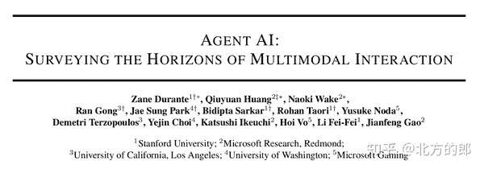
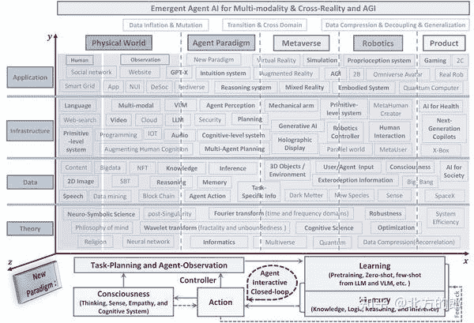
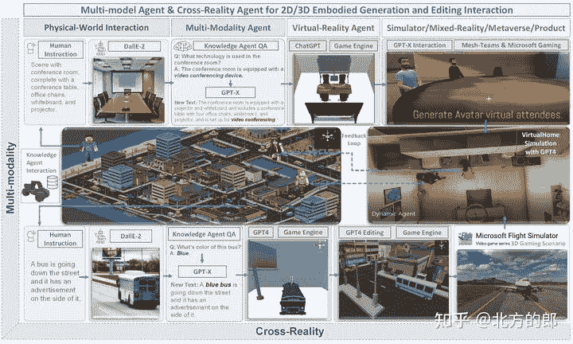
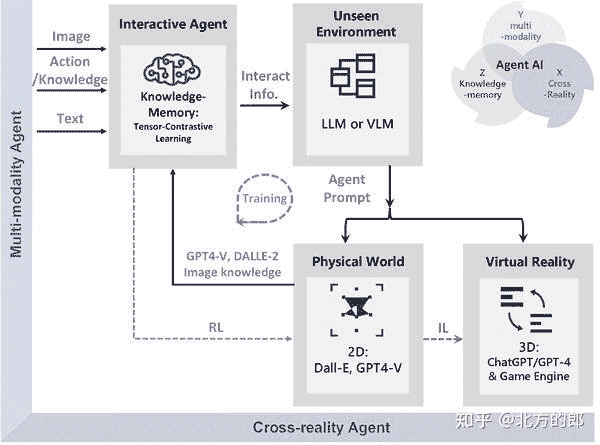
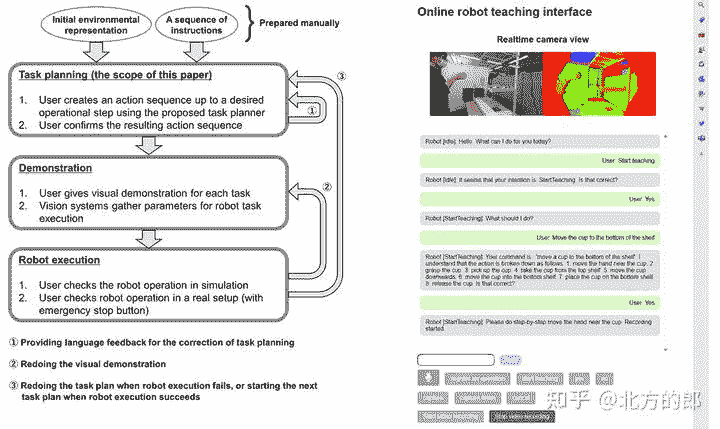
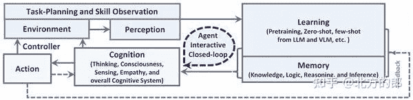
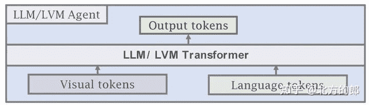
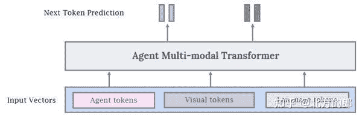

# Agent AI：多模态+智能体，跨模态交互综述 Part 1

> 来源：[https://agijuejin.feishu.cn/docx/NV4Udd519oZbjsxnlgCcc0bznmD](https://agijuejin.feishu.cn/docx/NV4Udd519oZbjsxnlgCcc0bznmD)

> 作者：北方的郎

> 原文：[https://zhuanlan.z](https://zhuanlan.zhihu.com/p/677891205)hihu.com/p/677891...

大模型发展的两个大趋势是多模态及智能体，那么多模态+智能体会构建出多么强大的人工智能呢？

来自斯坦福大学、微软研究、加利福尼亚大学洛杉矶分校的研究人员对此进行了研究，并发表了论文《AGENT AI: SURVEYING THE HORIZONS OF MULTIMODAL INTERACTION》。

原文链接： https:// arxiv.org/abs/2401.0356 8

为了方便大家学习，我对文章进行了翻译，因为文章太长，拆成了3部分进行翻译，这是其他2部分：

Part 2： [北方的郎：Agent AI：多模](https://zhuanlan.zhihu.com/p/677899464)态+智能体，跨模态交互综述 Part 2

Part 3： [北方的郎：Agent AI：多模](https://zhuanlan.zhihu.com/p/677906946)态+智能体，跨模态交互综述 Part 3

译文如下：

## Abstract

多模态人工智能系统很可能成为我们日常生活中无处不在的存在。使这些系统更具交互性的一种有前途的方法是将它们作为智能体存在于物理和虚拟环境中。目前，系统利用现有的基础模型作为创造具体化智能体的基本构建块。将智能体嵌入到这样的环境中有助于模型处理和解释视觉和环境上下文数据的能力，而这对于创建更复杂、更具上下文感知的人工智能系统至关重要。例如，一个能够感知用户行为、人类行为、环境物体、音频表达和场景集体情感的系统可以用来通知和指导智能体在给定环境中的反应。为了加快基于智能体体的多模态智能研究，我们将“Agent AI”定义为一类交互系统，该系统可以感知视觉刺激、语言输入和其他基于环境的数据，并能通过无限智能体产生有意义的具体化行为。特别是，我们探索旨在通过整合外部知识、多感官输入和人类反馈来改进智能体的系统，该系统基于下一个具体化的行为预测。我们认为，通过在有根环境中开发智能体人工智能系统，还可以减轻大型基础模型产生幻觉和生成环境不正确输出的倾向。智能体人工智能这一新兴领域包含了更广泛的具体化和智能体化多模态交互的方面。除了在物理世界中行动和相互作用的智能体之外，我们设想了一个未来的场景，人们可以轻松创建任何虚拟现实或模拟场景并与嵌入在虚拟环境中的智能体进行交互。

## 1 Introduction

## 1.1 Motivation

历史上，人工智能系统被定义为能够从环境中收集信息并以有用的方式与之互动的人造生命形态。受到这一定义的启发，Minsky的麻省理工学院团队于1970年构建了一个名为“仿制演示”的机器人系统，它观察了“方块世界”的场景并成功地重建了观察到的多面体块结构。这个系统包括观测、规划和操纵模块，揭示了每个子问题都非常困难，需要进一步的研究。人工智能领域分裂为专门的子领域，在解决这些和其他问题方面基本上独立地取得了巨大进展，但过度简化已经模糊了人工智能研究的总体目标。

为了超越现状，有必要回到以亚里士多德整体论为动力的人工智能基础。幸运的是，最近大型语言模型（LLMs）和视觉语言模型（VLMs）的革命使得能够创建与整体理想一致的新型人工智能智能体成为可能。抓住这个机会，本文探讨了集成语言能力、视觉认知、上下文记忆、直觉推理和适应性的模型。它探索使用LLMs和VLMs完成这种整体综合的潜力。在我们的探索中，我们还重新审视了基于亚里士多德最终原因的系统设计，即系统的目的，这在之前的人工智能发展中可能被忽视了。

随着强大的预训练LLMs和VLMs的出现，自然语言处理和计算机视觉迎来了复兴。LLMs现在展示出了从世界真实语言数据中解读微妙之处的令人印象深刻的能力，通常能达到或甚至超过人类专业知识的水平。最近，研究人员表明LLMs可以扩展为在各种环境中充当智能体，当与特定领域的知识和模块配对时，执行复杂的行动和任务。这些情境具有复杂的推理、对智能体角色和环境的理解，以及多步规划，考验了智能体在环境约束下做出高度微妙和复杂决策的能力。

在这些初步努力的基础上， 人工智能社区正处于一个重要的范式转变的边缘， 从为被动的结构化任务创建人工智能模型转向能够在各种复杂环境中扮演动态、智能体性角色的模型。在这种情况下，本文考察了将LLMs和VLMs作为智能体的巨大潜力，并强调了具有语言能力、视觉认知、上下文记忆、直觉推理和适应性的模型。利用LLMs和VLMs作为智能体，特别是在游戏、机器人技术和医疗保健等领域，不仅为最先进的人工智能系统提供了严格的评估平台，还预示了以智能体为中心的人工智能对社会和产业产生的变革性影响。当充分利用时，智能体模型可以重新定义人类体验并提升运营标准。由这些模型带来的全面自动化潜力预示着产业和社会经济动态的巨大变化。这样的进展将与多层次的领导者竞赛紧密相连，不仅是技术层面上的竞赛，也涉及道德层面，我们将在第11节详细阐述。我们探讨了Agent AI这些子领域的重叠区域，并在图1中说明了它们的相互关系。

## 1.2 Background

我们将介绍支持Agent AI的概念、理论背景和现代实现的相关研究论文。

大型基础模型: LLM和VLM一直推动着智能机器的发展努力(Bubeck et al., 2023; Mirchandani et al., 2023)。尽管它们是使用大型文本语料库进行训练的，但它们卓越的问题解决能力并不局限于经典的语言处理领域。LLM有潜力处理以前被认为只有人类专家或领域专用算法才能做到的复杂任务，范围包括数学推理(Imani etal., 2023; Wei et al., 2022; Zhu et al., 2022)、回答专业法律问题(Blair-Stanek et al., 2023; Choi et al., 2023; Nay,2022)等。最近的研究表明，使用LLM为机器人和游戏AI生成复杂计划是可能的(Liang et al., 2022; Wang et al.,2023a,b; Yao et al., 2023a; Huang et al., 2023a)，这标志着LLM作为通用智能智能体的重要里程碑。具身化智能: 许多研究利用LLM执行任务规划(Huang et al., 2022a; Wang et al., 2023b; Yao et al., 2023a; Li et al.,2023a)，具体利用LLM的全球网规模领域知识和新出现的零-shot具身化能力来执行复杂任务规划和推理。最近的机器人研究还利用LLM执行任务规划(Ahn et al., 2022a; Huang et al., 2022b; Liang et al., 2022)，将自然语言指令分解为一系列子任务，采用自然语言形式或Python代码，然后使用低级控制器执行这些子任务。此外，它们还包括环境反馈来提高任务性能(Huang et al., 2022b)，(Liang et al., 2022)，(Wang et al., 2023a)和(Ikeuchi etal., 2023)。

互动式学习: 为互动学习设计的AI智能体使用了机器学习技术和用户交互的组合。首先，AI智能体在大型数据集上进行训练。该数据集包含各种类型的信息，具体取决于智能体的预期功能。例如，针对语言任务设计的AI会在大规模的文本数据语料库上进行训练。训练过程中使用机器学习算法，包括神经网络等深度学习模型。这些训练模型使得AI能够识别模式、作出预测并根据所训练的数据生成回应。AI智能体还可以从与用户的实时交互中学习。这种互动学习可以通过以下几种方式进行：1）基于反馈的学习：AI根据直接用户反馈来调整其回应(Li et al., 2023b; Yu et al., 2023a; Parakh et al., 2023; Zha et al., 2023; Wake et al., 2023a,b,c)。例如，如果用户纠正了AI的回应，AI可以利用这些信息来改进未来的回应(Zha et al., 2023; Liu et al., 2023a)。2）观察性学习：AI观察用户的交互并隐式学习。例如，如果用户经常提出类似的问题或以特定方式与AI进行交互，AI可能会调整回应以更好地适应这些模式。它使得AI智能体能够理解和处理人类语言、多模态环境、解释跨现实环境并生成人类用户的回应。随着更多的用户交互和反馈，AI智能体的性能通常会持续改进。这个过程通常由人为操作员或开发人员监督，以确保AI的学习适当，不会产生偏见或错误的模式。

## 1.3 Overview

多模态Agent AI（Multimodal Agent AI，MAA）是一类根据对多模态感知输入的理解，在给定环境中生成有效行动的系统家族。随着大型语言模型（Large Language Models，LLMs）和视觉语言模型（VisionLanguage Models，VLMs）的出现，许多MAA系统已经在基础研究和应用领域提出。尽管这些研究领域通过与各个领域的传统技术整合（例如视觉问题回答和视觉-语言导航）而迅速增长，但它们共享共同关注点，如数据集收集、基准测试和伦理观点。在本文中，我们着重关注MAA的一些代表性研究领域，即多模态、游戏（VR/AR/MR）、机器人技术和医疗保健，并旨在全面了解这些领域讨论的共同关注点。因此，我们期望学习MAA的基本原理，并深入了解进一步推进其研究的见解。具体的学习目标包括：

●MAA综述：深入探讨其原理和在当代应用中的角色，为研究人员提供全面了解其重要性和用途的机会。

●方法论： 通过在游戏、 机器人和医疗保健领域的案例研究中详细阐述LLMs和VLMs如何增

强MAAs的实例来加以说明。

●性能评估：关于使用相关数据集进行MAAs评估的指导，重点关注其有效性和推广性。

●伦理考虑：讨论部署智能智能体的社会影响和伦理标准，突出负责任的开发实践。

●新兴趋势与未来发展方向：对各个领域的最新发展进行分类，并讨论其未来的发展方向。

计算机化行动和通用型智能智能体（GAs）对于许多任务都是有用的。要使GA对其用户真正有价值，它必须具备自然互动和广泛泛化的能力，可适应各种上下文和模态。我们的目标是培育一个充满活力的研究生态系统，为Agent AI社区建立共同的身份认同和目标。MAA在各种上下文和模态，包括人类输入方面具有广泛的适用性。因此，我们相信Agent AI领域可以吸引各种不同领域的研究人员，促进Agent AI社区的活跃与共享目标。在学术界和工业界的杰出专家的带领下，我们期待这篇论文将成为一个互动且丰富的经验，包括智能体指令、案例研究、任务讨论以及实验讨论，确保所有研究人员获得全面而有吸引力的学习体验。

本文旨在提供Agent AI领域当前研究的普遍和全面知识。 为此， 本文的其他部分安排如下。 第 2节概述了Agent AI如何从与相关新兴技术的整合中受益，尤其是大型基础模型。第 3节描述了我们提出的用于训练Agent AI的新范式和框架。第 4节概述了在Agent AI训练中广泛使用的方法论。第 5节对各种类型的智能体进行分类和讨论。第 6节介绍了Agent AI在游戏、机器人和医疗保健领域的应用。第 7节探讨了研究界努力开发具有广泛模态适应性的Agent AI，能够应用于各种模态、领域，并填补模拟到真实世界的差距。第 8节讨论了Agent AI不仅依赖预训练的基础模型，还通过与环境和用户的交互不断学习和自我提高的潜力。第 9节介绍了我们为多模态Agent AI的训练而设计的新数据集。第 11节讨论了AI智能体的伦理问题，以及本文的局限性和社会影响的热门话题。

## 2 Agent AI Integration

基于LLMs和VLMs的基础模型，正如先前研究所提出的，仍然在具体化人工智能领域表现出有限的性能，特别是在理解、生成、编辑和与未见过的环境或场景进行交互方面（Huang et al., 2023; Zeng et al., 2023）。因此，这些限制导致人工智能智能体的输出结果不够优化。

当前以智能体为中心的人工智能建模方法集中在直接可访问和明确定义的数据上（例如，世界状态的文本或字符串表示），并通常使用其大规模预训练中学到的与领域和环境无关的模式来预测每个环境的动作输出（Xiet al., 2023; Wang et al., 2023; Gong et al., 2023; Wu et al., 2023）。

在(Huang et al., 2023a)中，我们通过结合大型基础模型，研究了基于知识引导的协作和交互场景生成任务，并展示了有希望的结果，表明基于知识的LLM智能体可以提高2D和3D场景理解、生成和编辑的性能，同时还可以实现其他人与智能体之间的交互（Huang et al., 2023）。

通过整合Agent AI框架，大型基础模型能够更深入地理解用户输入，形成一个复杂而适应性强的人机交互系统。LLM和VLM的崭露的能力在生成人工智能、具身化人工智能、知识增强多模型学习、混合现实生成、文本与视觉编辑、二维/三维游戏或机器人任务中的人机交互中起着重要作用。Agent AI在基础模型方面的最新进展为开启具身智能体的普适智能提供了一个即将到来的催化剂。大型行动模型或Agent-Vision-Language模型为规划、问题解决和复杂环境中的学习等通用具身系统提供了新的可能性。Agent AI在元宇宙中进一步进行的测试是通向通用人工智能（AGI）的早期阶段之一。

## 2.1 Infinite AI agent

AI智能体具有根据其训练和输入数据进行解释、预测和响应的能力。虽然这些能力是先进的，并且不断改进，但我们必须认识到它们的限制以及其所训练的基础数据的影响。

AI智能体系统通常具有以下能力： 1）预测建模：AI智能体可以基于历史数据和趋势预测可能的结果或建议下一步行动。例如，它们可以预测文本的续写、问题的答案、机器人的下一步行动或场景的解决办法。 2）决策制定：在某些应用中，AI智能体可以根据其推理做出决策。通常，智能体将基于最有可能实现特定目标的方式进行决策。对于像推荐系统这样的AI应用，智能体可以根据对用户偏好的推断来决定推荐哪些产品或内容。 3）处理模糊性：AI智能体通常可以通过推断最有可能的解释来处理模糊的输入，这是基于上下文和训练的。然而，它们的能力受限于其训练数据和算法的范围。 4）持续改进：虽然一些AI智能体有能力从新的数据和交互中学习，但许多大型语言模型在训练后通常不会持续更新其知识库或内部表示。它们的推断通常仅基于其上次训练更新时可用的数据。

图 2展示了增强的多模态与跨现实无关集成的新兴机制。AI智能体在每个新任务中需要收集大量的训练数据，这对许多领域可能是昂贵的或不可能的。在本研究中，我们开发了一个无限智能体，它学会将来自通用基础模型（例如GPT-X、DALL-E）的记忆信息转移到新领域或场景，以实现对物理世界或虚拟世界的场景理解、生成和交互式编辑。

这种无限智能体在机器人领域的一个应用是RoboGen (Wang et al., 2023d)。在这项研究中，作者提出了一个能够自主运行任务建议、环境生成和技能学习周期的流水线。RoboGen是将嵌入在大型模型中的知识转移到机器人领域的一项努力。

## 2.2 Agent AI with Large Foundation Models

最近的研究表明，大型基础模型在创建数据方面起着关键作用，这些数据作为确定在环境约束下智能体的行动的基准。例如，使用基础模型进行机器人操作 (Black et al., 2023; Ko et al., 2023)和导航 (Shah et al., 2023a; Zhouet al., 2023a)。以黑特与库兰为例，他们使用图像编辑模型作为高级规划器，生成未来子目标的图像，从而引导低级策略 (Black et al., 2023)。对于机器人导航，沙赫等人提出了一种系统，该系统利用LLM从文本中识别地标，并利用VLM将这些地标与视觉输入关联起来，通过自然语言指令提升导航能力 (Shah et al., 2023a)。此外，越来越多的研究关注对语言和环境因素作出反应的条件下生成人体动作。多个人工智能系统被提出，以根据具体的语言指令生成动作和行为 (Kim et al., 2023; Zhang et al., 2022; Tevet et al., 2022)，并适应各种三维场景 (Wang et al., 2022a)。这些研究强调了生成模型在提高人工智能智能体的适应性和响应能力方面的不断增强的能力。

### 2.2.1 Hallucinations

生成文本的智能体通常容易产生错觉，即生成的文本与提供的源内容不符或不符合实际 (Raunak et al., 2021;Maynez et al., 2020)。错觉可以分为两类，即内在和外在错觉 (Ji et al., 2023)。内在错觉是与源材料相矛盾的错觉，而外在错觉是生成的文本包含了源材料中原本没有包含的附加信息。

减少语言生成中错觉率的一些有希望的途径包括使用检索增强生成 (Lewis et al., 2020; Shuster et al., 2021)或通过外部知识检索来对自然语言输出进行基础化的其他方法 (Dziri et al., 2021; Peng et al., 2023)。一般来说，这些方法通过检索额外的源材料，并提供机制来检查生成的回应与源材料之间的矛盾，从而增强语言生成。在多模态智能体系统的背景下，也已经发现了视觉语言模型的错觉问题 (Zhou et al., 2023b)。基于视觉的语言生成的一个常见原因是过度依赖训练数据中物体的共现和视觉暗示 (Rohrbach et al., 2018)。完全依赖预训练LLM或VLM的AI智能体，并进行有限的环境特定微调，可能特别容易产生错觉，因为它们依赖于预训练模型的内部知识库来生成动作，并可能无法准确理解部署环境中的世界状态动态。

### 2.2.2 Biases and Inclusivity

基于LLMs或LMMs（大型多模态模型）的AI智能体存在与其设计和训练过程中的若干因素相关的偏见。在设计这些AI智能体时，我们必须注意到包容性，并了解所有最终用户和利益相关者的需求。在AI智能体的背景下，“包容性”指采取措施和原则，以确保智能体的回应和互动对来自不同背景的广泛用户是包容、尊重和敏感的。我们以下列出智能体的偏见和包容性的关键要点。

●训练数据：基础模型是通过收集自互联网的大量文本数据进行训练的，包括书籍、文章、网站和其他文本来源。这些数据往往反映了人类社会中存在的偏见，模型可能会无意中学习并复制这些偏见。其中包括与种族、性别、民族、宗教和其他个人属性相关的刻板印象、偏见和倾斜观点。特别是通过在互联网数据上进行训练，通常只使用英文文本，模型会隐含地学习西方、受教育、工业化、富裕和民主（WEIRD）社会的文化规范 (Henrich et al., 2010)，而这些社会在互联网上的存在是不成比例的。然而，必须认识到由人类创建的数据集不可能完全没有偏见，因为它们经常反映了社会偏见和最初生成和/或编制数据的个人的倾向。

●历史和文化偏见：AI模型是在大型多样化内容的数据集上进行训练的。因此，训练数据经常包含历史文本或来自不同文化的材料。特别是来自历史来源的训练数据可能包含冒犯性或贬损性语言，代表了某个社会的文化规范、态度和偏见。这可能导致模型持续强化过时的刻板印象，或无法完全理解当代文化变迁和微细差异。

●语言和情境限制:语言模型可能难以理解并准确呈现语言中的细微差别，例如讽刺、幽默或文化参考。这可能导致在特定情境下的误解或偏见回答。此外，口语中许多方面无法通过纯文本数据捕捉，从而导致人类理解语言与模型理解语言之间可能存在不一致的情况。

●政策和指南：AI智能体在严格的政策和指南下运作，以确保公平和包容性。例如，在生成图像时，有规定要多样化地描绘人物，避免涉及种族、性别和其他属性的刻板印象。

●概括过度:这些模型倾向于根据训练数据中观察到的模式生成回答。这可能导致概括过度，模型可能会产生对某些群体进行刻板印象或广泛假设的回答。

●持续监控和更新: AI系统被持续监控和更新，以解决任何新出现的偏见或包容性问题。用户的反馈以及在AI伦理方面的持续研究在这一过程中起到了关键作用。

●主导观点的放大: 由于训练数据通常更多地包含来自主导文化或群体的内容，因此模型可能更加偏向这些观点，可能会不充分地或错误地代表少数群体的观点。

●道德和包容性设计：AI工具应以道德考虑和包容性原则为核心进行设计。这包括尊重文化差异、促进多样性，以及确保AI不会持续传播有害的刻板印象。

●用户指南：用户还应该以促进包容性和尊重的方式与人工智能进行互动。这包括不提出可能导致偏见或不适当输出的要求。此外，这也有助于减轻模型从用户互动中学习有害材料的问题。

尽管采取了这些措施，AI智能体仍然存在偏见。在智能体AI研究和开发方面，目前的努力集中于进一步减少这些偏见，提高智能体AI系统的包容性和公平性。减轻偏见的努力：

●多样且包容的训练数据：我们努力将更多多元且包容性强的来源纳入训练数据中。

●偏见检测和修正:当前的研究着重于检测和修正模型回应中的偏见。

●伦理指南和政策：模型通常受到伦理指南和政策的规范，旨在减少偏见并确保尊重和包容的互动。●多样化的表述: 确保由AI智能体生成的内容或提供的回复能够充分代表多种人类经验、文化、种族和身份。这在图像生成或叙事构建等场景特别重要。

●偏见缓解: 积极努力降低人工智能回应中的偏见。这包括与种族、性别、年龄、残疾、性取向和其他个人特征相关的偏见。目标是提供公正和平衡的回应，不要持续强化刻板印象或偏见。

●文化敏感性：该人工智能系统的设计中考虑到了文化敏感性，认可并尊重不同的文化规范、习俗和价值观。这包括理解并适当地回应文化参照和细微差别。

●可访问性：确保人工智能（AI）智能体程序对不同能力的用户可访问性，包括残障人士。这可能涉及到整合一些功能，使得有视觉、听觉、运动或认知功能障碍的人易于进行交互。

●基于语言的包容性: 提供支持多种语言和方言，以满足全球用户群的需求，并对语言中的细微差异和变化保持敏感 (Liu et al., 2023b)。

●道德和尊重的互动：该智能智能体程序被设定为与所有用户进行道德和尊重的互动，避免产生可能被视为冒犯、有害或不尊重的回应。

●用户反馈和适应性: 将用户反馈纳入AI智能体的持续改进过程，以提高包容性和效果。这包括通过学习互动来更好地理解和服务多样化的用户群体。

●遵循包容性准则: 遵守人工智能智能体的包容性准则和标准，通常由行业组织、伦理委员会或监管机构制定。

尽管进行了这些努力，但我们需要意识到回应中存在潜在的偏见，并运用批判性思维来解读它们。人工智能智能体技术和道德实践的持续改进旨在逐步减少这些偏见。在Agent AI中，包容性的一个总体目标是创造一个尊重和面向所有用户的智能体，无论他们的背景或身份如何。

### 2.2.3 Data Privacy and Usage

一个关键的人工智能智能体伦理考虑因素是了解这些系统如何处理、存储和潜在地检索用户数据。我们在下面讨论了关键方面:

数据收集、使用和目的。 在使用用户数据来提高模型性能时，模型开发人员可以访问AI智能体在生产过程中和与用户交互时收集的数据。一些系统允许用户通过用户账户或向服务提供商提出请求来查看他们的数据。重要的是要了解AI智能体在这些交互过程中收集了哪些数据。这可能包括文本输入、用户使用模式、个人偏好，以及有时更敏感的个人信息。用户还应了解从他们的交互中收集的数据是如何使用的。如果AI对某个特定个人或群体的信息持有错误的观点，用户应该有一种机制来帮助纠正这一点。这对准确性和尊重所有用户和群体都很重要。检索和分析用户数据的常见用途包括改进用户交互、个性化回应和系统优化。开发人员非常重要的一点是确保数据不被用于用户未同意的目的，例如未经请求的营销。

存储与安全。 开发人员应了解用户交互数据存储在哪里以及有什么安全措施来保护数据免受未经授权的访问或违规行为。这包括加密、安全服务器和数据保护协议。要确定智能体数据是否与第三方共享以及在什么条件下共享。这应该是透明的，并且通常需要用户的同意。

数据删除与保留。 用户也应了解用户数据存储多长时间以及如何请求删除数据。许多数据保护法律赋予用户被遗忘的权利，意味着他们可以要求删除他们的数据。人工智能智能体必须遵守欧盟的GDPR或加利福尼亚的CCPA等数据保护法律。这些法律规定了数据处理实践和用户个人数据的权利。

数据可移植性和隐私政策。 此外，开发人员必须制定人工智能智能体的隐私政策，以记录和解释用户数据如何处理。这应该详细说明数据收集、使用、存储和用户权利的情况。开发人员应确保在收集数据时获得用户的同意，尤其是对于敏感信息。用户通常可以选择退出或限制他们提供的数据。在某些司法管辖区，用户甚至可以要求以可以转移到另一个服务提供商的格式获得其数据的副本。

匿名化。 对于用于更广泛的分析或人工智能训练的数据，理想情况下应进行匿名化来保护个人身份。开发人员必须了解他们的人工智能智能体在交互过程中如何检索和使用历史用户数据。这可以用于个性化或改进回应的相关性。

总之，在了解人工智能智能体的数据隐私方面，需要知道用户数据是如何收集、使用、存储和保护的，并确保用户了解他们在访问、更正和删除数据方面的权利。了解用户和AI智能体之间的数据检索机制对于全面了解数据隐私也是至关重要的。

### 2.2.4 Interpretability and Explainability

模仿学习 → 解耦。 在强化学习（RL）或模仿学习（IL）中，通常使用一个连续的反馈循环对智能体进行训练，从一个随机初始化的策略开始。然而，当奖励稀疏或仅在长期交互的最后可用时，这种方法在陌生环境中获得初始奖励面临着困难。因此，一种更优的解决方案是使用通过IL训练的无限记忆智能体，它可以从专家数据中学习策略，改进探索和利用未知环境空间，如图 3所示。通过专家特征帮助智能体更好地探索和利用未知的环境空间。智能体AI可以直接从专家数据中学习策略和新的范式流程。

传统的模仿学习使智能体模仿专家示范者的行为来学习策略。然而，直接学习专家策略可能并不是最佳方法，因为智能体可能不能很好地推广到未知情况。为了解决这个问题，我们提出了使用上下文提示或隐式奖励函数来学习一个智能体，该函数捕捉到专家行为的关键方面，如图 3所示。这使得无限记忆智能体具有了来自物理世界行为数据的任务执行能力，这些数据是从专家示范中学习的。它有助于克服传统模仿学习的缺点，如对大量专家数据和复杂任务中潜在错误的需求。 Agent AI的关键思想有两个部分：1）无限智能体收集物理世界专家演示的状态动作对，2）虚拟环境模仿智能体生成器。模仿智能体产生模仿专家行为的动作，而智能体通过减少专家动作和学习策略生成的动作之间差异的损失函数，学习从状态到动作的映射策略。

解耦 → 泛化。 与依赖于特定任务的奖励函数的做法不同， 智能体通过学习专家演示来获得知识， 这些演示提供了覆盖各种任务方面的不同状态动作对。 然后， 智能体通过模仿专家的行为来学习将状态映射到动作的策略。 模仿学习中的解耦是指将学习过程与特定任务的奖励函数分离开来， 使策略能够在不明确依赖特定任务的奖励函数的情况下在不同任务之间进行泛化。 通过解耦， 智能体能够通过学习专家演示来学习一个适应各种情况的策略。 解耦可以实现迁移学习， 在一个领域学到的策略可以在其他领域进行最小的微调后适应。 通过学习一个不依赖于特定奖励函数的通用策略， 智能体可以利用在一个任务中获得的知识来在其他相关任务中表现良好。 由于智能体不依赖于特定奖励函数， 它可以适应奖励函数或环境的变化而无需进行重大的重新训练。 这使得学到的策略在不同环境中更加稳健和具有泛化能力。 在这个上下文中， 解耦指的是学习过程中两个任务的分离： 学习奖励函数和学习最优策略。

从泛化到新兴行为。 泛化解释了如何从简单组件或规则中产生新兴的属性或行为。其关键在于确定系统行为的基本元素或规则，如个体神经元或基本算法。因此，通过观察这些简单组件或规则之间的相互作用，可以导致复杂行为的出现。这些组件之间的相互作用往往不能仅通过研究个体组件来预测。在不同复杂性层次之间的泛化能够使系统学习到能够适用于这些层次的通用原则，从而产生新兴的属性。这使得系统能够适应新的情境，展现出从简单规则中产生的更复杂行为的出现。此外，能够在不同复杂性层次之间进行泛化的能力有助于知识在不同领域之间的转移，为系统在新的上下文中适应时的复杂行为的出现做出贡献。

### 2.2.5 Inference Augmentation

AI智能体的推理能力在于根据其训练和输入数据进行解释、预测和响应的能力。虽然这些能力是先进的且不断改进的，但我们需要认识到它们的局限性和受其训练数据的影响。特别是在大型语言模型的背景下，它指的是根据其训练数据和接收到的输入，推断结论、进行预测和生成响应的能力。AI智能体的推理增强指的是通过额外的工具、技术或数据来增强AI的自然推理能力，以提高其性能、准确性和实用性。这在复杂的决策场景或处理微妙或专业化内容时尤为重要。我们在下面特别重要的推理增强的来源如下：

数据丰富 . 将额外的、通常是外部的数据源结合到一起，以提供更多的背景或上下文，可以帮助AI智能体做出更明智的推理，特别是在其训练数据可能有限的领域。例如，AI智能体可以推断对话或文本的含义。它们分析给定的信息，并使用它来理解用户查询的意图和相关细节。这些模型善于识别数据中的模式。它们利用这种能力基于它们在训练过程中学到的模式对语言、用户行为或其他相关现象进行推理。

算法增强 . 改进AI的基础算法，以做出更好的推理。这可能涉及使用更先进的机器学习模型，集成不同类型的AI（如将自然语言处理与图像识别结合起来），或更新算法以更好地处理复杂任务。语言模型的推理涉及理解和生成人类语言。这包括理解语气、意图和不同语言结构的微妙之处。

人在循环中（HITL） . 在人的输入下来增强AI的推理，在人类判断至关重要的领域特别有用，例如伦理考虑、创造性任务或模糊场景。人类可以提供指导、纠正错误或提供智能体本身无法推断的见解。

实时反馈整合 . 使用用户或环境的实时反馈来增强推理的方法是提高推理性能的另一种有前途的方法。例如，AI可以根据用户的实时反应或动态系统中的变化条件来调整其推荐。或者，如果智能体在模拟环境中执行违反某些规则的操作，可以动态地给予反馈以帮助其进行纠正。

跨领域知识转移 . 利用从一个领域获得的知识或模型来改善另一个领域的推理，特别在生产专业学科输出时非常有帮助。例如，为语言翻译所开发的技术可以应用于代码生成，或者从医学诊断中获得的见解可以增强机械设备的预测性维护。

针对特定用途的定制 . 为特定应用或行业量身定制AI的推理能力可以涉及将AI训练于专门的数据集，或微调其模型以更适应特定任务，例如法律分析、医学诊断或金融预测。由于一个领域内的特定语言或信息可能与其他领域的语言有很大的对比，因此在领域特定的信息上微调智能体可能是有益的。

伦理和偏见的考虑 . 确保增强过程不引入新的偏见或伦理问题非常重要。这需要仔细考虑额外数据的来源或新推理增强算法对公平性和透明性的影响。在进行推理时，特别是关于敏感话题的推理时，AI智能体有时必须处理伦理问题。这包括避免有害的刻板印象，尊重隐私和确保公平性。

持续的学习和适应 . 定期更新和优化AI的能力，以跟上新的发展、不断变化的数据环境和不断演变的用户需求。

简而言之，AI智能体的推理增强涉及通过额外的数据、改进的算法、人类输入和其他技术来增强其自然推理能力的方法。根据使用情况，这种增强通常对处理复杂任务和确保智能体输出的准确性至关重要。

### 2.2.6 Regulation

最近，Agent AI取得了显著的进展，并且其与具体系统的整合为通过沉浸式、动态和吸引人的体验与智能体进行交互开辟了新的可能性。为了加快此过程并简化在智能体AI开发中繁琐的工作，我们建议开发下一代AI增强的智能体交互流水线。开发一个人机协作系统，人类和机器可以进行有意义的交流和互动。该系统可以利用LLM或VLM对话能力和广泛的行动来与人类玩家交谈并识别人类需求。然后，它将根据请求采取适当的行动来帮助人类玩家。

在人机协作系统中使用LLM/VLM时， 需要注意的是它们作为黑匣子运行， 生成不可预测的输出。 这种不确定性在物理设置（如操作实际机器人）中可能变得关键。解决这一挑战的方法是通过提示工程来限制LLM/VLM的焦点。例如，在根据指令进行机器人任务规划时，提供提示中的环境信息据报道可以产生比仅依赖文本更稳定的输出 (Gramopadhye and Szafir, 2022)。这份报告得到了Minsky的AI框架理论的支持(Minsky, 1975)，该理论认为，LLM/VLM需要解决的问题空间由给定的提示定义。另一种方法是设计提示，使LLM/VLM包含解释性文本，以便用户了解模型关注或识别的内容。此外，实施一个允许在人类指导下进行预执行验证和修改的更高层次可以促进在此类指导下工作的系统的操作（图 4）。

## 2.3 Agent AI for Emergent Abilities

尽管交互式智能智能体系统的采用不断增长，但大部分提出的方法在未知环境或情境中的泛化性能方面仍面临挑战。目前的建模方法要求开发人员为每个领域准备大规模数据集以微调/预训练模型；然而，如果领域是新的，这个过程既费时又可能不可行。为了解决这个问题，我们构建了一种交互式智能体，利用通用基础模型（如ChatGPT、Dall-E、GPT-4等）的知识存储来生成人类和智能体之间的协作空间，专门用于一个新颖的场景。我们发现了一种新兴机制 - 我们将其命名为混合现实与知识推理交互，这种机制促进了与人类的合作，以解决复杂实际环境中的困难任务，并能够探索未知环境以适应虚拟现实。对于这种机制，智能体学习了以下内容：i）跨模态的微观反应：从显式网络源和从预训练模型的输出中隐式推断（例如，理解未见过的场景），收集每个交互任务的相关个体知识；ii）与现实无关的宏观行为：改进语言和多模态领域中的交互维度和模式，并基于特征化的角色、特定目标变量、对混合现实和LLMs中的协作信息的受影响分散进行变更。我们研究了基于知识引导的互动协同效应，在结合各种OpenAI模型的情况下生成协同场景，并展示了交互式智能体系统如何进一步提升我们设置中的大型基础模型。它整合并改进了复杂自适应AI系统的泛化深度、意识和可解释性。

## 3 Agent AI Paradigm

在本节中，我们讨论了一种用于培训Agent AI的新范式和框架。我们的目标是通过我们提出的框架实现几个目标：

●利用现有的预训练模型和预训练策略，有效地为我们的智能体提供对重要模态（比如文本或视觉输入）的有效理解。

●支持足够的长期任务规划能力。

●融入一个记忆框架，使得学到的知识能够被编码并在以后进行检索。

●允许利用环境反馈来有效地训练智能体学习应该采取的行动。

我们在图 5中展示了一个高层次的新智能体图，概述了这种系统的重要子模块。

## 3.1 LLMs and VLMs

我们可以使用LLM模型或VLM模型来引导Agent的组件，如图 5所示。特别是，LLM已被证明在任务规划方面表现良好 (Gong et al., 2023a)，含有丰富的世界知识 (Yu et al., 2023b)，并展示出出色的逻辑推理能力 (Creswell et al., 2022)。此外，像CLIP (Radford et al., 2021)这样的VLM提供了一种与语言对齐的通用视觉编码器，同时还提供了零样本视觉识别能力。例如，最先进的开源多模态模型，如LLaVA (Liu et al.,2023c)和InstructBLIP (Dai et al., 2023)，依赖冻结的CLIP模型作为视觉编码器。

## 3.2 Agent Transformer Definition

不仅可以使用冻结的LLMs和VLMs作为AI agent，还可以使用单个的transformer模型作为输入，该模型接受视觉tokens和语言tokens作为输入，类似于Gato (Reed et al., 2022)。除了视觉和语言之外，我们还添加了第三种一般类型的输入，我们将其表示为agent tokens。在概念上，agent tokens用于为模型的输入空间和输出空间保留一个特定的子空间，用于智能体行为。对于机器人技术或游戏玩法，这可以表示为控制器的输入动作空间。训练智能体来使用特定的工具（例如图像生成或图像编辑模型）或其他API调用时，也可以使用智能体tokens。如图7所示，我们可以将agent tokens与视觉和语言tokens结合起来，为训练多模式智能体AI生成统一的接口。与使用大型专有LLMs作为智能体相比，使用智能体transformer具有几个优点。首先，该模型可以轻松定制到非常特定的智能体任务，这在自然语言中可能很难表示（例如控制器输入或其他特定操作）。因此，智能体可以通过环境交互和领域特定数据进行学习，以提高性能。其次，通过访问智能体tokens的概率，可以更容易理解模型为什么会采取或不会采取特定动作。第三，某些领域，如医疗保健和法律，有严格的数据隐私要求。最后，相对较小的智能体transformer可能比较大型专有语言模型便宜得多。

## 3.3 Agent Transformer Creation

如上图 5 所示，我们可以使用新的智能体模式与LLM和VLM引导智能体，并利用由大型基础模型生成的数据来训练智能体转换模型以学会执行特定目标。在这个过程中，智能体模型被训练为专业化和定制化的特定任务和领域。这种方法允许您利用预先存在的基础模型所学到的特征和知识。我们在下面的两个步骤中展示了该过程的简化概述：

在领域内定义目标。 为了训练智能体转换器，需要明确定义在每个具体环境中智能体的目标和动作空间。这包括确定智能体需要执行的具体任务或动作，并为每个任务分配唯一的智能体令牌。此外，可以使用任何自动规则或流程来标识任务的成功完成，这可以显著提高用于训练的数据量。否则，将需要使用基础模型生成的或人工标注的数据来训练模型。当收集到数据并且能够评估智能体的性能后，可以开始持续改进的过程。持续改进。 模型性能的持续监控和反馈收集是这个过程中至关重要的步骤。反馈应该用于进一步的微调和更新。同时还要确保模型不会延续偏见或不道德的结果。这需要仔细检查训练数据，定期检查输出中的偏见，并在必要时训练模型识别和避免偏见。一旦模型达到了令人满意的性能，就可以为预期的应用部署该模型。持续监控仍然至关重要，以确保模型的预期性能，并进行必要的调整。有关这个过程、训练数据来源以及有关智能体工智能的持续学习的详细信息，可以参考第 8 节。

## 4 Agent AI Learning

## 4.1 Strategy and Mechanism

交互式人工智能策略在不同领域中扩展了以训练智能体程序主动收集用户反馈、行为信息和有用知识以进行生成和交互的大型基础模型调用范例。有时，LLM/VLM模型不需要重新训练，我们通过在测试时为智能体程序提供改进的上下文提示来提高它们的性能。另一方面，它始终涉及通过三个系统的知识/推理/常识/交互式建模的组合——一个系统用于从多模型查询中进行知识检索，第二个系统用于从相关智能体程序进行交互式生成，最后一个系统则通过改进的自监督训练或预训练与强化学习或模仿学习进行训练。

### 4.1.1 Reinforcement Learning (RL)

有着丰富历史的强化学习（Reinforcement Learning，RL）利用RL方法训练可以展现智能行为的交互式智能体。RL是一种通过奖励（或惩罚）所引起的行动结果，学习状态与行动之间最优关系的方法。RL是一个高度可扩展的框架，在许多应用领域已得到应用，包括机器人技术。然而，通常面临一些排行榜（leaderboard）挑战，而LLM/VLM已显示出其减轻或克服其中一些困难的潜力。

●奖励设计 政策学习的效率在很大程度上取决于奖励函数的设计。设计奖励函数不仅需要对强化学习算法有所了解，还需要深入理解任务的性质，因此通常需要根据专家经验来设计函数。已经有几项研究探索了使用LLM/VLMs来设计奖励函数的方法 (Yu et al., 2023a; Katara et al., 2023; Ma et al., 2023)。

●数据收集和效率 考虑到其探索性质，基于强化学习的策略学习需要大量的数据 (Padalkar et al., 2023)。当策略涉及管理长序列或整合复杂动作时，对大量数据的需求尤为明显。这是因为这些场景要求更加细致的决策和从更广泛的情况中学习。在最近的研究中，努力集中在提高数据生成以支持策略学习 (Kumar et al., 2023; Du et al., 2023)。此外，在一些研究中，这些模型已被整合到奖励函数中以提高策略学习 (Sontakke et al., 2023)。与这些发展同时进行的另一个研究领域主要关注使用语言模型 (Tanget al., 2023; Li et al., 2023d)和语言-视觉模型 (Shi et al., 2023)在学习过程中实现参数的高效性。

●长时间步骤 在涉及数据效率问题时，随着动作序列长度的增加，强化学习变得更具挑战性。这是由于动作和奖励之间的关系模糊（即信用分配问题）以及需要探索的状态数量增加，需要大量的时间和数据。针对长而复杂的任务，一种典型方法是将其分解为一系列的子目标，并应用预训练策略来解决每个子目标（例如，(Takamatsu et al., 2022)）。这个想法落在了称为任务与运动规划（TAMP）的框架内(Garrett et al., 2021)。TAMP由两个主要组件组成：任务规划，涉及识别高级动作序列，以及运动规划，涉及找到物理一致、无碰撞的轨迹以实现任务计划的目标。

LLM非常适合TAMP，并且最近的研究经常采用一种方法，即使用LLM来执行高级任务规划，同时

使用基于RL的策略来处理低层控制(Xu et al., 2023; Sun et al., 2023a; Li et al., 2023b; Parakh et al., 2023)。LLM的先进能力使它们能够有效地将抽象指令分解为子目标(Wake et al., 2023c)，从而增强了机器人系统的语言理解能力。

### 4.1.2 Imitation Learning (IL)

强化学习（RL）旨在通过与环境的交互来训练一种基于探索性行为和最大化回报的策略，而模仿学习（IL）则旨在利用专家数据来模拟经验丰富的智能体或专家的行为。例如，在机器人学中，基于IL的主要框架之一是行为克隆（BC）。BC是一种通过直接复制专家行为来训练机器人模仿专家行为的方法。在这种方法中，记录了专家在执行特定任务时的行为，机器人被训练在类似情况下复制这些行为。最近基于BC的方法通常整合了LLM/VLM技术，实现了更先进的端到端模型。例如，Brohan等提出了RT-1和RT-2，这是基于Transformer的模型，将一系列图像和语言作为输入，输出基座和机械臂的动作序列。据报道，这些模型在大量训练数据上训练后具有很高的泛化性能。

### 4.1.3 Traditional RGB

学习利用图像输入的智能智能体行为已经引起了多年的关注 (Mnih et al., 2015)。使用RGB输入的固有挑战是维度灾难。为解决这个问题，研究人员要么使用更多的数据 (Jang et al., 2022; Ha et al., 2023)，要么在模型设计中引入归纳偏差以提高样本效率。具体而言，作者将3D结构与模型架构相结合，用于操作 (Zeng et al., 2021;Shridhar et al., 2023; Goyal et al., 2023; James and Davison, 2022)。对于机器人导航，作者 (Chaplot et al., 2020a,b)利用地图作为表示。地图可以通过神经网络聚合所有先前的RGB输入来学习，也可以通过3D重建方法（如神经辐射场）学习 (Rosinol et al., 2022)。

为了获得更多的数据，研究人员使用图形模拟器合成了合成数据 (Mu et al., 2021; Gong et al., 2023b)，并尝试填补模拟到真实之间的差距 (Tobin et al., 2017; Sadeghi and Levine, 2016; Peng et al., 2018)。最近，一些集体努力旨在整理大规模数据集，以解决数据稀缺问题 (Padalkar et al., 2023; Brohan et al., 2023)。另一方面，为了提高样本复杂度，数据增强技术也得到了广泛研究 (Zeng et al., 2021; Rao et al., 2020; Haarnoja et al., 2023;Lifshitz et al., 2023)。

### 4.1.4 In-context Learning

随着GPT-3等大型语言模型的出现，上下文学习被证明是解决自然语言处理任务的一种有效方法(Brown et al.,2020; Min et al., 2022)。在NLP中，少样本提示被认为是一种在各种任务中上下文化模型输出的有效方式，它通过在LLM提示的上下文中提供任务示例来实现(An et al., 2023; Dong et al., 2022)。上下文演示中展示的示例的多样性和质量可能会提高模型输出的质量(An et al., 2023; Dong et al., 2022)。在多模态基础模型的背景下，Flamingo和BLIP-2等模型在只给出少量示例的情况下，已被证明对各种视觉理解任务非常有效(Alayrac et al.,2022; Li et al., 2023c)。通过在特定环境中采取某些行动时结合特定于环境的反馈，可以进一步改进环境中的上下文学习的智能体(Gong et al., 2023a)。

### 4.1.5 Optimization in the Agent System

智能体系统的优化可以分为空间和时间两个方面。空间优化考虑了智能体在物理空间内执行任务的方式。这包括智能体之间的协作、资源分配和保持有序空间。

为了有效优化Agent AI系统，尤其是存在大量并行执行的智能体的系统，前期的研究工作主要集中在使用大批量的强化学习(Shacklett et al., 2023)。由于特定任务的多智能体交互数据集很少，自我对弈强化学习使得一组智能体能够随着时间的推移不断改进。然而，这也可能导致智能体非常脆弱，只能在自我对弈中工作，而不能与人类或其他独立智能体一起工作，因为它们过度适应了自我对弈的训练范式。为了解决这个问题，我们可以通过发现多样化的规范(Cui et al., 2023; Sarkar et al., 2023)，来训练一个能意识到各种规范的智能体。基础模型还可以帮助与人类或其他独立智能体建立规范，使得与新智能体之间的协作更加顺畅。另一方面，时间优化关注智能体在时间上如何执行任务。这包括任务调度、排序和时间线效率。例如，优化机器人手臂的轨迹是有效优化连续任务之间移动的一个示例(Zhou et al., 2023c)。在任务调度的层面上，LLM-DP(Dagan et al., 2023)和ReAct(Yao et al., 2023a)等方法已被提出，通过相互作用地考虑环境因素来解决高效任务规划问题。

## 4.2 Agent Systems (zero-shot and few-shot level)

### 4.2.1 Agent Modules

我们进入智能体范例的探索涉及使用LLMs或VLMs来开发交互多模态智能体的Agent AI "Modules"。我们最初的Agent Modules旨在促进训练或情境学习，并采用极简设计，以展示智能体有效安排和协调的能力。我们还探索了初步的基于提示的记忆技术，以促进更好的规划和在领域内指导未来的行动方法。为了说明，我们的“MindAgent”基础设施包括5个主要模块：1）任务规划的环境感知，2）智能体学习，3）记忆，4）一般智能体行动预测和5）认知，如图5所示。

### 4.2.2 Agent Infrastructure

基于Agent的人工智能（AI）是一个庞大且快速增长的社区，它涉及娱乐、研究和工业等领域。大型基础模型的发展显著提高了Agent AI系统的性能。然而，以此方式创建Agent受限于创建高质量数据集和总体成本所需的不断增加的工作量。在微软，通过使用先进的硬件、多样的数据源和强大的软件库，构建高质量的Agent基础设施对多模式Agent副驾驶员产生了重大影响。随着微软继续推动Agent技术的边界，AI Agent平台有望在多模式智能领域长期领先。然而，Agent AI的互动过程目前仍是一个复杂的过程，需要多种技能的综合。大型生成型AI模型领域的最新进展有可能大大降低当前交互内容所需的高成本和时间，无论是对于大型工作室还是赋予较小独立内容创作者设计高质量体验的能力，都超出了他们当前的能力范围。目前，多模式Agent内的人机交互系统主要基于规则。它们在对人类或用户行为做出智能响应和在某种程度上拥有网络知识方面表现出一定的能力。然而，这些交互通常受到软件开发成本的限制，以实现系统中的特定行为。此外，当前的模型未经设计来帮助人类实现目标，在用户无法完成特定任务的情况下提供适当的支持。因此，需要建立一个Agent AI系统基础设施来分析用户行为并在需要时提供适当的支持。

## 4.3 Agentic Foundation Models (pretraining and finetune level)

预训练基础模型的使用在各种用例中具有显著优势。这些模型的整合使得能够为各种应用开发定制解决方案，避免了为每个特定任务需要大量标记数据集的需要。

在导航领域，一个显著的例子是LM-Nav系统 (Shah et al., 2023a)，该系统采用了GPT-3和CLIP的新颖方法。它有效地利用语言模型生成的文本地标，将它们在机器人获取的图像中作为导航锚点。这种方法展示了文本和视觉数据的无缝融合，显著增强了机器人导航的能力，同时保持了广泛适应性。

在机器人操纵中， 有几项研究提出使用现成的LLM （例如ChatGPT）， 同时使用开放词汇的物体检测器。LLM与先进的物体检测器（例如Detic (Zhou et al., 2022)）的结合有助于理解人类指令，同时将文本信息与场景信息关联起来 (Parakh et al., 2023)。此外，最新的进展展示了利用GPT-4V（ision）等先进多模态模型的提示工程的潜力。这种技术为多模态任务规划打开了新的可能性，突显了预训练模型在各种情境中的多功能性和适应性。