# Agent AI：多模态+智能体，跨模态交互综述 Part 2

> 来源：[https://agijuejin.feishu.cn/docx/AEQZdTRXBorsXzxNF7sc8pWTnld](https://agijuejin.feishu.cn/docx/AEQZdTRXBorsXzxNF7sc8pWTnld)

> 作者：北方的郎

> 原文：[https://zhuanlan.z](https://zhuanlan.zhihu.com/p/677899464)hihu.com/p/677899...

## 5 Agent AI Categorization

## 5.1 Generalist Agent Areas

计算机化的行为和通用智能体（GAs）在许多任务中都非常有用。最近在大型基础模型和交互式人工智能领域的进展，使得通用智能体（GAs）能够具备新功能。然而，要使GAs对用户真正有价值，它必须能够与自然互动，并能够在广泛的背景和模式下进行泛化。

我们在第6节的Agent基础人工智能主要章节中，对一些与这些主题相关的领域进行了高质量扩展。多模态Agent AI（MMA）是一个即将到来的论坛，旨在使我们的研究和工业社区能够相互交流，并与更广泛的研究和技术社区进行互动。最近在大型基础模型和交互式人工智能领域的进展，使得通用智能体（GAs）能够具备新功能，例如在受限制环境中预测用户行为和任务规划（例如MindAgent(Gong et al.,2023a)），细粒度的多模态视频理解（例如MOMA(Luo et al., 2022)），机器人技术（例如(Ahn et al., 2022b;Brohan et al., 2023)），或为用户提供聊天伴侣并融入知识反馈（例如为医疗系统提供网站客户支持(Peng et al.,2023)）等等。下面展示了一些相关代表作品和最近代表作品的详细信息。

我们希望讨论我们对于MAA未来的愿景，并激励未来的研究者在这一领域展开工作。这篇文章和我们的论坛涵盖了以下主要主题，但不局限于这些主题：

●主要主题: 多模态Agent AI，通用Agent AI

●次级主题:具身化智能体，行动智能体，基于语言的智能体，视觉与语言智能体，知识和推理智能体，游戏、机器人和医疗等领域的智能体。

●扩展主题:视觉导航，模拟环境，重新安排，主体性基础模型，虚拟现实/增强现实/混合现实，具身视觉与语言。

下面，我们提供了代表性智能体类别的具体列表如下：

5.2 Embodied Agents

我们的生物大脑存在于身体中，而我们的身体在一个不断变化的世界中移动。具有体现式人工智能的目标是创建能够学习创造性地解决需要与环境进行交互的具有机器人等智能体。尽管这是一个重大挑战，但深度学习和像ImageNet这样的大型数据集的日益丰富可用性已经使得以前被认为难以处理的各种人工智能任务实现了超出人类的表现。计算机视觉、语音识别和自然语言处理在语言翻译和图像分类等类似的被动输入-输出任务中经历了革命性的变革，而强化学习也在像游戏玩耍这样的交互任务中同样取得了世界级的表现。这些进步将体现式人工智能推向了变得智能体能够与机器进行交互的速度快的用户群体的不断增长。

### 5.2.1 Action Agents

行动智能体是指需要在模拟的物理环境或现实世界中执行物理动作的智能体。特别是，它们需要积极地与环境进行活动交互。我们根据应用领域将行动智能体广泛分类为两个不同的类别：游戏人工智能和机器人。在游戏人工智能中，智能体将与游戏环境和其他独立实体进行交互。在这些环境中，自然语言可以实现智能体与人类之间的流畅沟通。根据游戏的不同，可能需要完成特定任务，提供真实的奖励信号。例如，在竞技外交游戏中，使用人类对话数据和强化学习的行动策略来训练语言模型，可以实现人类水平的游戏 (Meta Fundamental AI Research (FAIR) Diplomacy Team et al., 2022)。

还有一些设置，我们的智能体在城镇中作为普通居民进行行动 (Park et al., 2023a)，而不是试图优化特定目标。基础模型在这些环境中非常有用，因为它们可以通过模仿人类行为来建模更加自然的交互。当结合外部记忆时，它们可以生成真实的智能体，可以进行对话、安排日程、建立关系并拥有虚拟生活。

### 5.2.2 Interactive Agents

互动智能体器简单地指的是能够与世界互动的智能体器，这是一个比行动智能体器更广泛的智能体器类别。它们的互动形式不一定需要物理行动，但可能涉及向用户传递信息或修改环境。例如，一个具有实体化的互动智能体器可以通过对话回答用户关于某个主题的问题，或者帮助用户解析现有信息，类似于聊天机器人。通过扩展智能体器的功能以包括信息共享，Agent AI的核心设计和算法可以有效地适应各种应用，例如诊断 (Lee et al.,2023)和知识检索 (Peng et al., 2023)智能体器。

## 5.3 Simulation and Environments Agents

AI智能体学习在环境中如何行动的有效方法是通过与环境的交互经历试错过程。一种代表性的方法是强化学习（RL），它需要大量的失败经验来训练智能体。尽管存在使用物理智能体的方法 (Kalashnikov et al., 2018)，但使用物理智能体是费时且昂贵的。此外，当在实际环境中失败可能会带来危险时（例如自动驾驶、水下车辆），在物理环境中进行训练往往是可行的。因此，使用模拟器学习策略是一种常见的方法。

许多模拟平台已被提出，用于研究实体化人工智能，从导航 (Tsoi et al., 2022; Deitke et al., 2020; Kolve et al.,2017)到物体操纵 (Wang et al., 2023d; Mees et al., 2022; Yang et al., 2023a; Ehsani et al., 2021)。一个例子是Habitat(Savva et al., 2019; Szot et al., 2021)，它提供了一个三维室内环境，人类和机器人智能体可以执行各种任务，如导航、指令跟随和问题回答。另一个代表性的模拟平台是VirtualHome (Puig et al., 2018)，支持在三维室内环境中进行物体操纵的人类虚拟角色。在游戏领域，Carroll等人引入了“Overcooked-AI”，一个旨在研究人类与AI之间合作任务的基准环境 (Carroll et al., 2019)。在类似的方向上，一些工作旨在将真实人类干预纳入到智能体与环境之间的交互之外 (Puig et al., 2023; Li et al., 2021a; Srivastava et al., 2022)。这些模拟器有助于在涉及智能体和机器人相互作用的实际环境中学习策略，并利用人类演示动作进行基于IL的策略学习。

在某些场景中，学习策略的过程可能需要在模拟器中集成特定的功能。例如，在学习基于图像的策略的情况下，通常需要进行逼真的渲染，以便适应真实环境 (Mittal et al., 2023; Zhong et al., 2023)。利用逼真的渲染引擎可以有效地生成反映各种条件的图像，例如照明环境。此外，需要使用物理引擎的模拟器来模拟与物体的物理交互 (Liu and Negrut, 2021)。研究表明，在模拟中集成物理引擎有助于获得适用于真实场景的技能 (Saitoet al., 2023)。

## 5.4 Generative Agents

最近在大型生成AI模型领域的进展潜在地可以大大降低目前互动内容所需的高成本和时间，这对于大型游戏工作室以及使小型独立工作室能够创造高质量体验超越其当前能力之外，也是一种赋能。此外，在沙盒环境中嵌入大型AI模型将允许用户创作自己的体验和以目前无法实现的方式表达创造力。

这种智能体的目标不仅仅是将交互式3D内容添加到场景中，还包括：

●添加任意行为和交互规则到对象中，让用户能够在最少的提示下创建自己的虚拟现实规则。

●通过使用多模态GPT4-v模型以及涉及视觉AI模型的其他模型链，可以从一张纸上的草图生成整个层次几何。

●在场景中使用扩散模型重新进行纹理处理

●通过简单的用户提示创建自定义着色器和视觉特效

短期内的一个潜在应用是虚拟现实创作的故事板/原型工具，允许单个用户比目前可行的速度更快地创建一个粗略（但功能性）的体验/游戏草图。随后，可以使用这些工具扩展并使其更加完善。

### 5.4.1 AR/VR/mixed-reality Agents

AR/VR/混合现实（统称为XR）环境目前需要熟练的艺术家和动画师来创建角色、环境和物体，以用于模拟虚拟世界中的交互。这是一个昂贵的过程，涉及到概念艺术、3D建模、纹理贴图、骨骼绑定和动画制作。XR智能体可以通过促进创作者之间的交互并构建工具来帮助构建最终的虚拟环境来协助这个过程。

我们早期的实验已经证明GPT模型可以在Unity引擎中的few-shot模式下使用（无需任何额外的微调），以调用引擎特定的方法，使用API调用从互联网上下载3D模型并将它们放置到场景中，并为它们分配行为和动画的状态树(Huang et al., 2023a)。这种行为可能是由于在使用Unity的开源游戏代码库中存在类似的代码。因此，GPT模型能够根据简单的用户提示在视觉场景中加载许多物体。

这类智能体的目标是构建一个平台和一套工具，为大型AI模型（包括GPT系列模型和扩散图像模型）与渲染引擎之间提供高效的接口。我们在这里探索两个主要途径：

●将大型模型集成到智能体基础设施中的各种编辑工具中，以实现开发速度的显著提升。

●控制渲染引擎从用户体验内部，通过生成遵循用户指令的代码并在运行时进行编译，使用户有可能以任意方式编辑他们与之互动的VR/模拟，甚至引入新的智能体机制。

引入一个专注于增强现实（XR）设置的人工智能副驾驶对于XR创作者来说将是非常有用的，他们可以利用副驾驶完成繁琐的任务，比如提供简单资源或编写代码模板，从而让创作者专注于他们的创意愿景并快速迭代想法。

此外，智能体可以帮助用户通过添加新资源、改变环境动态或构建新设置来进行互动性修改。这种在运行时进行的动态生成形式也可以由创作者进行指定，使用户的体验感觉新鲜并持续演化。

## 5.5 Knowledge and Logical Inference Agents

推理和应用知识的能力是人类认知的一个核心特征，特别在于复杂任务如逻辑推理和理解心智理论上有明显体现2。在知识上进行推理确保人工智能的反应和行动与已知事实和逻辑原则一致。这种一致性是保持人工智能系统在关键应用领域如医学诊断或法律分析中的信任和可靠性的关键机制。在此，我们引入了智能体技术，将知识和推理的相互作用纳入其中，以处理智能和推理的特定方面。

### 5.5.1 Knowledge Agent

知识智能体在其获得的知识系统中进行两个方向的推理：隐式推理和显式推理。隐式知识通常是大规模语言模型（如GPT系列）在经过大量文本数据训练后所包含的内容。这些模型可以生成给人以理解的回应，因为它们依赖于在训练过程中隐式学到的模式和信息。相反，显式知识是结构化的，可以直接查询，比如在知识库或数据库中找到的信息，传统上通过引用可验证的外部资源来增强人工智能的推理能力。

尽管语言模型的发展取得了进展，但其隐式知识是静态的，并随着世界的变化而过时。这个限制需要整合连续更新的显式知识源，确保人工智能系统能够提供准确和实时的回应。隐式知识和显式知识的融合赋予了人工智能智能体更为细致的理解和能够上下文地应用知识的能力，类似于人类智能。这样的整合对于打造以知识为中心的人工智能智能体至关重要，这些智能体不仅拥有信息，还能理解、解释和应用知识，从而缩小广泛学习和深刻知识之间的鸿沟。这些智能体旨在以灵活和动态的世界信息进行推理，增强其鲁棒性和适应性。

### 5.5.2 Logic Agents

一般来说，逻辑智能体是系统的组成部分，旨在对数据进行逻辑推理或解决特定的逻辑推理或推理任务。在诸如GPT-4的大型基础模型中，逻辑智能体指的是专门设计用于处理逻辑推理任务的组件或子模块。这些任务通常涉及理解和操作抽象概念、从给定前提推断结论或解决需要结构化、逻辑方法的问题。基本上，像GPT-4这样的基础模型是通过大量的文本数据进行训练，并学会执行各种任务，包括那些需要某种形式的逻辑推理的任务。因此，它们的逻辑推理能力被整合到整体架构中，一般不具备一个独立的、孤立的“逻辑智能体”。虽然GPT-4和类似的模型能够执行涉及逻辑的任务，但它们的方法与人类或传统的基于逻辑的系统运作的方式根本不同。它们不遵循形式逻辑规则，也没有对逻辑的明确理解；相反，它们根据从训练数据中学到的模式生成回复。因此，它们在逻辑任务中的表现可能令人印象深刻，但也可能在性能上存在不一致或受到训练数据的性质和模型设计的固有限制的制约。在架构中嵌入一个独立的逻辑子模块的一个例子是(Wang et al., 2023e)，该论文修改了LLMs在预训练期间使用的标记嵌入过程，通过将文本解析为逻辑段落，显式地对标记嵌入中的逻辑层次进行建模。

### 5.5.3 Agents for Emotional Reasoning

情绪理解和共情是许多人机交互中的重要技能。以此为例，创建引人入胜的对话智能体的一个重要目标是使智能体在行为中增加情感和共情，同时最大限度地减少社交不当或冒犯性输出。为了实现对话智能体这一目标，我们发布了包含近200万张图像以及相应的人工生成的评论和一组人类情绪标注的带有共情的神经图像评论（NICE）数据集(Chen et al., 2021)。我们还提供了一种新颖的预训练模型——用于图像评论的情感生成建模（MAGIC）(Chen et al., 2021)，其旨在根据捕捉风格和情感的语言表示生成图像评论，并帮助生成更具共情、情绪、吸引力和社交适当性的评论。我们的实验证明，该方法能有效训练出更像人类、更具吸引力的图像评论智能体。开发具有共情意识的智能体是互动智能体的一个有前途的方向，重要的是要在各种群体和人群中创建具有情绪理解能力的智能体，特别是考虑到许多当前的语言模型在情绪理解和共情推理能力方面存在偏见(Mao etal., 2022; Wake et al., 2023d)。

### 5.5.4 Neuro-Symbolic Agents

神经符号智能体使用神经元和符号的混合系统进行操作 (d’Avila Garcez and Lamb, 2020)。解决自然语言陈述的问题是一项具有挑战性的任务，因为它需要明确捕捉输入中隐含的离散符号结构信息。然而，大多数通用的神经序列模型并没有明确地捕捉到这种结构信息，从而限制了它们在这些任务上的性能。工作 (Chen et al.,2020) 提出了一种基于结构化神经表示智能体的新的编码器-解码器模型，TP-N2F 的编码器使用 TPR ‘binding’来在向量空间中编码自然语言的符号结构，解码器使用 TPR ‘unbinding’ 在符号空间中生成由关系元组组成的顺序程序，每个关系元组由一个关系（或操作）和若干参数组成。

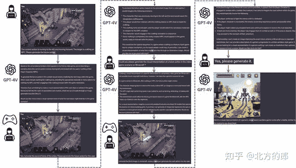

类似于 GPT-4 的视觉语言（visual-language，VL）指导模型提供了灵活的接口，以零-shot方式支持广泛的多模态任务。然而，基于完整图像的接口不直接使用户能够“指向”和访问图像内的特定区域。这种能力不仅对支持基于参考的 VL 基准测试很重要，还对需要精确的图像内推理的实际应用很重要。在 (Park et al.,2023b) 中，我们构建了局部化视觉常识模型，允许用户指定（多个）区域作为输入。我们通过从大型语言模型（LLM）中采样定位的常识知识来训练我们的模型：具体而言，我们提示LLM根据全局字面图像描述和一组VL模型自动生成的局部字面区域描述收集常识知识。这个流程是可扩展且完全自动化的，因为不需要对齐或人为创作的图像和文本对。通过额外训练一个选择高质量样本的评论模型，我们发现仅从图像扩展的定位常识语料库进行训练能够成功地提炼现有的VL模型，以支持基于参考的输入接口。零-shot场景中的实证结果和人工评估表明，我们的提炼方法相比于基线方法通过传递生成的指代表达式，能够得到更精确的VL推理模型。

## 5.6 LLMs and VLMs Agent

一些研究利用LLMs作为智能体执行任务规划 (Huang et al., 2022a; Wang et al., 2023b; Yao et al., 2023a; Li et al.,2023a)，利用LLMs的大规模互联网领域知识和零-shot规划能力来执行像规划和推理这样的智能体任务。最近的机器人研究也利用LLMs来执行任务规划 (Ahn et al., 2022a; Huang et al., 2022b; Liang et al., 2022)，通过将自然语言指令分解为一系列子任务，以自然语言形式或Python代码的形式，并使用低级控制器来执行这些子任务。此外，(Huang et al., 2022b)、(Liang et al., 2022)和(Wang et al., 2023a)还结合环境反馈来改善任务性能。还有一些作品展示了基于大规模文本、图像和视频数据训练的通用视觉对齐的大型语言模型作为创建多模态智能体的基础，这些智能体具有具身能力并可以在各种环境中行动 (Baker et al., 2022; Driess et al., 2023; Brohan et al.,2023)。

## 6 Agent AI Application Tasks

## 6.1 Agents for Gaming

游戏提供了一个独特的沙盒环境，以测试LLMs和VLMs的主动行为，并推动他们在协作和决策能力方面的边界。我们特别描述了三个领域，这些领域突显了智能体与人类玩家和其他智能体互动的能力，以及他们在环境中采取有意义的行动的能力。

### 6.1.1 NPC Behavior

在现代游戏系统中，非玩家角色（NPC）的行为主要由开发人员制定的预定义脚本所决定。这些脚本基于游戏环境中的各种触发器或玩家行为，涵盖了一系列的反应和互动。然而，这种脚本化的性质往往导致NPC行为可预测或重复，无法根据玩家的行动或动态游戏环境而进化。这种僵化性质阻碍了动态游戏环境中所期望的沉浸式体验。因此，越来越多的人开始关注利用大规模语言模型（LLMs）在NPC行为中引入自主性和适应性，使互动更加细腻和引人入胜。基于人工智能的NPC可以从玩家行为中学习，适应不同的策略，并提供更具挑战性和更不可预测的游戏体验。

大规模语言模型（LLMs）可以在游戏中显著改变NPC行为。通过处理大量文本，LLMs可以学习模式并生成更加多样和类人的反应。它们可以用于创建动态对话系统，使与NPC的互动更加引人入胜和不可预测。此外，LLMs还可以通过玩家反馈和游戏数据进行训练，不断优化NPC行为，使其更符合玩家的期望和游戏的动态特性。

### 6.1.2 Human-NPC Interaction

人类玩家与非玩家角色（NPC）之间的互动是游戏体验的关键因素。传统的互动范式主要是单向的，NPC对玩家的输入做出预设反应。这种局限性抑制了更有机和丰富的互动的潜力，类似于虚拟领域内人与人之间的互动。LLM和VLM技术的出现有望改变这一范式。通过应用这些技术，游戏系统能够分析和学习人类行为，提供更接近人类的互动。这不仅增强了游戏的真实感和参与度，还提供了一个探索和理解控制但复杂环境下人机互动的平台。

### 6.1.3 Agent-based Analysis of Gaming

游戏是日常生活中不可或缺的一部分，据估计，全球有一半的人口参与其中3。此外，游戏对心理健康产生积极影响4。然而，现代游戏系统在与玩家互动方面存在不足，因为它们的行为主要由游戏开发人员手工制作。这些预先编程的行为经常无法适应玩家的需求。因此，需要在游戏中引入新的人工智能系统，可以分析玩家的行为，并在必要时提供适当的支持。智能交互系统有潜力彻底改变玩家与游戏系统的互动方式。非玩家角色（NPC）与玩家的互动不再局限于游戏开发人员设计的受限规则集。它们有能力与玩家的体验无缝对接，提供及时的反馈来丰富游戏体验，提升人机交互的协同效应。

LLMs可以作为分析游戏中的文本数据的强大工具，包括聊天记录、玩家反馈和叙事内容。它们可以帮助识别玩家行为、偏好和互动模式的模式，对于游戏开发者改善游戏机制和叙事非常有价值。此外，VLMs可以解析大量的图片和视频数据来帮助分析玩家在游戏世界中的意图和动作。此外，LLMs和VLMs可以促进游戏中智能智能体的开发，这些智能体可以以复杂和类似人类的方式与玩家和其他智能体进行沟通，增强整体游戏体验。除了LLMs和VLMs之外，用户输入数据为创建模拟人类玩家的感知、游戏和理解模型的游戏智能体提供了一个有前途的途径。通过结合玩家互动和反馈、像素输入以及自然语言规划和理解，智能体模型可以助于不断改进游戏动态，推动游戏环境更加以玩家为中心的演进。

### 6.1.4 Scene Synthesis for Gaming

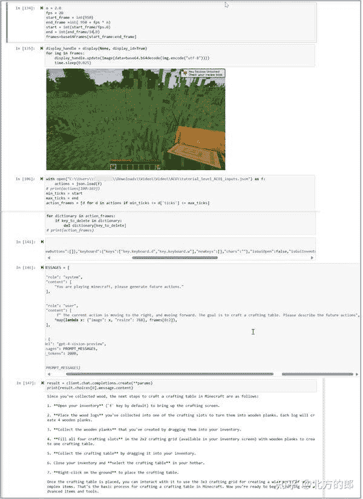

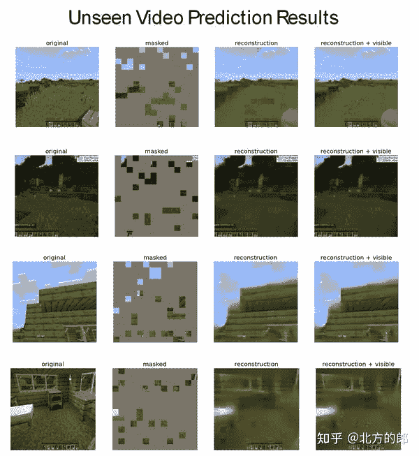

场景合成是创造和增强沉浸式游戏环境的关键组成部分。它涉及在游戏中自动生成或半自动生成三维（3D）场景和环境。这个过程包括地形的生成、物体的放置、逼真光照的创建，有时甚至还包括动态天气系统。

现代游戏往往具有广阔的开放世界环境。 手动设计这些景观可能非常耗时和资源密集。 自动地形生成， 通常利用程序化或人工智能驱动的技术， 可以以较少的手动工作生成复杂逼真的景观。LLMs和VLMs可以利用互联网规模的知识制定规则，设计出视觉上令人印象深刻且独特的非重复性景观。此外，LLMs和VLMs还可以用于确保生成资产的语义一致性和多样性。在场景中以逼真、美观的方式放置建筑物、植被和其他元素对于沉浸感至关重要。

VLM 和 LLM 可以通过遵循预定义或学习的规则和审美原则来帮助物体摆放，从而加快关卡设计流程。VLM 和 LLM 还可以被进一步训练以理解设计原则和审美，从而在程序化内容生成中提供帮助。它们可以帮助制定规则或指导方针，供程序算法遵循以生成既具有视觉吸引力又与背景相关的物体和场景。

逼真的光照和大气效果对于创造可信并吸引人的游戏环境至关重要。先进的算法可以模拟自然光照条件和动态天气效果，增强场景的逼真感和氛围。LLM 可以通过多种创新方式帮助开发更逼真的光照和大气效果系统。VLM 可以分析来自真实世界光照和大气条件的大量数据集，以帮助开发在游戏中模拟这些效果的更逼真算法。通过理解自然光照和天气的模式和细微差别，这些模型可以为模仿现实的算法的开发做出贡献。LLM 和 VLM 还可以用于开发基于玩家操作、游戏状态或外部输入实时调整光照和大气效果的系统。它们可以处理玩家的自然语言命令来修改游戏环境，提供更互动和沉浸式的体验。

### 6.1.5 Experiments and Results

使用LLM或LVM的零样本/少样本学习。 正如我们在图 8和图 9中展示的，我们使用GPT-4V进行高级描述和动作预测。图 8展示了使用GPT-4V生成和编辑动作描述的一些定性示例。增强智能体文本打开了一种生成具有游戏动作先验知识的3D场景的新方法，有助于提高场景的自然度。因此，GPT-4V生成与游戏视频相适应的相关高级描述。

小型智能体预训练模型。 为了展示我们的智能体视觉-语言架构，我们首先研究其在广泛使用的游戏智能体领域中的应用，通过在Minecraft数据上进行预训练。如图 7所示，给定输入的动作智能体、视频的关键帧和相应的文本，可以使用标准的编码器-解码器将动作智能体和图像转换为动作文本令牌和图像补丁令牌，然后使用智能体-视觉-语言解码器将其转换为动作预测句子。整体架构如图 7所示。我们使用几个Minecraft演示来评估我们的方法。 Minecraft视频数据包括5分钟的片段，我们使用的预训练数据包含78,000个视频，我们使用了5,000个视频（占预训练数据的6%）进行第一轮预训练。我们在16个NVIDIA v100 GPU上训练了一个2.5亿参数的模型，持续一天，并在图 10和图 11中可视化了我们的模型输出。图 10显示了我们相对较小的智能体架构可以为在训练期间未见过的Minecraft场景产生合理的输出。图 11显示了模型的预测与地面真实人类玩家动作的比较，表明我们的小型智能体模型具有潜在的低级理解能力。

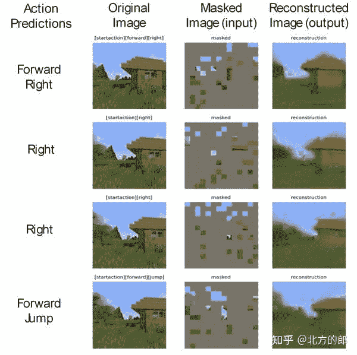

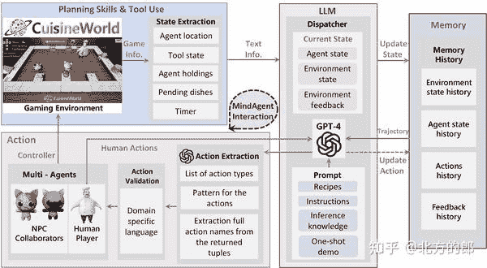

多智能体基础架构。 如图5所示的智能体范式， 我们设计了一个新颖的基础设施， 用于一个名为“CuisineWorld”的新游戏场景(Gong et al., 2023a)。我们在图12中详细介绍了我们的方法。我们的基础架构通过利用GPT-4作为中央规划器，在多个游戏领域中实现了多智能体的协作。我们研究了系统的多智能体规划能力，并将基础架构部署到真实世界的视频游戏中，以展示其多智能体和人工智能协作的有效性。此外，我们提出了一个基于文本的多智能体协作基准测试“Cuisineworld”，该测试通过协作效率的自动指标协作得分（CoS）来 quantitify 合作效率。

有关游戏描述、 高级动作预测和GPT-4V提示的更多示例和详细信息， 请参见附录。 我们在附录C中展示了Bleeding Edge的示例， 附录D中展示了Microsoft Flight Simulator的示例， 附录E中展示了ASSASSIN’sCREED ODYSSEY的示例，附录F中展示了GEARS of WAR 4的示例，以及附录G中展示了Starfield的示例。我们还在附录B中提供了GPT4V生成Minecraft示例的提示过程的详细截图。

## 6.2 Robotics

机器人是代表性的智能体，需要与其环境有效地互动。在本节中，我们将介绍对于高效机器人操作至关重要的关键要素，审视最新的LLM/VLM技术应用研究课题，并分享我们最近研究的发现。

视觉-动作控制。 视觉-动作控制是指在机器人系统中整合视觉感知和运动行为，以有效执行任务。这种整合至关重要，因为它使机器人能够解释来自环境的视觉数据，并相应调整其运动动作，以准确地与环境互动。例如，在装配线上，配备视觉-动作控制的机器人可以感知物体的位置和方向，并准确调整其操纵器与这些物体进行交互。这种能力对于确保机器人在从工业自动化到帮助老年人日常事务等各种应用中的精度和效率至关重要。此外，视觉-动作控制有助于机器人适应环境状态可能会迅速变化的动态环境，根据视觉反馈实时调整运动动作。

此外，在安全操作的环境下，视觉信息对于检测执行错误和确认每个机器人动作的前后条件至关重要。在未经控制的环境中，例如未知的家庭环境，由于家具形状的变化、光照变化和滑动等无法预测的因素，机器人更有可能面临意外结果。在这些环境中，仅仅按照前向反馈的预先计划行动计划可能会带来重大风险。因此，利用视觉反馈持续验证每一步的结果是确保机器人系统稳健可靠运行的关键。

语言条件下的操作。 语言条件下的操作是指机器人系统根据语言指令解释和执行任务的能力。这一方面对于为人机交互创建直观友好的界面至关重要。通过自然语言指令，用户可以以类似人际交流的方式为机器人指定目标和任务，从而降低操作机器人系统的门槛。例如，在实际场景中，用户可以命令一个服务机器人“从桌子上拿起红苹果”，机器人将解析这个指令，识别出所指的对象并执行拿起的任务 (Wake et al., 2023c)。核心挑战在于开发强大的自然语言处理和理解算法，能够准确解释各种指令，包括直接指令和更抽象的指令，并使机器人将这些指令转化为可执行的任务。此外，确保机器人能够在各种任务和环境中推广这些指令，对于增强机器人在现实应用中的多功能性和实用性至关重要。利用语言输入来指导机器人的任务规划已在一个名为任务和动作规划的机器人框架中引起关注(Garrett et al., 2021)。

技能优化。 最近的研究强调了LLMs在机器人任务规划中的有效性。然而，对于涉及抓取等物理交互的任务，尤其需要深入理解环境，超越仅仅解释人类指令。例如，机器人抓取需要精确的接触点 (Wake et al.,2023e)和手臂姿态 (Sasabuchi et al., 2021)以有效执行后续动作。虽然这些元素——精确的接触点和手臂姿态——对于人类来说是直观的，但通过语言来表达它们是具有挑战性的。尽管在互联网规模的VLM方面取得了进展，但从场景中捕捉这些微妙的间接线索并有效地将它们转化为机器人技能仍然是一个重大挑战。为此，机器人学界越来越注重收集增强型数据集（例如 (Wang et al., 2023d; Padalkar et al., 2023)），或者开发直接从人类演示中获得技能的方法论 (Wake et al., 2021a)。其中，基于示范和模仿学习的框架在这些发展中扮演着关键角色，对于优化物理技能起到至关重要的作用。

### 6.2.1 LLM/VLM Agent for Robotics.

最近的研究已经表明， LLM/VLM对涉及与人类在环境中的互动的机器人智能体的潜力。 旨在利用最新的LLM/VLM技术的研究主题包括：

多模态系统：最近的研究一直积极关注开发端到端系统，将最新的LLM和VLM技术作为输入信息的编码器。特别是，有一个显著的趋势是修改这些基础模型以处理多模态信息 (Jiang et al., 2022; Brohan et al., 2023, 2022;Li et al., 2023d; Ahn et al., 2022b; Shah et al., 2023b; Li et al., 2023e)。这种适应旨在基于语言指令和视觉提示引导机器人行动，从而实现有效的体现。

任务规划和技能训练：与端到端系统相比，基于任务和运动规划(TAMP)的系统首先计算高层任务计划，然后通过低层机器人控制实现这些任务，即技能。

LLM的先进语言处理能力已经证明能够解释指令并将其分解为机器人行动步骤，从而极大推动了任务规划技术的发展 (Ni et al., 2023; Li et al., 2023b; Parakh et al., 2023; Wake et al., 2023c)。对于技能训练，一些研究探索了使用LLMs/VLMs设计奖励函数 (Yu et al., 2023a; Katara et al., 2023; Ma et al., 2023)、生成数据以促进策略学习 (Kumar et al., 2023; Du et al., 2023)或作为奖励函数的一部分 (Sontakke et al., 2023)的应用。结合强化学习（RL）和迭代学习（IL）等训练框架，这些工作将为高效的机器人控制器的开发做出贡献。

现场优化：在机器人技术中，执行长时间任务的步骤可能会因为意外和不可预测的环境条件而变得困难。因此，领域内的一个重要挑战涉及通过将任务计划与实时环境数据集成来动态调整和优化机器人技能。例如，(Ahn et al., 2022b)提出了一种通过视觉信息计算行动可行性（即适应能力）并将其与计划的任务进行比较的方法。此外，还有一些方法专注于使LLMs能够输出任务步骤的前置条件和后置条件（例如对象状态和它们之间的相互关系），以优化其执行 (Zhou et al., 2023c)，并检测前置条件错误以对任务计划进行必要的修订(Raman et al., 2023)。这些策略旨在通过整合环境信息并在任务计划或控制器层面调整机器人的行动来实现基于环境的机器人执行。

对话智能体：在创建对话机器人方面，LLMs可以促进与人类的自然、上下文敏感的交互 (Ye et al., 2023a; Wakeet al., 2023f)。这些模型处理和生成模仿人类对话的回复，使机器人能够参与有意义的对话。此外，LLMs在估计话语的概念属性 (Hensel et al., 2023; Teshima et al., 2022)和情感属性 (Zhao et al., 2023; Yang et al., 2023b;Wake et al., 2023d)方面发挥重要作用。这些属性有助于理解人类意图并生成有意义的手势，从而提高人机沟通的自然性和效果。

导航智能体： 机器人导航具有悠久的研究历史， 专注于诸如基于地图的路径规划和同时定位与地图构建（SLAM）等核心方面，用于创建环境地图。这些功能已成为广泛使用的机器人中间件（如机器人操作系统ROS）的标准 (Guimar?es et al., 2016)。经典导航技术在许多机器人应用中仍然盛行，但通常依赖于静态或预创建地图。近年来，对于先进技术的兴趣增加，这些先进技术使得机器人能够在更具挑战性的环境中导航，利用了计算机视觉和自然语言处理等领域的突破。一个代表性的任务是对象导航（object navigation）(Chaplot et al., 2020a; Batra et al., 2020; Gervet et al., 2023; Ramakrishnan et al., 2022; Zhang et al., 2021)，机器人在导航时使用对象名称而不是地图坐标，需要在环境中进行对象名称的视觉关联。此外，最近还开始关注零样本（zero-shot）条件下导航机器人在完全陌生的新环境中的技术，即所谓的零样本对象导航（zero-shot objectnavigation） (Gadre et al., 2023; Dorbala et al., 2023; Cai et al., 2023)。此外，视觉-语言导航 (Vision-LanguageNavigation, VLN) (Anderson et al., 2018a) 是另一个代表性的任务，该任务涉及在之前未见过的真实世界环境中，通过自然语言指令引导机器人导航 (Shah et al., 2023a; Zhou et al., 2023a; Dorbala et al., 2022; Liang et al.,2023; Huang et al., 2023b)。VLN 解释的是句子而不是对象名称，例如“走到你左边的浴室”，因此需要更高的功能来解析输入文本 (Wang et al., 2019)。

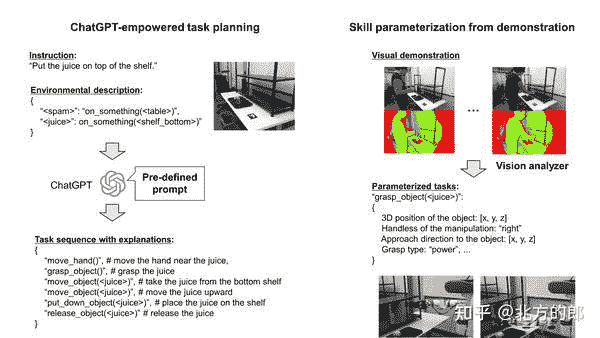

基础模型的出现为这种适应性、即时导航技术的发展做出了贡献，它增强了人类语言指令的理解和环境信息的视觉解释能力。有关代表性 VLN 研究的更详细解释，请参见 6.2.2。

### 6.2.2 Experiments and Results.

越来越多的证据表明，最近的VLMs和LLMs在符号任务规划（例如，何时做什么）方面具有良好的能力。然而，每个任务都需要低层次的控制策略（例如，如何做）来实现与环境的成功交互。虽然强化学习和模仿学习是以数据驱动的方式学习策略的有希望的方法，但另一种有希望的方法是通过现场演示直接从人类获取策略，这种方法被称为观察学习 (Wake et al., 2021a; Ikeuchi et al., 0)。在本节中，我们介绍了一项使用ChatGPT进行任务规划的研究，并通过将其与适应性信息参数化来丰富计划，以促进有效和精确的执行（图 13）。流程包括两个模块：任务规划和参数化。在任务规划中，系统接受语言指令和工作环境的描述。这些指令与预定义的一组机器人动作和输出规范被编译成一个全面的提示，并提供给ChatGPT，然后ChatGPT生成一系列分解任务及其文本描述（图 13；左窗格）。值得注意的是，我们采用了少样本学习方法，即ChatGPT没有在此任务上进行训练，这在应用方面具有优势，因为它消除了对硬件相关数据收集和模型训练的需求。此外，输出中的文本描述使用户可以根据需要检查和调整结果，这是安全和稳健操作的关键功能。图 14展示了在VirtualHome (Puig et al., 2018)上进行的主体模拟的定性结果。结果显示了一个合理的任务计划及其在调整输出方面的灵活性，表明我们方法的广泛适用性。

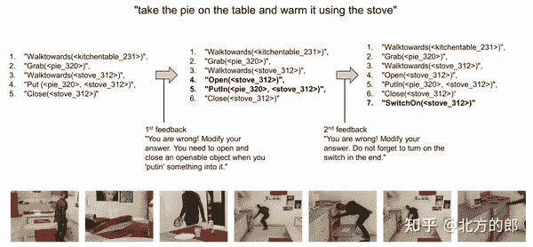

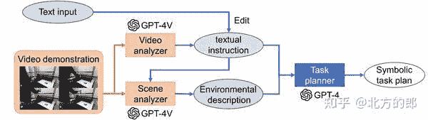

尽管任务计划器可以确保任务序列的连贯性，但在现实操作中，成功执行任务还需要详细的参数。例如，握取方式对于在搬运容器时倾倒内容物非常重要，这种参数在仿真器中经常被忽视（参见图 14中握取馅饼的例子）。因此，在我们的机器人系统中，用户被要求通过视觉演示每个动作（图 13；右侧面板）。这些任务具有执行所需的预定参数，我们的视觉系统从视频中提取这些参数 (Wake et al., 2021b)。值得注意的是，我们的机器人系统并非旨在精确复制人类动作（即遥操作），而是处理不断变化的真实世界条件，例如物体位置的变化。因此，从人类演示中提取的参数包括不精确的运动路径，而是决定有效环境移动的适应性信息（例如用于避免碰撞的路径点 (Wake et al., 2023a)，握取类型 (Wake et al., 2023e)和上肢姿势 (Sasabuchi et al., 2021;Wake et al., 2021a)）。上肢姿势对于具有高自由度的机器人至关重要，并设计为与运行中机器人共存的人类的可预测姿势。带有适应性信息的任务序列通过强化学习转化为一系列可重复使用的机器人技能，并由机器人执行 (Takamatsu et al., 2022)。

通过将[LLM应用于任务规划，可以通过与VLM相](https://link.zhihu.com/?target=http%3A//%25E5%25AE%258C%25E6%2595%25B4%25E7%259A%2584%25E6%258F%2590%25E7%25A4%25BA%25E5%2586%2585%25E5%25AE%25B9%25E5%258F%25AF%25E5%259C%25A8microsoft.github.io/GPT4Vision)结合来扩展更多功能的机器人系统。在这里，我们展示了一个示例，我们在多模态输入上使用GPT-4V（视觉）来拓宽上述的任务规划器（见图 15），一个人执行一些希望机器人能够复制的动作。本文中，只展示部分提示。 完整的提示内容可在microsoft.github.io/GPT4Vision Robot-Manipulation-Prompts上查看。该流程接收演示视频和文本作为输入，并输出机器人动作序列。视觉分析器旨在理解视频中人类执行的动作。我们使用了GPT-4V并提供了一个提示，以生成以人类间典型通信风格为基础的文本指令。图 16展示了使用文本输入的功能，允许用户对GPT-4V的识别结果进行反馈以进行纠正。这种功能旨在改善识别结果的准确性，同时也提高了系统的稳健性。

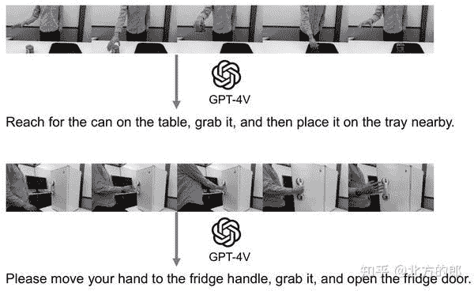

接下来，场景分析器根据指令和视频数据的第一帧（或环境图像）将预期的工作环境编译成文本信息。这些环境信息包括由GPT-4V识别出的对象名称列表、对象的可抓取属性以及对象之间的空间关系。尽管这些计算过程在GPT-4V内部是一个黑盒子，但该信息是基于GPT-4V的知识和图像/文本输入而输出的。图 17显示了我们场景分析器的示例输出。如图所示，GPT-4V成功地选择了与操作相关的对象。例如，在人类将垃圾容器重新摆放在桌子上时，输出中包括了桌子，而在开冰箱的任务中则忽略了桌子。这些结果表明，场景分析器将场景信息编码为与人类行为相关的形式。我们促使GPT-4V解释了对象选择过程的结果以及背后的原因。在实践中，我们发现这种方法得到了合理的输出。最后，基于给定的文本指令和环境信息，任务规划器输出一系列任务 (Wake et al., 2023c)。

用于机器人导航的具身智能体。 视觉语言导航（Vision-Language Navigation，简称VLN）是将具身智能体引导到真实三维环境中执行自然语言指令的任务。在真实三维环境中导航(Zhu et al., 2017a; Mirowski et al.,2016; Mousavian et al., 2018; Hemachandra et al., 2015)是移动智能系统在物理世界中运行的基本能力。近年来，已经提出了大量的任务和评估协议(Savva et al., 2017; Kolve et al., 2017; Song et al., 2017; Xia et al., 2018;Anderson et al., 2018a)，如(Anderson et al., 2018b)所总结的。VLN的重点是在真实三维环境中进行基于语言的导航(Anderson et al., 2018a)。为了解决VLN任务，(Anderson et al., 2018a)建立了基于注意力机制的序列到序列基准模型，然后(Wang et al., 2018)引入了一种混合方法，将无模型和模型为基础的强化学习（RL）相结合，以提高模型的泛化能力。最后，(Fried et al., 2018)提出一种讲话者-跟随者模型，采用了数据扩增、全景动作空间和修改的波束搜索来进行VLN，并在Room-to-Room数据集上取得了当前最先进的性能。在前人的工作基础上，我们在(Wang et al., 2019)中提出了一种增强的跨模态匹配（RCM）方法来进行VLN。RCM模型基于(Fried et al., 2018)，但在许多重要方面有所不同：（1）RCM结合了一种新颖的多重奖励RL和模仿学习方法来进行VLN，而讲话者-跟随者模型(Fried et al., 2018)只使用了监督学习，即(Anderson et al., 2018a)中提到的方式。（2）RCM基于事实推理导航器在单模态输入中执行跨模态基准，而不是采用时间注意机制。（3）RCM的匹配评论家在体系结构设计方面与讲话者类似，但前者用于为RL和SIL训练提供循环重建内部奖励，而后者则用于扩增监督学习的训练数据。

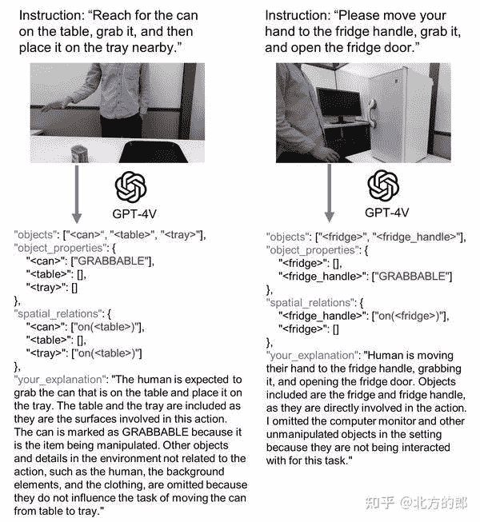

在(Wang et al., 2019)中，我们研究了如何解决这个任务的三个关键问题：跨模态基准、不确定反馈和泛化问题。如图 18所示，我们提出了一种新颖的增强跨模态匹配方法来通过强化学习（RL）在局部和全局上实现跨模态基准。尤其地，我们使用匹配评论家来提供内部奖励，鼓励指令和轨迹之间的全局匹配，并使用推理导航器，在局部视觉场景中进行跨模态基准。对VLN基准数据集的评估表明，我们的RCM模型在SPL上显著优于之前的方法，并取得了新的最先进性能。为了提高所学策略的泛化性，我们进一步引入了一种自监督模仿学习（SIL）方法，通过模仿自己以前做出的良好决策来探索未见环境。我们证明SIL可以近似出更好和更高效的策略，极大地减小了已见和未见环境之间的成功率性能差距（从30.7%减小到11.7%）。此外，在(Wanget al., 2019)中，我们引入了一种自监督模仿学习方法来解决泛化问题，这是之前的工作中未被充分研究的问题。与此工作同时进行的是(Thomason et al., 2018; Ke et al., 2019; Ma et al., 2019a,b)从各个方面研究了VLN任务，(Nguyen et al., 2018)介绍了VLN任务的一种变体，通过在需要时请求语言辅助来找到物体。值得注意的是，我们是第一个提出探索未见环境的VLN任务的研究。

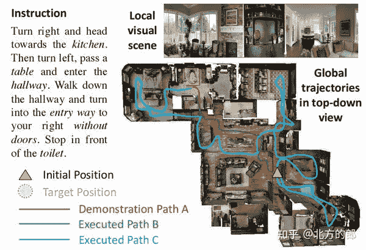

## 6.3 Healthcare

在医疗保健领域，LLMs和VLMs可以作为诊断智能体、患者护理助手，甚至是治疗辅助工具，但它们也带来了独特的领导挑战和责任。人工智能智能体具有显著改善患者护理和挽救生命的潜力，但过度或过快地部署可能会危及全球数千或数百万人的安全。我们讨论了医疗保健领域AI智能体的一些有前景的途径，并讨论了一些关键挑战。

诊断智能体。 最近，将LLMs用作用于患者诊断的医疗聊天机器人引起了极大关注，原因在于医疗专家需求量大，而LLMs可以帮助分诊和诊断患者的潜力 (Lee et al., 2023)。特别是那些能够有效传达重要医学信息给来自不同患者人群的广泛范围人群的对话智能体，有潜力为历史上处于不利地位或边缘化群体提供平等的医疗保健服务。此外，全球的医生和医疗系统普遍承担过重且资源匮乏，导致数亿人缺乏足够医疗护理 (WorldHealth Organization and World Bank, 2015)。诊断智能体提供了改善数百万人医疗保健的特别有利途径，因为它们能够具备理解各种语言、文化和健康状况的能力。初步结果显示，通过利用大规模网络数据，我们可以训练具备医疗知识的LLMs (Li et al., 2023f)。虽然这是一个令人兴奋的方向，但诊断智能体的承诺并不是没有风险的。在下一节中，我们将重点介绍医疗背景下产生幻觉的风险，以及潜在的解决途径。

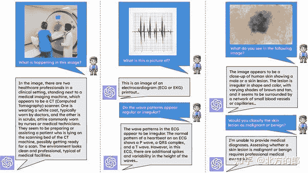

知识检索智能体。 在医学领域中，模型幻觉尤其危险，可能导致严重的患者损害或死亡，这取决于错误的严重程度。例如，如果患者错误地接受了一项诊断，认为他们没有某种实际上存在的疾病，可能会导致灾难性后果。这些后果包括延迟或不适当的治疗，或者在某些情况下，没有必要的医疗干预。未诊断或误诊的病症的严重性可能导致医疗支出的增加，延长疗程加重身体负担，甚至在极端情况下造成严重伤害或死亡。因此，能够更可靠地检索知识的智能体方法 (Peng et al., 2023) 或以基于检索的方式生成文本的方法 (Guu et al.,2020) 是有希望的方向。将诊断智能体与医疗知识检索智能体配对具有潜力显著降低幻觉，同时改进诊断对话智能体的回答质量和准确性。

远程医疗与监护。 基于智能体的人工智能也在远程医疗和监护领域具有巨大潜力，可以改善医疗保健的可及性，提高医疗服务提供者与患者之间的沟通效果，提高频繁医患互动的效率并降低成本 (Amjad et al., 2023)。初级护理医生花费大量时间整理通常与他们无关或不必要的患者信息、报告和邮件。有很大的潜力让支持智能体帮助筛选来自医生、患者和其他医疗提供者的信息，并帮助强调对所有相关方重要的信息。通过使智能体性人工智能系统与患者、临床医生和其他人工智能智能体协同工作，有巨大潜力革新远程医疗和数字健康产业。

### 6.3.1 Current Healthcare Capabilities

图像理解。 我们在图19中展示了GPT-4V等现代多模态智能体的当前能力和局限性，特别是在医疗环境中。我们可以看到，尽管GPT-4V具有对医院护理中涉及的设备和程序的重要内部知识，但它并不总是对用户更具指导性或诊断性的查询作出回应。

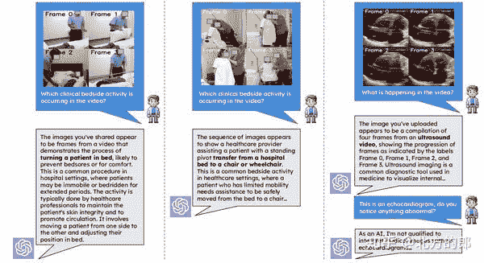

视频理解。 我们在两个情境中研究了VLM智能体的医疗视频理解性能。首先，我们研究了VLM智能体在临床空间中识别重要患者护理活动的能力。其次，我们探索了VLM智能体在更技术性的视频（如超声）中的应用。具体来说，在图20中，我们展示了GPT-4V在医院护理和医学视频分析方面的部分当前能力和局限性。

## 6.4 Multimodal Agents

将视觉和语言理解相结合对于开发复杂的多模态人工智能智能体非常重要。这包括图像字幕生成、视觉问答、视频语言生成和视频理解等任务。我们的目标是深入研究这些视觉-语言任务，探索在人工智能智能体的背景下它们所呈现的排行榜和机遇。

### 6.4.1 Image-Language Understanding and Generation

图像-语言理解是一项任务，需要使用语言解释给定图像中的视觉内容，并生成相关的语言描述。这个任务对于开发能够以更像人类的方式与世界进行互动的AI智能体非常关键。其中一些最受欢迎的任务包括图像描述 (Lin et al., 2014; Sharma et al., 2018; Young et al., 2014; Krishna et al., 2016)，指代表达 (Yu et al., 2016; Karpathyet al., 2014) 和视觉问答 (Antol et al., 2015; Ren et al., 2015; Singh et al., 2019)。

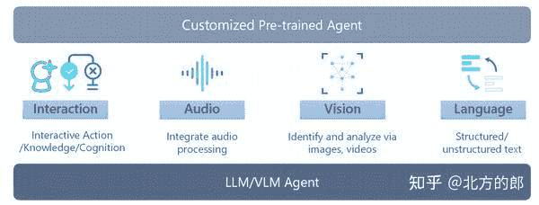

最近引入了一些知识密集型的视觉问答任务，如OKVQA (Marino et al., 2019)，KB-VQA (Wang et al., 2015)，FVQA (Wang et al., 2017)和WebQA (Chang et al., 2021)。多模态智能体应该能够识别图像中的对象，理解它们之间的空间关系，生成准确的关于场景的描述句子，并利用推理能力处理知识密集型的视觉推理。这不仅需要对象识别能力，还需要对空间关系、视觉语义的深入理解，并且能够将这些视觉元素与语言构造相结合，并整合世界知识的能力。

### 6.4.2 Video and Language Understanding and Generation

视频语言生成。 视频字幕生成或视频故事叙述是为视频帧的流生成一系列连贯句子的任务。受在视频和语言任务中成功使用的递归大型基础模型的启发，增强型的智能体驱动模型的变体在视频语言生成任务中展现出了有希望的结果。基本挑战是神经编码-解码模型的强大性能在视觉故事叙述中不具有良好的泛化能力，因为该任务需要全面理解每个图像的内容以及不同帧之间的关系。该领域的一个重要目标是创建一个能够有效编码帧序列并生成主题连贯的多句段落的智能体意识文本合成模型。

视频理解。 视频理解将图像理解的范围扩展到动态视觉内容。它涉及对视频序列的解释和推理，通常与相应的音频或文本信息相结合。智能体应该能够与视觉、文本和音频模态进行交互，以展现其对视频内容的高级理解能力。该领域的任务包括视频字幕生成、视频问答和活动识别等。视频理解的领先方法有很多。它们包括视觉和语言内容的时间对齐、处理长序列帧、以及对时间推移中展开的复杂活动的解释。关于音频，智能体可以处理口语、背景噪音、音乐和语调，以理解视频内容的情绪、环境和细微差别。

以前的研究侧重于利用在线可用的现有视频语言训练数据建立视频基础模型(Li et al., 2020, 2021b; Fu et al.,2022; Bain et al., 2021; Zellers et al., 2021, 2022; Fu et al., 2023)。然而，由于这些数据集的有限和常常不一致的特点，支持这种训练流程和功能是困难的。视频基础模型采用了遮蔽和对比预训练目标，并在各自的任务上进行了调整。尽管在多模态基准测试中表现出了显著的结果，但这些模型在仅涉及视频的任务（例如动作识别）中遇到了困难，因为它们依赖于从嘈杂的音频转录中构建的有限的视频-文本数据。这种限制还导致了大型语言模型普遍具备的鲁棒性和细粒度推理能力的缺乏。

其他方法，类似于在图像语言理解中使用的方法，借鉴了大型语言模型的强大推理能力和广泛知识，以提高视频解释的不同方面。像ChatGPT和GPT4这样只使用语言的模型，或者像GPT4-V这样的图像-语言模型，将音频、视频和语言模态视为可独立解释的输入数据类型，并将智能体定位为强大的开源模型。例如，(Huang etal., 2023c; Li et al., 2023g)通过使用开源视觉分类/检测/字幕模型将视频理解转化为自然语言处理（NLP）问题回答的形式。 (Lin et al., 2023) 将GPT4-V与视觉、音频和语音的专用工具整合在一起，以便完成复杂的视频理解任务，例如对长视频中的角色移动和动作进行脚本化。

并行研究探索了从大型模型生成规模化的数据集，然后在生成的数据上应用视觉指导调整(Liu et al., 2023c; Liet al., 2023c; Zhu et al., 2023)。随后使用了相当数量的音频、语音和视觉专家感知模型来口述视频。语音使用自动语音识别工具进行转录，而视频描述和相关数据则使用各种标记、沉降和字幕模型生成(Li et al., 2023g;Maaz et al., 2023; Chen et al., 2023; Wang et al., 2023f)。这些技术展示了如何在生成的数据集上调整视频语言模型的指导，从而提高视频推理和沟通能力。

### 6.4.3 Experiments and Results

●知识密集型模型:正如在INK (Park et al., 2022)和KAT (Gui et al., 2022a)中所介绍的，这是一种密集的神经知识任务，它结合了人工标注的所需知识，以支持知识密集型检索任务。

●多模态智能体: 近年来，对多模态语言模型如Chameleon（Lu等，2023）和MM-React（Yang等，2023）的兴趣日益增长。

●视觉指导调整:VCL(Gui et al., 2022b)、 Mini-GPT4(Zhu et al., 2023)、 MPLUG-OWL(Ye et al.,2023b)和LSKD(Park et al., 2023c)生成图像级指导调整数据集。

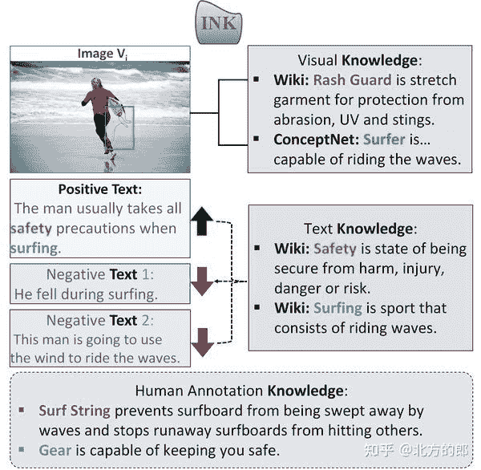

知识密集型智能体。 如图 22 和图 23 所示，基于知识的视觉问答和视觉-语言检索任务是多模态机器学习中具有挑战性的任务，需要超越图像内容的外部知识。最近关于大规模Transformer的研究主要集中在最大化模型参数的效率以存储信息。这一研究方向探索了一个不同的方面：多模态Transformer是否可以在决策过程中使用显式知识。基于Transformer的预训练方法已经在隐式学习多个模态的知识表示方面取得了显著的成功。然而，传统方法主要是单模态的，已经研究了知识检索和随后的答案预测，对于所检索的知识的质量和相关性以及使用隐式和显式知识的推理过程的集成提出了问题。为了解决这些问题，我们引入了知识增强Transformer（KAT），在2022年OK-VQA开放域多模态任务中，其性能比其他方法提高了6%。KAT通过使用编码器-解码器结构，将来自GPT3的隐式知识与来自网站的显式知识相结合，并允许在答案生成过程中同时进行隐式和显式知识的推理。此外，合并显式知识增强了模型预测的解释性。代码和预训练模型可以在以下网址获取: https://github.com/guilk/KAT。

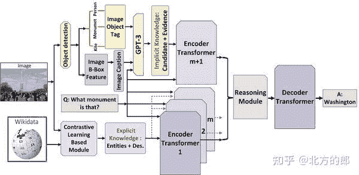

视觉-语言Transformer智能体 接下来，我们介绍了“通过标题训练视觉-语言Transformer”（VLC）模型(Gui etal., 2022b)，这是一个仅使用图像标题对进行预训练的Transformer。尽管仅使用简单的线性投影层对图像嵌入进行处理，VLC在各种视觉-语言任务中取得了有竞争力的结果，与依赖于物体检测器或受监督CNN/ViT网络的其他方法形成对比。通过广泛的分析，我们探索了VLC作为视觉-语言Transformer智能体的潜力。例如，我们展示了VLC的视觉表示对于ImageNet-1K分类非常有效，我们的可视化结果证实了VLC能够准确地将图像补丁与相应的文本标记匹配。性能随着更多训练数据的扩展显示了开发大规模、弱监督、开放领域的视觉-语言模型的有希望潜力。

## 6.5 Video-language Experiments

为了了解将预训练的图像-语言模型转化为视频理解的实用性， 我们对InstructBLIP进行了时间扩展和微调，用于视频字幕生成。具体来说，我们利用与时间上冻结的模型Frozen in Time相同的分割空间-时间注意力方案，对InstructBLIP的视觉编码器（EVA-CLIP-G）进行了扩展，并在训练过程中将Q-former和LLM（Flan-T5-XL）保持冻结状态。我们冻结了视觉编码器的所有空间层，而在字幕生成训练过程中保持时间层解冻。 这使得我们的模型可以接受图像和视频作为输入 （与InstructBLIP的图像级性能相匹配）。 我们在WebVid10M的500万个视频字幕子集上进行训练。我们在图 25 中展示了两个示例输出。然而，现有的智能体程序在理解视频内容的精确、细粒度的视觉细节方面仍存在问题。类似的限制也出现在视觉指导调整方法中，它们缺乏一般的、人类水平的感知能力，这仍然需要由多模态模型和智能体程序来解决。

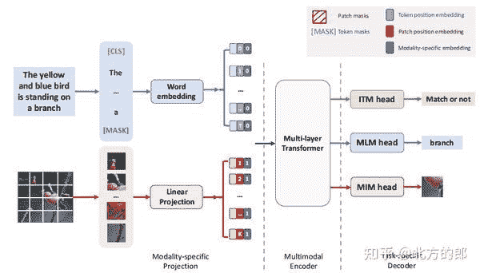

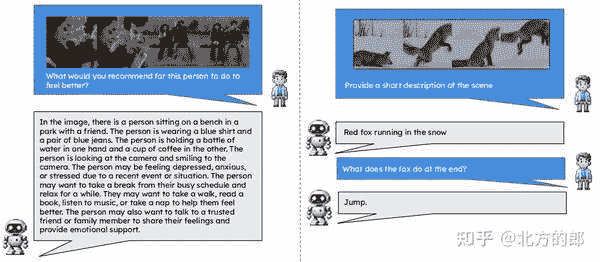

指导调整的模型在准确总结视频中的可见动作和有效识别动作（如图 25所示的“人坐在长凳上”）方面显示出希望。然而，有时它们会添加不正确的细节，例如“对着相机微笑的人”，暴露了捕捉对话话题或视频氛围的不足，这些元素对于人类观察者来说很容易察觉到。这个不足突显了另一个关键限制：忽略了可能丰富视频理解的音频和语音模态，从而帮助更准确的解释并防止此类误导。弥合这个差距需要综合整合可用的模态，使多模态智能体能够达到类似于人类感知的理解水平，并确保对视频解释采用全面的多模态方法。

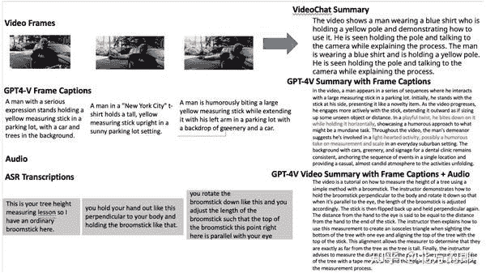

具备 GPT-4V 的音频-视频-语言智能体 然后，我们在(Lin et al., 2023)中概述的方法论下评估了GPT-4V作为一个多模态智能体的能力，该智能体集成了视觉、音频和语音，以对视频进行细致和准确的理解。图 26中的结果比较了各种视频智能体在视频摘要任务上的性能。视频指导调优模型(Li et al., 2023g)提供了准确的内容，但在综合性和细节性方面表现不佳，错过了一些具体的动作，比如有条不紊地使用扫把杆测量一棵树的高度。

为了提高视频描述的准确性，我们使用GPT-4V来给帧添加标题，而音频及其转录来自OpenAI Whisper模型。然后，我们让GPT-4V使用帧标题创建视频摘要，一开始只使用帧标题，然后同时使用帧标题和音频转录。首先，我们观察到仅使用帧标题可能会导致虚构事件，比如第三部分中的一个人咬木棍。这些不准确性在视频摘要中仍然存在，例如描述中的"在一个富有趣味的转折中，他水平握住它，咬下去"。没有音频输入，智能体无法纠正这些标题的错误，导致描述在语义上正确但在视觉上具有误导性。

然而，当我们向智能体提供音频转录时，它成功地准确描绘了内容，甚至捕捉到了"将扫帚棍垂直于身体并向下旋转"等详细的身体动作。这种详细程度更加丰富，给观众提供了对视频目的和关键细节更清晰的理解。这些发现凸显了整合音频、视频和语言交互以开发高质量多模态智能体的重要性。GPT-4V成为这种先进多模态理解和交互的有希望的基础。

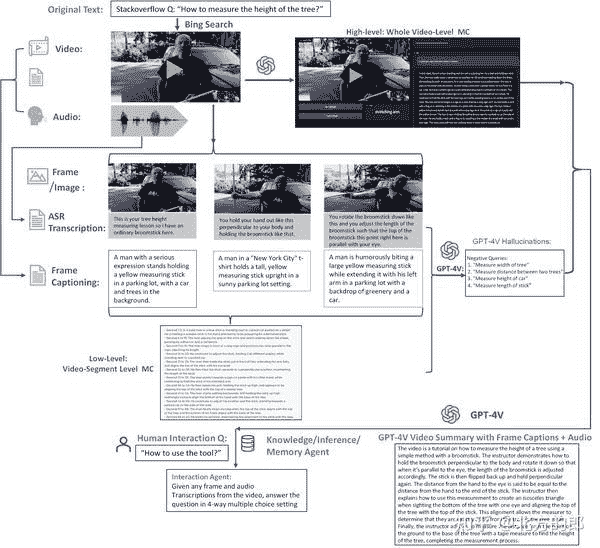

具有GPT-4V的具身化多模态智能体。 如图 27所示， 我们主要使用StackOverflow获取初始问题， 然后使用"Bing搜索"API检索与问题相关的视频和音频。接下来，我们主要使用GPT-4V获取相关的文本信息和高级视频描述。另一方面，我们通过ASR将关键帧音频转换为关键帧的低级部分描述。最后，我们使用GPT-4V生成引人注目的"幻觉"，作为视频问题和回答任务的困难负面查询。我们支持在视频的当前帧中进行交互和问答，以及对整体高级视频描述的摘要。在推理过程中，我们还通过网络搜索结合外部知识信息来提高回答能力。

GPT-4V的主要提示信息如下所述。整个提示信息以增加清晰度而缩进，长度超过一页。

> GPT-4V是一种助手，为视觉受损但能听到视频而无法看到的人提供详细、信息丰富和全面的视频描述。工作任务是通过综合给定的注释，创造高质量、密集的视频描述，并将其输出为JSON。具体来说，GPT-4V将获得用于搜索视频的原始查询、视频标题、描述、音频转录以及视频中特定时间段的潜在混乱描述。同一视频的不同片段以 "[时间开始 - 时间结束（以秒为单位）] ’文本’ "的方式进行注释。利用所有的转录和描述来推断出视频中可能发生的具体细节和视觉展示。GPT-4V将根据需要合并或分割时间戳以提供最佳的视频分割。

> 对于GPT-4V的输出期望如下：

> 1. 以行动为导向的描述：优先考虑与音频暗示相关的可信动作、动作和物理演示，通过丰富的动态视觉线索丰富您的叙述。

> 2. 完整覆盖视频内容：提供连续一致的音频描述体验，覆盖视频整个时长，确保没有内容被遗漏。

> 3. 简明分段：将描述构建为专注、简洁的1-2句的片段，以有效传达视觉动作，避免过多细节的压倒。

> 4. 上下文音频-视觉综合：无缝地将口头音频内容与推断出的视觉元素融合，形成与屏幕上活动相关的叙述。

> 5. 富有想象力且可信的推测：通过与音频相对应的创造性而令人信服的视觉细节，增强场景的理解。

> 6. 准确的时间码对应：将描述片段与相应的时间码对其，确保推测的视觉细节与音频叙述的时间轴同步。

> 7. 自信的叙述传递：以确信的方式呈现描述，就像推测的视觉内容正在发生一样，从而给听众带来信心。

> 8. 忽略不合理的细节：不包括不合理的细节描述，这些细节在音频和视觉信息提供的上下文中不能合理地适应其中。

> 最终输出应以JSON格式结构化，其中包含一个字典列表，每个字典详细描述视频的一个片段。

> 最终输出应以JSON格式结构化，其中包含一个字典列表，每个字典详细描述视频的一个片段。

> [ ‘start’: <start-time-in-seconds>, ‘end’: <end-time-in-seconds>, ‘text’: “<Your detailedsingle-sentence, audio-visual description here>" ]

> 对于多项选择题（Multiple Choice，简称MC）的创建：我们的任务是为视频到文本检索任务创建多项选择题，这些问题可以通过查看标题并阅读音频转录来轻松解决。为了完成此任务，我们将获得原始查询以获取视频、描述、音频转录，以及视频中特定时刻的潜在嘈杂描述。

> ●音频转录格式：-[起始时间-结束时间（以秒为单位）] “转录”

> ●噪声描述的格式： - [以秒为单位的时间] “描述”

> 我们向GPT-4V提出请求，生成四个查询，其中主要查询与视频内容保持一致，另外三个负例与我们的主要查询略有不同。选择主要查询不应该仅仅依赖于听音频转录，比如，文本原始查询包含在音频转录中。负例应该与视频内容密切相关，但并非完全一致，需要对视频的视觉理解来区分。例如，以微妙的方式修改语义，以至于需要观看视频而不仅仅是听着来选择原始查询。通过以类似字幕的方式编写四个查询语句，其中第一个是重新表述的原始查询。

> 逐步思考如何利用视频信息提出负面陈述。并且证明负面查询是不正确但仍然具有吸引力的选择，需要对视频有微妙的理解。人类不会出错地选择负面查询而不是原始查询。最后，我们按照以下的分析和四个查询的格式提出我们的工作。不需要生成你是如何翻译原始查询的。

> ●Video Analysis: xxx

> ●Queries: [query1, query2, query3, query4]

> ●Justification: xxx

## 6.6 Agent for NLP

### 6.6.1 LLM agent

在互动人工智能和自然语言处理领域，识别任务指令并采取行动一直是一个根本性的挑战。随着深度学习的最新进展，越来越多的人开始将这些领域进行联合研究，以改进人机协作。我们确定了三个具体的方向，以改进基于语言的智能体：

●工具使用和知识库查询。 这个方向强调将外部知识库、网络搜索或其他有用的工具集成到人工智能智能体的推理过程中的重要性。通过利用来自各种来源的结构化和非结构化数据，智能体可以增强其理解能力并提供更准确和与上下文相关的回应。此外，它还促进了智能体在面对陌生情境或查询时主动寻找信息的能力，确保提供更全面和明智的回应。其中一些例子包括 Toolformer (Schick et al., 2023)和 Retrieve What You Need (Wang et al., 2023g)。

●改进智能体的推理和规划能力。增强智能体的推理和规划能力对于有效的人机协作至关重要。这涉及到开发能够理解复杂指令、推断用户意图和预测潜在未来情景的模型。可以通过要求智能体反思过去的行动和失败，如ReAct (Yao et al., 2023a)所示，或通过将智能体思考过程构建为一种搜索形式(Yao et al., 2023b)来实现这一目标。通过模拟不同的结果和评估各种行动的后果，智能体可以做出更加明智的上下文感知决策。

●融合系统和人类反馈。 AI智能体经常在两种主要环境中运作：提供关于其行动有效性明确信号的环境（系统反馈），以及与能够提供口头批评的人类合作的情境（人类反馈）。这一方向强调了对自适应学习机制的需求，使智能体能够改进其策略并纠正错误，例如在AutoGen中(Wu et al., 2023)。持续从不同反馈来源中学习和适应的能力确保智能体始终对用户需求提供帮助和对齐。

### 6.6.2 General LLM agent

识别和理解智能体内容和自然语言是互动人工智能和自然语言处理领域长期以来的基本挑战。随着深度学习的最新进展，越来越多的研究开始关注联合研究这两个领域，以实现对智能体规划或人类反馈进行深度理解，从而进行知识推理和自然语言生成。这些是许多人机交互智能体的关键组成部分，例如“AutoGen”（引用文献：(Wu et al., 2023)）和“检索所需”（引用文献：(Wang et al., 2023g)）

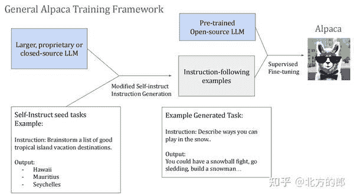

### 6.6.3 Instruction-following LLM agents

此外，创建能够有效按照人类指令执行的LLM智能体已成为一个重要的研究领域。初始模型使用人类反馈来训练智能体激励模型，以模拟人类偏好，这个过程被称为强化学习与人类反馈（RLHF）(Ouyang et al., 2022)。这个过程产生了InstructGPT和ChatGPT等模型。为了更高效地训练具有指令遵循能力的LLM智能体，而无需人类标签，研究人员开发了一种更高效的指令调整方法，直接通过人类生成的指令/响应对或者LLMs自动生成的指令/响应对来训练LLM智能体，例如Dolly 2.05或者Alpaca(Taori et al., 2023)。我们展示了Alpaca训练管道的整体流程，如图6.6.3所示。

### 6.6.4 Experiments and Results

尽管对话和自我反馈系统得到了日益广泛的采用，但这些形式的人工智能在从其隐含知识中生成事实正确的回答方面表现不佳，因此通常在推理时使用外部工具，如网络搜索和知识检索机制，来增强其响应。解决这个问题将有助于在许多实际应用中为用户创造更有吸引力的体验。在社交对话中（如Instagram和Facebook等社交媒体平台上的对话）或者问答网站（如Ask或Quora），人们通常通过一系列的评论和网页搜索与他人进行交流，以获取与讨论相关的信息和知识。因此，在这种情况下生成对话转换的任务不仅仅是在传统自然语言处理模型和任务的基础上进行改进，而是使用智能体机制通过智能行为生成对话，这些智能行为反映了知识搜索和获取(Peng et al., 2023)。

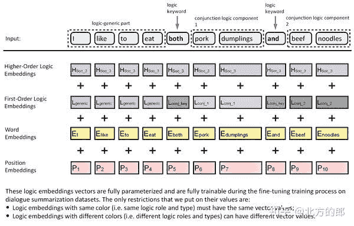

通过在对话过程中添加明确的知识搜索和检索步骤，智能智能体为自然语言处理任务扩展了任务描述并提高了响应的可解释性。在对话中将这些网络搜索和检索智能体作为反馈的一部分，将有助于进一步深入地促进人与智能体之间的社交互动(Wang et al., 2023e)。如图 29所示，我们引入了一种新的转换语言模型建模范式，该模型从输入文本中检测和提取重要的逻辑结构和信息，然后通过精心设计的多层分层逻辑投影将它们整合到输入嵌入中，以将逻辑结构注入到预训练的语言模型中，作为一种自然语言处理智能体之一(Wang et al., 2023e)。通过逻辑转换器智能体，我们提出了一种为转换语言模型构建逻辑感知输入嵌入的新方法，通过逻辑检测、逻辑映射和分层逻辑投影的组合，然后开发了相应的新建模范式，可以将所有现有的转换语言模型升级为逻辑转换模型，从而始终提升它们的性能。通过深入理解文本的逻辑结构，所提出的逻辑转换器智能体始终表现出优越的性能，相对于基线转换模型。对于人类用户来说，往往更重要的是在通过基于智能体的对话和信息检索之间进行有意义和有趣的交流时，注重这些方面。

在自然语言处理的深入研究中，本主题将讨论在使LLMs更具智能体性和更适合各种以语言为中心的任务方面的进展和竞争结果。

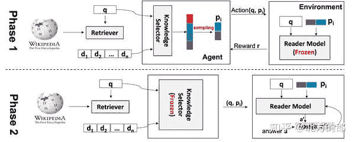

开放领域的问答（QA）系统通常遵循一种“先检索，然后阅读”的范式，其中使用一个“检索器”从大量语料中检索相关段落，然后一个“阅读器”根据检索到的段落和原始问题生成答案。在 (Wang et al., 2023g)中，我们提出了一种简单而新颖的互相学习框架，通过一种名为“知识选择器”智能体的中间模块来提高“先检索，后阅读”模型的性能，我们使用强化学习对其进行训练。精细的“知识选择器”将纳入到“先检索，后阅读”范式中，其目标是构建一个保留与问题相关信息的小型段落子集。如图 30所示，这个知识选择器智能体是作为我们的新颖互相学习框架的组成部分进行训练的，该框架通过迭代地训练知识选择器和阅读器来完成。我们采用一种简单而新颖的方法，使用策略梯度对知识选择器智能体进行优化，使用阅读器的反馈来训练它选择一小部分信息丰富的段落。这种方法避免了蛮力搜索或手动设计的启发式策略，而无需任何带有监督的查询-文档配对。我们展示了在一些公开的开放领域问答基准测试上，通过迭代训练阅读器和知识选择器智能体可以获得更好的预测性能。