# 综述：探索基于大型语言模型的智能体：定义、方法与前景

> 来源：[https://agijuejin.feishu.cn/docx/UYWwdt0Wao9Tk5xpB7Mc4LXSn32](https://agijuejin.feishu.cn/docx/UYWwdt0Wao9Tk5xpB7Mc4LXSn32)

> 作者：北方的郎

> 原文：[https://zhuanlan.zhihu.com/p/677778544](https://zhuanlan.zhihu.com/p/677778544)

这是一篇关于智能体的综述，正如题目所言，很好的介绍智能体的定义、方法与前景。

论文地址：[Ex](https://link.zhihu.com/?target=https%3A//arxiv.org/abs/2401.03428)ploring Large Language Model based Intelligent Agents: Definitions, Methods, and Prospects

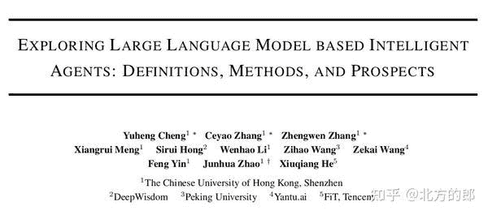

译文如下，翻译的过程中有小删节。

## ABSTRACT

聪明的智能体（Intelligent agents）是通向人工通用智能（AGI）的一种潜在路径。因此，研究人员致力于对聪明的智能体实现的多样化付出了重要努力。

受到大型语言模型（LLM）最近进展的益处，使用通用自然语言作为接口的基于LLM的代理展现出在各种应用中的稳健泛化能力，从作为自主通用任务助手到在编码、社交和经济领域的应用，基于LLM的智能体提供了广泛的探索机会。

本文调查了当前的研究，以提供对单智能体和多智能体系统中基于LLM的聪明的智能体的深入概述。它涵盖了它们的定义、研究框架以及组成、认知和规划方法、工具利用和对环境反馈的响应等基础组件。我们还深入探讨了在多智能体系统中部署基于LLM的智能体的机制，包括多角色协作、消息传递以及缓解智能体之间通信问题的策略。讨论还为流行的数据集和应用场景提供了启示。最后，我们展望了基于LLM的智能体的前景，考虑到人工智能和自然语言处理的不断发展的格局。

Keywords 大型语言模型 · 智能体 · 多智能体系统

We define AI as the study of agents that receive percepts from the environment and performactions.

— Artificial Intelligence: A Modern Approach, Stuart Russell and Peter Norvig (2003).

## 1 Introduction

### 1.1 Intelligent Agents

对基于LLM的智能体的研究近年来引起了相当大的关注。在人工智能中，“智能体”这个概念具有坚实的基础，主要强调了智能体与其环境的区别[1]。任何能够感知环境并采取行动的实体都可以被视为智能体。智能体具有在不同环境中执行任务的自主能力，依靠过去的经验和知识做出与预定目标一致的决策。

一般来说，智能体具有以下特征[1, 2, 3, 4]：

+ 自治性：智能体独立感知环境、做出决策并采取行动，而无需依赖外部指令。

+ 感知: 智能体配备了感知能力，通过传感器收集有关环境的信息。

+ 决策: 智能体根据所感知到的信息进行决策，选择合适的行动来实现他们的目标。

+ 行动: 智能体执行改变其环境状态的动作。

智能体可以分为五类：简单反射智能体、基于模型的反射智能体、基于目标的智能体、基于效用的智能体和学习型代理[1]。基于强化学习的智能体（即`RL-based`智能体）和基于大型语言模型的智能体（即`LLM-based`智能体）属于学习型智能体的范畴。

学习型智能体的一个显着特点是它们能够根据经验学习和改进自己的行为。这些智能体通过观察环境和其行动的结果，随着时间的推移可以提升其决策过程。这种改进解决了其他类型智能体所固有的局限性，比如缺乏自主学习能力和处理多步决策问题的困难。这些不同类型的智能体往往依赖于固定规则或简单模型，这可能限制了它们的适应性和泛化能力[5, 6]。

### 1.2 RL-based Agents

基于强化学习（RL）的智能体的主要目标是学习一种策略，指导智能体在不同状态下采取行动以最大化累积奖励（Sutton and Barto，2018）。这些智能体通过反复试验和错误学习，并不断调整策略以优化长期奖励。基于强化学习的智能体在游戏（Mnih et al.，2015）、机器人控制（Kober et al.，2013）和自动驾驶（Kiran et al.，2021）等领域取得了显著的成功。

基本的强化学习框架包括智能体、环境、状态、行动和奖励（Sutton and Barto，2018）。智能体在环境中执行行动，环境根据智能体的行动做出状态变化和奖励的响应。智能体根据环境的反馈调整策略，以获得未来行动中更高的累积奖励。

然而，近年来，`RL-based`智能体的某些局限性逐渐显现，这些局限性包括深度隐藏（Nguyen et al.，2020）和隐藏性（McCallum，1996）。

+ ? 训练时间：`RL`算法通常需要较长时间来收敛至稳定和令人满意的性能。这是因为智能体必须探索环境、从交互中学习，并根据观察到的奖励不断更新策略。长时间的训练可能会带来显著的缺点，尤其是对于大规模和复杂的问题而言。

+ ? 样本效率: 基于强化学习的智能体通常需要在学习出有效策略之前与环境进行多个周期的交互。这种高样本需求在某些应用场景中可能会导致计算成本过高，甚至不可行，比如机器人学或者真实世界场景中的数据采集费用高或者过程冗长。

+ ? 稳定性：强化学习中的学习过程可能不稳定，特别是在使用高维函数逼近器（如深度神经网络）时。这种不稳定性可能导致性能的波动甚至学习算法的发散。这个问题在强化学习智能体经常处理非稳态环境时更加严重，其中环境的动态随着智能体的策略演变而改变。

+ ? 泛化性:基于强化学习的智能体倾向于在其训练的特定任务上专门化，并且可能无法有效地泛化到新的任务或环境中。这种缺乏泛化能力可以是一个重大局限，因为它需要针对每个新问题从头开始训练一个新的智能体。迁移学习旨在通过利用在一个任务中获得的知识来改善在一个相关但不同的任务中的学习，以应对这个问题。然而，为强化学习开发有效的迁移学习技术仍然是一个开放的研究挑战。

### 1.3 LLM-based Agents

当代研究强调了`LLM`在自然语言处理（NLP）领域中的卓越能力，包括推理、常规问题回答、编程和文本生成（Zhao，2023；Bubeck，2023）。然而，调查表明，`LLM`在解决实际任务时经常面临许多障碍（Chan，2023；Devlin，2019；Reed，2022）。

+ 上下文长度约束：`LLM`常常在上下文长度方面存在限制，更容易忽略位于上下文中部的文本，相比之下，更容易关注开头或结尾的文本。

+ 持续的知识更新：`LLMs`在每次训练迭代过程中需要大量的时间和计算资源，导致知识更新被推迟。

+ 缺乏直接工具利用: `LLMs`无法直接使用外部工具，如计算器、SQL执行器或代码解释器。

将智能体机制纳入其中，可以在一定程度上解决上述挑战。以`GPT-4`为代表的基于`LLM`的聪明的智能体，将`LLM`作为认知和战略过程的基础，融合了`LLM`和智能体的优势。与其他智能体不同，基于`LLM`的智能体利用`LLM`进行认知和战略处理，促进智能行为。

相比于其他替代智能体，基于`LLM`的智能体具有以下优点。

+ 强大的自然语言处理和全面知识: 利用在大量文本数据上训练中培养出的深厚语言理解和生成能力，`LLM`拥有丰富的常识知识、领域专业知识和事实数据。这使得基于`LLM`的智能体程序具备处理各种自然语言任务的能力。

+ 零样本学习或少样本学习: `LLM`已经在训练过程中获得了丰富的知识和能力，因此基于`LLM`的智能体在新任务中通常只需要很少的样本就能表现出色。它们卓越的泛化能力使它们能够在之前从未遇到的情境中表现出色。

+ 有机人机交互：基于`LLM`（语言理解与生成模型）的聪明的智能体可以理解和生成自然语言文本，促进人类用户和聪明的智能体之间通过自然语言的交互。这增强了人机交互的便利性和以用户为中心的特点。通过将`LLM`的语言理解和生成能力与智能体决策和规划能力相结合，基于`LLM`的智能体为解决`LLM`在实际应用中遇到的障碍提供了有前景的解决方案。

本文在第2节中介绍了基于`LLM`的智能体系统，接着在第3节中概述了基于`LLM`的智能体系统框架。第4节描述了智能体常见的数据集和评估方法。在第5节中，我们考察了基于`LLM`的智能体在不同领域的应用，包括自然科学、社会科学、工程系统和普通领域。最后，在第6节中，我们探讨了智能体的发展轨迹，其中涉及增强基于`LLM`的智能体的适应能力、将多模态模型或大规模多模态模型（`LMMs`）整合到智能体中以赋予智能体多模态信息处理能力，以及应对所遇到的挑战。

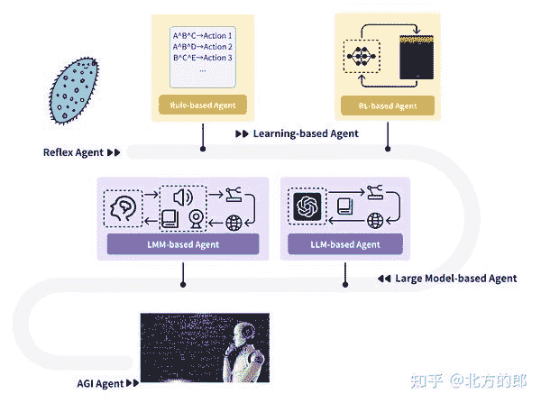

## 2 Overview

在对基于`LLM`的智能体进行审查后，可以将其分为两个主要类型：单个智能体系统和多智能体系统。这些不同的系统类型在许多方面表现出显著差异，包括应用领域、记忆和重新考虑机制、数据要求、模式和工具集等。因此，本论文深入探讨了这些智能体类型，以帮助读者理解它们的特点和应用领域。

### 2.1 Single-Agent System

一个单一智能体系统包含一个基于`LLM`的聪明的智能体，能够处理多个任务和领域，通常称为基于`LLM`的智能体。基于`LLM`的智能体通常具有广泛的语言理解、生成能力和多任务泛化能力，使其能够执行诸如代码生成、游戏探索和数据管理等任务。此外，不同基于`LLM`的智能体的评估方法有所不同，使用的工具也不是标准化的。基于`LLM`的智能体可以是单模态或多模态的，这取决于其设计目标。即将到来的表1提供了几个当代基于`LLM`的智能体的概述。

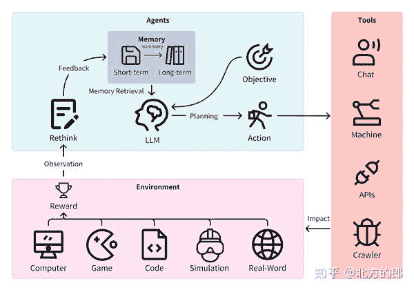

每个基于`LLM`的智能体`V` 可以简洁地表示为一个五元组`V = (L, O, M, A, R)`，其中`L`表示`LLM`，`O`表示目标，`M`包含记忆，`A`表示行动，`R`代表重新思考。

+ `LLM`: 将`LLM`和智能体配置以及熟练程度纳入通常需要快速定义或使用特定领域`LLM`。可以假设`LLM`不需要额外的训练；然而，其推理参数（例如温度）可以动态调整。`LLM`作为基于`LLM`的智能体的核心，根据当前观测、历史记忆和奖励信息来指导任务策略和决策。

+ 目标: 主要目标，即目标，代表智能体必须实现的终止状态或条件。智能体根据目标必须进行任务分解和规划。

+ 行动：智能体者拥有可以执行的一系列行动，通常涉及使用各种工具、开发新工具或向环境或其他智能体者传递信息。

+ 记忆: 智能体器的记忆存储信息并表示智能体器的当前状态。当智能体器采取行动时，随后的环境反馈和奖励信息都会被记录在记忆中。

+ 反思: 在执行一个行动之后，智能体需要利用内省能力，即所谓的“反思”，来反思前面的行动以及相关的环境反馈奖励。这个思考过程应该与智能体的记忆、`LLM`或其他适合的模型相结合，以规划和执行接下来的行动。

关于基于`LLM`的智能体的外部组成部分，环境和工具通常包括以下内容：

+ 工具：工具指的是智能体可以利用的任何工具，例如计算器、代码解释器、机械臂等。

+ 环境：所在环境显著地影响着智能体体的行动。智能体体可以观察和与环境互动，获得有价值的反馈。

### 2.2 Multi-Agent System

与单一智能体系统不同，多智能体系统（`MAS`）是一个由多个相互作用的聪明的智能体组成的计算机化系统[22]。受敏斯基的“思维社会”（`Society of Mind`，`SOM`）[23]和自然语言为基础的`SOM`（`NLSOM`）[24]的启发，多主体系统（`MAS`）的设计要求在各个智能体之间进行更高水平的复杂协调，特别是在它们的相互作用和信息共享方面。每个智能体通常具有特定领域的专业知识，使多智能体系统在跨多个领域的任务中特别有优势。`Decker`（1987）为`MAS`提出了一个四维框架。这些维度包括： 1）智能体的粒度，从粗粒度到可接受的配置；2）智能体知识的异质性，将具有冗余知识的智能体与具有专业知识的智能体进行比较； 3）控制分配机制，可以归类为互惠型或竞争型、以团队为导向或分层型，并且可能涉及静态或动态角色分配； 4）通信协议的多样性，区分黑板和基于消息的系统，并指定了从低级到高级内容的分级。

从应用的角度，`Parunak`（1996）从三个重要特征提出了多主体系统的分类：

+ ? `System Function`;

+ ? 系统架构（如通信、协议、人的参与）；

+ ? `Agent Architecture`（例如，异质性程度，反应式与深思熟虑式）。

该分类系统的主要贡献在于将多`Agent`系统分为个体层面和系统层面特征。

`Stone and Veloso` [2]根据两个关键维度对多`Agent`系统进行分类：异质性程度和通信程度。该分类框架给出了四种不同的多`Agent`系统典型：同质非通信`Agent`、异质非通信`Agent`、同质通信`Agent`和异质通信`Agent`。为这些`Agent`赋予智能和自主性常常采用控制理论和强化学习等方法。

正如`Yang` [27]所强调的，在单`Agent`范式中深度Q学习（`Deep Q-learning`，`DQN`）[8]架构的突破后，2019年观察到基于强化学习的`Agent`扩展到了多`Agent`系统，意味着多`Agent`强化学习（`Multi-Agent ReinforcementLearning`，`MARL`）技术的蓬勃发展。在`MARL`的背景下，`Hu et al.` [28]通过采用以下四个维度提供了一种区分`MARL`算法的分类方法：

+ ? 任务模式: 合作型或竞争型；

+ ? 智能体类型: 异质或均质;

+ ? 学习风格：独立学习、集中培训、分散执行（`CTDE`）或完全集中；

+ ? 知识共享: 在智能体层、情景层或任务层。

自2022年起，`LLM`蓬勃发展。考虑到多个基于`LLM`的`MAS`智能体，一个图`G(V, E)`可以表示多个基于`LLM`的代理之间的关系。这里`V` 是节点集合，其中`Vi`表示一个基于`LLM`的智能体，`E`是边集合，其中`Eij`表示基于`LLM`的智能体`Vi`和`Vj`之间的消息传递和关系。

我们提出了一种分类方法，以考虑以下几个方面：

+ ? 多角色协调: 合作、竞争、混合和层次化。

+ ? 规划类型：集中式规划分布式执行（`CPDE`）和分布式规划分布式执行（`DPDE`）。

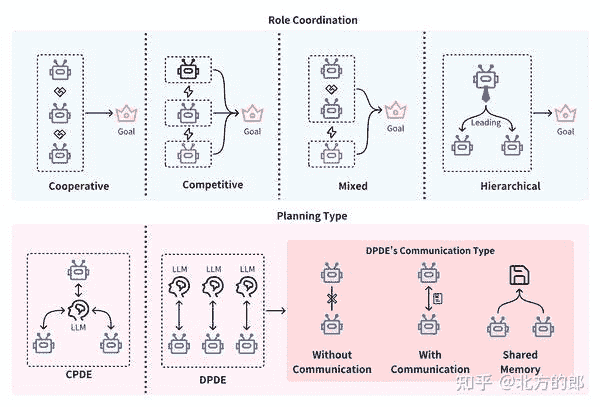

It will be listed with the detailed information of each LLM-based in the following table 2.

### 2.3 Agent System Template

许多研究者提出了智能体和模板解决方案，以帮助未来的研究者和爱好者开发更相关的智能体。例如，`ToolLLM`[74] 提供了一个全面的数据构建、模型训练和评估模板，促进了具有增强功能的智能体的开发。

各种项目，如 `AutoGPT` [75]、`XLang` [76]、`LangChain` [77]、`MiniAGI` [76]、`XAgent` [78]、`OpenAgents` [79] 和`WorkGPT` [80]，已将其代码开源在 `GitHub` 上。这些模板支持多样的功能，包括不同的思考、规划和审查方法，并允许将各种模型集成为智能体的核心组件。此外，`AgentGPT` [81] 提供了对模型进行微调和将本地数据纳入模型训练过程的功能。`Crouse` 等人 [82] 提出了一种流程简化的模板，利用线性时间逻辑（`LTL`）促进了基于 `LLM` 的智能体的设计和实施，推动了快速实验和增强智能体性能。

此外，诸如 `AutoGen` [83]、`AgentVerse` [84]、`AutoAgents` [85] 和 `AGENTS` [86] 等模板通过允许选择和定制多智能体配置中的角色，加快了多智能体系统的创建过程，简化了开发过程。

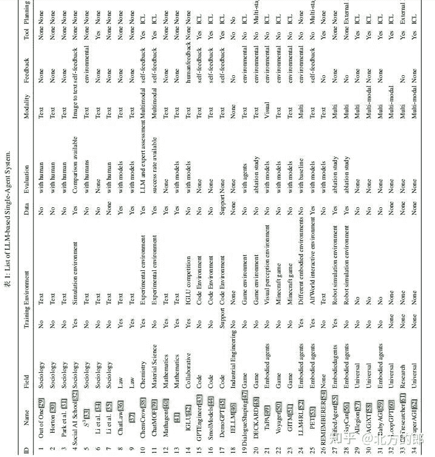

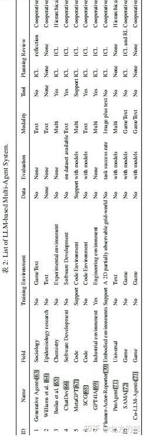

## 3 LLM-based Agent System Framework

### 3.1 LLM-based Single Agent System

本节简要地将单一智能体系统分解为五个关键组成部分，即规划、记忆、重新思考、环境和动作。每个组成部分因其独特的贡献而受到强调，它们共同构成了整体的重要部分，突显了系统的复杂设计和功能。

#### 3.1.1 Planning

规划能力定义了基于`LLM`的智能体根据设定目标和现有环境约束制定行动序列的能力，以确保目标的实现。这是`LLM`智能体的一个关键特性，包括任务分析、潜在行动预测、最优行动选择以及解决复杂问题和任务的能力。与传统的和强化学习智能体不同，后者使用规划算法如`Dijkstra` [87]和`POMDP` [88]在状态空间中寻找最佳行动序列并在不确定环境中进行规划，而基于强化学习的智能体则需要学习策略[5]。基于`LLM`的智能体主要通过`LLM`获得其规划能力。尽管`LLM`主要通过自然语言或特定文本进行交流，但其内部结构和训练方法赋予了它们一定的规划能力。最近的研究趋势还将指导`LLM`在思考和规划方面作为一个关键的发展方向。

上下文学习（`ICL`）方法 `ICL`利用自然语言提示，包括任务描述和可能的任务示例，引导语言模型进行问题解决[106]。`Thought`链（`CoT`）包括`Complex CoT` [90]，`Auto CoT` [91]和`zero-shot CoT` [92]，利用思维引导提示将复杂的任务系统地分解为更小、可管理的组成部分，从而促进长期规划和思考。为增强`CoT`的效果，`Self-consistency` [93]使用`LLM`生成多个推理路径，并通过在路径之间进行投票选择最一致的答案来集成结果。`Thought`树（`ToT`）[94]将问题分成几个思考阶段，在每个阶段产生多个概念并形成一个类似树结构的表示。搜索过程采用广度优先或深度优先探索，并使用分类器或多数投票评估每个状态。

### 3.1.1 Planning and Reasoning

为增强CoT的泛化能力，Least-to-Most [95]将复杂问题分解为子问题，并依次解决。与此同时，Thought骨架（SoT）[96]首先指导LLM生成答案的框架，然后通过API调用或批量解码完成每个骨架点，大大加快答案生成速度。Thought图（GoT）[97]将LLM生成的信息表示为任意图形，其中信息单元（LLM思考）作为顶点，边表示这些顶点之间的依赖关系。渐进提示（PHP）[98]通过使用先前生成的响应作为提示，加快对准确答案的引导，从而提高模型在问题解决环境中的推理能力。Self-Refine [107]使LLM能够对其输出提供多方面的反馈，并根据这些反馈迭代地改进先前的输出，模拟人类在生成文本时可能经历的迭代改进过程。外部能力方法 使用外部能力方法涉及在计算机科学中使用工具、算法或仿真技术进行规划目的。LLM+P[100]依赖于经典规划器进行长期规划，利用规划领域定义语言（PDDL）[108]作为中间接口。模型将问题转换为问题描述（问题PDDL），请求规划器基于“领域PDDL”生成PDDL规划，然后将PDDL规划转换回自然语言。LLM-DP [101]将LLM与符号规划器结合起来解决具体任务，利用LLM对行动对环境的影响的理解和规划器的解决效率。

除了这些方法，还提出了其他几种方法来增强规划和推理能力。LLM被用作常识世界模型，并应用启发式策略来解决复杂的任务规划问题[110]。结合认知架构和LLM的可行方法[103]。提出了一种基于模拟的方法，通过知识图和实体嵌入动态地组合并行运行的智能体的策略[104]。FaR [111]结合心理理论（ToM）[112]提供了一个框架，使LLM能够预测未来的挑战并考虑潜在的行动。LATS [113]将LLM作为智能体、值函数和优化器，利用其潜在优势增强规划、行动和推理能力。Think-on-Graph [114]通过在知识图上执行波束搜索，帮助智能体确定最佳的规划路径。这些方法展示了LLM在各种规划和推理任务中的多样性和潜力，为未来更先进、更高效的解决方案铺平了道路。

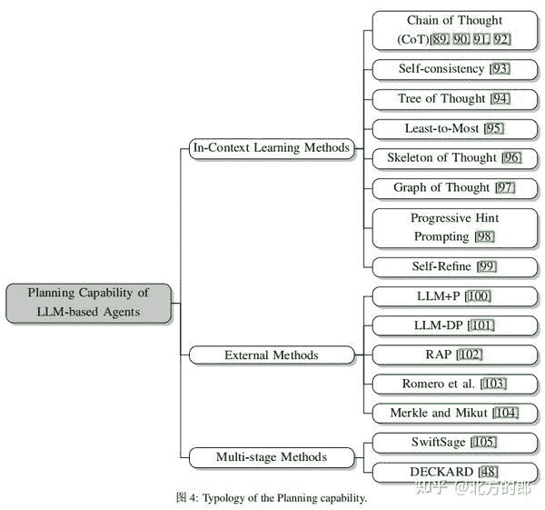

#### 多阶段方法

多阶段方法将规划过程分解为不同的阶段，旨在改善LLM在复杂推理和问题解决任务中的性能。SwiftSage [105] 是一个受到双过程理论启发的框架，结合了行为克隆和引导式LLM的优势，提高任务完成的性能和效率。它包括两个主要模块：SWIFT模块，负责快速、直观思考；SAGE模块，处理审慎思考。DECKARD的探索过程[48]分为梦境和清醒两个阶段。在梦境阶段，智能体利用LLM将任务分解为子目标。在清醒阶段，智能体根据经验学习每个子目标的模块化策略，并验证或修正假设。

这些方法可以提高模型在复杂的推理和问题解决任务中的表现。通过这些方法，LLM能够在思考和规划过程中得到指导，以解决复杂的问题和任务。

### 3.1.2 Memory

LLM-based智能体机制的记忆系统的主要功能是保存和调控知识、经验数据和历史信息，这些信息可用于问题解决和任务执行过程中的参考和修改。此外，记忆系统还经常代表LLM-based智能体机制的当前状态。通常，这类智能体机制的记忆以文本格式记录，以实现与LLM的无缝交互。本文描述了流行的记忆分类及其相关设计方法。

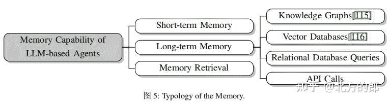

#### 短期记忆

短期记忆存储和操作有限数量的瞬时信息。在基于LLM的 agent 的上下文中，这可以通过将输入文本与与当前任务相关的上下文信息相结合来实现，并受限于LLM的上下文长度。正如 ChatDev[66] 所示，会话历史被归档，从而使得可以根据记录的 agent 间通信来进行后续步骤的决策。LangChain[77]通过封装每次交互中的关键信息并保存最常见的交互来提高短期记忆的效率。

#### 长期记忆

长期记忆存储和管理大量的知识、经验数据和历史记录。利用长期记忆的 agent 可能会与外部知识库、数据库或其他信息源进行交互。外部记忆的设计可以利用知识图谱[115]、向量数据库[116]、关系数据库查询或 API 调用等技术与外部数据源进行交互。Voyager[50]采用一个不断扩展的技能存储库来存储和检索复杂的行为。在GITM[51]中，记忆主要帮助从外部知识库中提取最相关的文本知识，然后长期记忆利用这些知识来识别必要的材料、工具和相关信息。为了提高 agent 的性能，ExpeL[117] agent 保留了跨多个任务的经验。在 Reflexion[118]中，通过自我反思获得的经验被保存在长期记忆中，并影响未来的行动。MemGPT[119]是一个能够管理各种记忆层次结构的智能系统，有效地在LLM的有限上下文窗口内提供了一个扩展的上下文，并利用中断来管理自身与用户之间的控制流。

短期记忆可以封装和概括关键信息，然后动态地存储在长期记忆中。正如 Generative Agents[63]所示，该agent 通过归档和更新经验来维持其内部状态，通过将经验与LLM的语言表示进行匹配生成自然语言，并不断积累新的经验并将其与现有经验整合。agent 的记忆会随着时间的推移而演变，并可以动态访问以表示agent 的当前状态。

#### 记忆检索

检索增强生成（Retrieval-augmented generation）[120]可以将信息检索组件与LLM结合起来，从而产生更可靠的输出。检索目标可以用记忆库（knowledge library）表示。记忆检索对于有效访问和管理记忆非常重要。在基于LLM的 agent 环境中，可以通过在线学习和自适应修改来促进记忆检索。在制定记忆检索方法时，在线强化学习、多任务学习或注意机制等技术可以实现实时更新和调整模型参数。LaGR-SEQ[121]引入了 SEQ（Sample Efficient Query），通过训练一个二级基于强化学习的 agent 来确定何时查询LLM以获得解决方案。REMEMBER[54]为LLM提供了长期记忆，使其能够从过去的经验中获取，并引入了强化学习和经验记忆来更新记忆。Synapse[122]从原始状态中清除与任务无关的信息，从而在限定的上下文中获得更多的样本。它通过存储样本嵌入并通过相似度搜索检索它们来推广到新的任务。Kang等人[123]讨论了人脑中分布式存储记忆的特征，提出了构建内部存储模块 DT-Mem，允许 agent 存储和检索与各种下游任务相关的信息。Wang等人[124]利用多模型记忆来存储 agent 收集的交互经验，并利用具体化的RAG来通过探索开放世界的Minecraft来使 agent 自我改进。

利用以上方法，有可能为基于LLM的智能体设计与其特性相适应的存储器类型和检索技术。需要强调的是，基于LLM的智能体可以同时涵盖两种记忆分类。恰当选择相关的记忆分类和检索机制可以增强LLM-based智能体的数据存储、管理和快速提取能力，从而在应对挑战、完成任务的同时增强其效力与适应性。

### 3.1.3 Rethinking

LLM概念为基础的智能体内省能力，即重新思考能力，包括评估先前的决策和随后的环境反馈。这种能力使得以LLM为基础的智能体能够全面审查其行为、决策和学习过程，增强其智能和适应性。

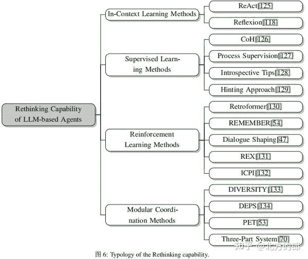

对于以LLM为基础的智能体重新思考的当代研究可以按照不同的学习方法进行广泛分类，其中包括上下文学习、监督学习、强化学习和模块化协调方法。

#### 上下文学习方法

如第3.1.1节所述，上下文学习 (In-Context Learning, ICL) 借助于任务特定的语言提示和实例实现强化学习。ReAct [125] 实现了一种交互范式，交替生成与任务相关的语言推理和动作，从而促进语言模型推理和动作能力的协同增强。该方法在解决需要多样化行动空间和推理的任务方面具有普适性和适应性。Reflexion [118] 在每个动作之后计算启发式，并通过自我反思确定是否重置环境，从而增强智能体的推理能力。

#### 监督学习方法

监督学习通常依赖于多样的信息源，包括语言模型、人类专业知识、编译器和外部知识。CoH [126] 利用一系列带有反馈的先前输出来促进模型的自我增强。该技术采用了监督微调、正负评级和经验回放等方法来提高性能。Lightman et al. [127] 的实验证实了过程监督在数学推理任务中的优于结果监督，并且主动学习极大地增强了过程监督的效力。Introspective Tips [128] 引入了一个基于过去轨迹或专家演示的自我检查框架，为策略优化产生简明但有价值的见解。Zhou et al. [129] 倡导一种基于显式基于代码的自我验证的提示方法，以提升 GPT-4 代码解释器的数学推理能力。此外，它还在推理步骤中引入了一个多样性验证器，进一步增强了智能体的推理能力。

#### 强化学习方法

强化学习强调通过从历史经验中获取知识来改善参数。Retroformer [130] 通过从回顾模型中学习，并利用策略梯度自主调节基于语言模型的智能体的提示，进一步改善智能体。REMEMBER [54] 引入了一种新颖的半参数强化学习方法，通过结合强化学习和经验记忆来更新记忆并通过经验类比增强能力。Zhou et al. [47] 提供了一个塑造对话的框架，通过从非玩家角色（NPC）中提取相关信息并将其转化为知识图来加快智能体收敛到最优策略。REX [131] 引入了一个辅助奖励层，并吸收了类似于上限置信区间得分的概念，从而实现了更强大、更高效的人工聪明的智能体性能。ICPI [132] 通过在强化学习环境中进行尝试和错误的交互中迭代地更新提示内容，展示了在没有专家演示或梯度的情况下执行强化学习任务的能力。Liu etal. [135] 通过在贝叶斯自适应马尔科夫决策过程中利用学习和规划，将智能体规划和行动相结合。在这种方法中，语言模型从记忆缓冲区构建未知环境的更新后验进行学习，同时生成最优轨迹以最大化多个未来步骤的价值函数。 Wang et al. [136] 提出了一种通过迭代探索和Proximal Policy Optimization (PPO) [137] 与环境和其他智能体进行训练，使基于语言模型的智能体能够持续改进的技术。该方法还促进了将短期经验整合到长期记忆中。

#### 模块化协调方法

模块化协调方法通常包括多个模块协同工作，以促进基于语言模型的智能体的规划和内省。DIVERSITY [133] 探索各种提示以增加推理路径的多样性。通过引入一个验证器来区别有利和不利的响应，它实现了增强加权投票并利用多样性验证来确保每个步骤的正确性。DEPS [134] 框架通过描述符、解释器和目标选择器与语言模型规划器交互，提高整体成功率。PET [53] 利用语言模型的知识来简化具有实体智能体的控制问题。该框架包含规划、消除和跟踪模块，以完成更高级的子任务。Dasgupta et al. [70] 研究了规划者、执行者和报告者在三方系统中的集成。这个系统在分布式学习中展示了泛化能力，研究了失败场景，并说明了强化学习如何训练单个组件以提升性能。

这些方法和框架通过环境反馈、自主学习和反思，优化了基于LLM的智能体系统的性能。它们在增强LLM智能体系统在反思和重新规划方面的能力方面取得了显著进展。

### 3.1.4 Environments

基于LLM的Agent可以通过环境反馈与多种环境进行交互和学习。这些环境可以是计算机、游戏、代码、现实世界和模拟环境。

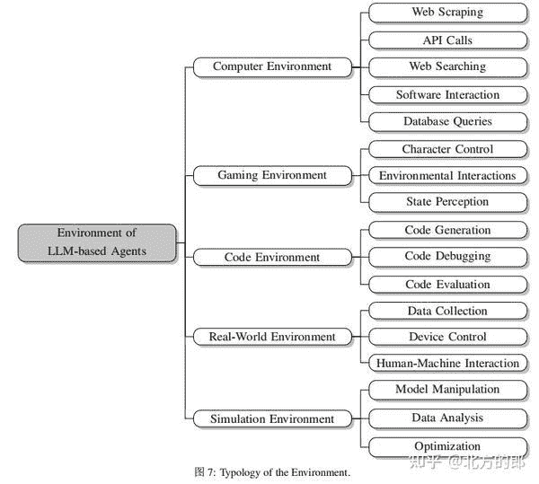

#### 计算机环境

基于LLM的智能体程序在计算环境中与网站、API、数据库和应用程序进行交互，涵盖了计算机、网络和移动环境下的多种模式。

+ 网络爬虫：从网站上获取重要的数据和知识的过程。
+ API调用：使用Web API来访问或传输数据，促进与在线服务的交互。
+ 网络搜索：利用搜索引擎寻找与问题解决或任务完成相关的信息和资源。
+ 软件交互：操纵和与软件应用程序进行接口交互，涵盖从文字处理器到图形设计工具的各种应用，以高效执行任务。
+ 数据库查询：直接访问和更新数据库，实现实时数据处理和处理。

当代研究引入了一种名为RCI的方法， 该方法通过自然语言命令指导语言模型执行计算任务[138]。WebArena提供了一个独立的、 自托管的Web环境， 用于构建自主智能体[139]。 WebGPT利用搜索引擎进行文档检索，实现端到端的模仿学习和强化学习，以优化检索和聚合，同时生成引用了网络检索信息的响应[140]。Mobile-Env允许智能体观察屏幕截图和Android操作系统的框架，以执行操作，例如点击屏幕或输入命令与Android应用交互[141]。SheetCopilot利用自然语言便捷地与电子表格进行交互[142]。

#### 游戏环境

基于LLM的智能体在游戏环境中与虚拟角色、物体和设置进行交互。在游戏环境中，交互方法包括：

+ 角色控制：通过发出指令（如移动、跳跃、攻击）来引导游戏角色。
+ 环境互动：通过与游戏环境中的物体互动（例如捡起、使用、放置）来完成任务。
+ 状态感知：从游戏环境中收集状态信息（如角色位置，物品数量）用于决策和规划。

著名的应用包括DECKARD，它在Minecraft游戏中采用LLM引导的探索方式来设计任务。VOYAGER是一个基于Minecraft的LLM驱动的终身学习智能体，持续探索世界，获取各种技能并发掘新发现。GITM采用一种"间接映射"的方法，将长期复杂的目标转化为一系列低级键盘和鼠标操作，从而在Minecraft游戏中实现高效和可适应的操作。AgentSims生成了一个具有多样化建筑和居民的虚拟城镇，简化任务设计，并解决由于不同背景和编程经验水平造成的研究人员可能遇到的挑战。LLM-Deliberation建立了一个多用途测试平台，用于基于文本、多智能体、多问题和语义丰富的协商游戏。此外，该平台还可以轻松调整困难程度。

#### 编码环境

编码环境使LLM基础智能体能够为各种任务编写、修改和执行代码，从编码到通过代码进行推理验证。代码环境中的交互方法包括代码生成、代码调试和代码评估。代码生成根据任务要求生成代码片段或完整程序。代码调试识别和纠正代码中的错误或问题。代码评估执行代码并评估其性能，通过运行时错误消息或输出进行优化和改进。

LLift是一个全自动智能体，与静态分析工具和LLM接口，以解决错误特定建模、广泛问题范围和LLM的非确定性等挑战。MetaGPT将人类工作流程纳入LLM驱动的协作中，使用标准操作规程（SOP）作为提示，以促进结构化协调。同样，文章[7]中引入了一个自协作框架，涉及多个LLM角色，用于自动生成代码。在这个框架中，不同的角色扮演分析师、程序员、测试员等，形成一个协作团队来完成代码生成任务。ChatDev代表一个基于聊天的虚拟软件开发公司，将开发过程划分为设计、编码、测试和文档四个离散的顺序阶段，基于瀑布模型进行。CSV通过提示解释器利用代码进行自我验证，增强了解决方案的可信度。

#### 真实环境

基于LLM的智能体可以与真实世界的设备、传感器和执行器进行交互，从而促进其在真实情境中的运作。这些情境中的交互方法包括：

+ 数据收集：基于LLM的智能体可以从摄像头和麦克风等传感器收集实时数据，并用于分析和决策。
+ 设备控制：关于设备控制，基于LLM的智能体可以通过传输控制信号来操作执行器，如机器臂和无人机，从而完成特定任务。
+ 人机交互：关于人机交互，基于LLM的智能体系统在与人类用户进行自然语言交流方面表现出色，能够接收指令、提供反馈并回答问题。

Di Palo et al. [55]在一个稀疏奖励的机器人操作环境中介绍了一种以语言为中心的推理工具包框架，机器人在其中执行像堆叠物体等任务。TaPA [146] 提出了一种嵌入式任务规划智能体，用于在实际物理场景约束下进行规划。Alexa Prize项目中的SimBot挑战 [147] 的目标是构建能够在模拟的物理环境中完成任务的机器人助理。Zheng et al. [148] 提出了23种启发式方法，用于指导基于LLM的智能体在与人类协作和共创服务时进行引导。

#### 仿真环境

基于LLM的智能体使用虚拟模型来表示模拟环境中的真实系统或过程，如经济市场、物理环境和交通系统。仿真环境中的交互方法包括：

+ 模型处理：调整模拟模型内的参数或变量以探索各种场景并分析其结果。
+ 数据分析：收集和分析由模拟产生的数据，以识别能够为决策制定提供指导的模式、趋势和洞见。
+ 优化：应用优化算法在模拟环境中确定最佳行动方案，考虑约束和目标。

近期的研究中，TrafficGPT [149] 展示了在交通仿真环境 SUMO [150] 中进行交通流分析和解决问题的能力。Li et al. [34] 对模拟社交平台上的社会智能体行为特征进行了研究。Horton [30] 调查了基于LLM的智能体在经济仿真场景中的行为，并比较了智能体和实际人类行为之间的差异。AucArena [151] 是一个拍卖仿真环境，智能体必须考虑资源和风险管理因素。

这些仿真环境为基于LLM的智能体提供了一个受控但又逼真的背景，使其能够学习、实验和开发适用于现实世界场景的解决方案，促进了虚拟领域知识和技能的转移。

总之，基于LLM的智能体通过自然语言交互和环境反馈在不同环境中学习和应用知识，为各种任务提供强大的解决方案

### 3.1.5 Action

基于LLM的智能体的行动能力涉及行动的表现或使用工具。这类智能体主要的互动模式通常是通过生成文字来促进与外部环境的交流，这与生成式智能体的特点相似[63]。另一种方法包括使用LLM或智能体使用的工具，包括API、计算器、程序解释器或通过基于文字的指令在物理环境中进行的行动。这进一步扩展到对工具的战略性规划和部署，这可能需要开发新的工具来实现它们的应用。

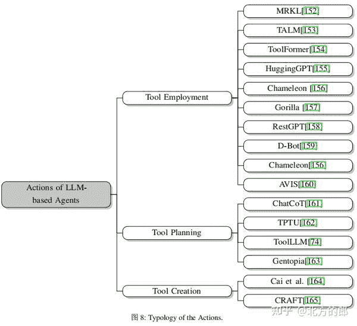

## 3.1 Tool Application

### Tool Application

工具应用 MRKL（Karpas等，2022）整合了LLM和外部工具，以解决复杂问题。这包括模块和路由的构建以及自然语言查询的路由。TALM（Parisi等，2022）连接了语言模型和工具，方便了文本到文本API连接。ToolFormer（Schick等，2023）展示了LLM利用外部工具增强各种任务性能的能力。HuggingGPT（Shen等，2023）结合了多个AI模型和工具，用于任务规划和执行，包括文本分类和物体检测。使用基础模型进行工具学习探索了工具学习，提出了一个将基础模型和工具集融合起来实现高效任务执行的通用框架。Gorilla（Patil等，2023）深入研究了LLM在API调用和程序合成、上下文学习和任务分解方面的应用，以提高性能。RestGPT（Song等，2023）是一种将LLM与RESTful API相连接的方法，用于处理用户请求，包括在线规划和API执行。TaskMatrix.AI（Liang等，2023）可以理解文本、图像、视频、音频和代码输入，并生成调用API来完成任务的代码。D-Bot（Zhou等，2023）提供了涵盖知识检测、根本原因分析和多个LLM协作的数据库维护建议。

Chameleon（Lu等，2023）利用各种工具应对挑战，并使用自然语言计划器选择和组合存储在库存中的模块，从而构建解决方案。AVIS（Hu等，2023）是一个自主的视觉信息寻求系统，利用LLM动态制定利用外部工具并检查其输出结果的策略，从而获取提供问题答案所需的基本知识。

### Tool Planning

工具规划 ChatCoT（Chen等，2023）将链状思维模型化为多轮对话，通过工具辅助推理改进复杂任务处理能力。TPTU（Ruan等，2023）引入了一个任务执行框架，包括任务指令、设计提示、工具包、LLM、结果以及任务规划和工具利用能力。ToolLLM（秦等，2023）基于深度优先搜索开发了基于决策树的方法，使LLM能够评估多个基于API的推理路径并扩展搜索空间。Gentopia（许等，2023）是一个框架，通过简单的配置实现对智能体的灵活定制，无缝集成各种语言模型、任务格式、提示模块和插件到一个统一范式中。

### Tool Creation

工具创建 Cai等（2023）提出了一个工具创建和利用框架，生成适用于不同任务的工具，包括工具的分阶段生成和任务执行。CRAFT（袁等，2023）是一个为开发和检索通用工具而设计的框架，能够生成针对特定任务的专用工具包。LLM能够从这些工具包中提取工具，以解决复杂任务。

## 3.2 LLM-based Multi-Agent System

### 3.2.1 Relationship of Multi-Agent Systems

在基于LLM的多智能体系统（MAS）中，许多智能体通过协作、竞争或层级组织来执行复杂的任务。这些任务可以涵盖搜索和优化、决策支持、资源分配、协作生成或控制等方面。这些系统中的智能体之间的相互关系至关重要，因为它们影响着智能体之间的互动和合作机制。同样，这些智能体之间的互动关系可以推广到基于LLM的MAS中。目前，基于LLM的MAS的大部分研究主要集中在智能体之间的合作和竞争动态上。

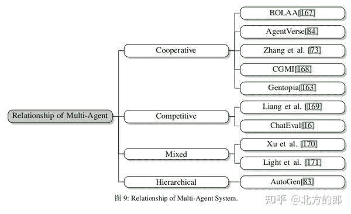

#### 合作关系

在合作关系中，学术界主要关注于为协作决策制定角色和任务分配策略以及算法。这些方法可以提高智能体协作效能，从而改善整体系统性能。SPP [172] 通过多角色自协作实现多轮对话，将一个单一的LLM转化为一个认知协同体。生成型智能体 [63] 利用基于LLM的智能体仿真人类行为，培养智能体之间的合作。CAMEL [173] 实现了AI助手和AI用户之间的面向任务的角色扮演合作。MetaGPT [67] 将有效的工作流程整合到基于LLM的多智能体协作编程方法中，实现了不同角色之间的协作。ChatDev [66] 利用多个基于LLM的代理进行对话任务解决，加速了LLM应用的开发。

在Minsky的心智社会中 [23]获得启发，NLSOM [24] 引入了自然语言为基础的心智社会（NLSOMs）的概念，包括多个LLM和其他基于神经网络的专家，通过自然语言界面进行交流。这种方法应用于解决各种场景下的复杂任务。Zou et al. [174] 实现了设备端LLM之间的协作。在具体的多智能体系统（embodied MAS）中，RoCo [175] 使用LLM进行高级通信和低级路径规划，促进多机器人协作。InterAct [176] 指派了诸如检查员和分类器的角色，在AlfWorld [177]中取得了显著的成功率。AutoAgents [85] 可以自适应地生成和协调多个专门的智能体，组成一个AI团队，根据不同的任务实现目标。

在LLM为基础的MAS框架研究中，BOLAA [167] 设计了一个架构来协调多智能体策略，增强了单个智能体的互动能力。AgentVerse [84] 提供了一个灵活的框架，简化了为LLM创建自定义多智能体环境的过程。Zhang et al. [73] 提出了一个新颖的框架，赋予具象化智能体计划、交流和协作的能力，以高效地完成与其他具象化智能体或人类的长期任务。CGMI [168] 是一个可配置的通用多Agent交互框架，利用LLM的能力来解决特定任务中的Agent性能挑战，并模拟人类行为。Gentopia [163] 是一个框架，通过简单配置实现对智能体的灵活定制，无缝集成各种语言模型、任务格式、提示模块和插件到统一的范式中。DyLAN [178] 引入了基于任务的动态框架，实现了多个智能体之间的交互，并根据无监督度量选择最有效的智能体进行自动优化以提高团队表现。

#### 竞争关系

在竞争关系中，考虑因素涵盖了设计有效的竞争策略、信息隐藏技术和对抗行为。这些技术可以帮助智能体在竞争中获得优势，从而实现他们的目标。Liang et al. [169] 通过多智能体辩论框架增强了任务解决能力。ChatEval [16] 采用多智能体方法，促进LLM组与各种智能对手的协作，利用各自的能力和专业知识提高处理复杂任务的效率和效果的。

#### 混合关系

智能体必须在混合关系中平衡合作和竞争，以实现他们的目标。目前，LLM为基础的MAS中关于混合关系的研究集中在设计协作竞争算法上，这是一个重要的课题。这些技术可以帮助智能体在复杂环境中做出有效的决策。Xu et al. [170] 使多个基于LLM的智能体参与了人狼游戏，每个智能体根据不对称信息条件下的目标合作或背叛其他智能体。同样，Light et al. [171] 使基于LLM的智能体参与了阿瓦隆游戏，每个智能体必须在动态演变的游戏阶段中做出决策，并与其他智能体进行涉及合作或欺骗的谈判，以实现其分配的角色的目标。Corex [179] 从人类行为中得到启发，融入了辩论、评论和检索等各种协作范式。这些范式共同努力增强推理过程的真实性、忠实性和可靠性。

#### 分层关系

研究人员专注于开发有效的分层控制结构、信息传递机制和任务分解方法，以分层关系中实现有效的协同作用，提高系统的整体性能。这些技术使得智能体能够在不同层级之间有效地进行协作。分层关系通常以树形结构表现，其中父节点智能体负责任务分解，并将任务分配给子节点智能体。后者遵循其相应父节点所设定的安排，并返回概括信息。AutoGen [83] 利用不同的智能体来处理任务，如代码生成和文本写作，并通过对话进行任务分解。目前，关于LLM基于MAS的分层关系的研究仍在发展中，只有少数层级被探讨。在未来的研究中，利用博弈论、拍卖机制和谈判技巧有望应对合作智能体之间任务分配问题所带来的挑战。此外，分布式约束优化问题（DCOP）为研究合作智能体中的协同决策提供了一个重要的框架。在其他关系类型的背景下，合作博弈和多目标强化学习（MORL）成为探索合作与竞争之间微妙平衡的重要框架。这些已经建立的研究框架也可以在基于LLM的多智能体系统中进行调整和改进。

### 3.2.2 Planning Type

在MAS领域中，规划构成一个关键组成部分，它使多个智能体能够协同追求共享目标。已经提出了许多规划方法，每种方法都有其独特的优点和限制。类似于多智能体强化学习中集中式训练分布式执行（CTDE）的概念[180]，本研究探讨了两种主要的规划范式：集中式规划分布式执行（CPDE）和分布式规划分布式执行（DPDE）。

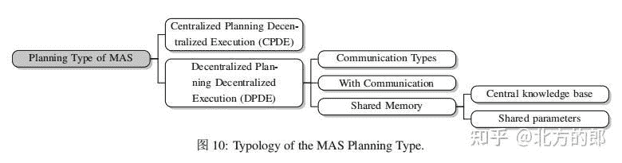

#### 集中规划分散执行（CPDE）

在CPDE范式中，一个集中式LLM负责代表系统中的所有智能体进行规划。这要求LLM考虑到所有智能体的目标、能力和约束，为它们制定适当的行动计划。正如Gong et al. [181]所强调的，规划者必须同时管理多个智能体，回避潜在的冲突，并协调它们以完成需要复杂协作的共享目标。在完成规划后，每个智能体独立执行其指定的任务，不再与中央LLM进行进一步的交互。这种方法的优点在于优化整体性能，因为集中式LLM可以考虑到所有智能体的需求和资源[181]。Li et al. [72]在overcooked [182]和MiniRTS[183]多智能体环境中开发了SAMA，通过采用集中式LLM来促进目标生成、目标分解、目标分配和自我反思的重新规划。

然而，CPDE也存在一定的局限性。首先，集中式规划过程可能导致计算复杂性升级，特别是在管理众多代理和复杂任务时。其次，由于所有智能体都依赖于单个LLM进行规划，系统可能容易受到单点故障和通信延迟的影响。最后，CPDE可能不适用于需要实时响应能力和高度适应性的情况，因为中央LLM可能无法迅速响应环境变化。

#### 分布式规划分布式执行（DPDE）

与CPDE相比，DPDE系统将独立的LLMs纳入每个智能体的行动规划中。因此，每个智能体都可以根据其目标、能力和本地信息独立制定计划。在执行阶段，智能体可以通过本地通信和协商协调他们的行动来增强合作。

DPDE的好处包括增加的稳健性和可扩展性，因为每个智能体都可以独立规划和执行，从而减轻中央LLM的计算负担。此外，DPDE系统通常表现出更大的适应性，因为每个智能体可以根据本地信息及时修改其行为。这种特性使得DPDE系统在动态和不确定的环境中更为合适。

然而，DPDE的限制包括在实现全局最优性方面可能存在的挑战，因为每个智能体的计划都取决于本地信息。此外，在大规模系统中，协调和通信开销可能会变得相当大，可能影响整体性能。

在这种系统中，智能体之间的信息交流对于促进合作和协作至关重要。以下讨论了DPDE系统中智能体之间的三种信息交流方式：

#### 无通信的信息交流

在这种模式下，智能体避免直接通信。每个智能体都独立制定计划并执行，仅依靠本地信息和观察来完成任务。这种方法的优点在于通信开销最小，因为智能体不需要交换信息。此外，在通信有限或不可靠的环境中，这种方法可能是唯一可行的选择。

然而，缺乏通信可能导致智能体之间的合作不够最优，因为他们无法共享信息、协调行动或解决冲突。在某些情况下，这可能导致行为低效和整体性能下降。

#### 通过通信实现的信息交流

在这种模式下，智能体通过明确的通信进行信息交流和行动协调。通信可以采用多种形式，包括消息传递、广播或点对点通信。智能体可以通过通信传播观察、目标、计划和其他相关信息，从而促进协作和整体性能的提升。

然而，通信可能会产生额外的开销，包括通信延迟、带宽利用和接收信息处理。此外，在通信不可靠或有限的环境中，这种方法可能会遇到障碍，如丢失的消息或延迟的更新。

#### 通过共享内存实现的信息交流

在这种模式下，智能体通过共享内存进行信息交流，这是一个能够所有系统内的智能体访问和修改的集中化数据结构。智能体通过在共享内存中存储和检索信息来实现信息共享和协作。共享内存具有几个优点，例如简化通信，因为智能体不需要直接传输和接收消息。此外，它提供了统一的信息表示和访问机制，简化了系统的设计和实现。

然而，共享内存也存在一些限制。首先，由于所有智能体都需要访问和修改共享内存，可能会出现竞争和同步问题。其次，共享内存可能阻碍系统的可扩展性，需要所有智能体之间的一致性。最后，在分布式和移动智能体环境中实现共享内存可能会遇到技术挑战，例如确保数据一致性和管理并发控制。

在当代研究中，可以找到两种形式的共享内存：

+ 中央知识库：可以建立一个中央知识库来存储和管理每个智能体的共享知识。该知识库可以是一个数据库、知识图或其他存储结构。通过查询和更新这个知识库，智能体可以实现记忆共享。MetaGPT [67] 提供了一个全局的记忆池，用来存储所有的协作记录，使每个智能体可以订阅或搜索所需信息。这种设计使得智能体能够主动观察和提取相关信息。

+ 共享参数：在某些情况下，可以考虑在基于LLM的MAS系统中让智能体之间共享部分或全部模型参数。通过这种方式，当一个智能体获得新的知识或技能时，其他智能体也可以立即获得这些信息。然而，这种方法可能会引发过拟合或过度专业化的问题。为了解决这个问题，可以动态调整共享参数的权重，以平衡每个智能体的专业化和泛化能力。

### 3.2.3 Methods of Enhancing Communication Efficiency

在基于LLM的MAS中，存在着沟通不畅和LLM错觉的挑战。为了缓解这些问题，可以采取以下策略：

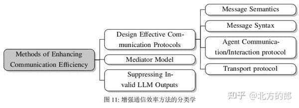

#### 设计有效的通信协议

在多agent系统（MAS）的领域中，有必要通过一个包括“何时”，“什么”和“如何”维度的三方面视角来审视通信的讨论。这些维度共同决定了agent之间互动的时机、内容和方式，从而对于复杂问题的解决和协调努力的效果起到关键作用。

可以确定四个层次的agent通信：

+ 信息语义：每条信息的含义。

+ 消息语法：每条消息的表达式。

+ 智能体通信/交互协议：对话/对话结构。

+ 传输协议：智能体通过发送和接收信息的方式。

从历史上看，智能Agent，尤其是基于强化学习（RL）的Agent，多通过学习隐性地进行通信。相比之下，基于LLM的Agent可以通过自然语言处理（NLP）进行通信，为人类提供更透明和明确的交互模式。因此，在涉及LLM的MAS中，关于消息语义和传输协议的担忧是不必要的。

关于消息语法的问题引起了对Agent通信语言（ACL）的关注，该语言根据Searle提出的言语行为理论[184]而形成。现在有两个主要的标准：知识查询和操作语言（KQML）[185]以及智能物理Agent基金会（FIPA）提出的ACL3。

1996年，FIPA为异构和相互作用的Agent和基于Agent的系统制定了标准。FIPA的ACL包括22个表现行为，即Inform和Request等。这些表现行为并不是孤立的实体，而是作为结构化对话协议的组成部分。这样的协议由预定义规则来规范，这些规则概述了执行特定集体目标所需的表现行为使用的顺序和时机。例如，FIPAACL可以构建FIPA-Auction-English协议和FIPA-Auction-Dutch协议。实施明确定义的通信协议可以确保Agent之间的交互遵循一致的结构和语义，减少歧义和误传，提高通信效率。采用嵌入（embeddings）[186]或结构化输出格式，如JSON，可以进一步增强这些优势。

#### 使用调解模型

在基于LLM的MAS中，LLM之间的大量交互可能导致更高的开销和更长的参与时间。调解模型作为一个鉴别机制，帮助确定LLM之间交互的必要性，从而减少冗余的通信开销，增强系统的整体效能。调解模型参与交互的决策受到任务复杂性、Agent间关联程度和通信开销的影响。已经有研究实现了调解模型，例如Hu et al. [52], Karimpanal et al. [121]的研究探讨了在Agent和LLM之间优化成本效益的智能交互。

#### 缓解LLM的不准确输出

LLM往往会产生过分赞美或无根据的信息输出。Wei et al. [187]的研究介绍了一种简单的方法，在辅助微调阶段使用合成数据以减少赞美式输出的发生。Rawte et al. [188]详细分析了LLM中的幻觉问题以及用于对抗幻觉的技术。验证链（CoVe）[189]通过促使模型首先生成初步回应，然后为核实这个草案提出验证的询问，并独立地处理这些询问，并最终生成经过验证和改进的回应，以最小化幻觉。通过实施这些策略，可以有效解决基于LLM的多智能体系统中的沟通效率低下和虚假感知问题。这将最终提升系统的性能和稳定性。

## 4 Performance Evaluation

### 4.1 Dataset

大多数基于LLM的智能体程序不需要对LLM进行进一步的训练，并且某些特定任务的数据集并不公开。因此，我们只列举公开可用且广泛使用的数据集。

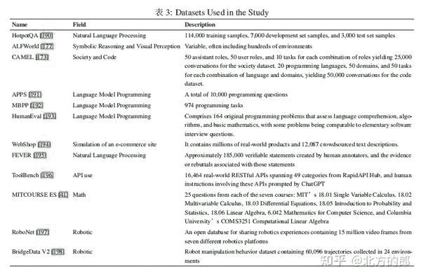

### 4.2 Benchmark

目前，尽管一些研究通过比较分析他们的基于LLM的智能体与其他智能体，但尚没有被广泛使用的基准。此外，研究人员正在努力提出可能成为未来评估标准的基准。

ToolBench [74] 是一个涵盖单工具和多工具场景的工具利用调优数据集。TE [199] 评估语言模型模拟各种人类行为的能力。Akata et al. [200] 旨在理解LLM的社会行为。它为机器的行为博弈理论奠定了基础，强调了理解LLM在交互社会环境中的运作方式的重大社会价值。Ziems et al. [201] 提供了一个最佳提示实践的汇编和一个全面的评估流程，以评估24个代表性CSS基准测试中13个语言模型的零-shot性能。

AgentSims [143] 提供了一个用于LLM评估的开源平台。Drori et al. [41] 收集了来自麻省理工学院和哥伦比亚大学的计算线性代数最大课程的问题数据集，用于评估数学推理能力。BMTools [196] 建立了工具利用的框架和评估标准。SmartPlay [202] 提供了一个具有独特设置的挑战性基准测试，包括六个不同的游戏，提供高达20种评估配置和无限的环境变化。MLAgentBench [203] 是一个用于评估AI研究智能体的ML任务集合，便于进行文件读写、代码执行和输出检查等操作。MetaTool [204] 用于评估LLM是否有意识地使用工具，并能选择适当的工具。LLM-Co [205] 评估智能体推断合作伙伴意图、进行推理行为和在游戏环境中进行长期合作的能力。

## 5 Prospect Applications

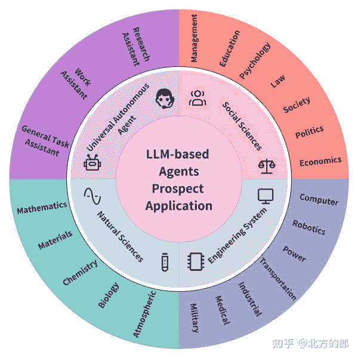

### 5.1 Natural Sciences

#### 5.1.1 Mathematics

### 5.1.1 Mathematics

近期的许多研究都集中在智能体和多智能体系统在数学领域的应用。例如，Kennedy（1995）提出了粒子群优化算法，一种基于多智能体框架的全局优化技术，已广泛应用于数学、工程和计算等领域的优化问题中。Macal（2005）讨论了基于智能体建模和仿真方法的实施，以及它们在复杂数学模型中的应用。Crainic（1986）研究了基于智能体方法在组合优化问题中的应用，特别是关于多商品、多模式运输网络的设计。目前，基于LLM的智能体研究主要集中在提高推理能力和理论推导支持方面。例如，Math Agents（Swan，2023）利用LLM来研究、揭示、解决和演示数学问题。Zhou（2023）引入了一种创新且高效的提示技术，称为基于代码的自验证，进一步增强了GPT-4代码解释器的数学推理能力。LeanDojo（Yang，2023）是一种可以与Lean持续互动的工具，可以纠正现有定理证明工具中的证明检查错误。Dong（2023）通过与GPT-4进行97次严谨的“苏格拉底式”推理，最终确定了“P≠NP”。Yang（2023）设计了一个系统，可以仅凭一系列原始网络文本自主生成有效、原创和有价值的假设。ToRA（Gou，2023）提供了一系列集成工具的推理代理人，利用自然语言推理和调用外部工具来解决复杂的数学问题。COPRA（Thakur，2023）用于形式定理证明，将GPT-4作为其状态回溯搜索策略的关键组成部分。这种方法可以在搜索过程中选择证明策略，并从外部数据库中检索公理和定义。

基于LLM的智能体在即将进行的数学研究中展现出巨大的潜力，包括：

? 辅助理论推导: 基于LLM的智能体理解基础领域中的主流理论，如数学和物理学，并协助人类进一步推导和验证，最终推动科学探索的发展。

? 符号和数值计算: 基于LLM的智能体可以用于符号和数值计算，帮助研究者解决各种数学难题。智能体能够执行多种数学操作，包括方程求解、积分、微分以及更多其他操作。多智能体系统能够通过将复杂的数学问题分解为多个子问题来增强计算效率和精度。

尽管基于LLM的智能体在数学理论推导和计算方面取得了一定的成就，不过我们仍然需要不断完善LLM和代理的数学推理能力，并设计更加高效的数学知识表示方法，以提高它们处理复杂数学问题的准确性和效率。此外，在解决数学问题时，LLM智能体的可解释性和可靠性也至关重要。探索补充性方法以增强智能体的可解释性，使其能够为用户提供更加明确和可靠的解决方案是至关重要的。同时，对智能体的推理结果进行监督和验证可以确保它们在实际应用中的可靠性。

### 5.1.2 Chemistry and Materials

在先前的研究中，Gomez等人（2016）通过高保真模拟从大量分子库中筛选出了160万个有机发光二极管材料候选物。MolDQN框架（Zhou等人，2019）将化学领域的专业知识与强化学习方法相结合，明确勾勒出分子修饰，确保100％的化学有效性。You等人（2018）提出了一种基于图卷积策略网络（GCPN）的模型，该模型基于通用图卷积网络，通过强化学习生成目标导向的图形，旨在发现具有期望属性（如药物相似性和合成可达性）的新颖分子。Beaini等人（2023）引入了Graphium图机器学习库，简化了构建和训练多任务和多水平分子数据集的分子机器学习模型的过程。

在化学和材料科学领域的基于LLM的智能体研究领域中，Coscientist（Boiko等人，2023）利用LLM的功能以及互联网和文档搜索、代码执行和实验自动化等工具，能够自主设计、规划和执行真实世界的化学实验。ChatMOF（Kang等人，2023）致力于预测和生成金属有机框架（MOFs），包括三个核心组件：智能体、工具包和评估器。这些组件擅长于管理数据检索、性能预测和结构生成。ChemCrow（Bran等人，2023）通过访问与化学相关的数据库在生物合成、药物发现和材料设计等领域执行各种化学任务，从而加快了更高效的研究。基于LLM的智能体还在以下几个方面显示出了相当的潜力：

+ ? 分子模拟和化学反应优化：基于LLM的智能体通过模拟分子结构和化学反应，推动化学和材料科学研究的发展。通过研究不同的反应路径和条件，这些智能体可以找到合成新材料或改善现有材料性能的有效策略。

+ ? 化学实验自动化与智能化: 基于LLM的智能体可以通过检索信息、查询专业数据库以及设计和实施根据特定要求定制的实验计划来推动化学实验的自动化。这将有助于获得有关化学反应和物质性质的数据。此外，多智能体系统可以通过合作协作和共享实验数据和经验来提高实验的效率和精度。

+ ? 材料设计和优化: 在材料科学研究中，基于LLM（Language Learning Model）的聪明的智能体可以辅助材料性能的仿真和优化。通过自主探索多样化的材料组合和结构，并利用LLM模型的强大概括能力来模拟和预测新材料的性能，聪明的智能体可以发现具有卓越性能的创新材料。这加快了材料设计过程并提高整体效率。

虽然现有的基于LLM的聪明的智能体在化学和材料科学研究上取得了一定的成功，但模型准确性和可靠性的进一步提高仍然是一个重要的挑战。未来的研究应该集中于增强LLM的处理复杂化学和材料问题的能力，以提高对化学反应、材料性质和其他方面的预测和生成的准确性。

### 5.1.3 Biology

近年来，在生物学领域出现了许多关于智能体和多智能体系统的成熟研究。例如，Bonabeau等人（1999）探讨了群体智能的理论和应用，包括基于多智能体模型的遗传算法、蚁群算法和粒子群算法。DeAngelis等人（2005）对个体建模方法在生态研究中的应用进行了全面概述，模拟了生态系统中的物种互动和环境影响。Wilensky等人（2015）介绍了基于智能体模型的建模方法及其在自然、社会和工程复杂系统中的应用，包括使用智能体系统模拟地理科学问题，如海洋生态系统和大气环流。Jain等人（2022）提出了一种利用GFlowNets作为生成多样候选解的生成器的主动学习算法，旨在产生具有优良特性的生物序列，如蛋白质和DNA序列。

目前，生物学领域关于基于LLM的智能体的研究还很有限。BioPlanner（O’Donoghue等人，2023）是一种自动化评估方法，用于评估LLM在生物学领域的协议生成和规划任务中的性能。OceanGPT（Bi等人，2023）采用多智能体协作技术，在海洋科学的各个子领域中自动生成数据。然而，在未来的研究中，存在着很大的潜力，可以在以下领域进行深入探索：

+ ? 生态系统建模: 基于LLM的智能体可以模拟生态系统中的物种互动和环境影响，帮助研究人员理解生态系统的结构和功能。例如，通过模拟各种智能体的行为和互动，包括生物个体、种群和环境，可以分析生态系统的稳定性、多样性和进化过程。

+ ? 群体行为与集体智能: 通过对群体内行为和互动的模拟，可以阐明群体行为、集体智能、种群遗传学和进化的基本概念。特别是通过模拟多个分子或生物群体的行为和互动，可以研究群体行为的形成、协调、适应和演化，从而更好地理解统领整个系统运行的机制。

+ ? 细胞生物学和分子生物学: 基于LLM的智能体能够模拟细胞内的分子机制和信号通路，进而研究生物分子之间的相互作用和调控。例如，通过模拟多个智能体（如蛋白质、核酸和代谢产物）的行为和相互作用，可以分析细胞内的信号转导、基因表达调控和代谢途径等生物过程。

生物系统以其内在的复杂性而闻名，这种复杂性表现在不同的层次、时空尺度和时间范围上。鉴于此，利用LLM的智能体必须展示在管理这种复杂性方面的熟练程度。这意味着要考虑到各种生物实体的动态行为和相互作用，包括个体生物、种群以及它们各自的生态背景。此外，生物学领域的数据通常表现出数量庞大、多样化、异构结构和固有噪声的特征。这在包含基因组、表型和环境信息的数据集中表现得很明显。因此，基于LLM的智能体需要具备有效处理大量异构数据并从中提炼有价值的见解和知识的能力。

### 5.1.4 Climate Science

在大气研究中，智能体系统的应用主要涵盖气候行为的阐释和气候能源经济的调查。Jager [225] 提出了一种新型的基于智能体的建模方法，阐述了其在解析与气候相关的行为动态复杂性方面的实用性。此外，Castro et al.[226] 对以气候能源政策为中心的研究进行了全面考察，强调了通过实施基于智能体的建模方法来减少排放和节约能源。

在当前的研究领域中，Kraus et al. [227] 利用基于LLM的智能体从ClimateWatch4中提取排放数据，从而为气候变化的关键方面提供更准确可靠的数据。基于LLM的智能体可以通过在不同地理位置部署传感器网络来收集大气数据（例如温度、气压、湿度、风速），并通过基于LLM的智能体对这些数据进行实时分析和处理，进而为大气现象和气候变化进行预测或发布警报。相反，在气候模型模拟和优化领域，基于LLM的智能体可以模拟各种大气过程和事件，如大气环流、气候系统和空气污染传播。通过不断优化和修改智能体之间的相互作用规则，该模型可以更准确地反映现实情况，最终为大气科学研究提供更精确的预测和解决方案。在气候模拟过程中，多智能体系统的不断复杂化对计算效率提出了重大挑战。提高基于LLM的智能体规划和重新考虑的性能对于在有限的计算资源内实现更精确的气候模拟和预测至关重要。此外，由于大多数大气数据是数字化的，提高LLM对数字值的理解和计算能力将极大地影响系统性能。

## 5.2 Universal Autonomous Agent

### 5.2.1 General Task Assistant

目前关于通用任务助手的研究主要集中在基于LLM的智能体系统或框架上。Generalist Agent [18]是一种多模态、多任务、多实体的通用智能体，能够执行各种任务，例如玩Atari游戏、命名图像、聊天、使用真实机械臂叠放积木等。HuggingGPT [155]整合了不同领域的模块和机器学习社区中的AI模型，以执行任务规划。ModelScope-Agent [228]是一个通用的、可定制的基于LLM的智能体框架，适用于实际应用，提供用户友好的系统库。LangChain [77]是一个开源框架，通过自然语言交流和协作实现高效的软件开发。XLang [76]为基于LLM的智能体提供了全面的工具和用户界面，支持数据处理、插件使用和网络场景。BabyAGI [59]根据预定义的目标创建任务，利用LLM创建新任务，并存储和检索任务结果。AutoGPT [75]是一个自动化智能体，能够分解目标并循环执行任务。AgentVerse [84]可以基于多个基于LLM的智能体扮演不同角色的模拟实验快速创建。LMA3 [229]是一种利用LLM支持各种抽象目标表示、生成和学习的方法。Kani [230]通过提供聊天交互的核心构建模块，包括模型接口、聊天管理和强大的函数调用，帮助开发人员实现各种复杂功能。尽管在利用LLM-based智能体研究通用任务助手方面已经取得了显着进展，但还存在一些挑战。其中之一是确定如何在保持任务求解效率、最小化记号消耗和减少计算资源需求的同时，明智地控制任务分解的粒度。另一个挑战涉及内存利用和信息整合：设计方法更有效地利用存储在内存中的信息，将来自不同来源的知识和数据融合在一起，并增强LLM-based智能体在问题求解中的准确性和效率。此外，在各种背景下开发额外的工具和技术，以增强LLM-based智能体的适应性和可扩展性，是至关重要的通用任务助手。最重要的是，为LLMbased智能体配备长期学习和自适应能力，这对于持续改进面对不断演变的任务和环境的性能至关重要。未来的研究可以探索更高效的自动化任务分解和优化算法，使LLM-based智能体能够在面对复杂任务时自主地执行合理的任务分解，从而提高问题解决的速度和质量。此外，将多模态信息处理技术整合到智能体中将有助于处理和整合来自不同形式的信息，如图像、声音和视频，从而丰富任务助手的能力。

### 5.2.2 Work/Research Assistant

在工作和研究努力的背景下，积累大量的资料和文献可能是必要的，紧接着需要通过理解来对它们进行总结，随着实验和验证的进行，观点也会逐渐精炼，并最终将它们编写成报告、论文、演示文稿或叙事和影视作品。这些步骤也可以委托给基于LLM的智能体，它们可以浏览网页、数据库和文献库，通过LLM对其进行总结，生成验证实验代码，并随后起草结论。

在一般的文本生成中，ChatEval [16]采用了多Agent辩论框架，提高了处理复杂任务的效率和有效性。Zhu etal. [231] 提出了一种启发式强化学习框架，可以显著提高性能，而无需优先数据。在创建研究报告、故事和电视剧方面，Maas et al. [232]提出了一种基于LLM的方法，借助自定义扩散模型和多Agent模拟来生成高质量的分集内容。GPT Researcher [61]是一个自动化智能体，能够产生详细、准确和公正的研究报告。Boiko et al.[65]提出了一个聪明的智能体系统，能够自主设计、规划和执行复杂的科学实验。在特定领域的应用中，Mehtaet al. [42]构建了一个能够学习理解建筑语言指令并利用这些指令在网格上放置方块以构建3D结构的智能体。LayoutGPT [233]与视觉生成模型合作，在各个领域中生成合理的布局，从2D图像到3D室内场景。MusicAgent[234]集成了与音乐相关的工具和自动化工作流程，包括音色合成和音乐分类，以满足用户需求。MemWalker[235]是一个交互式智能体，用于长文本阅读，它利用一种将广泛的上下文转化为摘要节点树结构的技术。当收到查询时，智能体会遍历这棵树以找到相关信息，并在积累了足够信息后生成回应。

与一般的任务助手不同，工作和研究助手需要更强大的记忆和知识整合能力。增加基于LLM的智能体的记忆容量对于在处理大量文本材料后高效组织、总结和检索信息至关重要。此外，有效利用领域特定的工具，如代码和模拟器，进行验证实验对于增强任务完成和准确性至关重要。基于LLM的智能体还应展示更全面的跨领域知识和技能，以适应不同的工作和研究需求。最终，创新和原创性带来了重大挑战，因为在工作和研究助理中需要增强LLM-based智能体的创造力和原创性，同时避免生成重复或过度相似的内容。

未来基于LLM的智能体在工作和研究助理方面的努力可能会进一步涉及艺术创作，如音乐和电影生成，并结合人机协作，充分利用人类知识来产生更加原创的作品，从而提供更大的方便性给人类工作和创造力。

## 5.3 Social Sciences

### 5.3.1 Economics and Finance

已有的智能体与多智能体系统已被应用于经济和金融研究。Arthur（2018）运用多智能体模型构建了一个人工股票市场，探讨了资产定价、投资者行为和市场波动等金融市场问题。Tesfatsion（2006）全面介绍了基于智能体的计算经济学方法及其在各个经济领域的应用。Johanson（2022）通过使用多智能体强化学习（MARL）模型来展示智能体在空间中生成资源并以所期望的价格进行交易的能力。AI Economist（Zheng等，2020）提出了一个具有竞争压力和市场动态的经济仿真环境，并通过展示基本税务系统的运行以经济一致的方式验证了仿真，包括学习和专业智能体的行为和专业化。Tilbury（2022）回顾了经典基于智能体的技术在经济建模中面临的历史障碍。《AI Economist：通过AI驱动的税收政策改善平等和生产力》提出了一种基于经济仿真的两层深度强化学习方法，用于学习动态税收政策，智能体和政府学习和适应。

目前，许多研究关注于经济和金融领域中基于LLM的智能体。Horton（2023）通过将LLM放置在不同的经济情景中并探索其行为，比较了LLM行为与实际人类行为的差异，使研究人员能够在模拟中调查经济行为，例如独裁者博弈和最低工资问题，从而获得对经济学的新见解。Phelps（2023）在委托智能体冲突中研究了LLM的反应。在一个简单的在线购物任务中，基于LLM的智能体超越了委托方的目标，提供了明确的委托智能体冲突证据，并突显了将经济原则纳入对齐过程的重要性。AucArena（Chen等，2023）说明了基于LLM的智能体在拍卖中的有效参与，通过具体的激励机制有效地管理预算，维护长期目标和提高适应性。

在博弈论领域，Suspicion-Agent（Guo等，2023）在各种不完全信息的纸牌游戏中展示了出色的适应能力。它展示了强大的高阶心灵理论能力，表明它能够理解他人并有意识地影响他们的行为。

许多研究已经在金融交易场景的背景下使用基于LLM的智能体进行了调查。AlphaGPT（Wang等，2023）引入了一个交互式的Alpha挖掘框架，采用启发性方法来理解量化研究人员使用的概念，并生成创新、深入和高效的Alpha。TradingGPT（Li等，2023）提出了一个新颖的基于LLM的多智能体系统框架，通过模拟人类的认知过程来增强金融交易决策。这种方法使智能体能够优先处理重要任务，整合历史行动和市场洞见，并进行智能体间讨论，提高响应能力和准确性。

鉴于基于LLM的智能体具有更强的文本理解和复杂决策能力，在经济和金融研究中利用这些智能体存在着很大的潜力。相关的探索可以涵盖以下领域：

+ ? 市场模拟和仿真：建立基于LMM的智能体来模拟各种市场参与者的行为，例如供需双方、竞争对手和监管机构，可以让研究者预测和仿真产品价格、市场份额、市场结构和交易完成率的数据。这些行为可能包括购买、竞价、讨价还价和合作招标。

+ ? 金融市场分析：通过模拟金融市场参与者的行为，包括投资者、机构和监管机构，基于LLM的智能体可以提供对市场波动性和风险的有价值的见解。例如，对投资者交易行为和市场信息传播过程的模拟可以预测股票价格、汇率和利率的波动。

+ ? 宏观经济和政策模拟: 基于LLM的智能体可以模拟财政和货币政策的实施过程，涵盖政府、企业和个人等各种经济参与者。这使得智能体能够预测宏观经济指标的变化，包括国内生产总值（GDP）、通货膨胀率和失业率。

+ ? 社会经济网络分析：通过对社会经济网络内信息传播、资源分配和信任建立等过程建模，基于LLM的代理可以为对网络经济的演化和影响提供更深入的理解。具体而言，涉及消费者、企业和政府等多样化代理的模拟可以为网络效应、信息不对称和市场失灵等问题提供洞察。

对于以LLM为基础的经济智能体，通常需要模拟人类或经济行为者的决策过程，智能体之间的交互行为空间和智能体的状态起着至关重要的作用，直接影响实验结果。有效地表示交互行为空间和智能体状态，更准确地模拟经济行为者的决策过程是一个重要的挑战。同时，LLM拟人化的可信度也是一个重大挑战。如果进行大规模的宏观经济分析，可能需要很多基于LLM的智能体，这会给系统性能或代币消耗带来困难。其中一种方法是使用强化学习方法来控制和减少与LLM的交互次数。

### 5.3.2 Politics

### 5.3.3 Society

在政治领域的前期智能体研究中，Epstein（1996）应用多主体系统构建了一个人工社会，研究社会现象的形成和演化，包括政治通信和政治学中的社会运动。Lustick（2009）讨论了多主体系统在比较政治科学研究中的应用，包括政治体制、政治决策和政治稳定。Tsvetovat（2004）介绍了多主体模型在研究复杂社会技术系统方面的应用，包括政治通信和政治决策。Trott（2021）利用两级强化学习和数据驱动的模拟实现了有效、灵活和可解释的政策设计。

在当前基于LLM的智能体研究中，这些智能体用于探索政治行为者的潜在决策和沟通情境。Ziems（2023）使用基于LLM的智能体帮助理解政治家演讲的内容和策略。Bail（2023）证明了基于LLM的智能体可以检测意识形态、预测投票结果并识别模式。Mukobi（2023）提出了零和博弈外交的一种广义和变体。在这个变体中，智能体必须平衡在军事征服和国内福利之间的投资。

在政治领域中，基于LLM的智能体可以探索以下领域：

+ ? 政治模拟与预测: 通过模拟政治过程中各参与者的行为和互动，如政党竞争、选民行为和政策制定过程，基于LLM的智能体可以预测政治事件的发展趋势、选举结果和政策效果。

+ ? 政治决策分析：利用基于LLM的智能体模拟不同政治决策过程的行为和互动，可以评估各种政策选择的优势、劣势和影响。这种方法使研究人员能够模拟政府、政党和利益集团之间的互动，为决策者提供有关政策效果的重要信息。

+ ? 国际关系研究：利用基于LLM的聪明的智能体模型来描绘国家间国际政治的相互作用和冲突，研究人员可以探索各个方面，如国际贸易、军事冲突和外交互动。这种方法有助于理解国际政治的复杂性和潜在风险。

在政治研究中，基于语言和认知模型（LLM）的智能体可能需要确保沟通效率，同时避免过多的礼貌和无效的沟通，增强LLM-based智能体在政治科学研究中的实际应用价值。同时，准确地建模政治环境的复杂性和不确定性，以提高LLM-based智能体在政治领域研究中的准确性和可靠性，是一个挑战。当然，还需要确保LLMbased智能体的行为符合道德和伦理要求，避免不良的社会影响。

### 5.3.3 Society

在社会学的多主体研究中，Epstein（1996）运用多主体模型构建了一个人工社会，研究了社会运动、文化演化和社会变革等社会现象的形成和演化。Macy和Willer（2002）引入了计算社会学和基于智能体的建模方法，包括社会网络、社会规范和社会影响。Gilbert和Troitzsch（2005）介绍了利用模拟方法进行社会科学研究的理论和实践，包括多主体模型在社会学研究中的应用。Hasan（2023）讨论了可持续发展的支柱（例如社会、环境和经济）。

目前，基于语言模型的智能体主要集中在模拟人类行为和社会互动。Park等人（2023）提出了多个基于语言模型的智能体之间的相互作用模式，以实现对人类行为的可信模拟。Gao等人（2023）使用提示工程和调整技术创建了一个基于语言模型的多主体系统，模拟了现实社交网络数据的情感、态度和互动行为。Li等人（2023）在类似Twitter的社交网络中研究了基于语言模型驱动的社交机器人的行为特点。结果表明，这些机器人可以通过有毒行为伪装和影响在线社区。Liu等人（2023）提出了一种新的学习范式，使语言模型能够从模拟的社会互动中学习。Feng等人（2023）研究了基于语言模型的智能体在精心设计的环境和协议中模拟可信的人类行为的能力。Wei等人（2023）评估了多方组聊模型的性能，探索了提高模型性能的方法，并解决了转交和对话连贯性的挑战。

另一方面，Li等人（2023）开发了一个意见网络动态模型，编码了基于语言模型的观点、个体认知可接受度和使用策略，模拟了不同场景中基于语言模型的影响力对观点动态的影响。Wang等人（2023）利用基于语言模型的语言理解和推理能力分析人类迁移数据，引入了历史逗留和上下文逗留的概念，捕捉人类运动的长期和短期依赖，并利用时间信息进行预测。Egami等人（2023）利用基于语言模型的输出进行社会科学中文档标签的下游统计分析，同时保持渐进无偏性和准确的不确定性量化。Ghaffarzadegan等人（2023）探索了利用生成人工智能构建具有复杂反馈的计算模型的新机遇，这些模型可以描绘社会系统中个体决策的过程。Kaiya等人（2023）评估了多种多主体情境中智能体的自我驱动和社交能力。该方法在保持低成本和实时响应性的同时保留智能和目标导向性。

这些研究为基于语言模型的智能体在模拟人类行为和社会互动方面提供了各种方法和框架。由于基于语言模型的智能体能够模拟人类的交流和思考过程，这些智能体可以模拟可信的人类行为，参与多方组聊，学习模拟环境中的社会互动，处理记忆和规划任务，并展现在观点动态中的人类行为特征。

然而，这些研究也揭示出一些挑战，例如确保基于语言模型的智能体在多方组聊中保持转交和对话连贯性，以增强模拟人类行为和社会互动的真实性，以及在模拟环境中有效训练与社会对齐的语言模型，以提高基于语言模型的智能体在社交互动中的适应性和准确性。此外，基于语言模型的智能体必须实现对每个人类参与者的多样性和个性化模拟，以更好地反映现实世界的社会现象。未来的研究可以继续探索这些挑战，并提出更有效的方法，以改善基于语言模型的智能体在模拟人类行为和社会互动方面的性能。

### 5.3.4 Law

在先前关于法律领域中的Agent和Multi-Agent系统的研究中，Bench和Brinting等人运用多Agent模型来研究法律推理过程中的理论和价值，提供了新颖的法律决策和法律系统设计的理论与方法。Hamiliton等人介绍了基于多LLM的Agent`Blind Judgement`，用于模拟2010年至2016年美国最高法院的审判决议，训练了九个分别模拟不同法官观点的模型。Shui等人评估了将LLM与专业信息检索系统整合应用于案例学习和问题回答在法律领域的效用。

考虑到LLM-based agents具备强大的文本处理和理解能力，以及用于记录历史案例和决策的`Memory`机制，法律领域有着广泛的研究潜力，如以下领域：

+ ? 自治法律助理：基于法学硕士（LLM）的聪明的智能体结合了法律条款和历史案例回顾，用于提供文书编写和对当前案件的辅助建议。

+ ? 法律决策分析：基于LLM（法学硕士）的聪明的智能体模拟法律决策过程中各参与者的行为和互动，包括法官、律师和诉讼当事人，以评估不同法律政策和法律体系的优势、劣势、影响、公平性和效率。由于法律领域通常涉及大量的文字材料，基于LLM的智能体需要更长的上下文和更高效的记忆能力。此外，有效地表示法律知识，包括法律条款、历史案例和法律原则，并在基于LLM的智能体中执行准确的法律推理对于阅读和理解法律后做出决策或模拟是至关重要的。

### 5.3.5 Psychology

在心理学的先前研究中，Sun等（2006）全面介绍了将多智能体交互应用于认知建模和社会模拟，并涵盖了心理学中的认知过程、社会互动和情绪动机。Marsella等（2009）利用智能体模型对情绪评估过程进行建模，深入理解情绪心理学的基本原理。

目前，基于LLM的智能体主要关注于心理健康支持和心理实验模拟的应用领域。马等（2023）对基于LLM的智能体支持的心理健康应用进行了定性分析。研究发现，该应用有助于提供按需、非评判性的支持，增强用户信心，促进自我发现。然而，它面临着过滤有害内容、保持一致的沟通、记忆新信息和减轻用户过度依赖的挑战。Aherr等（2023）利用基于LLM的智能体模拟心理实验，揭示了LLM中一些可能影响下游应用的“超精确扭曲”。Akata等（2023）利用基于LLM的智能体模拟博弈论中的重复博弈，发现基于LLM的智能体在强调自利的游戏中表现出色，尤其是囚徒困境博弈，并表现出将自利优先于协调的心理倾向。这些研究为基于LLM的智能体在心理健康支持和心理实验模拟中提供了各种方法和框架。这些基于LLM的智能体在提供心理支持、重复心理发现和模拟博弈理论实验方面有广阔的应用前景。`Humanoid agents`（Wang等，2023）是开发模拟人类认知、沟通和行为模式的智能体的平台。这些智能体具有依赖于特定因素的逻辑推理能力，例如满足基本需求、情绪和与他人的互动。Zhang（2023）探讨了基于LLM的多智能体社群模拟人类协作智能的潜力。

心理学领域的基于LLM的智能体未来可以探索以下领域：

+ ? 心理治疗与咨询：基于LLM技术的智能体系统模拟心理治疗和咨询过程中的互动和影响，为研究人员提供对心理治疗和咨询心理学基本原理的深入理解，并支持接受心理治疗的患者。

+ ? 认知建模：通过模拟感知、记忆、思维和决策等认知过程，基于LLM的智能体能够揭示认知心理学的核心原理。具体而言，这些智能体能够通过模拟个体在各种情境下的认知过程，分析认知偏见和策略。

+ ? 情绪和动机建模：利用LLM和记忆来模拟情绪和动机过程，基于LLM的智能体使得研究人员能够通过研究个体的情绪反应、兴趣和驱动力来探索情绪和动机心理学的基本原理。

然而，这些研究也揭示了一些挑战，例如有效过滤有害内容、保持一致的沟通、实现更具人形化的沟通或模拟，并解决用户过度依赖问题。未来的研究可以继续探索这些挑战，并提出更有效的方法，以改善基于LLM的智能体在心理健康支持和心理实验模拟中的性能。

### 5.3.6 Education

在现有的Agent和Multi-Agent研究中，Woolf等人（2010）介绍了构建智能互动教师的方法和技术，包括使用Agent和Multi-Agent系统实现个性化教学和自适应学习。Soller等人（2003）提出了采用多Agent模型进行在线知识共享交互分析的计算方法，以改进教育组织和管理。

基于其强大的自然语言交互能力，基于LLM的Agent可与人类进行高效沟通，可用于辅助人类学习或模拟教育领域的课堂。有关研究辅助，请参阅研究辅助部分。`数学Agent`（Swan，2023）将文献中的数学公式转化为LaTeX和Python格式，利用LLM作为语言用户界面和人工智能助手，促进数学与计算机科学之间的交互。`AgentVerse`（Chen，2023）是一个基于LLM的MAS框架，模拟NLP课堂教育。`CGMI`（Jinxin，2023）是一个通用的多Agent交互框架，模拟教师和学生之间各种课堂交互，实验结果表明教学方法、课程和学生表现与真实课堂环境非常相似。此外，基于LLM的Agent可以模拟未来教育政策和系统的实施过程，帮助研究人员评估不同教育策略的优势、劣势和影响。例如，通过模拟政府、学校、教师和学生的行为，MAS可以预测学术投入、质量和公平性的变化。

在教育领域，基于LLM的Agent面临的主要挑战是输出无害、更可信的内容，以提高教育质量。另一个挑战是多样性和个性化：教育涉及各种不同的学生群体，在基于LLM的Agent系统中为每个学生实施个性化教学和自适应学习仍然是一个重大挑战。此外，尽管LLM具有强大的自然语言交互能力，但在理解学生的问题、表达和情绪方面仍有改进空间，以更好地满足他们的学习需求。

### 5.3.7 Management

在现有的Agent和Multi-Agent Systems领域研究中，North and Macal [271]全面介绍了应用基于Agent的建模和仿真来管理企业复杂性。这包括组织行为、人力资源管理以及市场营销等管理研究领域。Bonabeau [272]介绍了基于Agent的建模方法及其在模拟人类系统方面的应用，包括组织行为、供应链管理以及金融市场等管理领域。Liu et al. [273]应用MARL来解决多层次库存管理问题，旨在最小化整个供应链的成本。目前，管理领域中基于LLM的Agent主要集中在模拟公司和组织的运营。例如，`MetaGPT` [67]和`ChatDev`[66]模拟软件公司中的多个角色以进行协作软件开发。`MetaAgents` [274]利用模拟的招聘会环境作为案例研究，评估agent的信息处理、检索和协调能力。研究结果表明，这些agent在理解项目工作流程、确定合适的合作者和委派任务方面表现出卓越的性能。可以在以下领域进行进一步探索：

+ ? 组织行为与协作工作: 通过模拟组织中的员工、团队和经理的行为和交互作用，基于LLM的智能体为研究人员提供了一个有价值的工具，以研究协作工作过程，增进对组织结构、文化、领导力和效率的理解。

+ ? 公司辅助运营：以LLM为基础的智能体机构在公司和组织的运营过程中发挥辅助作用，通过承担报告、信息摘要、处理、审批和决策等任务，提高了效率，使公司运营更加高效、公平和透明。

+ ? 供应链管理和物流优化: 研究者可以通过使用基于LLM的智能体来模拟资源分配和协作决策过程，从而有效地分析和优化供应链管理和物流。通过对供应商、制造商、分销商和零售商的行为和互动进行建模，LLM-based智能体可以解决供应链库存管理、运输计划和需求预测等问题。

管理问题通常涉及多个层次、角色和目标。在LLM（学习、逻辑和模型）为基础的智能体的处理过程中，有效解决这些复杂性和可扩展性问题仍然是一个重要挑战。此外，管理研究通常依赖于多种历史和实时数据形式。LLM为基础的智能体需要有效地理解不同格式的历史数据。

## 5.4 Engineering Systems

### 5.4.1 Computer System

在计算机科学领域，已经有许多成熟的关于智能体和多智能体系统的研究。这些研究主要关注计算机操作任务、人机交互、代码生成与测试、网络安全、游戏和推荐系统应用。

+ ? 计算机操作: `RCI`（参考文献 [138]）使用自然语言指令来指导LLM完成计算机任务。`Mobile-Env`（参考文献 [141]）基于Android移动设备环境，使聪明的智能体能够观察Android操作系统的屏幕截图，查看层次结构，并与Android应用程序进行交互。

+ ? 人机交互: Lin et al. [275] 提出了一种名为面向决策对话的协作任务。在这些任务中，AI助手通过自然语言与人类协作，帮助进行复杂决策。`SAPIEN` [276] 引入了一种由LLM驱动的高保真虚拟智能体平台，允许与用户进行13种语言的开放域对话，并通过面部表情和声音调节来表达情感。在网络交互方面，`WebAgent`[277] 提出了一个模型，集成了两个语言模型——领域专家语言模型和通用语言模型，用于在真实网站上进行自主导航。`WebArena` [139] 是一个独立的、自托管的网络环境，用于构建自主智能体。`SheetCopilot`[142] 通过自然语言实现与电子表格的交互，将复杂请求转换为可执行步骤。

+ ? 网络安全：Rigaki et al. [278] 提出一种利用 LLM 作为攻击智能体在增强学习环境中应用的方法。

+ ? 代码生成: `GPT-Engineer` [43] 很容易进行调整和扩展，使得基于语言模型（LLM）的智能体能够根据提示生成整个代码仓库。 Dong et al. [68] 允许多个LLM扮演不同的角色，形成一个无需人工干预的团队，共同合作完成代码生成任务。`ChatDev` [66] 探索使用LLM驱动的端到端软件开发框架，涵盖需求分析、代码开发、系统测试和文档生成，以提供一种统一高效、具有成本效益的软件开发范式。`CAAFE` [279] 使用LLM生成和执行用于表格数据特征工程的代码。`AutoGen` [83] 提出了一个自主的基于LLM的智能体，根据提示生成整个代码仓库。

+ ? 软件测试：`LLift` [145] 是一个与静态分析工具和LLM接口的自动化测试工具，使用精心设计的智能体和提示。 Feldt et al. [280] 提出了一种基于LLM的自主测试智能体，提供了一个对话框架，帮助开发人员进行测试，并强调LLM虚幻在测试中的好处。`RCAgent` [281] 是一个在云环境中用于实际和注重隐私保护的工业根本原因分析（RCA）的工具增强型智能体。

+ ? 推荐系统: `RecAgent` [282] 以LLM为核心和推荐模型为工具，构建了一个多功能互动推荐系统。`Agent4Rec`[283] 包括用户配置文件、记忆和行动模块，并通过网页交互来提供个性化电影推荐。

+ ? 角色扮演游戏: `VOYAGER` [50]是一个在Minecraft中由LLM驱动的终身学习智能体，可以持续探索世界，获取各种技能并进行发现。`GITM` [51] 提出了一个框架，通过将长期和复杂目标转化为一系列最低级别的键盘和鼠标操作，实现了高效灵活的操作。Junprung等人 [284] 提出了两个模拟人类行为的智能体：一个是两方协商智能体，一个是六方谋杀谜题智能体。Zhou等人 [47] 提出了一个对话塑造框架，允许LLM通过对话从非玩家角色（NPCs）获得有用信息，并将其转化为知识图，然后使用故事塑造技术加快强化学习智能体收敛到最佳策略的速度。Chalamalasetti [285] 开发了一个灵活可扩展的框架，利用对话游戏作为测试工具，快速评估各种模型。`Tachikuma` [286] 提出了将虚拟游戏主持人（GMs）整合到智能体的世界模型中的方法。GMs在监督信息、估计玩家意图、提供环境描述、提供反馈以及解决当前世界模型的局限性方面起着关键作用。Xu等人 [170] 在实验中有效地进行了狼人游戏，并且在不调整LLMs参数的情况下展现了战略行为。Gong等人 [181] 提出了一种新颖的游戏场景和相关的基准，促进了多智能体协作效率的评估，同时实现了对同时参与游戏的多个智能体的监督。

+ ? 游戏生成: Chen et al. [287] 设计了一个基于`ChatGPT`的文本冒险游戏想象游戏系统，用于生成与想象游戏相关的故事。`GameGPT` [288] 利用双智能体协作和分层方法，采用多个内部字典来自动化游戏开发。尽管在计算机科学领域中，基于LLM的智能体已经取得了一些成就，但仍存在许多研究方向和挑战。例如，在代码生成和测试方面，LLM的编码能力至关重要，如何提高基于LLM的智能体的代码质量和测试结果是一个值得关注的问题。在网络安全、推荐系统和其他方面，充分利用LLM智能体的优势并解决现有问题仍需要进一步的研究。对于计算机操作和人机交互，LLM智能体必须掌握更多的工具使用能力以实现更多的功能。此外，通过建立自适应学习和长期发展的LLM智能体系统，它们在面对不断变化的计算机科学问题时可以不断提高性能。

### 5.4.2 Robotics System

在先前关于机器人中的智能体和多智能体系统的研究中，Parker（2016）介绍了对多移动机器人系统和多个机器人之间协同控制问题的研究。Busoniu（2008）讨论了机器人学习和智能方面的关注点。在本文关于基于LLM的机器人智能体研究中，主要关注于机器人任务规划。Di（2023）提出了一种利用语言作为核心推理工具、模拟机器人操作环境，并展示了在探索效率和离线数据重用方面的显着性能改进的框架。ProgPrompt（Singh等，2022）提出了一种程序化的LLM提示结构，有助于在各种环境和机器人功能任务中进行任务规划。Huang（2022）研究了LLM如何在机器人控制情境中通过自然语言反馈进行推理，而无需进一步的训练。TaPA（Wu等，2023）提出了一种在现实世界物理场景约束下的规划方法，其中智能体通过对场景中的对象进行LLM和视觉感知模型的对齐来生成可执行计划。LLM-Planner（Song等，2022）利用LLM的强大能力对具身智能体进行高效样本规划。Xiang（2023）使用世界模型对LLM进行微调，以获取多样的具身知识，利用这些经验进一步微调LLM，实现在各种物理环境中的推理和行动。3D-LLM（Hong等，2022）接受3D点云及其特征作为输入，完成一系列与3D相关的任务。ProAgent（Zhang等，2022）能够预测队友的即将做出的决策，并为自身制定改进的计划，在合作推理方面表现出色。此外，它可以动态调整自己的行为，以提高与队友的协作。

基于LLM的智能体在提升自动化水平、支持多场景应用和实现高效任务执行方面具有很大潜力。未来的研究可以继续解决这些挑战或研究以下方面：

+   ? 多机器人协同控制: 基于LLM的智能体非常适合模拟多机器人系统中的协同控制和任务分配，帮助研究人员提高这类系统的协同性能和执行效率。例如，研究人员可以通过模拟不同类型的机器人、任务和环境的行为和交互来分析多机器人任务分配、路径规划和协作策略。

+   ? 无人机（UAV）群体飞行和控制：基于LLM的智能体可以模拟无人机群体飞行中的群体控制、路径规划和避障，帮助研究人员分析无人机群体的飞行稳定性、编队变化和安全飞行。

与此同时，基于LLM的智能体系统必须更全面地解决复杂环境适应和建模问题，因为机器人技术涵盖了许多复杂的环境和任务，要求能够准确处理复杂问题。此外，机器人必须处理实时的多模态数据并做出决策，这意味着智能体系统还应具备快速响应和多模态处理能力。

### 5.4.3 Power System

在电力和能源系统中，基于Agent和Multi-Agent系统已经存在许多成熟的应用。例如，Kilkki et al. [295]全面回顾了智能电网中基于Agent的建模和仿真应用。该论文介绍了智能电网的特点和挑战。它对Agent-based建模和仿真方法进行了分类和比较，并讨论了Agent-based模型在智能电网中不同场景中的应用。Merabet et al.[296]在智能电网中回顾了MAS的应用，介绍了MAS的概念和特点，并讨论了MAS在智能电网中的应用场景、关键技术和挑战。Ghazzali et al. [297]利用滑模和多Agent一致性设计方法，研究了孤岛微电网中的固定时间分布式电压和无功补偿。Shinde and Amelin [298]回顾了在各种电力市场中应用基于Agent的建模的文献。Mayand Huang [299]运用多Agent强化学习(MARL)设计了在气候变化情景下的能源市场动态定价策略。在电力和能源领域，基于LLM的Agent研究正在发展，相关研究相对较少。未来的研究可以探索以下方向：? 智能电网管理与优化: 通过模拟电厂、输电线路和用电设备的行为和相互作用，基于LLM的智能体可以很好地对智能电网中的问题进行建模。这些问题包括电力发电、输电、配电和用电管理。利用这些智能体还可以评估电网稳定性、能源效率和电力调度。

+   ? 分布式能源资源调度: 分布式能源资源， 如太阳能、 风能和能量存储设备的调度和优化可以使用基于LLM的智能体模型进行建模。这些智能体模型可以用来研究分布式能源资源的发电效果、市场竞争和能源互补。

+   ? 能源市场和交易机制：基于LLM的智能体适用于模拟能源市场的问题，如供需平衡、价格形成和交易机制。准确地说，它们可以模拟能源生产者、消费者和交易平台的行为和互动，分析能源市场的竞争格局、价格波动和交易效率。

在可再生能源和分布式能源资源的背景下，大规模集成和协同优化面临着重大挑战。为了实现电力系统的高效运行和可持续发展，基于LLM的智能体必须考虑到各种能源类型、多级电网结构和复杂的市场环境。此外，制定相关的技术标准和规范是促进多智能体系统在智能电网中广泛应用和推广的必要条件。这将增强这些系统的互操作性和可扩展性，同时降低集成的难度和成本。通过广泛的研究和创新，基于LLM的智能体预计将在智能电网管理和优化、分布式能源资源调度以及能源市场和交易机制方面发挥至关重要的作用，最终促进电力系统的可持续发展。

### 5.4.4 Transportation System

交通运输在智能系统中引起了广泛的研究兴趣。多智能体强化学习（MARL）可用于协调多个交通信号灯，优化交通流量，减少拥堵，提高道路交通效率。Zeng等人（2018）介绍了一种利用深度Q学习来控制交通信号的方法。Chu等人（2019）应用分布式MARL技术，协调大规模城市道路网络中的交通信号，以最小化交通拥堵。

目前，基于LLM的交通智能体研究处于初期阶段。Da等人（2023）运用LLM通过基于上下文的提示来理解和分析系统动态。通过利用LLM的推理能力，可以理解天气条件、交通条件和道路类型如何影响交通动态。随后，智能体根据实际动态采取行动，并相应地学习更加现实的策略。TrafficGPT（Zhang等人，2023）将LLM与交通领域专业知识结合，提高交通管理的效果。此外，它使LLM具备可视化、分析和处理交通数据的能力，为城市交通系统管理提供有价值的决策支持。DiLu（Wen等人，2023）集成了推理和反思模块，使自动驾驶系统能够基于常识知识进行决策。

基于LLM的智能体可以在交通领域的以下方面进行调查和贡献：基于LLM的智能体可以管理交通信号，根据实时交通流量和需求进行优化，以减少拥堵和等待时间。与传统方法相比，调度员可以通过自然语言调整信号周期。然而，由于涉及到多目标优化和决策制定，对LLM的推理和决策能力提出了重大挑战。另一方面，基于LLM的智能体可以用于模拟交通流程中的车辆行驶和道路状况变化，帮助研究人员了解影响交通流量的特性和因素。例如，通过模拟车辆、道路和交通信号的行为和互动，基于LLM的智能体可以分析交通拥堵、事故和效率问题，提供比原始实现更高程度的仿真，因为基于LLM的智能体模拟的车辆更接近于人类决策。对于交通系统来说，有效处理实时数据并基于实时交通流量和需求优化决策通常至关重要。基于LLM的智能体需要展现快速的响应速度。此外，面对多个优化目标和决策因素时，高效地实施交通信号控制和调度策略仍然具有挑战性。

### 5.4.5 Industrial Control System

在Agent和Multi-Agent研究领域，Shen and Norrie [304]回顾了关于基于Agent的智能制造系统的当前研究现状，特别强调了生产调度和资源优化问题。Shen et al. [305]全面地研究了智能制造领域内的基于Agent的系统应用。

目前，在工业控制和工程方面的基于LLM的Agent应用包括了一些工作，如Xia et al. [69]的研究，该研究引入了一种创新的框架，将LLMs、数字孪生和工业自动化系统集成到智能化生产过程的计划和控制中。作者建立了两种智能Agent的类别：一个管理Agent，在自动化模块的顶部，负责协调各种模块技能来制定生产计划；另一个操作Agent位于特定自动化模块内，协调多个功能来执行所提供的技能。在能效照明系统方面，[306]采用传感器、执行器和神经网络，通过引入GPT-4来实现优秀的决策能力和适应性，而无需进行大量训练。在芯片设计领域，Li et al. [307]利用基于LLM的Agent来辅助发展有限差分时域（FDTD）模拟代码和深度强化学习代码，从而优化硅光子和光集成电路应用的先进光子晶体表面发射激光（PCSEL）结构。基于LLM的Agent在工业过程控制和优化方面具有很大的潜力，包括数据采集模拟、控制策略制定和设备修改等任务。通过模拟传感器、控制器和执行器的行为和相互作用，LLM-based Agent可以评估工业过程的稳定性、生产效率和能源消耗。LLM-based Agent面临的挑战之一是弥合实际任务规划和文本任务规划之间的差距，从而增强其在工业过程控制和优化中的实际适用性。另一个挑战涉及到应对工业过程控制和优化中由多个层次、角色和目标所带来的复杂性和可扩展性问题。

### 5.4.6 Medical System

智能体系统在医学和药物研究领域具有许多应用，涵盖了药物发现与优化、药物机制探索和药代动力学模拟等方面。An等人（2001）展示了智能体基于计算机模拟在生物医学研究中的应用，包括药物发现与优化过程。Ekins等人（2006）提出了基于智能体的通路映射工具，用于高通量数据分析，涵盖了药物机制调查和药物靶标识别等方面。Walker等人（2004）提出了细胞社会行为的智能体模型，用于模拟个性化药物治疗和精准医学。Singhal等人（2022）讨论了在医学和临床领域中LLL（Large Language Models）的增强。Zhavoronkov等人（2019）开发了基于生成张量强化学习（GENTRL）的方法，用于设计新型小分子，优化合成化合物的可行性、新颖性和生物活性。

目前，基于LLL的智能体在医学科学领域的研究仍相对较少。Williams等人（2023）引入了一种新型的个体模型范式，以应对将人类行为纳入流行病模型的挑战，智能体表现出沿袭流行病期间观察到的多波流行模式。Lobentanzer等人（2023）利用通用和生物医学专业知识解决了LLL幻觉问题，并无缝地整合了流行的生物信息学技术，提高了实际适用性和可靠性。Mehandru等人（2023）提出了一种新颖的评估框架，名为“人工智能结构化临床考试”（AI-SCI），用于评估LLL智能体在实际临床任务中的性能。

基于LLL的智能体在医学和药物研究领域具有重要潜力，涵盖了以下方面：

+   ? 疾病传播和流行病建模：通过模拟在疾病传播中各种个体行为和互动，包括感染者、易感者和康复者，以及个体流动性、社会行为和疾病状态变化等过程，研究者可以更加深入地了解疾病传播动力学，并制定有效的控制策略。

+   ? 药物发现与优化: LLM基于的智能体可以被用于复制药物发现中的筛选、优化和评估过程，从而帮助研究人员识别具有特定效果和应用的新药。具体而言，通过模拟药物分子、靶蛋白和生物过程的行为和相互作用，LLM智能体可以考察药物的结构-活性关系、药效学和药代动力学。

然而，这个领域涉及许多高度复杂的生物系统，并在确保模型准确度的同时解决这些复杂性问题仍然是一个重大挑战。

### 5.4.7 Military System

智能体和多智能体系统（MAS）在军事研究中具有重要潜力，特别是通过模拟和仿真帮助研究人员理解军事问题的复杂性和动态性。Ilachinski和CIL（2010）引入了基于多智能体的战争模拟方法，包括战争模拟和战术分析、军事情报和决策支持。Sycara（2006）回顾了团队合作模型的进展，包括基于多智能体的军事通信和指挥控制系统。

目前，关于基于LLM的MAS在军事领域的研究有限。未来的探索可以集中在战争模拟和战术分析上，LLMbased MAS可以被应用于模拟战斗行动和战术决策制定。这可能涉及到利用多个合作或对立智能体来模拟战斗单位、指挥官和地形环境。这样的模拟有助于研究人员评估各种战术计划的优势和劣势，并分析战斗效果、战场情况和战术优势。另一个感兴趣的领域是军事情报和决策支持：基于LLM的智能体可以被用于实现军事情报和决策支持，从而提高指挥决策的准确性和效率。具体来说，智能体可以进行情报收集、分析和决策模拟，实现实时情报分析、早期警报和战略规划。LLM-based智能体可以利用其强大的泛化能力在不同的军事场景中进行规划、分析和决策。

然而，军事研究经常需要考虑许多因素，例如确保一个高度逼真的模拟环境，整合更准确的战场地形、天气条件、战斗单位性能以及多级别（例如战略、作战、战术）和多领域（例如陆地、海洋、空中、空间、网络）因素。与人类决策者的有效协作对于准确反映战斗行动和战术决策的复杂性和动态性至关重要。同时，必须解决法律和伦理问题。随着人工智能技术在军事中的日益普及，法律和伦理考虑的重要性也越来越大。

## 6 Discussion

### 6.1 Trend

评估 基于LLM的智能体在多个领域展示出了卓越的能力，包括特定任务解决、合作和人机交互。然而，对其性能的定量和客观评估仍然是一个挑战。

+   ? 基础能力:随着基于LLM的智能体研究领域不断发展，这些智能体的基础能力已经达到相对稳定的阶段，强调了对这些基础能力进行标准评估的迫切需求。值得注意的是，引入了一些基准测试，如Minecraft [50, 51,134]和Tachikuma [286]，以评估LLM智能体对于理解复杂问题和进行逻辑推理的能力。此外，AgentSims[143]是一个多功能框架，用于评估智能体的规划和决策能力，包括其在不同情境中做出明智决策的能力。AgentBench [318]提供了一个综合评估智能体基础能力的平台。评估LLM智能体对工具和资源的利用已经引起了相当多的研究关注。随着该领域更加标准化和精细调整的评估指标和协议的发展，这一领域有望不断发展。值得注意的是，ToolBench [196]和Gentopia [163]通过确定智能体如何有效地利用各种工具和资源来完成任务，为这一评估方面做出了贡献。目前，检索能力在在线购物场景中进行评估，例如WebShop[194]和WebArena [139]。信息检索对于LLM智能体获取更新知识至关重要，因此应该包含在工具利用的基准测试中。记忆存储、检索和记忆形成机制是LLM智能体保持长期上下文理解和有意义行为的关键设计。关于记忆能力的量化指标和良好设计的基准已在文献 [319]中进行了讨论，并应包括扩大的任务和指标以促进LLM智能体的更加人类化的记忆行为。

+   ? 基于领域的评估:评估基于LLM的智能体的性能需要对执行环境和指定任务进行基准测试。 仅依赖于MBPP [192]和HumanEval [193]的基准是不够的，因为基于LLM的智能体可以观察运行时的执行结果并执行代码重构，例如MetaGPT [67]和ChatDev [66]。因此，有必要设计任务级别的定义和评估协议，AgentBench即是如此。此外，在诸如法律和医学等多个领域开发和发布基于任务的基准是推动领域特定LLM智能体研究和应用的迫切需求。这些基准作为评估这些智能体在专业领域内的效能和能力的关键参考点。同时，在心理学领域，评估基于LLM的智能体的情感评估和应用LLM智能体的治疗结果评估依赖于人类反馈和比较，正如 tse Huang et al. [320]中所报道的那样，数据集和评估机制也是必不可少的。

持续演化 在复杂且动态的环境中运行时，基于LLM的智能体通常需要具备持续演化的能力，根据需要调整其参数、记忆和目标。

+   ? 持续学习和自我训练：LLM（Lifelong Machine Learning）为基础的智能体的关键之一在于其持续学习和适应能力。随着任务和领域的不断演变，智能体必须在不丢失先前学习信息的情况下获得新的知识和技能。终身学习和元学习等技术可以增强智能体的推理能力，使其能够将知识概括和应用到新颖情境中。此外，高效利用智能体的记忆能够提高其内在的泛化能力。开发有效的持续学习和自我训练机制对于LLM为基础的智能体的长期成功和在不同领域的适用性至关重要。该领域的研究应集中在设计稳健的算法和模型上，使智能体能够从多样化的信息源中学习，包括文本数据、用户交互和现实世界经验。? 自我评估与动态目标: 基于LLM的智能体应具备自我评估和目标设定能力，以提高性能并适应不断变化的环境。对于智能体来说，评估来自环境的反馈并理解对其行为的批评非常关键。基于LLM的智能体可以通过更高效的编程机制有效地从反馈中学习并提取和保留关键经验。基于LLM的智能体能够评估信号或量化指标以及定性反馈，增强其评价处理能力。该能力涉及评估其优势和劣势，确定改进领域，并设定实际可行的自我提升目标。智能体还需监控实现这些目标的进展情况，并进行必要的调整以保持正确的方向。发展自我评估和动态目标设定机制将使基于LLM的智能体更加自主和适应，从而提高性能并实现更有效的人机协作。

+   ? 适应性: 基于LLM的智能体的成功关键取决于它们适应新环境、任务和用户偏好的能力。这种适应性涵盖了多个方面，包括理解和适应用户需求，适应不同的沟通风格，并迅速学习新的任务和领域。在这个领域的研究应该专注于创建能够使智能体从与用户的经验和互动中学习的模型和算法，从而使它们能够相应地调整行为和策略。开发强大的LLM和重新思考技术也将使基于LLM的智能体能够将它们的知识和技能应用于新的情境，最终实现更多样化和有效的智能体。

多模态能力的增强 智能体必须在现实世界情境中处理多模态信息，包括图像、视频和语音。引入额外的多模态模型可以为基于LMM的智能体赋予多模态的能力。这个过程通常包括将多模态输入转换为文本数据，利用LMM进行推理和规划，并使用多模态模型生成输出。例如，MM-React [321]将ChatGPT与视觉专家池集成在一起，实现多模态推理和行动。IdealGPT [322] 是一个用于逐步分解视觉推理的框架，利用LMM生成子问题，多模态模型提供相应的子答案，并使用LMM推导出最终的回答。Di Palo et al. [55] 提出了一个将从头开始训练的基于RL的智能体与LMM和多模态模型的先进能力结合起来的框架。该智能体可以通过语言解释其多模态环境、任务和行动。TaPA [146] 通过将LLM和视觉感知模型与现实世界场景约束对齐，生成可执行的计划。ViperGPT [323] 结合视觉和语言模型，使用代码生成模型为任何查询生成结果。

相反， 最近的大型多模态模型 （LMM） 如GPT4-V [324]， miniGPT-v2 [325]， LLaVA [326]和PALM-E[327]已展示出强大的图像内容理解能力。将来构建使用LMM的智能体时，不再需要将图像转换为文本再输送到LMM中。相反，LMM可以直接根据当前的图像输入执行多模态任务的规划和重设，提高信息利用效率和多模态任务处理性能。

### 6.2 Challenges

### 6.2.1 Intrinsic Constraints of LLMs

LLM为基于LLM的智能体提供了基础，可以实现规划和重新评估能力，自然语言表达能力，并且可以在各种任务中实现鲁棒的泛化能力。然而，由于上下文长度的限制 [14]，LLM经常面临着处理大篇幅文章或复杂对话时丢失重要信息的问题 [328]。另一个关注点是LLM生成无效数据和幻觉 [329]。尽管LLM能够产生流畅且表面上合理的文本，但它们可能会生成与主题无关、无效甚至错误的信息。这种现象是由于在训练过程中，LLM获取了额外的数据或不正确的模式导致的。这些问题极大地影响了LLM的效能，进而对基于LLM的智能体和基于LLM的MAS的整体性能产生了影响。

### 6.2.2 Dynamic Scaling

随着LLM基于多智能体系统的部署越来越广泛，系统必须能够根据需求，在各种硬件和软件环境中实现动态扩展，以调整其规模和性能。然而，动态扩展的实施面临着几个挑战，包括：

+ ? 适应能力: 系统必须能够根据不同的任务要求和计算环境进行自适应的规模和性能调整。这需要具有强大的自适应能力，包括对智能体数量、各种内存空间大小和转换策略的自动调整。研究人员可以使用自适应算法，如强化学习和遗传算法，进行自动优化和调整，以实现这种适应能力。

+ ? 资源分配与管理： 动态扩展要求适应性地扩展集体智能系统的计算和存储资源。 在CPDE MAS （见第3.2.2节）中，单个LLM负责角色分配和行动规划，动态扩展必须考虑LLM相对于可变数量的智能体的分配和规划，以及LLM推理的资源消耗。例如，Yue et al. [330]研究了构建LLM级联以减少雇佣LLM的成本，特别是在执行推理任务时。

### 6.2.3 Security and Trust

适当的权限分配和系统安全的保证对基于LLM的智能体至关重要 [331]。鉴于这些智能体可以交换信息和资源，过多的权限可能导致错误的决策和行动，影响整体系统性能并引发安全问题。我们如何防止有害错误，从而保持人类和企业来之不易的信任呢？为了解决这个问题，必须开发一种有效的权限分配机制，促进不同代理之间的高效协作，同时不超出它们规定的权限范围。此外，进行可靠性测试的重要性也不容忽视。例如，ToolEmu [332]利用LLM模拟工具执行，展示了它评估不同工具和场景中基于LLM的智能体的能力。这种方法可以检测智能体的故障并量化相关风险。

## 7 Conclusion

本文综合评述了基于LLM的智能体的当前研究现状、 应用和前景。 从智能体到基于RL的智能体再到基于LLM的智能体的发展历程进行了追溯，并介绍了基于LLM的智能体的基本概念，包括其定义、规划能力、记忆、重新思考能力、行动和外部环境等。随后，本文详细阐述了基于LLM的多角色关系、规划类型和增强通信方法的多智能体系统。此外，还讨论了基于LLM的智能体在各个领域中的潜在发展前景和挑战，并提出可能的解决方案。最后，本文深入探讨了基于LLM的智能体面临的发展趋势和挑战，如LLM的固有局限性、多智能体系统的动态扩展以及安全和信任问题。虽然目前的研究离实现AGI还有很大差距，但我们相信基于LLM的智能体可以代表一个重要的前进步骤。
