# LLM Agent（或者LLM as Agent）总结

> 来源：[https://agijuejin.feishu.cn/docx/KPVtd7IJcok0JcxoaXPcsP9HnGb](https://agijuejin.feishu.cn/docx/KPVtd7IJcok0JcxoaXPcsP9HnGb)

> 作者：北方的郎

> 原文：[https://zhuanlan.z](https://zhuanlan.zhihu.com/p/675924550)hihu.com/p/675924...

我整理的关于LLM Agent一个简单总结，后续继续完善。

## 1 LLM Agent 的定义：

LLM代理是一种超越简单文本生成的人工智能系统。它使用大型语言模型（LLM）作为其核心计算引擎，使其能够进行对话、执行任务、推理并展现一定程度的自主性。简而言之，代理是一个具有复杂推理能力、记忆和执行任务手段的系统。

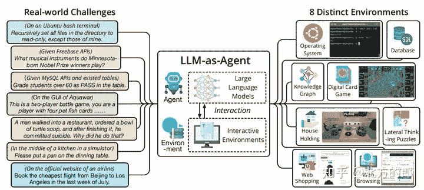

## 2 LLM Agent 的主要组成部分：

在LLM赋能的自主agent系统中(LLM Agent)，LLM充当agent大脑的角色，并与若干关键组件协作 。

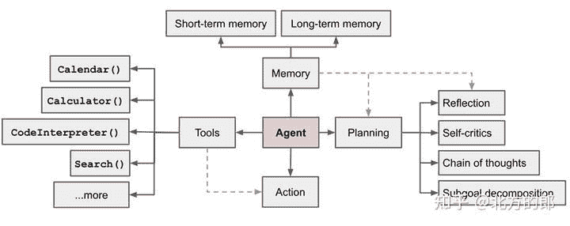

规划（planning）

+   子目标分解：agent将大任务拆分为更小的可管理的子目标，使得可以有效处理复杂任务。

+   反思与完善：agent对历史动作可以自我批评和自我反思，从错误中学习并在后续步骤里完善，从而改善最终结果的质量。

记忆（Memory）

+   短期记忆：上下文学习即是利用模型的短期记忆学习

+   长期记忆：为agent提供保留和召回长期信息的能力，通常利用外部向量存储和检索实现

工具使用（tool use）

+   对模型权重丢失的信息，agent学习调用外部API获取额外信息，包括当前信息、代码执行能力、专有信息源的访问等等

## 3 常见LLM Agent框架或者应用：

### 3.1 AutoGPT

可以说是LLM Agent的鼻祖了。Auto-GPT是一个实验性的开源应用程序，展示了GPT-4语言模型的能力。这个程序由GPT-4驱动，将LLM“思想”连接在一起，以自主地实现您设置的任何目标。作为GPT-4完全自主运行的最早示例之一，Auto-GPT突破了人工智能的极限，将AI进程推向了新高度 -- 自主人工智能。

[https:// github.com/Significan](https://link.zhihu.com/?target=https%3A//github.com/Significant-Gravitas/AutoGPT)t- Gravitas/AutoGPT

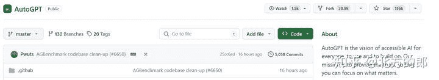

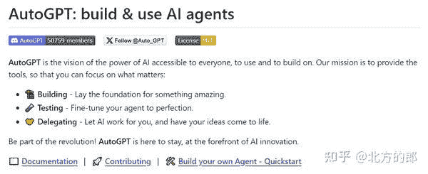

### 3.2 AutoGen

微软发布的AutoGen agent是可定制的、可对话的，并能以各种模式运行，这些模式采用 LLM、人类输入和工具的组合。使用 AutoGen，开发人员还可以灵活定义agent交互行为。自然语言和计算机代码都可用于为不同的应用编程灵活的对话模式。AutoGen 可作为一个通用框架，构建具有不同复杂性和 LLM 能力的各种应用。实证研究证明了该框架在许多样本应用中的有效性，应用领域包括数学、编码、问答、运筹学、在线决策、娱乐等。

[https:// github.com](https://link.zhihu.com/?target=https%3A//github.com/microsoft/autogen)/microsoft/au togen

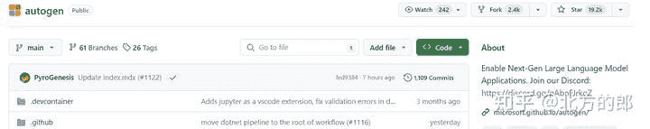

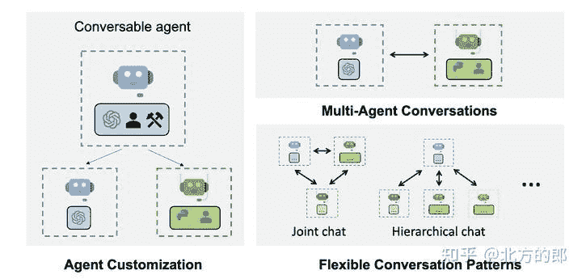

### 3.3 ChatDev

清华大学 NLP 实验室联合面壁智能等科研机构研发的一个大模型驱动的全流程自动化软件开发框架。ChatDev (Chat-powered Software Development)。ChatDev 拟作一个由多智能体协作运营的虚拟软件公司，在人类“用户”指定一个具体的任务需求后，不同角色的智能体将进行交互式协同，以生产一个完整软件（包括源代码、环境依赖说明书、用户手册等）。这一技术为软件开发自动化提供了新的可能性，支持快捷高效且经济实惠的软件制作，未来将有效地将部分人力从传统软件开发的繁重劳动中解放出来。

[Git](https://link.zhihu.com/?target=https%3A//github.com/OpenBMB/ChatDev)Hub - OpenBMB/ChatDev: Create Customized Software using Natural Language Idea (through LLM-powered Multi-Agent Collaboration)

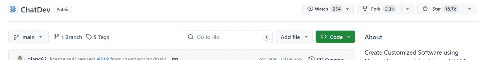

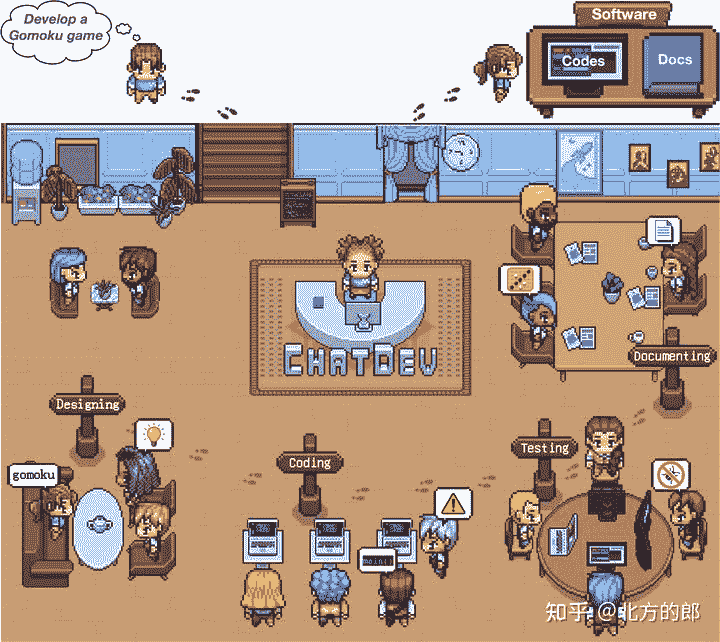

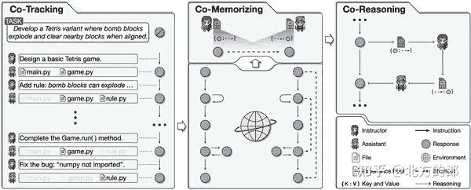

### 3.4 XAgent

[GitHub - OpenBMB/XAgent: An Auton](https://link.zhihu.com/?target=https%3A//github.com/OpenBMB/XAgent)omous LLM Agent for Complex Task Solving

XAgent是面壁智能联合清华大学 NLP 实验室共同研发开源的基于LLM的自主智能体，可以自动解决各种任务。 它被设计为一个通用的智能体，可以应用于各种任务，终极目标是创建一个可以解决任何给定任务的超级智能体。换句话说，打造的是超级无敌的多边形战士，不是单独为某个任务设计的特定智能体。

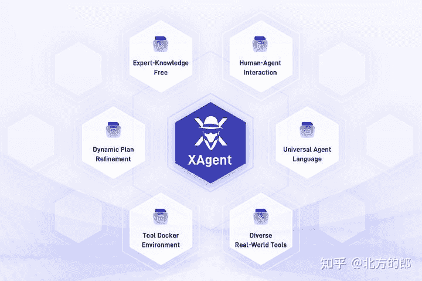

### 3.5 GPT-engineer

[Git](https://link.zhihu.com/?target=https%3A//github.com/gpt-engineer-org/gpt-engineer)Hub - gpt-engineer-org/gpt-engineer: Specify what you want it to build, the AI asks for clarification, and then builds it.

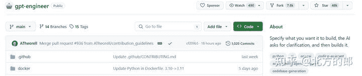

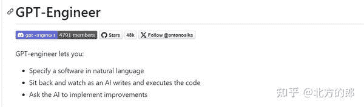

参考文献：

[h](https://link.zhihu.com/?target=https%3A//lilianweng.github.io/posts/2023-06-23-agent/)ttps:// lilianweng.github.io/po sts/2023-06-23-agent/

https:// arxiv.org/abs/2312.1702 5

[h](https://link.zhihu.com/?target=https%3A//developer.nvidia.com/blog/introduction-to-llm-agents/)ttps:// developer.nvidia.com/bl og/introduction-to-llm-agents/

编辑于 2024-04-22 08:25 ・IP 属地黑龙江

「真诚赞赏，手留余香」

赞赏

还没有人赞赏，快来当第一个赞赏的人吧！