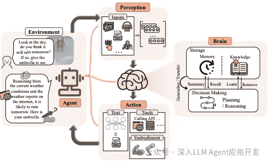
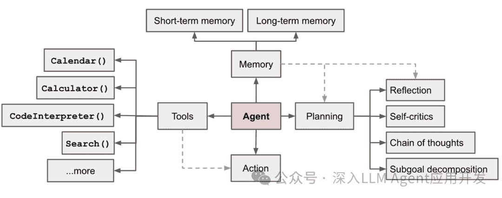
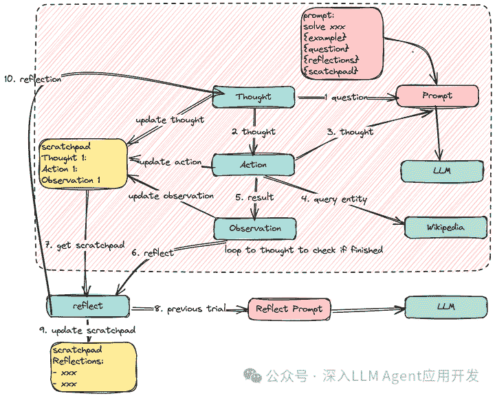

# 当我们在谈论LLM Agent的时候，我们在说什么？

> 来源：[https://agijuejin.feishu.cn/docx/UclldJLiHohFsdxEG6IcStxFnMb](https://agijuejin.feishu.cn/docx/UclldJLiHohFsdxEG6IcStxFnMb)

> 作者：还就可 | 深入LLM Agent应用开发

> 原文链接： [https://mp.weixin.](https://mp.weixin.qq.com/s/wP41Le0uKQ7MzuZjOMY2QQ)qq.com/s/wP41Le0u...

想象一下，如果机器不仅能理解你的言语，还能像人类一样思考、感知并采取行动，这不就是电影照进现实，未来已来吗？诸如AutoGPT、BabyGPT、ChatDev、MetaGPT和AutoGen之类的创新应用，正生动展现了这一前沿领域的无限潜力。基于大语言模型（LLMs）Agent（后文也称代理），正以前所未有的方式重塑人工智能的边界。

在复旦大学的一篇论文中《 **The Rise and Potential of Large La**nguage Model Based Agents: A Survey [1] 》作者详细地追溯了代理（Agent）的起源，并讨论了其在人工智能中的发展，并且解释了为什么大型语言模型（LLM）适合作为代理的基础。 AI Agent被定义为能够感知其环境、做出决策并采取行动的人工实体。

> we treat AI agents as artificial entities that are capable of perceiving their surroundings using sensors, making decisions, and then taking actions in response using actuators

随后提出了一个基本LLM Agent通用框架，包括三个组成部分：大脑、感知和行动，如下图所示。

1.  大脑：这是LLM基础代理的核心部分，主要由一个大型语言模型（LLM）组成。LLM具有高质量的生成能力和深度理解能力，使其能够理解和生成自然语言，从而与环境进行交互。

1.  感知：这是LLM基础代理的输入部分，它使代理能够感知其环境。这可能包括从各种源（如文本、图像、声音等）获取信息，并将这些信息转化为LLM可以理解的形式。

1.  行动：这是LLM基础代理的输出部分，它使代理能够在其环境中采取行动。这可能包括生成自然语言文本以进行交流，或者控制其他系统以影响环境。

Open AI的应用主管Liliang Weng在2023年6.23撰写的一篇博客《 LLM Powered Autonomous Agents [2] 》也提出了如下LLM Agent架构，与上文提出的有异曲同工之妙。

LLM作为Agent系统的大脑，负责规划、记忆和工具使用等关键功能。

1.  规划能力使得LLM能够对任务分解，这里常见的技术包思维链（Chain of Thought, CoT）和思维树（Tree of Thoughts, ToT）等技术，将复杂任务分解为更小、更易管理的子任务。也能够通过自我批评和反思从而改进未来的行动，常见技术包括Self-Refine和Reflexion。

1.  记忆分为短期记忆和长期记忆。更具体的说，让LLM能够对当前的情景判定和决策都是利用LLM自身的短期记忆功能，也就是它支持的最大Token窗口，一般我们会通过提示工程（角色说明、任务说明、样例、输入输出说明)来指导LLM。对于长期记忆，通常就是外挂外部存储库，常见应用就是RAG，使其能够弥补自身知识和私域知识的鸿沟。

1.  工具使用，LLM被赋予可以请求调用的函数，用于收集信息、采取行动或操纵数据，比如调用web搜索工具、计算器、写代码、或者HuggingFace。

那么LLM Agent当下有哪些发展趋势呢？最近Andrew.Ng吴恩达教授在letters中表示大语言模型 Agents工作流将是AI领域中一个关键的趋势，并且有可能在今年推动大规模的人工智能进步——甚至可能比下一代基础模型更甚。

> I think AI agent workflows will drive massive AI progress this year — perhaps even more than the next generation of foundation models. This is an important trend, and I urge everyone who works in AI to pay attention to it.

吴恩达教授将LLM Agent 工作流分为4个部分，分别是反思、工具使用、规划和多智能体协作。我已经针对这4个工作流写了一系列文章，从论文到代码，从理论到实践、设计良好的流程图来帮助读者充分理解这些工作流，关注我。

### **参考资料**

[1]Paper link: https://arxiv.org/pdf/2309.07864

[2]liliang wang的博客: https://lilianweng.github.io/posts/2023-06-23-agent/