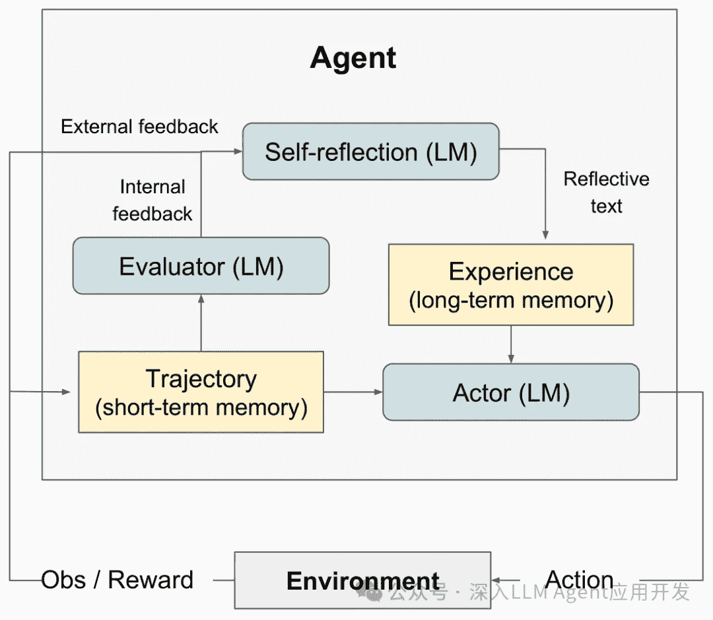

# 万字长文深度解析LLM Agent反思工作流框架Reflexion上篇：安装与运行

> 来源：[https://agijuejin.feishu.cn/docx/WdL3dfHpfohVjGxCPqFcaJJEnOe](https://agijuejin.feishu.cn/docx/WdL3dfHpfohVjGxCPqFcaJJEnOe)

> 作者：还就可 | 深入LLM Agent应用开发

> 原文： [https://mp.weixin.](https://mp.weixin.qq.com/s/oV6Gi9wgaolDAhapL1G_rg)qq.com/s/oV6Gi9wg...

在上一篇文章 [LLM Agent提效进阶1：反思工](http://mp.weixin.qq.com/s?__biz=MzI0OTAzNTEwMw==&mid=2247483722&idx=1&sn=71c9dcd3579e5cf7bce3319e3d7b8fed&chksm=e996e17adee1686cb17bfc8da85fd70e54b292247f3a5b06acf3acbe3fdd873b91d16d88815c&scene=21#wechat_redirect)作流—91%精度大超GPT-4 24% 中，我们深入探讨了三篇开创性的论文，它们共同描绘了大语言模型中反思设计智能体的宏伟蓝图。 今天，我们将迈出从理论到实践的关键一步——通过安装和测试Reflexion框架，我们将揭开智能体工作流的神秘面纱，实现知识的深度融合与应用。 由于框架东西较多，我们暂定分为上中下三篇来讲解。



## ** 1. 安装**

### ** 1.1 克隆和查看项目 **

git clone https://github.com/noahshinn/reflexion.git

查看该项目，它有4个测试项目分别为

+   alfworld_runs， **ALFWorld [1] **（Adaptive Learning Framework World）是一个用于研究和开发智能体Agent的仿真环境。它提供了一个虚拟世界，其中包含了各种场景、任务和智能体需要解决的挑战。ALFWorld 的目标是促进对于自然语言理解、智能决策和多模态交互等领域的研究。ALFWorld 还包括了丰富的多模态数据集，可用于训练和评估智能代理的性能。

+   hotpotqa_runs，HotpotQA也称火锅对答，是一个基于大规模的多项选择问题和自由形式自然语言问题的数据集。这个数据集旨在推动机器阅读理解和自然语言推理领域的研究。

+   programing_runs，是一个编程Agent，可自动编写程序并提交给leetcode，让其执行并给出反馈，也就是执行结果，以此来判定编程能力。

+   webshop_runs，Webshop 数据集是一个用于电子商务相关研究的数据集，通常包含有关在线商店的信息，例如产品信息、用户行为、购买历史等。这些数据通常用于分析用户购物行为、个性化推荐系统、市场营销策略等领域的研究和实验。

这4个项目是独立的，需要分别下载依赖。为简单起见，我们以hotpotqa_runs开始分析。

###  1.2 安装hotqa_runs

安装依赖

```
cd hotpotqa_runs
conda create -n reflexion python=3.10
pip install -r requirements.txt
```

项目实际的入口是hotpotqa_runs/notebooks 下的三个文件

+   CotQA_context.ipynb

+   CotQA_no_context.ipynb

+   ReactQA.ipynb

在深入探讨思维链CoT（Chain of Thoughts）之前，我们先以ReactQA.ipynb为例，来谈谈实际中可能会遇到的问题。当你打开这个juypter笔记本后，你会发现还有报错，警告很多依赖没安装。我本地生成了所需的依赖文件requirements.txt，有需要的同学可以联系我发送给你。

```
pip install juypter
pip install openai
pip install wikipedia
pip install &quot;pandas&lt;2.0.0&quot;
```

在juypter notebook中不太好观察代码本身的调用和错误，我们还要调试代码。因此，我们使用juypter的nbconvert工具将ReactQA.ipynb转换为纯python文件。

```
**jupyter nbconv**ert --to script hotpotqa_runs/notebooks/ReactQA.ipynb 
# 生成ReactQA.py
# 移动到notebook外，可以解决代码上一些本地util问题。
mv ReactQA.py ../
```

## ** 2. 运行**

### ** 2.1 运行前准备 **

在本项目中，我们采用了一种成本效益更高的方法来实现大型语言模型（LLM）的测试。虽然项目配置中默认使用OpenAI作为LLM的接口，但考虑到实际应用中可能涉及的费用，我们选择探索更为经济的替代方案。为此，我们采用之前部署的Llama.cpp服务，以取代OpenAI的服务。我把部署文章也链接在这里。

接下来，启动最近部署的Mistral 7B量化模型。该模型经过优化，能够在保持性能的同时减少资源消耗。通过这种方式，我们不仅能够评估框架的运行效率，还能够探索在不同成本约束下的最佳实践。

```
./server -m ./models/mymodels/mistral-7b-instruct-v0.2.Q4_K_S.gguf -c 8192 -n -1 -t 7 --embeddings
```

修改代码，让Agent中的LLM调用本地的Llama.cpp服务。

1.  设置环境变量

export OPENAI_API_KEY="sk"

因为 hotpotqa_runs/agents.py 中有好几处使用 os.environ['OPENAI_API_KEY'] 来获取key，我们设置一个假的API_KEY就不用改这部分代码了。

1.  设置OpenAI的api base

打开hotpotqa_run/llm.py文件，设置openai_api_base为 http://localhost:8080

```
class AnyOpenAILLM:

  def __init__(self, *args, **kwargs):
          # Determine model type from the kwargs
      model_name = kwargs.get(&#x27;model_name&#x27;, &#x27;gpt-3.5-turbo&#x27;)
      kwargs[&#x27;openai_api_base&#x27;] = &quot;http://localhost:8000&quot;
      if model_name.split(&#x27;-&#x27;)[0] == &#x27;text&#x27;:
          self.model = OpenAI(*args, **kwargs)
          self.model_type = &#x27;completion&#x27;
      else:
                kwargs[&#x27;openai_api_base&#x27;] = &quot;http://localhost:8080&quot;
                    self.model = ChatOpenAI(*args, **kwargs)
                    self.model_type = &#x27;chat&#x27;
```

### ** 2.2 运行 **

python ReactQA.py

输出

```
Question: The creator of &quot;Wallace and Gromit&quot; also created what animation comedy that matched animated zoo animals with a soundtrack of people talking about their homes? 
Thought 1: The creator of &quot;Wallace and Gromit&quot; is Nick Park. I need to search for other animation comedies by Nick Park that match this description.
Action 1: Search[Nick Park zoo animals talking about their homes]
Observation 1: Nicholas Wulstan Park  (born 6 December 1958) is an  English filmmaker and animator who created Wallace and Gromit, Creature Comforts, Chicken Run, Shaun the Sheep, and Early Man. Park has been nominated for an Academy Award a total of six times and won four with Creature Comforts (1989), The Wrong Trousers (1993), A Close Shave (1995) and Wallace &amp; Gromit: The Curse of the Were-Rabbit (2005).He has also received five BAFTA Awards, including the BAFTA for Best Short Animation for A Matter of Loaf and Death, which was also the most watched television programme in the United Kingdom in 2008. His 2000 film Chicken Run is the highest-grossing stop motion animated film.In 1985, Park joined Aardman Animations based in Bristol, and for his work in animation he was among the British cultural icons selected by artist Peter Blake to appear in a 2012 version of Blake&#x27;s most famous artwork—the Beatles&#x27; Sgt. Pepper&#x27;s Lonely Hearts Club Band album cover—to celebrate the British cultural figures of his life.Park was appointed a Commander of the Order of the British Empire (CBE) in the 1997 Birthday Honours for services to the animated film industry.
Thought 2: Nick Park also created Creature Comforts, which is the animation comedy that matched animated zoo animals with a soundtrack of people talking about their homes.
Action 2: Finish[Creature Comforts]
```

第一个问题已经完成并得出了答案，那么我们来看看 React 是如何运行这么多轮获取正确答案的吧？

### ** 2.3 分析 **

ReactQA.py 的代码比较简单，我把主要流程的代码适当的做了一些增减，以方便运行调试，并贴在这里准备开始分析。

```
# Load the HotpotQA Sample
hotpot = joblib.load(&#x27;data/hotpot-qa-distractor-sample.joblib&#x27;).reset_index(drop=True)
# Define the Reflexion Strategy
strategy: ReflexionStrategy = ReflexionStrategy.REFLEXION
agent_cls = ReactReflectAgent if strategy != ReflexionStrategy.NONE else ReactAgent
row = hotpot.iloc[3]
agents = [agent_cls(row[&#x27;question&#x27;], row[&#x27;answer&#x27;])]
# Run `n` trials
n = 5
for i in range(n):
  for agent in [a for a in agents if not a.is_correct()]:
      agent.run(reflect_strategy=strategy)
      print(f&#x27;Answer: {agent.key}&#x27;)
```

+   首先 加载hotpotQA数据集

hotpot = joblib.load('data/hotpot-qa-distractor-sample.joblib').reset_index(drop=True)

那么这个数据都是啥样呢？它的每一条问答包含问题，答案，难度，支持的事实依据还有上下文。

| 列名 | 列值 |
| --- | --- |
| id | 5a7613c15542994ccc9186bf |
| question | VIVA Media AG changed it&#x27;s name in 2004. What does their new acronym stand for? |
| answer | Gesellschaft mit beschränkter Haftung |
| type | bridge |
| level | hard |
| supporting_facts | [&#x27;VIVA Media&#x27;, &#x27;Gesellschaft mit beschränkter Haftung&#x27;] |
| context | { &quot;title&quot;: [ &quot;Constantin Medien&quot;, &quot;VIVA Poland&quot;, ... } |

+   设定反思策略

strategy: ReflexionStrategy = ReflexionStrategy.REFLEXION

共有以下4种反思策略。

+   NONE: No reflection

+   LAST_ATTEMPT: Use last reasoning trace in context

+   REFLEXION: Apply reflexion to the next reasoning trace

+   LAST_ATTEMPT_AND_REFLEXION: Use last reasoning trace in context and apply reflexion to the next reasoning trace

这里设定为REFLEXION，该反思策略为应用refexion到下一次推理轨迹中。

+   初始化agent

```
agent_cls = ReactReflectAgent if strategy != ReflexionStrategy.NONE else ReactAgent
row = hotpot.iloc[3]
agents = [agent_cls(row[&#x27;question&#x27;], row[&#x27;answer&#x27;])]
```

由于策略设定为REFLEXION，因此agent_cls就是ReactReflectAgent。

+   设定一些初始参数

n = 5

n用于设定总共所有的agent跑5次。

+   开始循环运行agent

```
for agent in [a for a in agents if not a.is_correct()]:
  agent.run(reflect_strategy=strategy)
  print(f&#x27;Answer: {agent.key}&#x27;)
```

所以，第一个问题的答案就是在 agent.run 之后分析出的。鉴于Agent run分析起来耗时较多，我们将 agent.run 的运行细节放到下一篇分析中。

此外，如果你对大语言模型应用开发开发有兴趣，还可以考虑购买Langchain实战课程：《LangChain 实战：LLM 应用开发指南》，点击阅读原文查看购买。

### **参考资料**

[1]alfworld: https://alfworld.github.io/