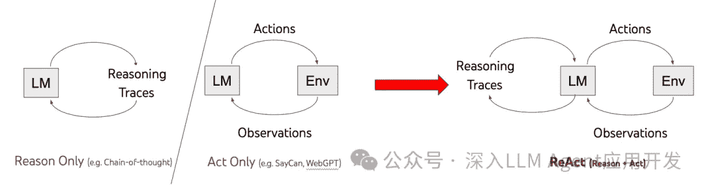
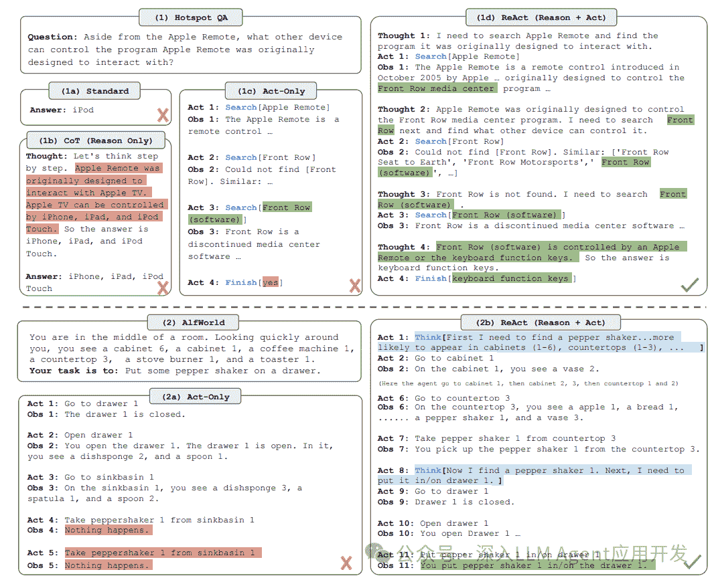
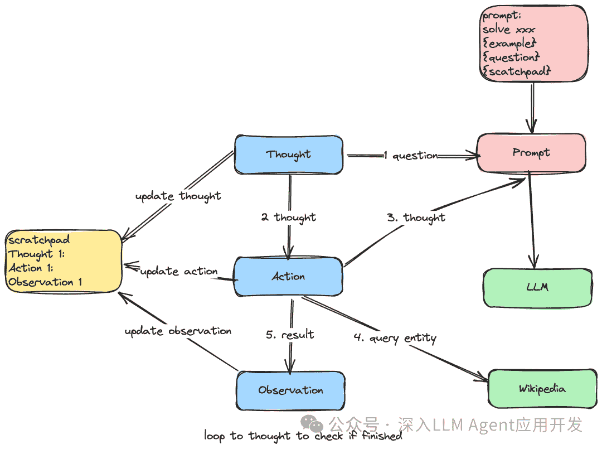

# 万字长文深度解析LLM Agent反思工作流框架Reflexion中篇：ReactAgent workflow

> 来源：[https://agijuejin.feishu.cn/docx/Jc0Wd4TSgoJEDPx5ujlcbnPtnoc](https://agijuejin.feishu.cn/docx/Jc0Wd4TSgoJEDPx5ujlcbnPtnoc)

> 作者：还就可 | 深入LLM Agent应用开发

> 原文：[https://mp.weixin.](https://mp.weixin.qq.com/s/YrxVDFug2mkrfiiUylq8ag)qq.com/s/YrxVDFug...

前文《 [[LLM-Agents]万字长文深度解析Agent反思工作流](http://mp.weixin.qq.com/s?__biz=MzI0OTAzNTEwMw==&mid=2247483725&idx=1&sn=eee4882da7dec099edc32067c8c7c31a&chksm=e996e17ddee1686b5a07cbf242f07874945d9aee03b22969680c97070a381c5cb00ed6c56cec&scene=21#wechat_redirect)框架Reflexion上篇：安装与运行 》我们已经介绍了 Reflexion 框架的背景知识、数据集以及安装运行方法。在本文中，我们将深入探讨 Agent 的具体运行细节。

上篇讲到 agent.run(reflect_strategy=strategy) ，我们知道 agent 是 ReactReflectAgent 类的实例，而 ReactReflectAgent 继承自 ReactAgent 。因此，本文将从 ReactAgent 开始，然后逐步深入到 ReactReflectAgent ，最终将整个流程连接起来。通过这样的讲解，我们不仅可以学习如何更好地设计提示，还可以加深对基于反思的 Agent 整体设计的理解，从而更好地设计和开发自己的 Agent 应用。

##  1. ReactAgent 论文

ReAct来自论文《 **R**eAct: Synergizing Reasoning and Acting in Language Models [1] 》，它提出了一种新的方法，通过结合语言模型中的推理（reasoning）和行动（acting）来解决多样化的语言推理和决策任务。在多种任务上对 ReAct 进行了实验评估，包括问答（HotpotQA）、事实验证（Fever）、基于文本的游戏（ALFWorld）和网页导航（WebShop），并展示了其在少量样本学习设置下相比现有方法的优势。通过一系列的消融实验和分析，探讨了在推理任务中行动的重要性，以及在交互任务中推理的重要性。ReAct 提供了一种更易于人类理解、诊断和控制的决策和推理过程。它的典型流程如下图所示，可以用一个有趣的循环来描述：思考（Thought）→ 行动（Action）→ 观察（Observation），简称TAO循环。

+   思考（Thought） 首先，面对一个问题，我们需要进行深入的思考。这个思考过程是关于如何定义问题、确定解决问题所需的关键信息和推理步骤。

+   行动（Action） 确定了思考的方向后，接下来就是行动的时刻。根据我们的思考，采取相应的措施或执行特定的任务，以期望推动问题向解决的方向发展。

+   观察（Observation） 行动之后，我们必须仔细观察结果。这一步是检验我们的行动是否有效，是否接近了问题的答案。

+   循环迭代

如果观察到的结果并不匹配我们预期的答案，那么就需要回到思考阶段，重新审视问题和行动计划。这样，我们就开始了新一轮的TAO循环，直到找到问题的解决方案。



它的典型的流程如下图所示，通过不断地循环迭代来推理到最终答案。



##  2. 设计ReAct Agent

从上面的演示图来看，如果我们要实现ReAct，他应该是什么样子呢？首先，他需要一个循环迭代。如何让LLM能够先思考，然后基于思考结果给出行动指导呢？我们需要设计一个良好的Prompt，并给出Few-shot示例。如何将迭代的流程告诉LLM，避免多次思考出相同的结果呢？可能有人会说，把整个对话流程都塞给LLM，这也不是不行，但是我们有很多的示例数据。那么这里我要介绍一个概念 ScratchPad ，简单理解他是一个草稿本，用来记录LLM思考、行动和观察的结果过程，类似不断的推理的草稿本。

### ** 2. 1 设计Prompt **

我认为良好的Prompt，要有明确的任务说明，完整的输入说明和输出说明，格式要求，示例，对于ReAct，还需要有草稿本。以上述问答的Prompt为例，它的Prompt设计如下。其中example中应该给出Thought时候，要搜索的实体，然后在Action中直接自动提取实体，在Observation中给出观察的结果，example大约在4-5个左右。

```
用交替进行的&quot;思考、行动、观察&quot;三个步骤来解决问答任务。思考可以对当前情况进行推理，而行动必须是以下三种类型：
(1) Search[entity]，在维基百科上搜索确切的实体，并返回第一个段落（如果存在）。如果不存在，将返回一些相似的实体以供搜索。
(2) Lookup[keyword]，在上一次成功通过Search找到的段落中返回包含关键字的下一句。
(3) Finish[answer]，返回答案并结束任务。
你可以采取必要的步骤。确保你的回应必须严格遵循上述格式，尤其是行动必须是以上三种类型之一。
以下是一些参考示例：
Question: What is the elevation range for the area that the eastern sector of the Colorado orogeny extends into?
Thought 1: I need to search Colorado orogeny, find the area that the eastern sector of the Colorado orogeny extends into, then find the elevation range of the area.
Action 1: Search[Colorado orogeny]
Observation 1: The Colorado orogeny was an episode of mountain building (an orogeny) in Colorado and surrounding areas.
Thought 2: It does not mention the eastern sector. So I need to look up eastern sector.
...
（例子结束）
Question：{question}
{scratchpad}
```

> 需要注意的是，对于LLM来说，如果你期望LLM能够按照你设想的格式返回，在Prompt中应该以强硬的语气类似必须（Must）等文字来设定。GPT-3.5可能还好，我本地部署模型经常在找到结果的时候，不会以 Finish[answer] 回复，当我修改了Prompt并用力的PUA它，它正常多了。。。

这里ScratchPad，我们需要手动填入当前是 Thought 1: 外加LLM的思考的返回结果，然后到Action 1我们再次填入LLM返回的Action结果，经过迭代，我们就能实现上图中的过程。

### ** 2. 2 流程设计图 **



react flow-2024-05-20-0947

接下来，进入Reflexion框架，查看ReactAgent实现代码，探索具体的实现细节。

##  3. ReactAgent实现

### ** 3.1 初始化 **

```
def __init__(self,
    question: str,
    key: str,
    max_steps: int = 6,
    agent_prompt: PromptTemplate = react_agent_prompt,
    docstore: Docstore = Wikipedia(),
    react_llm: AnyOpenAILLM = AnyOpenAILLM(
        temperature=0,
        max_tokens=100,
        model_name=&quot;gpt-3.5-turbo&quot;,
        model_kwargs={&quot;stop&quot;: &quot;\n&quot;},
        openai_api_key=&quot;sk&quot;),
    ) -&gt; None:
self.question = question
self.answer = &#x27;&#x27;
self.key = key
self.max_steps = max_steps
self.agent_prompt = agent_prompt
self.react_examples = WEBTHINK_SIMPLE6
self.docstore = DocstoreExplorer(docstore) # Search, Lookup
self.llm = react_llm
self.enc = tiktoken.encoding_for_model(&quot;text-davinci-003&quot;)
self.__reset_agent()    
```

+   question、answer和key：从hotpotqa中传入question和answer，传入answer是为了评估agent结果是否准确，并不是用来告诉agent答案。

+   设定max_steps为6，设定ReactAgent最多运行6步，会判断获取的answer和key是否相同。

+   agent_prompt：设定提示词，采用langchain的PromptTemplate设定要输入的字段和模板。

```
REACT_INSTRUCTION = &quot;&quot;&quot;Solve a question answering task with interleaving Thought, Action, Observation steps. Thought can reason about the current situation, and Action must be three types: 
(1) Search[entity], which searches the exact entity on Wikipedia and returns the first paragraph if it exists. If not, it will return some similar entities to search.
(2) Lookup[keyword], which returns the next sentence containing keyword in the last passage successfully found by Search.
(3) Finish[answer], which returns the answer and finishes the task.
You may take as many steps as necessary. Ensure that your responses MUST strictly to the above formats, especially Action must be one of the three types.
Here are some examples:
{examples}
(END OF EXAMPLES)
{reflections}
Question: {question}{scratchpad}&quot;&quot;&quot;
react_agent_prompt = PromptTemplate(input_variables=[&quot;examples&quot;, &quot;question&quot;, &quot;scratchpad&quot;],
                                    template = REACT_INSTRUCTION)
```

**注**意，这里的Prompt我做了一点PUA式的修改，和Repo中相比我强调了输出Action必须是这三者之一，不然在运行时会有很多意外

+   设定react_examples为WEBTHINK_SIMPLE6

```
WEBTHINK_SIMPLE6 = &quot;&quot;&quot;Question: What is the elevation range for the area that the eastern sector of the Colorado orogeny extends into?
Thought 1: I need to search Colorado orogeny, find the area that the eastern sector of the Colorado orogeny extends into, then find the elevation range of the area.
Action 1: Search[Colorado orogeny]
Observation 1: The Colorado orogeny was an episode of mountain building (an orogeny) in Colorado and surrounding areas.
....
&quot;&quot;&quot;
```

设定example模板给LLM指导它推理步骤，是一个典型的React Prompt，即Thought，Action和Observation，该代码中Example有6个案例，便于阅读起见，这里做了删减。在 ReactAgent 的方法 _build_agent_prompt 中，会将提示词中缺失信息 examples , question 和 scratchpad 补全。

```
def _build_agent_prompt(self) -&gt; str:
  return self.agent_prompt.format(examples = self.react_examples, question = self.question,
                                  scratchpad = self.scratchpad)
```

所以最终生成的Prompt如下, 对example有所删除。

```
Solve a question answering task with interleaving Thought, Action, Observation steps. Thought can reason about the current situation, and Action must be three types: 
...
(END OF EXAMPLES)
Question: The creator of &quot;Wallace and Gromit&quot; also created what animation comedy that matched animated zoo animals with a soundtrack of people talking about their homes?
Thought 1:
```

+   初始化 docstore 为 DocstoreExplorer(docstore) ，其中 dockstore 为lanchiain内置的访问wikipedia工具。

+   赋值 llm 为 reactllm ， reactllm 为 AnyOpenAILLM 的实例，我们在上节有将其修改为本地llm。AnyOpenAILLM包含两个方法__init__和__call__方法。其中init方法，初始化LLM是Chat模式还是扩写模式，而call方法是一种magic method，在类中实现这一方法可以使该类的实例(对象)像函数一样被调用，即我们可以直接通过 llm(prompt) 来调用的chat方法。

```
class AnyOpenAILLM:
    def __init__(self, *args, **kwargs):
        # Determine model type from the kwargs
        model_name = kwargs.get(&#x27;model_name&#x27;, &#x27;gpt-3.5-turbo&#x27;)
        kwargs[&#x27;openai_api_base&#x27;] = &quot;http://localhost:8080/v1&quot;
        if model_name.split(&#x27;-&#x27;)[0] == &#x27;text&#x27;:
            self.model = OpenAI(*args, **kwargs)
            self.model_type = &#x27;completion&#x27;
        else:
            self.model = ChatOpenAI(*args, **kwargs)
            self.model_type = &#x27;chat&#x27;
    
    def __call__(self, prompt: str):
        if self.model_type == &#x27;completion&#x27;:
            return self.model(prompt)
        else:
            return self.model(
                [
                    HumanMessage(
                        content=prompt,
                    )
                ]
            ).content
```

> 小结：初始化ReActAgent，主要是传入Prompt所需的输入question和template，并初始化所需使用的LLM。

### ** 3.2 运行函数run **

```
def run(self, reset = True) -&gt; None:
    if reset:
        self.__reset_agent()
    while not self.is_halted() and not self.is_finished():
        self.step()
```

这几个函数调用都很简单，一是重置一些影响运行的条件状态变量，二是判断当前运行状态是否结束。

```
def __reset_agent(self) -&gt; None:
    self.step_n = 1
    self.finished = False
    self.scratchpad: str = &#x27;&#x27;
def is_halted(self) -&gt; bool:
    return ((self.step_n &gt; self.max_steps) or (len(self.enc.encode(self._build_agent_prompt())) &gt; 3896)) and not self.finished
def is_finished(self) -&gt; bool:
    return self.finished
```

如果当前没有达到最大运行步骤6或者输入没有超过3896个提示词（应该是防止超过4K上下文而设定）且finished标志不是true，就运行step方法。所以step方法最多运行6次，每次运行都会得到Thought，Action和Observe。

### ** 3.3 step方法**

```
def step(self) -&gt; None:
    # Think
    self.scratchpad += f&#x27;\nThought {self.step_n}:&#x27;
    self.scratchpad += &#x27; &#x27; + self.prompt_agent()
    print(self.scratchpad.split(&#x27;\n&#x27;)[-1])

    # Act
    self.scratchpad += f&#x27;\nAction {self.step_n}:&#x27;
    action = self.prompt_agent()
    self.scratchpad += &#x27; &#x27; + action
    action_type, argument = parse_action(action)
    print(self.scratchpad.split(&#x27;\n&#x27;)[-1])

    # Observe
    self.scratchpad += f&#x27;\nObservation {self.step_n}: &#x27;
    
    if action_type == &#x27;Finish&#x27;:
        self.answer = argument
        if self.is_correct():
            self.scratchpad += &#x27;Answer is CORRECT&#x27;
        else: 
            self.scratchpad += &#x27;Answer is INCORRECT&#x27;
        self.finished = True
        self.step_n += 1
        return

    if action_type == &#x27;Search&#x27;:
        try:
            self.scratchpad += format_step(self.docstore.search(argument))
        except Exception as e:
            print(e)
            self.scratchpad += f&#x27;Could not find that page, please try again.&#x27;
        
    elif action_type == &#x27;Lookup&#x27;:
        try:
            self.scratchpad += format_step(self.docstore.lookup(argument))
        except ValueError:
            self.scratchpad += f&#x27;The last page Searched was not found, so you cannot Lookup a keyword in it. Please try one of the similar pages given.&#x27;

    else:
        self.scratchpad += &#x27;Invalid Action. Valid Actions are Lookup[&lt;topic&gt;] Search[&lt;topic&gt;] and Finish[&lt;answer&gt;].&#x27;

    print(self.scratchpad.split(&#x27;\n&#x27;)[-1])

    self.step_n += 1
```

该方法共分为3个步骤：Thought，Act，Observe。

### ** 3.4 Thought **

首先设定 scratchpad 为 Thought 1 ，然后调用 prompt_agent() 方法， build_agent_prompt 我们在3.1节有提到过，构造提示词并填充所需字段比如example，question和scratchpad，llm就是 AnyOpenAILLM 的 call 接口。

```
def prompt_agent(self) -&gt; str:
    return format_step(self.llm(self._build_agent_prompt()))
def format_step(step: str) -&gt; str:
    return step.strip(&#x27;\n&#x27;).strip().replace(&#x27;\n&#x27;, &#x27;&#x27;)
```

在Thought阶段，llm输入就是上面构建的promt，此时他应该长这样

```
Solve a question answering task with interleaving Thought, Action, Observation steps. Thought can reason about the current situation, and Action can be three types: 
...
(END OF EXAMPLES)
Question: The creator of &quot;Wallace and Gromit&quot; also created what animation comedy that matched animated zoo animals with a soundtrack of people talking about their homes?
Thought 1:
```

> 注意我们在初始化 AnyOpenAILLM 时候，有设定一些关键参数。比如要求 temperature 为 0 的严格模式，不要肆意发挥。设定 stop 条件为遇到换行， max_tokens 为 100 。为什么呢？因为如果不设定 stop 为 \n 的话，那么LLM默认会按照Example将Thought，Action，Observe的几个步骤都输出了。这样的结果是，没有工具参与，都是模型完成了，但他并不能真的去网络搜索。因此我们要他在第一个 \n 就结束输出。大家可以自己拷贝Prompt到Postman中测试一下。

```
AnyOpenAILLM(temperature=0, 
    max_tokens=100,
    model_name=&quot;gpt-3.5-turbo&quot;,
    model_kwargs={&quot;stop&quot;: &quot;\n&quot;},
    openai_api_key=&quot;sk&quot;)
```

### ** 3.5 Action **

经过Thought步骤后，进入Action环节，scratchpad被赋值为

```
Thought 1: The creator of &quot;Wallace and Gromit&quot; is Nick Park. I need to search for other animation comedies by Nick Park that match this description.
Action 1:
```

调用 action = self.prompt_agent() action会被赋值为

```
Search[Nick Park zoo animals talking about their homes]
```

更新scratchpad为

```
Thought 1: The creator of &quot;Wallace and Gromit&quot; is Nick Park. I need to search for other animation comedies by Nick Park that match this description.
Action 1: Search[Nick Park zoo animals talking about their homes]
```

接下来使用正则表达式 pattern = r'^(\w+)\[(.+)\]$' 提取Search这个Action，提取中括号中的检索字符串。根据step方法，判断Action为Search需要执行Wikipedia检索行为，具体的wikipedia工具的实现这里不多赘述，可以参考 Langchain官方文档 [2] 。

```
self.scratchpad += f&#x27;\nObservation {self.step_n}: &#x27;
self.scratchpad += format_step(self.docstore.search(argument))
```

### ** 3.6. Observe **

在Wikipedia中检索结果如下

```
Nicholas Wulstan Park  (born 6 December 1958) is an  English filmm...
```

整个step完成，最终的scratchpad为

```
Thought 1: The creator of &quot;Wallace and Gromit&quot; is Nick Park. I need to search for other animation comedies by Nick Park that match this description.
Action 1: Search[Nick Park zoo animals talking about their homes]
Observation 1: Nicholas Wulstan Park  (born 6 December 1958) is an  English filmmaker and ...
```

### ** 3.7 迭代React **

循环调用step，直到满足条件退出。最终的scratchpad如下

```
Thought 1: The creator of &quot;Wallace and Gromit&quot; is Nick Park. I need to search for other animation comedies by Nick Park that match this description.
Action 1: Search[Nick Park zoo animals talking about their homes]
Observation 1: Nicholas Wulstan Park  (born 6 December 1958) is an  English filmmaker ...
Thought 2: Nick Park also created Creature Comforts, which is the animation comedy that matched animated zoo animals with a soundtrack of people talking about their homes.
Action 2: Finish[Creature Comforts]
```

## ** 4. 总结**

根据上述分析，我们可以了解到ReactAgent的核心设计理念是通过有效的Prompt进行设计，并通过对Thought、Action和Observer的迭代优化回答的质量。Prompt应当简洁明了地说明回答问题的步骤，包括TAO（Thought、Action、Observer），并提供四到五个示例以供LLM参考。Thought部分应根据当前情境进行推理，而Action则要求以Search、Lookup和Finish三个选项中的一个回复，并详细说明所提取的实体。值得注意的是，这里的Action并非通用的，而是根据我们所面向的具体任务进行设计。比如Action是一些调用函数名，那么你应该在Prompt中说明Action可为什么，当然这种工具调用也可以直接考虑使用LLM的 Function Calling （如果支持的话）。

LLM会根据Prompt对问题进行针对性推理，即根据问题推断出应采取何种行动，并提供Thought的推理结果。在这一设计中，我们要求LLM在遇到第一个换行符时停止，以防止其根据Example回复Search、Lookup和Finish，这一设计依赖于Example中的格式。接下来，我们将Thought与Prompt结合再次输入LLM，LLM将基于此进行进一步推理，确定应采取何种行动，从而对Thought中的想法进行总结提炼，决定是执行Search、Lookup还是Finish操作。随后，我们调用工具进行维基百科搜索以获取实体。在Observation阶段，我们会获取工具返回的结果，再次进入Thought以便确定是否找到了问题的答案。若找到了，给出Action Finished；若未找到，则根据Observation的结果或相似内容进行思考，然后在Action阶段开始检索。通过一次次地迭代，最终获得答案。

如果您意犹未尽，想要参与LangChain实战课程，可以点击原文链接查看购买，亲历LLM应用开发之旅。关注我，及时获得更新。

### **参考资料**

[1]react paper: https://arxiv.org/abs/2210.03629

[2]langchain: https://python.langchain.com/docs/integrations/retrievers/wikipedia/#running-retriever