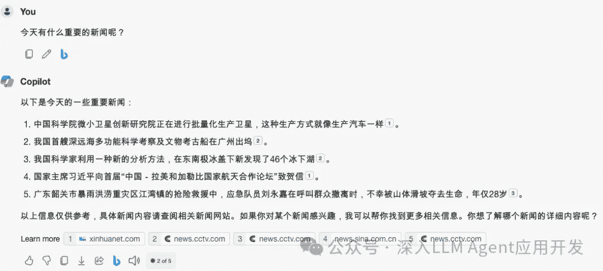
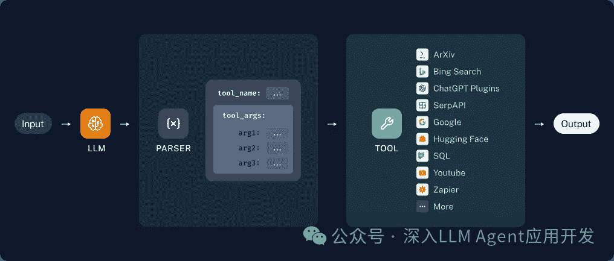
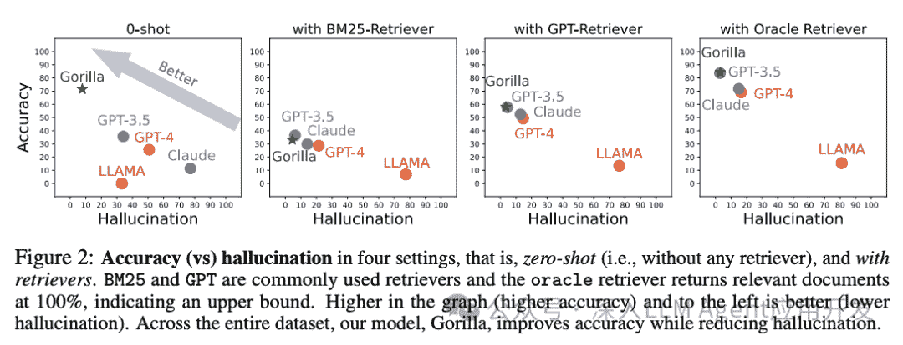
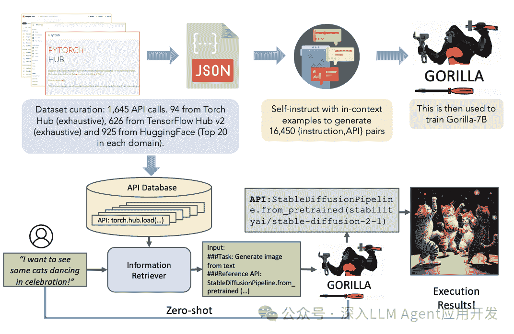
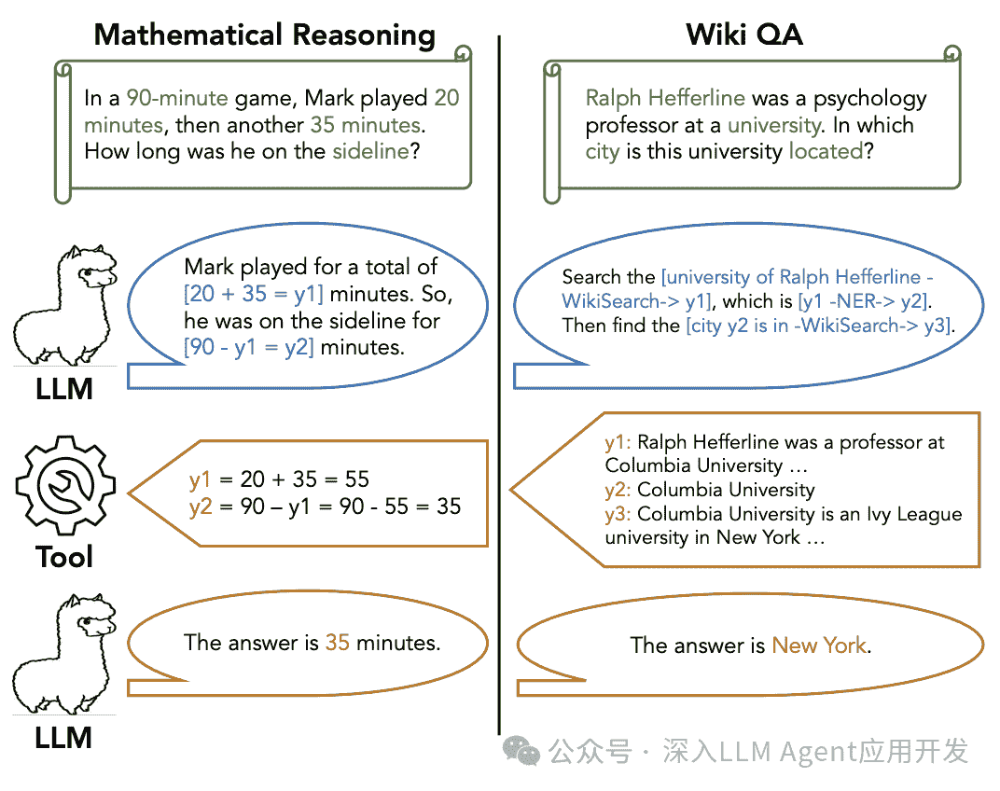
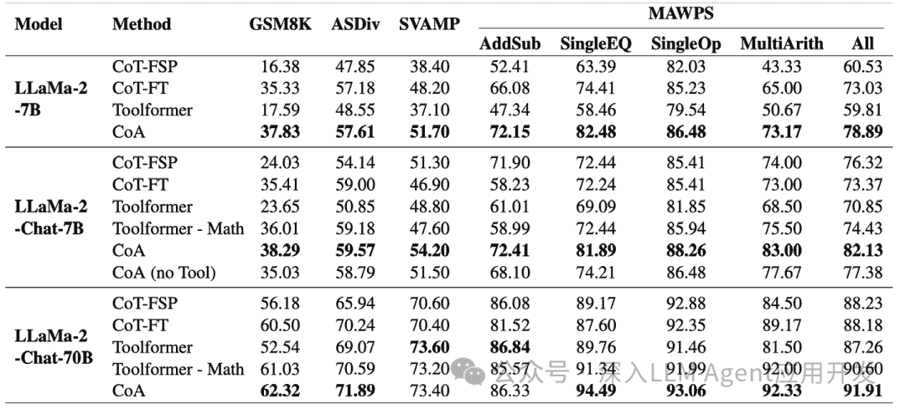
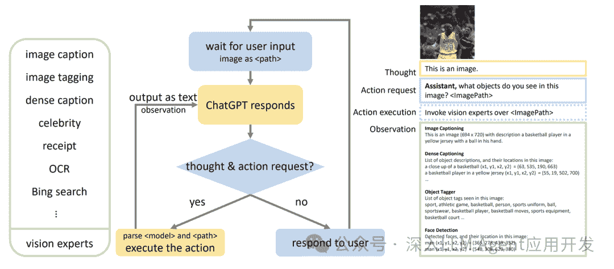
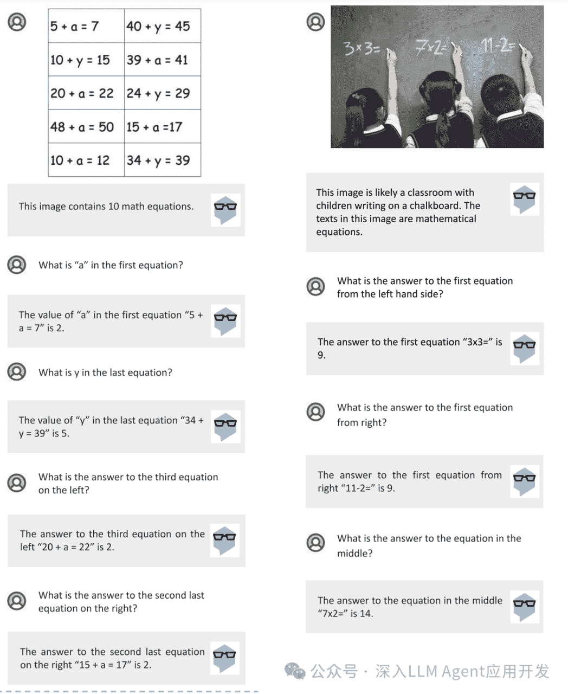
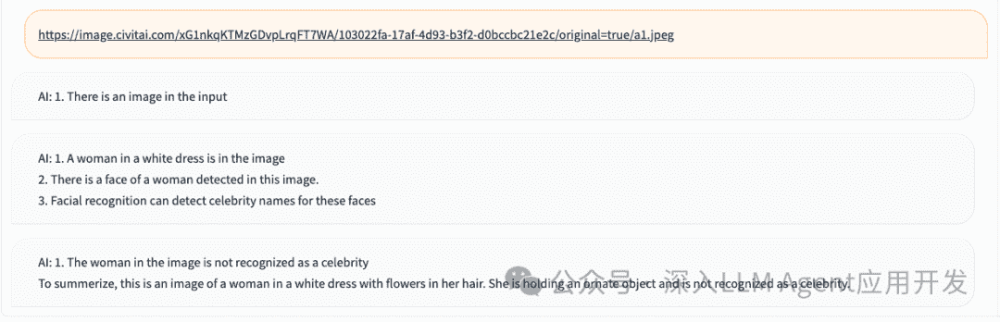

# 详解LLM Agent中工具使用工作流

> 来源：[https://agijuejin.feishu.cn/docx/T83jdBdTaoFitexyZIIc62I7nMG](https://agijuejin.feishu.cn/docx/T83jdBdTaoFitexyZIIc62I7nMG)

> 作者：还就可 | 深入LLM Agent应用开发

> 原文： [https://mp.weixin.](https://mp.weixin.qq.com/s/y3w9IS2scIeaF8YU0E9Mqg)qq.com/s/y3w9IS2s...

我们在文章 [[LLM-Agents] 提升LLM](http://mp.weixin.qq.com/s?__biz=MzI0OTAzNTEwMw==&mid=2247483685&idx=1&sn=38ab1a6be6609c4d5705aa859fbfa27c&chksm=e996e115dee16803e358d8d8289cbbb034661e1b7b27db394f8ec65417f0980d33fdf6f01b48&scene=21#wechat_redirect)性能**利器Agent**s workflow 我们提到Agent的四种工作流：反思、工具使用、推理和多智能体协作。在此之前，我们已经在前面文章中阐述了反思设计思想。本篇我们将深入Agent工作流第二部分：工具使用。Andrew.Ng教授在 文章 [1] 将工具使用定义为LLM被赋予可以请求调用的函数，用于收集信息、采取行动或操纵数据，是一种Agent工作流的主要设计模式。

> Tool Use, in which an LLM is given functions it can request to call for gathering information, taking action, or manipulating data, is a key design pattern of AI agentic workflows. -- Andrew.Ng

我们知道单纯的依赖LLM预训练的知识是无法解决一些诸如数学计算、代码运行、实时的天气预报等问题的，常见的做法是当用户提出问题时，触发LLM生成特定格式的字符串，以请求调用相应的工具，LLM会决定执行网络搜索以获取相关信息，或者运行代码来执行特定计算。然后，系统会处理这些字符串，调用相应的功能，并将结果返回给LLM，以供进一步处理和回答用户的问题。或许你已经在前文Reflexion框架中初步了解如何在LLM流程中使用wikipedia这样的工具，在其他聊天工具比如Copliot中也有见过使用网络搜索的案例。



**著名的LLM应用开发**框架Langchain中甚至内置了 几十种工具 [2] 供开发者使用，比如ArXiv、Bing Search、Wikipedia、Youtube、Google、PubMed、Python REPL、HuggingFace和Yahoo Finance Data等。



开发者通过提供描述函数的详细说明和函数期望的参数信息来引导LLM去解析获取相关信息，然后自动选择调用正确的函数来完成任务。在多模态大模型未出来之前，有些研究者拓展了函数调用，使其能够调用图像识别模型或者生成模型进行处理图像，使得LLM不在局限于文本处理方面的工作。接下来，我们先了解一下 OpenAI提供的Function Calling [3] 接口和响应是如何进行函数调用。

## ** 1. OpenAI函数调用**

+   请求

```
curl https://api.openai.com/v1/chat/completions \
-H &quot;Content-Type: application/json&quot; \
-H &quot;Authorization: Bearer $OPENAI_API_KEY&quot; \
-d &#x27;{
  &quot;model&quot;: &quot;gpt-4-turbo&quot;,
  &quot;messages&quot;: [
    {
      &quot;role&quot;: &quot;user&quot;,
      &quot;content&quot;: &quot;What&#x27;\&#x27;&#x27;s the weather like in Boston today?&quot;
    }
  ],
  &quot;tools&quot;: [
    {
      &quot;type&quot;: &quot;function&quot;,
      &quot;function&quot;: {
        &quot;name&quot;: &quot;get_current_weather&quot;,
        &quot;description&quot;: &quot;Get the current weather in a given location&quot;,
        &quot;parameters&quot;: {
          &quot;type&quot;: &quot;object&quot;,
          &quot;properties&quot;: {
            &quot;location&quot;: {
              &quot;type&quot;: &quot;string&quot;,
              &quot;description&quot;: &quot;The city and state, e.g. San Francisco, CA&quot;
            },
            &quot;unit&quot;: {
              &quot;type&quot;: &quot;string&quot;,
              &quot;enum&quot;: [&quot;celsius&quot;, &quot;fahrenheit&quot;]
            }
          },
          &quot;required&quot;: [&quot;location&quot;]
        }
      }
    }
  ],
  &quot;tool_choice&quot;: &quot;auto&quot;
}&#x27;
```

+   响应

```
{
  &quot;id&quot;: &quot;chatcmpl-abc123&quot;,
  &quot;object&quot;: &quot;chat.completion&quot;,
  &quot;created&quot;: 1699896916,
  &quot;model&quot;: &quot;gpt-3.5-turbo-0125&quot;,
  &quot;choices&quot;: [
    {
      &quot;index&quot;: 0,
      &quot;message&quot;: {
        &quot;role&quot;: &quot;assistant&quot;,
        &quot;content&quot;: null,
        &quot;tool_calls&quot;: [
          {
            &quot;id&quot;: &quot;call_abc123&quot;,
            &quot;type&quot;: &quot;function&quot;,
            &quot;function&quot;: {
              &quot;name&quot;: &quot;get_current_weather&quot;,
              &quot;arguments&quot;: &quot;{\n\&quot;location\&quot;: \&quot;Boston, MA\&quot;\n}&quot;
            }
          }
        ]
      },
      &quot;logprobs&quot;: null,
      &quot;finish_reason&quot;: &quot;tool_calls&quot;
    }
  ],
  &quot;usage&quot;: {
    &quot;prompt_tokens&quot;: 82,
    &quot;completion_tokens&quot;: 17,
    &quot;total_tokens&quot;: 99
  }
}
```

##  2. Langchain函数调用

```
from langchain_core.tools import tool

@tool
def get_current_weather(location: str, unit: str = &quot;celsius&quot;) -&gt; int:
    &quot;&quot;&quot;
    Get the current weather in a given location.
    &quot;&quot;&quot;
    return 24

print(get_current_weather.name)
print(get_current_weather.description)
print(get_current_weather.args)
```

输出

```
get_current_weather
get_current_weather(location: str, unit: str = &#x27;celsius&#x27;) -&gt; int - Get the current weather in a given location.
{&#x27;location&#x27;: {&#x27;title&#x27;: &#x27;Location&#x27;, &#x27;type&#x27;: &#x27;string&#x27;}, &#x27;unit&#x27;: {&#x27;title&#x27;: &#x27;Unit&#x27;, &#x27;default&#x27;: &#x27;celsius&#x27;, &#x27;type&#x27;: &#x27;string&#x27;}}
```

结合OpenAI的函数调用API，我们知道一个函数调用需要提供函数名，函数说明，函数的参数名称、类型和说明，这样在LLM在响应的时候，就知道是否可以在tool里匹配上当前的提问，并解析到响应的参数。Langchain中通过装饰器tool将函数的名称、说明、参数的说明等自动提取，这样在构造函数调用请求的时候，就能从函数上获取到这些信息。

## ** 3. 限制**

假设在构建的LLM系统中，需要访问数百个工具，这数百个函数的说明必然使得LLM Prompt爆炸，甚至超越LLM提供的上下文Token数量限制。有些研究者采用启发式的方法选择最相关的子集，然后再进一步的选择具体的函数。有几篇论文论述了如何支持数百个工具调用和进行多模态函数调用。

+   **G**orilla: Large Language Model Connected with Massive APIs [4]

+   **E**fficient Tool Use with Chain-of-Abstraction Reasoning [5]

+   **M**M-REACT: Prompting ChatGPT for Multimodal Reasoning and Action [6]

##  4.Gorrila: 赋能LLM与海量API连接

作者研究了LLM在工具调用方面需要使用数百万个不断变化的API的集合的问题，此时不可能再像上面一样把所有的函数说明升成Prompt提供给大模型，并且许多API将具有重叠的功能，以及些微的限制和约束，这会导致LLM幻觉问题产生，比如生成不存在模型，不存在函数接口。我用chatgpt让他基于某个框架写功能代码的时候，我经常遇到他给我提供一些不存在的函数，出现幻觉了。作者为了评估这种数百万API工具调用的问题，构建了一个APIBench数据集，包含 HuggingFace、TorchHub 和 TensorHub 的 API，并提出了一个微调的 LLaMA 模型，该模型在 API 调用编写任务上的性能超过了 GPT-4。



Gorilla整体流程如下图所示，主要是以下4个步骤。需要使用API文档文具来微调Llama-7B模型，负责专门处理API调用。

+   用户提示：用户提供输入，描述他们希望使用 API 实现的特定任务或目标。

+   检索（可选）：Gorilla 使用文档检索器（例如 BM25 或 Llama-Index）从数据库中获取最新的 API 文档。然后，该文档和用户提示一起发送给Gorrila，指示 Gorilla 使用它作为参考。

+   API 调用生成：Gorilla 处理用户提示（和检索到的文档，如果启用检索的话）以生成满足用户任务或目标的适当 API 调用。这是通过 Gorilla 的微调 LLaMA-7B 模型实现的，该模型专为 API 调用而设计。

+   输出：Gorilla 将生成的 API 调用返回给用户，然后可用于与所需的 API 进行交互并完成指定的任务。

值得注意的是，Gorilla 具有很强的适应性，可以在零样本和检索模式下运行，使其能够适应 API 文档的变化并随着时间的推移保持准确性，可以减少LLM在处理工具调用时的幻觉问题。



1.  Chain-Of-Abstraction Reasoning 通过抽象链推理实现高效工具使用

CoA抽象链推理是用于解决在多步推理中的工具调用问题，不仅提高准确率，而且还支持并行调用加快推理速度。提出了一种新方法，训练 LLMs 首先生成带有抽象占位符的推理链，然后调用领域工具来实现每个推理链，通过填充特定知识来具体化推理流程。CoA 方法使 LLMs 能够学习更通用的推理策略，这些策略对领域知识的变动（如数学结果）具有鲁棒性。同时，它还允许 LLMs 并行执行解码和调用外部工具，避免了因等待工具响应而造成的推理延迟。它还允许LLM并行执行解码和调用外部工具，避免了等待工具响应而引起的推理延迟。在数学推理和 Wiki QA（问答）领域，CoA 方法在分布内和分布外测试集上均一致优于先前的链式思考（CoT）和工具增强（tool-augmented）基线，平均绝对 QA 准确率提高了约 6%。使用 CoA 方法训练的 LLM 代理还显示出更高效的工具使用，平均推理速度比基线工具增强 LLMs 快约 1.4 倍。

头图为例



具体的说

+   首先，构造这种使用抽象占位符推理的数据，然后微调LLM，使得其能够输出上图中蓝框所示的带有抽象占位符的推理步骤的输出。

+   第二步，调用外部工具填充抽象占位符的数据

+   第三步，将填充好的数据输出。评测显示，其在数学评估上显示出了优越的性能。



##  6. MM-REACT：提示ChatGPT做多模态推理和执行

这是一个比较有意思的论文，提出了一个将 ChatGPT 与视觉专家模型结合的系统，以解决复杂的视觉理解任务。通过设计文本提示（prompt design），使得语言模型能够接受、关联和处理多模态信息，如图像和视频。展示了 MM-REACT 在不同场景下处理高级视觉理解任务的有效性，如多图像推理、多跳文档理解、视频摘要和事件定位等。讨论了 MM-REACT 与通过联合微调扩展语言模型到多模态场景的替代方法的比较，并探讨了 MM-REACT 的可扩展性。具体的说，使用LangChain 代码库实现如下流程的MM-REACT，并使用 Azure Cognitive Services APIs 中的公共视觉专家模型。

+   用户输入一张图像和对应的提问

+   LLM使用ReAct模式Thought、Action和Observation

+   执行Action，调用视觉工具，诸如图像字幕生成、图像标记、密集字幕、光学字符识别（OCR）和特定识别模型，如名人识别和收据识别。



+   典型的测试流程



+   **可**以去Hugging Face上 mm-react - a Hugging Face Space by microsoft-cognitive-service [7] 测试这个demo，但是它只能识别它自己提供的样例图片，不支持用户上传文件。我看了代码才知道，你需要输入图像的URL才会识别。



## ** 7. 总结**

本篇从处理海量API调用、多步推理中调用以及多模态中使用3个方面详细探讨了工具调用在LLM中深入应用。下一篇我们深入源码研究MM-REACT的实现细节，动动小手关注、收藏、点赞、评论走起来。下一篇我们开始探讨规划工作流，之后深入分析HuggingGPT框架，来从源码上分析工具调用和规划。

如果您意犹未尽，想要参与LangChain实战课程，可以点击原文链接查看购买，亲历LLM应用开发之旅。

关注我，及时获得更新。

## **参考资料**

[1]andrew letters: https://www.deeplearning.ai/the-batch/agentic-design-patterns-part-3-tool-use

[2]langchain 内置工具列表: https://python.langchain.com/docs/integrations/tools/

[3]OpenAI Function Calling: https://platform.openai.com/docs/api-reference/chat/create#chat-create-tools

[4]Gorilla: https://arxiv.org/abs/2305.15334

[5]Chain-of-Abstraction Reasoning: https://arxiv.org/abs/2401.17464

[6]MM-REACT: https://arxiv.org/abs/2303.11381

[7]Hugging Face: https://huggingface.co/spaces/microsoft-cognitive-service/mm-react