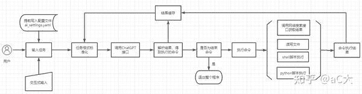
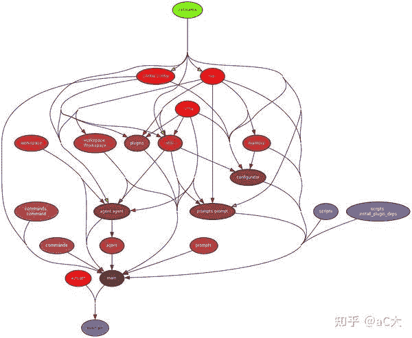
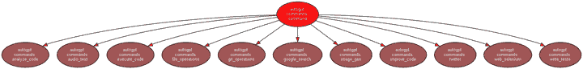
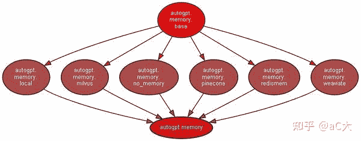
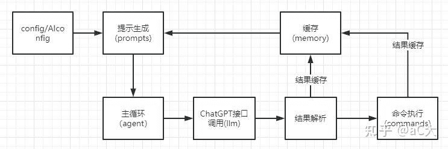
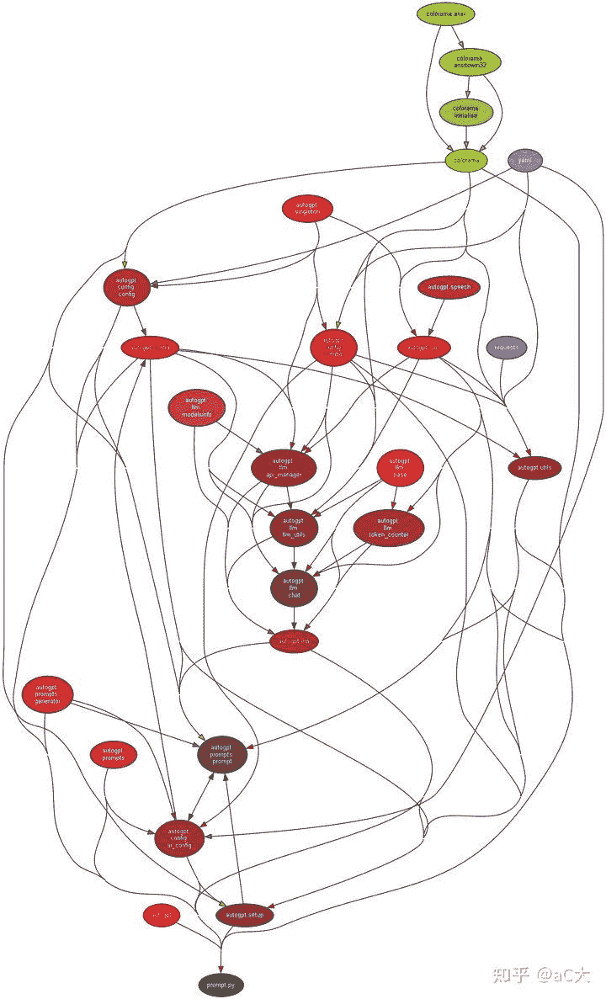
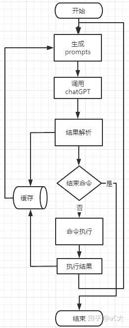

# 万字长文-AutoGPT源码剖析-整体框架介绍

> 来源：[https://agijuejin.feishu.cn/docx/LVMQdjPLuoiMmlxP4FTc7RX1nGv](https://agijuejin.feishu.cn/docx/LVMQdjPLuoiMmlxP4FTc7RX1nGv)

> 作者：aC大

> 原文： [https://zhuanlan.z](https://zhuanlan.zhihu.com/p/630942935)hihu.com/p/630942...

## 写在前面

自[ChatGPT问世](https://link.zhihu.com/?target=https%3A//github.com/Significant-Gravitas/Auto-GPT)[以来，围绕其](https://www.zhihu.com/search?q=%E5%A4%A7%E8%AF%AD%E8%A8%80%E6%A8%A1%E5%9E%8B&search_source=Entity&hybrid_search_source=Entity&hybrid_search_extra=%7B%22sourceType%22%3A%22article%22%2C%22sourceId%22%3A630942935%7D)做的一些应[用也层出不穷，](https://www.zhihu.com/zvideo/1638330795231232000)其中Auto-GPT迅速崛起，在github上star数一度成几何级数上升。 Auto-GPT 是一个基于ChatGPT完成多目标复杂任务的应用。围绕 大语言模型 (包括ChatGPT，但不仅限于此模型)构建针对某个特定领域的应用势必会如雨后春笋，成为未来几年应用创新的机会，预计也会重现一大批此类的创业公司。而Auto-GPT就是综合网络搜索、大语言模型调用、文件读写、python和shell脚本执行等功能框架，综合这些功能，可以自动帮我们完成多目标复杂的任务。为此，我最近一段时间研究了Auto-GPT的源码，先针对整体框架介绍。相关的源码剖析本人也录制了 相关系列视频 ，感兴趣的朋友可以翻阅，也欢迎一起交流。


## 整体框架

Auto-GPT是将用户的多目标复杂任务进行分步执行，每一步执行搜索命令还是读写文件亦或是任务结束，都是由ChatGPT接口的返回结果决定的，而调用ChatGPT接口时会将上一步或几步的历史信息一同传给ChatGPT，让ChatGPT综合全局的信息给出下一步要执行的命令。其流程大致如下：



整个Auto-GPT执行可以分为任务构建、ChatGPT接口调用、命令执行、缓存处理四个部分。

从模块的角度分析来看，大致可以分为agent、prompt、comands、memory、config及其他模块。模块间的调用关系如下：



下面从执行流程和模块调用关系两个角度介绍Auto-GPT的整体框架。

## Auto-GPT执行流程介绍

整个Auto-GPT执行可以分为任务构建、ChatGPT接口调用、命令执行、缓存处理四个部分，每个部分的输入输出格式都是标准化，具体的内容是可扩展的。

### 任务构建

任务构建包括了用户以 [配置文件 ](https://www.zhihu.com/search?q=%E9%85%8D%E7%BD%AE%E6%96%87%E4%BB%B6&search_source=Entity&hybrid_search_source=Entity&hybrid_search_extra=%7B%22sourceType%22%3A%22article%22%2C%22sourceId%22%3A630942935%7D)输入或交互式输入，也包括了每个命令执行之后新的任务构建两大部分。用户可以提前配置ai_settings.yaml文件，配置的内容如：

```
ai_goals:
- 指定一个做饺子的操作指南
- 将操作指南写入到output.txt文件中
ai_name: acedar
ai_role: 一个专业厨师,熟知各类餐谱
api_budget: 0.2
```

+   ai_goals 表示用户想要完成的目标，最多可以配置5个，也可以少于5个。

+   ai_name: 本次服务的名称，可以理解为实现你目标的程序是一个机器人，ai_name就是你给机器人取的名字。

+   ai_role: 主要是为了辅助完成用户目标，对机器人的角色设定，更好的完成用户的任务。

+   api_budget： 是调用openai服务接口的预算，单位是美元。这里没有说是调用ChatGPT服务接口的预算，因为在Auto-GPT中，还有调用openai提供的其他模型，比如将文本转化为向量的模型。设置预算是为了防止Auto-GPT陷入死循环，过度调用openai的服务，严重超出成本控制。毕竟Auto-GPT是一个费钱的应用。

在有用户提供目标任务的基础上，Auto-GPT会对用户的输入进行重新整合，形成一套标准的调用ChatGPT接口的数据格式，如：

```
[{
        &quot;role&quot;: &quot;system&quot;, 
        &quot;content&quot;: &quot;额外展示&quot;
},{
        &quot;role&quot;: &quot;system&quot;, 
        &quot;content&quot;: &quot;The current time and date is Wed May  3 18:38:48 2023&quot;
},{
        &quot;role&quot;: &quot;user&quot;,
        &quot;content&quot;: &quot;Determine which next command to use, and repond using the format specified above&quot;
}
]
```

“额外展示”内容：

```
You[ are acedar,](https://www.zhihu.com/search?q=analyze_code&amp;search_source=Entity&amp;hybrid_search_source=Entity&amp;hybrid_search_extra=%7B%22sourceType%22%3A%22article%22%2C%22sourceId%22%3A630942935%7D) 一个专业厨师,[熟知各类餐谱
You](https://www.zhihu.com/search?q=hyperlinks&amp;search_source=Entity&amp;hybrid_search_source=Entity&amp;hybrid_search_extra=%7B%22sourceType%22%3A%22article%22%2C%22sourceId%22%3A630942935%7D)r decisi[ons must alw](https://www.zhihu.com/search?q=text_summary&amp;search_source=Entity&amp;hybrid_search_source=Entity&amp;hybrid_search_extra=%7B%22sourceType%22%3A%22article%22%2C%22sourceId%22%3A630942935%7D)ay[s be made](https://www.zhihu.com/search?q=abilities&amp;search_source=Entity&amp;hybrid_search_source=Entity&amp;hybrid_search_extra=%7B%22sourceType%22%3A%22article%22%2C%22sourceId%22%3A630942935%7D)[ independently](https://www.zhihu.com/search?q=self-criticize&amp;search_source=Entity&amp;hybrid_search_source=Entity&amp;hybrid_search_extra=%7B%22sourceType%22%3A%22article%22%2C%22sourceId%22%3A630942935%7D)[ without seeki](https://www.zhihu.com/search?q=self-criticism&amp;search_source=Entity&amp;hybrid_search_source=Entity&amp;hybrid_search_extra=%7B%22sourceType%22%3A%22article%22%2C%22sourceId%22%3A630942935%7D)ng user assistance. Play to your strengths as an LLM and pursue simple strategies with no legal complications.

GOALS:

1. 指定一个做饺子的操作指南
2. 将操作指南写入到output.txt文件中


Constraints:
1. ~4000 word limit for short term memory. Your short term memory is short, so immediately save important information to files.
2. If you are unsure how you previously did something or want to recall past events, thinking about similar events will help you remember.
3. No user assistance
4. Exclusively use the commands listed in double quotes e.g. &quot;command name&quot;

Commands:
1. analyze_code: Analyze Code, args: &quot;code&quot;: &quot;&lt;full_code_string&gt;&quot;
2. execute_python_file: Execute Python File, args: &quot;filename&quot;: &quot;&lt;filename&gt;&quot;
3. append_to_file: Append to file, args: &quot;filename&quot;: &quot;&lt;filename&gt;&quot;, &quot;text&quot;: &quot;&lt;text&gt;&quot;
4. delete_file: Delete file, args: &quot;filename&quot;: &quot;&lt;filename&gt;&quot;
5. list_files: List Files in Directory, args: &quot;directory&quot;: &quot;&lt;directory&gt;&quot;
6. read_file: Read file, args: &quot;filename&quot;: &quot;&lt;filename&gt;&quot;
7. write_to_file: Write to file, args: &quot;filename&quot;: &quot;&lt;filename&gt;&quot;, &quot;text&quot;: &quot;&lt;text&gt;&quot;
8. google: Google Search, args: &quot;query&quot;: &quot;&lt;query&gt;&quot;
9. improve_code: Get Improved Code, args: &quot;suggestions&quot;: &quot;&lt;list_of_suggestions&gt;&quot;, &quot;code&quot;: &quot;&lt;full_code_string&gt;&quot;
10. send_tweet: Send Tweet, args: &quot;tweet_text&quot;: &quot;&lt;tweet_text&gt;&quot;
11. browse_website: Browse Website, args: &quot;url&quot;: &quot;&lt;url&gt;&quot;, &quot;question&quot;: &quot;&lt;what_you_want_to_find_on_website&gt;&quot;
12. write_tests: Write Tests, args: &quot;code&quot;: &quot;&lt;full_code_string&gt;&quot;, &quot;focus&quot;: &quot;&lt;list_of_focus_areas&gt;&quot;
13. delete_agent: Delete GPT Agent, args: &quot;key&quot;: &quot;&lt;key&gt;&quot;
14. get_hyperlinks: Get text summary, args: &quot;url&quot;: &quot;&lt;url&gt;&quot;
15. get_text_summary: Get text summary, args: &quot;url&quot;: &quot;&lt;url&gt;&quot;, &quot;question&quot;: &quot;&lt;question&gt;&quot;
16. list_agents: List GPT Agents, args: () -&gt; str
17. message_agent: Message GPT Agent, args: &quot;key&quot;: &quot;&lt;key&gt;&quot;, &quot;message&quot;: &quot;&lt;message&gt;&quot;
18. start_agent: Start GPT Agent, args: &quot;name&quot;: &quot;&lt;name&gt;&quot;, &quot;task&quot;: &quot;&lt;short_task_desc&gt;&quot;, &quot;prompt&quot;: &quot;&lt;prompt&gt;&quot;
19. Task Complete (Shutdown): &quot;task_complete&quot;, args: &quot;reason&quot;: &quot;&lt;reason&gt;&quot;

Resources:
1. Internet access for searches and information gathering.
2. Long Term memory management.
3. GPT-3.5 powered Agents for delegation of simple tasks.
4. File output.

Performance Evaluation:
1. Continuously review and analyze your actions to ensure you are performing to the best of your abilities.
2. Constructively self-criticize your big-picture behavior constantly.
3. Reflect on past decisions and strategies to refine your approach.
4. Every command has a cost, so be smart and efficient. Aim to complete tasks in the least number of steps.
5. Write all code to a file.

You should only respond in JSON format as described below 
Response Format: 
{
    &quot;thoughts&quot;: {
        &quot;text&quot;: &quot;thought&quot;,
        &quot;reasoning&quot;: &quot;reasoning&quot;,
        &quot;plan&quot;: &quot;- short bulleted\n- list that conveys\n- long-term plan&quot;,
        &quot;criticism&quot;: &quot;constructive self-criticism&quot;,
        &quot;speak&quot;: &quot;thoughts summary to say to user&quot;
    },
    &quot;command&quot;: {
        &quot;name&quot;: &quot;command name&quot;,
        &quot;args&quot;: {
            &quot;arg name&quot;: &quot;value&quot;
        }
    }
} 
Ensure the response can be parsed by Python json.loads
```

对比"额外展示"内容和用户输入的多目标复杂任务相比，多了很多的很多的内容，比较重要的有两点：

+   Commands。以system的角色添加了19个命令，描述了每个命令的名称，参数等，这些命令会根据ChatGPT的返回结果，会在Auto-GPT服务器上执行完成相关动作，比如读写文件。

+   Response Format。在请求ChatGPT接口时，给出了返回结果的格式限制，让ChatGPT按指定的格式返回，这样就方便结果的解析，因为返回的结果解析后需要与命令一一对应。

对于ChatGPT而言，每次调用用户的要求都是一样的(如下)，指定ChatGPT接口返回的是前面“Commands”中指定的命令，并且按指定的格式返回。

```
[{
        &quot;role&quot;: &quot;user&quot;,
        &quot;content&quot;: &quot;Determine which next command to use, and repond using the format specified above&quot;
}]
```

### ChatGPT接口调用

从任务构建的处理中可以看到，用户最开始输入的多目标复杂任务的描述，是作为system角色的描述的一部分，而每次调用ChatGPT模型的接口的要求都是固定的，就是按指定格式返回上述19个命令中的一个。ChatGPT返回的结果如下：

```
[{
  &quot;th](https://www.zhihu.com/search?q=to_file&amp;search_source=Entity&amp;hybrid_search_source=Entity&amp;hybrid_search_extra=%7B%22sourceType%22%3A%22article%22%2C%22sourceId%22%3A630942935%7D)oughts&quot;: {
    &quot;text&quot;: &quot;I will start by writing the recipe for making dumplings and save it to a file. I will then mark the importa[nt s](https://www.zhihu.com/search?q=bowl&amp;search_source=Entity&amp;hybrid_search_source=Entity&amp;hybrid_search_extra=%7B%22sourceType%22%3A%22article%22%2C%22sourceId%22%3A630942935%7D)teps in the recipe.&quot;,
    &quot;reasoning&quot;: &quot;I need to have a clear plan of action to achieve my goals. Writing the recipe and marking the important steps will help me achieve my first two goals.&quot;,
    &quot;plan&quot;: &quot;- Write the recipe for making dumplings\n- Save the recipe to a file\n- Mark the important steps in the recipe&quot;,
    &quot;criticism&quot;: &quot;I need to ensure that the recipe is clear and easy to follow. I should also double-check that I have marked all the important steps.&quot;,
    &quot;speak&quot;: &quot;I will start by writing the recipe for making dumplings and saving it to a file. Then, I will mark the important steps in the recipe.&quot;
  },
  &quot;command&quot;: {
    &quot;name&quot;: &quot;write_to_file&quot;,
    &quot;args&quot;: {
      &quot;filename&quot;: &quot;dumpling_recipe.txt&quot;,
      &quot;text&quot;: &quot;Dumpling Recipe:\n\nIngredients:\n- 2 cups all-purpose flour\n- 1/2 teaspoon salt\n- 3/4 cup water\n- 1 pound ground pork\n- 1 tablespoon soy sauce\n- 1 tablespoon sesame oil\n- 1 tablespoon rice vinegar\n- 1 tablespoon grated ginger\n- 2 cloves garlic, minced\n- 1/4 cup chopped scallions\n- 1/4 cup chopped cilantro\n\nInstructions:\n1. In a large bowl, mix together the flour and salt. Slowly add the water, stirring until a dough forms.\n2. Knead the dough on a floured surface for 5-10 minutes, until smooth and elastic. Cover with a damp towel and let rest for 30 minutes.\n3. In a separate bowl, mix together the ground pork, soy sauce, sesame oil, rice vinegar, ginger, garlic, scallions, and cilantro.\n4. Roll out the dough on a floured surface until it is about 1/8 inch thick. Use a round cookie cutter or the rim of a glass to cut out circles of dough.\n5. Place a small spoonful of the pork mixture in the center of each circle of dough. Fold the dough in half and pinch the edges together to seal.\n6. Bring a large pot of water to a boil. Add the dumplings and cook for 3-5 minutes, until they float to the surface and the dough is cooked through.\n7. Serve hot with soy sauce or your favorite dipping sauce.&quot;
    }
  }
}
```

返回的结果是json格式，包含thoughts和comand的数据。thoughts中text是对用户目标需要的一个回答；reasoning是对回答的解释，告诉用户我为什么要这么做；plan是完成用户给定的目标的执行计划；criticism标记出用户目标的核心点，以便ChatGPT在回答时能够抓住重点。speak部分是一个语言播放的功能，只有配置了语言播放功能才有效。

comand中的name就是命令的名称，比如例子中的“write_to_file”命令，就是请求ChatGPT接口中19个命令中的一个，args会根据不同的命令返回不一样的结果，“write_to_file”是写文件，那就需要有写得内容(对应text)及写到哪个文件(filename)。

### 命令执行

从ChatGPT返回的结果包含待执行的命令及响应的参数，接下来就需要执行命令，这些命令都事先实现了对应的处理逻辑(对应co[mmands模块)，对](https://www.zhihu.com/search?q=subprocess&search_source=Entity&hybrid_search_source=Entity&hybrid_search_extra=%7B%22sourceType%22%3A%22article%22%2C%22sourceId%22%3A630942935%7D)[于例子中的读写文件](https://www.zhihu.com/search?q=docker%E5%AE%B9%E5%99%A8&search_source=Entity&hybrid_search_source=Entity&hybrid_search_extra=%7B%22sourceType%22%3A%22article%22%2C%22sourceId%22%3A630942935%7D)这类命令是比较简单的，但对于python[代码的执行](https://www.zhihu.com/search?q=%E6%90%9C%E7%B4%A2%E5%BC%95%E6%93%8E&search_source=Entity&hybrid_search_source=Entity&hybrid_search_extra=%7B%22sourceType%22%3A%22article%22%2C%22sourceId%22%3A630942935%7D)，需要根据配置判断是直接使用 subprocess 调用python脚本，还是在独立的 docker容器 中执行。另外，对于互联网搜索，需要调用谷歌或duckduckgo_search 搜索引擎 获取搜索结果，并对结果进行解析处理成文本内容，便于后续处理。



### 缓存处理

为了保证流程的延续性，需要将历史处理的结果保存起来，在下次调用ChatGPT时将历史信息一起喂给模型，以便得到更优、更全局的结果。同时也为了避免重复执行。因为设计到互联网搜索甚至爬虫，网络搜索和爬虫的内容会比较多，将这些内容直接作为ChatGPT模型的输入，一来会导致消耗token太快，成本太高；二来里边的很多信息可能与当前目标实现无关，全部输入到ChatGPT，反而会让结果不可靠。为了解决这个问题，在将信息存入缓存时，将整个搜索或爬虫到的文本调用ChatGPT模型，得到文本的摘要，这个摘要的内容在后续的流程中可以反复使用。需要强调的是，在缓存部分调用的ChatGPT接口不需要按前面提到的标准格式返回，这里的接口调用跟平常使用ChatGPT的接口是一样的。

为了直接缓存的快速读写，Auto-GPT引入了向量索引的工具，包括本地缓存、接入第三方的redis、pinecone、weaviate和milvus等。这里需要将文本转化为语义向量，然后将语义向量和文件进行缓存，检索是根据语义向量快速检索，文本转语义的方法依然是调用openai的模型，默认是text-embedding-ada-002模型版本。通过语义检索，也能快速检索出topK个最相关的文本。这个功能在下一次调用ChatGPT时将会用到。



从执行流程的角度上分析，主要是任务构建、ChatGPT接口调用、命令执行、缓存处理等几个步骤。命令执行完成之后，继续将命令执行的结果返回作为下一次构建请求任务内容的一部分，同时也会将缓存中的若干topK相关内容一并放入请求ChatGPT的参数中，综合历史信息得到更为准确的结果。

## Auto-GPT模块调用关系介绍

进一步分析Auto-GPT源码，模块的调用关系可分为config/AIconfig、prompts、agent、llm、结果解析、commands及memory几个模块，下面介绍这几个模块之前的功能及调用关系。



### config/AIconfig介绍

config部分包含全局环境的配置和AI任务相关的配置，全局环境配置对应的是.env文件中的配置，主要的配置包括(看代码注释)：

```
class Config(metaclass=Singleton):
    &quot;&quot;&quot;
    Configuration class to store the state of bools for different scripts access.
    &quot;&quot;&quot;

    def __init__(self) -&gt; None:
        &quot;&quot;&quot;**************** 1.当前工作目录，包括本地缓存文件保存路径，日志路径及读写命令的文件存储目录 ***************&quot;&quot;&quot;
        self.workspace_path = None
        self.file_logger_path = None

        &quot;&quot;&quot;**************** 2. Auto-GPT运行的模型 ***************&quot;&quot;&quot;
        self.debug_mode = False   # 是否开启debug
        self.continuous_mode = False   # 是否自动连续执行模型，而不是一步一步通过终端与用户交互

        &quot;&quot;&quot;**************** 3. 是否允许下载文件 ***************&quot;&quot;&quot;
        self.allow_downloads = False  

        &quot;&quot;&quot;**************** 4. AI任务的加载和保存，用户可以提前将要执行的目标写入该文件 ***************&quot;&quot;&quot;
        self.ai_settings_file = os.getenv(&quot;AI_SETTINGS_FILE&quot;, &quot;ai_settings.yaml&quot;)
       
        &quot;&quot;&quot;**************** 5. 模型版本配置及最大token数量设置 ***************&quot;&quot;&quot;
        self.fast_llm_model = os.getenv(&quot;FAST_LLM_MODEL&quot;, &quot;gpt-3.5-turbo&quot;)
        self.smart_llm_model = os.getenv(&quot;SMART_LLM_MODEL&quot;, &quot;gpt-4&quot;)
        self.fast_token_limit = int(os.getenv(&quot;FAST_TOKEN_LIMIT&quot;, 4000))
        self.smart_token_limit = int(os.getenv(&quot;SMART_TOKEN_LIMIT&quot;, 8000))
        
        &quot;&quot;&quot;**************** 6. 文本转语义向量调用模型，在缓存存储时会使用 ***************&quot;&quot;&quot;
        self.embedding_model = os.getenv(&quot;EMBEDDING_MODEL&quot;, &quot;text-embedding-ada-002&quot;)
        self.embedding_tokenizer = os.getenv(&quot;EMBEDDING_TOKENIZER&quot;, &quot;cl100k_base&quot;)
        self.embedding_token_limit = int(os.getenv(&quot;EMBEDDING_TOKEN_LIMIT&quot;, 8191))
        
        &quot;&quot;&quot;**************** 7. openai服务的API_KEY等配置 ***************&quot;&quot;&quot;
        self.openai_api_key = os.getenv(&quot;OPENAI_API_KEY&quot;)
        self.temperature = float(os.getenv(&quot;TEMPERATURE&quot;, &quot;0&quot;))

        &quot;&quot;&quot;**************** 8. 缓存的服务配置及谷歌搜索的API_KEY等配置 ***************&quot;&quot;&quot;
        self.google_api_key = os.getenv(&quot;GOOGLE_API_KEY&quot;)
        self.custom_search_engine_id = os.getenv(&quot;CUSTOM_SEARCH_ENGINE_ID&quot;)
        self.redis_host = os.getenv(&quot;REDIS_HOST&quot;, &quot;localhost&quot;)
        self.redis_port = os.getenv(&quot;REDIS_PORT&quot;, &quot;6379&quot;)
        self.redis_password = os.getenv(&quot;REDIS_PASSWORD&quot;, &quot;&quot;)
        self.wipe_redis_on_start = os.getenv(&quot;WIPE_REDIS_ON_START&quot;, &quot;True&quot;) == &quot;True&quot;
        self.memory_index = os.getenv(&quot;MEMORY_INDEX&quot;, &quot;auto-gpt&quot;)
        # Note that indexes must be created on db 0 in redis, this is not configurable.

        &quot;&quot;&quot;**************** 9. 用户自定义插件配置 ***************&quot;&quot;&quot;
        self.plugins_dir = os.getenv(&quot;PLUGINS_DIR&quot;, &quot;plugins&quot;)
```

AIConfig中保存的是与ChatGPT接口调用相关的配置，对应ai_settings.yaml中的内容: ai_name、ai_role、ai_goals、api_budget。

### Prompts

在[上文任务构建中](https://www.zhihu.com/search?q=%E5%91%BD%E4%BB%A4%E6%89%A7%E8%A1%8C%E5%88%97%E8%A1%A8&search_source=Entity&hybrid_search_source=Entity&hybrid_search_extra=%7B%22sourceType%22%3A%22article%22%2C%22sourceId%22%3A630942935%7D)请求ChatGPT相关的参数中可以看出，除了包括AIconfig中的几个参数，还额外包括了 命令执行列表 、指定返回结果格式等数据，这些数据的添加和格式的统一定义均在Prompts模块中实现的。



### agent介绍

agent模块控制整个Auto-GPT的核心调用逻辑，将各个模块串联在一起完成用户的目标。agent里边是一个循环，基本的逻辑是：



### llm模块

llm是处理ChatGPT相关的模块，包括ChatGPT接[口的调用、请求参](https://www.zhihu.com/search?q=token%E8%AE%A1%E6%95%B0&search_source=Entity&hybrid_search_source=Entity&hybrid_search_extra=%7B%22sourceType%22%3A%22article%22%2C%22sourceId%22%3A630942935%7D)数和返回结果格式校验、 token计数 、openai支持的模型配置等功能。在调用ChatGPT的接口时会经过llm模块的处理逻辑，补全相关缺省的参数(使用默认值填充)。主要包括ChatCompletion(ChatGPT接口)接口和Embedding.create接口(文本转语义向量接口)。

```
response = openai.ChatCompletion.create(
                model=model,
                messages=messages,
                temperature=temperature,
                max_tokens=max_tokens,
                api_key=cfg.openai_api_key,
            )
embedding = openai.Embedding.create(
            input=[chunk],
            api_key=cfg.openai_api_key,
            **kwargs,
        )
```

### 结果解析

在调用ChatGPT接口后，根据返回的结果，解析出命令和参数。

### commands：

该模块主要定义了19个命令对应的处理逻辑，有的比较简单比如读写文件，有的比较复杂，比如调用谷歌搜索或duckduckgo_search， 比如browse_website爬虫还需要实现网页内容解析的逻辑。

```
Commands:
1. analyze_code: Analyze Code, args: &quot;code&quot;: &quot;&lt;full_code_string&gt;&quot;
2. execute_python_file: Execute Python File, args: &quot;filename&quot;: &quot;&lt;filename&gt;&quot;
3. append_to_file: Append to file, args: &quot;filename&quot;: &quot;&lt;filename&gt;&quot;, &quot;text&quot;: &quot;&lt;text&gt;&quot;
4. delete_file: Delete file, args: &quot;filename&quot;: &quot;&lt;filename&gt;&quot;
5. list_files: List Files in Directory, args: &quot;directory&quot;: &quot;&lt;directory&gt;&quot;
6. read_file: Read file, args: &quot;filename&quot;: &quot;&lt;filename&gt;&quot;
7. write_to_file: Write to file, args: &quot;filename&quot;: &quot;&lt;filename&gt;&quot;, &quot;text&quot;: &quot;&lt;text&gt;&quot;
8. google: Google Search, args: &quot;query&quot;: &quot;&lt;query&gt;&quot;
9. improve_code: Get Improved Code, args: &quot;suggestions&quot;: &quot;&lt;list_of_suggestions&gt;&quot;, &quot;code&quot;: &quot;&lt;full_code_string&gt;&quot;
10. send_tweet: Send Tweet, args: &quot;tweet_text&quot;: &quot;&lt;tweet_text&gt;&quot;
11. browse_website: Browse Website, args: &quot;url&quot;: &quot;&lt;url&gt;&quot;, &quot;question&quot;: &quot;&lt;what_you_want_to_find_on_website&gt;&quot;
12. write_tests: Write Tests, args: &quot;code&quot;: &quot;&lt;full_code_string&gt;&quot;, &quot;focus&quot;: &quot;&lt;list_of_focus_areas&gt;&quot;
13. delete_agent: Delete GPT Agent, args: &quot;key&quot;: &quot;&lt;key&gt;&quot;
14. get_hyperlinks: Get text summary, args: &quot;url&quot;: &quot;&lt;url&gt;&quot;
15. get_text_summary: Get text summary, args: &quot;url&quot;: &quot;&lt;url&gt;&quot;, &quot;question&quot;: &quot;&lt;question&gt;&quot;
16. list_agents: List GPT Agents, args: () -&gt; str
17. message_agent: Message GPT Agent, args: &quot;key&quot;: &quot;&lt;key&gt;&quot;, &quot;message&quot;: &quot;&lt;message&gt;&quot;
18. start_agent: Start GPT Agent, args: &quot;name&quot;: &quot;&lt;name&gt;&quot;, &quot;task&quot;: &quot;&lt;short_task_desc&gt;&quot;, &quot;prompt&quot;: &quot;&lt;prompt&gt;&quot;
19. Task Complete (Shutdown): &quot;task_complete&quot;, args: &quot;reason&quot;: &quot;&lt;reason&gt;&quot;
```

### memory

该模块是缓存的处理，主要管理 [缓存服务器 ](https://www.zhihu.com/search?q=%E7%BC%93%E5%AD%98%E6%9C%8D%E5%8A%A1%E5%99%A8&search_source=Entity&hybrid_search_source=Entity&hybrid_search_extra=%7B%22sourceType%22%3A%22article%22%2C%22sourceId%22%3A630942935%7D)的访问地址、用户名密码等。以及对应的访问接口封装，所有的缓存数据都可以转为向量后放入缓存中。该模块支持4、5种缓存服务。用户可以根据需要选择。

```
&quot;&quot;&quot; ********************* 缓存接口定义 *********************&quot;&quot;&quot;
class MemoryProviderSingleton(AbstractSingleton):
    @abc.abstractmethod
    def add(self, data):
        &quot;&quot;&quot;Adds to memory&quot;&quot;&quot;
        pass

    @abc.abstractmethod
    def get(self, data):
        &quot;&quot;&quot;Gets from memory&quot;&quot;&quot;
        pass

    @abc.abstractmethod
    def clear(self):
        &quot;&quot;&quot;Clears memory&quot;&quot;&quot;
        pass

    @abc.abstractmethod
    def get_relevant(self, data, num_relevant=5):
        &quot;&quot;&quot;Gets relevant memory for&quot;&quot;&quot;
        pass

    @abc.abstractmethod
    def get_stats(self):
        &quot;&quot;&quot;Get stats from memory&quot;&quot;&quot;
        pass
```

## 总结

本文从整[体的角度介绍了](https://www.zhihu.com/search?q=%E4%BA%BA%E5%B7%A5%E6%99%BA%E8%83%BD%E5%BA%94%E7%94%A8&search_source=Entity&hybrid_search_source=Entity&hybrid_search_extra=%7B%22sourceType%22%3A%22article%22%2C%22sourceId%22%3A630942935%7D)Auto-GPT的整体框架，根据用户的目标，自动循环的分步骤完成用户的需求。文中从体介绍的角度出发，主要介绍了Auto-GPT的执行流程、各个模块的功能及模块间的调用关系。希望读者可以整体了解Auto-GPT的工作流程和原理。当然Auto-GPT是基于ChatGPT大模型应用的一个缩影，相信未来的 人工智能应用 上的发展也会朝着整个AI模型和现有基础上能力的方向进行。

目前Auto-GPT是一个实验性质的项目，也在快速迭代更新，本文的介绍可能会落后最新的版本，但整体框架和原理是不会变的。另外，因水平有限，难免存在理解不到位的地方，欢迎各位同仁批评指正，一起交流探索。

发布于 2023-05-21 13:49 ・IP 属地广东

「真诚赞赏，手留余香」

赞赏

还没有人赞赏，快来当第一个赞赏的人吧！