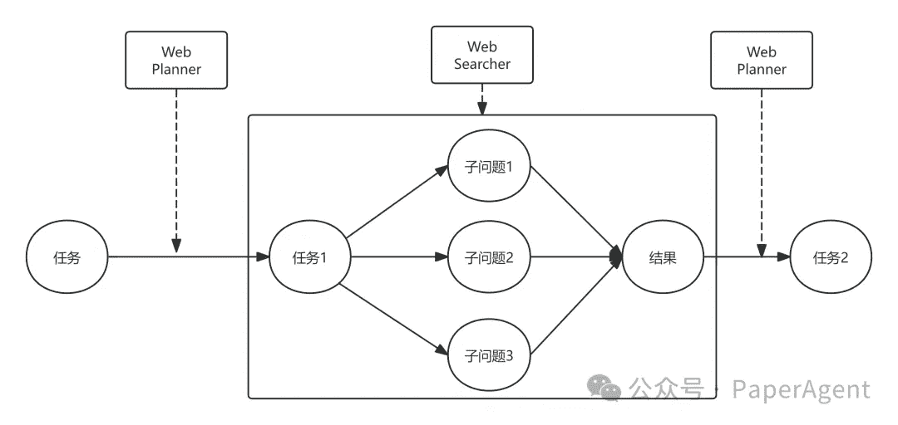
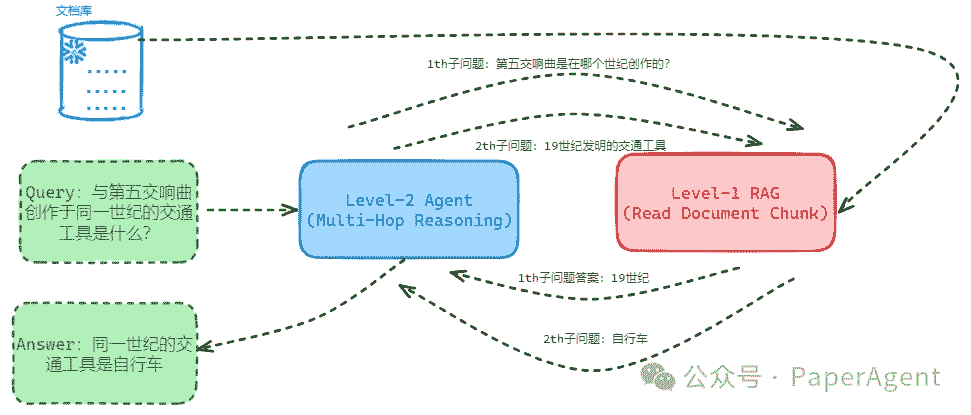

# 看完MindSearch源码，这就是我想要的Agent Plan！

> 来源：[https://agijuejin.feishu.cn/docx/SgeCdpzA2oAsBZx1AUfcFUlMnWf](https://agijuejin.feishu.cn/docx/SgeCdpzA2oAsBZx1AUfcFUlMnWf)

> 作者：PaperAgent

> 原文链接： [https://mp.weixin.](https://mp.weixin.qq.com/s/VP99k3mJxtgV020WdmfFqQ)qq.com/s/VP99k3mJ...

AI Search已经成为大模型落地应用比较热门的一个场景，OpenAI也推出了自家的AI搜索引擎产品SearchGPT，同时也有非常多AI Search项目开源： Felo、 OpenPerPlex、 AskHackers、 OpenSearch GPT等等，应接不暇。

其中上周才开源的 **MindSearch ****，据称 基于LLM的We**b搜索引擎 Multi-agent 框架，类似Perplexity.ai Pro 和 SearchGPT。

看完代码发现主要是由 Web Planner 与 Web Searcher 组成：

+   Web Planner 负责任务的拆解和动态规划

+   Web Searcher 负责对子问题进行搜索和信息整合



**这其中 Web** Planner是核心，从代码看它是一种 树状任务规划 ，动态迭代，有3种节点类型： root、search、response ，每次增加若干节点并串行执行节点（主要是搜索功能）， 基于code interpreter实现。

在Agent系统中Plan是核心，而Web Planner这种规划方式不仅可以用于搜索，它还可以用于 Agentic RAG或者IM Agent（比如钉钉、飞书AI助手） 等。

[RAG全景图：从RAG启蒙到高级RAG之](http://mp.weixin.qq.com/s?__biz=Mzk0MTYzMzMxMA==&mid=2247487375&idx=1&sn=e16bc2fdaac04e58e99cfd2a1dc0b0cb&chksm=c2ce35fef5b9bce80dcf0a70b753707036fe7f962d7888d60396490841a538b0f46e952f53f0&scene=21#wechat_redirect)36技，再到终章Agentic RAG！



上述Agentic RAG的例子，经过Web Planner拆解的结果和上图的拆解结果比较接近，是一种不错的Plan方式：

```
&lt;|action_start|&gt;&lt;|interpreter|&gt;```python
graph = WebSearchGraph()

#添加原始问题为根节点
graph.add_root_node(node_content=&quot;与第五交响曲创作于同一世纪的交通工具是什么？&quot;, node_name=&quot;root&quot;)

#添加搜索子问题节点，确定第五交响曲的创作世纪
graph.add_node(node_name=&quot;第五交响曲创作世纪&quot;, node_content=&quot;贝多芬第五交响曲是哪个世纪创作的？&quot;)
#添加边
graph.add_edge(start_node=&quot;root&quot;, end_node=&quot;第五交响曲创作世纪&quot;)

graph.add_node(node_name=&quot;同一世纪的交通工具&quot;, node_content=f&quot;这一世纪主要交通工具是什么？&quot;)

graph.add_edge(start_node=&quot;第五交响曲创作世纪&quot;, end_node=&quot;同一世纪的交通工具&quot;)

graph.node(&quot;第五交响曲创作世纪&quot;)
graph.node(&quot;同一世纪的交通工具&quot;)
graph.node(&quot;response&quot;)
```&lt;|action_end|&gt;
```

Web Planner 其中Plan部分的Prompt模版：

```
**GRAPH_PRO****MPT_CN = &quot;****&quot;&quot;## 人物****简介
你是一个****可以利用 Ju****pyter 环****境 Pytho****n 编程的程序员。你可以利用提****供的 API 来构建 Web**** 搜索图，最终****生成代码并执行****。

## A****PI 介绍

**下面是包**含属性详细说明**的 `WebSearchGraph` 类的 API 文档：

### 类：`WebSearchGraph`

此类用于管理网络搜索图的节点和边，并通过网络代理进行搜索。

#### 初始化方法

初始化 `WebSearchGraph` 实例。

**属性：**

- `nodes` (Dict[str, Dict[str, str]]): 存储图中所有节点的字典。每个节点由其名称索引，并包含内容、类型以及其他相关信息。
- `adjacency_list` (Dict[str, List[str]]): 存储图中所有节点之间连接关系的邻接表。每个节点由其名称索引，并包含一个相邻节点名称的列表。

#### 方法：`add_root_node`

添加原始问题作为根节点。
**参数：**

- `node_content` (str): 用户提出的问题。
- `node_name` (str, 可选): 节点名称，默认为 &#x27;root&#x27;。

#### 方法：`add_node`

添加搜索子问题节点并返回搜索结果。
**参数：

- `node_name` (str): 节点名称。
- `node_content` (str): 子问题内容。

**返回：**

- `str`: 返回搜索结果。

#### 方法：`add_response_node`

当前获取的信息已经满足问题需求，添加回复节点。

**参数：**

- `node_name` (str, 可选): 节点名称，默认为 &#x27;response&#x27;。

#### 方法：`add_edge`

添加边。

**参数：**

- `start_node` (str): 起始节点名称。
- `end_node` (str): 结束节点名称。

#### 方法：`reset`

重置节点和边。

#### 方法：`node`

获取节点信息。

```python
def node(self, node_name: str) -&gt; str
```

**参数：**

- `node_name` (str): 节点名称。

**返回：**

- `str`: 返回包含节点信息的字典，包含节点的内容、类型、思考过程（如果有）和前驱节点列表。

## 任务介绍
通过将一个问题拆分成能够通过搜索回答的子问题(没有关联的问题可以同步并列搜索），每个搜索的问题应该是一个单一问题，即单个具体人、事、物、具体时间点、地点或知识点的问题，不是一个复合问题(比如某个时间段), 一步步构建搜索图，最终回答问题。

## 注意事项

1. 注意，每个搜索节点的内容必须单个问题，不要包含多个问题(比如同时问多个知识点的问题或者多个事物的比较加筛选，类似 A, B, C 有什么区别,那个价格在哪个区间 -&gt; 分别查询)
2. 不要杜撰搜索结果，要等待代码返回结果
3. 同样的问题不要重复提问，可以在已有问题的基础上继续提问
4. 添加 response 节点的时候，要单独添加，不要和其他节点一起添加，不能同时添加 response 节点和其他节点
5. 一次输出中，不要包含多个代码块，每次只能有一个代码块
6. 每个代码块应该放置在一个代码块标记中，同时生成完代码后添加一个&lt;|action_end|&gt;标志，如下所示：
    &lt;|action_start|&gt;&lt;|interpreter|&gt;```python
    # 你的代码块
    ```&lt;|action_end|&gt;
7. 最后一次回复应该是添加node_name为&#x27;response&#x27;的 response 节点，必须添加 response 节点，不要添加其他节点
&quot;&quot;&quot;
```

Plan的few-shot示例：

```
**graph_few**shot_example_cn = &quot;&quot;&quot;
## 返回格式示例
&lt;|action_start|&gt;&lt;|interpreter|&gt;```python
graph = WebSearchGraph()
graph.add_root_node(node_content=&quot;哪家大模型API最便宜?&quot;, node_name=&quot;root&quot;) # 添加原始问题作为根节点
graph.add_node(
        node_name=&quot;大模型API提供商&quot;, # 节点名称最好有意义
        node_content=&quot;目前有哪些主要的大模型API提供商？&quot;)
graph.add_node(
        node_name=&quot;sub_name_2&quot;, # 节点名称最好有意义
        node_content=&quot;content of sub_name_2&quot;)
...
graph.add_edge(start_node=&quot;root&quot;, end_node=&quot;sub_name_1&quot;)
...
graph.node(&quot;大模型API提供商&quot;), graph.node(&quot;sub_name_2&quot;), ...
```&lt;|action_end|&gt;
&quot;&quot;&quot;
```

```
https://github.com/InternLM/mindsearch
https://mindsearch.netlify.app/
https://arxiv.org/abs/2407.20183
```

**推荐阅读**

+   对齐LLM偏好的直接偏好优化方法：DPO、IPO、KTO

+   2024：ToB、Agent、多模态

+   [RAG全景图：从RAG启蒙到高级RAG之](http://mp.weixin.qq.com/s?__biz=Mzk0MTYzMzMxMA==&mid=2247487375&idx=1&sn=e16bc2fdaac04e58e99cfd2a1dc0b0cb&chksm=c2ce35fef5b9bce80dcf0a70b753707036fe7f962d7888d60396490841a538b0f46e952f53f0&scene=21#wechat_redirect)36技，再到终章Agentic RAG！

+   [A](http://mp.weixin.qq.com/s?__biz=Mzk0MTYzMzMxMA==&mid=2247485322&idx=1&sn=71ffb345fca514aa5ce2848cb2c9f071&chksm=c2ce3dfbf5b9b4edd5b98e45c6179890bdea748fb5220636d25f42006954ea5c81afa8735725&scene=21#wechat_redirect)gent到多模态Agent再到多模态Multi-Agents系统的发展与案例讲解（1.2万字，20+文献，27张图）

---

欢迎关注我的公众号“ **PaperAgent **”， 每天一篇大模型（LLM）文章来锻炼我们的思维，简单的例子，不简单的方法，提升自己。