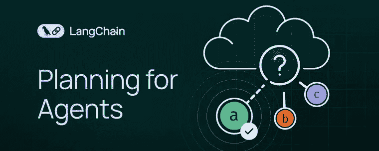
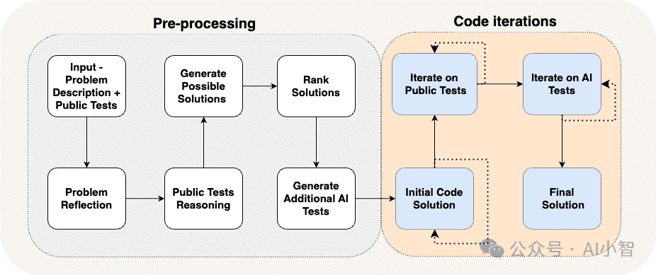
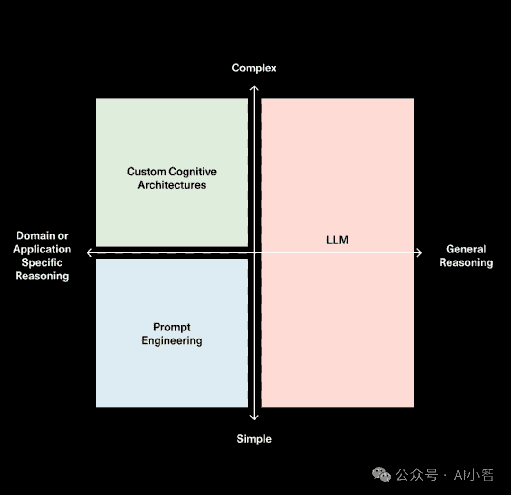

# 如何改进Agents的推理与规划?

> 来源：[https://agijuejin.feishu.cn/docx/NKYRdmuoJowc4vxwvylcRQz7nac](https://agijuejin.feishu.cn/docx/NKYRdmuoJowc4vxwvylcRQz7nac)

> 作者：AI小智

> 原文链接： [https://mp.weixin.](https://mp.weixin.qq.com/s/CIMAnWmH4ItgZxOanoe0UA)qq.com/s/CIMAnWmH...

> 如果你询问任何正在使用大型语言模型（LLM）构建智能代理的开发者，他们很可能会告诉你，智能代理在规划和推理方面的不足是影响其可靠性的一个主要问题。

+   智能代理的规划究竟是什么？

+   目前人们是如何克服这一缺陷的？

+   我们对智能代理未来规划和推理的发展趋势有何预测？

接下来的文章将一一解答这些问题。

**编辑注： **本文经翻译并二次整理自planning-for-agents一文。

###  **规划和推理的真正含义是什么？ **

智能代理的规划和推理，指的是它如何思考并决定采取哪些行动，这既包括短期行动也包括长期行动。LLM需要评估所有可用信息，然后决定需要采取哪些步骤，以及当前应该首先执行哪一步。

大多数情况下，开发者会使用函数调用技术来让LLM选择要执行的行动。这项技术最初由OpenAI在2023年6月引入，随后在2023年末至2024年初被其他公司采纳。通过函数调用，开发者可以为不同的函数提供JSON格式的模式，并让LLM生成符合这些模式的对象。

函数调用主要用于让智能代理选择立即要执行的行动。然而，要成功完成一个复杂的任务，通常需要按照顺序执行一系列行动。对于LLM来说，进行长期规划和推理是一项更具挑战性的任务，原因有二：首先，LLM需要考虑一个长期目标，然后迅速回到需要立即执行的短期行动；其次，随着智能代理执行的行动越来越多，这些行动的结果会反馈给LLM，导致上下文窗口扩大，可能会使LLM分心，影响其性能。

和LL**M世界中的大多**数事物一样，很难准确衡量当前模型在规划和推理方面的表现。有一些合理的基准测试，比如Berkeley Function Calling Leaderboard，用于评估函数调用的能力。我们也进行了一些研究，以评估多步骤应用的效果。但最好的方法是为 你的特定问题 构建一个评估集，并尝试自己进行评估。

> **❝**

> 💡根据经验，我们可以得出一个普遍的结论：规划和推理目前还没有达到现实世界任务所需的水平。

###  **如何改进智能代理的规划能力？ **

改进智能代理规划能力的一个简单方法是确保LLM拥有进行合理规划和推理所需的所有必要信息。虽然这听起来很基础，但实际上，传入LLM的提示往往没有包含足够的信息。增加一个检索步骤或澄清提示指令，可以轻松地实现改进。这就是为什么实际查看数据并了解LLM实际看到的内容至关重要。

接下来，我建议你尝试改变你的应用程序的认知架构。这里所说的“认知架构”，指的是你的应用程序用于推理的数据工程逻辑。你可以考虑两种类型的认知架构来提高推理能力：通用认知架构和特定领域认知架构。

###  通用认知架构与特定领域认知架构

通用认知架构试图以一种通用的方式实现更好的推理，可以应用于任何任务。例如，“计划和解决”架构，这篇论文提出了一种先制定计划，然后执行计划中每个步骤的架构。另一个例子是Reflexion架构，这篇论文探讨了在智能代理完成任务后增加一个明确的“反思”步骤，以评估任务是否完成得当。

尽管这些想法显示出了一定的改进，但它们通常对于生产环境中的智能代理来说过于通用。相反，我们看到智能代理通常采用特定领域的认识架构。这通常体现在特定领域的分类/路由步骤、特定领域的验证步骤等方面。一些关于规划和反思的通用思想可以在这里应用，但它们通常是以特定领域的方式应用的。

以AlphaCodium论文为例，它通过使用所谓的“流程工程”（谈论认知架构的另一种方式），实现了最先进的性能。下面是一个他们使用的流程图。

AlphaCodium流程图

这个流程非常特定于他们试图解决的问题。他们告诉智能代理按步骤做什么 - 想出测试，然后想出解决方案，然后迭代更多的测试等。这种认知架构高度特定于领域 - 它不会帮助您写文章，例如。

##  为什么特定领域认知架构如此有帮助？

我倾向于从两个角度来看待这个问题。

首先：你可以将这视为向智能代理传达它应该做什么的另一种方法。你可**以通过**提示指令或在代码中硬编码特定的转换来传达指令。任何一个都是有效的！代码是 极好 的传达你想要发生的事情的方式。

其次：这本质上是从我们作为工程师的角度，将规划责任从LLM中移除。我们基本上是在说：“不用担心规划，LLM，我会为你做的！”当然，我们并没有从LLM中移除所有的规划，因为我们仍然要求它在某些情况下进行一些规划。

例如，让我们回顾一下上面的AlphaCodium示例。流程中的步骤基本上是我们为LLM做的规划！我们告诉它首先编写测试，然后编写代码，然后运行测试等。这可能是作者认为编写软件的好计划。如果他们正在计划如何解决一个问题，这就是他们会怎么做的。而不是在提示中告诉LLM - 它可能会忽略它，不理解它，没有所有细节 - 他们通过构建特定领域的认识架构来告诉系统要做什么。

> **❝**

> 💡我们看到的几乎所有高级“智能代理”实际上都有一个非常特定领域和自定义的认知架构。

我们正在使用LangGraph使构建这些自定义认知架构变得更容易。LangGraph的一个主要关注点是可控性。我们设计LangGraph非常低级和高度可控 - 这是因为我们看到这种可控性是100%需要创建可靠的自定义认知架构。

###  规划和推理的未来会是什么样子？

LLM领域一直在迅速变化和发展，我们在构建应用程序时，尤其是构建工具时，应该牢记这一点。

我目前的立场是，通用推理将越来越多地被吸收到模型层中。模型将变得越来越智能，无论是通过规模还是研究突破 - 似乎很愚蠢去反对这一点。模型也会变得更快，更便宜，所以将大量上下文传递给它们将变得越来越可行。

然而，我相信无论模型变得多么强大，你总是需要以某种形式向智能代理传达它应该做什么。因此，我相信提示和自定义架构将一直存在。对于简单任务，提示可能就足够了。对于更复杂的任务，您可能希望将它应该如何行为的逻辑放在代码中。代码优先方法可能更快，更可靠，更易于调试，并且通常更容易/更符合逻辑地表达。

我最近在播客上与Sequoia的Sonya和Pat讨论了这个话题。他们画了一个很好的图表，展示了提示、认知架构和模型的角色/重要性可能如何随时间演变。

所以，尽管LLM的规划和推理肯定会变得更好，我们也坚信，如果您正在构建特定任务的智能代理，那么您将需要构建一个自定义认知架构。

今天的 内容就到这里，如果老铁觉得还行，可以来一波三连，感谢！

