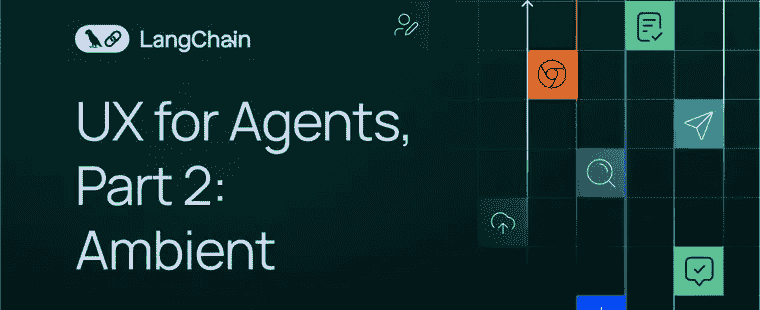
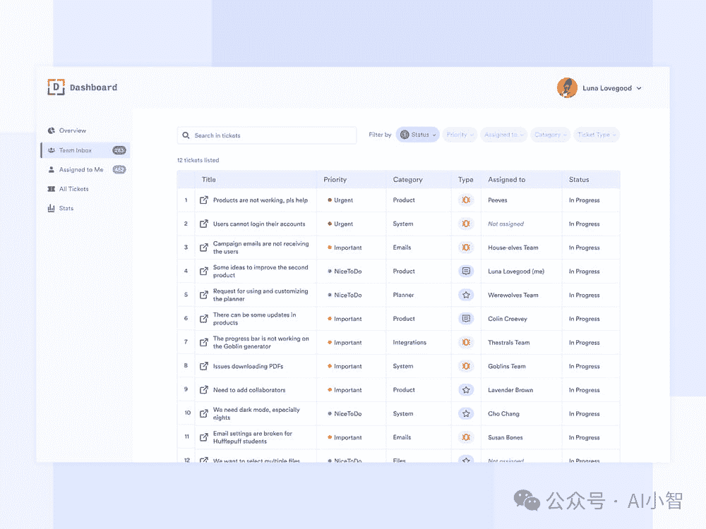

# 可信Agent构建之道：AI如何重塑工作流？

> 来源：[https://agijuejin.feishu.cn/docx/KpWhdbSN6omocgxx1u4cSVPDnrg](https://agijuejin.feishu.cn/docx/KpWhdbSN6omocgxx1u4cSVPDnrg)

> 作者：AI小智

> 原文链接： [https://mp.weixin.](https://mp.weixin.qq.com/s/WWNghL19j_dI5PQyOc2n_g)qq.com/s/WWNghL19...

用户体验代理，第二部分：环境型

> 这[**是我们关于代理用户体验的**](https://mp.weixin.qq.com/mp/appmsgalbum?__biz=Mzg2ODA5NTM1OA==&action=getalbum&album_id=3115055723522015235&token=162966106&lang=zh_CN#wechat_redirect)第二篇文章。我们讨论了能够同时处理多项任务的环境型背景代理，以及它们如何融入您的工作流程。 本系列合集，点击链接查看

在之前的博客文章中，我们探讨了基于聊天的代理用户体验，其中用户需要主动思考如何与AI进行交流。但如果AI能在后台默默为您工作，那会怎样呢？

我认为，为了让代理系统真正发挥潜力，我们需要转变观念，让AI在后台默默工作。当任务在后台处理时，用户通常更能接受较长的完成时间，因为他们对即时响应的期望降低了。这样，代理就能更自由地进行工作，往往比在聊天界面中更加细致和认真。

此外，让代理在后台运行，也使我们能够更有效地扩展我们的能力。聊天界面通常限制我们一次只能处理一个任务。但如果代理能在后台环境中运行，就可以有多个代理同时处理多个任务。

那么，这种后台代理的用户体验应该是什么样的呢？

**编辑注： **本文经翻译并二次整理自UX for Agents, Part 2: Ambient一文。

##  建立对后台代理的信任：从“人在循环中”到“人在循环上”

要让代理在后台运行，需要建立一定程度的信任。如何建立这种信任呢？

一个简单直接的方法是向用户 **展示 **代理正在做什么。展示它采取的所有步骤，并让用户能够观察整个过程。虽然这些信息可能不会立即显示（就像实时响应那样），但它应该可以让用户点击查看。

接下来，不仅要让用户 **看到 **发生了什么，还要让他们 **纠正 **代理。如果用户发现代理在10步中的第4步做出了错误的选择，他们应该能够回到第4步并进行某种方式的纠正。

这种纠正可以采取多种形式。让我们以一个具体的例子来说明，比如纠正一个错误调用工具的代理：

1.  你可以手动输入正确的工具调用命令，让它看起来像是代理自己输出的，然后从那里继续执行。

1.  你可以给代理明确的指示，告诉它如何更好地调用工具——比如，**“使用**参数X而不是参数Y”，然后让代理 更新 其预测。

1.  你可以更新代理在特定时间点的指示或状态，然后从那个步骤重新开始执行。

选项2和3的区别在于代理是否意识到了自己的错误。在选项2中，代理面对自己之前的错误生成，并被要求进行纠正；而在选项3中，它并不知道自己的预测错误（只是简单地遵循了更新后的指示）。

这种方法将人类的角色从“在循环中”转变为“在循环上”。“在循环上”意味着能够向用户展示代理采取的所有中间步骤，允许用户在工作流程中途暂停，提供反馈，然后让代理继续执行。

一个已经实现了类似这种用户体验的应用是Devin，AI软件工程师。Devin可以长时间运行，但你可以看到所有采取的步骤，回溯到特定时间点的开发状态，并从那里进行纠正。

##  整合人类输入：代理在需要时如何寻求帮助

尽管代理可能在后台运行，但这并不意味着它需要完全独立地完成任务。总会有一些时刻，代理不知道该怎么做或如何回答。这时，它需要引起人类的注意并请求帮助。

以**我正在**构建的电子邮件助理代理为例。尽管电子邮件助理可以处理基本的邮件，但它经常需要我在某些任务上的输入，这些任务我 不想 自动化。这些任务包括审查复杂的LangChain错误报告，决定我是否参加会议等。

在这种情况下，电子邮件助理需要一种方式来告诉我它需要信息来响应。注意，它不是要求我直接回应；相反，它寻求我对某些任务的意见，然后它可以利用这些信息来制作和发送一封漂亮的电子邮件或安排日历邀请。

目前，我将这个助手设置在Slack上。它向我提出问题，我在线程中回应它，这样自然地融入了我的工作流程。如果我考虑这种类型的用户体验，而不仅仅是针对我自己的电子邮件助手，我会设想一个类似于客户支持仪表板的界面。这个界面将显示所有需要人类帮助的区域，请求的优先级，以及任何额外的元数据。

我最初用“代理收件箱”这个词来描述这个电**子邮件**助手 - 但更准确地说，它是一个 人类 协助代理完成某些任务的收件箱……这是一个有点令人不寒而栗的想法。

##  **结论 **

我对环境型代理非常看好，因为我认为它们是让我们扩展自己能力的关键。

如果您正在使用环境型代理构建应用程序，请与我们联系。我们很乐意听听您的经验！

今天的内容就到这里，如果老铁觉得还行，可以来一波三连，感谢！

