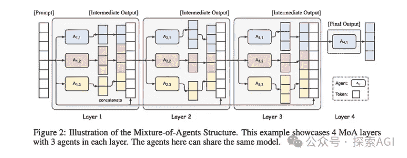
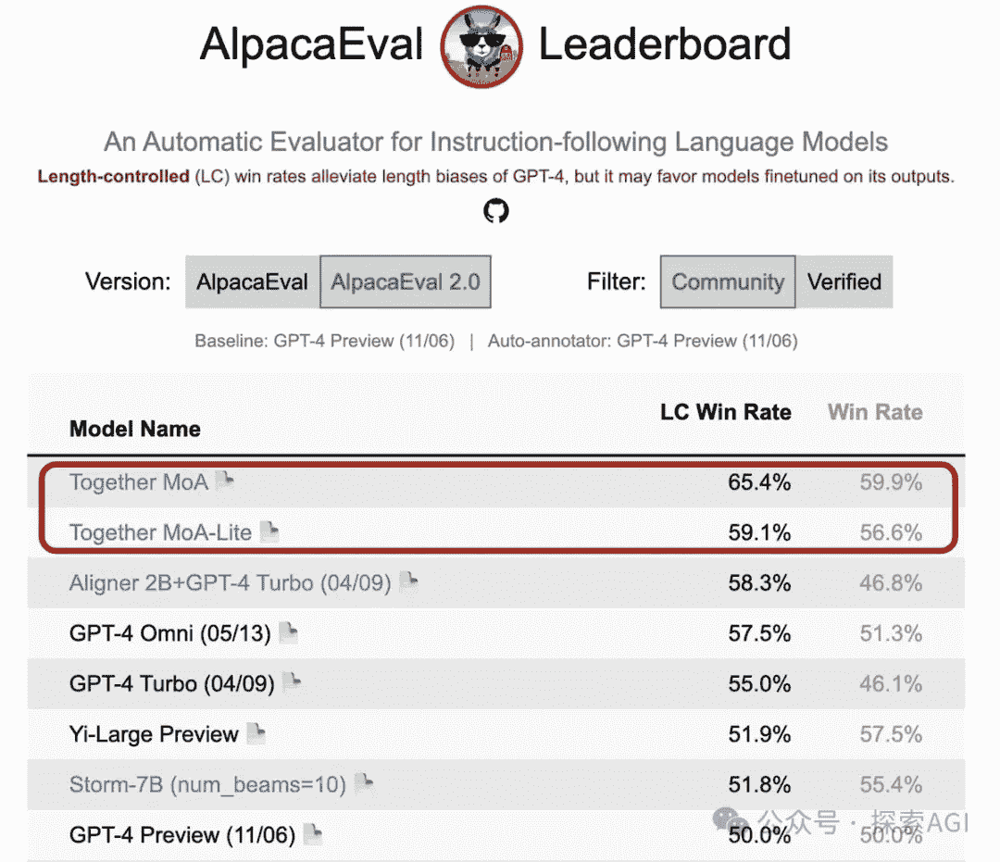

# Mixture-of-Agents系统，竟然如此简单！

> 来源：[https://agijuejin.feishu.cn/docx/DDGydt9xuoQ47hxhJsdcyiGgnvf](https://agijuejin.feishu.cn/docx/DDGydt9xuoQ47hxhJsdcyiGgnvf)

> 作者：猕猴桃 | 探索AGI

> 原文： [https://mp.weixin.](https://mp.weixin.qq.com/s/KNl20EdZAnvlix4zHvmw1w)qq.com/s/KNl20EdZ...

嘿，大家好！这里是一个专注于AI智能体的频道！

首先，让我们来聊聊LLM。这些模型通过在海量数据集上预训练，已经展现出了惊人的能力，无论是理解还是生成自然语言，它们都能做得很好。但问题来了，这些模型的规模和训练成本都很高，这让它们在实际应用中有点不切实际。

这时候，MoA登场了！MoA通过利用多个LLM的集体优势，提供了一个创新的解决方案。想象一下，如果每个智能体都能贡献自己的一份力量，那么最终的输出结果将会多么强大！

MoA的结构就像是一个分层的建筑，每一层都有多个LLM智能体。每个智能体都会处理上一层的输出，然后生成更精细的响应。这个过程会一直迭代，直到产生一个最终的、强大的输出。



这种结构的好处在于，LLM之间有一种天然的协作性。研究表明，当LLM能够参考其他模型的输出时，它们会产生更高质量的响应，哪怕这些辅助响应的质量低于模型独立输出的质量。

Together.ai就是MoA的一个典型例子。他们开发的Together MoA在AlpacaEval 2.0上的得分高达65.1%，超过了之前领先的GPT-4o的57.5%。这不仅仅是一个数字的胜利，更是MoA方法在实际应用中的成功证明。



MoA的优势不仅仅在于性能的提升，还在于成本效益和灵活性。通过使用多个开源模型并优化层数和智能体的数量，MoA能够在保持高性能的同时，成本也更加可控。

Together的MOA框架已经开源了~ ，下面是示例代码

```
import os
from together import Together
os.environ[&quot;TOGETHER_API_KEY&quot;] = &quot;your_api_key_here&quot;

client = Together(api_key=os.environ.get(&quot;TOGETHER_API_KEY&quot;))
import asyncio
from together import AsyncTogether

async_client = AsyncTogether(api_key=os.environ.get(&quot;TOGETHER_API_KEY&quot;))

user_prompt = &quot;What is Karma Yoga as per Bhagavad Gita, Vyadha Gita, Yoga Vasistham and Tripura Rahasya?&quot;
reference_models = [
    &quot;Qwen/Qwen2-72B-Instruct&quot;,
    &quot;Qwen/Qwen1.5-72B-Chat&quot;,
    &quot;mistralai/Mixtral-8x22B-Instruct-v0.1&quot;,
    &quot;databricks/dbrx-instruct&quot;,
]
aggregator_model = &quot;mistralai/Mixtral-8x22B-Instruct-v0.1&quot;
aggregator_system_prompt = &quot;&quot;&quot;You have been provided with a set of responses from various open-source models to the latest user query. Your task is to synthesize these responses into a single, high-quality response. It is crucial to critically evaluate the information provided in these responses, recognizing that some of it may be biased or incorrect. Your response should not simply replicate the given answers but should offer a refined, accurate, and comprehensive reply to the instruction. Ensure your response is well-structured, coherent, and adheres to the highest standards of accuracy and reliability.

Responses from models:&quot;&quot;&quot;


async def run_llm(model):
    &quot;&quot;&quot;Run a single LLM call with a reference model.&quot;&quot;&quot;
    response = await async_client.chat.completions.create(
        model=model,
        messages=[{&quot;role&quot;: &quot;user&quot;, &quot;content&quot;: user_prompt}],
        temperature=0.7,
        max_tokens=512,
    )
    print(f&quot;Response from {model}: {response.choices[0].message.content}\n&quot;)
    return response.choices[0].message.content


async def main():
    results = await asyncio.gather(*[run_llm(model) for model in reference_models])

    finalStream = client.chat.completions.create(
        model=aggregator_model,
        messages=[
            {&quot;role&quot;: &quot;system&quot;, &quot;content&quot;: aggregator_system_prompt},
            {&quot;role&quot;: &quot;user&quot;, &quot;content&quot;: &quot;,&quot;.join(str(element) for element in results)},
        ],
        stream=True,
    )

    for chunk in finalStream:
        print(chunk.choices[0].delta.content or &quot;&quot;, end=&quot;&quot;, flush=True)


# asyncio.run(main())
await main()
```

好了，这就是我今天想分享的内容。如果你对构建AI智能体感兴趣，别忘了点赞、关注噢~