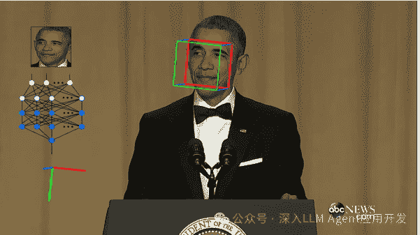
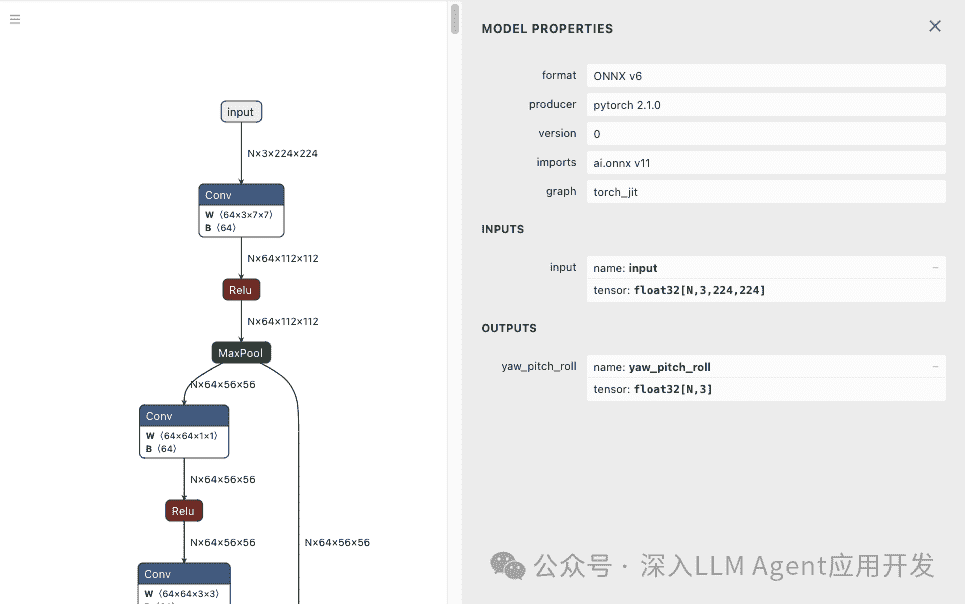
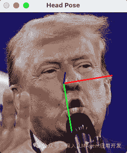
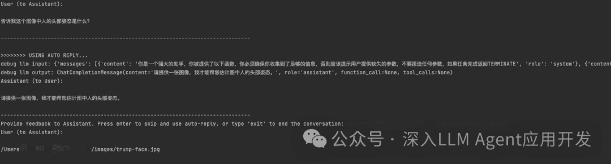
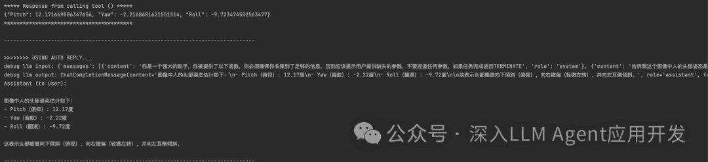

# 给LLM Agent应用插上视觉模型的翅膀：封装ONNX加载的头部姿态评估模型作为Agent的工具

> 来源：https://agijuejin.feishu.cn/docx/Hd4TdH3JPoOPplxeLHycebQknce

> 作者：还就可 | 深入LLM Agent应用开发

> 原文：https://mp.weixin.qq.com/s/jCZLZoj4J_CkMoUr6n7Y7w

现在，生活中处处都是AI的影子，手机中照片自动优化，自动抠图，照片自动根据人脸分组。抖音直播中送的眼镜，甚至是现在的文生图、`图生图`，都是AI模型。所以，我认为每个工程师都应该了解和使用模型，看到喜欢的模型，就动动手用起来，丰富自己的工具栈。 如果将视觉模型按照LLM工具调用方式嵌入到大语言模型应用中，给大语言模型插上视觉模型必定能让你的LLM应用更为有趣。

或许有人告诉你模型太复杂了，机器学习太复杂了，还要学习线性代数、矩阵运算、概率论等等。这简直令人头大，然而我们今天要说的是加载和使用模型。你只需熟悉`Python`或者`Java`或者`C#`再或者`JS`、`C++`等就能跑起来，没有那么多高深的知识，它已经大大简化了我们使用模型的门槛。

书接上文《LLM AutoGen 7: 什么你还在自己看论文？自动获取论文并撰写报告》，说到最近需要调研头部姿态评估模型。论文挑了几篇，使用`kimi`阅读总结做了大致的了解，在Github上找到对应的Repo开始测试。本文以 `6DRepNet` [1] 为例，通过介绍`ONNX`使用，并将其作为`AutoGen`的工具进行调用，大模型能够自动解释返回的结果，本篇作为抛砖引玉，希望读者们能够开发出非常有意思的结合视觉和语言的模型。举个例子，比如我们跟`LLM`说帮我把这张照片中的人脸戴个墨镜，就像抖音直播中送的眼镜一样，如何做呢？我们可以将检测人脸关键点的模型、和贴图功能作为两个工具函数，再结合`ReACT`进行规划，他可能会规划出先调用检测人脸关键点模型，然后再规划调用贴图工图工具，并将人脸的关键点位置作为参数传递过去，最后输出一张已经贴上墨镜的图像。

或许你会说已经有了视觉大模型了，为什么还要调用这些模型？其实不然，视觉大模型还是比较通用的模型，我们还是需要一些特定的专用模型或者是公司内部训练的专用来处理一些特定问题，就比如上述问题。

在深入探讨`ONNX`如何赋能`LLM Agent`以视觉理解能力之前，如果您渴望更全面地理解这一领域的核心理论与实践，以下这部著作将是您不可或缺的伴侣：

话不多说，我们先看看看论文全称：`6D Rotation Representation for Unconstrained Head Pose Estimation`，介绍如下：



> 这篇论文由 Thorsten Hempel、Ahmed A. Abdelrahman 和 Ayoub Al-Hamadi 撰写，来自德国马格德堡的奥托·冯·格里克大学电气工程与信息技术学院。论文提出了一种用于无约束头部姿态估计的新方法。作者针对旋转标签的歧义问题，引入了旋转矩阵的形式主义，并提出了一种连续的6D旋转矩阵表示，以便进行高效且稳健的直接回归。这种方法可以学习到完整的旋转外观，超越了之前方法的能力，这些方法通常将姿态预测限制在狭窄的角度范围内以获得满意的结果。此外，作者还提出了一种基于测地线距离的损失函数，以SO(3)流形几何学为依据对网络进行惩罚。在公共AFLW2000和BIWI数据集上的实验表明，所提出的方法显著优于其他最先进的方法，提高了高达20%的性能。关键点包括：

+ 提出了一种无标记的头部姿态估计方法，使用旋转矩阵表示进行准确的姿态回归。
+ 通过压缩的6D形式高效回归，然后将其转换为旋转矩阵。
+ 引入了基于测地线距离的损失函数，以更好地反映SO(3)流形的几何特性。
+ 在AFLW2000和BIWI数据集上的性能显著优于其他方法。
+ 开源了代码和模型，以促进研究实验和实际应用开发。论文还详细介绍了所提出方法的实现细节，包括使用`Pytorch`框架、`RepVGG`作为主干网络、训练策略、数据集以及与其他最先进方法的比较。

`6DRepNet` [2] 中给出的预训练模型是以`pth`结尾的`Pytorch`导出模型，`Pytorch`虽然也简单，但我们不打算使用，因为`Pytorch`更偏向于为算法工程师提供训练模型流程。今天我们要介绍的是`ONNX`，全称`Open Neural Network Exchange`，开放神经网络交换，是一种用于表示机器学习模型的开放格式，定义了一组通用的运算符——即机器学习和深度学习模型的构建模块，并提供了一种通用的文件格式，使得 AI 开发者能够在各种框架、工具、运行时和编译器中使用模型。简单的说，它使得模型便于在不同机器学习框架中转换、加载使用，关键是支持在云端、移动设备和嵌入式设备中部署。

从上述描述来看，似乎我们需要学习`Pytoch`然后将其转换为`ONNX`模型。大可不必，网络上很多模型都提供了`ONNX`模型，我们简单的搜索就能找到。你可以从`Github`上的 `PINTO_model_zoo` [3] 这个共享链接 `6DRepNet360` [4] 中下载到所需的`ONNX`模型。`ONNX`本身也提供了一个`ONNX Zoo`：https://github.com/onnx/models/tree/main/validated，有兴趣的可以围观。

那么`ONNX`模型怎么使用呢？

## 1. ONNX

作为工程师，你把`ONNX`当做一个黑盒子，只需要知道输入和输出是什么？模型本身是自解释的，当你有了`ONNX`模型，你只需要使用 https://netron.app/ 即可查看模型的输入输出，仍然以`6drepnet360`为例。打开`netron`之后，点击`Open Model`并选中你本地的模型，他会自动解析出类似下图的模型属性和输入输出。



`image-20240621120141972`

以上是采用`netron`在线app查看`onnx`模型的输入输出和属性，我们也可以使用程序进行打印查看。这要说的就是`onnx`包。

首先我们安装`onnx`包。

```
pip install onnx
```

然后加载模型并输出它的`input`和`output`要求。

```
import onnx
model = onnx.load("models/sixdrepnet360_Nx3x224x224.onnx")
print(model.graph.input)
print(model.graph.output)
```

输入参数要求如下，`N`表示输入的`batch`数量，后面`3`表示`RGB`3个通道，`224`和`224`表示高和宽：

```
[name: "input"
type {
  tensor_type {
    elem_type: 1
    shape {
      dim {
        dim_param: "N"
      }
      dim {
        dim_value: 3
      }
      dim {
        dim_value: 224
      }
      dim {
        dim_value: 224
      }
    }
  }
}
]
```

输出参数如下，输入`batch`的数量`N`和输出3个`yaw` `pitch` `roll`。

```
[name: "yaw_pitch_roll"
type {
  tensor_type {
    elem_type: 1
    shape {
      dim {
        dim_param: "N"
      }
      dim {
        dim_param: "3"
      }
    }
  }
}
]
```

`onnx`经常用于导出模型。但对于推理，我们更常用的其实`onnx`的运行时：`onnxruntime`。它不仅提供`Python`的包，还有`C#`、`JS`、`Java`、`C++`、`OC`和`Ruby`等，让我们一起学习一下`Python`的`onnxruntime`。

首先，安装`onnxruntime`包。

```
pip install onnxruntime
```

接下来，我们使用`InferenceSession`开始加载模型。

```
import onnxruntime as ort
session = ort.InferenceSession("models/sixdrepnet360_Nx3x224x224.onnx", provider=['CoreMLExecutionProvider'])
```

使用`session`的方法 `get_inputs` 和 `get_outputs` 查看模型的输入输出等信息。

```
> len(session.get_inputs())
1
> session.get_inputs()[0].name
'input'
> session.get_inputs()[0].type
'tensor(float)'
> session.get_inputs()[0].shape
['N', 3, 224, 224]
> session.get_outputs()[0].name
'yaw_pitch_roll'
> session.get_outputs()[0].shape
['N', '3']
> session.get_outputs()[0].type
'tensor(float)'
```

既然输入输出已定，那么如何运行呢？使用`session`的 `run` 方法执行推理即可。

```
def run(self, output_names, input_feed, run_options=None):
  pass
```

+ `output_names` - 输出的名称列表，可不写，他会自动提取
+ `input_feed` - 输入字典，形如 { `input_name`: `input_value` }

因此，我们可以使用`numpy`按照输入要求随机构造一个输入数据。

```
import numpy as np
input_data = np.random.randn(1, 3, 224, 224).astype(np.float32)
input_name = session.get_inputs()[0].name
outputs = session.run(None, {input_name: input_data})
print(outputs)
# [array([[-17.788296, 171.02617 , 171.44977 ]], dtype=float32)]
```

用一个随机数据输入输出看起来没啥意思，我们使用`opencv`读取图片来试试，就以小可爱川普为例。


`trump-face`

按照`6DRepNet`中头部姿态估算的要求， 输入图像需要先检测人脸 ，然后将人脸扣出，之后做一些图像预处理即可输入模型进行推理。上图是已经通过`SCRFD`人脸检测模型抓取的人脸。

使用`OpenCV`读取图像，并做一些预处理将输入图像调整为`CHW`（`Channel`、`Height`、`Width`）并处理为输入带有批处理维度`[1, 3, 224, 224]`。

```
# 读取图像
image_path = 'images/trump-face.jpg'
image = cv2.imread(image_path)

resized_image = cv2.resize(image, (224, 224))
# 进行标准化
resized_image = resized_image.astype(np.float32) / 255.0
mean = np.array([0.485, 0.456, 0.406])
std = np.array([0.229, 0.224, 0.225])
resized_image = (resized_image - mean) / std

# 调整形状到 (1, 3, 224, 224)
resized_image = np.transpose(resized_image, (2, 0, 1))
resized_image = np.expand_dims(resized_image, axis=0)
resized_image = resized_image.astype(np.float32)

outputs = session.run(None, {input_name: resized_image})
print(outputs)
# [array([[-2.2168682, 12.171669 , -9.7234745]], dtype=float32)]
```

> 实际使用中，在`resize`时候可能还需要考虑保持宽高比并在边缘填充`padding`以保持模型所需输入维度



`WX20240625-105305`

你可能会说什么`pitch`、`yaw`、`roll`啊，代表什么意思？此时你可能会自己搜索，但如果我们把这个作为工具提供给大模型，它会自动帮你解释各个字段结果的意思。

## 2. 作为LLM工具使用

想必在`AutoGen`中使用`Python typing`定义工具，应该已经比较熟悉了，注解参数和返回值。

```
def estimate_head_pose(image_path: Annotated[str, "the image path to be estimate head pose"]) -> Annotated[
    HeadPose, "A dictionary representing a head pose with pitch yaw roll."]:
    """Estimate the head pose of a given image"""
    input_name = session.get_inputs()[0].name
    # 读取图像
    image = cv2.imread(image_path)
    resized_image = cv2.resize(image, (224, 224))

    # normalized
    resized_image = resized_image.astype(np.float32) / 255.0
    mean = np.array([0.485, 0.456, 0.406])
    std = np.array([0.229, 0.224, 0.225])
    resized_image = (resized_image - mean) / std

    # 调整形状到 (1, 3, 224, 224)
    resized_image = np.transpose(resized_image, (2, 0, 1))  # 形状变为 (3, 224, 224)
    resized_image = np.expand_dims(resized_image, axis=0)  # 形状变为 (1, 3, 224, 224)
    resized_image = resized_image.astype(np.float32)

    outputs = session.run(None, {input_name: resized_image})
    output = outputs[0][0].tolist()
    return HeadPose(Pitch=output[1], Yaw=output[0], Roll=output[2])
```

其中`HeadPose`是

```
class HeadPose(TypedDict):
    Pitch: Annotated[float, "the pitch of head"]
    Yaw: Annotated[float, "the yaw of head"]
    Roll: Annotated[float, "the roll of head"]
```

然后通过 `autogen` 的 `register_function` 将函数注册到`Agent`。

```
autogen.register_function(estimate_head_pose, caller=assistant, executor=user_proxy,description="Estimate the head pose of a given image")
```

那么我们之后通过 `initiate_chat` 只需要说请告诉我这张图的头部姿态是啥？他会尝试自动提取图片地址，如果缺失地址他也会自动询问要求提供图片。


```
chat_result = user_proxy.initiate_chat(assistant, message=&quot;告诉我这个图像中人的头部姿态是什么？&quot;)
```



image-20240625105924034



image-20240625110012542

注意提示词，一定要告诉它不要尝试捏造任何参数。你可以看到它自动帮你解释这些参数并且同意自然语言描述这个头部姿态，是不是方便多了？

> 你是一个强大的助手，你被提供了以下函数，你必须确保你收集到了足够的信息，否则应该提示用户提供缺失的参数，不要捏造任何参数，如果任务完成返回`TERMINATE`

## 3. 总结

本文通过介绍ONNX和如何使用`onnxruntime`加载模型和推理，通过加载头部姿态模型6DRepNet、预处理图像和推理演示了使用`onnxruntime`的全过程。从我为数不多的测试来看，我个人觉得在图像模糊的时候，对于头部的姿态估算准确度不是很好。本文是一个简单的介绍，主要针对非算法工程师如何也能玩转模型，同时也能方便读者在有需要的时候，可以使用LLM的工具调用能力调用丰富的视觉类小模型。

至此，我们已共同见证了ONNX如何为LLM Agent巧妙融入头部姿态评估模型，开启了多模态交互的新篇章。在我们探索之旅的尾声，若您意犹未尽，渴望亲自操刀，将理论付诸实践，那么黄佳老师这本《大模型应用开发：动手做AI Agent》将是您理想的选择。

关注点赞不迷路哦！

## 参考资料

[1] 6DRepNet: `https://github.com/thohemp/6DRepNet`

[2] 6DRepNet: `https://github.com/thohemp/6DRepNet`

[3] PINTO_model_zoo: `https://github.com/PINTO0309/PINTO_model_zoo/tree/main/423_6DRepNet360`

[4] 6DRepNet360: `https://s3.ap-northeast-2.wasabisys.com/pinto-model-zoo/423_6DRepNet360/resources.tar.gz`
