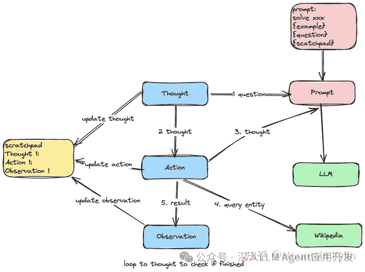
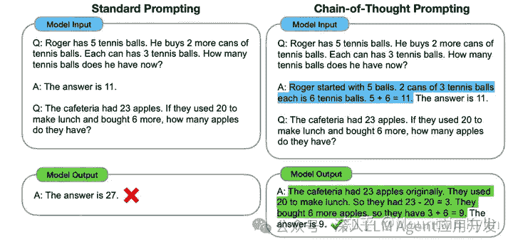
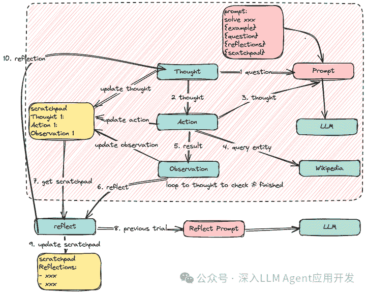
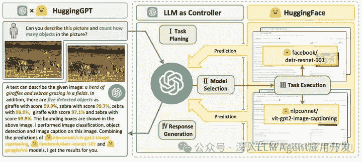

# 敲黑板！吴恩达LLM Agent工作流Prompt精华全解析

> 来源：[https://agijuejin.feishu.cn/docx/Cy3JdCy3xo6uArxYvpCc7WVTngd](https://agijuejin.feishu.cn/docx/Cy3JdCy3xo6uArxYvpCc7WVTngd)

> 作者：还就可 | 深入LLM Agent应用开发

> 原文： [https://mp.weixin.](https://mp.weixin.qq.com/s/_CabX-EbmRdJtiZaEmwU5w)qq.com/s/_CabX-Eb...

在 详解和实测吴恩达4种Agentic 工作流 之中，我测试了各种框架诸如反思、工具调用、规划、多智能体，在学习了其中各种Prompt设计后，有了一些新的认识。

> **对于特定的任务来说，没有万能的Prompt，只有一些通用的模式，要完成这个任务还需要这个任务特定的Ex**ample。另外，你一定要PUA它，强烈的鼓励它，使用类似MUST、奖励等字眼来PUA它，这样能让大模型更好的跟随指令。

对你没看错，如果你想要更好的达成你的目的，你一定要给它Example，我在测试各个框架过程中，没有一个不包含Example。虽说网上也有介绍Zero Shot的Prompt，比如 Let's think step by step ，但遇到稍微复杂点的任务，它就不一定能解决了，它只是分步思考，并不是步步为营。

一个精心设计完成特定任务的Prompt大体需要包含这几部分：

1.  **解决任务的方法**

1.  **任务的输入和输出**

1.  任务的Example，3到5个左右。

1.  **任务的历史纪录，如果有的话**

1.  **用户输入的问题。**

话不多说，我们来看看4种LLM Agentic工作流Prompt设计，相信大家一定能有所收获。

###  1. 规划Prompt设计案例

+   ReAct

ReAct 提供了一种更易于人类理解、诊断和控制的决策和推理过程。它的典型流程如下图所示，可以用一个有趣的循环来描述：思考（Thought）→ 行动（Action）→ 观察（Observation），简称TAO循环。

> 思考（Thought） 首先，面对一个问题，我们需要进行深入的思考。这个思考过程是关于如何定义问题、确定解决问题所需的关键信息和推理步骤。行动（Action） 确定了思考的方向后，接下来就是行动的时刻。根据我们的思考，采取相应的措施或执行特定的任务，以期望推动问题向解决的方向发展。观察（Observation） 行动之后，我们必须仔细观察结果。这一步是检验我们的行动是否有效，是否接近了问题的答案。

循环迭代以上流程，如下图所示。



img

Prompt设计如下所示，包含说明解决问题的方法、输入和输出、样例和用户问题。

```
用交替进行的&quot;思考、行动、观察&quot;三个步骤来解决问答任务。思考可以对当前情况进行推理，而行动必须是以下三种类型：
(1) Search[entity]，在维基百科上搜索确切的实体，并返回第一个段落（如果存在）。如果不存在，将返回一些相似的实体以供搜索。
(2) Lookup[keyword]，在上一次成功通过Search找到的段落中返回包含关键字的下一句。
(3) Finish[answer]，返回答案并结束任务。
你可以采取必要的步骤。确保你的回应必须严格遵循上述格式，尤其是行动必须是以上三种类型之一。
以下是一些参考示例：
问题: 科罗拉多造山运动东部地区的海拔范围是多少？
思考1: 我需要搜索科罗拉多造山运动，找到科罗拉多造山运动东部地区的范围，然后找到该地区的海拔范围。
行动1: 搜索[科罗拉多造山运动]
观察1: 科罗拉多造山运动是科罗拉多州及周边地区的一次造山运动（造山运动）。
思考2: 它没有提到东部地区。所以我需要查找东部地区的信息。...
（例子结束）
Question：{question}
{scratchpad}
```

+   CoT



img

想让模型按照思维链这样的方式思考，你一定要给他Ex[ample，并且针对特定](http://mp.weixin.qq.com/s?__biz=MzI0OTAzNTEwMw==&mid=2247483725&idx=1&sn=eee4882da7dec099edc32067c8c7c31a&chksm=e996e17ddee1686b5a07cbf242f07874945d9aee03b22969680c97070a381c5cb00ed6c56cec&scene=21#wechat_redirect)的任务。我们看 reflexion框架 中如何设计的CoT式Prompt：

```
COT_AGENT_REFLECT_INSTRUCTION = &quot;&quot;&quot;通过思考来解决问答任务，然后用你的答案完成任务。
思考可以推理当前情况。Finish[answer] 返回答案并完成任务。你将获得一些背景信息，你应该利用这些信息来帮助你回答问题。
以下是一些示例：:
{examples}
(END OF EXAMPLES)

相关背景: {context}
问题: {question}{scratchpad}&quot;&quot;&quot;
```

Example

```
COT = &quot;&quot;&quot;相关背景: 尼罗河是世界上最长的河流，长度约为6,650公里（4,132英里）。它流经东北非的十一国，包括埃及、苏丹和乌干达。
问题: 世界上最长的河流是什么？
思考: 这个问题询问世界上最长的河流，根据提供的背景信息，我知道是尼罗河。
行动: 完成[尼罗河]
...
&quot;&quot;&quot;
```

[关于规划推理的更多内容，](http://mp.weixin.qq.com/s?__biz=MzI0OTAzNTEwMw==&mid=2247483725&idx=1&sn=eee4882da7dec099edc32067c8c7c31a&chksm=e996e17ddee1686b5a07cbf242f07874945d9aee03b22969680c97070a381c5cb00ed6c56cec&scene=21#wechat_redirect)尤其是《 Reflexion框架 》它是如何设计Prompt，如何设计流程，请参考本人👸号获取更多的详细信息。

###  2. 反思Prompt设计案例

反思或者说精炼，是一种在现有问答基础上更进一步地指导模型进行自我优化和排除错误答案的过程。Reflexion框架中[设](http://mp.weixin.qq.com/s?__biz=MzI0OTAzNTEwMw==&mid=2247483757&idx=1&sn=c60b2fc88240e0ee675b3cbde9f0a331&chksm=e996e15ddee1684beb1f6e7afd87750532af3168e1b869044750b360e109e35b5c227fbc8b73&scene=21#wechat_redirect)计的Prompt如下，让他能够根据历史记录逐步排除选项，更多的关于Reflexion框架设计，请参考本人👸号文章《 万字长文深度解析Agent反思工作流框架Reflexion下篇：ReflectionAgent workflow 》。

+   Prompt

```
你是一个能够通过自我反思来改进的高级推理代理。你将获得之前的推理测试流程，在之前的测试中你尝试访问Docstore API并回答了问题。由于你猜错了答案（使用了Finish[&lt;answer&gt;]），或者用完了设定的推理步骤数，你未能成功回答问题。诊断失败的可能原因，并制定一个新的、简明的高级计划，旨在减轻同样的失败。要求必须使用完整的语句来回复。
这里有一些例子：
{examples}
之前的尝试：
问题：{question}{scratchpad}
反思：
```

+   Example

```
之前的尝试:
问题: 《罗马议定书》由三位总理签署，其中一位被暗杀是作为什么的一部分？
思考1: 我需要搜索《罗马议定书》，找到这三位总理
...
行动3: 完成[第二次世界大战]

反思: 我搜索了参与签署的一位总理，然后试图立即回答。我应该搜索每位总理，然后查看每位总理的“死亡”信息，以获取更多信息后再回答。
```



img

###  3. 工具调用Prompt设计案例

如果[你有大量的工具函数可能会被](http://mp.weixin.qq.com/s?__biz=MzI0OTAzNTEwMw==&mid=2247483825&idx=1&sn=c442fc3ba3767fe8b79331b5becfac9f&chksm=e996e181dee168971e4a3b8ebeafab012047308812023b42b9b1b13876940aed3cbbd109aac2&scene=21#wechat_redirect)调用，但你显然无法将所有Tools发给LLM，这可能会超过大模型的Token限制。你要怎么处理呢？一个简单的方法是采用分组，尽量将类似的函数组合到一起，然后再选择。我之前在《 HuggingGPT解析 》文章中有讨论，HuggingGPT使用HuggingFace的模型进行推理任务，要知道在当时HuggingFace上有大约673个模型，其接口和任务描述大约 2765000个字符，我们是不可能给它一次上传到LLM的。 好在，HuggingFace的模型是分类，分为19个类别，其中15个NLP任务类型，2个Audio任务类型，3个CV的任务类型。如下所示关于任务描述，他也包含了那句神奇的Think step by step，更多的关于HuggingGPT的Prompt设计和流程设计，请参考我的👸号文章《 万字长文深度解析规划框架：HuggingGPT 》。

> 任务必须从以下选项中选择："token-classification"、"text2text-generation"、"summarization"、"translation"、"question-answering"、"conversational"、"text-generation"、"sentence-similarity"、"tabular-classification"、"object-detection"、"image-classification"、"image-to-image"、"image-to-text"、"text-to-image"、"text-to-video"、"visual-question-answering"、"document-question-answering"、"image-segmentation"、"depth-estimation"、"text-to-speech"、"automatic-speech-recognition"、"audio-to-audio"、"audio-classification"、"canny-control"、"hed-control"、"mlsd-control"、"normal-control"、"openpose-control"、"canny-text-to-image"、"depth-text-to-image"、"hed-text-to-image"、"mlsd-text-to-image"、"normal-text-to-image"、"openpose-text-to-image"、"seg-text-to-image"。可能存在多个相同类型的任务。逐步思考解决用户请求所需的所有任务。解析出尽可能少的任务，同时确保能够解决用户请求。注意任务之间的依赖关系和顺序。如果无法解析用户输入，你需要回复空 JSON []，否则必须直接返回 JSON。



img

**另外，在使用工具调用时候，由于大模型有时候会捏造参数，你一定要在Prompt中提**示它不要捏造任何参数，如果未提供，请求用户提供，这需要针对不同模型多次尝试优化。

###  4. 多智能体Prompt设计

多智能体为何有效，大概源于人类的分工合作思想，Prompt如果设定过多的不同任务，很可能会导致大模型无法准确跟随指令，因此给不同的智能体设计专用的Prompt就能让它们工作的更高效，具体案例可以参考我使用AutoGen多智能体框架设计的对话登机服务：《 LLM多智能体AutoGen教程2 顺序对话：登机服务 》。

> 合作使我们能够知道比我们自己所能知道的更多。它赋予我们不同的思维方式，让我们接触到原本无法获得的信息，并在我们共同努力实现共同目标的过程中将想法结合起来。

### ** 5. 总结 **

以上就是我在研究这4种LLM Agentic工作流中对于Prompt提示所得与思考。 在我们探索之旅的尾声，若您意犹未尽，渴望亲自操刀，将理论付诸实践，那么黄佳老师这本《大模型应用开发：动手做AI Agent》将是您理想的选择。

如果您渴望更全面地理解这一领域的核心理论与实践，以下这部图解GPT著作将是您不可或缺的伴侣。