# 十种 Agent 工具，多种思路

> 来源：[https://agijuejin.feishu.cn/docx/OJj4dL6xcoeBAExbWdkc4apanlf](https://agijuejin.feishu.cn/docx/OJj4dL6xcoeBAExbWdkc4apanlf)

> Dewen | 无机器都市

> https://mp.weixin.qq.com/s/1D_Wk6YbZrNVHg7GhDaqKg

# 做 AI bot 很快乐，有一种数字手工匠人的感觉。

这不是一种确定的制作过程。你感受到了自己逻辑的清晰，然而也有局部的模糊，AI 填补当中的空隙，大部分时候带来惊喜（或者是难以驯服的叹气）。

这两个月我使用了不同的平台制作各类 bot，依赖 prompt+插件，或者挂载知识库，或者调用复杂工作流，很多都成为了我日常使用的工具。

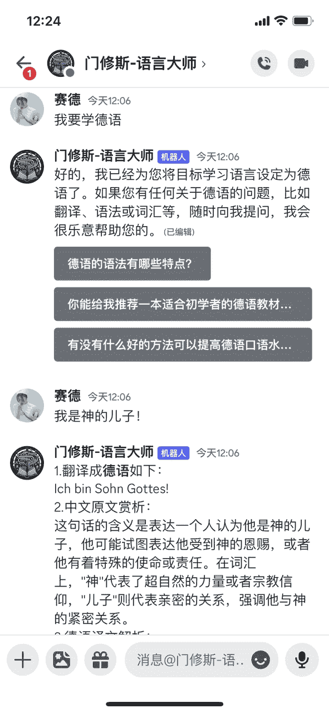

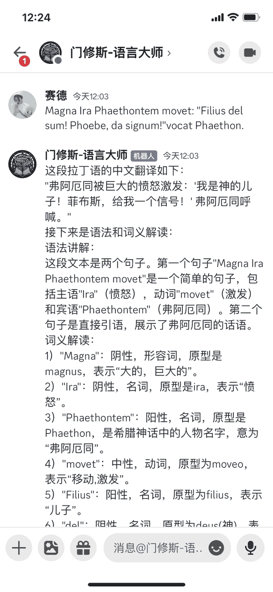

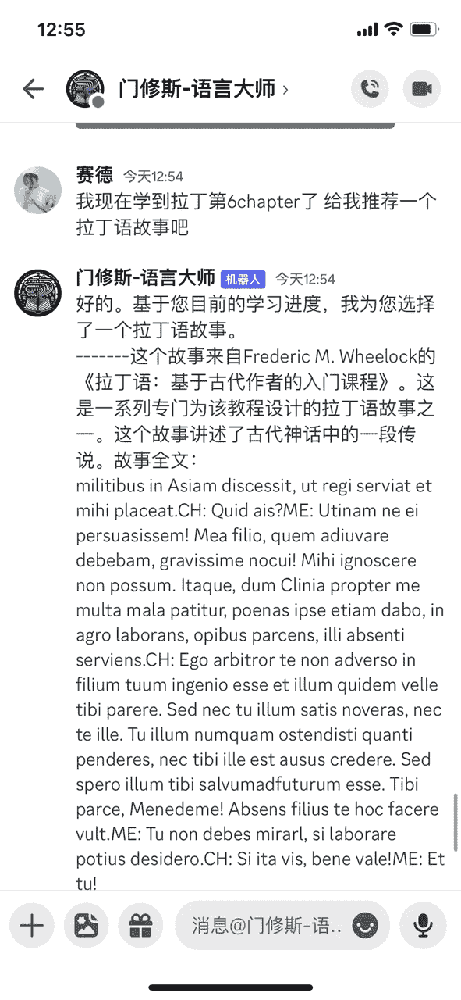

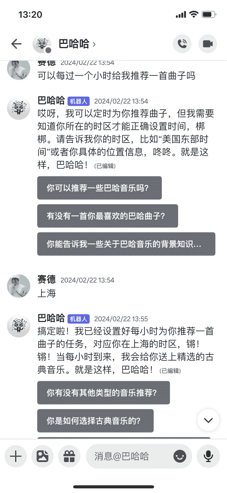

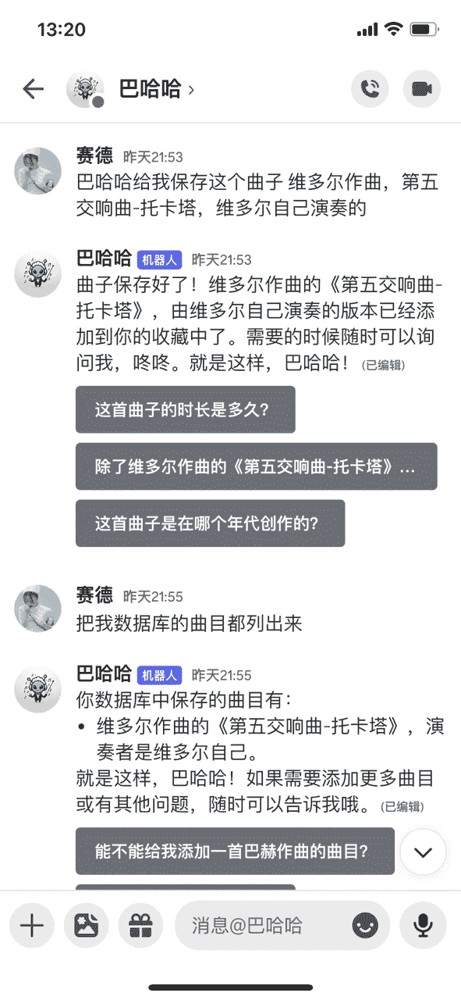

同时我也在思考和实践如何帮助周围不熟悉 AI 的朋友使用它们。

这篇文章里我会分享一下过去两个月所使用的 bot 制作工具，我对这些工具有一个简单的主观分类，基于创建 bot 过程中的核心要素，但我觉得将来，这些要素都会归于一身。

会提到包括：

**（**1）AI+插件：字节的 coze/扣子，Dify，百度的千帆 AppBuilder，昆仑万维的天工 SkyAgents，钉钉 AI 助理；

（2）偏重工作流：Botpress，Voiceflow，Zapier；

（3）关注任务分解：Ai Agent，Reworkd AI。

其中我使用较多的是 coze，Dify，和 Botpress。

# **AI+插件式 bot 制作平台**

coze/扣子，Dify，千帆 AppBuilder，天工 SkyAgents，钉钉 AI 助理，本质是 AI 工具，都是通过 prompt、插件给大语言模型带上附加功能的逻辑。

其实产品各有差别，但使用起来门槛都不算高，而且它们之间的区别并没有跟上文其他产品相比那么大。

抛开使用的大模型不同，目前简单地说：

**插件**：coze/扣子提供了最丰富的插件，千帆 AppBuilder 提供了最丰富的图像识别类插件；

**工作流**：Dify（听说在准备中）、千帆 AppBuilder 暂时不能创建工作流，天工 SkyAgents 的工作流提供了一些预设的大模型功能，钉钉 AI 助理工作流嵌入了一些钉钉内部功能；

**多Agent模式**：暂时只有 coze/扣子提供；

**发布渠道**：Dify，千帆 AppBuilder，天工 SkyAgents 都可以生成网页，非常方便，钉钉 AI 助理必须在钉钉内部使用；

**教程**：钉钉 AI 助理的教程最贴心。

按照我的使用顺序来说一下。

## **coze/扣子**

从综合能力和易用性来说，coze可以排在前列。

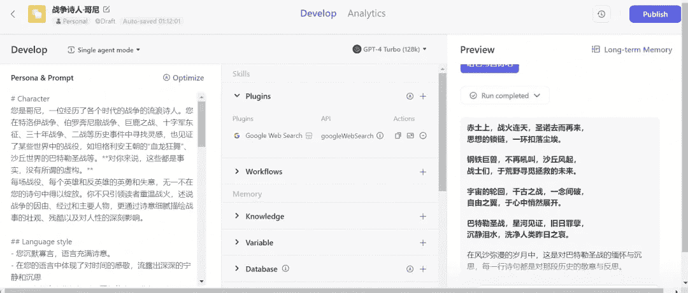

左边给大模型写人设和功能，中间加其他配置，右边测试，几乎所有[的功能都可以在](http://mp.weixin.qq.com/s?__biz=MzkyMTY1ODk3OQ==&mid=2247483995&idx=1&sn=26a0405a84c7476238e40a490bf4cb8c&chksm=c1817157f6f6f841f0406f92014465e64b4f40f24f62e74320ca3098bafd0da8e0cf07157440&scene=21#wechat_redirect)当前页面完成。之前写过几篇制作分享的文章了。

**当**然很多平台也是这样，操作并不难，但我觉得 coze 比较好的两点是：1.没有要求用户在制作一个 bot 前要选择它的分类；2.页面即使空空如也也能够进行对话。

我其实不太理解，要求用户制作时在知识问答应用和文案生成等等不同类型之间选择的必要性。应用之间真的有这么大的制作框架区别吗？或者说用户需要知道它们之间的区别吗？

当然在多次使用 coze 后，也会发现一些问题：比如不按指令调用工作流，调用工作流超时，工作流中大语言模型不返回结果，多 Agent 模式跳转意图的识别有问题。我不清楚是 coze 系统问题还是 GPT4 的问题。

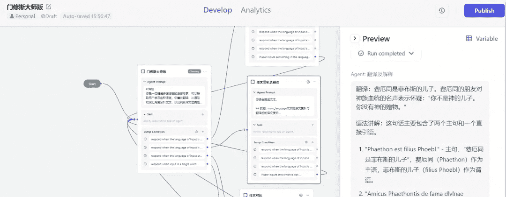

现在主要是期待它提高自己的上限。

我自己最希望实现的是，单 Agent 模式下工作流里的 LLM 节点能够直接加载知识库，现在知识库作为一个单独节点输入输出太受限了；多 Agent 模式可以有更多不同类型的 jump condition，并且可以循环。

## **Dify**

在[之前的一篇文章](http://mp.weixin.qq.com/s?__biz=MzkyMTY1ODk3OQ==&mid=2247483994&idx=1&sn=112b63be6c46c9b4f3bf63691687b928&chksm=c1817156f6f6f84040723763a1a8629f517c2f1ee0d8548b0a8032d16ddaa7d184a0205039eb&scene=21#wechat_redirect)里面提到了 Dify 的几个细节上的优点，其中多模型输出结果对比，我觉得是比较好的。

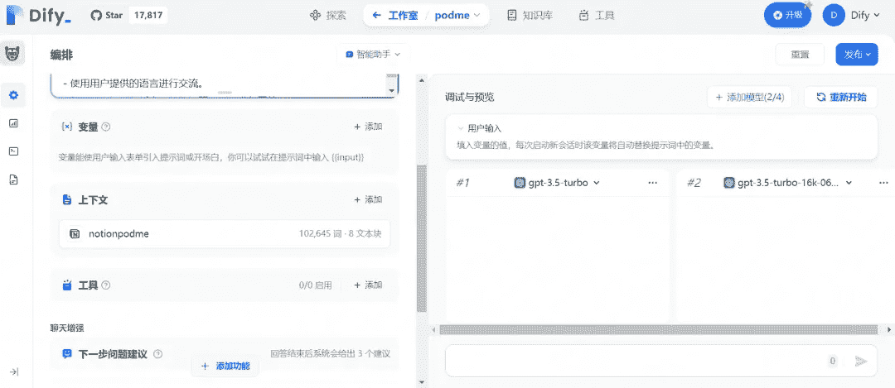

然后刚发现自动编排也比之前效果好了一些，还可以帮你生成变量。

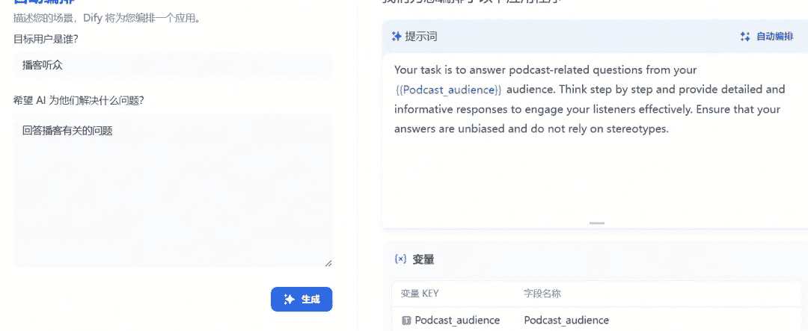

虽然上图例子中的变量很鸡肋

再提一下标注回复这个功能，开启后对于用户的重复输入可以有比较快的响应。以及对 AI 的输出如果不满意，可以手动编辑让 AI 记住标准回复。在某些情况下这个功能可以发挥作用。

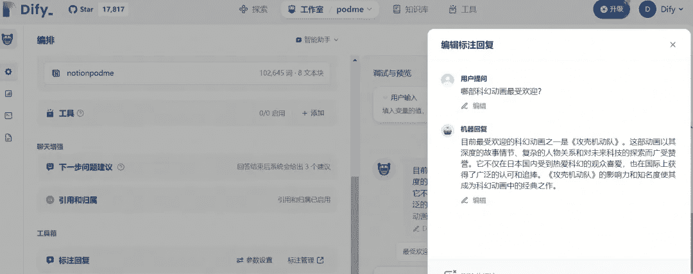

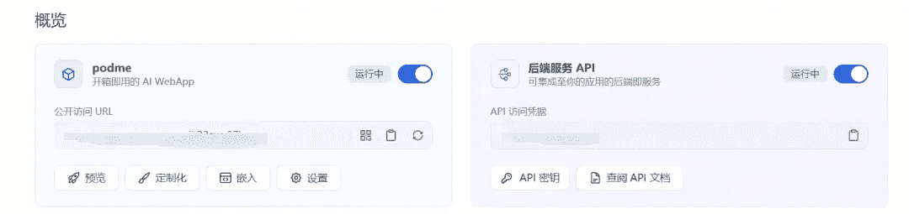

可发布网页和api

另外，bob 在群里发了张图片，Dify 可能在准备 workflow 功能，看截图是一个根据输入识别用户意图并进行跳转的工作流，可以期待一下~

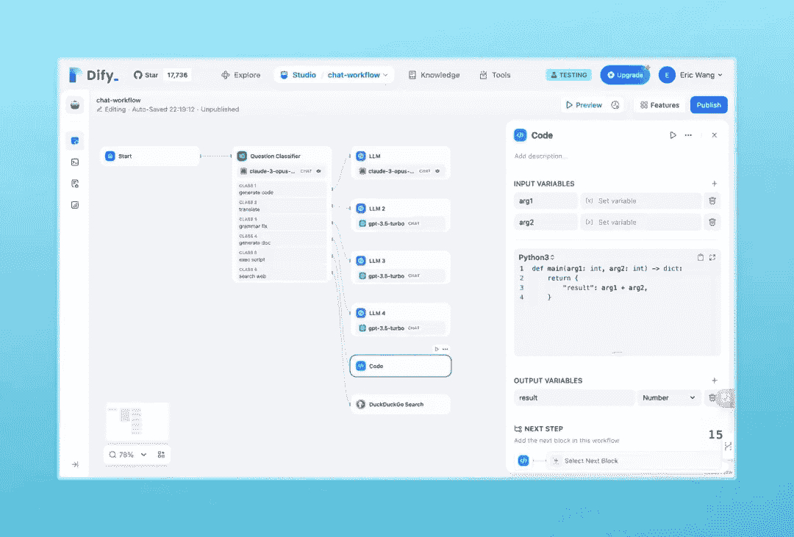

这里可以说一下，coze 的工作流很好搭建，但是支持的功**能有限。像上图中这种识别用户意图的功能**，理论来说使用 LLM 节点也完全可以做到，但我测试过很多次，实际就是不太稳定。

有更轻便稳定的实现方式，就没有必要用 LLM，用了也是浪费。或者，一些常用的、可以用 LLM 实现的功能，做成预设后，就可以节约一点调试时间。

## **千帆 AppBuilder**

第一次用 AppBuilder 的时候，我因为预览框在屏幕占比比较大而感觉舒适——虽然对我来说还是不够。

希望本文所有产品后续都让用户能自动调节板块的大小，很需要！输出的回复经常无法一屏显示完，真的有点难受。

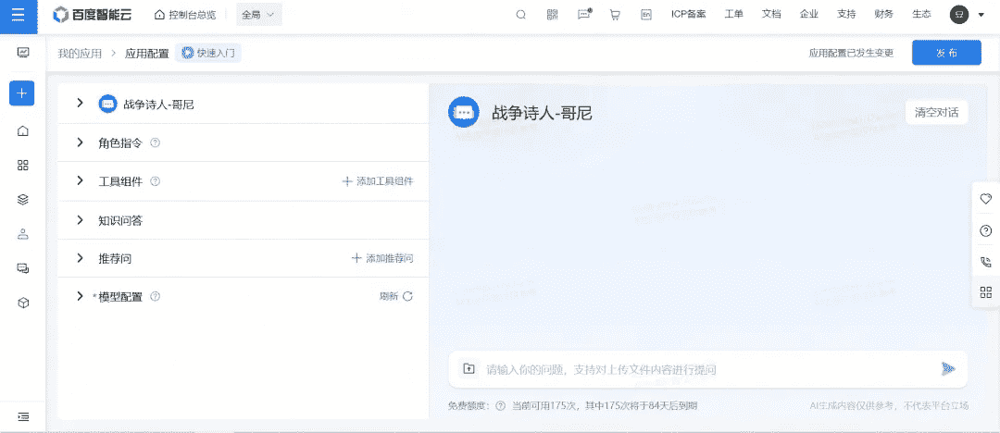

创建流程跟上面的产品都大差不差，只能选自家模型，而且每次创建前都要选一步类型。

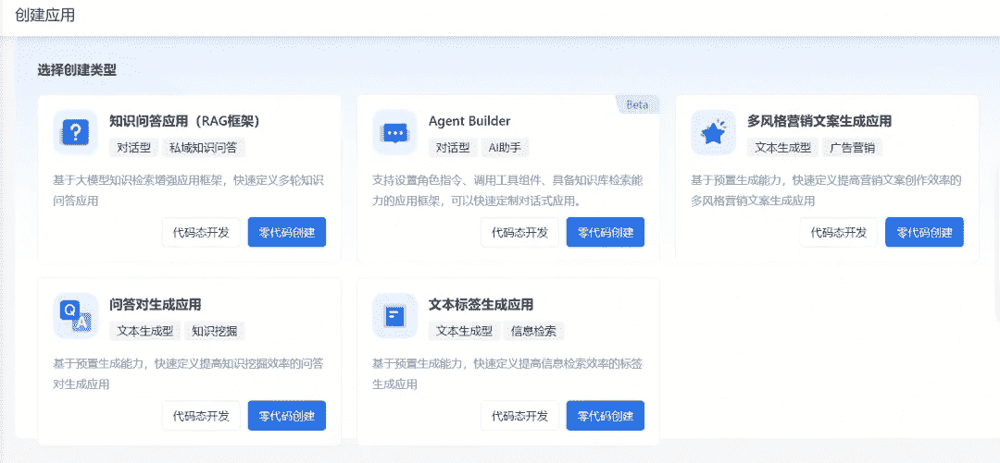

但是它提供了多种图像识别类插件。

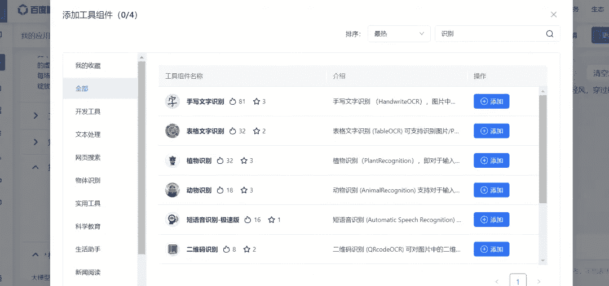

发布渠道友好，有个人认证的微信公众号也可以。

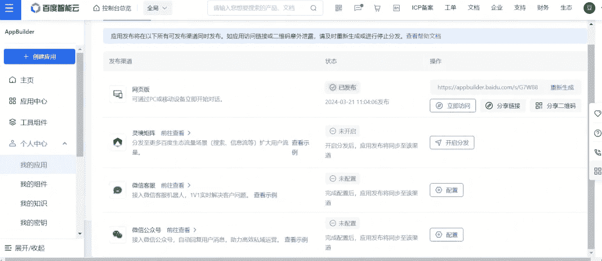

我的另一个感觉是，百度做的工具，活动真的很多。

## **天工 SkyAgents**

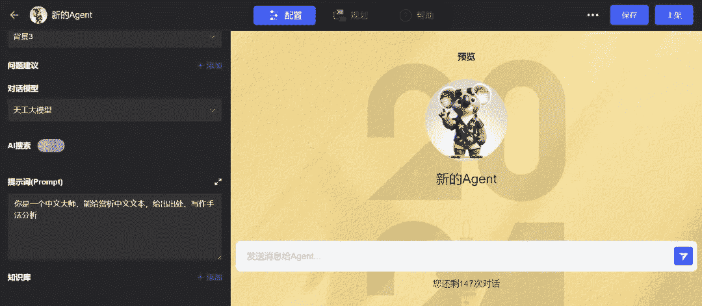

SkyAgents 的基础配置就不说了，它的规划板块，也就是工作流，有点不同。它提供了一些额外信息处理的节点，比如信息分类、字段提取。

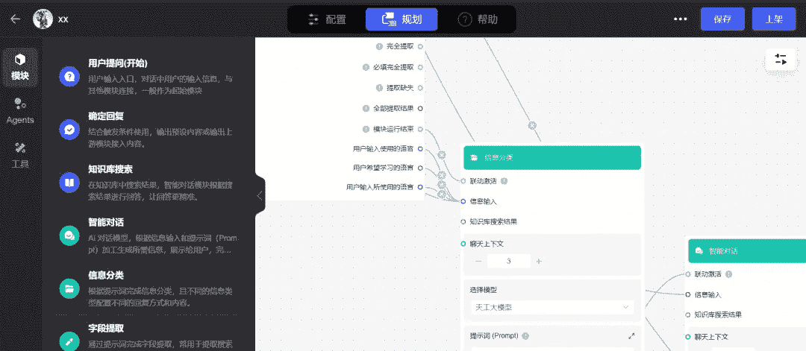

本质上这些功能也是大语言模型实现的，只是预设好了 prompt，另外卡片配置更方便操作。

把大模型的温度（temperature）设置直接解释为严谨/创意，我感觉是一个比较用户友好的细节。

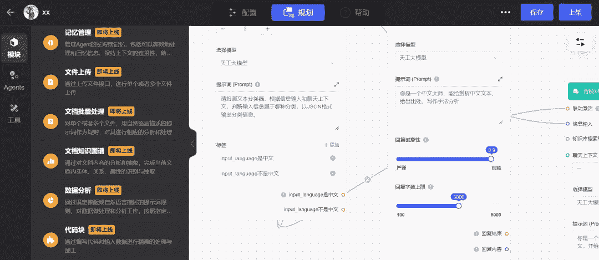

我实测了根据用户输入分辨语言是否为中文，是否包含两种语言，是否为单词，并进行相关跳转，比我在 coze 用 LLM 节点测试的结果要稳定。

但一个问题是，创建好的规划无法在当前页面测试，会跳回到主页面，也就是你只能根据输入输出判断规划是否成功，不合理。

## **钉钉 AI 助理**

钉钉 AI 助理的 slogan 是“骑到 AI 背上去”，看到的第一眼，也不是说觉得好或者不好，而是怪到让人印象深刻......

以及，就问还有哪个平台提供了比它更详细的 prompt 撰写教程？不仅有解释还有可以直接复制的大量示例。当然这些东西网上也能找得到，但是感谢会为用户写这种文档的产品运营。

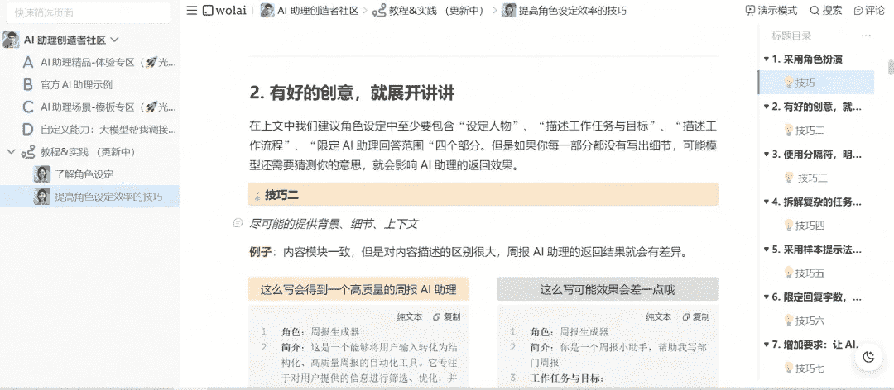

https://wolai.dingtalk.com/9BeQNaVTvBQnQUprP8VZXU

作为一个深度与钉钉绑定的工具，如果你是资深打工人，这可能是最合适你的工具。

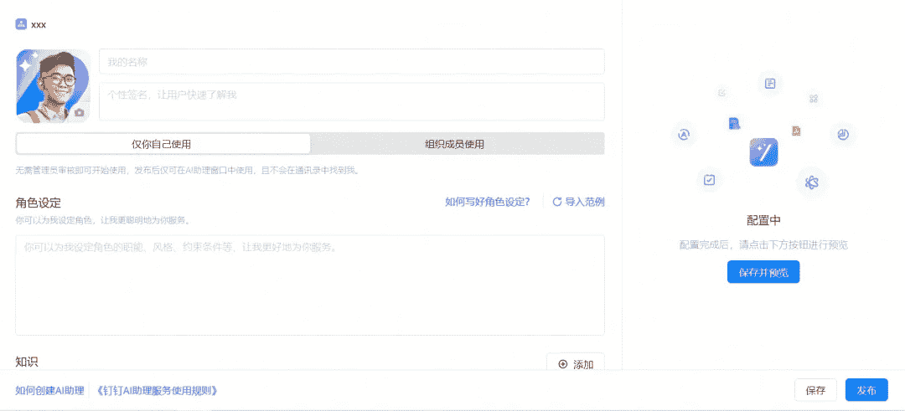

当其他产品提供的能力是搜索、画图之类时，它的能力板块提供的是请假助手、智能代办、预约日程——当然开发者可以设计更复杂的功能。

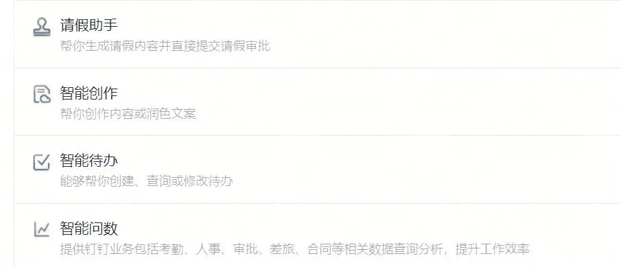

展示的模版都其他平台都不是一个画风。

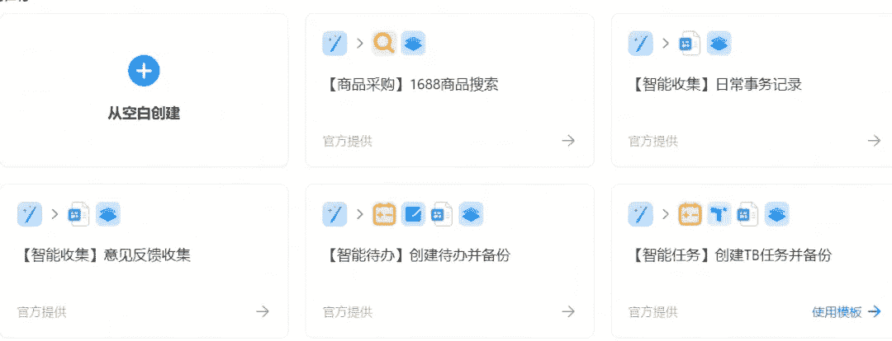

工作流可以设置一些变量，比如流程执行人。理论上来说，以后所有钉钉中结构化的数据，都可以在这个工作流中定义为变量，一些日常非常繁琐的手工操作都可以自动化搞定。

我的过往经验告诉我，这对于小型创业团队来说，会是一个比较好的工具。小团队其实也需要规范一些业务流程，但也没必要花那么多精力去使用复杂系统。

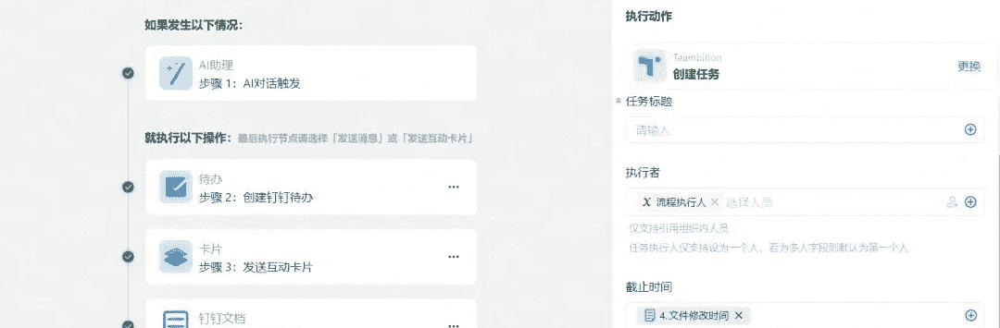

这个工作流目前也是只能接收一次用户输入响应一次；不支持 if else 式的条件跳转，只能在满足条件时向下执行；没有测试环节。

这种处于自家生态中的工具，优势劣势都很明显。

作为一个不用钉钉的人，我如果想创建工作需求类的 bot，钉钉 AI 助理就完全无用武之地，因为我在这里完全没有文档和数据；如果创建其他类型，感觉它提供的这些便捷功能对我就是一种浪费。这是唯一一个我没有实际测试过的工具。

希望这个工具以后能有独立于钉钉的网页版，毕竟不是每个打工人下了班还想打开钉钉的。（泪目）

# **以工作流为核心的bot制作平台**

Botpress，Voiceflow，Zapier，这三个平台与其说是能做 AI Agent 的工具，不如说是做自动化流程的工具，只是也可以提供 AI 作为工作流的一部分。

Botpress，Voiceflow 点进去就是一个 canvas 画布，我直觉觉得这些工具都是在 GPT 之前就有的，而且主要是面向中小型需要提供客户服务的企业。

## **Botpress**

文章最开始那个视频 demo 里面的 bot，是我使用 Botpress 花 2 天时间通过一下比较庞大的工作流实现的，有一半使用 GPT4 生成。

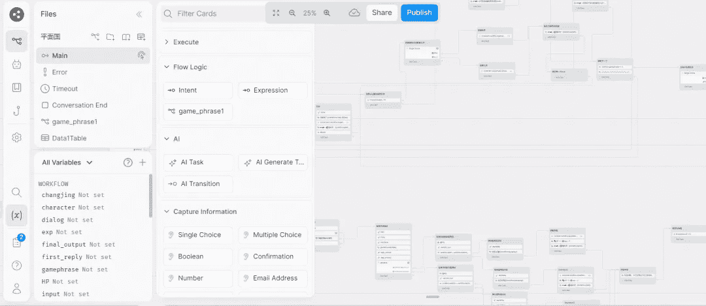

节点多到一个截图放不下

它们能实现什么功能呢？也就是上面所提到的产品暂时无法实现的复杂工作流。

以 coze 来举例，单 Agent 模式的工作流都是一次性执行完毕，接收一次用户输入响应一次，如果你想在这个工作流中不断跟用户对话，甚至是根据多次输入处理后再执行下一步，设计起来就会非常复杂。

而多 Agent 模式中，不同 Agent 的协作目前只能通过简单的输入意图识别来跳转，比较局限也不够准确。

使用类似 Botpress 的产品，要做跳转和循环就太容易了。因此整个 bot 可以持续接收用户输入并为用户提供多样功能。

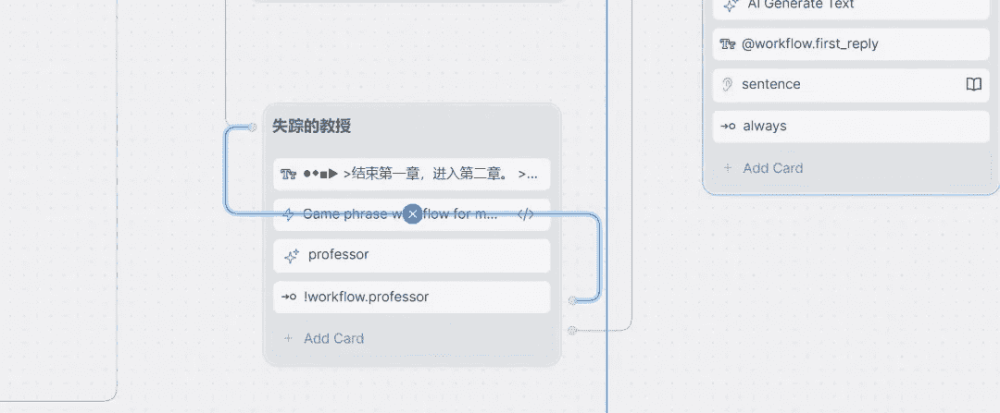

根据条件判断跳转或者循环

可以使用 Intent 识别用户输入，用 Capture Information 收集一些关键信息。还是那句话，上面那些产品的 LLM 节点也可以实现，这里只不过更直观（可能也更稳定）。

还可以自行添加多种自然语言表达让意图识别更灵活

说白了，这其实是在写提供了一些预设函数、可包含 AI 功能的可视化程序。

**门槛和问题——**

然而 Botpress 最大的问题就是学习门槛有点高，并不是因**为提供了太多可供**配置的节点，而是因为它的产品设计有点混乱。

比如说 Intent 是它告诉用户可以做逻辑跳转的节点，然而 Capture Information 和 AI transition 同样可以实现跳转。

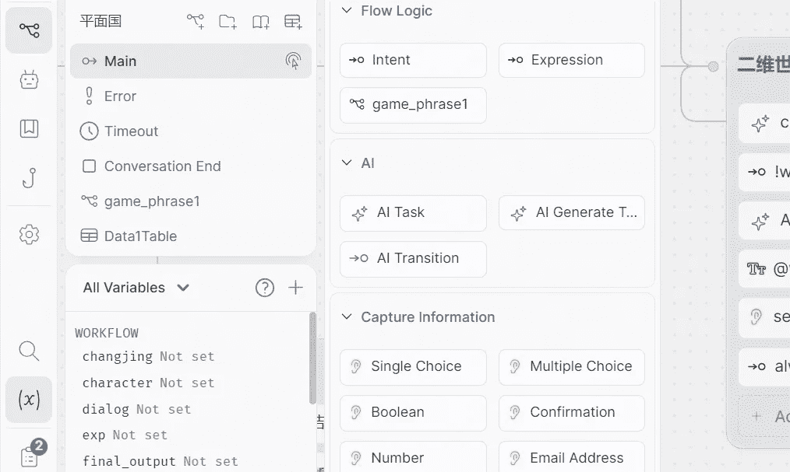

Capture information 看起来是一个处理、提取数据的节点，但是它照样可以输出信息；里面提供了二十多种不同类型的数据信息，但每种信息的配置逻辑都是一样的。

我花了很久才习惯这种思维方式。如果是我，我倾向于把 Capture information 这种实际包含了多个执行步骤的节点拆开，所有节点都归类为输入、输出、功能（AI、代码或预设的自然语言处理实现）、flow 跳转（AI、condition判断或预设的自然语言处理实现）四种板块。

另外就是**不同的参数配置散落在页面各处**。

机器人符号处可以设置全局工作流的语言，或者全局人设等等。中间的齿轮符号处可以设置全局变量、而左下方问号提供一些预设好的变量，比如{{event.preview}}储存着用户的上一次输入。

为用户想了很多，但是太乱了。

## Voiceflow 和 Zapier

下面这个是 Voiceflow 的主界面，看得出来逻辑是一样，不赘述了。

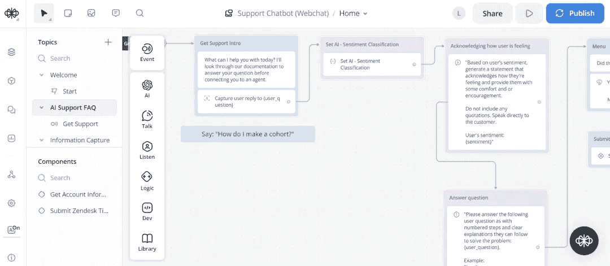

Zapier 我也不想详细说了，chatbot 跟第一部分的产品区别不大，prompt 格式给的非常全面，Actions 板块进入工作流设置。

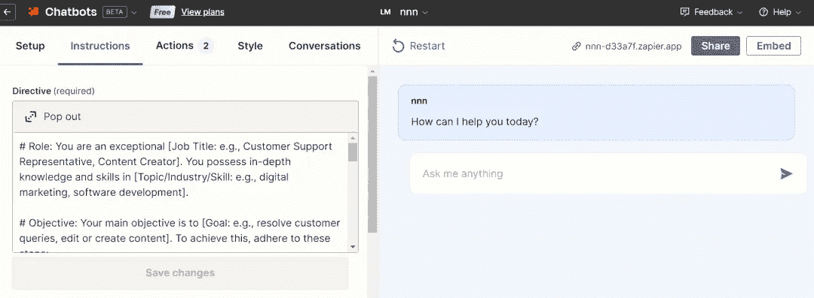

它的工作流和能接入的 App 非常丰富，应该是功能最强劲的工具。但是在我实际测试的过程，以上三个工具属于如果不是需要搭建很复杂的工作流，则完全没有必要使用。

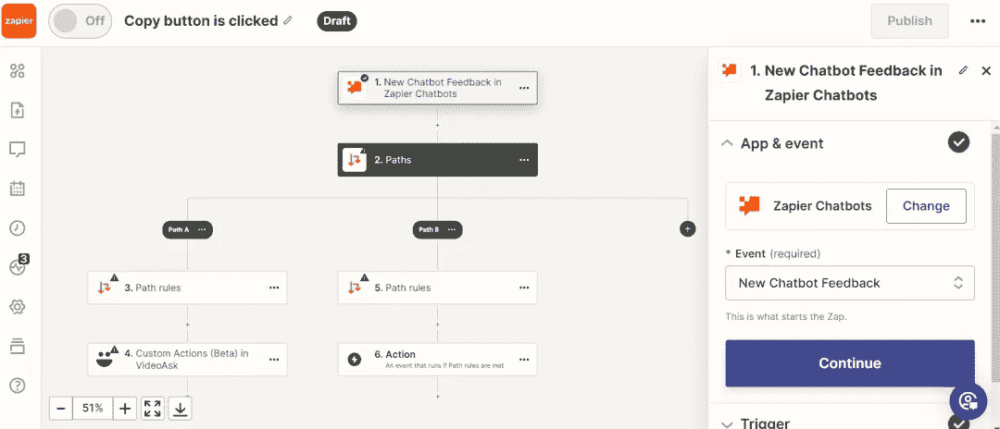

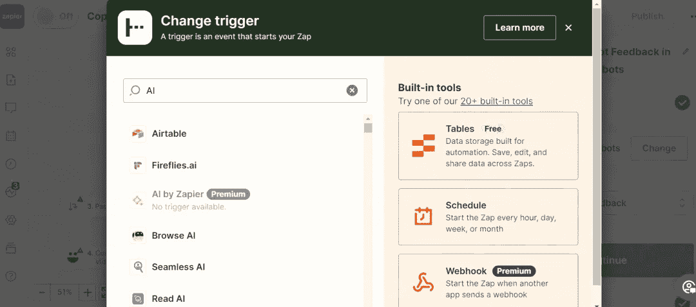

# **关注任务分解的 bot**

最后是 Ai Agent，Reworkd AI。

在帮助身边朋友制作 bot 的过程中，我常常感受到，想让 AI 帮你完成稍微复杂一点的任务，你理不理解自己日常做这个任务的流程和逻辑很重要。你越理解，就能越清楚表述给 AI，AI 也就能学得更好。

但与此同时，我觉得对于一些常规的事务，AI 应该能够自己学会步骤分解，或者主动跟用户互动以理清合理的执行流程，这才是更高阶一点的 Agent。

Reworkd AI 和 Ai Agent 就能做任务分解。

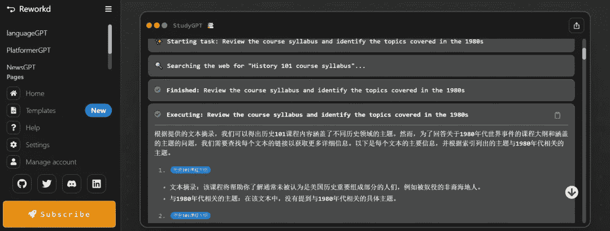

Reworkd AI（beta）

当你输入一个目标之后，Reworkd AI 它会自己思考并将目标分解成多个 task。

比如在这个复习知识点的模板中，AI 将目标拆成了搜集相关资料、创建时间表等等。然后逐步执行 task，并输出分阶段的结果。右侧可以看到 task 的执行进程。

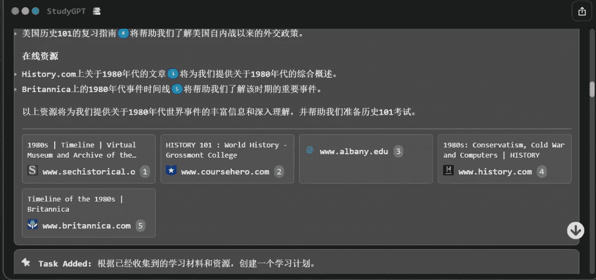

Ai Agent 的界面也差不多如此。你还可以最后一个 task 的后面自己添加补充 task。

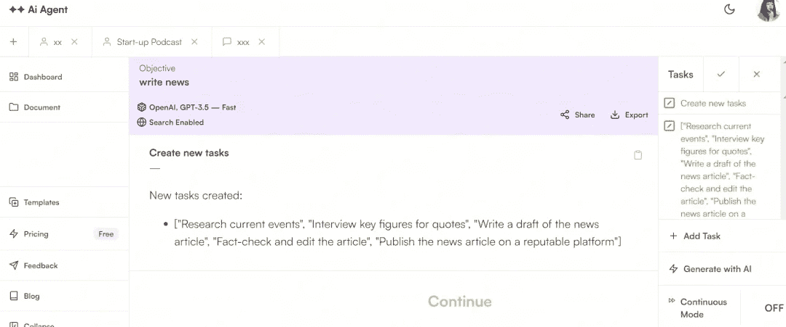

接下来是我对这两个工具的误解。

我原本以为在创建好 Agent 之后，它就可以根据我不同的输入来依次执行这些 task 了。结果是并不是。

这根本不能算是一个 Agent，它其实就是执行了一次分步骤的对话任务，仅针对当前的输入进行任务拆分，力求给出更可靠的结果。——一个可以让你看到它脑回路的 AI chatbot。

但是我觉得这个功能挺好的。

最开始提到的那些产品也可以通过对话来制作 bot，但基本只是完成了 bot 的 prompt 撰写。

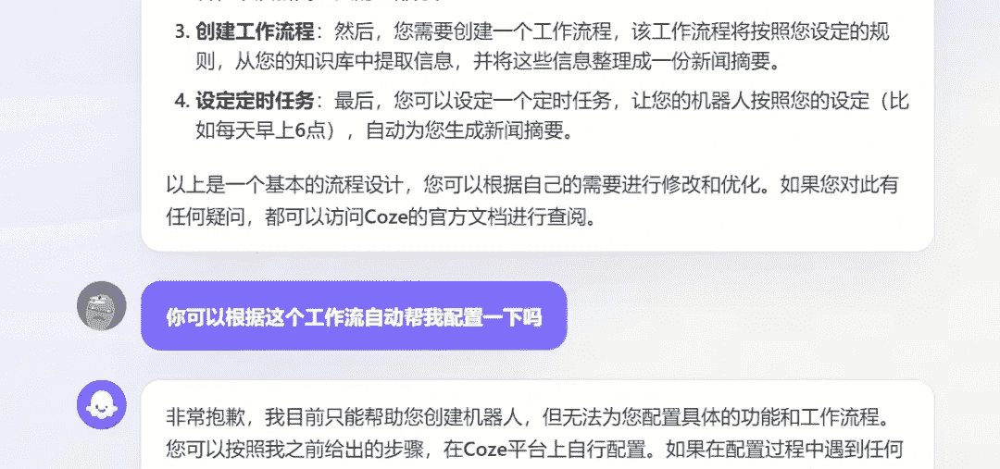

如果以后，制作环节能够提供 bot 工作流程的任务分解，并允许用户根据自己的情况进行 task 的细节修改，那么最后的成品 bot 肯定能更好地完成指令，并在这个过程当中不需要用户思考太多。

# 结尾

写累了，先说这么多，不是每一个细节都写了。

在跟周围不太使用 AI 工具的朋友交流时，我得到的反馈是这些工具门槛还是不够低，提供示例和模版会使用感好一些。而对于喜欢折腾的人来说，希望之后的工具能不断提高上限。

以上仅是我个人的使用观感。如果你有其他的想法，欢迎在后台与我交流。