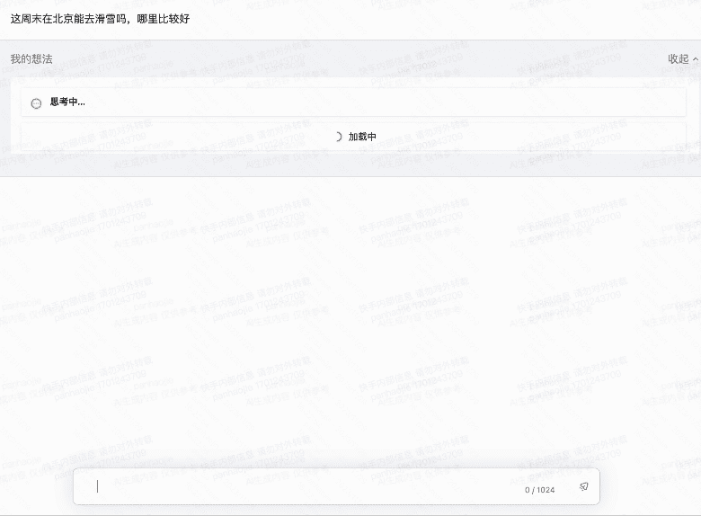
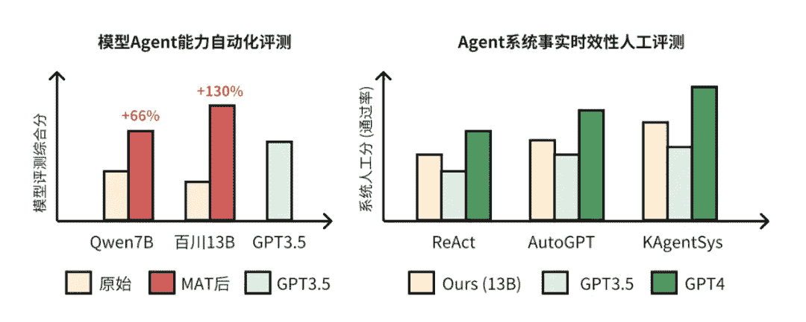
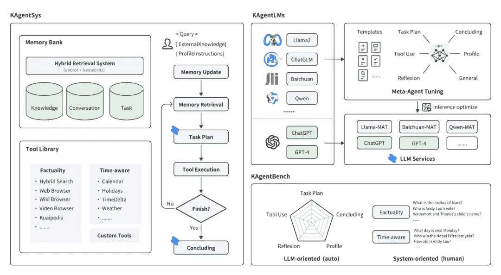
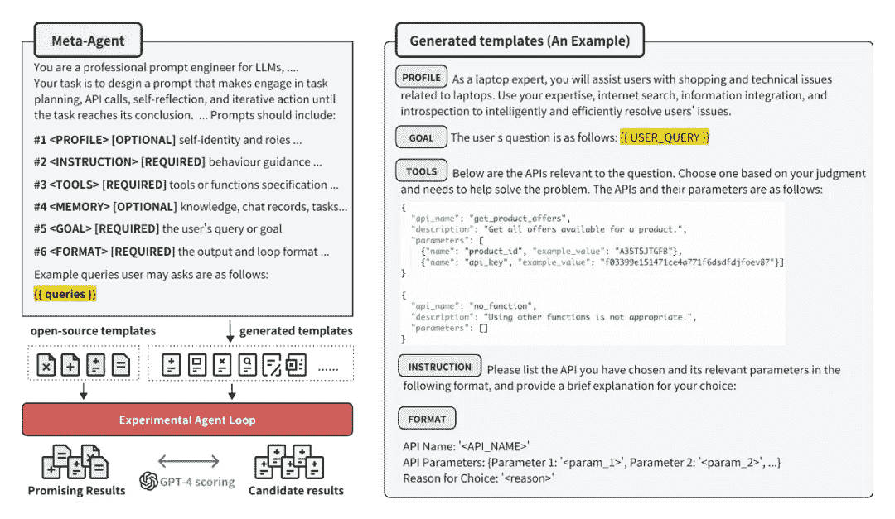
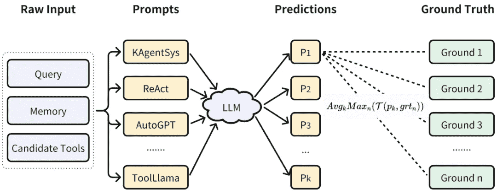
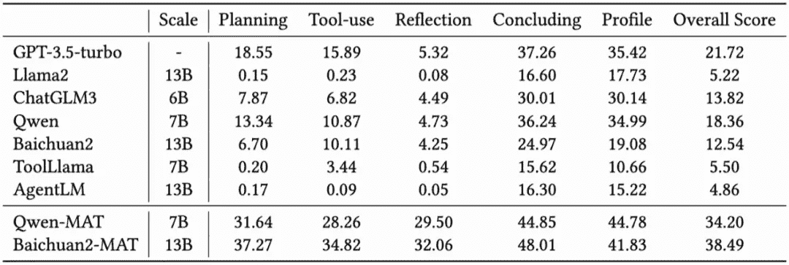
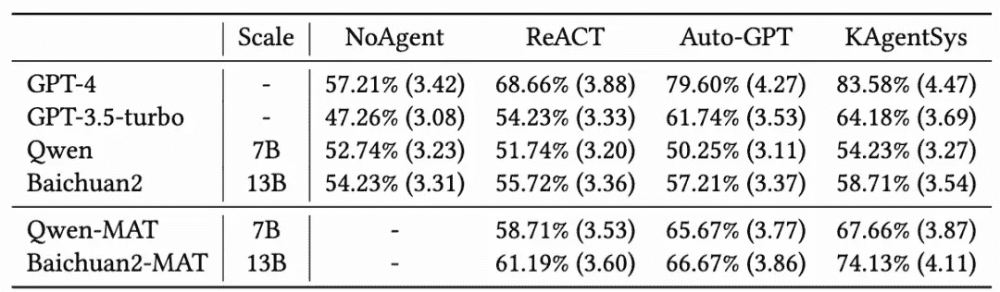
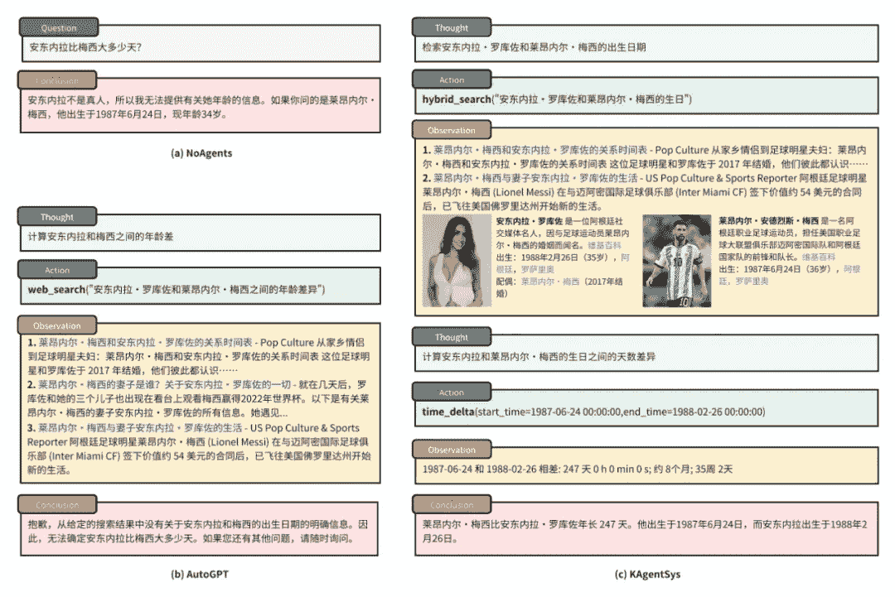

# 快手Agents系统、模型、数据全部开源！

> 来源：[https://agijuejin.feishu.cn/docx/LZsVdukogolTmqxSN2ncdnG0nVf](https://agijuejin.feishu.cn/docx/LZsVdukogolTmqxSN2ncdnG0nVf)

> 作者：机器之心

> 原文：https://mp.weixin.qq.com/s/QhZIFL1GHH90z98gnk194g

快手联合哈尔滨工业大学研发的「KwaiAgents」，使7B/13B模型也能达到超越GPT-3.5的效果，并且这些系统、模型、数据、评测都开源了！

7B 大小的模型也能玩转 AI Agents 了？近期，快手开源了「KwaiAgents」，问它周末滑雪问题，它不但帮你找到场地，连当天的天气都帮你考虑周到了。

大家都知道大语言模型（LLM）通过对语言的建模而掌握了大量知识，并具备一定认知和推理能力。但即使是当前最强的 GPT-4，单独使用的情况下，依然会一本正经地胡说八道，无法跟世界保持实时的交互。AI Agents 就是解决这个问题的道路之一，通过激发大模型任务规划、反思、调用工具等能力，使大模型能够借助现实世界工具提升生成内容的准确性，甚至有能力解决复杂问题。这一次，快手联合哈尔滨工业大学研发的「KwaiAgents」，使 7B/13B 的 “小” 大模型也能达到超越 GPT-3.5 的效果，并且这些系统、模型、数据、评测都开源了！

+   技术报告：https://arxiv.org/abs/2312.04889

+   项目主页：https://github.com/KwaiKEG/KwaiAgents

从「KwaiAgents」的 Github 主页中可以看到，本次开源内容包含：

1.  系统（KAgentSys-Lite）：轻量级 AI Agents 系统，并配备事实、时效性工具集；

1.  模型（KAgentLMs）：Meta-Agent Tuning 后，具有 Agents 通用能力的系列大模型及其训练数据；

1.  评测（KAgentBench）：开箱即用的 Agent 能力自动化评测 Benchmark 与人工评测结果。

## **系统**

KAgentSys 系统，是基于大模型作为认知内核，配以记忆机制、工具库，形成的迭代式自动化系统。其主要包含：

1.  记忆机制：包含知识库、对话、任务历史三类记忆，依托于混合向量检索、关键词检索等技术的检索框架，在每一次规划路径中检索所需的信息。

1.  工具集：包含事实性增强工具集，异构的搜索和浏览机制能够汇集网页、文本百科、视频百科等多个来源的知识；包含日历、节日、时间差、天气等常见的时效性增强工具集。

1.  自动化 Loop：在一轮对话中，用户会给予一个问题，可选知识库及额外人设整体进行输入，系统会先进行记忆的更新和检索，再调用大模型进行任务的规划，如果需要调用工具则进行调用，如果不用则进入总结阶段，大模型综合历史的信息给出符合预期的回答。

本次开源 KAgentSys 的部分能力，系统将逐步进行升级和开放。

## **模型**

为了避免训练中单一模板引起的过拟合问题，团队提出 Meta-Agent Tuning (MAT) 的方法，通过在训练数据中引入更多 Agent Prompt 模板，从而提升大模型在 Agent 能力上的通用性，并提升了效果。

Meta-Agent Tuning (MAT) 分为两阶段：

1.  模板生成阶段：通过设计 Meta-Agent，对特定问题集合，生成实例化的 Agent Prompt 模板（上右图为一个例子）候选；并在相同的实验环境下，生成模板产出的候选结果，与开源模板（如 ReAct，AutoGPT 等）产出的高置信结果，用打分模型进行对比打分，从而筛选出高质量的 Agent Prompt 模板库。通过引入这些多元的模板，能够显著降低模型微调时对模板的依赖，提纯更本质的 Agents 在任务规划、工具使用、反思等能力，从而提高模型的泛化性和有效性。

1.  指令微调阶段：基于上万的模板，构建了超过 20 万的 Agent 调优指令微调数据。团队调优了一些热门开源模型如 Qwen-7B、Baichuan2-13B 等，供大家使用和参考，后续还会陆续放出其他热门模型。

## **评测**

KAgentBench 通过人工精细化标注的上千条数据，做到了开箱即用，让大家能够用一行命令评测一个大模型在不同模板下各方面的 Agents 能力。

如上图所示，在 KAgentBench 中，会对不同种类的能力构造输入，每个 query 配备多个模板和多个人工编辑的真实回答，旨在综合评测准确性和泛化性，下表显示了经过 MAT 调优后，7B-13B 模型各项能力的提升，且超越了 GPT-3.5 的效果：

同时，该研究还请人类标注者在 200 个事实性和时效性的问题（如 “刘德华今年几岁了”），对不同的大模型和 Agent 系统进行了交叉评估，可以看到 KAgentSys 系统和 MAT 之后模型提升显著（百分号前为正确率，括号内为 5 分制均分）。

通常仅依赖网页搜索对一些长尾问题和热门问题返回结果不佳。比如问到 “安东内拉比梅西大多少天？” 这类长尾问题，往往搜索结果返回的都是一些两者的八卦新闻，而返回不了一些关键信息。而 KAgentSys 通过调用百科搜索工具获取精准的出生日期，再调用 time_delta 时间差工具算出年龄差，就能精准回答这个问题了。

团队表示，AI Agents 是一条非常有潜力的道路，未来一方面会在这个方向持之以恒地沉淀核心技术，并为整个社区不断地注入新的活力；另一方面也会积极探索 Agents 技术与快手业务的结合，尝试更多有趣、有价值的创新应用落地。