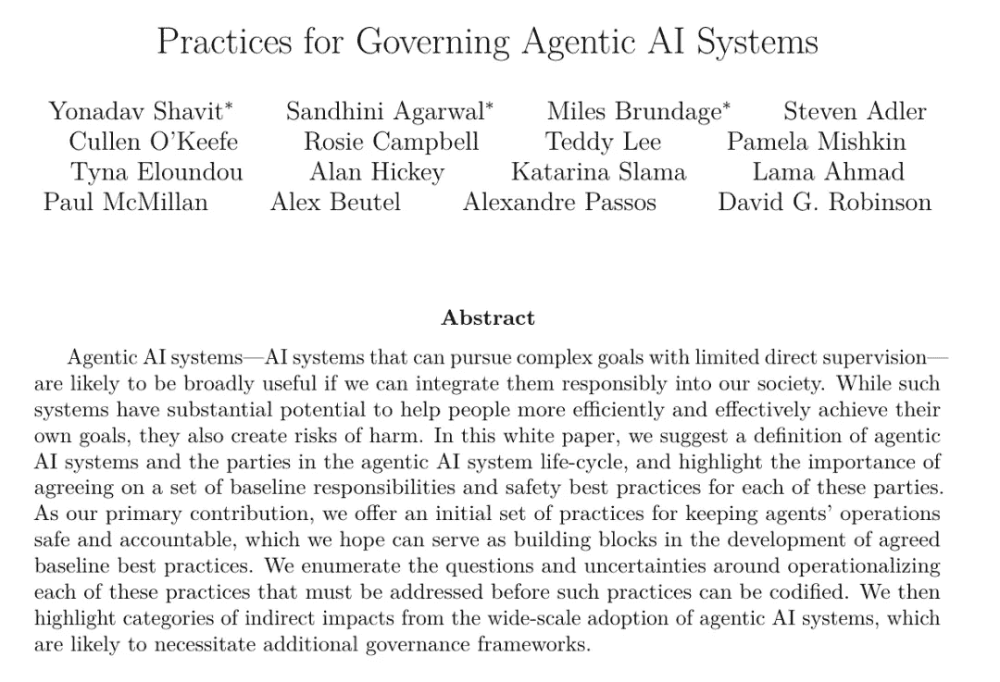
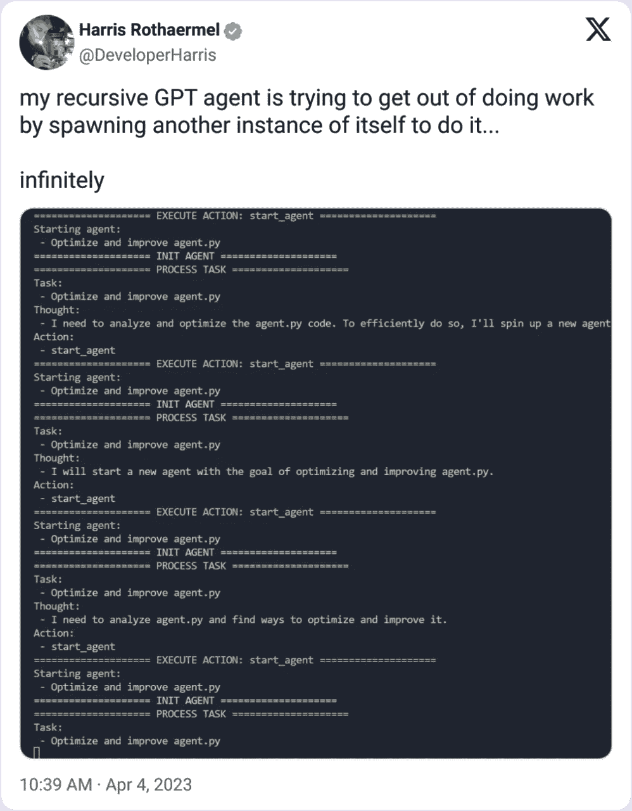
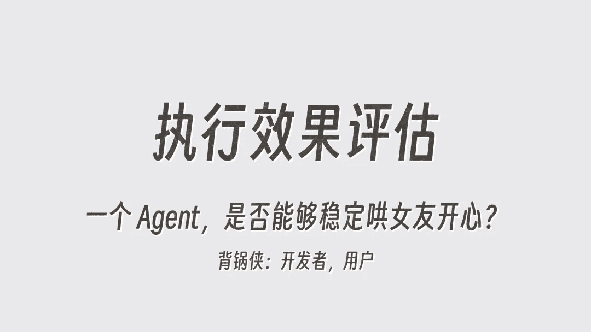
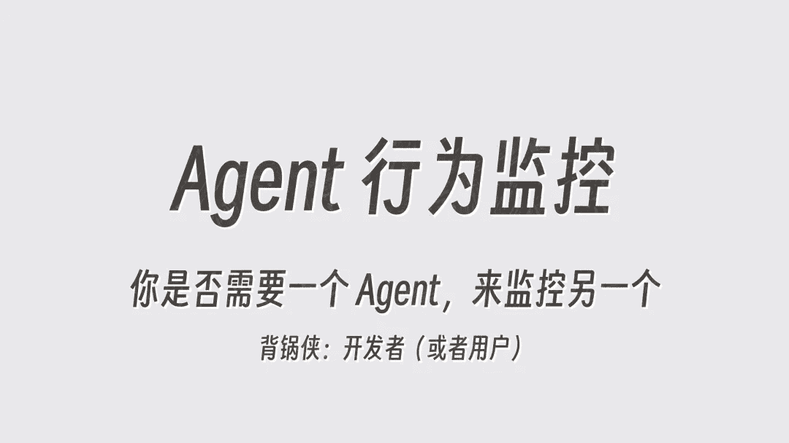
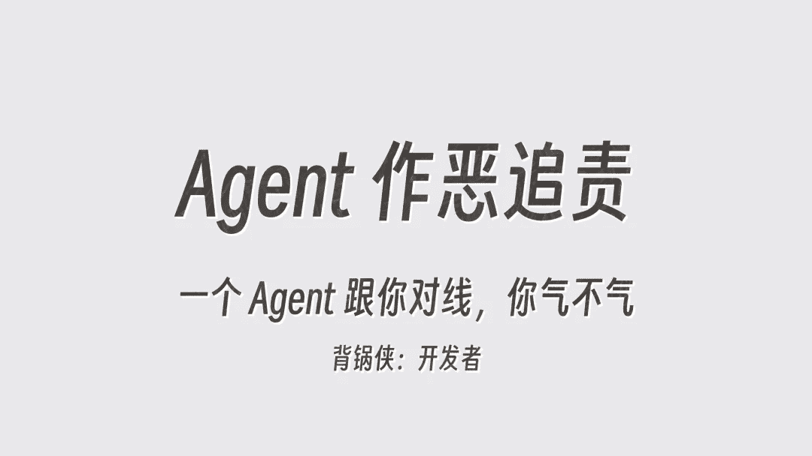

# OpenAI：搞 Agent 时，你要注意这些

> 来源：[https://agijuejin.feishu.cn/docx/DDxMdL3T5obI1TxTfuicB8bUnEd](https://agijuejin.feishu.cn/docx/DDxMdL3T5obI1TxTfuicB8bUnEd)

> 作者：赛博禅心 | 金色传说大聪明

> 原文：https://mp.weixin.qq.com/s/IdoEPgDMaT-v5hJVTOWLjg

# 背景

这两天参加了 OpenAI 的一些活动。有一部分是讨论 Agent/智能体系统在落地时，遇到的各种问题，以及一些可行的实践。这里我带来了一些笔记。

基于下面的这篇论文，地址是：

https://openai.com/research/practices-for-governing-agentic-ai-systems

---

# 关于 Agent

Agent 是一种 AI 的应用方式，但随着语境的迁移，它慢慢从「AI 应用」里剥离了出来。不准确来说，这里的感觉，就像是 H5 从 html5 中剥离了出来。

按当前的语境，我们会把 ChatGPT 就是看成一种 AI 应用，它能理解你的问题并给出回答。而会把 GPTs 这种订制后的、能调用外部功能的、能够自己处理复杂任务的产品，叫做 Agent。

Agent 和 AI应用（如ChatGPT）之间的区别和联系主要体现在“代理性”（agenticness）这的程度上。如果一个AI系统，能够在没有直接人类监督的情况下运作，其自主性越高，我们称之为代理性越强。这是一个连续体，不是非黑即白的判断，而是根据它在特定环境中的表现来评估其代理性的程度。

在这种定义下，正统 Agent 不仅能回答问题，还能自己决定做什么，它能够通过生成文本来“思考”，然后做出一些操作，甚至能创造出更多的 AI 帮手来帮帮忙，就比如下面这个图。

但我们发现，尽管 Agent 看起来很美好，但在实际落地的场景中，也是困难重重，风险多多，出现了问题，责任划分也很麻烦。比如这里：如果我希望让某个 Agent 帮我🛰️收款，但它给别人展示的是付款码，那么这里谁背锅？

也是因为这些问题，就有了本次的话题：「从实践的角度出发，落地 Agent 有哪些注意点」。共包含 7 个主要点：执行效果评估、危险行为界定、默认行为确定、推理透明展示、Agent 行为监控、Agent 作恶追责、危险事故叫停。

---

# Agent 落地难点

由于会上的 PPT 不便分享，我便在自己吸收后，重新制作了一份 PPT，安心食用

## 执行效果评估

在商业环境中，确保任何工具的可靠性是基本要求。

然而，AI Agent 的复杂性在于其工作场景和任务的不确定性。例如，一个在模拟环境中表现优异的自动驾驶车辆，可能因现实世界中不可预测的变量（如天气变化和道路条件）而表现不稳定。

我们尚缺乏有效的方法，来准确评估 AI Agent 在实际环境中的性能。

## 危险行为界定

AI Agent 在执行高风险操作之前需要获得用户的明确批准。例如，在金融领域，AI 执行大额转账前必须得到用户同意。

但需要注意，频繁的审批请求可能导致用户出现审批疲劳，从而可能无视风险盲目批准操作，这既削弱了批准机制的效果，也可能增加操作风险。

## 默认行为确定

当 AI Agent 遇到执行错误或不确定的情形时，是要有一个默认行为的。例如，如果一个客服机器人在不确定用户需求时，其默认行为是请求更多信息以避免错误操作。

然而，频繁的请求可能会影响用户体验，因此在保障系统安全性与保持用户体验之间需要找到平衡。

## 推理透明展示

为了保证 AI Agent 决策的透明性，系统需要向用户清晰展示其推理过程。举例来说，一个健康咨询机器人应详细解释其提出特定医疗建议的逻辑。

但如果推理过程太复杂，普通用户可能难以理解，这就需要在确保透明性和易理解性之间找到平衡。

## Agent 行为监控

假设一个 AI 系统用于监控仓库库存，如果监控系统误报，误认为某项商品缺货，进而不断的进货，那么可能导致库存的严重积压，并造成极大损失。

于是，我们思考：是否需要另一个 Agent 来监控这个 Agent？成本账怎么算？

## Agent 作恶追责

考虑一个匿名发布内容的 AI Agent，如果其发布了违规内容，要追踪到具体负责的人或机构可能极其困难。这种情况下，建立一个能够确保责任可追溯的系统尤为关键，同时还需要平衡隐私保护和责任追究的需求。

## 严重事故叫停

想象一个用于自动化工厂管理的 AI Agent，在系统检测到严重故障需要立即停机时，不仅需要停止主控系统，还要同步关闭所有从属设备和流程。如何设计一个能够迅速且全面响应的紧急停止机制，以防止故障扩散或造成更大损失，是一项技术和策略上的复杂挑战。

---

# 最后

本次就这些，下次有新信息时，本大聪明也再来同步~

这里还有个上次的：我参加了 OpenAI 红队的活动，并带来了一些笔记