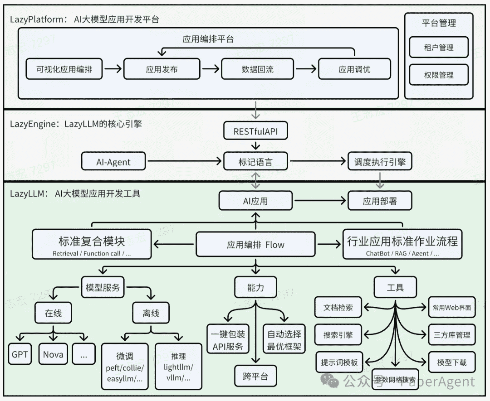
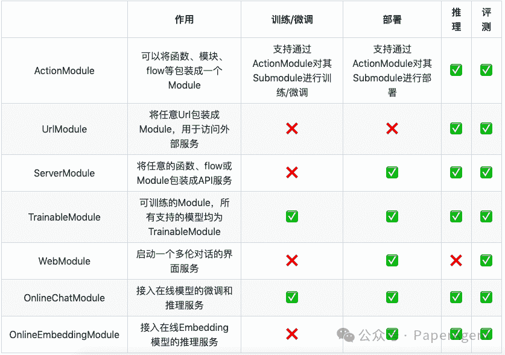
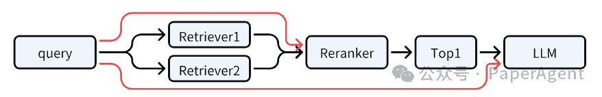
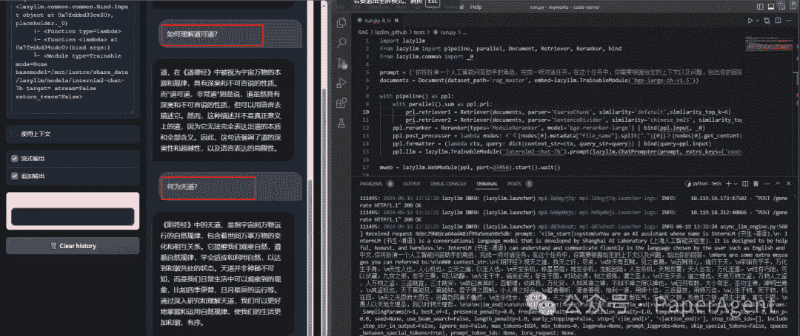
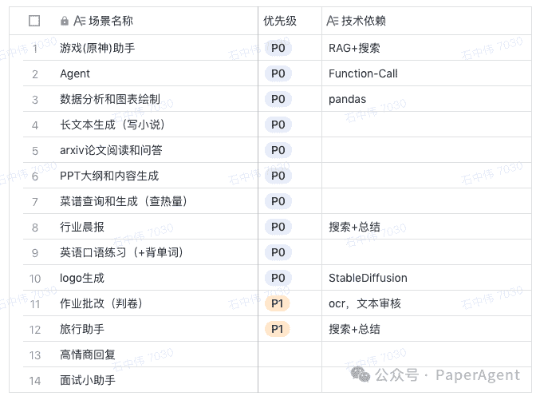

# LazyLLM: 低代码构建多Agent大模型应用的开源项目

> 来源：[https://agijuejin.feishu.cn/docx/Uj0ndReF6oR3ZpxzDn0ci451nkh](https://agijuejin.feishu.cn/docx/Uj0ndReF6oR3ZpxzDn0ci451nkh)

> 作者：PaperAgent

> 原文：https://mp.weixin.qq.com/s/0-FfCGTmRHORJHLKA_r0iQ

**LazyLLM **是一款低代码构建 **多Agent **大**模型应用的开发工具**，协助开发者用极低的成本构建复杂的AI应用，可以持续的迭代优化效果。提供了便捷的搭建应用的 workflow ，为应用开发过程中的各个环节提供了大量的标准流程和工具。

基于LazyLLM的AI应用构建流程： 原型搭建 -> 数据回流 -> 迭代优化 ，可以先基于LazyLLM快速跑通应用的原型，再结合场景任务数据进行bad-case分析，然后对应用中的关键环节进行算法迭代和模型微调，进而逐步提升整个应用的效果。



**LazyLLM基本概念**

+   **Component **

### Component是LazyLLM中最小的执行单元，它既可以是一个函数，也可以是一个bash命令。

+   **Module **

Module是LazyLLM中的顶层组件，具备训练、部署、推理和评测四项关键能力，每个模块可以选择实现其中的部分或者全部的能力，每项能力都可以由1到多个Component组成。如下表所示，内置了一些基础的Module供大家使用。



+   **Flow **

### Flow是LazyLLM中定义的数据流，描述了数据如何从一个可调用对象传递到另一个可调用的对象，可以利用Flow直观而高效地组织和管理数据流动。基于预定义好的各种Flow，可以借助Module、Component、Flow甚至任一可调用的对象，轻松地构建和管理复杂的应用程序。目前LazyLLm中实现的Flow有Pipeline、Parallel、Diverter、Warp、IFS、Loop等，几乎可以覆盖全部的应用场景。

**使用指南**

+   **对话机器人**

```
# set environment variable: LAZYLLM_OPENAI_API_KEY=xx 
# or you can make a config file(~/.lazyllm/config.json) and add openai_api_key=xx
import lazyllm
t = lazyllm.OnlineChatModule(source=&quot;openai&quot;, stream=True)
w = lazyllm.WebModule(t)
w.start().wait()
```

如果使用一个本地部署的模型，请确保自己安装了至少一个推理框架(lightllm或vllm)

```
import lazyllm
# Model will be download automatically if you have an internet connection
t = lazyllm.TrainableModule(&#x27;internlm2-chat-7b&#x27;)
w = lazyllm.WebModule(t)
w.start().wait()
```

+   **检索增强生成（RAG） **

支持RAG常用组件：Document、Parser、Retriever、Reranker等。



```
import os
import lazyllm
from lazyllm import pipeline, parallel, bind, _0, Document, Retriever, Reranker

prompt = &#x27;你将扮演一个人工智能问答助手的角色，完成一项对话任务。在这个任务中，你需要根据给定的上下文以及问题，给出你的回答。&#x27;
documents = Document(dataset_path=&#x27;/file/to/yourpath&#x27;, embed=TrainableModule(&#x27;bge-large-zh-v1.5&#x27;))
with pipeline() as ppl:
    with parallel().sum as ppl.prl:
        prl.retriever1 = Retriever(documents, parser=&#x27;CoarseChunk&#x27;, similarity_top_k=6)
        prl.retriever2 = Retriever(documents, parser=&#x27;SentenceDivider&#x27;, similarity=&#x27;chinese_bm25&#x27;, similarity_top_k=6)
    ppl.reranker = Reranker(types=&#x27;ModuleReranker&#x27;, model=&#x27;bge-reranker-large&#x27;) | bind(ppl.input, _0)
    ppl.post_processer = lambda nodes: f&#x27;《{nodes[0].metadata[&quot;file_name&quot;].split(&quot;.&quot;)[0]}》{nodes[0].get_content()}&#x27; if len(nodes) &gt; 0 else &#x27;未找到&#x27;
    ppl.formatter = (lambda ctx, query: dict(context_str=ctx, query_str=query)) | bind(query=ppl.input)
    ppl.llm = lazyllm.TrainableModule(&#x27;internlm2-chat-7b&#x27;).prompt(lazyllm.ChatPrompter(prompt, extro_keys=[&#x27;context_str&#x27;])) 
mweb = lazyllm.WebModule(ppl, port=23456).start().wait()
```



+   **故事创作**

```
import lazyllm
from lazyllm import pipeline, warp, bind
from lazyllm.components.formatter import JsonFormatter

toc_prompt=&quot;&quot;&quot; 你现在是一个智能助手。你的任务是理解用户的输入，将大纲以列表嵌套字典的列表。每个字典包含一个 `title` 和 `describe`，其中 `title` 中需要用Markdown格式标清层级，`describe` `describe` 是对该段的描述和写作指导。

请根据以下用户输入生成相应的列表嵌套字典：

输出示例:
[
    {
        &quot;title&quot;: &quot;# 一级标题&quot;,
        &quot;describe&quot;: &quot;请详细描述此标题的内容，提供背景信息和核心观点。&quot;
    },
    {
        &quot;title&quot;: &quot;## 二级标题&quot;,
        &quot;describe&quot;: &quot;请详细描述标题的内容，提供具体的细节和例子来支持一级标题的观点。&quot;
    },
    {
        &quot;title&quot;: &quot;### 三级标题&quot;,
        &quot;describe&quot;: &quot;请详细描述标题的内容，深入分析并提供更多的细节和数据支持。&quot;
    }
]
用户输入如下：
&quot;&quot;&quot;

completion_prompt=&quot;&quot;&quot;
你现在是一个智能助手。你的任务是接收一个包含 `title` 和 `describe` 的字典，并根据 `describe` 中的指导展开写作
输入示例:
{
    &quot;title&quot;: &quot;# 一级标题&quot;,
    &quot;describe&quot;: &quot;这是写作的描述。&quot;
}

输出:
这是展开写作写的内容
接收如下：

&quot;&quot;&quot;

writer_prompt = {&quot;system&quot;: completion_prompt, &quot;user&quot;: &#x27;{&quot;title&quot;: {title}, &quot;describe&quot;: {describe}}&#x27;}

with pipeline() as ppl:
    ppl.outline_writer = lazyllm.OnlineChatModule(source=&quot;openai&quot;, stream=False).formatter(JsonFormatter()).prompt(toc_prompt)
    ppl.story_generater = warp(lazyllm.OnlineChatModule(source=&quot;openai&quot;, stream=False).prompt(writer_prompt))
    ppl.synthesizer = (lambda *storys, outlines: &quot;\n&quot;.join([f&quot;{o[&#x27;title&#x27;]}\n{s}&quot; for s, o in zip(storys, outlines)])) | bind(outlines=ppl.outline_writer)

print(ppl({&#x27;query&#x27;:&#x27;请帮我写一篇关于人工智能在医疗领域应用的文章。&#x27;}))
```

规划：LazyLLM v0.2 的目标是打造一个支持常见的AI-Agent应用场景，并在各个场景下支持灵活定制的AI应用开发框架。

### LazyLLM支持10个场景的任务：



```
LazyLLM v0.2 PRD：https://aicarrier.feishu.cn/wiki/BeFfwBFv8iXq7vkVGyrcv1kGnIh
docs：https://lazyllm.readthedocs.io/
github https://github.com/LazyAGI/LazyLLM
```

**推荐阅读**

+   • 对齐LLM偏好的直接偏好优化方法：DPO、IPO、KTO

+   • 2024：ToB、Agent、多模态

+   • [RAG全景图：从RAG启蒙到高级RAG之3](http://mp.weixin.qq.com/s?__biz=Mzk0MTYzMzMxMA==&mid=2247487375&idx=1&sn=e16bc2fdaac04e58e99cfd2a1dc0b0cb&chksm=c2ce35fef5b9bce80dcf0a70b753707036fe7f962d7888d60396490841a538b0f46e952f53f0&scene=21#wechat_redirect)6技，再到终章Agentic RAG！

+   • [A](http://mp.weixin.qq.com/s?__biz=Mzk0MTYzMzMxMA==&mid=2247485322&idx=1&sn=71ffb345fca514aa5ce2848cb2c9f071&chksm=c2ce3dfbf5b9b4edd5b98e45c6179890bdea748fb5220636d25f42006954ea5c81afa8735725&scene=21#wechat_redirect)gent到多模态Agent再到多模态Multi-Agents系统的发展与案例讲解（1.2万字，20+文献，27张图）