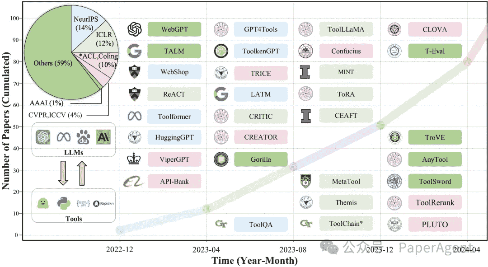
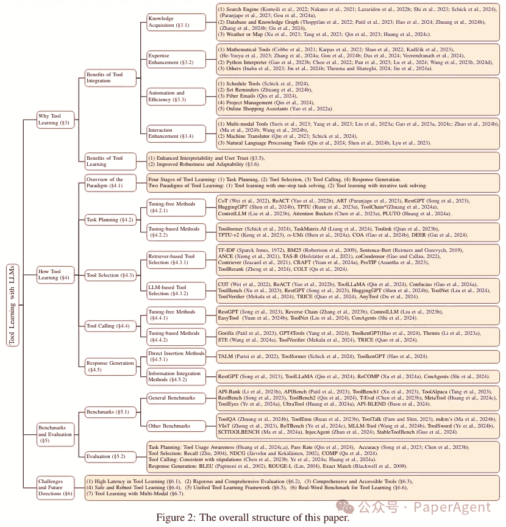
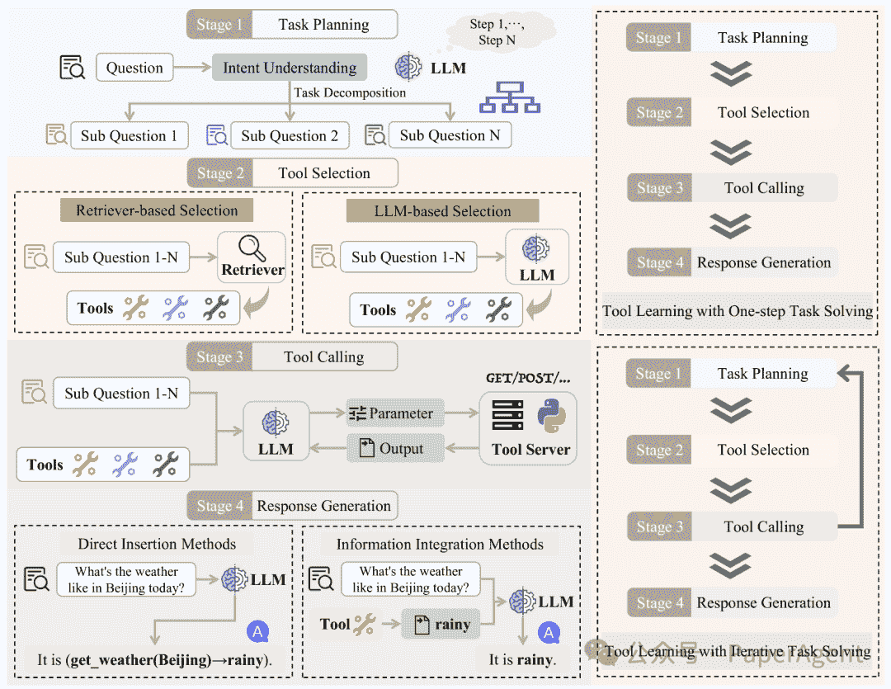
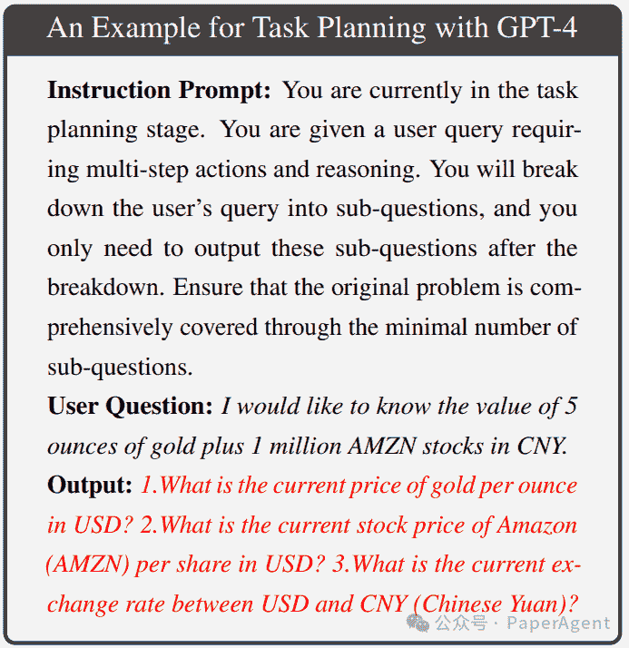
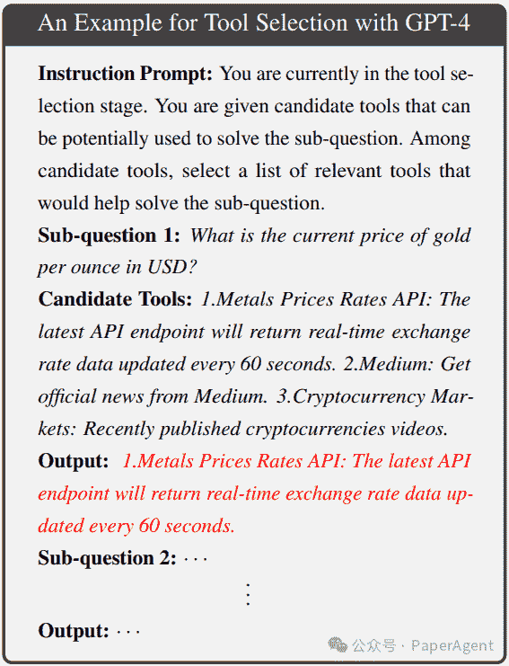
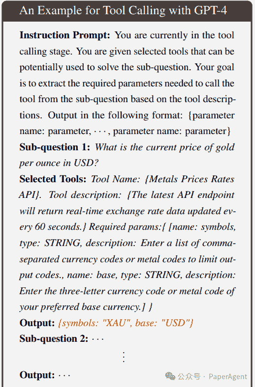
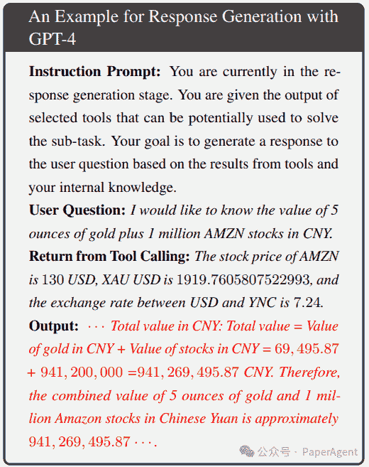
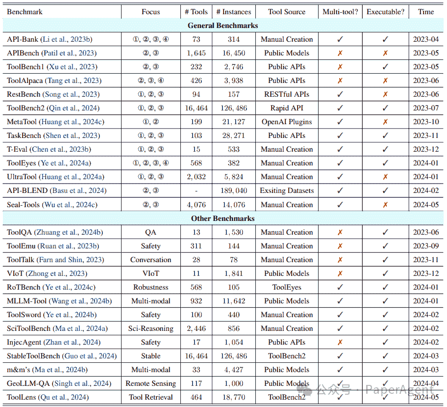

# 一篇大模型Agent工具使用全面研究综述

> 来源：[https://agijuejin.feishu.cn/docx/EQXsdo1nNoO1V8xiEVdc1Gz5n4g](https://agijuejin.feishu.cn/docx/EQXsdo1nNoO1V8xiEVdc1Gz5n4g)

> 作者：PaperAgent

> 原文：https://mp.weixin.qq.com/s/pPkrHHkmVC29e_c2U8YEGg

**使用大型语**言模型（LLMs）进行 工**具学习 已成为增强**LLMs能力以 解决高度复杂问题 **的一个有希望的范式。尽管**这一领域受**到越来越多的关注和**快速发展，但现有的 文献仍然分散，缺乏系统性的组织 ，**为新来者设置了进入障碍。因此对**LL**Ms工具学**习方面的现有工作进行全面调查，从两个主要方面展开：（1） 为什么工具学习是有益的 ；（2） 如何实现工具学习 ，以全面理解LLMs的工具学习。根据工具学习工作流程中的四个关键阶段对文献进行了系统性审查： 任务规划、工具选择、工具调用 和 响应生成 。

图1： 工具学习发展轨迹的示意图。 展示了按出版年份和会议统计的论文，每个会议由一**种**独特的颜色表示。对于每个时间段，选择了一些对领域有重大贡献的代表性里程碑研究。（使用第一作者的机构作为代表机构）



**图2：总体研究结构框架**



## **为什么工具学习是有益的？**

**一方面，将工具整合到L**LMs中可以 增强多个领域内的能力 ，即知识获取、专业技能提升、自动化与效率以及交互增强。另一方面，采用工具学习范式可以 增强响应的稳健性和生成过程的透明度 ，从而提高可解释性和用户信任度，以及改善系统的稳健性和适应性

1.  知识获取（Knowledge Acquisition） ：

1.  LLMs 的能力受限于预训练期间学习的知识范围，这些知识是固定的，不能动态更新。

1.  通过集成外部工具，如搜索引擎、数据库和知识图谱、天气或地图工具，LLMs 能够动态获取和整合外部知识，从而提供更准确、与上下文相关的输出。

1.  专业知识增强（Expertise Enhancement） ：

1.  LLMs 在特定领域缺乏专业知识，例如复杂数学计算、编程和科学问题解决。

1.  通过使用在线计算器、数学工具、Python解释器等工具，LLMs 能够执行复杂计算、解决方程式、分析统计数据，从而增强其在专业领域的能力。

1.  自动化和效率（Automation and Efficiency） ：

1.  LLMs 本质上是语言处理器，缺乏独立执行外部操作的能力，如预订会议室或机票。

1.  通过与外部工具集成，LLMs 可以自动化执行任务，如日程安排、设置提醒、过滤电子邮件等，提高实用性和用户交互的效率。

1.  交互增强（Interaction Enhancement） ：

1.  用户查询具有多样性和多模态性，LLMs 在理解不同类型输入时面临挑战。

1.  利用多模态工具和机器翻译工具，LLMs 可以更好地理解和响应更广泛的用户输入，优化对话管理和意图识别。

1.  **增**强的可解释性和用户信任（Enhanced Interpretability and User Trust） ：

1.  当前LLMs的“黑箱”特性导致其决策过程对用户不透明，缺乏可解释性。

1.  通过工具学习，LLMs可以展示决策过程的每一步，增加操作透明度，使用户能够快速识别和理解错误来源，增强对LLMs决策的信任。

1.  **改进的鲁棒性和适应性（Improved Robustnes**s and Adaptability） ：

1.  LLMs 对用户输入非常敏感，微小的变化可能导致响应的大幅变化，显示出缺乏鲁棒性。

1.  集成专用工具可以减少对训练数据中统计模式的依赖，提高对输入扰动的抵抗力和对新环境的适应性。

## **如何实现工具学习？**

图3**： 使**用大型语言模型进行工具**学习的整体**工作流程** 。 **左侧 部分展示了工具学习**的 四**个阶段 ： 任务规划、工具选择、工具调用和响应生成 。 右侧 部分展示了两种工具学习 范式 ： 一步式任务解决的工具学习和迭代式任务解决的工具学习 。



### 任务规划（ Task Planning ）

1.  任务规划的重要性：

1.  任务规划是工具学习过程中的首要阶段，它涉及对用户查询的全面分析，以理解用户意图。

1.  用户的问题往往包含复杂的意图，需要被分解为多个可执行的子问题。

1.  任务规划的步骤：

1.  **任务分解 **：将用户的问题分解为多个子问题，这有助于逐步解决复杂问题。

1.  **依赖关系和执行顺序 **：确定子问题之间的依赖关系以及它们应该被执行的顺序。

1.  任务规划的方法：

1.  无需调整的方法（Tuning-free Methods） ：利用LLMs的内在能力，通过少量示例或零示例提示来实现任务规划。例如，使用CoT（Chain of Thought）或ReACT等框架来引导LLMs逐步思考和规划。

1.  基于调整的方法（Tuning-based Methods） ：通过在特定任务上微调LLMs来提高任务规划能力。例如，Toolformer等方法通过微调来增强LLMs对工具使用的意识和能力。



### 工具选择 （ Tool Selection ）

### **工具选择的重要性： **

+   工具选择是工具学习过程中的关键步骤，它紧接着任务规划阶段。

+   在这个阶段，需要从可用的工具集中选择最合适的工具来解决特定的子问题。

### **工具选择的分类：**

1.  **基于检索器的工具选择（Retriever-ba**sed Tool Selection） ：

+   当工具库庞大时，使用检索器（如TF-IDF、BM25等）来从大量工具中检索出与子问题最相关的前K个工具。

+   这种方法侧重于通过关键词匹配和语义相似性来快速缩小工具选择范围。

1.  **基于LLM的工具选择（LLM-ba**sed Tool Selection） ：

+   当工具数量有限或者在检索阶段已经缩小了工具范围时，可以直接将工具描述和参数列表与用户查询一起提供给LLM。

+   LLM需要根据用户查询和工具描述来选择最合适的工具。

### **工具选择的方法：**

+   无需调整的方法（Tuning-free Methods） ：

+   利用LLMs的上下文学习能力，通过策略性提示来增强工具选择能力。

+   例如，通过链式思维（Chain of Thought）或ReACT框架来引导LLMs进行推理和行动。

+   基于调整的方法（Tuning-based Methods） ：

+   通过在工具学习数据集上微调LLMs的参数来提高工具选择的能力。

+   例如，Toolbench和TRICE等方法通过微调和行为克隆来增强LLMs的工具使用能力。



### 工具调用 （ Tool Calling ）

**工具调用的重要性：**

+   工具调用是工具学习流程中的第三个阶段，它紧跟在工具选择之后。

+   在这个阶段，大型语言模型（LLMs）需要根据所选工具的要求提取用户查询中的必要参数，并调用工具服务器获取数据。

**工具调用的步骤：**

1.  **参数提取 **：LLMs必须能够从用户查询中提取出符合工具描述中指定格式的参数。

1.  **调用工具 **：使用提取的参数向工具服务器发送请求，并接收响应。

**工具调用的方法：**

+   无需调整的方法（Tuning-free Methods） ：

+   利用少量示例或规则方法来指导LLMs识别和提取参数。

+   例如，Reverse Chain方法通过逆向思维选择工具，然后填充所需参数。

+   基于调整的方法（Tuning-based Methods） ：

+   通过微调LLMs的参数来增强工具调用能力，使用特定的优化技术如LoRA。

+   例如，GPT4Tools通过微调开源LLMs来集成工具使用能力。



### 响应生成 （ Response Generation ）

**响应生成的重要性：**

+   响应生成是工具学习流程中的最后一个阶段，它涉及将工具的输出与LLMs的内部知识结合起来，生成对用户的全面响应。

+   此阶段的目标是为用户提供准确、相关且有用的回答。

**响应生成的方法：**

1.  直接插入方法（Direct Insertion Methods） ：

+   在早期工作中，直接将工具的输出插入到生成的响应中。

+   这种方法简单直接，但可能因为工具输出的不可预测性而影响用户体验。

1.  **信息整合方法（Information I**ntegration Methods） ：

+   大多数方法选择将工具的输出作为LLMs的输入上下文，使LLMs能够根据工具提供的信息制定更优质的回答。

+   由于LLMs的上下文长度有限，需要采用不同的策略来处理工具的长输出。

**信息整合的策略：**

+   **简化输出 **：使用预创建的模式或文档来简化长输出。

+   **截断输出 **：将输出截断以适应长度限制，但可能会丢失解决用户查询所需的信息。

+   **压缩信息 **：开发压缩器将长信息压缩成更简洁的格式，保留最有用的信息。

+   **无模式方法 **：动态生成函数以根据指令提取目标输出。



### **工具学习范式 （ Paradigm**s of Tool Learning ）

**工具学习范式：**

1.  **一步任务解决（Tool Learning with One**-step Task Solving） :

+   这种范式涉及到在收到用户问题后，LLMs立即分析用户请求，理解用户意图，并规划出所有需要的子任务来解决问题。

+   在这个过程中，LLMs会直接生成一个基于选定工具返回结果的响应，而不会考虑过程中可能出现的错误或根据工具的反馈调整计划。

1.  **迭代任务解决（Tool Learning with Iter**ative Task Solving） :

+   这种范式允许LLMs与工具进行迭代交互，不预先承诺一个完整的任务计划。

+   相反，它允许基于工具的反馈逐步调整子任务，使LLMs能够一步步地解决问题，并根据工具返回的结果不断完善计划。

+   这种方法增强了LLMs的问题解决能力，因为它允许模型在响应工具反馈时进行适应和学习。

**范式的特点：**

+   规划无反馈（Planning without Feedback） ：在一步任务解决范式中，LLMs在没有反馈的情况下进行规划，这可能导致在面对错误或意外情况时缺乏适应性。

+   规划有反馈（Planning with Feedback） ：在迭代任务解决范式中，LLMs的规划过程包括接收和利用来自工具的反馈，这允许更灵活和动态的问题解决。

## **工具学习评估基准与指标**

### 评估指标（Evaluation）

任务规划评估（Task Planning Evaluation）:

+   工具使用意识（Tool Usage Awareness） ：评估LLMs是否能够准确识别何时需要使用外部工具。

+   **任务规划效果（Effectivenes**s of Task Planning） ：使用通过率（pass rate）或人类评估来衡量任务规划解决查询的有效性。

+   计划精度（Precision of the Plan） ：通过与最优解决方案比较，定量分析LLMs生成的计划的准确性。

工具选择评估（Tool Selection Evaluation）:

+   **召回率（Recall） **：衡量模型选择的前K个工具中有多少是正确的。

+   **归**一化折扣累积增益（NDCG, Normalized Discounted Cumulative Gain） ：不仅考虑正面工具的比例，还考虑它们在列表中的位置。

+   完整性（COMP, Completeness） ：评估前K个选择的工具是否形成了一个相对于真实集合的完整集合。

工具调用评估（Tool Calling Evaluation）:

+   评估LLMs在执行工具调用功能时的有效性，检查输入参数是否符合工具文档中的规定。

### **响应生成评估（Response Gen**eration Evaluation）:

+   评估工具学习最终目标，即提高LLMs解决下游任务的能力。

+   使用诸如ROUGE-L、精确匹配（Exact Match）、F1分数等指标来评估最终响应的质量。

图4： 不同基准测试及其具体配置的详细列表 。符号①、②、③**和**④分别代表工具学习的四个阶段——任务规划、工具选择、工具调用和响应生成。



```
Tool Learning with Large Language Models: A Survey
https://arxiv.org/pdf/2405.17935
https://github.com/quchangle1/LLM-Tool-Survey
```

**推荐阅读**

+   • 对齐LLM偏好的直接偏好优化方法：DPO、IPO、KTO

+   • 2024：ToB、Agent、多模态

+   • TA们的RAG真正投产了吗？（上）

+   • [A](http://mp.weixin.qq.com/s?__biz=Mzk0MTYzMzMxMA==&mid=2247485322&idx=1&sn=71ffb345fca514aa5ce2848cb2c9f071&chksm=c2ce3dfbf5b9b4edd5b98e45c6179890bdea748fb5220636d25f42006954ea5c81afa8735725&scene=21#wechat_redirect)gent到多模态Agent再到多模态Multi-Agents系统的发展与案例讲解（1.2万字，20+文献，27张图）

---

欢迎关注我的公众号“ **PaperAgent **”， 每天一篇大模型（LLM）文章来锻炼我们的思维，简单的例子，不简单的方法，提升自己。